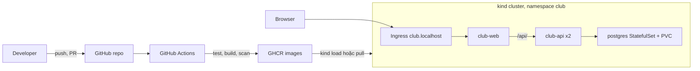
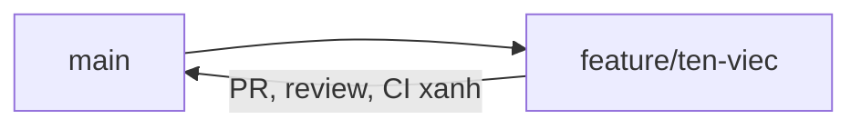

# Capstone – Build and Deploy a Club Management System

> **Tóm tắt:** Nhóm 3–4 người, 2 tuần (buổi 29–32), biến `starter-project/` thành một hệ thống quản lý thành viên CLB hoàn chỉnh: có CRUD, chạy bằng Compose, có CI/CD lên GHCR, triển khai trên kind và bảo vệ kỹ thuật trước mentor.

Tài liệu liên quan trong bộ Capstone:

- [Milestones theo buổi 29–32](milestones.md)
- [Hướng dẫn demo và bảo vệ kỹ thuật](demo-guide.md)
- [Rubric chấm điểm 100 điểm](../../curriculum/capstone-rubric.md)
- [Template peer review](../../templates/peer-review-template.md) và [template ADR](../../templates/adr-template.md)
- [Template báo cáo dự án](../../templates/project-template.md)

## 1. Đề bài

CLB cần một hệ thống nhỏ để quản lý danh sách thành viên. Nhiệm vụ của nhóm không chỉ là "làm cho app chạy" mà là **đưa app từ source code tới môi trường chạy được, lặp lại được, giải thích được**:

1. Hoàn thiện API (thêm, sửa, xóa thành viên) và giao diện web đơn giản.
2. Đóng gói bằng Docker, chạy toàn stack bằng Docker Compose.
3. Tự động hóa test, build, publish image bằng GitHub Actions và GHCR.
4. Triển khai lên cluster kind local bằng manifest Kubernetes có ConfigMap, Secret, PVC, probes.
5. Chứng minh khả năng vận hành: xem log, xử lý ít nhất ba sự cố có chủ đích, scale backend.
6. Trình bày và bảo vệ các quyết định kỹ thuật.

Mọi thứ chạy local trên Windows 11 + WSL2 Ubuntu. Không expose máy cá nhân ra Internet.

## 2. Kiến trúc mục tiêu



Nhóm phải vẽ lại sơ đồ này theo đúng hệ thống của mình (thêm những thành phần nhóm tự bổ sung) trong README của repo nhóm.

## 3. Yêu cầu chức năng

| Mã | Yêu cầu | Chấp nhận khi |
| --- | --- | --- |
| F1 | Xem danh sách thành viên: `GET /api/members` | Trả JSON, có dữ liệu mẫu |
| F2 | Xem một thành viên: `GET /api/members/:id` | 200 khi có, 404 khi không có |
| F3 | Thêm thành viên: `POST /api/members` | 201, kiểm tra dữ liệu đầu vào, 400 khi sai |
| F4 | Sửa thành viên: `PUT /api/members/:id` | 200 khi thành công, 404 khi không có |
| F5 | Xóa thành viên: `DELETE /api/members/:id` | 204 khi thành công, 404 khi không có |
| F6 | Health check: `GET /health` và `GET /ready` | `/ready` trả lỗi khi mất kết nối DB |
| F7 | Giao diện web | Xem, thêm, xóa thành viên qua form, gọi API qua `/api/` |
| F8 | Dữ liệu bền vững | Recreate container/Pod không làm mất dữ liệu |

Thông tin tối thiểu của một thành viên: theo bảng `members` trong `database/init.sql` của starter project (đọc file này trước khi thiết kế API). Nhóm được phép thêm trường nếu cập nhật `init.sql`, API, test và tài liệu cùng lúc.

Có ít nhất 5 test tự động cho backend (CRUD, trường hợp lỗi), chạy được bằng `npm test` mà không cần database thật (mock hoặc tách tầng truy cập dữ liệu).

## 4. Yêu cầu kỹ thuật

| Mảng | Yêu cầu bắt buộc |
| --- | --- |
| Git | Nhánh `main` được bảo vệ, mọi thay đổi qua PR, ít nhất 1 reviewer duyệt, commit message rõ nghĩa |
| Docker | Dockerfile multi-stage cho backend, chạy bằng user không phải root, có `.dockerignore`, image pin phiên bản |
| Compose | Một lệnh `docker compose up -d --build` chạy toàn stack, có healthcheck, volume cho PostgreSQL, secret qua `.env` |
| CI | Workflow chạy khi mở PR: cài dependency, test, kiểm tra build image, validate compose |
| CD | Khi merge vào `main` hoặc tag: build và publish image lên GHCR với tag truy vết được (SHA hoặc semver), không dùng `latest` làm tag duy nhất |
| Kubernetes | Deployment, Service, ConfigMap, Secret, StatefulSet hoặc PVC cho PostgreSQL, Ingress, liveness/readiness probe, resource requests và limits |
| Vận hành | Có runbook ngắn: xem log, xem events, rollout, rollback, scale |
| Bảo mật | Không có secret trong Git, quét image bằng công cụ nhóm chọn (ví dụ Trivy), quyền tối thiểu cho workflow (`permissions`) |
| Tài liệu | README chạy từ đầu, architecture diagram, ít nhất 3 ADR, troubleshooting log |

Yêu cầu nâng cao (không bắt buộc, dùng để phân biệt mức Excellent): migration có version, backup và restore PostgreSQL có kiểm chứng, NetworkPolicy, rolling update không downtime kèm bằng chứng, `securityContext` chặt hơn.

## 5. Definition of Done

Capstone chỉ được coi là xong khi **tất cả** mục sau đúng, kiểm chứng được bởi người chưa từng đụng vào repo:

- [ ] Clone repo nhóm trên máy sạch, làm theo README, chạy được bằng Docker Compose
- [ ] Không cần cài PostgreSQL trực tiếp trên máy
- [ ] CRUD hoạt động cả qua API và qua giao diện web
- [ ] Dữ liệu persistent: `docker compose down` rồi `up` không mất dữ liệu
- [ ] CI tự chạy khi tạo PR và chặn merge khi test fail
- [ ] Image được build và publish lên GHCR sau khi merge
- [ ] Kubernetes deployment hoạt động trên kind, truy cập được từ browser
- [ ] Scale được backend từ 2 lên 3 replicas và quay lại, không lỗi
- [ ] Xem log, events và xử lý được lỗi (có troubleshooting log)
- [ ] Không có secret thật trong lịch sử Git
- [ ] README đầy đủ, có architecture diagram, có ADR
- [ ] Mỗi thành viên có đóng góp thể hiện trong lịch sử PR/commit và đã review PR của người khác
- [ ] Có bản ghi demo (video) hoặc script demo đã chạy thử thành công

## 6. Phân công nhóm và review chéo

### Nhóm 4 người

| Vai trò | Phụ trách chính | Reviewer chéo (người duyệt PR) |
| --- | --- | --- |
| A – Backend | API CRUD, validation, test, Dockerfile backend | D |
| B – Frontend | Giao diện, Nginx, Dockerfile frontend | A |
| C – Data và Compose | `init.sql`, Compose, volume, backup/restore | B |
| D – CI/CD và Kubernetes | Workflows, GHCR, manifests kind | C |

Vòng duyệt A → D → C → B → A đảm bảo mỗi người đọc code của một mảng khác chuyên môn mình. Ở bảng trên, cột reviewer cho biết ai duyệt PR của vai trò đó (A do D duyệt, B do A duyệt, C do B duyệt, D do C duyệt).

### Nhóm 3 người

Gộp hai vai trò gần nhau, nhưng giữ nguyên vòng review:

| Vai trò | Phụ trách chính | Reviewer chéo |
| --- | --- | --- |
| A – Backend và Frontend | API, test, giao diện, hai Dockerfile | C |
| B – Data, Compose và bảo mật | `init.sql`, Compose, secret, quét image, backup/restore | A |
| C – CI/CD và Kubernetes | Workflows, GHCR, manifests kind, runbook | B |

Nhóm 3 người được miễn yêu cầu nâng cao nhưng vẫn phải đạt toàn bộ Definition of Done.

### Quy tắc chung về vai trò

- "Phụ trách chính" nghĩa là chịu trách nhiệm kết quả, không phải làm một mình. Ai cũng phải giải thích được toàn hệ thống khi bảo vệ.
- Từ buổi 31, các thành viên đổi vai ít nhất một lần trong lúc gỡ lỗi để người phụ trách mảng khác thử tự xử lý sự cố.
- Mỗi thành viên nộp một bản [peer review](../../templates/peer-review-template.md) vào cuối buổi 32.

## 7. Git workflow cho nhóm

Dùng trunk-based đơn giản với nhánh ngắn hạn:



Quy tắc:

1. Không push trực tiếp lên `main`. Bật branch protection (hoặc ruleset): yêu cầu PR, yêu cầu 1 approval, yêu cầu status check `test` pass. Với repo cá nhân miễn phí, nếu tính năng này không khả dụng thì nhóm cam kết quy ước và mentor kiểm tra qua lịch sử.
2. Đặt tên nhánh: `feature/api-delete-member`, `fix/compose-healthcheck`, `docs/readme-architecture`, `ci/publish-ghcr`.
3. Mỗi PR nhỏ (khoảng dưới 300 dòng thay đổi), gắn với một Issue (`Closes #12` trong mô tả PR).
4. Commit message theo dạng động từ + đối tượng, ví dụ `Add DELETE /api/members/:id`. Không commit kiểu `fix`, `update`.
5. Người mở PR không tự merge khi chưa có approval của reviewer chéo. Dùng Squash and merge để lịch sử `main` gọn.
6. Xung đột: người mở PR rebase hoặc merge `main` vào nhánh của mình và tự giải quyết xung đột.
7. Không bao giờ commit `.env`, file kubeconfig, token. Kiểm tra `.gitignore` ngay từ buổi 29.
8. Release: gắn tag `v1.0.0` trên `main` khi sẵn sàng demo, để workflow publish tạo image có tag phiên bản.

Mẫu mô tả PR (đặt trong `.github/pull_request_template.md` của repo nhóm):

```markdown
## Thay đổi gì và vì sao

## Cách kiểm tra
- [ ] Đã chạy test
- [ ] Đã chạy thử bằng Compose hoặc kind
- [ ] Đã cập nhật tài liệu nếu cần

Closes #
```

## 8. Dùng GitHub Projects

1. Tạo một Project (kiểu Board) trong tài khoản hoặc tổ chức của trưởng nhóm, liên kết với repo nhóm.
2. Cột (trường Status): `Backlog`, `Ready`, `In progress`, `In review`, `Done`.
3. Thêm trường tùy chỉnh: `Milestone` (M1 đến M4 theo [milestones](milestones.md)), `Owner`, `Size` (S, M, L).
4. Mỗi yêu cầu F1–F8 và mỗi mục Definition of Done chuyển thành ít nhất một Issue. Issue có tiêu chí hoàn thành dạng checklist.
5. Khi mở PR, liên kết Issue để thẻ tự chuyển sang `Done` lúc merge.
6. Đầu mỗi buổi dùng 15 phút đầu để rà bảng, cập nhật trạng thái, nêu blocker. Bảng là bằng chứng lập kế hoạch cho mentor.
7. Giới hạn WIP: mỗi người tối đa 2 thẻ `In progress`.

## 9. Cấu trúc repo nhóm đề xuất

Tạo repo nhóm từ nội dung `starter-project/`, đặt ở gốc repo:

```text
club-management/
├── .github/
│   ├── workflows/
│   │   ├── ci.yml
│   │   └── publish.yml
│   └── pull_request_template.md
├── backend/
│   ├── app.js, server.js, db.js
│   ├── tests/
│   ├── Dockerfile
│   └── .dockerignore
├── frontend/
│   ├── index.html
│   ├── Dockerfile
│   └── nginx.conf
├── database/
│   └── init.sql
├── k8s/
│   ├── kind-config.yaml
│   ├── namespace.yaml
│   ├── configmap.yaml
│   ├── secret.example.yaml
│   ├── postgres.yaml
│   ├── backend.yaml
│   ├── frontend.yaml
│   └── ingress.yaml
├── docs/
│   ├── adr/
│   ├── runbook.md
│   └── troubleshooting-log.md
├── compose.yaml
├── .env.example
├── .gitignore
└── README.md
```

Lưu ý: nếu nhóm giữ `starter-project/` làm thư mục con thì phải sửa đường dẫn trong workflow (`working-directory`, `context`) cho khớp. Tên file trong `frontend/` có thể khác tùy starter project, hãy đối chiếu với thư mục thật.

## 10. Yêu cầu README và architecture diagram

README của repo nhóm phải cho phép một người lạ chạy được trong 15 phút. Mục bắt buộc:

1. Giới thiệu hệ thống (3–5 câu) và danh sách thành viên kèm vai trò.
2. Architecture diagram bằng `mermaid`, thể hiện: luồng từ developer qua CI tới GHCR, các thành phần trong cluster, luồng request của người dùng, nơi lưu dữ liệu.
3. Yêu cầu trước khi chạy (Docker Desktop, WSL2, kind, kubectl) kèm phiên bản đã dùng.
4. Chạy bằng Compose: các lệnh, kết quả mong đợi, cách kiểm tra `/health`.
5. Triển khai lên kind: các lệnh theo thứ tự, cách truy cập, cách kiểm tra.
6. Mô tả pipeline CI/CD (sơ đồ hoặc bảng job và điều kiện kích hoạt).
7. Cấu hình và secret: bảng biến môi trường, nhắc rõ không commit `.env`.
8. Runbook: xem log, events, rollout restart, rollback, scale.
9. Troubleshooting log: tối thiểu 3 sự cố thật (triệu chứng, nguyên nhân gốc, cách xác minh, cách sửa, cách phòng tránh).
10. Liên kết tới các ADR (dùng [template ADR](../../templates/adr-template.md)) và tới bản demo.

## 11. Ghi lại demo

- Quay video 8–10 phút (OBS Studio hoặc Xbox Game Bar trên Windows 11), có giọng thuyết minh, màn hình đọc được (cỡ chữ terminal tối thiểu 16).
- Nội dung theo kịch bản trong [Hướng dẫn demo](demo-guide.md). Video là phương án dự phòng khi demo trực tiếp gặp sự cố.
- Không để lộ token, mật khẩu, thông tin cá nhân trong video. Kiểm tra lại trước khi nộp.
- Nộp liên kết video (chế độ không công khai hoặc kênh nội bộ CLB) trong README repo nhóm, hoặc theo cách mentor yêu cầu.

## 12. Cách chấm và điều kiện đạt

- Điểm Final Project tính theo [Rubric Capstone](../../curriculum/capstone-rubric.md), tổng 100 điểm, chiếm 30% điểm khóa học (xem [Đánh giá khóa học](../../curriculum/assessment.md)).
- Điều kiện đạt: Final Project tối thiểu 60/100.
- Điểm nhóm được điều chỉnh thành điểm cá nhân dựa trên đóng góp (PR, commit, review, buổi bảo vệ). Chi tiết ở rubric.

## 13. Lỗi thường gặp ở Capstone

- Dồn mọi việc vào tuần cuối nên không còn thời gian cho buổi 31 (kiểm thử và gỡ lỗi).
- Một người làm hết, các bạn khác chỉ quan sát: lịch sử Git và buổi hỏi đáp sẽ lộ ra.
- Chạy được trên máy một người nhưng không ai khác chạy lại được: thiếu `.env.example`, phụ thuộc cài đặt tay.
- Commit nhầm secret: phải xoay (đổi) secret ngay, xóa khỏi lịch sử là chưa đủ.
- Viết README sau cùng trong 10 phút: hãy cập nhật README trong mỗi PR.
