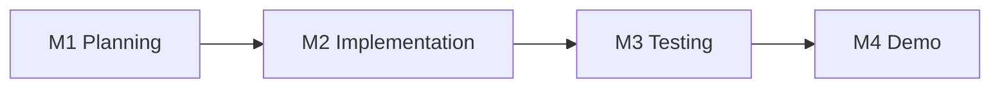

# Capstone – Milestones buổi 29–32

> **Tóm tắt:** Bốn mốc M1–M4 gắn với bốn buổi cuối của khóa. Mỗi mốc có deliverable cụ thể, cách kiểm tra và dấu hiệu nhóm đang chậm tiến độ.

Quay lại [đề bài Capstone](README.md). Rubric chấm điểm: [Rubric Capstone](../../curriculum/capstone-rubric.md).

## Tổng quan

| Mốc | Buổi | Chủ đề | Kết quả cuối buổi |
| --- | --- | --- | --- |
| M1 | 29 | Architecture và Planning | Repo nhóm, Project board, kiến trúc, ADR, backlog |
| M2 | 30 | Implementation | CRUD + giao diện + Compose + CI chạy được, image publish được |
| M3 | 31 | Testing và Troubleshooting | Chạy trên kind, vượt qua kiểm thử, gỡ lỗi có ghi nhận |
| M4 | 32 | Final Demo và Review | Demo 10 phút, hỏi đáp 5 phút, peer review |

Giữa các buổi, nhóm làm việc ngoài giờ theo backlog. Ước lượng khối lượng: khoảng 3–4 giờ mỗi người mỗi tuần ngoài buổi học.



## M1 – Buổi 29: Architecture và Planning

**Mục tiêu:** cả nhóm hiểu cùng một bức tranh và có kế hoạch kiểm chứng được.

### Deliverable

| Deliverable | Chi tiết | Nơi nộp |
| --- | --- | --- |
| Repo nhóm | Tạo từ `starter-project/`, có `.gitignore` chặn `.env`, README khung | GitHub |
| Branch protection | Bật quy tắc PR + approval (nếu khả dụng) | Settings của repo |
| Project board | Cột Status, trường Milestone/Owner/Size, mỗi F1–F8 và mục DoD có Issue | GitHub Projects |
| Architecture diagram | Mermaid trong README, đủ luồng CI/CD, cluster, dữ liệu | `README.md` |
| ADR | Ít nhất 3 ADR (ví dụ: chọn chiến lược tag image, cách lưu PostgreSQL trên k8s, cách truy cập từ ngoài cluster) | `docs/adr/` |
| Phân vai | Bảng vai trò, vòng reviewer chéo | `README.md` |
| Quy ước | Quy tắc nhánh, commit, PR template | `CONTRIBUTING.md` hoặc README |

### Cách kiểm tra

```bash
git clone git@github.com:ORG/club-management.git
cd club-management
git log --oneline | head
cat .gitignore | grep -n env
ls docs/adr
```

- [ ] Mỗi thành viên đã có ít nhất một commit hoặc PR đầu tiên (ví dụ sửa README, thêm ADR)
- [ ] Tất cả Issue có Owner và Milestone
- [ ] Nhóm trình bày kiến trúc 3 phút cho mentor cuối buổi

### Dấu hiệu chậm tiến độ

Chưa có repo chung, chưa ai biết mình review PR của ai, backlog chỉ là danh sách công cụ mà không có tiêu chí hoàn thành.

## M2 – Buổi 30: Implementation

**Mục tiêu:** có phiên bản chạy được từ đầu đến cuối trên Compose, CI xanh, image publish thành công.

### Deliverable

| Deliverable | Chi tiết |
| --- | --- |
| API CRUD | `POST`, `PUT`, `DELETE`, `GET /api/members/:id` có validation và mã trạng thái đúng |
| Test | Ít nhất 5 test, chạy bằng `npm test`, chạy trong CI |
| Frontend | Hiển thị danh sách, thêm, xóa thành viên qua `/api/` |
| Compose | `docker compose up -d --build` chạy toàn stack, healthcheck, volume PostgreSQL |
| CI | Workflow chạy trên PR: test + validate compose + build thử image |
| Publish | Workflow publish image lên GHCR khi merge vào `main` |
| PR | Ít nhất 4 PR đã merge, mỗi người có ít nhất 1 PR và 1 review |

### Cách kiểm tra

```bash
cp .env.example .env
docker compose up -d --build
docker compose ps
curl -i http://localhost:3000/health
curl -i -X POST http://localhost:3000/api/members \
  -H "Content-Type: application/json" \
  -d '{"name":"Test User","email":"test.user@example.com"}'
curl -s http://localhost:3000/api/members
```

Kết quả mong đợi (rút gọn):

```text
HTTP/1.1 200 OK
...
HTTP/1.1 201 Created
...
[{"id":1,"name":"Alice",...},{"id":2,"name":"Bob",...},{"id":3,"name":"Test User",...}]
```

Nếu nhóm đổi tên trường hoặc bỏ cổng publish 3000 của backend thì điều chỉnh lệnh cho khớp thiết kế.

- [ ] `docker compose down` rồi `docker compose up -d` vẫn còn thành viên vừa thêm
- [ ] Tab Actions của repo có ít nhất một lần chạy CI xanh trên PR
- [ ] Trang Packages của repo hoặc tài khoản có image `club-api` và `club-web`

### Dấu hiệu chậm tiến độ

Còn thiếu quá hai endpoint, CI chưa chạy lần nào, chỉ một người push code. Mentor yêu cầu nhóm cắt bớt phần nâng cao và tập trung vào Definition of Done.

## M3 – Buổi 31: Testing và Troubleshooting

**Mục tiêu:** hệ thống chạy trên kind, được kiểm thử có chủ đích và có bằng chứng gỡ lỗi.

### Deliverable

| Deliverable | Chi tiết |
| --- | --- |
| Triển khai kind | Cluster, namespace `club`, ConfigMap, Secret (tạo tay, không commit), PostgreSQL + PVC, backend, frontend, Ingress hoặc port-forward |
| Probes và resources | Liveness và readiness probe, requests/limits cho backend |
| Scale | Scale backend 2 → 3 → 2, ghi lại lệnh và kết quả |
| Failure injection | Thực hiện ít nhất 3 sự cố có chủ đích (ví dụ: xóa Pod backend, sai tag image, sai mật khẩu DB, readiness fail) |
| Troubleshooting log | Với mỗi sự cố: triệu chứng, nguyên nhân gốc, cách xác minh, cách sửa, cách phòng tránh |
| Runbook | `docs/runbook.md`: log, events, rollout restart, rollback, scale |
| Security | Quét image, kiểm tra không có secret trong Git, `permissions` tối thiểu trong workflow |

### Cách kiểm tra

```bash
kubectl get pods -n club
kubectl get svc,ingress -n club
kubectl scale deployment club-api -n club --replicas=3
kubectl rollout status deployment/club-api -n club
kubectl scale deployment club-api -n club --replicas=2
kubectl get events -n club --sort-by=.lastTimestamp | tail
```

Kết quả mong đợi (rút gọn):

```text
NAME                        READY   STATUS    RESTARTS   AGE
club-api-xxxxxxxxxx-aaaaa   1/1     Running   0          5m
club-api-xxxxxxxxxx-bbbbb   1/1     Running   0          5m
club-web-xxxxxxxxxx-ccccc   1/1     Running   0          5m
postgres-0                  1/1     Running   0          6m
```

Tên Deployment và Service lấy từ manifest của nhóm, đối chiếu với `k8s/` trong repo nhóm.

- [ ] Xóa một Pod backend, hệ thống vẫn trả lời, Pod mới tự được tạo
- [ ] Xóa Pod `postgres-0`, dữ liệu thành viên vẫn còn sau khi Pod chạy lại
- [ ] Troubleshooting log có tối thiểu 3 mục đầy đủ 5 phần
- [ ] Mentor đổi vai: một thành viên khác xử lý một sự cố do mentor tạo

### Dấu hiệu chậm tiến độ

Chưa chạy được trên kind khi còn 30 phút cuối buổi. Khi đó ưu tiên đưa lên kind phiên bản tối giản (backend + PostgreSQL), sau đó bổ sung frontend.

## M4 – Buổi 32: Final Demo và Review

**Mục tiêu:** trình bày, bảo vệ và rút kinh nghiệm.

### Deliverable

| Deliverable | Chi tiết |
| --- | --- |
| Tag phát hành | Tag `v1.0.0` trên `main`, image có tag tương ứng trên GHCR |
| README hoàn chỉnh | Đủ 10 mục theo [đề bài](README.md) |
| Demo | 10 phút demo + 5 phút hỏi đáp theo [Hướng dẫn demo](demo-guide.md) |
| Video dự phòng | Bản ghi demo hoặc script demo đã chạy thử |
| Peer review | Mỗi thành viên nộp [peer review](../../templates/peer-review-template.md) cho các bạn cùng nhóm |
| Báo cáo | Hoàn thiện theo [template dự án](../../templates/project-template.md) |

### Lịch gợi ý buổi 32 (120 phút, tối đa 5 nhóm)

| Thời lượng | Hoạt động |
| --- | --- |
| 15' | Nhóm chạy thử lần cuối, kiểm tra môi trường |
| 75' | Các nhóm demo lần lượt (mỗi nhóm 15': 10' demo + 5' hỏi đáp) |
| 15' | Mentor tổng kết, nêu nhận xét chung |
| 15' | Peer review và retrospective cá nhân |

Nếu có hơn 5 nhóm, mentor chia thành hai phòng hoặc tách thêm một buổi.

### Cách kiểm tra trước demo

```bash
git status
git log --oneline --decorate | head
docker compose config --quiet && echo compose-ok
kubectl get pods -n club
```

- [ ] Repo ở trạng thái sạch, tag `v1.0.0` đã được đẩy lên GitHub
- [ ] Đã chạy thử toàn bộ kịch bản demo ít nhất một lần
- [ ] Mỗi thành viên biết phần nào mình sẽ nói

## Bảng theo dõi tiến độ nhóm

Mentor dùng bảng này ở đầu mỗi buổi để biết nhóm cần hỗ trợ gì.

| Mốc | Đạt | Cần hỗ trợ | Ghi chú |
| --- | --- | --- | --- |
| M1 | [ ] | [ ] | |
| M2 | [ ] | [ ] | |
| M3 | [ ] | [ ] | |
| M4 | [ ] | [ ] | |
