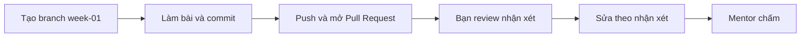

# Bài tập tuần 1 – DevOps Workflow & Dev Environment

> **Tóm tắt:** Phân tích một quy trình triển khai thủ công, vẽ lại thành workflow tự động bằng Mermaid, dựng môi trường WSL2 Ubuntu + Git + SSH và chứng minh môi trường chạy được bằng script cùng log thật.

**Hạn nộp:** trước buổi đầu tiên của tuần 02.
**Hình thức:** Pull Request vào repo cá nhân `devops-labs`, thư mục `lab-01/` và `lab-02/`.
**Bài lab liên quan:** [Buổi 01 – DevOps Introduction](../../labs/week-01/session-01.md), [Buổi 02 – Development Environment](../../labs/week-01/session-02.md).
**Mẫu nộp bài:** [templates/lab-template.md](../../templates/lab-template.md).

## Bối cảnh

Tuần này bạn làm hai việc nối tiếp nhau. Thứ nhất, bạn học cách nhìn một quy trình triển khai như một chuỗi bước có người làm, đầu vào và đầu ra, rồi tìm ra bước nào đang gây đau nhất. Thứ hai, bạn dựng môi trường làm việc chuẩn (Ubuntu trên WSL2) mà toàn bộ 15 tuần sau đều dùng.

Tình huống xuyên suốt: ứng dụng Club Management của CLB gồm frontend (Nginx), backend (Node.js, cổng 3000) và database (PostgreSQL). Hiện tại việc đưa ứng dụng lên server chung được làm tay: nén thư mục, gửi qua chat, giải nén, cài dependency, đặt biến môi trường, chạy. Nhiệm vụ của bạn là chỉ ra chỗ hỏng của cách làm đó và chuẩn bị máy để từ tuần sau bắt đầu sửa nó.

Bài tập này chỉ dùng kiến thức đã học ở Buổi 01 và Buổi 02. Nếu bị kẹt, đọc lại phần "Lỗi thường gặp" và "Phá lỗi và debug" của hai bài lab trước khi hỏi mentor.

## Nhiệm vụ L1 (bắt buộc)

### Nhiệm vụ 1. Bảng các bước triển khai thủ công

Lập file `lab-01/source/steps.md` mô tả quy trình triển khai thủ công của ứng dụng Club Management.

Tiêu chí hoàn thành:

- Bảng Markdown có tối thiểu 9 dòng bước (không tính dòng tiêu đề và dòng phân cách).
- Mỗi dòng có đủ các cột: Bước, Ai làm, Đầu vào, Đầu ra, Rủi ro, Tự động hóa được không.
- Các bước bắt buộc phải xuất hiện: commit, build, test, đóng gói, gửi lên server, cấu hình biến môi trường (ví dụ `DB_PASSWORD`), chạy ứng dụng, kiểm tra `/health`.
- Không có ô nào để trống hoặc ghi chung chung như "tùy". Cột Rủi ro nêu một lỗi cụ thể có thể xảy ra ở bước đó.

### Nhiệm vụ 2. Sơ đồ workflow thủ công và 3 điểm nghẽn

Vẽ sơ đồ Mermaid từ bảng ở Nhiệm vụ 1, rồi chọn ra đúng 3 điểm nghẽn.

Tiêu chí hoàn thành:

- `lab-01/source/manual-workflow.mmd` hiển thị được trên mermaid.live, có ít nhất một vòng lặp lỗi (bước lỗi quay về bước trước), mọi nhãn đặt trong dấu nháy kép.
- Tên nút cho biết ai làm (ví dụ tiền tố `Dev:` hoặc `Ops:`).
- `lab-01/source/bottlenecks.md` nêu đúng 3 điểm nghẽn. Mỗi điểm có ba phần: bước nào, vì sao nghẽn (dùng một trong bốn dấu hiệu của bài lab: phụ thuộc trí nhớ một người, chờ người khác, dễ sai khi làm tay, lặp lại nhiều), và hướng tự động hóa dự kiến.
- 3 điểm nghẽn phải truy ngược được về các dòng trong `steps.md` (ghi số bước).

### Nhiệm vụ 3. Sơ đồ workflow tự động hóa

Vẽ workflow mới trong đó mỗi điểm nghẽn ở Nhiệm vụ 2 được thay bằng một bước tự động.

Tiêu chí hoàn thành:

- `lab-01/source/automated-workflow.mmd` hiển thị được trên mermaid.live.
- Có đủ các bước: push code, CI build và test, cổng kiểm thử có nhánh "không đạt" quay về dev, đóng gói image, lưu vào registry có phiên bản, deploy từ file cấu hình, health check.
- Có thêm ít nhất một bước do bạn tự bổ sung (ví dụ rollback hoặc thông báo cho nhóm) và nói rõ trong `report.md` vì sao cần bước đó.
- Trong `report.md`, có một bảng ánh xạ: mỗi điểm nghẽn tương ứng nút nào trong sơ đồ mới.

### Nhiệm vụ 4. Dựng môi trường WSL2 + Git + SSH

Hoàn thành phần cài đặt của Buổi 02 trên máy của bạn.

Tiêu chí hoàn thành:

- `wsl --list --verbose` cho thấy distro Ubuntu có VERSION 2 (dán output từ PowerShell vào evidence).
- Thư mục làm việc `~/devops-labs` nằm trong filesystem Linux, không nằm trong `/mnt/c`. Evidence phải có output của `pwd` hoặc `realpath` chứng minh điều này.
- `git config --global --list` có `user.name`, `user.email` thật của bạn và `core.autocrlf=input`.
- `ssh -T git@github.com` báo xác thực thành công với username GitHub của bạn.
- Repo `devops-labs` có remote `origin` dạng `git@github.com:...` (output của `git remote -v`).
- Không có private key hay token nào trong repo.

### Nhiệm vụ 5. Script kiểm tra môi trường và log thật

Viết và chạy `lab-02/source/check-env.sh`.

Tiêu chí hoàn thành:

- Script kiểm tra tối thiểu `git`, `curl`, `ssh`, `docker` và cảnh báo khi đang đứng trong `/mnt/*`.
- File có quyền thực thi, dòng đầu là shebang, xuống dòng kiểu LF (lệnh `file` không báo "CRLF").
- Chạy script bằng lệnh, lưu cả output lẫn mã thoát vào `lab-02/evidence/command-output.txt` (dòng `exit code: N` ở cuối phần chạy script).
- Nếu `docker` chưa cài, script phải báo THIEU và mã thoát khác 0. Điều này chấp nhận được ở tuần này, nhưng bạn phải ghi vào `report.md` rằng đây là trạng thái dự kiến và khi nào nó sẽ thành 0.

## Nhiệm vụ L2 (nâng cao)

L2 là điểm thưởng, chỉ chấm khi L1 đã đạt từ 60 điểm trở lên.

### Thử thách A. Đề xuất DevOps workflow cho một dự án CLB thật

Chọn một dự án có thật (website CLB, bot Discord, ứng dụng điểm danh, ...) và viết `lab-01/source/proposal.md`.

Tiêu chí hoàn thành:

- Có hai sơ đồ Mermaid: workflow hiện tại và workflow đề xuất.
- Nêu 3 điểm nghẽn, mỗi điểm có số liệu ước lượng kèm cách bạn ước lượng (ví dụ "deploy tay mất 15 phút, 2 lần mỗi tuần, do bạn tự đo lần gần nhất").
- Mỗi điểm nghẽn có cách tự động hóa, công cụ dự kiến và buổi học trong khóa dạy công cụ đó (tra `curriculum/syllabus.md`).
- Có ít nhất một rủi ro của chính giải pháp tự động hóa và người chịu trách nhiệm khi pipeline hỏng.
- Có 2 chỉ số đo cải thiện, nói rõ cách đo.

### Thử thách B. Script kiểm tra đầy đủ và tự kiểm chứng

Mở rộng `check-env.sh` thành `check-env-full.sh` trong cùng thư mục `source/`.

Tiêu chí hoàn thành:

- Kiểm tra thêm `node`, `npm`, `make`; in dòng tổng kết số vấn đề; thoát khác 0 nếu có vấn đề.
- Kiểm tra quyền của private key SSH phải là 600 và báo lỗi nếu khác.
- Evidence gồm hai lần chạy liên tiếp trong cùng một file log: một lần ở trạng thái đúng và một lần bạn cố tình làm sai (đổi quyền một file key thử nghiệm, không phải key thật đang dùng), kèm mã thoát tương ứng. Ghi rõ cách bạn khôi phục.

### Thử thách C. Dotfiles chạy lặp lại an toàn

Tạo `lab-02/source/dotfiles/` chứa alias của bạn và `install.sh`.

Tiêu chí hoàn thành:

- `install.sh` chạy lần thứ hai không lỗi và không nhân đôi nội dung.
- Không ghi đè file có sẵn khi chưa sao lưu.
- Evidence ghi lại hai lần chạy liên tiếp và kết quả `ls -l` của các symlink.

## Bằng chứng cần nộp

Cấu trúc thư mục theo mẫu lab:

```text
lab-01/
├── README.md
├── report.md
├── source/
│   ├── steps.md
│   ├── manual-workflow.mmd
│   ├── bottlenecks.md
│   ├── automated-workflow.mmd
│   └── proposal.md          (L2, Thử thách A)
├── screenshots/
│   ├── manual-workflow.png
│   └── automated-workflow.png
└── evidence/
    └── command-output.txt
lab-02/
├── README.md
├── report.md
├── source/
│   ├── check-env.sh
│   ├── check-env-full.sh    (L2, Thử thách B)
│   └── dotfiles/            (L2, Thử thách C)
├── screenshots/
│   └── vscode-wsl.png
└── evidence/
    └── command-output.txt
```

Bằng chứng theo từng nhiệm vụ:

| Nhiệm vụ | Bằng chứng bắt buộc |
| --- | --- |
| 1 | `source/steps.md`; `evidence/command-output.txt` có kết quả đếm số dòng bảng (ví dụ `grep -c '^|' lab-01/source/steps.md`, số đếm gồm cả dòng tiêu đề và phân cách) |
| 2 | `manual-workflow.mmd`, `bottlenecks.md`, ảnh `manual-workflow.png` (chỉ chụp phần sơ đồ) |
| 3 | `automated-workflow.mmd`, ảnh `automated-workflow.png`, bảng ánh xạ điểm nghẽn sang nút trong `report.md` |
| 4 | `lab-02/evidence/command-output.txt` chứa output thật của `wsl --list --verbose` (dán tay từ PowerShell), `pwd`, `lsb_release -a`, `git config --global --list`, `git remote -v`, `ssh -T git@github.com`; ảnh `vscode-wsl.png` chỉ bổ trợ |
| 5 | `source/check-env.sh` và log chạy có `exit code:`; kết quả `ls -l` và `file` của script |
| L2 | Theo từng thử thách ở trên |

Nguyên tắc: ảnh chụp màn hình chỉ bổ trợ. Mọi nhiệm vụ phải kiểm chứng được bằng file nguồn và log dạng text để reviewer chạy lại hoặc đọc được. `README.md` của mỗi lab trả lời đủ 7 câu theo mẫu và ghi rõ đã làm L1 hay L2. `report.md` của `lab-01` ghi 3 điểm nghẽn, bảng ánh xạ và bước tự bổ sung; `report.md` của `lab-02` giải thích ngắn về `~` so với `/mnt/c`, về SSH key, và về mã thoát của `check-env.sh`.

Trước khi nộp, tự kiểm tra tệp nhạy cảm bằng lệnh sau (kết quả mong đợi: không in ra dòng nào):

```bash
cd ~/devops-labs
git ls-files | grep -E '(^|/)(id_ed25519|id_rsa|\.env)$'
grep -rIl "BEGIN OPENSSH PRIVATE KEY" . --exclude-dir=.git
```

## Barem chấm

Tổng 100 điểm cho L1, cộng tối đa 10 điểm thưởng cho L2.

| Tiêu chí | Đạt | Không đạt | Điểm |
| --- | --- | --- | --- |
| Nhiệm vụ 1: `steps.md` | Đủ 9 bước trở lên, đủ 6 cột, có đủ 8 bước bắt buộc, rủi ro cụ thể | Thiếu bước hoặc cột, ô trống, rủi ro chung chung | 15 |
| Nhiệm vụ 2: sơ đồ thủ công và điểm nghẽn | Mermaid hiển thị được, có vòng lặp lỗi, nút ghi rõ ai làm; đúng 3 điểm nghẽn có lý do và truy ngược được về `steps.md` | Sơ đồ lỗi cú pháp, không có vòng lặp, điểm nghẽn không có lý do hoặc không khớp bảng | 15 |
| Nhiệm vụ 3: sơ đồ tự động hóa | Đủ các bước bắt buộc, có bước tự bổ sung có giải thích, bảng ánh xạ điểm nghẽn sang nút đầy đủ | Thiếu bước CI/health check, không ánh xạ được | 15 |
| Nhiệm vụ 4: môi trường | Evidence chứng minh WSL2 VERSION 2, làm việc trong `~`, Git và SSH hợp lệ, remote dạng SSH | Thiếu một mục trong evidence hoặc làm việc trong `/mnt/c` | 20 |
| Nhiệm vụ 5: `check-env.sh` | Script chạy lại được, LF, có quyền thực thi, log có mã thoát đúng với trạng thái máy | Script lỗi, log do tự gõ tay, mã thoát sai hoặc không giải thích | 15 |
| `report.md` và `README.md` | Đủ 7 câu mỗi lab, giải thích đúng, ghi rõ mức đã làm | Thiếu câu, sao chép đề bài, không ghi mức | 10 |
| Bằng chứng và kỷ luật repo | Đúng cấu trúc thư mục, evidence là text thật, không có secret, commit message rõ ràng | Sai cấu trúc, evidence chỉ là ảnh, có secret | 5 |
| Quy trình nộp | Có PR, được một bạn review có nhận xét thật | Push thẳng vào `main` hoặc review chỉ ghi "OK" | 5 |
| **Tổng L1** | | | **100** |
| L2: Thử thách A (`proposal.md`) | Đủ 5 tiêu chí, số liệu có cách ước lượng | Thiếu tiêu chí hoặc số liệu bịa không giải thích | +5 |
| L2: Thử thách B và C | Mỗi thử thách đạt đủ tiêu chí và có evidence hai lần chạy | Thiếu evidence hoặc chạy lặp lại bị lỗi | +3 và +2 |
| **Tối đa thưởng** | | | **+10** |

Điểm một tiêu chí được chia theo mức: đạt đủ nhận điểm tối đa, đạt một phần nhận khoảng một nửa, không có hoặc không kiểm chứng được nhận 0.

## Câu hỏi kiểm tra kiến thức

Trả lời ngắn (2-4 câu mỗi câu) trong `lab-01/report.md` (câu 1 đến 3) và `lab-02/report.md` (câu 4 đến 5), bằng lời của bạn.

1. Vì sao nói DevOps không phải một công cụ và cũng không phải một chức danh? Nêu một ví dụ trong quy trình CLB để minh họa.
2. Phân biệt Continuous Delivery và Continuous Deployment. Với ứng dụng CLB, bạn chọn loại nào cho giai đoạn đầu và vì sao?
3. Nhóm của bạn push 12 lần mỗi ngày, mỗi lần deploy tay mất 8 phút. Tính tổng thời gian mỗi tuần (5 ngày) và nêu bước nên tự động hóa trước.
4. Vì sao mã nguồn nên nằm ở `~` thay vì `/mnt/c/Users/...`? Nêu hai hậu quả cụ thể nếu làm ngược lại.
5. `ssh -T git@github.com` báo `Permission denied (publickey)`. Liệt kê ba điểm kiểm tra đầu tiên theo thứ tự bạn sẽ làm và lệnh tương ứng.

## Lỗi hay bị trừ điểm

- Sơ đồ Mermaid có nhãn chứa ngoặc hoặc dấu hai chấm mà không đặt trong dấu nháy kép, khiến sơ đồ không hiển thị.
- `steps.md` chỉ có tên bước, thiếu Ai làm, Đầu vào, Đầu ra; hoặc điểm nghẽn không truy ngược được về bảng.
- Chọn công cụ trước khi nêu điểm nghẽn (ví dụ "dùng Kubernetes" mà không nói vấn đề cần giải).
- Làm việc và clone repo trong `/mnt/c`, hoặc evidence không chứng minh được vị trí làm việc.
- Dán output từ máy khác hoặc tự gõ tay output thay vì chạy lệnh thật; `command-output.txt` rỗng vì quên chuyển hướng.
- Lấy mã thoát sai (dùng `| tee` rồi đọc `$?`), nên log ghi `exit code: 0` trong khi script thật sự thất bại.
- Script có CRLF (`bash\r: No such file or directory`) hoặc thiếu quyền thực thi.
- Commit private key, `.env`, token hoặc ảnh chụp lộ thông tin cá nhân.
- Nộp ảnh chụp thay cho file nguồn và log text.
- Push thẳng vào `main`, không có PR hoặc không có người review.

## Quy trình nộp



1. Tạo branch từ `main` trong repo cá nhân:

```bash
cd ~/devops-labs
git switch main
git switch -c week-01
```

2. Làm bài, commit theo từng nhiệm vụ với message rõ nghĩa (ví dụ `Add lab-01 steps and workflows`).
3. Push branch và mở Pull Request vào `main` của chính repo cá nhân:

```bash
git push -u origin week-01
```

4. Nhờ một bạn trong CLB review. Reviewer để ít nhất 2 nhận xét cụ thể (một điểm tốt, một điểm cần sửa) trên PR. Bạn sửa theo nhận xét hợp lý và trả lời từng nhận xét.
5. Gắn mentor làm reviewer và dán link PR vào kênh nộp bài của lớp. Mentor chấm theo barem trên, không chấm nội dung đẩy sau hạn.

Hạn nộp: trước buổi đầu tiên của tuần 02. Nộp muộn sẽ bị trừ theo quy định trong `curriculum/assessment.md`.

## Checklist trước khi nộp

- [ ] `lab-01/` và `lab-02/` có đúng cấu trúc thư mục, có `README.md` (7 câu), `report.md`, `source/`, `screenshots/`, `evidence/`
- [ ] `steps.md` có tối thiểu 9 bước, đủ 6 cột, không ô trống
- [ ] Ba file `.mmd` hiển thị được trên mermaid.live, mọi nhãn đặt trong dấu nháy kép
- [ ] `bottlenecks.md` có đúng 3 điểm nghẽn, truy ngược được về `steps.md`
- [ ] `report.md` có bảng ánh xạ điểm nghẽn sang nút trong sơ đồ tự động hóa
- [ ] `wsl --list --verbose` (VERSION 2), `pwd`, `lsb_release -a`, `git config --global --list`, `git remote -v`, `ssh -T git@github.com` đều có trong evidence
- [ ] `check-env.sh` chạy lại được, có quyền thực thi, dùng LF, log có dòng `exit code:` đúng
- [ ] 5 câu hỏi kiểm tra kiến thức đã được trả lời trong `report.md`
- [ ] Đã chạy lệnh quét secret ở phần Bằng chứng và không có kết quả
- [ ] Không commit `.env`, password, token, private key
- [ ] Ghi rõ mức đã làm (L1 hoặc L2) cuối `README.md`
- [ ] Đã mở Pull Request, được ít nhất một bạn review, mentor đã được gắn
