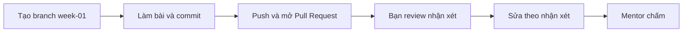

# Bài tập tuần 1 – DevOps Workflow & Dev Environment

> **Tóm tắt:** Nộp lại bằng chứng của hai buổi lab: quy trình triển khai thủ công được vẽ lại thành workflow tự động bằng Mermaid, và môi trường WSL2 Ubuntu + Git + SSH được chứng minh bằng log thật.

**Hạn nộp:** trước buổi đầu tiên của tuần 02.
**Hình thức:** upload hoặc Pull Request vào repo cá nhân `devops-labs` (PUBLIC), thư mục `lab-01/` và `lab-02/`. Buổi 01 chưa học Git nên được upload trên web; từ Buổi 02 nộp bằng Git qua SSH.
**Bài lab liên quan:** [Buổi 01 – DevOps Introduction](../../labs/week-01/session-01.md), [Buổi 02 – Development Environment](../../labs/week-01/session-02.md). Hub tuần: [Hub Tuần 1](../../labs/week-01/README.md).
**Mẫu nộp bài:** [mẫu bài lab](../../templates/lab-template.md).

**Bài tập = nộp lại bằng chứng của lab, không có việc mới**, trừ hai việc viết nhỏ trong `report.md`: bảng ánh xạ điểm nghẽn sang nút (Nhiệm vụ 3) và trả lời 5 câu kiểm tra kiến thức ở cuối trang.

| Nhiệm vụ | Làm ở Phần nào của lab | Giờ ước lượng | Bằng chứng nộp |
| --- | --- | --- | --- |
| 1. Bảng các bước triển khai thủ công | Buổi 01, Phần 1 và Phần 3 | 0,5 giờ | `lab-01/source/steps.md`, kết quả đếm số dòng bảng trong evidence |
| 2. Sơ đồ thủ công và 3 điểm nghẽn | Buổi 01, Phần 2 và Phần 3 | 0,5 giờ | `manual-workflow.mmd`, `bottlenecks.md`, ảnh `manual-workflow.png` |
| 3. Sơ đồ tự động hóa | Buổi 01, Phần 4 (cộng việc mới: bảng ánh xạ trong `report.md`, khoảng 15 phút) | 0,5 giờ | `automated-workflow.mmd`, ảnh `automated-workflow.png`, bảng ánh xạ trong `report.md` |
| 4. Môi trường WSL2 + Git + SSH | Buổi 02, Phần 1, 2, 3, 5 và 6 | 1,5 giờ (60 phút ở lớp, 30 phút ở nhà) | `lab-02/evidence/command-output.txt`, ảnh `vscode-wsl.png` |
| 5. Log `check-env.sh` | Buổi 02, Phần 4 | 0,25 giờ | Log có dòng `exit code:` trong `command-output.txt` |
| README, report và 5 câu kiểm tra | Phần Nộp bài của hai buổi | 0,75 giờ | `README.md` (7 câu), `report.md` ở mỗi lab |
| L2 (tùy chọn, điểm thưởng) | [Buổi 01 – Thử thách thêm](../../labs/week-01/session-01-challenge.md), [Buổi 02 – Thử thách thêm](../../labs/week-01/session-02-challenge.md) | 1,5 giờ | Theo từng thử thách |

Tổng L1 khoảng 4 giờ, trong đó khoảng 2 giờ đã nằm trong giờ lab trên lớp. Kẹt? Đọc phần "Gặp lỗi?" của từng bài lab trước khi hỏi mentor.

## Bối cảnh

Tình huống xuyên suốt: ứng dụng Club Management của CLB gồm frontend (Nginx), backend (Node.js, cổng 3000) và database (PostgreSQL). Việc đưa ứng dụng lên server chung đang làm tay: nén thư mục, gửi qua chat, giải nén, cài dependency, đặt biến môi trường, chạy. Bạn chỉ ra chỗ hỏng của cách làm đó (Buổi 01) và chuẩn bị máy để từ tuần sau bắt đầu sửa nó (Buổi 02).

## Bảng điểm

Tổng 100 điểm cho L1, cộng tối đa 10 điểm thưởng cho L2 (chỉ chấm khi L1 đạt từ 60 điểm).

| Tiêu chí | Điểm |
| --- | --- |
| Nhiệm vụ 1: `steps.md` | 15 |
| Nhiệm vụ 2: sơ đồ thủ công và 3 điểm nghẽn | 15 |
| Nhiệm vụ 3: sơ đồ tự động hóa và bảng ánh xạ | 15 |
| Nhiệm vụ 4: môi trường (WSL2, `~`, Git, SSH) | 20 |
| Nhiệm vụ 5: log `check-env.sh` có `exit code:` đúng | 15 |
| `README.md` và `report.md` | 10 |
| Bằng chứng và kỷ luật repo (không có secret) | 5 |
| Quy trình nộp (PR có người review) | 5 |
| **Tổng L1** | **100** |
| L2: Thử thách A (+5), B (+3), C (+2) | +10 |

Barem chi tiết, lỗi hay bị trừ điểm và cách chấm dành cho mentor nên không đăng ở đây. Bạn chỉ cần bám tiêu chí hoàn thành bên dưới.

## Nhiệm vụ L1 (bắt buộc)

### Nhiệm vụ 1. Bảng các bước triển khai thủ công

Lập `lab-01/source/steps.md` mô tả quy trình triển khai thủ công của ứng dụng Club Management. Tiêu chí hoàn thành:

- Bảng Markdown có tối thiểu 9 dòng bước (không tính dòng tiêu đề và dòng phân cách).
- Mỗi dòng có đủ các cột: Bước, Ai làm, Đầu vào, Đầu ra, Rủi ro, Tự động hóa được không.
- Các bước bắt buộc: commit, build, test, đóng gói, gửi lên server, cấu hình biến môi trường (ví dụ `DB_PASSWORD`), chạy ứng dụng, kiểm tra `/health`.
- Không ô nào để trống hoặc ghi chung chung như "tùy". Cột Rủi ro nêu một lỗi cụ thể có thể xảy ra ở bước đó.

### Nhiệm vụ 2. Sơ đồ workflow thủ công và 3 điểm nghẽn

Tiêu chí hoàn thành:

- `lab-01/source/manual-workflow.mmd` hiển thị được trên mermaid.live, có ít nhất một vòng lặp lỗi, mọi nhãn đặt trong dấu nháy kép, tên nút cho biết ai làm (tiền tố `Dev:` hoặc `Ops:`).
- `lab-01/source/bottlenecks.md` nêu đúng 3 điểm nghẽn, mỗi điểm có ba phần: bước nào, vì sao nghẽn (một trong bốn dấu hiệu: phụ thuộc trí nhớ một người, chờ người khác, dễ sai khi làm tay, lặp lại nhiều), hướng tự động hóa dự kiến.
- 3 điểm nghẽn truy ngược được về các dòng trong `steps.md` (ghi số bước).

### Nhiệm vụ 3. Sơ đồ workflow tự động hóa

Tiêu chí hoàn thành:

- `lab-01/source/automated-workflow.mmd` hiển thị được trên mermaid.live.
- Có đủ: push code, CI build và test, cổng kiểm thử có nhánh "không đạt" quay về dev, đóng gói image, registry có phiên bản, deploy từ file cấu hình, health check.
- Có ít nhất một bước bạn tự bổ sung (ví dụ rollback hoặc thông báo cho nhóm), nói rõ vì sao cần trong `report.md`.
- Trong `report.md` có bảng ánh xạ: mỗi điểm nghẽn tương ứng nút nào trong sơ đồ mới.

### Nhiệm vụ 4. Dựng môi trường WSL2 + Git + SSH

Tiêu chí hoàn thành:

- `wsl --list --verbose` cho thấy Ubuntu có VERSION 2 (dán output từ PowerShell vào evidence).
- Thư mục làm việc `~/devops-labs` nằm trong filesystem Linux; evidence có output của `pwd` hoặc `realpath` chứng minh điều này.
- `git config --global --list` có `user.name`, `user.email` thật và `core.autocrlf=input`.
- `ssh -T git@github.com` báo xác thực thành công với username GitHub của bạn.
- Repo `devops-labs` có remote `origin` dạng `git@github.com:...` (output của `git remote -v`).
- Không có private key hay token nào trong repo.

### Nhiệm vụ 5. Log script kiểm tra môi trường

Chạy `resources/check-env.sh` của giáo trình (Buổi 02, Phần 4). Tiêu chí hoàn thành:

- Log chạy script nằm trong `lab-02/evidence/command-output.txt`, kèm dòng `exit code: N` ở cuối phần chạy script, lấy bằng `code=$?` ngay sau lệnh chạy.
- Các dòng WSL, git, curl là `[ OK ]`. Các công cụ của tuần sau (docker, kubectl, kind, node) có thể còn `[ THIEU ]`, mã thoát 1 là trạng thái dự kiến.
- Trong `report.md` ghi rằng mã thoát khác 0 là dự kiến ở tuần này và nêu khi nào nó thành 0.

## Nhiệm vụ L2 (nâng cao)

L2 là điểm thưởng, chỉ chấm khi L1 đạt từ 60 điểm. Đề bài chi tiết và gợi ý ở hai trang thử thách của lab.

### Thử thách A. Đề xuất DevOps workflow cho một dự án CLB thật

Viết `lab-01/source/proposal.md` cho một dự án có thật. Tiêu chí hoàn thành:

- Hai sơ đồ Mermaid: workflow hiện tại và workflow đề xuất.
- 3 điểm nghẽn, mỗi điểm có số liệu ước lượng kèm cách ước lượng (ví dụ "deploy tay mất 15 phút, 2 lần mỗi tuần, tự đo lần gần nhất").
- Mỗi điểm nghẽn có cách tự động hóa, công cụ dự kiến và buổi dạy công cụ đó (tra [Lộ trình](../../curriculum/syllabus.md)).
- Ít nhất một rủi ro của chính giải pháp tự động hóa và người chịu trách nhiệm khi pipeline hỏng.
- 2 chỉ số đo cải thiện, nói rõ cách đo.

### Thử thách B. Tự viết script kiểm tra đầy đủ

Tự viết `lab-02/source/check-env.sh`, rồi mở rộng thành `check-env-full.sh`. Tiêu chí hoàn thành:

- Kiểm tra `node`, `npm`, `make`; in dòng tổng kết số vấn đề; thoát khác 0 nếu có vấn đề.
- Kiểm tra quyền private key SSH phải là 600 và báo lỗi nếu khác.
- Evidence gồm hai lần chạy trong cùng một file log: một lần đúng, một lần cố tình làm sai trên khóa thử `~/.ssh/test_key` (không đổi quyền khóa thật), kèm mã thoát và cách khôi phục.

### Thử thách C. Dotfiles chạy lặp an toàn

Tạo `lab-02/source/dotfiles/` chứa alias và `install.sh`. Tiêu chí hoàn thành:

- `install.sh` chạy lần thứ hai không lỗi và không nhân đôi nội dung; không ghi đè file có sẵn khi chưa sao lưu.
- Evidence ghi lại hai lần chạy liên tiếp và kết quả `ls -l` của các symlink.

## Bằng chứng cần nộp

```text
lab-01/
├── README.md
├── report.md
├── source/
│   ├── steps.md
│   ├── manual-workflow.mmd
│   ├── bottlenecks.md
│   ├── automated-workflow.mmd
│   └── proposal.md          (L2, Thử thách A)
├── screenshots/
│   ├── manual-workflow.png
│   └── automated-workflow.png
└── evidence/
    └── command-output.txt
lab-02/
├── README.md
├── report.md
├── source/                  (chỉ khi làm L2)
│   ├── check-env.sh
│   ├── check-env-full.sh    (L2, Thử thách B)
│   └── dotfiles/            (L2, Thử thách C)
├── screenshots/
│   └── vscode-wsl.png
└── evidence/
    └── command-output.txt
```

Nguyên tắc: ảnh chụp màn hình chỉ bổ trợ, mọi nhiệm vụ phải kiểm chứng được bằng file nguồn và log dạng text. `README.md` của mỗi lab trả lời đủ 7 câu theo mẫu và ghi rõ đã làm L1 hay L2. `report.md` của `lab-01` ghi 3 điểm nghẽn, bảng ánh xạ và bước tự bổ sung; `report.md` của `lab-02` giải thích ngắn về `~` so với `/mnt/c`, về SSH key và về mã thoát của `check-env.sh`.

Trước khi nộp, tự kiểm tra tệp nhạy cảm (kết quả mong đợi: không in ra dòng nào):

```bash
cd ~/devops-labs
git ls-files | grep -E '(^|/)(id_ed25519|id_rsa|\.env)$'
grep -rIl "BEGIN OPENSSH PRIVATE KEY" . --exclude-dir=.git
```

## Câu hỏi kiểm tra kiến thức

Trả lời ngắn (2 đến 4 câu mỗi câu) trong `lab-01/report.md` (câu 1 đến 3) và `lab-02/report.md` (câu 4 đến 5), bằng lời của bạn.

1. Vì sao nói DevOps không phải một công cụ và cũng không phải một chức danh? Nêu một ví dụ trong quy trình CLB.
2. Phân biệt Continuous Delivery và Continuous Deployment. Với ứng dụng CLB, bạn chọn loại nào cho giai đoạn đầu và vì sao?
3. Nhóm của bạn push 12 lần mỗi ngày, mỗi lần deploy tay mất 8 phút. Tính tổng thời gian mỗi tuần (5 ngày) và nêu bước nên tự động hóa trước.
4. Vì sao mã nguồn nên nằm ở `~` thay vì `/mnt/c/Users/...`? Nêu hai hậu quả cụ thể nếu làm ngược lại.
5. `ssh -T git@github.com` báo `Permission denied (publickey)`. Liệt kê ba điểm kiểm tra đầu tiên theo thứ tự bạn sẽ làm và lệnh tương ứng.

## Quy trình nộp



1. Tạo branch từ `main` trong repo cá nhân:

```bash
cd ~/devops-labs
git switch main
git switch -c week-01
```

2. Làm bài, commit theo từng nhiệm vụ với message rõ nghĩa (ví dụ `Add lab-01 steps and workflows`).
3. Push branch và mở Pull Request vào `main` của chính repo cá nhân:

```bash
git push -u origin week-01
```

4. Nhờ một bạn trong CLB review. Reviewer để ít nhất 2 nhận xét cụ thể (một điểm tốt, một điểm cần sửa) trên PR. Bạn sửa theo nhận xét hợp lý và trả lời từng nhận xét.
5. Gắn mentor làm reviewer và dán link PR vào kênh nộp bài của lớp. Mentor chấm theo bảng điểm trên, không chấm nội dung đẩy sau hạn.

Nộp muộn bị trừ theo quy định trong [Đánh giá](../../curriculum/assessment.md). Sau khi nộp, mở phần "Đối chiếu đáp án" ở [Hub Tuần 1](../../labs/week-01/README.md).

## Checklist trước khi nộp

- [ ] `lab-01/` và `lab-02/` có `README.md` (7 câu), `report.md`, `screenshots/`, `evidence/` (và `source/` đúng như mô tả)
- [ ] `steps.md` có tối thiểu 9 bước, đủ 6 cột, không ô trống
- [ ] Ba file `.mmd` hiển thị được trên mermaid.live, mọi nhãn đặt trong dấu nháy kép
- [ ] `bottlenecks.md` có đúng 3 điểm nghẽn, truy ngược được về `steps.md`
- [ ] `report.md` có bảng ánh xạ điểm nghẽn sang nút trong sơ đồ tự động hóa
- [ ] `wsl --list --verbose` (VERSION 2), `pwd`, `lsb_release -a`, `git config --global --list`, `git remote -v`, `ssh -T git@github.com` đều có trong evidence
- [ ] Log `check-env.sh` có dòng `exit code:` đúng
- [ ] 5 câu hỏi kiểm tra kiến thức đã được trả lời trong `report.md`
- [ ] Đã chạy lệnh quét secret và không có kết quả; không commit `.env`, password, token, private key
- [ ] Ghi rõ mức đã làm (L1 hoặc L2) cuối `README.md`
- [ ] Đã mở Pull Request, được ít nhất một bạn review, mentor đã được gắn
