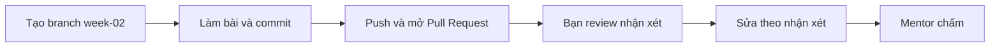

# Bài tập tuần 2 – Linux Essentials

> **Tóm tắt:** Dựng một workspace dự án bằng CLI, phân tích access log bằng pipeline, thiết lập thư mục dùng chung cho nhóm với user, group và setgid, điều khiển process bằng tín hiệu, và viết một script đọc cấu hình từ biến môi trường. Mọi kết quả phải kiểm chứng được bằng file nguồn và log text thật.

**Hạn nộp:** trước buổi đầu tiên của tuần 03.
**Hình thức:** Pull Request vào repo cá nhân `devops-labs`, thư mục `lab-03/` và `lab-04/`.
**Bài lab liên quan:** [Buổi 03 – Linux CLI](../../labs/week-02/session-03.md), [Buổi 04 – Linux Administration](../../labs/week-02/session-04.md). Hub tuần: [Tuần 02 – Linux Essentials](../../labs/week-02/README.md).
**Mẫu nộp bài:** [Mẫu nộp lab](../../templates/lab-template.md).

## Bảng nhiệm vụ

Bài tập này nộp lại bằng chứng của lab, nhưng **có việc mới**: bạn làm lại các kỹ thuật của lab với tên user, file và dữ liệu khác, và có vài sản phẩm riêng (ma trận dự đoán, script `show-config.sh`). Việc mới được ghi rõ ở cột cuối.

| Nhiệm vụ | Làm ở Phần nào của lab | Giờ ước lượng | Bằng chứng nộp |
| --- | --- | --- | --- |
| 1. Workspace bằng CLI | Buổi 03, Phần 1 và Phần 2 (việc mới: cây thư mục khác, script `commands-task1.sh`) | 0,5 giờ | `club-workspace/`, `commands-task1.sh`, 5 phép kiểm tra |
| 2. Phân tích access log | Buổi 03, Phần 3 (việc mới: tự viết `my-access.log` 15 dòng, `log-answers.md`) | 1,5 giờ | `my-access.log`, `log-answers.md`, `stderr.txt`, output pipeline |
| 3. Thư mục chung cho nhóm | Buổi 04, Phần 1 và Phần 2 (việc mới: ma trận dự đoán commit trước) | 1,5 giờ | `id`, `ls -ld`, 5 hành động, `permissions-matrix.md` |
| 4. Điều khiển process | Buổi 04, Phần 3 | 0,5 giờ | output `ps`, `pgrep -af`, `process-notes.md` |
| 5. Script đọc cấu hình từ môi trường | Buổi 04, Phần 4 (việc mới: viết `show-config.sh`) | 1 giờ | `show-config.sh`, `.env.example`, 4 lần chạy kèm mã thoát |
| L2 (tùy chọn, +10 điểm) | Hai trang thử thách thêm | 1 đến 2 giờ | Theo từng thử thách |

## Bối cảnh

Tuần này bạn làm quen với môi trường mà mọi thứ về sau đều chạy trên đó: Docker container là process Linux, volume phụ thuộc quyền file, log của backend là text mà bạn phải đọc bằng CLI, và cấu hình như `DB_PASSWORD`, `WEB_PORT` đến từ biến môi trường.

Tình huống xuyên suốt: nhóm dự án Club Management có ba thành viên dùng chung một máy chủ nhỏ. Bạn được giao bốn việc nối tiếp nhau:

1. Dựng nhanh khung workspace của dự án và ghi vài file cấu hình.
2. Trả lời câu hỏi "ai đang gọi API nhiều nhất, có bao nhiêu lỗi 5xx" từ access log mà không mở trình soạn thảo.
3. Tạo thư mục chia sẻ báo cáo cho nhóm: đúng người vào được, người ngoài bị chặn, không dùng `chmod 777`.
4. Chạy và dừng process đúng cách, rồi viết một script đọc cấu hình từ môi trường mà không làm lộ mật khẩu.

Bài tập chỉ dùng kiến thức của Buổi 03 và Buổi 04. Mọi lệnh chạy trong WSL2 Ubuntu, làm việc trong `~` (không dùng `/mnt/c`). Tên user, group, thư mục trong bài này cố tình khác với bài lab: bạn phải tự áp dụng, không chép lệnh nguyên văn.

Quy ước chung cho evidence:

- Lệnh quan trọng chạy dạng `lệnh 2>&1 | tee -a evidence/command-output.txt` để lưu cả lệnh lẫn kết quả. Trước mỗi lệnh, ghi một dòng chú thích bằng `echo "### Nhiem vu N - mo ta"`, để reviewer biết output thuộc nhiệm vụ nào.
- Khi cần lưu mã thoát, chạy lệnh trước, rồi `echo "exit code: $?"` ngay dòng kế tiếp. Không đọc `$?` sau một pipeline có `tee`, vì khi đó `$?` là mã thoát của `tee`.

## Nhiệm vụ L1 (bắt buộc)

### Nhiệm vụ 1. Workspace dự án bằng CLI (lab-03)

Trong `~/devops-labs/lab-03/source/`, tạo thư mục `club-workspace` đúng đặc tả sau.

```text
club-workspace/
├── backend/
│   ├── src/server.js
│   └── config/backend.conf
├── frontend/
│   ├── public/index.html
│   └── config/frontend.conf
├── database/init.sql
├── docs/
│   └── meeting notes/sprint 1.txt
└── logs/
```

Nội dung bắt buộc:

- `backend.conf` có đúng 2 dòng: `port=3000` và `db_host=postgres`.
- `frontend.conf` có đúng 1 dòng: `upstream=backend:3000`.
- `sprint 1.txt` có ít nhất 1 dòng nội dung tùy bạn.
- Các file còn lại có thể rỗng.

Sau khi tạo xong, tạo thêm `sprint 2.txt` trong cùng thư mục `meeting notes` bằng cách sao chép từ `sprint 1.txt`.

Tiêu chí hoàn thành (reviewer chạy lại được):

- `find club-workspace -type d | wc -l` in `11`.
- `find club-workspace -type f | wc -l` in `7`.
- `find club-workspace -name "*.conf"` in đúng 2 dòng.
- `grep -rn "3000" club-workspace` in đúng 2 dòng, mỗi dòng có tên file và số dòng.
- `wc -l club-workspace/backend/config/backend.conf` in `2` (chứng minh bạn không ghi đè nhầm bằng `>`).
- Ít nhất một lệnh `mkdir -p` dùng brace expansion `{a,b}`; mọi đường dẫn có khoảng trắng đều được quote.
- Dòng lệnh bạn đã dùng nằm trong `source/commands-task1.sh` (mỗi lệnh một dòng, có thể chạy lại trên thư mục trống để dựng lại đúng cây trên).

### Nhiệm vụ 2. Phân tích access log bằng pipeline (lab-03)

Phần A. Tự tạo log nhỏ để kiểm chứng bằng tay. Viết `source/my-access.log` đúng định dạng của `mini-access.log` trong bài lab, thỏa tất cả điều kiện:

- Đúng 15 dòng.
- Đúng 4 IP khác nhau, và có một IP duy nhất xuất hiện nhiều nhất (không hòa).
- Có ít nhất 3 dòng mã 404, ít nhất 2 dòng mã 5xx và ít nhất 1 dòng `POST`.

Phần B. Trên `my-access.log`, chạy và lưu vào evidence:

- Đếm request theo IP, giảm dần.
- Đếm theo mã HTTP, giảm dần.
- Lọc các dòng 5xx bằng `awk` kiểm tra đúng cột mã HTTP, in IP, đường dẫn và mã.
- Một pipeline cố tình thiếu `sort` đứng trước `uniq -c`, kèm 2 câu giải thích (viết trong `report.md`) vì sao kết quả sai so với bản có `sort`.
- Một lệnh đọc file không tồn tại, chuyển riêng stderr sang `evidence/stderr.txt` bằng `2>`.

Phần C. Trên file log thật `examples/linux/access.log` của giáo trình (260 dòng; sao chép vào `source/access.log`), điền `source/log-answers.md` theo bảng sau. Mỗi dòng trả lời phải kèm đúng lệnh bạn dùng để lấy ra con số.

| Câu hỏi | Kết quả | Lệnh đã dùng |
| --- | --- | --- |
| 3 IP gửi nhiều request nhất, kèm số lần | | |
| Tổng số request mã 5xx | | |
| Mã HTTP xuất hiện nhiều nhất và số lần | | |
| Đường dẫn được gọi nhiều nhất | | |

Tiêu chí hoàn thành:

- Tổng các số đếm theo IP và tổng các số đếm theo mã HTTP đều bằng `wc -l my-access.log` (đúng 15). Ghi phép kiểm tra này vào evidence.
- `my-access.log` thỏa mọi điều kiện ở Phần A; reviewer chạy lại pipeline và thấy đúng kết quả bạn nộp.
- Mọi con số trong `log-answers.md` tái hiện được khi reviewer chạy lại lệnh bạn ghi, không có số nào không kèm lệnh.
- Không dùng `grep " 5"` hoặc cách khớp chuỗi lỏng lẻo để đếm 5xx.

### Nhiệm vụ 3. Thư mục chung cho nhóm báo cáo (lab-04)

Dựng môi trường sau trên WSL2 của bạn (cần `sudo`):

- Group `clbops`; user `clb-ops1`, `clb-ops2` (thuộc `clbops`), `clb-visitor` (không thuộc `clbops`). Cả ba user có thư mục home.
- Thư mục `/srv/club-reports`: owner `root`, group `clbops`, quyền `2770`.
- Thư mục `/srv/club-reports-nosgid`: owner `root`, group `clbops`, quyền `770` (không có setgid), để đối chứng.

Thực hiện và ghi evidence cho các hành động sau, mỗi hành động chạy bằng `sudo -u` với đúng user:

1. `clb-ops1` tạo file `report-ops1.txt` trong `/srv/club-reports` với umask phù hợp để nhóm ghi được.
2. `clb-ops2` ghi nối thêm một dòng vào `report-ops1.txt`.
3. `clb-visitor` cố liệt kê `/srv/club-reports`.
4. `clb-ops1` tạo file trong `/srv/club-reports-nosgid`.
5. `clb-ops2` cố ghi nối thêm vào file ở bước 4.

Trước khi chạy, viết `source/permissions-matrix.md`: bảng 5 dòng ứng với 5 hành động trên, cột "Dự đoán (thành công hay Permission denied)" và cột "Lý do dự đoán" điền trước; thêm cột "Kết quả thật" và "Khớp dự đoán không" điền sau khi chạy. Hãy commit riêng phần dự đoán trước khi chạy lệnh (lịch sử `git log` phải cho thấy điều này).

Tiêu chí hoàn thành:

- Evidence có `id` của ba user: hai user đầu có `clbops`, `clb-visitor` thì không.
- `ls -ld /srv/club-reports` in `drwxrws---` với owner `root`, group `clbops`; `ls -ld /srv/club-reports-nosgid` in `drwxrwx---`.
- `ls -l` hai thư mục cho thấy file trong thư mục có setgid mang group `clbops`, file trong thư mục không có setgid mang group cá nhân của người tạo.
- Kết quả hành động 2 là thành công, hành động 3 và 5 là `Permission denied`.
- Không dùng `chmod 777` ở bất kỳ bước nào; không có thư mục nào ở chế độ `rwxrwxrwx`.
- Phần "Khớp dự đoán không" giải thích mọi dòng lệch dự đoán (nếu có) bằng khái niệm owner, group, other, setgid hoặc umask.
- Cuối nhiệm vụ, dọn sạch môi trường và chứng minh bằng lệnh: `getent passwd clb-ops1 clb-ops2 clb-visitor`, `getent group clbops` và `ls -d /srv/club-reports*` không còn kết quả (ghi mã thoát của lệnh `getent`, mong đợi khác 0).

### Nhiệm vụ 4. Điều khiển process bằng tín hiệu (lab-04)

Chạy ở shell hiện tại, dùng các giá trị `910` và `911` để dễ nhận biết process của bạn:

1. Chạy `sleep 910` ở nền.
2. Chạy một process bỏ qua SIGTERM: `bash -c 'trap "" TERM; sleep 911'` ở nền.
3. Dùng `ps` hiển thị PID, PPID, trạng thái và lệnh của cả hai; chứng minh PPID bằng `echo $$`.
4. Gửi SIGTERM cho `sleep 910` và chứng minh nó đã dừng.
5. Gửi SIGTERM cho process của bước 2 và chứng minh nó vẫn còn.
6. Dừng nó bằng SIGKILL, rồi chứng minh không còn process nào của bạn: `pgrep -af "sleep 91"` không in gì.

Viết `source/process-notes.md` (tối đa 6 dòng) trả lời: vì sao PPID bằng `$$`; vì sao bước 5 thất bại; vì sao không nên mở đầu bằng `kill -9`.

Tiêu chí hoàn thành:

- Evidence có đủ output `ps` của bước 3, trong đó PPID của hai process trùng với số in ra từ `echo $$` trong cùng log.
- Evidence thể hiện trước và sau bước 4, bước 5, bước 6 bằng `pgrep -af`; bước cuối có dòng `exit code: 1` ngay sau `pgrep` (không tìm thấy process).
- Chỉ dùng mẫu `pgrep -af "sleep 91"` hoặc PID cụ thể để chọn process. Không dùng `pkill sleep` hoặc `killall` làm ảnh hưởng process khác.
- `process-notes.md` nêu đúng tên tín hiệu và số hiệu (SIGTERM là 15, SIGKILL là 9).

### Nhiệm vụ 5. Script đọc cấu hình từ môi trường (lab-04)

Viết `source/show-config.sh` mô phỏng cách backend của starter-project đọc cấu hình:

- Đọc `WEB_PORT` (mặc định `8080` nếu không đặt) và `DB_PASSWORD` (bắt buộc).
- In ra `WEB_PORT=...` và một dòng `DB_PASSWORD: da dat`. Script không bao giờ in giá trị của `DB_PASSWORD`.
- Nếu thiếu `DB_PASSWORD`, in thông báo lỗi rõ ràng ra stderr và thoát với mã `1`.
- Có `set -u`, dòng đầu là shebang `#!/usr/bin/env bash`, mọi biến đặt trong dấu nháy kép.

Thêm hai file trong `lab-04/source/`:

- `.env.example` chứa `DB_PASSWORD=doi-mat-khau-that` và `WEB_PORT=8080` (chỉ là placeholder).
- `.gitignore` có dòng `.env`.

Chạy script bốn lần và lưu từng lần kèm mã thoát vào evidence:

1. Không đặt biến nào.
2. Chỉ `DB_PASSWORD` (đặt riêng cho lệnh, không `export` cho cả shell).
3. `DB_PASSWORD` và `WEB_PORT=8081` đặt riêng cho lệnh.
4. Đặt biến shell `DB_PASSWORD=mat-khau-thu` rồi gọi script mà không `export`, ghi rõ kết quả; sau đó `export` và gọi lại. Ghi 2 câu giải thích khác biệt vào `report.md`.

Tiêu chí hoàn thành:

- Bốn lần chạy cho kết quả đúng: lần 1 mã `1`, lần 2 in `WEB_PORT=8080` và mã `0`, lần 3 in `WEB_PORT=8081` và mã `0`, lần 4 cho thấy khác biệt trước và sau `export`.
- Evidence có lệnh chứng minh script không lộ mật khẩu: chạy script với `DB_PASSWORD=mat-khau-thu`, lọc bằng `grep -c "mat-khau-thu"` và kết quả đếm là `0`.
- `file source/show-config.sh` không báo CRLF; `ls -l` cho thấy quyền thực thi.
- Sau khi tạo file `.env` thử nghiệm trong `source/`, `git status --short` không liệt kê nó (hoặc `git check-ignore -v source/.env` xác nhận bị bỏ qua). Không có `.env` thật nào được commit.
- Unset hoặc đóng biến sau thí nghiệm (`unset DB_PASSWORD`) và ghi lệnh vào evidence.

## Nhiệm vụ L2 (nâng cao)

L2 là điểm thưởng, chỉ chấm khi L1 đã đạt từ 60 điểm trở lên. Mỗi thử thách có tiêu chí đo được và phải kèm giải thích bằng lời của bạn.

### Thử thách A. Script báo cáo log có kiểm tra tham số

Viết `lab-03/source/log-report.sh` với cú pháp `log-report.sh FILE [TOP_N]`.

Tiêu chí hoàn thành:

- In ba mục: top `TOP_N` IP, phân bố mã HTTP, top `TOP_N` đường dẫn có mã 4xx hoặc 5xx. `TOP_N` mặc định là 5.
- Thoát mã `1` kèm thông báo ở stderr khi: thiếu `FILE`, `FILE` không tồn tại, hoặc `TOP_N` không phải số nguyên dương. Mỗi trường hợp có một lần chạy trong evidence, kèm `exit code:`.
- Chạy được trên cả `my-access.log` và `access.log`; không hard-code đường dẫn tuyệt đối; mọi biến trong dấu nháy kép.
- Chạy với `TOP_N=2` trên `my-access.log` cho đúng 2 dòng trong mỗi mục top, và kết quả khớp lần đếm tay của Nhiệm vụ 2.
- `report.md` có đoạn 3-4 dòng giải thích vì sao script phải kiểm tra tham số trước khi chạy pipeline.

### Thử thách B. Script kiểm tra tài nguyên có ngưỡng

Viết `lab-04/source/resource-check.sh` in tải CPU (3 giá trị `loadavg`), phần trăm RAM đã dùng và phần trăm disk của `/`.

Tiêu chí hoàn thành:

- Có `set -euo pipefail`; ngưỡng đọc từ `MEM_LIMIT` và `DISK_LIMIT`, mặc định 85.
- Khi vượt ngưỡng in dòng bắt đầu bằng `WARN` và thoát mã `2`; khi không vượt, thoát mã `0`.
- Nếu ngưỡng không phải số nguyên, in lỗi ở stderr và thoát mã `1`.
- Evidence gồm ba lần chạy kèm mã thoát: mặc định, `MEM_LIMIT=1`, `MEM_LIMIT=abc`.
- Không chép nguyên mẫu mà không hiểu: `report.md` giải thích từng lệnh `awk` trong script bằng lời của bạn (mỗi lệnh 1 câu).

### Thử thách C. Script onboarding user chạy lặp an toàn

Viết `lab-04/source/onboard.sh` nhận tên user và tên group, đảm bảo group tồn tại, user tồn tại và thuộc group đó.

Tiêu chí hoàn thành:

- Chạy lần thứ hai với cùng tham số không báo lỗi, không tạo trùng, và in rõ những gì đã có sẵn (ví dụ `da ton tai`).
- Dùng `usermod -aG`, không dùng `-G` trần. Thiếu tham số thì in cách dùng và thoát mã `1`.
- Evidence ghi hai lần chạy liên tiếp, `id` của user sau mỗi lần, và chứng minh user không bị mất group phụ khác (thêm user vào một group thứ hai trước khi chạy và kiểm tra lại sau đó).
- Có bước dọn user, group thử nghiệm và chứng minh đã dọn.
- `report.md` nêu: một lỗi có thể xảy ra nếu script chạy ở phiên đăng nhập đang mở của chính user vừa thêm, và cách kiểm tra.

## Bằng chứng cần nộp

Cấu trúc thư mục theo mẫu lab:

```text
lab-03/
├── README.md
├── report.md
├── source/
│   ├── commands-task1.sh
│   ├── club-workspace/
│   ├── my-access.log
│   ├── access.log
│   ├── log-answers.md
│   └── log-report.sh          (L2, Thử thách A)
├── screenshots/
│   └── terminal-lab03.png
└── evidence/
    ├── command-output.txt
    └── stderr.txt
lab-04/
├── README.md
├── report.md
├── source/
│   ├── permissions-matrix.md
│   ├── process-notes.md
│   ├── show-config.sh
│   ├── .env.example
│   ├── .gitignore
│   ├── resource-check.sh      (L2, Thử thách B)
│   └── onboard.sh             (L2, Thử thách C)
├── screenshots/
│   └── terminal-lab04.png
└── evidence/
    └── command-output.txt
```

Bằng chứng theo từng nhiệm vụ:

| Nhiệm vụ | Bằng chứng bắt buộc |
| --- | --- |
| 1 | `source/club-workspace/` và `source/commands-task1.sh`; `lab-03/evidence/command-output.txt` có đủ 5 phép kiểm tra trong tiêu chí (đếm thư mục, đếm file, `*.conf`, `grep -rn`, `wc -l backend.conf`) |
| 2 | `source/my-access.log`, `source/access.log`, `source/log-answers.md` (mỗi dòng có lệnh); output pipeline trên `my-access.log`, phép kiểm tra tổng bằng 15, `evidence/stderr.txt`; câu giải thích thiếu `sort` trong `report.md` |
| 3 | `lab-04/evidence/command-output.txt` có `id` ba user, `ls -ld` hai thư mục, output 5 hành động, lệnh dọn và bằng chứng đã dọn; `source/permissions-matrix.md` có commit dự đoán trước (dán hash commit vào `report.md`) |
| 4 | Output `ps` có PPID và `echo $$`; các lần `pgrep -af` trước và sau mỗi lần gửi tín hiệu; `exit code: 1` ở cuối; `source/process-notes.md` |
| 5 | `source/show-config.sh`, `source/.env.example`, `source/.gitignore`; bốn lần chạy kèm `exit code:`; phép `grep -c` bằng `0`; kết quả `file` và `ls -l` của script |
| L2 | Theo từng thử thách ở trên, mỗi lần chạy kèm mã thoát |

Nguyên tắc: ảnh chụp màn hình chỉ bổ trợ. Mọi nhiệm vụ phải kiểm chứng được bằng file nguồn và log dạng text để reviewer chạy lại hoặc đọc được. `README.md` của mỗi lab trả lời đủ 7 câu theo mẫu và ghi rõ đã làm L1 hay L2. `report.md` của `lab-03` ghi một lỗi thật bạn gặp, cách điều tra, và câu trả lời cho câu hỏi kiểm tra 1 đến 3; `report.md` của `lab-04` ghi câu trả lời cho câu hỏi 4 và 5, hash commit dự đoán, và một lỗi thật bạn gặp kèm cách điều tra.

Trước khi nộp, tự kiểm tra tệp nhạy cảm bằng lệnh sau (kết quả mong đợi: không in ra dòng nào):

```bash
cd ~/devops-labs
git ls-files | grep -E '(^|/)(id_ed25519|id_rsa|\.env)$'
grep -rIl "BEGIN OPENSSH PRIVATE KEY" . --exclude-dir=.git
```

Lưu ý riêng cho tuần này: `access.log` giáo trình không chứa thông tin cá nhân, nhưng nếu bạn dán thêm log từ máy thật vào evidence, hãy kiểm tra không có IP, tên đăng nhập hay token của người khác.


## Bảng điểm

Tổng 100 điểm cho L1, cộng tối đa 10 điểm thưởng cho L2 (chỉ chấm khi L1 từ 60 điểm). Tiêu chí chi tiết dành cho mentor chấm.

| Tiêu chí | Điểm |
| --- | --- |
| Nhiệm vụ 1: workspace | 15 |
| Nhiệm vụ 2: phân tích log | 20 |
| Nhiệm vụ 3: thư mục chung | 20 |
| Nhiệm vụ 4: process | 10 |
| Nhiệm vụ 5: `show-config.sh` | 10 |
| Câu hỏi kiểm tra kiến thức | 10 |
| `README.md` và `report.md` | 5 |
| Bằng chứng và kỷ luật repo | 5 |
| Quy trình nộp (PR có review thật) | 5 |
| **Tổng L1** | **100** |
| L2: Thử thách A, B, C | +4, +3, +3 |

Mỗi điểm đều dựa trên bằng chứng text chạy lại được, không phải ảnh chụp màn hình. Các lỗi hay làm mất điểm (ví dụ `chmod 777`, `pkill sleep`, quên `sort` trước `uniq -c`) đều đã được nhắc trong tiêu chí của từng nhiệm vụ.

## Câu hỏi kiểm tra kiến thức

Trả lời ngắn (2-4 câu mỗi câu) bằng lời của bạn trong `lab-03/report.md` (câu 1 đến 3) và `lab-04/report.md` (câu 4 và 5).

1. Bạn chạy `awk '{print $9}' access.log | uniq -c` và thấy mã `200` xuất hiện ở nhiều dòng khác nhau với số đếm nhỏ. Điều gì đã xảy ra và bạn sửa thế nào? Làm sao tự kiểm tra con số sau khi sửa là đúng?
2. Vì sao xóa một thư mục có tên chứa khoảng trắng bằng `rm -r club-workspace/docs/meeting notes` lại báo lỗi? Nêu thói quen cụ thể giúp tránh lỗi này và tránh các lệnh xóa nguy hiểm hơn.
3. `find` và `grep` khác nhau ở đối tượng tìm kiếm. Viết một tình huống trong dự án Club Management cần dùng `find`, một tình huống cần `grep`, và một tình huống phải dùng cả hai.
4. File `report.txt` có quyền `640`, owner `alice`, group `dev`. Bob thuộc `dev`, Carol không thuộc `dev`. Mỗi người đọc và ghi được không? Một thư mục chia sẻ nên đặt quyền thế nào để file mới tạo luôn thuộc group của nhóm, và vì sao điều đó quan trọng?
5. Bạn vừa chạy `usermod -aG clbops clb-ops2`, nhưng bạn ấy vẫn gặp `Permission denied`. Liệt kê ba điểm kiểm tra đầu tiên theo thứ tự (kèm lệnh), và giải thích vì sao không nên "chữa cháy" bằng `chmod 777`. Liên hệ: vì sao ứng dụng trong container cũng hay gặp lỗi quyền kiểu này?

## Quy trình nộp



1. Tạo branch từ `main` trong repo cá nhân:

```bash
cd ~/devops-labs
git switch main
git switch -c week-02
```

2. Làm bài, commit theo từng nhiệm vụ với message rõ nghĩa (ví dụ `Add lab-03 club-workspace and log analysis`). Riêng `permissions-matrix.md`, commit phần dự đoán trước khi chạy lệnh của Nhiệm vụ 3.
3. Push branch và mở Pull Request vào `main` của chính repo cá nhân:

```bash
git push -u origin week-02
```

4. Nhờ một bạn trong CLB review. Reviewer để ít nhất 2 nhận xét cụ thể (một điểm tốt, một điểm cần sửa) trên PR, và nên tự chạy lại ít nhất một phép kiểm tra trong tiêu chí (ví dụ `find ... | wc -l`) để xác nhận. Bạn sửa theo nhận xét hợp lý và trả lời từng nhận xét.
5. Gắn mentor làm reviewer và dán link PR vào kênh nộp bài của lớp. Mentor chấm theo bảng điểm ở trên, không chấm nội dung đẩy sau hạn.

Hạn nộp: trước buổi đầu tiên của tuần 03. Nộp muộn sẽ bị trừ theo quy định trong `curriculum/assessment.md`.

## Checklist trước khi nộp

- [ ] `lab-03/` và `lab-04/` có đúng cấu trúc thư mục, có `README.md` (7 câu), `report.md`, `source/`, `screenshots/`, `evidence/`
- [ ] `club-workspace` có 11 thư mục, 7 file, 2 file `.conf`; `backend.conf` có đúng 2 dòng
- [ ] `my-access.log` đúng 15 dòng, thỏa điều kiện; tổng đếm theo IP và theo mã HTTP đều bằng 15
- [ ] `log-answers.md` mỗi dòng có kết quả và lệnh tái hiện được
- [ ] Ma trận quyền đã commit phần dự đoán trước khi chạy lệnh, có hash commit trong `report.md`
- [ ] `ls -ld` cho thấy `drwxrws---` và `drwxrwx---`; không có `chmod 777`
- [ ] Đã dọn user, group, thư mục `/srv/...` và có bằng chứng đã dọn
- [ ] Output `ps` có PPID khớp `echo $$`; bước cuối có `exit code: 1`
- [ ] `show-config.sh` chạy đúng bốn trường hợp, không in mật khẩu, mã thoát đúng, LF, có quyền thực thi
- [ ] `.gitignore` có `.env`; đã chạy lệnh quét secret ở phần Bằng chứng và không có kết quả
- [ ] 5 câu hỏi kiểm tra kiến thức đã được trả lời trong `report.md`
- [ ] Mỗi lệnh có mã thoát đều đọc `$?` ngay sau lệnh, không đứng sau `| tee`
- [ ] Ghi rõ mức đã làm (L1 hoặc L2) cuối `README.md`
- [ ] Đã mở Pull Request, được ít nhất một bạn review, mentor đã được gắn
