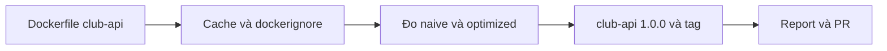
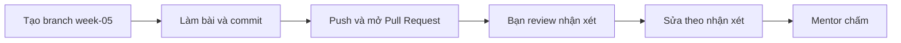

# Bài tập tuần 5 – Dockerfile & Image Optimization

> **Tóm tắt:** Viết Dockerfile cho `club-api`, chứng minh bằng log rằng cache hoạt động, `.dockerignore` chặn được rò rỉ `.env`, rồi đo và so sánh image naive với image tối ưu bằng số liệu thật (size, thời gian rebuild, user chạy).

**Hạn nộp:** trước buổi đầu tiên của tuần 06.
**Hình thức:** Pull Request vào repo cá nhân `devops-labs`, thư mục `lab-09/` và `lab-10/`.
**Bài lab liên quan:** [Buổi 09 – Dockerfile](../../labs/week-05/session-09.md), [Buổi 10 – Image Optimization](../../labs/week-05/session-10.md).
**Mẫu nộp bài:** [templates/lab-template.md](../../templates/lab-template.md).

## Bối cảnh

Hai buổi vừa rồi bạn đã đi qua một vòng đầy đủ: viết Dockerfile đầu tiên, thấy build chậm vì mất cache, thấy file `.env` lọt vào image, thấy container chạy bằng root, rồi học cách sửa từng vấn đề bằng thứ tự lệnh, `.dockerignore`, multi-stage build và `USER node`.

Tình huống xuyên suốt: mentor muốn đưa `club-api` (Node.js, cổng 3000) lên máy chung của CLB dưới dạng image. Trước khi được phép đưa lên, image phải qua một buổi "kiểm định" gồm bốn câu hỏi: build lại có nhanh không, image có chứa bí mật không, tiến trình chạy bằng user nào, và image nặng bao nhiêu. Bài tập này yêu cầu bạn tự trả lời bốn câu đó bằng log và số liệu của chính máy bạn, không bằng cảm giác.

Bài tập chỉ dùng kiến thức của Buổi 09 và Buổi 10. Chưa cần Compose hay Kubernetes: ở tuần này `/ready` trả `503` là bình thường vì container chưa có database.



Quy ước đặt tên để reviewer chạy lại được: image `club-api:lab9`, container `club-api-lab9`, host port 3001; ở lab-10 dùng host port 3100 cho `hello-node`.

## Nhiệm vụ L1 (bắt buộc)

### Nhiệm vụ 1. Dockerfile cho club-api (lab-09)

Chép mã nguồn `starter-project/backend` vào `lab-09/source/` (bỏ `node_modules`, Dockerfile và `.dockerignore` mẫu như bài lab), rồi tự viết `lab-09/source/Dockerfile`.

Tiêu chí hoàn thành:

- `docker build -t club-api:lab9 .` chạy từ `lab-09/source` thành công; evidence có log build kết thúc bằng dòng `naming to docker.io/library/club-api:lab9`.
- Dockerfile ghim base image có phiên bản cụ thể (không dùng `latest`), có `WORKDIR`, `ENV NODE_ENV=production`, `EXPOSE 3000`, `USER node` và `CMD` ở exec form.
- Dockerfile chép `package.json` và `package-lock.json` trước khi chạy `npm ci --omit=dev`, và chép phần còn lại của mã nguồn sau đó.
- Khi container chạy (`-p 3001:3000`), evidence có output thật của `curl -s localhost:3001/health` chứa `healthy`.
- Evidence có output của `docker exec club-api-lab9 id` cho thấy `uid=1000(node)`, và `docker run --rm club-api:lab9 node --version` in ra phiên bản bắt đầu bằng `v22`.

### Nhiệm vụ 2. Chứng minh build cache (lab-09)

Chứng minh bằng log rằng thứ tự lệnh của bạn tận dụng được cache, và cho thấy thứ tự sai gây ra điều gì.

Tiêu chí hoàn thành:

- Evidence có hai đoạn log build dùng `--progress=plain`, lọc bằng `grep -E "npm ci|CACHED"` hoặc tương đương:
  - Đoạn A: Dockerfile đúng thứ tự, sau khi chỉ sửa `server.js` (thêm một dòng comment): bước `npm ci` hiện `CACHED`.
  - Đoạn B: một biến thể có `COPY . .` đặt trước `npm ci` (lưu thành `lab-09/source/Dockerfile.badorder`, build bằng `-f`), sau khi sửa `server.js` một lần nữa: bước `npm ci` chạy lại, không có `CACHED`.
- Hai đoạn log phải cho thấy rõ lệnh nào đã được chạy, không chỉ kết quả cuối.
- `report.md` có 3 đến 5 dòng giải thích vì sao A có cache còn B thì không, dùng thuật ngữ layer và manifest.

### Nhiệm vụ 3. Build context, `.dockerignore` và rò rỉ bí mật (lab-09)

Tái hiện và ngăn chặn việc `.env` giả lọt vào image.

Tiêu chí hoàn thành:

- Tạo file `.env` chỉ chứa giá trị giả (ví dụ `DB_PASSWORD=gia-lap-khong-phai-that`) và một file rác `rac.bin` 100 MB trong `source/`.
- Evidence "trước": dòng `transferring context` (khoảng 100 MB) và output `docker run --rm <image> ls -a /app` có liệt kê `.env` và `rac.bin`.
- Có `lab-09/source/.dockerignore` loại tối thiểu `node_modules`, `.git`, `.env`, `*.bin`.
- Evidence "sau": dòng `transferring context` chỉ còn rất nhỏ (vài trăm byte đến vài chục KB, không còn khoảng 100 MB) và `ls -a /app` không còn `.env`, `rac.bin`.
- `.env` và `rac.bin` đã bị xóa khỏi `source/` trước khi commit (kiểm tra bằng `git ls-files` ở phần Bằng chứng).

### Nhiệm vụ 4. Đo baseline và bản tối ưu của hello-node (lab-10)

Dùng `examples/docker/hello-node` để có số liệu so sánh có kiểm chứng, theo đúng quy trình của Buổi 10.

Tiêu chí hoàn thành:

- Evidence có log build `hello-node:1.0.0-naive` (kèm `transferring context`), `docker image ls hello-node`, và output của `docker run --rm hello-node:1.0.0-naive cat /app/.env` (thấy nội dung) cùng `id` (thấy `uid=0`).
- Evidence có `docker history` của cả image naive và image `hello-node:1.0.0` build từ `Dockerfile.optimized`; trong `report.md` chỉ ra layer lớn nhất do bạn tạo ra ở mỗi image và layer nào thuộc base image.
- Có `.dockerignore` (viết lại ở Phần 3 của bài lab) và evidence cho thấy `.env`, `big.bin` không còn trong image sau khi áp dụng.
- `report.md` có bảng so sánh với đúng bốn cột đo được: size, thời gian rebuild sau khi sửa `server.js` (lấy từ `time docker build ...`, đơn vị giây), user chạy tiến trình, có rò `.env` hay không. Mỗi số trong bảng phải truy được về một dòng trong `evidence/command-output.txt`.
- Một câu nhận xét trong `report.md` giải thích vì sao `.dockerignore` không làm image naive nhỏ đi đáng kể.

### Nhiệm vụ 5. Build club-api:1.0.0 từ starter-project và gắn tag (lab-10)

Áp dụng những gì đã học để đọc và build Dockerfile multi-stage có sẵn của dự án.

Tiêu chí hoàn thành:

- Evidence có log `docker build -t club-api:1.0.0 .` chạy từ `starter-project/backend` thành công, và `docker image ls club-api` cho thấy tag `1.0.0`.
- Evidence có output `docker run --rm --entrypoint id club-api:1.0.0` cho thấy `uid=1000(node)`.
- Gắn thêm tag `club-api:1.0` bằng `docker tag`; evidence có `docker image ls club-api` cho thấy các tag cùng IMAGE ID.
- `report.md` có bảng đối chiếu, mỗi ô là một câu trả lời cụ thể dựa trên file thật của dự án: stage nào cài dependency, vì sao `COPY --from=dependencies` đứng trước `COPY . .`, `USER node` đặt ở đâu, và mỗi mục trong `.dockerignore` của backend giải quyết vấn đề gì.

## Nhiệm vụ L2 (nâng cao)

L2 là Advanced Challenge, điểm thưởng, chỉ chấm khi L1 đã đạt từ 60 điểm trở lên. Làm tự lực: không chép lại Dockerfile mẫu.

### Thử thách A. Dockerfile multi-stage có HEALTHCHECK và đo được

Viết `lab-10/source/hello-node/Dockerfile.mine` từ đầu.

Tiêu chí hoàn thành:

- Có ít nhất hai stage, base `node:22-alpine`, chạy bằng `USER node`, trong image không có `.env`.
- Có `HEALTHCHECK` gọi `/health` và `docker ps --filter name=hello-mine --format '{{.Names}} {{.Status}}'` hiện `healthy` trong evidence sau tối đa 1 phút.
- Log build sau khi sửa `server.js` cho thấy bước `npm ci` hiện `CACHED`.
- Size không lớn hơn size của `Dockerfile.optimized` quá 10%, có hai con số `docker image ls` đặt cạnh nhau trong `report.md`.

### Thử thách B. Stage test cho backend

Thêm stage `test` vào một bản sao Dockerfile của `starter-project/backend` (lưu thành `lab-10/source/Dockerfile.test`, không sửa Dockerfile gốc của dự án).

Tiêu chí hoàn thành:

- `docker build --target test -f Dockerfile.test -t club-api:test .` chạy được `npm test` và log có kết quả test; lưu vào `evidence/test-results.txt`.
- Image cuối (build không có `--target`) vẫn không chứa devDependencies: chứng minh bằng một lệnh `docker run` kiểm tra thư mục `node_modules` và ghi lệnh cùng output vào evidence.
- `report.md` giải thích đánh đổi liên quan tới `.dockerignore` loại thư mục `tests` và cách bạn xử lý (nhớ khôi phục cấu hình sau khi thử).

### Thử thách C. Điều tra lỗi build context và chiến lược tag

Tiêu chí hoàn thành:

- Tái hiện lỗi sai build context của Tình huống 05 theo mục "Phá lỗi và debug" của Buổi 09, hoặc lỗi `.dockerignore` loại `package-lock.json` của Buổi 10. Chọn một, dán dòng lỗi thật vào evidence.
- `report.md` nêu nguyên nhân gốc và hai cách sửa khác nhau, kèm lệnh build đã chạy lại thành công.
- Viết chiến lược tag cho `club-api` với ba bản phát hành 1.0.0, 1.0.1, 1.1.0: bảng nêu tag nào gắn cho image nào, tag nào được dời, và deploy dùng tag nào để rollback chính xác.

## Bằng chứng cần nộp

Cấu trúc thư mục theo mẫu lab:

```text
lab-09/
├── README.md
├── report.md
├── source/
│   ├── Dockerfile
│   ├── Dockerfile.badorder
│   ├── .dockerignore
│   └── (mã nguồn backend, không có node_modules, .env, rac.bin)
├── screenshots/
│   └── health-ok.png
└── evidence/
    └── command-output.txt
lab-10/
├── README.md
├── report.md
├── source/
│   └── hello-node/
│       ├── .dockerignore
│       ├── Dockerfile.mine        (L2, Thử thách A)
│       └── Dockerfile.test        (L2, Thử thách B, nếu để cạnh backend thì ghi rõ vị trí)
├── screenshots/
│   └── image-sizes.png
└── evidence/
    ├── command-output.txt
    └── test-results.txt           (L2, Thử thách B)
```

Bằng chứng theo từng nhiệm vụ:

| Nhiệm vụ | Bằng chứng bắt buộc |
| --- | --- |
| 1 | `lab-09/source/Dockerfile`; trong `lab-09/evidence/command-output.txt`: log build, `curl /health`, `docker exec ... id`, `node --version` |
| 2 | Hai đoạn log cache A (có `CACHED`) và B (không có `CACHED`) trong `lab-09/evidence/command-output.txt`; `Dockerfile.badorder`; đoạn giải thích trong `lab-09/report.md` |
| 3 | `.dockerignore`; log `transferring context` và `ls -a /app` trước và sau, trong `lab-09/evidence/command-output.txt` |
| 4 | `lab-10/evidence/command-output.txt` có `docker image ls`, `docker history` của hai image, kết quả `cat /app/.env`, `id`, `time docker build`; bảng so sánh trong `lab-10/report.md` |
| 5 | Log build `club-api:1.0.0`, `docker image ls club-api`, `id`; bảng đối chiếu trong `lab-10/report.md` |
| L2 | Theo từng thử thách ở trên |

Nguyên tắc: ảnh chụp màn hình chỉ bổ trợ. Mọi nhiệm vụ phải kiểm chứng được bằng Dockerfile và log dạng text để reviewer đọc hoặc chạy lại. Ghi lệnh cùng output (dòng bắt đầu bằng `$ ` cho lệnh) và dùng `2>&1 | tee -a ...` để log không bị rỗng. Nếu cần lấy thời gian rebuild, ghi cả dòng `real` của lệnh `time`.

`README.md` của mỗi lab trả lời đủ 7 câu theo mẫu và ghi rõ đã làm L1 hay L2. `report.md` của `lab-09` chứa phần giải thích cache; `report.md` của `lab-10` chứa bảng so sánh, phân tích layer, bảng đối chiếu và (nếu làm L2) phần giải thích còn lại.

Trước khi nộp, tự kiểm tra bí mật và file rác bằng các lệnh sau (kết quả mong đợi: không in ra dòng nào):

```bash
cd ~/devops-labs
git ls-files | grep -E '(^|/)(\.env|rac\.bin|big\.bin)$'
git ls-files | grep -E '(^|/)node_modules/'
grep -rIl "BEGIN OPENSSH PRIVATE KEY" . --exclude-dir=.git
```

## Barem chấm

Tổng 100 điểm cho L1, cộng tối đa 10 điểm thưởng cho L2.

| Tiêu chí | Đạt | Không đạt | Điểm |
| --- | --- | --- | --- |
| Nhiệm vụ 1: Dockerfile `club-api` | Build thành công, ghim phiên bản, đúng thứ tự manifest rồi mã nguồn, `USER node`, exec form; `/health` và `id` có trong log thật | Dùng `latest`, chạy root, `COPY . .` trước `npm ci`, log thiếu hoặc tự gõ tay | 20 |
| Nhiệm vụ 2: chứng minh cache | Hai đoạn log A và B đối chiếu được, có `CACHED` ở A và không có ở B, giải thích đúng | Chỉ có một đoạn log, giải thích sai nguyên nhân hoặc không có | 15 |
| Nhiệm vụ 3: `.dockerignore` và rò rỉ | Có đủ log trước và sau, `.dockerignore` hợp lý, `.env` và `rac.bin` không còn trong repo | Thiếu log "trước", `.env` còn trong image hoặc trong repo | 15 |
| Nhiệm vụ 4: đo naive và optimized | Bảng so sánh đủ bốn cột, mỗi số truy được về log, có phân tích layer từ `docker history` | Số liệu không có trong log, thiếu phân tích layer, kết luận không khớp số liệu | 20 |
| Nhiệm vụ 5: `club-api:1.0.0` và tag | Build thành công, `id` đúng, tag cùng IMAGE ID, bảng đối chiếu bám file thật của dự án | Không build được, bảng đối chiếu chung chung hoặc chép đề bài | 10 |
| `report.md` và `README.md` | Đủ 7 câu mỗi lab, ghi rõ mức đã làm, trả lời đủ 5 câu kiểm tra | Thiếu câu, chép đề bài, không ghi mức | 10 |
| Bằng chứng và kỷ luật repo | Đúng cấu trúc thư mục, evidence là text thật, không secret, không `node_modules` | Sai cấu trúc, evidence chỉ là ảnh, có secret hoặc file rác trong repo | 5 |
| Quy trình nộp | Có PR, được một bạn review có nhận xét thật | Push thẳng vào `main` hoặc review chỉ ghi "OK" | 5 |
| **Tổng L1** | | | **100** |
| L2: Thử thách A (`Dockerfile.mine`) | Đủ 4 tiêu chí, có log `CACHED` và trạng thái `healthy` | Thiếu `HEALTHCHECK`, size vượt ngưỡng hoặc không có log | +4 |
| L2: Thử thách B (stage test) | Chạy được `--target test`, chứng minh image cuối sạch devDependencies | Chỉ nêu ý tưởng, không có log test | +3 |
| L2: Thử thách C (debug và tag) | Nguyên nhân gốc đúng, hai cách sửa khác nhau, bảng tag hợp lý | Nguyên nhân sai hoặc chỉ có một cách sửa | +3 |
| **Tối đa thưởng** | | | **+10** |

Điểm một tiêu chí được chia theo mức: đạt đủ nhận điểm tối đa, đạt một phần nhận khoảng một nửa, không có hoặc không kiểm chứng được nhận 0.

## Câu hỏi kiểm tra kiến thức

Trả lời ngắn (2 đến 4 câu mỗi câu) bằng lời của bạn trong `report.md`: câu 1 đến 3 ở `lab-09/report.md`, câu 4 đến 5 ở `lab-10/report.md`.

1. `EXPOSE 3000` có làm cho `curl localhost:3000` từ máy host chạy được không? Nếu không thì cần thêm gì khi `docker run`?
2. Vì sao `COPY package.json package-lock.json ./` phải đứng trước `COPY . .`? Khi một layer mất cache thì các layer phía sau xử lý ra sao?
3. Đồng đội báo "build ở máy mình thì được, ở CI báo COPY không tìm thấy `package.json`". Nêu ba điểm bạn kiểm tra đầu tiên, theo thứ tự.
4. Vì sao `RUN rm -rf` ở layer sau không làm image nhỏ lại? Multi-stage build giải quyết vấn đề đó bằng cách nào?
5. Tag `latest` có đảm bảo là bản mới nhất không? Với `club-api`, bạn deploy bằng tag nào và vì sao?

## Lỗi hay bị trừ điểm

- Dùng `FROM node:latest` hoặc `node:22` mà không nói rõ vì sao, trong khi bài lab yêu cầu ghim phiên bản và đo size.
- `COPY . .` đặt trước `npm ci`, hoặc có log nhưng log cho thấy `npm ci` chạy lại mà không giải thích.
- Chỉ có log "sau" của `.dockerignore`, không có log "trước" nên không chứng minh được rò rỉ.
- Quên xóa `.env`, `rac.bin`, `big.bin` hoặc `node_modules` trước khi commit; ngoài ra `.dockerignore` loại luôn `package-lock.json` làm build lỗi.
- Bảng so sánh có số liệu không khớp log (ví dụ ghi size 200 MB trong khi log ghi khác), hoặc dùng số lấy từ bài giảng thay cho số đo trên máy.
- Làm việc trong `/mnt/c` khiến build chậm và sai quyền; evidence không chứng minh được thư mục làm việc.
- `evidence/command-output.txt` rỗng vì quên `tee`, hoặc chỉ dán output mà không có lệnh.
- Chạy bằng root nhưng báo cáo là non-root, hoặc kiểm tra `id` trên image khác với image được nộp.
- Đặt secret thật vào `ENV`, `COPY` hoặc commit lên repo; ảnh chụp màn hình lộ thông tin cá nhân.
- Nộp ảnh thay cho log text; push thẳng vào `main`, không có PR hoặc không có người review.

## Quy trình nộp



1. Tạo branch từ `main` trong repo cá nhân:

```bash
cd ~/devops-labs
git switch main
git switch -c week-05
```

2. Làm bài, commit theo từng nhiệm vụ với message rõ nghĩa (ví dụ `Add lab-09 Dockerfile and cache evidence`).
3. Push branch và mở Pull Request vào `main` của chính repo cá nhân:

```bash
git push -u origin week-05
```

4. Nhờ một bạn trong CLB review. Reviewer để ít nhất 2 nhận xét cụ thể (một điểm tốt, một điểm cần sửa) trên PR, nên thử chạy lại `docker build` từ `source/` để xác nhận Dockerfile build được. Bạn sửa theo nhận xét hợp lý và trả lời từng nhận xét.
5. Gắn mentor làm reviewer và dán link PR vào kênh nộp bài của lớp. Mentor chấm theo barem trên, không chấm nội dung đẩy sau hạn.

Hạn nộp: trước buổi đầu tiên của tuần 06. Nộp muộn sẽ bị trừ theo quy định trong `curriculum/assessment.md`.

## Checklist trước khi nộp

- [ ] `lab-09/` và `lab-10/` có đúng cấu trúc thư mục, có `README.md` (7 câu), `report.md`, `source/`, `screenshots/`, `evidence/`
- [ ] `docker build -t club-api:lab9 .` chạy được từ `lab-09/source`, Dockerfile ghim phiên bản, có `USER node`
- [ ] Evidence có hai đoạn log cache (có và không có `CACHED`) cùng giải thích trong `report.md`
- [ ] Evidence có log `transferring context` và `ls -a /app` trước và sau khi thêm `.dockerignore`
- [ ] Bảng so sánh naive và optimized có đủ size, thời gian rebuild, user chạy, rò `.env`; mỗi số truy được về log
- [ ] `docker history` của cả hai image có trong evidence, layer lớn nhất đã được phân tích
- [ ] `club-api:1.0.0` đã build, `id` cho thấy `node`, tag `1.0` cùng IMAGE ID
- [ ] 5 câu hỏi kiểm tra kiến thức đã được trả lời trong `report.md`
- [ ] Đã chạy các lệnh kiểm tra ở phần Bằng chứng và không có kết quả
- [ ] Không commit `.env`, `rac.bin`, `big.bin`, `node_modules`, password, token, private key
- [ ] Ghi rõ mức đã làm (L1 hoặc L2) cuối `README.md`
- [ ] Đã dọn container, image tạm không còn cần (`docker rm -f`, `docker rmi`) sau khi lấy evidence
- [ ] Đã mở Pull Request, được ít nhất một bạn review, mentor đã được gắn
