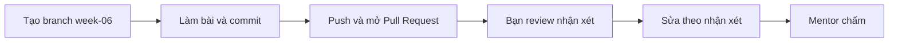

# Bài tập tuần 6 – Networking & Storage

> **Tóm tắt:** Dựng API và PostgreSQL giao tiếp bằng tên trên network riêng, chứng minh isolation, rồi chứng minh dữ liệu database sống sót qua việc xóa container và khôi phục được từ backup. Mọi kết luận phải có lệnh và output thật.

**Hạn nộp:** trước buổi đầu tiên của tuần 07.
**Hình thức:** Pull Request vào repo cá nhân `devops-labs`, thư mục `lab-11/` và `lab-12/`.
**Bài lab liên quan:** [Buổi 11 – Container Networking](../../labs/week-06/session-11.md), [Buổi 12 – Persistent Storage](../../labs/week-06/session-12.md). Hub tuần: [Tuần 6 – Networking và Storage](../../labs/week-06/README.md).
**Mẫu nộp bài:** [Lab XX – Tên lab](../../templates/lab-template.md).

**Bài tập = nộp lại bằng chứng của lab, không có việc mới.** Hai chỗ khác với lab: ở Nhiệm vụ 4 bạn dùng dữ liệu giả của riêng bạn thay cho Alice, Bob, Carol; và bạn viết lời giải thích bằng lời của mình trong `report.md`.

| Nhiệm vụ | Làm ở phần nào của lab | Giờ ước lượng | Bằng chứng nộp |
| --- | --- | --- | --- |
| 1. DNS theo tên (L1) | Buổi 11, Phần 1 và 2 | 0,5 | `docker network ls --filter name=lab-net`, output `wget` và `nslookup` thành công, dòng `bad address` từ default bridge, `curl -sI` với `200 OK`, `docker port` rỗng của container không publish |
| 2. API và Postgres trên `club-net` (L1) | Buổi 11, Phần 3 | 1 | `docker build` (dòng cuối), `docker network inspect club-net` đúng hai container, `curl` tới `/ready` và `/api/members`, `docker port` của Postgres rỗng; không có mật khẩu thật trong output |
| 3. Isolation (L1) | Buổi 11, Phần 4 | 0,5 | Output ba lần gọi (tên thất bại, IP thất bại, sau connect thành công) và `docker inspect` cho thấy hai network |
| 4. Dữ liệu sống sót qua recreate (L1) | Buổi 12, Phần 1 đến 4 | 0,75 | `SELECT` trước và sau recreate, `docker ps -a --filter name=pg-lab`, `docker volume ls`, `docker inspect` (Mounts), `SHOW data_directory;`, log có `Skipping initialization` |
| 5. Backup và restore (L1) | Buổi 12, Phần 5 | 0,75 | `source/backup.sql`, output `grep` hoặc `head` của file dump, output sau khi xóa volume, output restore và `SELECT` sau restore |
| L2: ba thử thách (tùy chọn) | [Thử thách thêm buổi 11](../../labs/week-06/session-11-challenge.md), [Thử thách thêm buổi 12](../../labs/week-06/session-12-challenge.md) | 1 đến 2 | Script và compose nằm trong `source/`, log chạy nằm trong `evidence/` |

Viết `report.md`, `README.md` và mở PR: thêm khoảng 1 đến 1,5 giờ cho cả tuần.

## Bối cảnh

Hai lỗi mà gần như ai học Docker cũng gặp: API chạy nhưng không nối được database, và database "mất sạch dữ liệu" sau khi cập nhật image. Cả hai đều không báo lỗi rõ ràng ở nơi bạn nhìn đầu tiên: container vẫn `Up`, `/health` vẫn trả 200, mọi lệnh đều chạy thành công.

Bài tập chỉ dùng kiến thức của Buổi 11 và Buổi 12. Nếu bị kẹt, đọc bảng "Gặp lỗi?" trong hai bài lab trước khi hỏi mentor. Mọi lệnh chạy trong WSL2, trong filesystem Linux (`~/devops-labs`), không dùng `/mnt/c`. Để không đụng cổng của máy bạn, chỉ dùng các cổng host từ 18000 trở lên (ví dụ 18082, 13000), không dùng 5432, 3000, 8080.

## Bảng điểm

Tổng 100 điểm cho L1, cộng tối đa 10 điểm thưởng cho L2 (chỉ chấm khi L1 đạt từ 60 điểm). Tiêu chí chấm chi tiết dành cho mentor.

| Tiêu chí | Điểm |
| --- | --- |
| Nhiệm vụ 1: DNS theo tên | 12 |
| Nhiệm vụ 2: API và Postgres | 15 |
| Nhiệm vụ 3: isolation | 10 |
| Nhiệm vụ 4: persistence | 15 |
| Nhiệm vụ 5: backup và restore | 13 |
| `report.md` và `README.md` | 15 |
| Bằng chứng và kỷ luật repo | 10 |
| Quy trình nộp (PR có review) | 10 |
| **Tổng L1** | **100** |
| L2: Thử thách A (script isolation) | +4 |
| L2: Thử thách B (Compose) | +3 |
| L2: Thử thách C (điều tra lỗi) | +3 |

Dọn dẹp tài nguyên (có output `docker ps -a`, `docker network ls`, `docker volume ls`) được tính vào mục "Bằng chứng và kỷ luật repo". Đừng dùng `docker volume prune` trên máy có dự án khác.

## Nhiệm vụ L1 (bắt buộc)

### Nhiệm vụ 1. DNS theo tên: default bridge so với user-defined bridge (lab-11)

Chứng minh bằng hai lần chạy đối chứng rằng phân giải tên container phụ thuộc vào loại network.

Tiêu chí hoàn thành:

- Có một network tự tạo tên `lab-net` (driver `bridge`) và hai container trên đó: một server Nginx ghim phiên bản (ví dụ `nginx:1.27-alpine`) và một client Alpine.
- Từ client, gọi server bằng tên thành công (`wget` trả HTML) và `nslookup` cho thấy server DNS là `127.0.0.11`.
- Một container chạy trên default bridge (không có `--network`) gọi cùng tên đó và thất bại với lỗi `bad address`.
- Một container Nginx thứ hai publish cổng bằng `-p 127.0.0.1:18082:80`, và `curl` từ host trả `HTTP/1.1 200 OK`. Container thứ nhất (không publish) có `docker port` rỗng.
- Trong `report.md` giải thích bằng 3-4 câu vì sao nên dựa vào tên và `-p`, không dựa vào IP container.

### Nhiệm vụ 2. API và Postgres trên `club-net` (lab-11)

Dựng đúng kiến trúc của ứng dụng CLB: API nói chuyện với Postgres qua network riêng, chỉ API được mở ra host.

Tiêu chí hoàn thành:

- Image `club-api:1.0.0` build từ `starter-project/backend`.
- Network `club-net` có đúng hai container: Postgres (ghim `postgres:17-alpine`, nạp `init.sql`) và API.
- API dùng `DB_HOST` bằng tên container Postgres, không dùng `localhost`, không dùng IP. Mật khẩu lấy từ biến môi trường trong shell, không ghi vào file nào trong repo.
- `curl http://localhost:13000/ready` trả `{"status":"ready"}` và `/api/members` trả danh sách thành viên từ `init.sql`.
- `docker port` của container Postgres in ra rỗng, và `docker network inspect club-net` liệt kê đúng hai container.
- Trong `report.md` giải thích vì sao Postgres không cần `-p 5432:5432` mà API vẫn kết nối được.

### Nhiệm vụ 3. Isolation giữa hai network (lab-11)

Chứng minh hai network khác nhau không thấy nhau, và `docker network connect` thay đổi điều đó.

Tiêu chí hoàn thành:

- Hai network `net-a`, `net-b`; container Nginx ở `net-a`, container Alpine giữ sống bằng `sleep` ở `net-b`.
- Từ container ở `net-b`: gọi bằng tên thất bại (`bad address`), gọi bằng IP của container ở `net-a` cũng thất bại (hết thời gian chờ, dùng `-T 3` để không chờ lâu).
- Sau `docker network connect net-a ...` gọi lại bằng tên thành công. Evidence có output của `docker inspect` cho thấy container đó thuộc cả hai network.
- Trong `report.md` giải thích vì sao gọi bằng IP cũng thất bại.

### Nhiệm vụ 4. Dữ liệu sống sót qua recreate (lab-12)

Chứng minh bằng lệnh, không bằng lời, rằng dữ liệu nằm ngoài container.

Tiêu chí hoàn thành:

- Volume tên `pg-data` gắn vào `/var/lib/postgresql/data` của một container `postgres:17-alpine`, khai báo bằng `--mount`.
- Bảng `members` có đúng 3 dòng do bạn nhập (dùng tên và email giả của riêng bạn, không dùng đúng dữ liệu mẫu trong bài lab).
- Xóa hẳn container bằng `docker rm -f`, tạo container mới với cùng volume, `SELECT` vẫn thấy đủ 3 dòng. Log container mới có dòng `Skipping initialization`.
- Evidence có output `docker inspect` (phần Mounts) và `SHOW data_directory;`, hai đường dẫn đối chiếu được với nhau.
- Mật khẩu database là giá trị giả chỉ dùng cho lab, đọc từ biến môi trường của shell.

### Nhiệm vụ 5. Backup và restore bằng pg_dump (lab-12)

Chứng minh bản backup dùng được bằng một lần restore thật vào database rỗng.

Tiêu chí hoàn thành:

- File `source/backup.sql` tạo bằng `pg_dump` từ container đang chạy, mở ra thấy dữ liệu của bạn.
- Xóa cả container và volume `pg-data`, dựng lại database rỗng, restore bằng `docker exec -i ... psql`.
- Sau restore, `SELECT count(*) FROM members;` trả đúng 3 và `SELECT` thấy lại đúng dữ liệu của bạn (không chỉ đúng số đếm).
- Evidence có output trước khi xóa, lúc volume bị xóa (database mới rỗng hoặc báo thiếu bảng) và sau restore.
- Trong `report.md` giải thích vì sao thiếu `-i` ở `docker exec` làm restore thất bại mà không có lỗi rõ ràng.

## Nhiệm vụ L2 (nâng cao)

L2 là điểm thưởng. Đề bài, tiêu chí hoàn thành và gợi ý từng bậc của ba thử thách nằm ở [Thử thách thêm buổi 11](../../labs/week-06/session-11-challenge.md) và [Thử thách thêm buổi 12](../../labs/week-06/session-12-challenge.md). Yêu cầu nộp tóm tắt:

- **Thử thách A (script isolation, `lab-11/source/isolation-test.sh`):** chạy không cần can thiệp, in `PASS` hoặc `FAIL` cho từng kiểm tra, thoát mã khác 0 nếu có `FAIL`, tự dọn kể cả khi lỗi giữa chừng; evidence có `docker ps -a` và `docker network ls` sau khi chạy và hai lần chạy liên tiếp đều thành công.
- **Thử thách B (Compose):** `lab-11/source/compose.yaml` với `postgres` chỉ trong `backend-net`, `api` trong cả hai network và publish `127.0.0.1:13001:3000`, `web` chỉ trong `frontend-net`; `web` không phân giải được `postgres`, `api` thì được (chứng minh bằng `docker compose exec`); chỉ `api` publish cổng, image ghim phiên bản, mật khẩu từ `.env` (không commit) kèm `.env.example` giá trị giả. Ở `lab-12/source/compose.yaml`: Postgres với named volume và `healthcheck`; evidence có hai lần kiểm tra `down` rồi `up -d --wait` (dữ liệu còn) và `down -v` rồi `up -d --wait` (dữ liệu mất), kèm 2-3 câu giải thích.
- **Thử thách C (điều tra lỗi):** chọn một trong hai lỗi (API với `DB_HOST=localhost`, hoặc `PGDATA` lệch điểm mount, Tình huống 04); `report.md` có 5 mục (triệu chứng, các bước điều tra theo thứ tự, nguyên nhân gốc, cách sửa, cách phòng tránh), mỗi kết luận có dòng log hoặc output làm căn cứ, và có output chứng minh lỗi đã hết sau khi sửa.

## Bằng chứng cần nộp

Cấu trúc thư mục theo mẫu lab:

```text
lab-11/
├── README.md
├── report.md
├── source/
│   ├── isolation-test.sh     (L2, Thử thách A)
│   ├── compose.yaml          (L2, Thử thách B)
│   └── .env.example          (L2, Thử thách B)
├── screenshots/
└── evidence/
    └── command-output.txt
lab-12/
├── README.md
├── report.md
├── source/
│   ├── backup.sql
│   ├── compose.yaml          (L2, Thử thách B)
│   └── .env.example          (L2, Thử thách B)
├── screenshots/
└── evidence/
    └── command-output.txt
```

Nguyên tắc: ảnh chụp màn hình chỉ bổ trợ. Mọi nhiệm vụ phải kiểm chứng được bằng file nguồn và log dạng text để reviewer đọc hoặc chạy lại. Thêm dòng thời gian bằng `date -Iseconds` trước mỗi nhóm lệnh để reviewer biết các lệnh được chạy liên tiếp. `README.md` của mỗi lab trả lời đủ 7 câu theo mẫu và ghi rõ đã làm L1 hay L2.

Trước khi nộp, tự kiểm tra tệp nhạy cảm (kết quả mong đợi: không in ra dòng nào):

```bash
cd ~/devops-labs
git ls-files | grep -E '(^|/)\.env$'
grep -rIn -E 'POSTGRES_PASSWORD=[^$"]|DB_PASSWORD=[^$"]' lab-11 lab-12 --exclude=.env.example
```

Lưu ý: nếu `grep` thứ hai in ra dòng chứa mật khẩu giả của lab, hãy thay bằng tham chiếu biến (`$DB_PASSWORD`) trong file và log nộp.

## Câu hỏi kiểm tra kiến thức

Trả lời ngắn (2-4 câu mỗi câu) bằng lời của bạn: câu 1 đến 3 trong `lab-11/report.md`, câu 4 đến 5 trong `lab-12/report.md`.

1. API trong container có `DB_HOST=localhost` và log báo `ECONNREFUSED 127.0.0.1:5432` dù Postgres đang chạy. Vì sao lỗi xảy ra, và bạn kiểm tra gì đầu tiên?
2. `-p 127.0.0.1:13000:3000` khác `-p 13000:3000` ở điểm nào về bảo mật? Khi nào bạn không cần `-p` cho một container?
3. Làm sao cho một container đang chạy nói chuyện được với container ở network khác mà không tạo lại nó? Nêu lệnh.
4. `docker volume ls` cho thấy volume của dự án, nhưng dữ liệu vẫn mất sau `down` rồi `up`. Hãy nêu hai nguyên nhân khả dĩ và hai lệnh để phân biệt chúng.
5. Bạn đổi `POSTGRES_PASSWORD` trong file compose rồi `up` lại, nhưng mật khẩu cũ vẫn là mật khẩu đang dùng. Giải thích vì sao và nêu cách đổi mật khẩu mà không mất dữ liệu.

## Quy trình nộp



1. Tạo branch từ `main` trong repo cá nhân:

```bash
cd ~/devops-labs
git switch main
git switch -c week-06
```

2. Làm bài, commit theo từng nhiệm vụ với message rõ nghĩa (ví dụ `Add lab-11 network evidence`).
3. Push branch và mở Pull Request vào `main` của chính repo cá nhân:

```bash
git push -u origin week-06
```

4. Nhờ một bạn trong CLB review. Reviewer để ít nhất 2 nhận xét cụ thể (một điểm tốt, một điểm cần sửa) trên PR, nên thử chạy lại ít nhất một lệnh trong evidence. Bạn sửa theo nhận xét hợp lý và trả lời từng nhận xét.
5. Gắn mentor làm reviewer và dán link PR vào kênh nộp bài của lớp. Mentor chấm theo barem trên, không chấm nội dung đẩy sau hạn.

Hạn nộp: trước buổi đầu tiên của tuần 07. Nộp muộn sẽ bị trừ theo quy định trong `curriculum/assessment.md`.

Dọn dẹp sau khi nộp (chỉ xóa tài nguyên của bài tập này, kiểm tra tên trước khi xóa):

```bash
docker ps -a
docker network ls
docker volume ls
```

## Checklist trước khi nộp

- [ ] `lab-11/` và `lab-12/` có đúng cấu trúc thư mục, có `README.md` (7 câu), `report.md`, `source/`, `screenshots/`, `evidence/`
- [ ] Nhiệm vụ 1: có cặp đối chiếu `lab-net` thành công và default bridge `bad address`, `nslookup` qua `127.0.0.11`, publish `127.0.0.1:18082`
- [ ] Nhiệm vụ 2: `/ready` trả ready, Postgres không publish cổng, `club-net` đúng hai container, `DB_HOST` là tên
- [ ] Nhiệm vụ 3: gọi bằng tên và bằng IP đều thất bại, connect xong thành công, có `docker inspect`
- [ ] Nhiệm vụ 4: dữ liệu sống sót sau `docker rm -f`, có `docker inspect` và `SHOW data_directory;` đối chiếu, có `Skipping initialization`
- [ ] Nhiệm vụ 5: `backup.sql` có dữ liệu của bạn, đã xóa volume rồi restore, `SELECT` thấy lại đúng dữ liệu
- [ ] Mọi image đều ghim phiên bản, không dùng `latest`
- [ ] `evidence/command-output.txt` chứa cả lệnh lẫn output thật, không gõ tay
- [ ] 5 câu hỏi kiểm tra kiến thức đã được trả lời trong `report.md` bằng lời của bạn
- [ ] Đã chạy lệnh quét secret ở phần Bằng chứng và không có kết quả
- [ ] Không commit `.env`, password, token, private key
- [ ] Đã dọn container, network, volume của bài tập và có output `docker ps -a`, `docker network ls`, `docker volume ls`
- [ ] Ghi rõ mức đã làm (L1 hoặc L2) cuối `README.md` của từng lab
- [ ] Đã mở Pull Request, được ít nhất một bạn review, mentor đã được gắn
