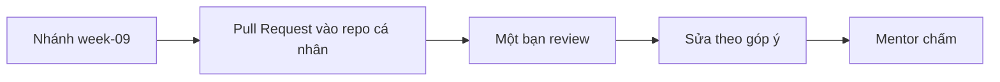

# Bài tập tuần 9 – Automated Testing & Docker CI

> **Tóm tắt:** Viết test tự động cho API Club Management, biến CI thành cổng chặn merge, rồi dựng pipeline build và publish image `club-api` lên GHCR với tag truy vết được. Mọi kết quả phải kiểm chứng được bằng source, log workflow và output lệnh.

## Bối cảnh

Hai buổi trong tuần giải quyết hai nửa của cùng một vấn đề: code vào nhánh chính mà không ai kiểm tra tự động, và image được build tay trên laptop nên không truy vết được.

- Buổi 17 (Automated Testing): unit test với mock pool, integration test với PostgreSQL, test report JUnit, branch protection.
- Buổi 18 (Docker CI Pipeline): workflow Buildx, `docker/metadata-action`, `GITHUB_TOKEN` với `packages: write`, cache `type=gha`, pull và chạy image từ GHCR.

Bài tập này làm trên repository cá nhân (ví dụ `devops-labs`), dùng backend và frontend chép từ `starter-project/` như trong hai bài lab. Bạn nộp vào hai thư mục `lab-17/` và `lab-18/`. Các lệnh chạy trong WSL2 Ubuntu, làm việc dưới `~`, không dùng `/mnt/c`.

Lưu ý quan trọng: bài nộp phải là sản phẩm của chính bạn trên repo của bạn. Tên tài khoản, run ID, SHA, digest trong evidence phải là của repo bạn, mentor sẽ đối chiếu với lịch sử commit và tab Actions.

## Nhiệm vụ L1 (bắt buộc)

### Nhiệm vụ 1 – Unit test cho API (lab-17)

Thêm `tests/api.test.js` vào `lab-17/source/backend` để kiểm tra `/ready` và `/api/members` bằng `node:test`, thay `pool.query` bằng mock gắn với test context.

Tiêu chí hoàn thành (đo được):

- [ ] Có ít nhất 4 test mới: `/ready` trả 200, `/ready` trả 503, `/api/members` trả dữ liệu, `/api/members` trả 500 khi query lỗi.
- [ ] `npm test` báo tổng `pass 5`, `fail 0` (gồm test `/health` có sẵn) và process tự thoát, không treo.
- [ ] Mỗi test dùng `t.mock.method`; test nhánh lỗi không in log nhiễu làm báo cáo khó đọc.
- [ ] Không có `node_modules` và `test-results.xml` trong commit.

### Nhiệm vụ 2 – Workflow test và test report (lab-17)

Tạo `.github/workflows/lab17-ci.yml` ở gốc repository chạy test trên `pull_request` và `push` vào nhánh chính, với job tên `unit-tests`, xuất JUnit XML và upload artifact.

Tiêu chí hoàn thành:

- [ ] Workflow nằm đúng `.github/workflows/`, có `permissions: contents: read`, dùng `working-directory` đúng thư mục backend.
- [ ] Một run xanh trên pull request, có artifact `test-results-unit` tải về được và mở ra thấy số test khớp với `npm test`.
- [ ] Step upload có `if: always()`. Chứng minh bằng một run đỏ (nhánh cố ý sai) vẫn có artifact.

### Nhiệm vụ 3 – Chặn merge khi CI đỏ (lab-17)

Cấu hình branch protection (hoặc ruleset) cho nhánh chính: bắt buộc pull request và bắt buộc check `unit-tests`. Kiểm chứng bằng một pull request cố ý đỏ.

Tiêu chí hoàn thành:

- [ ] Có một PR với check `unit-tests` đỏ và nút Merge bị khóa; link PR ghi trong `report.md`.
- [ ] PR đó sau khi sửa lại thì check xanh và nút Merge mở.
- [ ] Ảnh chụp danh sách required checks và ảnh nút Merge bị khóa nằm trong `screenshots/`. Ảnh chỉ minh họa; bằng chứng chính là link PR và log run.
- [ ] Nếu repo private và gói Free không hỗ trợ branch protection, ghi rõ trong `report.md` và đổi repo sang public cho bài này hoặc nêu cách bạn thay thế (chỉ được tính điểm khi giải thích hợp lý).

### Nhiệm vụ 4 – Workflow publish `club-api` lên GHCR (lab-18)

Tạo `.github/workflows/publish.yml` build `lab-18/source/backend` và push lên `ghcr.io/OWNER/club-api` khi push vào nhánh chính, dùng `docker/setup-buildx-action`, `docker/login-action`, `docker/metadata-action`, `docker/build-push-action` và `GITHUB_TOKEN`.

Tiêu chí hoàn thành:

- [ ] `permissions` cấp workflow chỉ có `contents: read`; `packages: write` chỉ nằm ở cấp job publish.
- [ ] Không có PAT hay secret tự tạo; đăng nhập bằng `${{ secrets.GITHUB_TOKEN }}`.
- [ ] Một run xanh; log bước `Build and push` có dòng push manifest cho `ghcr.io/owner/club-api:sha-xxxxxxx` (tên chữ thường).
- [ ] 7 ký tự sau `sha-` khớp kết quả `git rev-parse --short=7 HEAD` của commit đã kích hoạt run (ghi cả hai vào evidence).

### Nhiệm vụ 5 – Pull và chạy image đã publish (lab-18)

Xóa image local, pull image từ GHCR bằng tag `sha-`, chạy trên cổng 3100 và kiểm tra `/health`, ghi lại digest.

Tiêu chí hoàn thành:

- [ ] Output `docker pull` có dòng `Status:` của image `ghcr.io/...`, và `docker images` không còn tag `club-api:1.0.0` trước khi pull (chứng minh pull từ registry).
- [ ] `curl http://localhost:3100/health` trả JSON có `"status":"healthy"` và `"service":"club-api"`.
- [ ] Digest `sha256:...` từ `docker inspect --format '{{index .RepoDigests 0}}' ...` được ghi vào evidence.
- [ ] Container tạm đã dọn (`docker rm -f lab18-api`); không dùng cổng 3000, 5432, 8080.

## Nhiệm vụ L2 (nâng cao, điểm thưởng)

### Thử thách A – Integration test với PostgreSQL (lab-17)

Thêm `tests/members.integration.test.js` chạy với PostgreSQL thật khi `RUN_INTEGRATION=1`, mỗi test tự dựng dữ liệu. Thêm job `integration-tests` dùng `services.postgres` có health check và đưa job này vào required checks.

Tiêu chí hoàn thành:

- [ ] Cục bộ (Postgres cổng 5433): bật `RUN_INTEGRATION=1` thì các test DB chạy và pass; bỏ biến này thì nhóm test được đánh dấu skipped và `npm test` vẫn xanh.
- [ ] Chạy file integration hai lần liên tiếp và chạy riêng từng test bằng `--test-name-pattern` đều cho kết quả giống nhau (không phụ thuộc thứ tự hay dữ liệu còn sót).
- [ ] Job `integration-tests` xanh trên Actions; artifact `test-results-integration` có mặt.
- [ ] Có thêm một integration test cho nhánh lỗi (ví dụ bảng `members` không tồn tại thì API trả 500) mà không làm hỏng các test khác.

### Thử thách B – Pipeline đầy đủ hai image, tag phát hành và cache (lab-18)

Mở rộng workflow publish: matrix `club-api` và `club-web`, tag theo git tag `v*`, cache `type=gha` với `scope` riêng từng image, và pull request chỉ build chứ không push.

Tiêu chí hoàn thành:

- [ ] Sau khi đẩy git tag `v1.0.0`, GHCR có cả `club-api` và `club-web`, mỗi image có tag `v1.0.0` và một tag `sha-`.
- [ ] Một PR chạy workflow: log xác nhận build chạy, bước login bị bỏ qua và không có package/tag mới sinh ra từ PR đó.
- [ ] `report.md` ghi thời gian build lần 1 và lần 2 (lần 2 chỉ đổi một dòng mã nguồn) kèm link hai run, và trích dòng log chứng minh layer lấy từ cache.

### Thử thách C – Giải thích thiết kế (cả hai lab)

Trong `report.md`, viết ngắn gọn (mỗi ý 2-4 câu, bằng lời của bạn): vì sao cần cả unit lẫn integration test; một test nên thêm khi capstone có `POST /api/members`; vì sao `GITHUB_TOKEN` an toàn hơn PAT lưu trong secret; vì sao `packages: write` đặt ở cấp job.

Tiêu chí hoàn thành:

- [ ] Mỗi ý có ví dụ gắn với repo của bạn (tên file, tên job hoặc tên check), không chép lại câu chữ từ bài lab.

## Bằng chứng cần nộp

Nộp theo `templates/lab-template.md`, hai thư mục tách biệt:

```text
lab-17/
├── README.md
├── source/
│   ├── backend/        (có tests/api.test.js; L2: tests/members.integration.test.js)
│   └── database/
├── screenshots/
├── evidence/
│   ├── command-output.txt
│   └── test-results.txt
└── report.md
lab-18/
├── README.md
├── source/
│   ├── backend/
│   ├── frontend/
│   └── publish.yml     (bản sao workflow để chấm; bản thật ở .github/workflows/)
├── screenshots/
├── evidence/
│   └── command-output.txt
└── report.md
.github/workflows/lab17-ci.yml
.github/workflows/publish.yml
```

Evidence cụ thể cho từng nhiệm vụ:

| Nhiệm vụ | Evidence | Mentor kiểm chứng bằng |
| --- | --- | --- |
| 1 | `evidence/test-results.txt`: output `npm test -- --test-reporter=spec` có `pass 5`, `fail 0`; file `tests/api.test.js` | Chạy lại `npm ci && npm test` trên source đã nộp |
| 2 | Link run xanh và run đỏ ghi trong `report.md`; nội dung tóm tắt `test-results.xml` | Mở run, tải artifact, đọc workflow YAML |
| 3 | Link PR bị khóa merge và PR đã xanh; ảnh required checks | Mở PR, xem tab Checks và lịch sử commit |
| 4 | `lab-18/evidence/command-output.txt`: dòng push manifest, tag `sha-`, kết quả `git rev-parse --short=7 HEAD` | Đối chiếu SHA với commit của run, đọc khối `permissions` |
| 5 | Cùng file: output `docker images`, `docker pull`, `curl /health`, `docker inspect` (digest) | Đối chiếu digest với trang package trên GHCR |
| L2-A | Output chạy integration (có và không có `RUN_INTEGRATION=1`), link run có job `integration-tests` | Đọc `services.postgres`, artifact |
| L2-B | Link run theo tag `v1.0.0`, link run PR, bảng thời gian trong `report.md`, danh sách tag trên GHCR | Mở run, kiểm tra log cache và danh sách package |
| L2-C | Phần giải thích trong `report.md` | Đọc và hỏi lại nếu cần |

Mỗi README trả lời đủ 7 câu của template và đánh dấu level đã làm. `report.md` mô tả một lỗi bạn thực sự gặp (hoặc cố tình phá theo mục Phá lỗi của bài lab): triệu chứng, các bước điều tra, nguyên nhân gốc, cách phòng tránh. Không ghi token, PAT hay mật khẩu thật vào bất kỳ file nào; mật khẩu giả `ci-only-password` của DB tạm trong CI là chấp nhận được.

## Barem chấm

| Tiêu chí | Đạt | Không đạt | Điểm |
| --- | --- | --- | --- |
| Unit test (Nhiệm vụ 1) | Đủ 4 test mới, `pass 5`, mock đúng cách, process thoát | Thiếu test, test cần DB thật, treo, hoặc kết quả không khớp log | 15 |
| Workflow test và report (Nhiệm vụ 2) | Run xanh, artifact đúng, `if: always()` được chứng minh | Workflow sai chỗ, thiếu artifact, không chứng minh được khi đỏ | 15 |
| Branch protection (Nhiệm vụ 3) | Có PR đỏ bị khóa merge và PR xanh mở khóa, link kiểm chứng được | Chỉ có ảnh chụp, rule chọn sai check hoặc sai nhánh | 15 |
| Workflow publish (Nhiệm vụ 4) | Permissions least privilege, dùng `GITHUB_TOKEN`, tag `sha-` khớp commit | `packages: write` ở cấp workflow, dùng PAT, tag không khớp | 20 |
| Pull và chạy image (Nhiệm vụ 5) | Pull từ GHCR, `/health` healthy, có digest, dọn container | Dùng image build local, thiếu digest, cổng bị cấm | 10 |
| README và report | Trả lời đủ 7 câu, mô tả lỗi và điều tra có thật, đúng cấu trúc thư mục | Thiếu mục, mô tả chung chung hoặc chép từ bài lab | 10 |
| Câu hỏi kiểm tra kiến thức | Trả lời đúng ý, có lập luận | Sai ý hoặc chỉ nêu kết luận | 10 |
| Vệ sinh repo và quy trình | Không có secret, không có `node_modules`, PR có reviewer | Có `.env`, token, hoặc PR chưa review | 5 |
| Tổng L1 | | | 100 |
| L2-A Integration test | Đạt đủ 4 tiêu chí | Thiếu tiêu chí hoặc test phụ thuộc thứ tự | thưởng tối đa 4 |
| L2-B Pipeline hai image, tag, cache | Đạt đủ tiêu chí, có số liệu thời gian | Không có bằng chứng cache hoặc PR vẫn push | thưởng tối đa 4 |
| L2-C Giải thích thiết kế | Có ví dụ gắn với repo của bạn | Chung chung | thưởng tối đa 2 |
| Tổng thưởng L2 | | | tối đa 10 |

Điểm tối đa là 110 (100 điểm L1 và tối đa 10 điểm thưởng L2). Bài không có bằng chứng kiểm chứng được cho một nhiệm vụ thì nhiệm vụ đó tối đa một nửa điểm.

## Câu hỏi kiểm tra kiến thức

Trả lời ngắn (2-4 câu mỗi câu) trong `report.md` của `lab-17/` hoặc `lab-18/` (ghi rõ câu nào ở file nào), bằng lời của bạn:

1. Mock luôn trả dữ liệu đúng thì unit test có phát hiện được câu SQL sai trong `/api/members` không? Vì sao integration test vẫn cần thiết?
2. Vì sao step upload test report cần `if: always()`, và vì sao hai job upload artifact phải đặt tên khác nhau?
3. Bạn đã bật CI nhưng PR có test đỏ vẫn merge được. Nêu ít nhất ba nguyên nhân có thể và cách kiểm tra từng nguyên nhân.
4. Khác nhau giữa tag và digest là gì? Vì sao `latest` không nên dùng để tái lập bản phát hành?
5. Workflow xanh ở bước login nhưng đỏ ở bước push với lỗi `denied`. Bạn kiểm tra gì đầu tiên, và vì sao login thành công vẫn chưa đủ?

## Lỗi hay bị trừ điểm

- Nộp ảnh chụp màn hình mà không có link run, link PR hay log để kiểm chứng.
- Workflow đặt trong `lab-17/` hoặc `lab-18/` (không nằm ở `.github/workflows/` của gốc repo) nên không hề chạy.
- `packages: write` đặt ở cấp workflow, hoặc dùng PAT thay cho `GITHUB_TOKEN` mà không có lý do.
- Tên image có chữ hoa, hoặc tag `sha-` trong evidence không khớp commit của run.
- Dùng image build local rồi nói là đã pull từ GHCR (evidence thiếu `docker pull` thật hoặc digest).
- Test phụ thuộc thứ tự chạy hay dữ liệu còn sót trong DB; quên đóng server hoặc `pool.end()` làm test treo.
- Commit `node_modules`, `test-results.xml`, `.env`, token hoặc mật khẩu thật.
- Chọn nhầm tên check trong branch protection nên rule không có tác dụng, hoặc chưa từng kiểm chứng rule bằng PR đỏ.
- Chạy cổng bị cấm (3000, 5432, 8080) trong lệnh evidence thay vì cổng riêng của lab (3100, 5433).
- README và report chép nguyên văn từ bài lab, không có lỗi hay số liệu thật của bạn.
- Nộp trễ hạn hoặc PR chưa có người review.

## Quy trình nộp



1. Tạo nhánh `week-09` từ nhánh chính của repository cá nhân, commit từng phần nhỏ với message rõ ràng.
2. Push nhánh và mở Pull Request vào nhánh chính của repository cá nhân. Mô tả PR liệt kê level đã làm và link các run Actions dùng làm bằng chứng.
3. Nhờ một bạn trong CLB review PR (ít nhất một nhận xét cụ thể về workflow hoặc test). Sửa theo góp ý hợp lý.
4. Gửi link PR cho mentor. Mentor chấm dựa trên source, log run, artifact và evidence trong PR.
5. Hạn nộp: trước buổi đầu tiên của tuần 10. Nộp trễ bị trừ điểm theo quy định của khóa.

Gợi ý về thứ tự: Nhiệm vụ 3 cần workflow đã chạy trên repo trước, và PR của chính bài này có thể dùng để chạy check. Hãy ghi lại link các PR thử nghiệm (đỏ và xanh) khi làm, vì khó dựng lại sau.

## Checklist trước khi nộp

- [ ] `npm ci && npm test` chạy xanh với `pass 5`, `fail 0` trên source trong `lab-17/source/backend`
- [ ] Workflow `lab17-ci.yml` và `publish.yml` nằm ở `.github/workflows/` của gốc repo
- [ ] Có link run xanh và run đỏ (artifact vẫn có khi đỏ), link PR bị khóa merge
- [ ] Required check `unit-tests` đã bật và đã kiểm chứng bằng PR cố ý đỏ
- [ ] Tag `sha-` trên GHCR khớp commit; `docker pull`, `curl /health` và digest nằm trong `evidence/command-output.txt`
- [ ] Image dùng tên chữ thường; `permissions` đặt `packages: write` ở cấp job
- [ ] Nếu làm L2: log integration, link run theo tag `v1.0.0`, số liệu thời gian cache trong `report.md`
- [ ] `README.md` và `report.md` của cả hai lab đã điền đủ, trả lời 5 câu hỏi kiểm tra
- [ ] Không có `node_modules`, `test-results.xml`, `.env`, token, PAT trong commit (kiểm tra bằng `git diff --cached`)
- [ ] Container tạm đã dọn (`lab17-pg`, `lab18-api`)
- [ ] PR đã được ít nhất một bạn review và nộp đúng hạn
