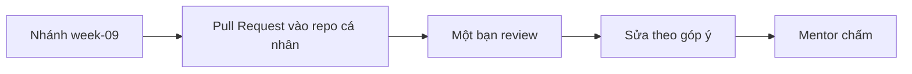

# Bài tập tuần 9 – Automated Testing và Docker CI

> **Tóm tắt:** Nộp lại bằng chứng của hai bài lab tuần 9: unit test cho API, CI chặn merge khi đỏ, và pipeline publish image club-api lên GHCR. Mọi kết quả phải kiểm chứng được bằng source, log workflow và output lệnh.

**Bài tập = nộp lại bằng chứng của lab, không có việc mới.** Việc duy nhất ngoài lab là viết `README.md`, `report.md` và trả lời 5 câu hỏi kiểm tra bên dưới bằng lời của bạn. Làm bài trên repo cá nhân `devops-labs` (để PUBLIC), trong WSL2 Ubuntu. Bài lab: [Buổi 17 – Automated Testing](../../labs/week-09/session-17.md) và [Buổi 18 – Docker CI Pipeline](../../labs/week-09/session-18.md). Hub: [Hub tuần 9](../../labs/week-09/README.md).

## Nhiệm vụ L1 (bắt buộc)

| Nhiệm vụ | Làm ở Phần nào của lab | Giờ ước lượng | Bằng chứng nộp |
| --- | --- | --- | --- |
| 1. Unit test cho API | [Buổi 17](../../labs/week-09/session-17.md), Phần 1-2 | 0,5 giờ | `tests/api.test.js`; `evidence/test-results.txt` có `pass 5`, `fail 0` |
| 2. Workflow test và report | [Buổi 17](../../labs/week-09/session-17.md), Phần 3 | 0,5 giờ | Link run xanh và run đỏ trong `report.md`; artifact `test-results-unit` |
| 3. Chặn merge khi CI đỏ | [Buổi 17](../../labs/week-09/session-17.md), Phần 4 | 0,5 giờ | Link PR đỏ bị khóa và PR đã xanh; ảnh required checks |
| 4. Workflow publish `club-api` | [Buổi 18](../../labs/week-09/session-18.md), Phần 1-3 | 1 giờ | `evidence/command-output.txt`: dòng push manifest, tag `sha-` khớp `git rev-parse --short=7 HEAD` |
| 5. Pull và chạy image | [Buổi 18](../../labs/week-09/session-18.md), Phần 4 | 0,5 giờ | Cùng file: `docker images`, `docker pull`, `curl /health`, digest |

Tiêu chí hoàn thành (đo được):

**Nhiệm vụ 1**

- [ ] Ít nhất 4 test mới: `/ready` trả 200, `/ready` trả 503, `/api/members` trả dữ liệu, `/api/members` trả 500 khi query lỗi.
- [ ] `npm test` báo tổng `pass 5`, `fail 0` (gồm test `/health` có sẵn) và process tự thoát.
- [ ] Mỗi test dùng `t.mock.method`; test nhánh lỗi không in log nhiễu.
- [ ] Không có `node_modules` và `test-results.xml` trong commit.

**Nhiệm vụ 2**

- [ ] File `.github/workflows/lab17-ci.yml` nằm đúng chỗ, có `permissions: contents: read` và `working-directory` đúng thư mục backend.
- [ ] Một run xanh trên pull request, artifact `test-results-unit` tải về được và số test khớp `npm test`.
- [ ] Step upload có `if: always()`, chứng minh bằng một run đỏ (nhánh cố ý sai) vẫn có artifact.

**Nhiệm vụ 3**

- [ ] Một PR có check `unit-tests` đỏ và nút Merge bị khóa; link PR ghi trong `report.md`.
- [ ] PR đó sau khi sửa lại thì check xanh và nút Merge mở.
- [ ] Ảnh required checks và ảnh nút Merge bị khóa nằm trong `screenshots/` (ảnh chỉ minh họa, bằng chứng chính là link PR và log run).
- [ ] Nếu repo private và gói Free không hỗ trợ branch protection, ghi rõ trong `report.md` và đổi repo sang public hoặc nêu cách thay thế hợp lý.

**Nhiệm vụ 4**

- [ ] `permissions` cấp workflow chỉ có `contents: read`; `packages: write` chỉ ở cấp job publish.
- [ ] Không có PAT hay secret tự tạo; đăng nhập bằng `secrets.GITHUB_TOKEN`.
- [ ] Một run xanh; log bước `Build and push` có dòng push manifest cho `ghcr.io/owner/club-api:sha-xxxxxxx` (tên chữ thường).
- [ ] 7 ký tự sau `sha-` khớp `git rev-parse --short=7 HEAD` của commit kích hoạt run (ghi cả hai vào evidence).

**Nhiệm vụ 5**

- [ ] Output `docker pull` có dòng `Status:` của image `ghcr.io/...`, và `docker images` không còn `club-api:1.0.0` trước khi pull.
- [ ] `curl http://localhost:3100/health` trả JSON có `"status":"healthy"` và `"service":"club-api"`.
- [ ] Digest `sha256:...` từ `docker inspect --format '{{index .RepoDigests 0}}' ...` được ghi vào evidence.
- [ ] Container tạm đã dọn (`docker rm -f lab18-api`); không dùng cổng 3000, 5432, 8080.

## Nhiệm vụ L2 (nâng cao, điểm thưởng)

Làm ở nhà, xem [Buổi 17 – Thử thách thêm](../../labs/week-09/session-17-challenge.md) và [Buổi 18 – Thử thách thêm](../../labs/week-09/session-18-challenge.md).

| Thử thách | Làm ở Phần nào của lab | Giờ ước lượng | Bằng chứng nộp |
| --- | --- | --- | --- |
| A. Integration test với PostgreSQL | Buổi 17 – Thử thách thêm, Phần 5-6 | 1 giờ | Output chạy có và không có `RUN_INTEGRATION=1`; link run có job `integration-tests`; artifact `test-results-integration` |
| B. Hai image, tag phát hành, cache | Buổi 18 – Thử thách thêm | 1 giờ | Link run theo tag `v1.0.0`, link run PR, bảng thời gian lần 1 và lần 2 trong `report.md`, danh sách tag trên GHCR |
| C. Giải thích thiết kế | Cả hai thử thách | 0,5 giờ | Phần giải thích trong `report.md`, mỗi ý có ví dụ gắn với repo của bạn |

Tiêu chí chính: (A) test DB chạy khi bật `RUN_INTEGRATION=1` và skipped khi tắt, chạy hai lần hoặc chạy riêng từng test đều cho kết quả giống nhau, có thêm test nhánh lỗi bảng `members` không tồn tại; (B) sau khi đẩy tag `v1.0.0` GHCR có đủ 2 image mỗi image có tag `v1.0.0` và một tag `sha-`, PR bỏ qua login và không tạo package, `report.md` có thời gian hai run và dòng log chứng minh cache; (C) giải thích vì sao cần cả unit lẫn integration test, một test nên thêm khi có `POST /api/members`, vì sao `GITHUB_TOKEN` an toàn hơn PAT, vì sao `packages: write` đặt ở cấp job (mỗi ý 2-4 câu, bằng lời của bạn).

## Cấu trúc nộp bài

Nộp theo [mẫu lab](../../templates/lab-template.md), hai thư mục tách biệt:

```text
lab-17/
├── README.md
├── source/
│   ├── backend/        (có tests/api.test.js; L2: tests/members.integration.test.js)
│   └── database/
├── screenshots/
├── evidence/
│   ├── command-output.txt
│   └── test-results.txt
└── report.md
lab-18/
├── README.md
├── source/
│   ├── backend/
│   ├── frontend/
│   └── publish.yml     (bản sao workflow để chấm; bản thật ở .github/workflows/)
├── screenshots/
├── evidence/
│   └── command-output.txt
└── report.md
.github/workflows/lab17-ci.yml
.github/workflows/publish.yml
```

Mỗi README trả lời đủ 7 câu của template và đánh dấu level đã làm. `report.md` mô tả một lỗi bạn thực sự gặp (hoặc cố tình phá theo phần Phá lỗi nâng cao): triệu chứng, các bước điều tra, nguyên nhân gốc, cách phòng tránh. Không ghi token, PAT hay mật khẩu thật vào bất kỳ file nào; mật khẩu giả `ci-only-password` của DB tạm trong CI là chấp nhận được.

## Bảng điểm

| Tiêu chí | Điểm |
| --- | --- |
| Unit test (Nhiệm vụ 1) | 15 |
| Workflow test và report (Nhiệm vụ 2) | 15 |
| Branch protection (Nhiệm vụ 3) | 15 |
| Workflow publish (Nhiệm vụ 4) | 20 |
| Pull và chạy image (Nhiệm vụ 5) | 10 |
| README và report | 10 |
| Câu hỏi kiểm tra kiến thức | 10 |
| Vệ sinh repo và quy trình | 5 |
| Tổng L1 | 100 |
| Thưởng L2 (A tối đa 4, B tối đa 4, C tối đa 2) | tối đa 10 |

Điểm tối đa là 110. Bài không có bằng chứng kiểm chứng được cho một nhiệm vụ thì nhiệm vụ đó tối đa một nửa điểm. Ảnh chụp màn hình không thay thế được link run, link PR hay log.

## Câu hỏi kiểm tra kiến thức

Trả lời ngắn (2-4 câu mỗi câu) trong `report.md` của `lab-17/` hoặc `lab-18/` (ghi rõ câu nào ở file nào), bằng lời của bạn:

1. Mock luôn trả dữ liệu đúng thì unit test có phát hiện được câu SQL sai trong `/api/members` không? Vì sao integration test vẫn cần thiết?
2. Vì sao step upload test report cần `if: always()`, và vì sao hai job upload artifact phải đặt tên khác nhau?
3. Bạn đã bật CI nhưng PR có test đỏ vẫn merge được. Nêu ít nhất ba nguyên nhân có thể và cách kiểm tra từng nguyên nhân.
4. Khác nhau giữa tag và digest là gì? Vì sao `latest` không nên dùng để tái lập bản phát hành?
5. Workflow xanh ở bước login nhưng đỏ ở bước push với lỗi `denied`. Bạn kiểm tra gì đầu tiên, và vì sao login thành công vẫn chưa đủ?

## Quy trình nộp



1. Tạo nhánh `week-09` từ nhánh chính của repository cá nhân, commit từng phần nhỏ với message rõ ràng.
2. Push nhánh và mở Pull Request vào nhánh chính của repository cá nhân. Mô tả PR liệt kê level đã làm và link các run Actions dùng làm bằng chứng.
3. Nhờ một bạn trong CLB review PR (ít nhất một nhận xét cụ thể về workflow hoặc test). Sửa theo góp ý hợp lý.
4. Gửi link PR cho mentor. Mentor chấm dựa trên source, log run, artifact và evidence trong PR.
5. Hạn nộp: trước buổi đầu tiên của tuần 10. Nộp trễ bị trừ điểm theo quy định của khóa.

Gợi ý về thứ tự: Nhiệm vụ 3 cần workflow đã chạy trên repo trước. Hãy ghi lại link các PR thử nghiệm (đỏ và xanh) ngay khi làm, vì khó dựng lại sau.

## Checklist trước khi nộp

- [ ] `npm ci && npm test` chạy xanh với `pass 5`, `fail 0` trên source trong `lab-17/source/backend`
- [ ] Workflow `lab17-ci.yml` và `publish.yml` nằm ở `.github/workflows/` của gốc repo
- [ ] Có link run xanh và run đỏ (artifact vẫn có khi đỏ), link PR bị khóa merge
- [ ] Required check `unit-tests` đã bật và đã kiểm chứng bằng PR cố ý đỏ
- [ ] Tag `sha-` trên GHCR khớp commit; `docker pull`, `curl /health` và digest nằm trong `evidence/command-output.txt`
- [ ] Image dùng tên chữ thường; `packages: write` đặt ở cấp job
- [ ] Nếu làm L2: log integration, link run theo tag `v1.0.0`, số liệu thời gian cache trong `report.md`
- [ ] `README.md` và `report.md` của cả hai lab đã điền đủ, trả lời 5 câu hỏi kiểm tra
- [ ] Không có `node_modules`, `test-results.xml`, `.env`, token, PAT trong commit (kiểm tra bằng `git diff --cached`)
- [ ] Container tạm đã dọn (`lab17-pg`, `lab18-api`)
- [ ] PR đã được ít nhất một bạn review và nộp đúng hạn
