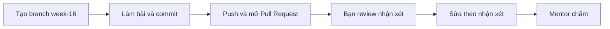

# Bài tập tuần 16 – Capstone Testing & Defense

> **Tóm tắt:** Kiểm thử hệ thống capstone từ một bản clone sạch, tiêm ba sự cố có kiểm soát trên kind và chẩn đoán bằng log và events, rồi chuẩn bị, trình bày và tự đánh giá buổi demo cuối. Mọi kết luận phải kiểm chứng được bằng source, log và kết quả lệnh.

**Hạn nộp:** trước buổi đầu tiên của tuần kế tiếp. Tuần 16 là tuần cuối của khóa nên mentor sẽ công bố ngày cụ thể ngay sau buổi 32.
**Hình thức:** Pull Request vào repo cá nhân `devops-labs`, thư mục `lab-31/` và `lab-32/`.
**Bài lab liên quan:** [Buổi 31 – Testing & Troubleshooting](../../labs/week-16/session-31.md), [Buổi 32 – Final Demo & Review](../../labs/week-16/session-32.md).
**Mẫu nộp bài:** [templates/lab-template.md](../../templates/lab-template.md).
**Tài liệu liên quan:** [đề bài Capstone](../capstone/README.md), [hướng dẫn demo](../capstone/demo-guide.md), [rubric Capstone](../../curriculum/capstone-rubric.md), [template peer review](../../templates/peer-review-template.md).

## Bối cảnh

Hệ thống Club Management của nhóm bạn đã chạy được trên máy người viết code. Câu hỏi của tuần này khác với các tuần trước: nếu một người chưa từng đụng vào repo làm lại từ đầu thì hệ thống có dựng được không, khi một thành phần hỏng thì hệ thống phản ứng thế nào, và người trực có tìm ra nguyên nhân gốc trong vài phút không.

Tuần này gồm hai phần nối tiếp nhau. Ở buổi 31 bạn tự phá hệ thống của nhóm theo kế hoạch (clean clone, sai tag image, sai mật khẩu database, xóa Pod) và ghi lại thành troubleshooting log và runbook. Ở buổi 32 nhóm demo trực tiếp, bảo vệ kỹ thuật trước mentor và viết lessons learned. Bài tập cá nhân này gom bằng chứng của cả hai buổi: bạn không nộp lại sản phẩm của nhóm, bạn nộp bằng chứng rằng chính bạn đã chạy, quan sát và hiểu từng bước.

Bài tập chỉ dùng kiến thức đã học đến buổi 32 và môi trường local (Windows 11, WSL2 Ubuntu, Docker Desktop, kind, kubectl, GitHub Actions, GHCR). Không expose máy của bạn ra Internet. Mọi lệnh chạy trong filesystem của WSL, không dùng `/mnt/c`. Nếu bị kẹt, đọc lại phần "Lỗi thường gặp" và "Phá lỗi và debug" của hai bài lab.

## Nhiệm vụ L1 (bắt buộc)

### Nhiệm vụ 1. Kiểm thử từ bản clone sạch (Compose)

Clone repo nhóm vào một thư mục mới và dựng stack Compose chỉ bằng README của nhóm.

Tiêu chí hoàn thành:

- Clone vào thư mục chưa từng tồn tại (ví dụ `~/work/clean-check`). Evidence có output của `pwd` và `git log --oneline -n 3` trong thư mục đó.
- `git ls-files | grep -E '(^|/)\.env$'` không in ra dòng nào, và repo có `.env.example` (nếu thiếu, ghi đây là lỗi README trong `report.md`).
- `docker compose config -q` thành công, `docker compose up -d --build` chạy xong và `docker compose ps` cho thấy `frontend`, `backend`, `postgres` đều `running`, `postgres` là `healthy`.
- Smoke test: `GET /health` và `GET /ready` trả `200`, `GET /api/members` trả JSON. Dùng `curl -s -o /dev/null -w` để in mã trạng thái.
- Chứng minh dữ liệu bền: thêm một bản ghi (hoặc dùng dữ liệu mẫu Alice, Bob nếu API của nhóm chưa có `POST`), chạy `docker compose down` (không `-v`) rồi `docker compose up -d`, và `GET /api/members` vẫn trả bản ghi đó.
- Danh sách "điểm README nhóm cần sửa" trong `report.md` có ít nhất một mục cụ thể, hoặc ghi rõ "không phát hiện" kèm lý do bạn tin như vậy (ví dụ đã làm đúng từng dòng README và không dùng kiến thức ngoài).

### Nhiệm vụ 2. Triển khai lên kind và đo độ trễ cơ bản

Triển khai bản clone sạch lên cluster kind với manifest trong `k8s/` và kiểm tra bằng smoke test.

Tiêu chí hoàn thành:

- Evidence có `kind get clusters`, `kubectl config current-context` (context bắt đầu bằng `kind-`) và `kubectl get nodes` với node `Ready`.
- Image `club-api` và `club-web` có tag phiên bản cụ thể (không dùng `latest`) và được nạp bằng `kind load docker-image`; evidence có output của `docker image ls club-api`.
- Secret `club-secrets` được tạo bằng lệnh `kubectl create secret ... --dry-run=client -o yaml | kubectl apply -f -` với mật khẩu thử nghiệm, không có file Secret chứa mật khẩu nào trong Git.
- `kubectl rollout status deployment/club-api -n club` báo thành công; `kubectl get pods,svc,ingress -n club` cho thấy mọi Pod `Running`, đủ `READY`, Ingress có host `club.localhost` (hoặc bạn dùng `kubectl port-forward` và nói rõ lý do trong `report.md`).
- Có 5 lần đo `curl -w "%{http_code} %{time_total}s\n"` tới `/api/members`, tất cả `200`.
- Có hai số đo tổng thời gian của 50 request tuần tự với 2 replica và 3 replica (lệnh `time`), kèm một đoạn nhận xét 2-4 câu trong `report.md` giải thích vì sao hai số gần nhau hoặc, nếu máy bạn cho kết quả khác, bạn nghĩ nút thắt nằm ở đâu và bằng chứng nào ủng hộ ý đó. Cuối bước đo, số replica phải được trả về 2.

### Nhiệm vụ 3. Ba sự cố có kiểm soát và troubleshooting log

Thực hiện ba sự cố A (xóa một Pod backend), B (sai tag image), C (sai mật khẩu database) như trong buổi 31, mỗi sự cố có dự đoán, quan sát, chẩn đoán, hoàn tác.

Tiêu chí hoàn thành:

- Với mỗi sự cố, `source/troubleshooting-log.md` có một mục đủ 5 trường: triệu chứng, nguyên nhân gốc, cách xác minh, cách sửa, cách phòng tránh, cộng một dòng "Dự đoán trước khi chạy" ghi trước khi bạn chạy lệnh và một dòng "Đúng hay sai" so với thực tế.
- Evidence có ba lần chụp trạng thái cho mỗi sự cố: trước (`kubectl get pods -n club`), trong lúc lỗi (kèm `kubectl get events -n club --sort-by=.lastTimestamp` hoặc `kubectl describe pod`) và sau khi hoàn tác. Tổng cộng 9 đoạn output có nhãn rõ ràng.
- Sự cố A: evidence có chuỗi mã HTTP khi gọi liên tiếp trong lúc xóa một Pod (không phải cả hai), và `report.md` giải thích vì sao người dùng không thấy lỗi.
- Sự cố B: evidence cho thấy Pod mới `ImagePullBackOff` trong khi Pod cũ vẫn `Running`, dòng event nêu rõ lỗi kéo image, và `kubectl rollout undo` đưa mọi Pod về `Running`.
- Sự cố C: evidence cho thấy Pod mới `Running` nhưng `0/1`, kết quả gọi trực tiếp vào Pod mới (qua `kubectl exec`) và `kubectl logs` của đúng Pod mới chứa lỗi xác thực. Mật khẩu gốc được khôi phục và không bị in ra trong evidence hay log (che bằng `***` nếu lệnh của bạn có hiển thị).
- Sau cả ba sự cố, evidence kết thúc bằng `kubectl get pods -n club` ở trạng thái khỏe mạnh và một lần `curl` `/api/members` trả `200`.

### Nhiệm vụ 4. Checklist bảo mật và runbook

Chạy checklist bảo mật tối thiểu của buổi 31 và viết runbook ngắn để người khác xử lý lại sự cố.

Tiêu chí hoàn thành:

- Evidence có output của: `git ls-files` lọc `.env`; lệnh tìm chuỗi nhạy cảm trong `git log -p --all` (kết quả rỗng hoặc bạn giải thích từng dòng in ra); `docker run --rm club-api:1.0.0 id` không in `uid=0`; `grep -n -A3 "^permissions" .github/workflows/*.yml` cho thấy khối `permissions`.
- `report.md` có bảng 5 hàng ứng với 5 hạng mục của checklist (không secret trong Git, non-root, quét image, quyền workflow, pin phiên bản) với cột trạng thái Đạt, Không đạt hoặc Chưa làm, và bằng chứng. Hạng mục không đạt phải có kế hoạch sửa. Hạng mục quét image: nếu bạn chạy công cụ quét, ghi số lượng HIGH và CRITICAL; nếu chưa chạy, ghi "Chưa làm" và lý do.
- `source/runbook.md` (bản sao của `docs/runbook.md` trong repo nhóm) có đủ 5 mục: xem log, xem events, rollout restart, rollback, scale. Mỗi mục có đúng một lệnh đã chạy thật trong Nhiệm vụ 3 hoặc 2, một câu "khi nào dùng" và kết quả mong đợi.
- Runbook không chứa mật khẩu, token hay địa chỉ riêng tư.

### Nhiệm vụ 5. Chuẩn bị demo, bảo vệ và tự đánh giá

Chuẩn bị cho lượt demo của nhóm ở buổi 32 và ghi lại những gì bạn tự làm.

Tiêu chí hoàn thành:

- `source/demo-commands.md` (hoặc `demo.sh`) liệt kê các lệnh bạn dùng trong phần demo của mình theo thứ tự, mỗi lệnh có một dòng chú thích, không chứa secret. Nếu dùng `demo.sh`, file có shebang, quyền thực thi và xuống dòng LF.
- `evidence/command-output.txt` của `lab-32/` có output thật của một lượt chạy thử có bấm giờ, gồm ít nhất: `docker compose ps`, `curl` `/api/members` sau `down` rồi `up`, `kubectl get pods,svc,ingress -n club`, một lần xóa Pod để thấy self-healing và một sự cố cùng cách sửa. Có dòng ghi tổng thời gian chạy thử (ví dụ bằng `date -Is` ở đầu và cuối).
- `source/` có link tới repo nhóm, link tới ít nhất một PR của bạn trong repo nhóm đã được review, và link hoặc tên run GitHub Actions xanh cùng package trên GHCR (ghi dạng văn bản trong `source/links.md`).
- `report.md` của `lab-32/` có ba mục lessons learned (điều làm tốt, điều làm chưa tốt, điều sẽ làm khác), mỗi mục có ít nhất hai ý gắn với sự việc cụ thể trong dự án (một PR, một lỗi, một lệnh), và mục "Nhận xét của mentor" để mentor điền hoặc bạn chép lại sau buổi demo.
- Bạn đã điền peer review cho từng bạn cùng nhóm và nộp cho mentor theo cách mentor hướng dẫn. Không đưa file peer review vào repo. Trong `report.md` chỉ ghi một dòng xác nhận đã nộp, không ghi nội dung.

## Nhiệm vụ L2 (nâng cao)

L2 là điểm thưởng (tối đa 10), chỉ chấm khi L1 đã đạt từ 60 điểm trở lên.

### Thử thách A. Thiết kế failure injection cho nhóm khác

Thiết kế một sự cố mới cho nhóm bên cạnh, để họ chẩn đoán mà không biết trước nguyên nhân.

Tiêu chí hoàn thành:

- `lab-31/source/challenge-design.md` mô tả kịch bản: lệnh gây lỗi, triệu chứng quan sát được (không nêu nguyên nhân), cách hoàn tác bằng một đến hai lệnh, và lý do kịch bản an toàn (chỉ gây một lỗi, chỉ chạy trên cluster của nhóm nhận khi họ đồng ý).
- Kịch bản khác ba sự cố A, B, C của buổi 31 và không phải sự cố có sẵn trong gợi ý của bài lab (đổi `DB_HOST`, sai đường dẫn readiness, memory limit thấp, `nodeSelector` không tồn tại) hoặc bạn nêu rõ điểm khác biệt đáng kể.
- Evidence có output bạn tự chạy thử kịch bản và hoàn tác trên cluster của nhóm mình trước khi giao.
- `report.md` có phần nhận xét báo cáo 5 mục của nhóm nhận: đủ bằng chứng chưa, quy trình chẩn đoán có đi từ trạng thái, sự kiện, log tới cấu hình không, và một điểm bạn học được từ cách họ chẩn đoán.

### Thử thách B. Xóa Pod PostgreSQL và so sánh với dự đoán

Tiêm sự cố vào tầng dữ liệu và chứng minh dữ liệu còn nguyên.

Tiêu chí hoàn thành:

- Trước khi chạy, `source/postgres-failure.md` ghi dự đoán gồm ba điều: Pod nào được tạo lại và bởi controller nào, dữ liệu còn hay mất và vì sao, người dùng thấy gì trong lúc đó.
- Evidence có tên Pod PostgreSQL thật (lấy từ `kubectl get pods`, không đoán), một bản ghi hoặc dữ liệu mẫu truy vấn được trước sự cố, quá trình Pod được tạo lại, và cùng dữ liệu đó truy vấn lại được sau khi Pod `Ready`.
- Evidence có `kubectl get pvc -n club` trước và sau, cho thấy PVC vẫn `Bound` và là cùng một PVC.
- Phần "So sánh với dự đoán" nêu điểm đúng, điểm sai, và một điều bạn quan sát thêm mà không dự đoán được (ví dụ khoảng thời gian backend trả lỗi). Không xóa PVC trong thử thách này.

### Thử thách C. Đề xuất cải tiến có ưu tiên và câu hỏi mở rộng

Viết `lab-32/source/improvements.md`.

Tiêu chí hoàn thành:

- Ít nhất 3 đề xuất cho hệ thống và 2 đề xuất cho khóa học. Mỗi đề xuất có: vấn đề quan sát được (kèm bằng chứng như tên file, lệnh hoặc sự cố đã gặp), cách làm cụ thể, ước lượng công sức (số giờ và cách bạn ước lượng), mức ưu tiên (cao, trung bình, thấp) và lý do.
- Các đề xuất được sắp xếp theo thứ tự ưu tiên, và có một đoạn giải thích vì sao đề xuất đứng đầu quan trọng hơn đề xuất đứng cuối.
- Trả lời hai câu mở rộng, mỗi câu 5-8 dòng: (1) khi có nhiều người dùng, nút thắt đầu tiên của hệ thống này là gì và bạn kiểm chứng bằng cách đo gì; (2) khi chuyển từ kind sang cluster thật, cần đổi những gì về image registry, Secret, Ingress và lưu trữ.

## Bằng chứng cần nộp

Cấu trúc thư mục theo mẫu lab:

```text
lab-31/
├── README.md
├── report.md
├── source/
│   ├── troubleshooting-log.md
│   ├── runbook.md
│   ├── challenge-design.md      (L2, Thử thách A)
│   └── postgres-failure.md      (L2, Thử thách B)
├── screenshots/
│   ├── pods-during-failure.png
│   └── pods-after-fix.png
└── evidence/
    ├── command-output.txt
    └── test-results.txt
lab-32/
├── README.md
├── report.md
├── source/
│   ├── demo-commands.md
│   ├── links.md
│   └── improvements.md          (L2, Thử thách C)
├── screenshots/
│   ├── actions-green-run.png
│   └── ghcr-package.png
└── evidence/
    └── command-output.txt
```

Bằng chứng theo từng nhiệm vụ:

| Nhiệm vụ | Bằng chứng bắt buộc |
| --- | --- |
| 1 | `lab-31/evidence/command-output.txt` có output clean clone, kiểm tra `.env`, `docker compose ps`, ba lệnh smoke test, chuỗi lệnh `down` và `up` cùng kết quả `GET /api/members`; `report.md` có danh sách điểm README cần sửa |
| 2 | Output `kind get clusters`, `kubectl get nodes`, `docker image ls club-api`, `kubectl rollout status`, `kubectl get pods,svc,ingress -n club`, 5 dòng `curl -w`, hai kết quả `time` (2 và 3 replica); đoạn nhận xét trong `report.md` |
| 3 | `source/troubleshooting-log.md` đủ 3 mục; 9 đoạn output có nhãn (trước, trong, sau cho từng sự cố) trong `evidence/command-output.txt`; ảnh `kubectl get pods` chỉ bổ trợ |
| 4 | Output 4 lệnh kiểm tra bảo mật; bảng 5 hạng mục trong `report.md`; `source/runbook.md` |
| 5 | `lab-32/source/demo-commands.md`, `links.md`; `lab-32/evidence/command-output.txt` của lượt chạy thử có bấm giờ; lessons learned trong `lab-32/report.md`; dòng xác nhận đã nộp peer review |
| L2 | Theo từng thử thách ở trên |

Nguyên tắc: ảnh chụp màn hình chỉ bổ trợ. Mọi nhiệm vụ phải kiểm chứng được bằng file nguồn và log dạng text để reviewer đọc và đối chiếu. Mỗi đoạn output trong `command-output.txt` nên có một dòng nhãn phía trên (ví dụ `=== Su co B - trong luc loi ===`) và lệnh đã chạy, để reviewer biết output nào thuộc bước nào. `README.md` của mỗi lab trả lời đủ 7 câu theo mẫu và ghi rõ đã làm L1 hay L2.

Trước khi nộp, tự kiểm tra tệp nhạy cảm bằng các lệnh sau (kết quả mong đợi: không in ra dòng nào đáng ngờ):

```bash
cd ~/devops-labs
git ls-files | grep -E '(^|/)(id_ed25519|id_rsa|\.env)$'
grep -rIn -E "password|token|secret" lab-31 lab-32 | grep -v -E "DB_PASSWORD|db-password|club-secrets|secretKeyRef"
grep -rIl "BEGIN OPENSSH PRIVATE KEY" . --exclude-dir=.git
```

Lệnh thứ hai có thể in ra các dòng văn bản mô tả hợp lệ (ví dụ tiêu đề "Secret không nằm trong Git"); hãy xem từng dòng và đảm bảo không dòng nào chứa giá trị mật khẩu thật.

## Barem chấm

Tổng 100 điểm cho L1, cộng tối đa 10 điểm thưởng cho L2.

| Tiêu chí | Đạt | Không đạt | Điểm |
| --- | --- | --- | --- |
| Nhiệm vụ 1: clean clone và Compose | Clone thư mục mới, không có `.env` trong Git, ba service lên, smoke test đủ, dữ liệu còn sau `down` và `up`, có nhận xét README | Dùng thư mục cũ, thiếu smoke test, không chứng minh dữ liệu bền | 15 |
| Nhiệm vụ 2: kind và độ trễ | Context kind đúng, image có tag phiên bản, mọi Pod Ready, đủ 5 lần đo và hai số `time`, nhận xét có lập luận | Pod không Ready, dùng `latest`, thiếu số đo hoặc kết luận không dựa trên số đo | 15 |
| Nhiệm vụ 3: ba sự cố | Đủ 9 đoạn output có nhãn, mỗi sự cố có dự đoán, log 5 trường, nguyên nhân gốc đúng, hoàn tác về trạng thái khỏe mạnh | Thiếu sự cố hoặc thiếu trạng thái trước, trong, sau; nguyên nhân sai hoặc chỉ nêu lại triệu chứng; không hoàn tác | 25 |
| Nhiệm vụ 4: bảo mật và runbook | 4 lệnh kiểm tra có output thật, bảng 5 hạng mục trung thực, runbook đủ 5 mục với lệnh đã chạy | Bảng ghi Đạt không có bằng chứng, runbook thiếu mục hoặc có lệnh chưa chạy, có secret | 15 |
| Nhiệm vụ 5: demo, bảo vệ, tự đánh giá | Có lệnh demo, lượt chạy thử bấm giờ bằng log thật, lessons learned cụ thể, đã nộp peer review | Lessons learned chung chung, thiếu log chạy thử, đưa peer review vào repo | 10 |
| `report.md` và `README.md` | Đủ 7 câu mỗi lab, giải thích đúng, 5 câu hỏi kiểm tra được trả lời bằng lời của bạn, ghi rõ mức đã làm | Thiếu câu, sao chép đề bài hoặc lời giải trong bài lab, không ghi mức | 10 |
| Bằng chứng và kỷ luật repo | Đúng cấu trúc thư mục, evidence là text thật có nhãn, không có secret, commit message rõ ràng | Sai cấu trúc, evidence chỉ là ảnh, có secret | 5 |
| Quy trình nộp | Có PR, được một bạn review có nhận xét thật | Push thẳng vào `main` hoặc review chỉ ghi "OK" | 5 |
| **Tổng L1** | | | **100** |
| L2: Thử thách A (thiết kế sự cố) | Kịch bản an toàn, hoàn tác được, đã tự chạy thử, có nhận xét báo cáo của nhóm nhận | Thiếu cách hoàn tác, chưa chạy thử, lộ nguyên nhân trong triệu chứng | +4 |
| L2: Thử thách B (xóa Pod PostgreSQL) | Dự đoán ghi trước, PVC cùng một cái, dữ liệu còn, so sánh dự đoán trung thực | Dự đoán viết sau khi chạy, không có output PVC, xóa PVC | +3 |
| L2: Thử thách C (cải tiến và câu hỏi mở rộng) | Đủ số đề xuất có ưu tiên và ước lượng, hai câu mở rộng có lập luận cụ thể | Đề xuất chung chung, không bằng chứng, câu trả lời không nêu cách đo | +3 |
| **Tối đa thưởng** | | | **+10** |

Điểm một tiêu chí được chia theo mức: đạt đủ nhận điểm tối đa, đạt một phần nhận khoảng một nửa, không có hoặc không kiểm chứng được nhận 0.

## Câu hỏi kiểm tra kiến thức

Trả lời ngắn (2-4 câu mỗi câu) bằng lời của bạn: câu 1 đến 3 trong `lab-31/report.md`, câu 4 và 5 trong `lab-32/report.md`.

1. Vì sao kiểm thử từ bản clone sạch phát hiện được những lỗi mà chạy lại trên máy đang làm việc không phát hiện? Nêu hai ví dụ cụ thể từ hệ thống của nhóm bạn hoặc từ bài lab.
2. Trong sự cố C, Pod backend mới `Running` nhưng `0/1` Ready và không bị restart, còn người dùng chưa thấy lỗi. Giải thích hiện tượng bằng sự khác nhau giữa readiness probe và liveness probe của dự án này.
3. Bạn vừa sửa Secret nhưng API vẫn dùng mật khẩu cũ. Bạn làm gì tiếp theo, vì sao, và bạn xác nhận Pod đã dùng giá trị mới bằng cách nào mà không in mật khẩu ra màn hình?
4. `docker compose down` khác `docker compose down -v` ở điểm nào, và khi xóa Pod `postgres-0` trên Kubernetes thì dữ liệu còn hay mất? Nêu thành phần quyết định điều đó.
5. Mentor chỉ định bạn trả lời về một phần bạn không trực tiếp viết (ví dụ Dockerfile multi-stage hoặc pipeline CI). Nêu ba bước bạn trả lời theo cấu trúc kết luận, lý do, bằng chứng, và cho biết bằng chứng đó nằm ở lệnh hay file nào trong repo nhóm.

## Lỗi hay bị trừ điểm

- Dùng thư mục làm việc cũ thay vì clone mới, nên không phát hiện thiếu `.env.example` hoặc thiếu bước trong README.
- `command-output.txt` chỉ có output cuối, thiếu trạng thái trước và trong lúc lỗi; hoặc output không có nhãn nên reviewer không biết thuộc sự cố nào.
- Viết dự đoán sau khi đã thấy kết quả, hoặc ghi nguyên nhân gốc là triệu chứng (ví dụ "Pod ImagePullBackOff" thay vì "tag không tồn tại trong node kind").
- Xem log của Pod cũ rồi kết luận "không có lỗi" trong sự cố C, vì không lấy đúng Pod mới; hoặc quên gọi trực tiếp vào Pod mới khi Service không gửi traffic tới Pod chưa Ready.
- Không hoàn tác: để Deployment ở tag `9.9.9`, để Secret sai mật khẩu, hoặc để replica ở 3.
- In mật khẩu thật hay mật khẩu thử nghiệm vào evidence, log, runbook hoặc ảnh chụp màn hình; commit `.env`, file Secret chứa giá trị thật, token hoặc private key.
- Ghi "Đạt" trong bảng bảo mật nhưng không có output lệnh tương ứng; khai quét image nhưng không có kết quả quét.
- Kết luận về hiệu năng mà không có số đo, hoặc nói thêm replica luôn làm nhanh hơn mà không giải thích nút thắt.
- Runbook chứa lệnh chưa từng chạy, hoặc dùng tên Pod cố định thay vì chỉ cách lấy tên Pod thật.
- Đưa file peer review vào repo công khai, hoặc lessons learned chung chung ("làm việc nhóm tốt hơn") không gắn với sự việc cụ thể.
- Nhóm chạy thử demo bằng ảnh chụp thay vì lệnh thật, hoặc lệnh trong `demo-commands.md` không khớp tên service và nhãn trong manifest.
- Nộp ảnh chụp thay cho file nguồn và log text; push thẳng vào `main`, không có PR hoặc không có người review.

## Quy trình nộp



1. Tạo branch từ `main` trong repo cá nhân:

```bash
cd ~/devops-labs
git switch main
git switch -c week-16
```

2. Làm bài, commit theo từng nhiệm vụ với message rõ nghĩa (ví dụ `Add lab-31 failure injection log`).
3. Push branch và mở Pull Request vào `main` của chính repo cá nhân:

```bash
git push -u origin week-16
```

4. Nhờ một bạn trong CLB review. Reviewer để ít nhất 2 nhận xét cụ thể (một điểm tốt, một điểm cần sửa) trên PR; nên đối chiếu thử một đoạn output trong `command-output.txt` với troubleshooting log tương ứng. Bạn sửa theo nhận xét hợp lý và trả lời từng nhận xét.
5. Gắn mentor làm reviewer và dán link PR vào kênh nộp bài của lớp. Mentor chấm theo barem trên, không chấm nội dung đẩy sau hạn.

Hạn nộp: trước buổi đầu tiên của tuần kế tiếp (mentor công bố ngày cụ thể sau buổi 32). Nộp muộn bị trừ theo quy định trong `curriculum/assessment.md`.

## Checklist trước khi nộp

- [ ] `lab-31/` và `lab-32/` có đúng cấu trúc thư mục, có `README.md` (7 câu), `report.md`, `source/`, `screenshots/`, `evidence/`
- [ ] Clean clone làm trong thư mục mới; `.env` không nằm trong Git và repo có `.env.example`
- [ ] Smoke test `/health`, `/ready`, `/api/members` và kiểm tra dữ liệu bền sau `down` rồi `up` đều có trong evidence
- [ ] Image có tag phiên bản, mọi Pod Ready trên kind, đủ 5 lần đo `curl -w` và hai số `time` (2 và 3 replica), replica đã trả về 2
- [ ] Troubleshooting log đủ 3 sự cố, mỗi sự cố có dự đoán và 5 trường; evidence có đủ trạng thái trước, trong, sau
- [ ] Cả ba sự cố đã hoàn tác, evidence kết thúc ở trạng thái khỏe mạnh
- [ ] Bảng 5 hạng mục bảo mật trung thực, mỗi dòng có bằng chứng; `runbook.md` đủ 5 mục với lệnh đã chạy thật
- [ ] `demo-commands.md`, `links.md` và log chạy thử có bấm giờ đã có; lessons learned gắn với sự việc cụ thể
- [ ] Đã nộp peer review cho mentor và không đưa vào repo
- [ ] 5 câu hỏi kiểm tra kiến thức đã được trả lời trong `report.md`
- [ ] Đã chạy các lệnh quét secret ở phần Bằng chứng và xem xét từng dòng kết quả
- [ ] Không commit `.env`, password, token, private key, file Secret chứa giá trị thật
- [ ] Ghi rõ mức đã làm (L1 hoặc L2) cuối `README.md`
- [ ] Đã mở Pull Request, được ít nhất một bạn review, mentor đã được gắn
