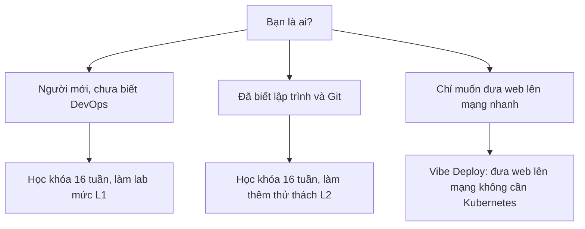

# Bắt đầu từ đây

Khóa này dạy bạn đưa một ứng dụng web từ máy tính của mình lên chạy ổn định, theo cách các đội kỹ thuật làm thật: dùng Linux, Git, Docker, tự động hóa bằng GitHub Actions và chạy trên Kubernetes. Bạn không cần biết DevOps trước, chỉ cần dùng máy tính thoải mái và sẵn sàng gõ lệnh. Cuối khóa, bạn tự dựng được một hệ thống gồm giao diện web, API và cơ sở dữ liệu, có quy trình tự kiểm tra và đóng gói, rồi giải thích được vì sao nó chạy.

> **Tóm tắt:** Học 16 tuần, mỗi tuần 2 buổi 120 phút cộng 2–3 giờ ở nhà. Việc cần làm trước buổi 01 mất khoảng 30 phút, gồm 5 việc bên dưới. Mỗi buổi đi theo thứ tự đọc, làm lab, gặp lỗi, tự kiểm tra, nộp bài.

## Trước buổi 01: 5 việc, khoảng 30 phút

::: tip Làm đủ 5 việc, theo thứ tự
- [ ] **Tài khoản GitHub và 2FA** (khoảng 5 phút). Tạo tài khoản và bật xác thực hai lớp, xem mục 1 của [Tài khoản GitHub và repo devops-labs](../resources/setup-github.md).
- [ ] **Repo `devops-labs`** (khoảng 3 phút). Tạo repo cá nhân tên `devops-labs`, chọn chế độ **Public** (cần để dùng GitHub Pages và GHCR miễn phí về sau), xem mục 2 của trang trên.
- [ ] **Cài Git** (khoảng 7 phút). Windows: tải Git for Windows từ git-scm.com, giữ lựa chọn mặc định (bản này kèm Git Bash). macOS và Linux thường đã có sẵn. Xem [Hướng dẫn cài đặt môi trường](../resources/setup-guide.md#can-ngay-tuan-1).
- [ ] **Cài Visual Studio Code** (khoảng 5 phút), chọn "Add to PATH" khi cài.
- [ ] **Đọc [Terminal 101](../resources/terminal-101.md)** (khoảng 10 phút, phần mở Git Bash và 10 lệnh đầu). Buổi 01 gõ lệnh trong Git Bash: bấm Start, gõ `Git Bash`.

Đừng cài trước: WSL2 để dành cho Buổi 02, Docker để dành cho Buổi 07 (Container Fundamentals), kind để dành cho Buổi 21. Buổi 08 là Docker CLI. Mỗi công cụ được cài đúng lúc, kèm hướng dẫn từng bước trong [Hướng dẫn cài đặt môi trường](../resources/setup-guide.md).
:::

Từ nào lạ thì tra [Thuật ngữ](../resources/glossary.md). Cần dùng Git ngay ở Buổi 01 để nộp bài? Xem [Git trong 10 phút](how-to-learn.md#git-10-phut), hoặc nộp bằng upload trên web GitHub.

## Chọn đường học của bạn

- Người mới: học theo thứ tự từ Tuần 1. Làm mức L1 là đủ để hoàn thành khóa.
- Đã biết lập trình: học cùng lộ trình, làm thêm các thử thách L2 ở cuối mỗi bài (tự quyết định, tự giải thích).
- Chỉ muốn lên mạng nhanh: xem [Vibe Deploy](../vibe/index.md), một nhánh riêng ngắn hơn.
- Muốn xem toàn cảnh trước: [Lộ trình 16 tuần](syllabus.md).

## Xong 5 việc? Vào học

Mở [Tuần 1](../labs/week-01/README.md) để xem kế hoạch tuần, hoặc vào thẳng buổi đầu tiên.

**[Vào Buổi 01 – DevOps Introduction](../labs/week-01/session-01.md)**

## Cần tra cứu sau này

Trang [Cách học khóa này](how-to-learn.md) gom những thứ bạn sẽ tra dần, không cần đọc trước:

- Git trong 10 phút và cách nộp bài bằng branch, Pull Request.
- Cách học một tuần, hai mức L1 và L2, tình huống lỗi.
- Cấu trúc repo `devops-labs`, theo dõi tiến độ bằng Issues và Projects.
- Mẫu câu hỏi khi cần giúp, mentor và kênh hỏi.
- Quy tắc dùng AI và trung thực học thuật.
