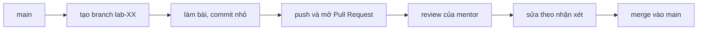

# Hướng dẫn học khóa này

Tài liệu dành cho học viên: một buổi học diễn ra thế nào, nộp bài ra sao, dùng công cụ nào để theo dõi tiến độ, và cách xin trợ giúp để được giúp nhanh nhất.

> **Tóm tắt:** Mỗi buổi 120 phút (ôn 15', kiến thức 30', thực hành 60', review 15'). Bài nộp bằng branch + Pull Request trong repo cá nhân `devops-labs`. Tự làm, hiểu và giải thích được là mục tiêu. AI là công cụ hỗ trợ, không thay thế việc hiểu. Hỏi bằng triệu chứng, việc đã thử và log.

## 1. Trước khi bắt đầu

- Cài môi trường theo [Setup Guide](../resources/setup-guide.md) và chạy hai script kiểm tra. Nếu gặp lỗi, xem [Xử lý sự cố cài đặt](../resources/troubleshooting-setup.md).
- Đọc [Syllabus](syllabus.md), [Lịch học](schedule.md), [Chuẩn đầu ra](learning-outcomes.md) và cách [Đánh giá](assessment.md).
- Có tài khoản GitHub, bật 2FA, và thêm SSH key.
- Tạo repo cá nhân `devops-labs` (mục 3).

Triết lý khóa học: **Learn, Build, Break, Debug, Deploy, Explain.** Bạn học khái niệm, tự dựng, cố ý làm hỏng, tìm nguyên nhân gốc, triển khai và giải thích lại bằng lời của mình. Giải thích được mới coi là hiểu.

## 2. Một buổi học diễn ra thế nào

Mỗi buổi kéo dài 120 phút:

| Thời lượng | Phần | Bạn làm gì |
| --- | --- | --- |
| 15 phút | Ôn tập | Trả lời nhanh câu hỏi của buổi trước, nhắc lại lệnh và khái niệm chính |
| 30 phút | Kiến thức và demo | Nghe, ghi chú, gõ lại lệnh demo trên máy mình, đặt câu hỏi |
| 60 phút | Thực hành | Làm lab theo mức L1 hoặc L2, chụp bằng chứng, ghi lại lỗi gặp phải |
| 15 phút | Review | Chia sẻ kết quả, nhận phản hồi, ghi lại điều chưa hiểu |

Cách chuẩn bị cho mỗi buổi:

1. Đọc trang buổi học và phần "Mục tiêu" trước khi đến lớp (10 đến 15 phút).
2. Mở sẵn terminal WSL và Docker Desktop (từ tuần 4) nếu buổi đó cần.
3. Chạy `docker ps` và `git status` để chắc môi trường còn nguyên trạng.

### Hai mức L1 và L2

Mỗi lab có hai mức. Chọn mức theo năng lực hiện tại, bạn có thể nâng dần qua các tuần.

| Mức | Tên | Cách làm | Sản phẩm nộp |
| --- | --- | --- | --- |
| L1 | Foundation | Làm theo hướng dẫn từng bước, hiểu từng lệnh làm gì | Kết quả chạy, ảnh chụp/log, trả lời câu hỏi kiểm tra |
| L2 | Engineering | Tự thiết kế và triển khai, xử lý lỗi, giải thích lựa chọn | Mã/cấu hình, report giải thích quyết định, lỗi đã gặp và cách sửa |

L2 không phải "làm nhiều hơn" mà là "tự quyết định và chịu trách nhiệm giải thích". Chi tiết mức đạt xem [Chuẩn đầu ra](learning-outcomes.md).

### Tình huống lỗi (troubleshooting)

Khóa có 10 tình huống lỗi trong `examples/troubleshooting`, xem tổng quan ở [10 tình huống lỗi](../examples/troubleshooting-scenarios.md). Bạn chỉ nhận **triệu chứng** và phải tìm **nguyên nhân gốc**. Đừng sửa mò: ghi lại giả thuyết, lệnh kiểm chứng và kết quả. Quy trình tốt: quan sát, đặt giả thuyết, kiểm chứng bằng lệnh, sửa một thay đổi mỗi lần, kiểm tra lại.

## 3. Cấu trúc repo cá nhân devops-labs

Tạo repo trống `devops-labs` trên GitHub, clone vào WSL:

```bash
mkdir -p ~/work && cd ~/work
git clone git@github.com:TEN-GITHUB/devops-labs.git
cd devops-labs
```

Thay `TEN-GITHUB` bằng username của bạn. Cấu trúc đề xuất:

```text
devops-labs/
├── README.md
├── .gitignore
├── lab-01/
│   ├── README.md
│   ├── source/
│   ├── screenshots/
│   ├── evidence/
│   │   ├── command-output.txt
│   │   └── test-results.txt
│   └── report.md
├── lab-02/
│   └── ...
└── cheatsheets/
```

- Mỗi buổi một thư mục `lab-XX/` với XX là số buổi hai chữ số (`lab-01`, `lab-02`, ...).
- `report.md` viết theo [mẫu lab](../templates/lab-template.md): bài lab giải quyết vấn đề gì, kiến thức đã dùng, các bước, kết quả, lỗi đã gặp, cách khắc phục, cải thiện được gì. Ghi rõ mức đã làm (L1 hay L2).
- Mẫu cho bài tập tuần và dự án: [Assignment template](../templates/assignment-template.md), [Project template](../templates/project-template.md).
- `evidence/` chứa output lệnh thật (ví dụ `docker ps > evidence/command-output.txt`). Output phải là của chính máy bạn.

Tạo `.gitignore` ngay từ đầu để không lỡ commit bí mật:

```text
.env
*.pem
id_*
node_modules/
*.log
.DS_Store
```

**Không bao giờ commit** mật khẩu, token, khóa riêng, file `.env`. Nếu lỡ commit, báo mentor ngay, đổi (rotate) bí mật đó. Xóa file khỏi commit mới nhất là chưa đủ vì lịch sử Git vẫn giữ.

Nhóm capstone dùng repo nhóm, bắt đầu từ `starter-project`. Xem [Capstone](../assignments/capstone/README.md).

## 4. Nộp bài bằng branch và Pull Request

Quy trình cho mỗi lab:



Lệnh cụ thể:

```bash
git switch main
git pull
git switch -c lab-03
mkdir -p lab-03/source lab-03/screenshots lab-03/evidence
# làm bài, rồi:
git add lab-03
git commit -m "lab-03: phan tich log bang grep va pipe"
git push -u origin lab-03
```

Sau đó mở Pull Request (trên trang GitHub hoặc `gh pr create --fill`) từ branch `lab-03` vào `main` của repo của bạn, gắn mentor làm reviewer và gán nhãn mức đã làm (`L1` hoặc `L2`).

Quy ước:

- Một lab = một branch = một Pull Request. Tên branch: `lab-XX`.
- Commit nhỏ, thường xuyên, mô tả rõ làm gì và vì sao. Ví dụ tốt: `lab-05: them cac lenh ss va curl vao report`. Tránh `update`, `fix`, `abc`.
- Mô tả Pull Request nêu: lab nào, mức nào, khó khăn gặp phải, điều bạn muốn mentor xem kỹ.
- Hạn nộp theo [Lịch học](schedule.md) và quy định tại [Đánh giá](assessment.md). Nộp muộn thì báo trước và nêu lý do.
- Khi có nhận xét: sửa trên cùng branch, commit và push tiếp, trả lời từng nhận xét. Không tạo Pull Request mới.
- Review chéo: bạn có thể được yêu cầu review bài của bạn khác. Nhận xét cụ thể, lịch sự, chỉ vào dòng cụ thể và nêu lý do.

## 5. Theo dõi tiến độ trên GitHub

| Công cụ | Dùng để | Cách dùng gợi ý |
| --- | --- | --- |
| Issues | Ghi từng đầu việc, câu hỏi, lỗi | Mỗi lab một issue có checklist `- [ ]`. Đóng bằng `Closes #N` trong mô tả Pull Request |
| Projects | Bảng Kanban cá nhân hoặc nhóm | Cột Todo, Doing, Review, Done. Dự án capstone bắt buộc có bảng của nhóm |
| Milestones | Gom issue theo mốc | Một milestone mỗi tuần hoặc mỗi giai đoạn (Foundation, Docker, CI/CD, Kubernetes, Capstone) |
| Discussions | Hỏi đáp chung, chia sẻ cách làm hay | Câu hỏi mang tính khái niệm hỏi ở đây để cả lớp cùng đọc được. Bài lab riêng thì hỏi qua Pull Request |
| Pull Requests | Nộp bài và review | Xem mục 4 |

Đặt tên issue theo dạng hành động: "Lab 04: tạo user và phân quyền thư mục". Việc chia nhỏ và ghi lại tiến độ cũng là một kỹ năng DevOps được chấm trong phần đánh giá.

## 6. Trung thực học thuật và vai trò của AI

Mục tiêu của khóa là bạn **làm được và giải thích được**, không phải có một repo trông đẹp.

Quy tắc chống đạo văn:

- Bài nộp là sản phẩm của chính bạn, chạy trên máy của bạn, với output thật của bạn. Không sao chép bài của bạn khác, không chép nguyên lời giải trên mạng.
- Được tham khảo tài liệu chính thức, bài viết, bạn học thảo luận ý tưởng. Khi dùng nguồn bên ngoài đáng kể, ghi nguồn (link) trong `report.md`.
- Làm việc nhóm ở capstone: ghi rõ ai làm phần nào. Lịch sử commit phải phản ánh đóng góp thật của từng người.
- Mentor có thể hỏi vấn đáp ngắn về bài bạn nộp ("vì sao dòng này có mặt?", "nếu bỏ nó thì chuyện gì xảy ra?"). Không giải thích được bài của chính mình bị coi như chưa đạt.

Dùng AI (ChatGPT, Claude, Copilot...) như một công cụ hỗ trợ:

- Được phép: giải thích khái niệm, giải thích thông báo lỗi, gợi ý hướng debug, review mã của bạn, hỏi ví dụ để hiểu thêm.
- Không được: nhờ AI làm cả bài rồi nộp; dán output do AI "bịa" vào phần bằng chứng; nộp cấu hình bạn không hiểu.
- Luôn kiểm chứng: AI có thể đưa lệnh, cờ hoặc phiên bản không tồn tại. Đối chiếu với tài liệu chính thức ([Tài liệu chính thức](../resources/documentation.md)) và chạy thử.
- Không dán bí mật (mật khẩu, token, nội dung `.env`) vào bất kỳ công cụ AI nào.
- Khai báo: nếu dùng AI đáng kể, ghi một dòng trong `report.md` đã dùng vào việc gì. Khai báo trung thực không bị trừ điểm; che giấu thì bị coi là vi phạm.
- Trong các buổi tình huống lỗi, hãy tự điều tra trước. Hỏi AI sau khi đã có giả thuyết và log, để dùng nó kiểm tra suy nghĩ chứ không thay suy nghĩ.

Một phép thử đơn giản: nếu mentor tắt Internet và hỏi, bạn có giải thích được bài của mình không?

## 7. Cách xin trợ giúp tốt

Câu hỏi tốt giúp bạn được trả lời nhanh và thường tự bạn cũng tìm ra đáp án trong lúc viết. Trước khi hỏi:

1. Đọc kỹ thông báo lỗi từ đầu đến cuối.
2. Tìm theo đúng thông báo lỗi (trong ngoặc kép) và đọc tài liệu chính thức.
3. Kiểm tra [Xử lý sự cố cài đặt](../resources/troubleshooting-setup.md) nếu là lỗi môi trường.
4. Thử thu nhỏ vấn đề: lệnh nào chạy được, lệnh nào hỏng.

Mẫu câu hỏi (sao chép vào Discussions hoặc kênh của lớp):

```text
Tiêu đề: [Lab 08] docker compose up báo lỗi port is already allocated

1. Mục tiêu: chạy stack Compose của starter-project ở cổng 8080.
2. Môi trường: Windows 11, WSL2 Ubuntu-24.04, RAM 8 GB, Docker Desktop 4.x.
3. Triệu chứng: sau khi chạy lệnh dưới đây, container frontend không lên.
4. Lệnh đã chạy:
   docker compose up -d
5. Log/lỗi đầy đủ (dán nguyên văn, đã xóa bí mật):
   Error response from daemon: ... port is already allocated
6. Đã thử:
   - docker ps: thấy một container cũ dùng cổng 8080
   - Đã chạy docker stop <tên>, vẫn lỗi
7. Giả thuyết hiện tại: có tiến trình Windows khác giữ cổng 8080.
8. Câu hỏi cụ thể: làm sao xác định tiến trình giữ cổng trong Windows?
```

Điểm chính của mẫu: **triệu chứng** (thấy gì), **đã thử gì** (kèm kết quả), **log** (dán văn bản, không chỉ ảnh chụp mờ), **giả thuyết** của bạn. Tránh những câu như "không chạy được, giúp em".

Khi dán log: chạy `docker logs <container>`, `kubectl describe pod <pod>`, `kubectl logs <pod>` tùy tình huống, và xóa mọi mật khẩu, token trước khi gửi.

### Office hour

- Mentor có office hour hằng tuần (thời gian và kênh thông báo ở buổi đầu và trong Discussions của lớp). Đăng ký trước bằng một issue hoặc tin nhắn ngắn nêu vấn đề.
- Đến office hour với câu hỏi đã viết theo mẫu trên và máy đã mở sẵn môi trường lỗi để cùng xem.
- Giúp nhau cũng là học: giải thích cho bạn khác là cách tốt để kiểm tra mình đã hiểu. Hướng dẫn bạn tìm nguyên nhân thay vì gửi sẵn lời giải.

## 8. Thói quen nên có

- Làm trong `~/` của WSL, không dùng `/mnt/c`.
- Commit thường xuyên, tin nhắn commit rõ ràng.
- Ghi lại mọi lỗi gặp và cách sửa, đây là nguyên liệu cho phần 5 và 6 của `report.md` và cho kỹ năng debug.
- Cuối buổi dọn dẹp: `docker compose down`, xóa cluster kind không dùng, đặc biệt trên máy 8 GB.
- Tự kiểm tra bằng checklist: "Mình giải thích được từng lệnh trong bài chưa? Mình tái lập được từ đầu chưa?"
- Cuối mỗi tuần, đọc lại report của chính mình và viết ba dòng: học được gì, còn mơ hồ gì, tuần sau cần cải thiện gì.

Chúc bạn học tốt, và đừng ngại làm hỏng mọi thứ trên máy của mình: đó là cách nhanh nhất để hiểu chúng.
