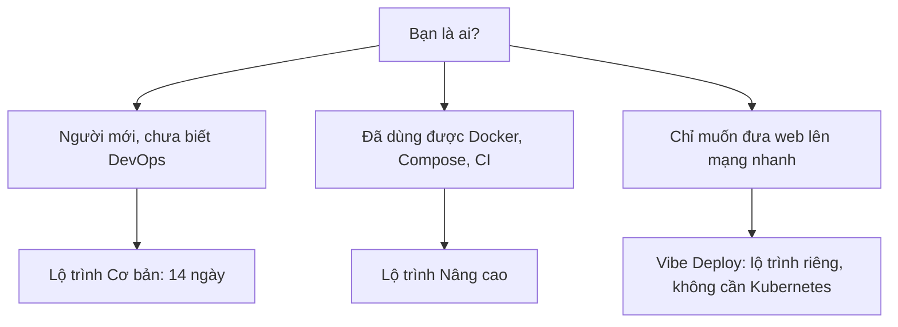

# Bắt đầu từ đây

Khóa này hướng dẫn đưa một ứng dụng web từ máy tính cá nhân lên chạy ổn định, theo quy trình các đội kỹ thuật áp dụng trong thực tế: dùng Linux, Git, Docker và tự động hóa bằng GitHub Actions. Người học không cần biết DevOps trước, chỉ cần sử dụng máy tính thành thạo ở mức cơ bản và sẵn sàng gõ lệnh. Phương pháp học là **thực hiện một dự án thật**, không phải đọc lý thuyết.

> **Tóm tắt:** Lộ trình Cơ bản kéo dài 14 ngày, mỗi ngày khoảng 2 giờ. Việc cần làm trước Ngày 1 mất khoảng 20 phút, gồm 4 việc bên dưới. Mỗi ngày là một bộ slide: xem, gõ lệnh làm theo, kiểm tra kết quả.

## Trước Ngày 1: 4 việc, khoảng 20 phút

::: tip Làm đủ 4 việc, theo thứ tự
- [ ] **Tài khoản GitHub và 2FA** (khoảng 5 phút). Tạo tài khoản và bật xác thực hai lớp, xem mục 1 của [Tài khoản GitHub và repo devops-labs](../resources/setup-github.md).
- [ ] **Repo `devops-labs`** (khoảng 3 phút). Tạo repository (kho mã nguồn) cá nhân tên `devops-labs`, chọn chế độ **Public** (cần để dùng GitHub Actions và GHCR miễn phí về sau), xem mục 2 của trang trên.
- [ ] **Cài Visual Studio Code** (khoảng 5 phút), chọn "Add to PATH" khi cài.
- [ ] **Đọc [Terminal 101](../resources/terminal-101.md)** (khoảng 10 phút, tùy chọn nhưng nên làm nếu chưa quen dòng lệnh).

Chưa cài trước: WSL2 và Git dành cho Ngày 1, Docker dành cho Ngày 4. Mỗi công cụ được cài đúng thời điểm cần dùng, kèm hướng dẫn từng bước trong [Hướng dẫn cài đặt môi trường](../resources/setup-guide.md).
:::

Thuật ngữ chưa quen được giải thích trong [Thuật ngữ](../resources/glossary.md).

## Chọn đường học của bạn

- **Người mới:** bắt đầu từ [Lộ trình Cơ bản](basic.md): 14 ngày, mỗi ngày khoảng 2 giờ, làm một dự án xuyên suốt.
- **Đã dùng được Docker, Compose và CI:** vào [Lộ trình Nâng cao](advanced.md) và tự kiểm tra điều kiện ở đầu trang đó.
- **Đã biết lập trình:** vẫn học theo lộ trình, thực hiện nhanh hơn và tự thêm tính năng cho Club app khi hoàn thành sớm.
- **Chỉ muốn lên mạng nhanh:** [Vibe Deploy](../vibe/index.md), một lộ trình riêng, ngắn hơn, không cần Kubernetes.
- **Muốn xem toàn cảnh trước:** [Lộ trình đầy đủ](syllabus.md).

## Xong 4 việc? Vào học

**[Vào Ngày 1](../slides/01-foundation/session-02.md)** và chọn **Trình chiếu** để học từng slide. Muốn xem cả 14 ngày trước: [Kế hoạch 14 ngày](basic.md).

## Cần tra cứu sau này

Trang [Cách học khóa này](how-to-learn.md) tập hợp những nội dung tra cứu dần, không cần đọc trước:

- Git trong 10 phút và cách làm việc bằng branch, Pull Request.
- Cách học một ngày và các tình huống lỗi thường gặp.
- Cấu trúc repo `devops-labs`, theo dõi tiến độ bằng Issues và Projects.
- Mẫu câu hỏi khi cần giúp, mentor và kênh hỏi.
- Quy tắc dùng AI và trung thực học thuật.
