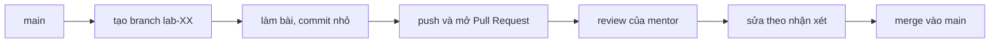

# Cách học khóa này

Trang này gom mọi thứ bạn cần tra trong suốt khóa: Git cơ bản, cách học một tuần, cấu trúc repo `devops-labs`, quy trình nộp bài, cách hỏi và quy tắc dùng AI. Bạn không cần đọc hết trước buổi 01; cứ vào [Buổi 01 – DevOps Introduction](../labs/week-01/session-01.md) rồi quay lại khi cần.

> **Tóm tắt:** Mỗi buổi đi theo thứ tự đọc, làm lab, gặp lỗi, tự kiểm tra, nộp bài. Mỗi lab nộp bằng một branch và một Pull Request. Hỏi bằng mẫu có log và giả thuyết. Dùng AI để hiểu, không để chép.

## Git trong 10 phút {#git-10-phut}

Git là công cụ lưu lịch sử thay đổi của mã nguồn. Buổi 01 bạn chỉ cần tài khoản GitHub: nộp bài bằng cách tải file lên trang web GitHub, hoặc làm theo mục này. Đến [Buổi 06 – Git & GitHub Workflow](../labs/week-03/session-06.md) bạn mới học đầy đủ branch, push và Pull Request.

Năm lệnh cần biết (chạy trong Git Bash, trong thư mục dự án):

```bash
git clone https://github.com/TEN-GITHUB/devops-labs.git   # tải repo về máy (lần đầu)
git add lab-01                                             # chọn các thay đổi để lưu
git commit -m "lab-01: ve so do trien khai"                # lưu thành một mốc có ghi chú
git push                                                   # đẩy lên GitHub
git switch -c lab-02                                       # tạo và chuyển sang nhánh mới
```

Thay `TEN-GITHUB` bằng username của bạn. Ví von: `commit` giống bấm chụp ảnh lại trạng thái hiện tại, `push` giống tải ảnh đó lên đám mây.

Lần đầu `git push` qua HTTPS, Git Credential Manager (đi kèm Git for Windows) mở cửa sổ trình duyệt để bạn đăng nhập GitHub, bạn không cần gõ mật khẩu hay token vào dòng lệnh. Địa chỉ `git@github.com:...` (SSH) chỉ dùng được sau khi bạn tạo khóa ở Buổi 02, nên các buổi đầu hãy dùng địa chỉ HTTPS như trên.

Ngại dòng lệnh? Có hai lối đi hợp lệ cho các buổi đầu:

- Dùng [GitHub Desktop](https://desktop.github.com/) (giao diện đồ họa, bấm nút thay cho gõ lệnh, đăng nhập GitHub một lần).
- Dùng nút **Add file > Upload files** trên trang repo GitHub để tải bài lên.

Hướng dẫn tạo tài khoản, đăng nhập và clone repo giáo trình nằm ở [Tài khoản GitHub và repo devops-labs](../resources/setup-github.md).

## Cách học một tuần

Mỗi tuần có hai buổi lớp 120 phút và khoảng 2–3 giờ tự làm ở nhà. Mỗi buổi đi theo cùng một thứ tự:

| Bước | Việc bạn làm | Thời gian gợi ý |
| --- | --- | --- |
| 1. Đọc | Đọc phần vấn đề thực tế và khái niệm cốt lõi | 15 phút |
| 2. Làm lab | Gõ lệnh theo từng phần, kiểm tra kết quả cuối mỗi phần | 60 phút |
| 3. Gặp lỗi? | Tra bảng lỗi ngay sau lab, không sửa mò | khi cần |
| 4. Tự kiểm tra | Trả lời 3–5 câu, mở đáp án sau khi tự nghĩ | 10 phút |
| 5. Nộp bài | Gom bằng chứng vào thư mục `lab-XX` và nộp | 15 phút |

Trên lớp, mentor demo trước rồi bạn làm; tự học thì làm thẳng phần lab. Phần thử thách L2 ở cuối bài là tùy chọn, làm ở nhà. Mỗi tuần có một trang tổng hợp (hub tuần) cho biết cần làm gì trước, trong và sau buổi.

Triết lý khóa học: **Learn, Build, Break, Debug, Deploy, Explain.** Bạn học khái niệm, tự dựng, cố ý làm hỏng, tìm nguyên nhân gốc, triển khai và giải thích lại bằng lời của mình. Giải thích được mới coi là hiểu.

### Hai mức L1 và L2

Mỗi lab có hai mức. Chọn mức theo năng lực hiện tại, nâng dần qua các tuần.

| Mức | Tên | Cách làm | Sản phẩm nộp |
| --- | --- | --- | --- |
| L1 | Foundation | Làm theo hướng dẫn từng bước, hiểu từng lệnh làm gì | Kết quả chạy, ảnh chụp/log, trả lời câu hỏi kiểm tra |
| L2 | Engineering | Tự thiết kế và triển khai, xử lý lỗi, giải thích lựa chọn | Mã/cấu hình, report giải thích quyết định, lỗi đã gặp và cách sửa |

L2 không phải "làm nhiều hơn" mà là "tự quyết định và chịu trách nhiệm giải thích". Chi tiết xem [Chuẩn đầu ra](learning-outcomes.md).

### Tình huống lỗi

Khóa có 10 tình huống lỗi, xem tổng quan ở [10 tình huống lỗi](../examples/troubleshooting-scenarios.md). Bạn chỉ nhận **triệu chứng** và phải tìm **nguyên nhân gốc**. Đừng sửa mò: ghi lại giả thuyết, lệnh kiểm chứng và kết quả. Quy trình tốt: quan sát, đặt giả thuyết, kiểm chứng bằng lệnh, sửa một thay đổi mỗi lần, kiểm tra lại.

## Nghỉ vài buổi? Làm gì {#nghi-vai-buoi}

Đừng cố học bù hết một lần. Làm theo thứ tự:

1. Mở [hub tuần](../labs/week-01/README.md) của tuần bạn bỏ lỡ (đổi số tuần ở đường dẫn) để biết cần làm gì trước, trong và sau buổi.
2. Mở terminal WSL và chạy `bash ~/devops-course/resources/check-env.sh N`, thay `N` bằng số của buổi bạn định vào học. Script cho biết máy còn thiếu công cụ nào.
3. Cập nhật giáo trình bằng `cd ~/devops-course && git pull`, rồi làm lại buổi gần nhất bạn đã xong để lấy lại nhịp.
4. Kẹt thì nhắn mentor theo [mẫu câu hỏi](#cach-xin-giup), nói rõ bạn nghỉ từ buổi nào.

## Cấu trúc repo cá nhân devops-labs

Clone repo `devops-labs` của bạn vào WSL (từ buổi 02, sau khi đã thêm SSH key; trước đó dùng web hoặc GitHub Desktop):

```bash
mkdir -p ~/work && cd ~/work
git clone git@github.com:TEN-GITHUB/devops-labs.git
cd devops-labs
```

Cấu trúc đề xuất:

```text
devops-labs/
├── README.md
├── .gitignore
├── lab-01/
│   ├── README.md
│   ├── source/
│   ├── screenshots/
│   ├── evidence/
│   │   ├── command-output.txt
│   │   └── test-results.txt
│   └── report.md
├── lab-02/
│   └── ...
└── cheatsheets/
```

- Mỗi buổi một thư mục `lab-XX/` với XX là số buổi hai chữ số (`lab-01`, `lab-02`, ...).
- `report.md` viết theo [Mẫu báo cáo lab](../templates/lab-template.md): bài lab giải quyết vấn đề gì, kiến thức đã dùng, các bước, kết quả, lỗi đã gặp, cách khắc phục, cải thiện được gì. Ghi rõ mức đã làm (L1 hay L2).
- Mẫu cho bài tập tuần và dự án: [Mẫu bài tập](../templates/assignment-template.md), [Mẫu dự án](../templates/project-template.md).
- `evidence/` chứa output lệnh thật (ví dụ `docker ps > evidence/command-output.txt`). Output phải là của chính máy bạn.

Tạo `.gitignore` ngay từ đầu để không lỡ commit bí mật:

```text
.env
*.pem
id_*
node_modules/
*.log
.DS_Store
```

::: warning Không bao giờ commit bí mật
Không commit mật khẩu, token, khóa riêng hay file `.env`. Nếu lỡ commit, báo mentor ngay và đổi (rotate) bí mật đó. Xóa file khỏi commit mới nhất là chưa đủ vì lịch sử Git vẫn giữ.
:::

Nhóm capstone dùng repo nhóm, bắt đầu từ `starter-project`. Xem [Capstone](../assignments/capstone/README.md).

## Cách nộp bài

Mỗi lab nộp bằng một branch và một Pull Request (PR) vào repo `devops-labs` của bạn, trong thư mục `lab-XX`. Từ buổi 01 đến 05 bạn có thể nộp bằng upload web; từ buổi 06 dùng quy trình đầy đủ dưới đây.



Lệnh cụ thể:

```bash
git switch main
git pull
git switch -c lab-03
mkdir -p lab-03/source lab-03/screenshots lab-03/evidence
# làm bài, rồi:
git add lab-03
git commit -m "lab-03: phan tich log bang grep va pipe"
git push -u origin lab-03
```

Sau đó mở Pull Request (trên trang GitHub hoặc `gh pr create --fill`) từ branch `lab-03` vào `main` của repo của bạn, gắn mentor làm reviewer và gán nhãn mức đã làm (`L1` hoặc `L2`).

Quy ước:

- Một lab = một branch = một Pull Request. Tên branch: `lab-XX`.
- Commit nhỏ, thường xuyên, mô tả rõ làm gì và vì sao. Ví dụ tốt: `lab-05: them cac lenh ss va curl vao report`. Tránh `update`, `fix`, `abc`.
- Mô tả Pull Request nêu: lab nào, mức nào, khó khăn gặp phải, điều bạn muốn mentor xem kỹ.
- Hạn nộp theo [Lộ trình](syllabus.md) và quy định tại [Đánh giá](assessment.md). Nộp muộn thì báo trước và nêu lý do.
- Khi có nhận xét: sửa trên cùng branch, commit và push tiếp, trả lời từng nhận xét. Không tạo Pull Request mới.
- Review chéo: bạn có thể được yêu cầu review bài của bạn khác. Nhận xét cụ thể, lịch sự, chỉ vào dòng cụ thể và nêu lý do.

## Theo dõi tiến độ trên GitHub

| Công cụ | Dùng để | Cách dùng gợi ý |
| --- | --- | --- |
| Issues | Ghi từng đầu việc, câu hỏi, lỗi | Mỗi lab một issue có checklist `- [ ]`. Đóng bằng `Closes #N` trong mô tả Pull Request |
| Projects | Bảng Kanban cá nhân hoặc nhóm | Cột Todo, Doing, Review, Done. Dự án capstone bắt buộc có bảng của nhóm |
| Milestones | Gom issue theo mốc | Một milestone mỗi tuần hoặc mỗi giai đoạn (Foundation, Docker, CI/CD, Kubernetes, Capstone) |
| Discussions | Hỏi đáp chung, chia sẻ cách làm hay | Câu hỏi mang tính khái niệm hỏi ở đây để cả lớp cùng đọc được. Bài lab riêng thì hỏi qua Pull Request |
| Pull Requests | Nộp bài và review | Xem mục "Cách nộp bài" |

Đặt tên issue theo dạng hành động: "Lab 04: tạo user và phân quyền thư mục". Việc chia nhỏ và ghi lại tiến độ cũng là một kỹ năng DevOps được chấm trong phần đánh giá.

## Cách xin giúp {#cach-xin-giup}

Câu hỏi tốt giúp bạn được trả lời nhanh, và thường bạn tự tìm ra đáp án trong lúc viết. Trước khi hỏi:

1. Đọc kỹ thông báo lỗi từ đầu đến cuối.
2. Tra bảng "Gặp lỗi?" của bài, rồi tìm theo đúng thông báo lỗi (trong ngoặc kép).
3. Xem [Xử lý sự cố cài đặt](../resources/troubleshooting-setup.md) nếu là lỗi môi trường.
4. Thu nhỏ vấn đề: lệnh nào chạy được, lệnh nào hỏng.

Mẫu câu hỏi (sao chép vào kênh hỏi đáp của lớp):

```text
Tiêu đề: [Lab 08] docker compose up báo lỗi port is already allocated

1. Mục tiêu: chạy stack Compose của starter-project ở cổng 8080.
2. Môi trường: Windows 11, WSL2 Ubuntu-24.04, RAM 8 GB, Docker Desktop 4.x.
3. Triệu chứng: sau khi chạy lệnh dưới đây, container frontend không lên.
4. Lệnh đã chạy:
   docker compose up -d
5. Log/lỗi đầy đủ (dán nguyên văn, đã xóa bí mật):
   Error response from daemon: ... port is already allocated
6. Đã thử:
   - docker ps: thấy một container cũ dùng cổng 8080
   - Đã chạy docker stop <tên>, vẫn lỗi
7. Giả thuyết hiện tại: có tiến trình Windows khác giữ cổng 8080.
8. Câu hỏi cụ thể: làm sao xác định tiến trình giữ cổng trong Windows?
```

Điểm chính của mẫu: **triệu chứng** (thấy gì), **đã thử gì** (kèm kết quả), **log** (dán văn bản, không chỉ ảnh chụp mờ), **giả thuyết** của bạn. Tránh những câu như "không chạy được, giúp em". Khi dán log, chạy `docker logs <container>`, `kubectl describe pod <pod>` hoặc `kubectl logs <pod>` tùy tình huống, và xóa mọi mật khẩu, token trước khi gửi.

## Mentor và kênh hỏi

Hỏi ngay trong nhóm chat của lớp, hoặc hỏi ở đầu hoặc cuối buổi học. Xem lịch office hour mà mentor thông báo cho lớp.

Đến office hour với câu hỏi đã viết theo mẫu trên và máy đã mở sẵn môi trường lỗi để cùng xem. Giúp nhau cũng là học: giải thích cho bạn khác là cách kiểm tra mình đã hiểu, hãy hướng dẫn bạn tìm nguyên nhân thay vì gửi sẵn lời giải.

## Quy tắc dùng AI và trung thực học thuật

Mục tiêu của khóa là bạn **làm được và giải thích được**, không phải có một repo trông đẹp. Quy tắc ngắn gọn: dùng AI để hiểu, không để chép; bài nào nộp thì bạn phải giải thích được.

Quy tắc chống đạo văn:

- Bài nộp là sản phẩm của chính bạn, chạy trên máy của bạn, với output thật của bạn. Không sao chép bài của bạn khác, không chép nguyên lời giải trên mạng.
- Được tham khảo tài liệu chính thức, bài viết, bạn học thảo luận ý tưởng. Khi dùng nguồn bên ngoài đáng kể, ghi nguồn (link) trong `report.md`.
- Làm việc nhóm ở capstone: ghi rõ ai làm phần nào. Lịch sử commit phải phản ánh đóng góp thật của từng người.
- Mentor có thể hỏi vấn đáp ngắn về bài bạn nộp ("vì sao dòng này có mặt?", "nếu bỏ nó thì chuyện gì xảy ra?"). Không giải thích được bài của chính mình bị coi như chưa đạt.

Dùng AI (ChatGPT, Claude, Copilot...) như một công cụ hỗ trợ:

- Được phép: giải thích khái niệm, giải thích thông báo lỗi, gợi ý hướng debug, review mã của bạn, hỏi ví dụ để hiểu thêm.
- Không được: nhờ AI làm cả bài rồi nộp; dán output do AI "bịa" vào phần bằng chứng; nộp cấu hình bạn không hiểu.
- Luôn kiểm chứng: AI có thể đưa lệnh, cờ hoặc phiên bản không tồn tại. Đối chiếu với [Tài liệu chính thức](../resources/documentation.md) và chạy thử.
- Không dán bí mật (mật khẩu, token, nội dung `.env`) vào bất kỳ công cụ AI nào.
- Khai báo: nếu dùng AI đáng kể, ghi một dòng trong `report.md` đã dùng vào việc gì. Khai báo trung thực không bị trừ điểm; che giấu thì bị coi là vi phạm.
- Trong các buổi tình huống lỗi, hãy tự điều tra trước. Hỏi AI sau khi đã có giả thuyết và log, để dùng nó kiểm tra suy nghĩ chứ không thay suy nghĩ.

Một phép thử đơn giản: nếu mentor tắt Internet và hỏi, bạn có giải thích được bài của mình không?

## Thói quen nên có

- Làm trong `~/` của WSL, không dùng `/mnt/c`.
- Commit thường xuyên, tin nhắn commit rõ ràng.
- Ghi lại mọi lỗi gặp và cách sửa, đây là nguyên liệu cho phần lỗi trong `report.md` và cho kỹ năng debug.
- Cuối buổi dọn dẹp: `docker compose down`, xóa cluster kind không dùng, đặc biệt trên máy 8 GB.
- Tự kiểm tra: "Mình giải thích được từng lệnh trong bài chưa? Mình tái lập được từ đầu chưa?"
- Cuối mỗi tuần, đọc lại report của chính mình và viết ba dòng: học được gì, còn mơ hồ gì, tuần sau cần cải thiện gì.

## Quay lại

Về [Bắt đầu từ đây](getting-started.md) hoặc mở [Tuần 1](../labs/week-01/README.md). Đừng ngại làm hỏng mọi thứ trên máy của mình: đó là cách nhanh nhất để hiểu chúng.
