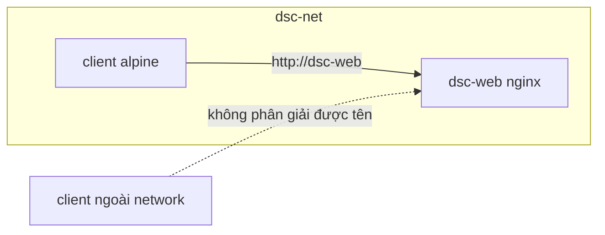

# network-lab: container giao tiếp qua user-defined network

Buổi liên quan: Tuần 4 (Docker networking, DNS theo tên container, không publish cổng không cần thiết).

Ý tưởng: tạo một network riêng `dsc-net`, chạy container `dsc-web` (Nginx) trong đó, rồi dùng container thứ hai gọi tới `dsc-web` bằng tên. Sau đó chứng minh container ở network mặc định không gọi được bằng tên.



## Chạy bằng script

```bash
cd examples/docker/network-lab
./network-lab.sh up
./network-lab.sh test
./network-lab.sh down
```

Kết quả mong đợi của `test` (rút gọn):

```text
== 1. Từ client trong CÙNG network, gọi bằng tên container
<!DOCTYPE html>
<html>
<head>
<title>Welcome to nginx!</title>

== 2. Từ client ở network mặc định (bridge): không phân giải được tên
Thất bại như dự kiến: bridge mặc định không có DNS theo tên container.

== 3. Container dsc-web có publish cổng ra host không?
(không in gì nghĩa là không có cổng nào được publish)
```

## Làm thủ công để hiểu từng bước

```bash
docker network create dsc-net
docker run -d --name dsc-web --network dsc-net nginx:1.27-alpine
docker run --rm --network dsc-net alpine:3.20 wget -qO- http://dsc-web/
docker network inspect dsc-net
```

Trong kết quả `docker network inspect`, mục `Containers` liệt kê `dsc-web` cùng địa chỉ IP nội bộ (dạng `172.x.x.x`). Địa chỉ này đổi mỗi lần tạo lại container, vì vậy luôn dùng tên thay vì IP. Đây cũng là lý do trong `compose.yaml` của starter project, backend kết nối database bằng host `postgres` chứ không dùng IP.

## Câu hỏi để giải thích

- Vì sao `dsc-web` không cần `-p` mà client vẫn gọi được?
- Khác biệt giữa bridge mặc định và user-defined bridge về DNS là gì?
- Nếu muốn người dùng trên máy host truy cập `dsc-web`, cần thêm gì?
- Mô hình này ứng với `Service` nào trong Kubernetes?

## Dọn dẹp

```bash
./network-lab.sh down
```
