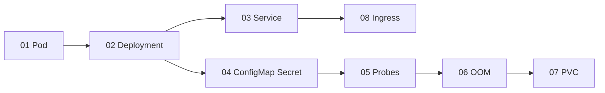

# Ví dụ Kubernetes

Các manifest nhỏ, mỗi file minh họa một khái niệm, dùng cho Tuần 13-16. Tất cả đặt trong namespace `demo` để không lẫn với ứng dụng `club` của starter project. Môi trường: kind trên Docker Desktop (WSL2), kubectl.

Chú ý: các manifest đã được kiểm tra cú pháp YAML nhưng chưa được áp dụng lên cluster kind thật trong lúc soạn (riêng cơ chế OOM của `06-resources-oom.yaml` đã được thử bằng `docker run --memory`). Nếu gặp khác biệt, đọc `kubectl describe` và báo lại mentor.

## Chuẩn bị cluster

```bash
cd examples/kubernetes
kind create cluster --name demo --config kind-3-nodes.yaml
kubectl get nodes
```

Kết quả mong đợi (rút gọn):

```text
NAME                 STATUS   ROLES           AGE   VERSION
demo-control-plane   Ready    control-plane   60s   v1.3x.x
demo-worker          Ready    <none>          40s   v1.3x.x
demo-worker2         Ready    <none>          40s   v1.3x.x
```

```bash
kubectl create namespace demo
```

`kind-3-nodes.yaml` map cổng 80 và 443 của máy host, nên hai cổng này phải đang trống. Nếu bạn đang có cluster `club` của starter project dùng cùng cổng, hãy xóa cluster đó (`kind delete cluster --name club`) hoặc bỏ phần `extraPortMappings` khi chỉ thực hành các file 01-07.

## Thứ tự áp dụng



| File | Khái niệm | Lệnh thử nhanh |
| --- | --- | --- |
| `01-pod.yaml` | Pod đơn lẻ | `kubectl apply -f 01-pod.yaml` rồi `kubectl -n demo get pod hello-pod` |
| `02-deployment.yaml` | Deployment, rolling update | `kubectl -n demo rollout status deployment/web` |
| `03-service.yaml` | Service ClusterIP | `kubectl -n demo get endpoints web` |
| `04-configmap-secret.yaml` | ConfigMap, Secret, biến môi trường | `kubectl -n demo logs config-demo` |
| `05-probes.yaml` | startup, readiness, liveness | `kubectl -n demo get pods -l app=probe-demo` |
| `06-resources-oom.yaml` | requests, limits, OOMKilled | `kubectl -n demo describe pod oom-demo` |
| `07-pvc.yaml` | PersistentVolumeClaim | xem phần dưới |
| `08-ingress.yaml` | Ingress | xem phần dưới |

## Hướng dẫn từng file

### 01 đến 03: Pod, Deployment, Service

```bash
kubectl apply -f 01-pod.yaml
kubectl apply -f 02-deployment.yaml
kubectl apply -f 03-service.yaml
kubectl -n demo get pods -o wide
```

Thử nghiệm: xóa `hello-pod` thì nó biến mất mãi mãi; xóa một Pod của Deployment `web` thì Deployment tạo Pod mới ngay.

```bash
kubectl -n demo delete pod hello-pod
kubectl -n demo delete pod -l app=web --wait=false
kubectl -n demo get pods
```

Gọi Service từ trong cluster:

```bash
kubectl -n demo run curl-test --rm -it --restart=Never --image=busybox:1.36 -- wget -qO- http://web
```

Kết quả mong đợi: HTML mặc định của Nginx ("Welcome to nginx!").

Rolling update: đổi image rồi theo dõi quá trình, sau đó rollback:

```bash
kubectl -n demo set image deployment/web nginx=nginx:1.27.5-alpine
kubectl -n demo rollout status deployment/web
kubectl -n demo rollout undo deployment/web
```

Nếu tag bạn chọn không tồn tại, bạn sẽ gặp `ImagePullBackOff`: đây chính là tình huống lỗi 07, hãy tự chẩn đoán bằng `kubectl describe pod`.

### 04: ConfigMap và Secret

Giá trị Secret trong file chỉ để minh họa. Không bao giờ commit giá trị thật vào Git; ở dự án thật hãy tạo Secret bằng `kubectl create secret generic` với `--from-literal` hoặc `--from-file` từ file không được commit.

```bash
kubectl apply -f 04-configmap-secret.yaml
kubectl -n demo logs config-demo
kubectl -n demo get secret app-secret -o jsonpath="{.data.DB_PASSWORD}" | base64 -d; echo
```

Dòng cuối chứng minh Secret chỉ là base64, ai có quyền đọc Secret đều lấy được giá trị.

### 05: Probes

```bash
kubectl apply -f 05-probes.yaml
kubectl -n demo get pods -l app=probe-demo
kubectl -n demo get endpoints probe-demo
```

Sau vài giây cả hai Pod `1/1 Ready` và Endpoints có hai địa chỉ. Sửa `readinessProbe.httpGet.path` thành `/khong-co`, apply lại, quan sát Pod mới ở `0/1` và Endpoints thiếu địa chỉ. Xem lý do bằng `kubectl -n demo describe pod` (mục Events: `Readiness probe failed`).

### 06: OOMKilled

```bash
kubectl apply -f 06-resources-oom.yaml
sleep 10
kubectl -n demo get pod oom-demo
kubectl -n demo describe pod oom-demo | grep -A6 "State:"
```

Kết quả mong đợi (rút gọn):

```text
State:          Terminated
  Reason:       OOMKilled
  Exit Code:    137
```

Container dùng quá giới hạn `32Mi` nên bị kernel kill (exit code 137). Pod đặt `restartPolicy: Never` nên không lặp lại. Nếu đổi thành `Always` bạn sẽ thấy `CrashLoopBackOff`. Mô phỏng này chỉ ảnh hưởng đúng container bị giới hạn, không ảnh hưởng node.

### 07: PVC

```bash
kubectl apply -f 07-pvc.yaml
kubectl -n demo get pvc,pod
kubectl -n demo logs pvc-demo
kubectl -n demo delete pod pvc-demo
kubectl apply -f 07-pvc.yaml
kubectl -n demo logs pvc-demo
```

PVC có thể ở trạng thái `Pending` cho đến khi Pod đầu tiên dùng nó được tạo (`WaitForFirstConsumer`, bình thường với StorageClass của kind). Lần log thứ hai hiển thị hai dòng ngày giờ: dữ liệu còn nguyên sau khi Pod bị xóa.

### 08: Ingress

Cài ingress-nginx bản dành cho kind (cùng phiên bản với Buổi 27; trang kind không còn hướng dẫn riêng cho ingress-nginx, xem [ingress-nginx](https://kubernetes.github.io/ingress-nginx/deploy/)), rồi đợi controller sẵn sàng:

```bash
kubectl apply -f https://raw.githubusercontent.com/kubernetes/ingress-nginx/controller-v1.12.1/deploy/static/provider/kind/deploy.yaml
kubectl -n ingress-nginx wait --for=condition=ready pod \
  --selector=app.kubernetes.io/component=controller --timeout=120s
kubectl apply -f 08-ingress.yaml
curl -s http://demo.localhost | head -n 5
```

Kết quả mong đợi: HTML của Nginx. Nếu `curl` trong WSL2 không phân giải được `demo.localhost`, dùng `curl -H "Host: demo.localhost" http://127.0.0.1`.

## Dọn dẹp

```bash
kubectl delete namespace demo
kind delete cluster --name demo
```

## Script deploy-local.sh

`deploy-local.sh` là ví dụ CD local cho Tuần 11: kéo image đã publish từ GHCR, nạp vào kind và cập nhật Deployment của ứng dụng `club`. Nó cần cluster `club` của starter project đang chạy và chưa được kiểm chứng trên kind thật.

```bash
OWNER=ten-github-cua-ban TAG=sha-abc1234 ./deploy-local.sh
```

Biến `OWNER` là tên tài khoản GitHub (chữ thường), `TAG` là tag image đã được workflow publish tạo ra. Script dừng ngay với thông báo lỗi nếu thiếu một trong hai biến.
