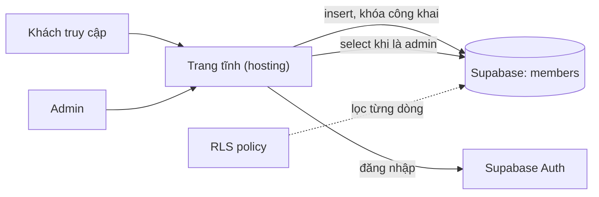

# Club Landing: landing page CLB có đăng ký thành viên

> **Tóm tắt:** Landing page CLB, form đăng ký lưu vào Supabase bằng khóa công khai, trang admin đăng nhập xem danh sách, bảo vệ bằng Row Level Security. Không cần build: đổi tên `config.example.js` thành `config.js`, điền URL và khóa công khai, rồi commit cùng code.

Đây là dự án mẫu cho [bài Mini project](../../../vibe/09-mini-project.md). Bạn có thể dùng nguyên bản hoặc nhờ AI agent tạo lại theo ý mình rồi so sánh.

## Cấu trúc

| File | Vai trò |
| --- | --- |
| `index.html`, `app.js` | Trang chủ và form đăng ký |
| `admin.html`, `admin.js` | Trang quản trị: đăng nhập, xem danh sách, tải CSV |
| `style.css` | Giao diện chung, responsive, tự đổi sáng/tối |
| `schema.sql` | Bảng `members`, bảng `admins`, bật RLS và các policy |
| `config.example.js` | Mẫu cấu hình. Đổi tên thành `config.js` rồi điền URL và khóa công khai (gói zip chỉ có file mẫu này) |
| `build-config.mjs` | Tùy chọn, nâng cao: tạo `config.js` từ biến môi trường và gom file công khai vào `dist/` lúc build; có chế độ `--local` |
| `.gitignore` | Chặn `.env` và `dist/` bị commit nhầm. `config.js` KHÔNG bị chặn vì chỉ chứa khóa công khai |

## Kiến trúc



Khách chỉ ghi được (insert). Chỉ tài khoản có tên trong bảng `admins` mới đọc được. Không ai sửa hay xóa được qua khóa công khai.

## Cấu hình từng bước

1. Tạo project trên [Supabase](https://supabase.com/dashboard) (gói Free, tự quyết định, không cần nhập thẻ để bắt đầu). Giao diện có thể khác chút so với mô tả dưới đây.
2. Mở SQL Editor, dán toàn bộ `schema.sql`, bấm Run. Bạn sẽ thấy "Success. No rows returned".
3. Vào Table Editor, kiểm tra hai bảng `members` và `admins` đều hiện nhãn RLS đã bật.
4. Tạo admin đầu tiên, xem mục "Admin đầu tiên và Supabase Auth" ngay bên dưới.
5. Lấy URL và khóa công khai: vào Project Settings, mục API Keys (hoặc nút Connect). Copy Project URL và **Publishable key** (`sb_publishable_...`). Dự án cũ có thể chỉ có khóa `anon` kiểu cũ, dùng được tương tự.
6. Tạo cấu hình: **đổi tên** `config.example.js` thành `config.js`, mở bằng trình soạn thảo và thay hai giá trị `SUPABASE_URL` và `SUPABASE_KEY`.

```bash
# Dòng lệnh tương đương (Git Bash, macOS, Linux); trên Windows có thể đổi tên bằng File Explorer
cp config.example.js config.js
```

::: details Nâng cao: tạo config.js bằng script từ biến môi trường

```bash
SUPABASE_URL="https://YOUR-PROJECT-REF.supabase.co" SUPABASE_KEY="YOUR_PUBLISHABLE_KEY" node build-config.mjs --local
```
:::

Không bao giờ dán secret key hay `service_role` vào đây. Script build (nếu dùng) sẽ từ chối khi phát hiện.

## Admin đầu tiên và Supabase Auth

Trang admin dùng đăng nhập email và mật khẩu. Làm theo thứ tự này để không bị kẹt.

**1. Quyết định có cần xác nhận email không.** Vào Authentication, mục Sign In / Providers, bấm Email. Công tắc Confirm email mặc định bật: user phải bấm link trong email trước khi đăng nhập. Admin chỉ có một hai người do bạn tự tạo, nên có hai cách an toàn:

- Tạo user bằng dashboard và tích **Auto Confirm User**: không cần email nào được gửi.
- Hoặc để Confirm email bật, dùng email thật của bạn và bấm link xác nhận.

**2. Tạo user admin qua dashboard.** Authentication, mục Users, nút Add user, Create new user. Nhập email của bạn và một mật khẩu mạnh (trình quản lý mật khẩu tạo giúp), tích Auto Confirm User. Đừng để người khác tự đăng ký rồi mới nâng quyền.

**3. Đóng cổng đăng ký công khai.** Trong cài đặt Authentication, tắt "Allow new users to sign up". Theo tài liệu Supabase, khi tắt thì chỉ user đã tồn tại mới đăng nhập được, người lạ không tự tạo tài khoản. Nếu giao diện của bạn có khác, tìm mục tương đương, và nhớ kiểm tra lại là bạn vẫn đăng nhập được.

**4. Đánh dấu user là admin.** Chạy trong SQL Editor (đổi email):

```sql
insert into public.admins (user_id)
select id from auth.users where email = 'admin@example.com';
```

Policy trong `schema.sql` kiểm tra `auth.uid()` có nằm trong bảng `admins` không. Muốn thêm hoặc bớt admin chỉ cần thêm hoặc xóa một dòng, có hiệu lực ngay, không phải chờ token làm mới.

**Vì sao KHÔNG dùng user_metadata để phân quyền.** `user_metadata` (cột `raw_user_meta_data`) là chỗ chính người dùng được phép tự sửa bằng `supabase.auth.updateUser()`. Nếu policy viết kiểu "ai có `user_metadata.role = 'admin'` thì được xem", bất kỳ ai đăng nhập được đều tự phong mình thành admin chỉ bằng một dòng JavaScript trong Console. Nếu muốn đưa quyền vào token, dùng `app_metadata` (người dùng không sửa được, chỉ server hoặc dashboard sửa), và nhớ rằng thay đổi chỉ có trong token sau khi token làm mới. Với CLB nhỏ, bảng `admins` là đủ và dễ kiểm tra hơn.

**5. Site URL và Redirect URLs.** Vào Authentication, mục URL Configuration.

| Lúc nào | Site URL | Redirect URLs cần có |
| --- | --- | --- |
| Làm trên máy | `http://localhost:3000` (mặc định) | `http://localhost:3000/**`, thêm `http://localhost:8000/**` nếu dùng cổng 8000 |
| Sau khi lên mạng | Địa chỉ thật, ví dụ `https://club.example.com` | Thêm đúng địa chỉ thật có `/**` ở cuối. Giữ localhost nếu còn làm tiếp trên máy |

Đăng nhập bằng mật khẩu của bài này không chuyển hướng nên thường chạy được dù chưa cấu hình. Nhưng các email do Supabase gửi (xác nhận, đặt lại mật khẩu, magic link) dùng Site URL làm địa chỉ gốc: để mặc định thì link trong email trỏ về `localhost`, người nhận không mở được. Hãy đổi Site URL ngay khi có địa chỉ thật.

**6. Giới hạn email mặc định.** Dịch vụ email có sẵn của Supabase chỉ để thử. Theo tài liệu (kiểm tra 10/2026) nó chỉ gửi tới địa chỉ thuộc nhóm của dự án, khoảng 2 email mỗi giờ, và có thể đổi mà không báo trước. Vì thế đừng dựa vào email để mời nhiều admin hay bắt thành viên xác nhận. Tạo admin bằng dashboard với Auto Confirm User là cách không cần email. Khi cần email thật, cấu hình SMTP riêng, xem [tài liệu SMTP](https://supabase.com/docs/guides/auth/auth-smtp).

## Chạy thử trên máy

```bash
npx serve .
# hoặc
python -m http.server 8000
```

Mở `http://localhost:3000` (hoặc `:8000`), điền form, rồi vào `/admin.html` đăng nhập để thấy dòng vừa đăng ký.

Nếu chưa có `config.js`, trang vẫn mở và hiện thông báo "Chưa cấu hình Supabase" thay vì báo lỗi khó hiểu.

## Deploy

Mặc định rất đơn giản: `config.js` chỉ chứa Project URL và khóa công khai nên được commit cùng code. Commit, push, rồi deploy thư mục gốc như một trang tĩnh thông thường (GitHub Pages, Vercel, Netlify, Cloudflare). Không cần build, không cần biến môi trường.

Vì sao commit `config.js` là an toàn: trang chạy trong trình duyệt của khách nên khóa công khai **luôn** nhìn thấy được (Xem nguồn trang, tab Network). Supabase thiết kế nó như vậy, và quyền thật nằm ở RLS. Ngược lại `service_role` hoặc `sb_secret_` bỏ qua RLS: đặt vào repo hay frontend là trao quyền admin database cho cả thế giới. Tuyệt đối không, kể cả repo riêng tư.

Kiểm tra sau deploy: mở link, trang chủ không còn dòng "Chưa cấu hình Supabase"; mở `/config.js` thấy đúng URL và khóa `sb_publishable_`; gửi một đăng ký thử rồi đăng nhập `/admin.html`. Sau đó đặt Site URL và Redirect URLs theo bảng ở mục Admin đầu tiên.

::: details Nâng cao: tạo config lúc build (không commit config.js)

Dùng khi bạn muốn đổi khóa mà không sửa code, hoặc repo không chứa giá trị cấu hình nào. Thêm `config.js` vào `.gitignore`, đặt `SUPABASE_URL`, `SUPABASE_KEY` (và tùy chọn `CLUB_NAME`) trong cài đặt nền tảng, Build command `node build-config.mjs`, thư mục xuất bản `dist`. Redeploy sau khi đặt biến, vì biến chỉ được đọc lúc build.

`node build-config.mjs` (không có `--local`) tạo thư mục `dist/` chỉ gồm `index.html`, `admin.html`, `app.js`, `admin.js`, `style.css` và `config.js`. `schema.sql`, README, script build không bị đưa lên mạng. Script từ chối chạy nếu thấy `sb_secret_` hoặc khóa có role `service_role`.

### Cài đặt cho từng nền tảng (cách A)

Giá trị cần điền: `SUPABASE_URL` là Project URL, `SUPABASE_KEY` là publishable key. `CLUB_NAME` là tùy chọn.

| Nền tảng | Build command | Output directory | Đặt biến môi trường ở đâu |
| --- | --- | --- | --- |
| Vercel | `node build-config.mjs` | `dist` (Framework Preset: Other) | Project Settings, Environment Variables |
| Netlify | `node build-config.mjs` | Publish directory: `dist` | Site configuration, Environment variables |
| Cloudflare Workers (static assets) | `node build-config.mjs`, và `wrangler.jsonc` đặt `assets.directory` là `./dist` | `dist` | Settings, Build, Variables and secrets (biến lúc build) |
| Cloudflare Pages (đường cũ) | `node build-config.mjs` | Build output directory: `dist` | Settings, Variables and Secrets (loại Text) |
| GitHub Pages | Chạy trong GitHub Actions, xem bên dưới | `path: dist` | Settings, Secrets and variables, Actions, tab Variables |

Giao diện các nền tảng thay đổi thường xuyên; nếu tên mục khác, đối chiếu tài liệu chính thức. Đặt biến trước khi bấm Deploy, hoặc đặt xong thì deploy lại (redeploy), vì biến chỉ được đọc lúc build. Đây là giá trị công khai nên trên GitHub dùng **Variables** là đủ, không cần Secrets.

GitHub Pages không có ô Build command, nên thêm file `.github/workflows/pages.yml` (Settings, Pages, Source chọn GitHub Actions):

```yaml
name: Deploy Pages

on:
  push:
    branches: [main]
  workflow_dispatch:

permissions:
  contents: read
  pages: write
  id-token: write

concurrency:
  group: pages
  cancel-in-progress: true

jobs:
  deploy:
    runs-on: ubuntu-latest
    environment:
      name: github-pages
    steps:
      - uses: actions/checkout@v4
      - uses: actions/setup-node@v4
        with:
          node-version: 22
      - name: Tạo dist với config công khai
        run: node build-config.mjs
        env:
          SUPABASE_URL: ${{ vars.SUPABASE_URL }}
          SUPABASE_KEY: ${{ vars.SUPABASE_KEY }}
          CLUB_NAME: ${{ vars.CLUB_NAME }}
      - uses: actions/upload-pages-artifact@v3
        with:
          path: dist
      - id: deployment
        uses: actions/deploy-pages@v4
```

Nếu dự án nằm trong thư mục con của repo, thêm `working-directory` cho bước build và đổi `path` tương ứng. Phiên bản action có thể đã tăng, kiểm tra trong kho `actions/deploy-pages`.

Kiểm tra sau deploy: mở link, trang chủ không còn dòng "Chưa cấu hình Supabase"; mở `/config.js` thấy đúng URL và khóa `sb_publishable_`; gửi một đăng ký thử rồi đăng nhập `/admin.html`. Sau đó quay lại Supabase, đặt Site URL và Redirect URLs theo bảng ở mục Admin đầu tiên.
:::

## Kiểm tra bảo mật (5 phút)

- [ ] Table Editor hiển thị RLS đã bật cho `members` và `admins`.
- [ ] Mở trang ở cửa sổ ẩn danh, mở Console và thử đọc danh sách bằng khóa công khai: kết quả phải rỗng.
- [ ] `git log -p` và `git status` không có `sb_secret_`, `service_role`, `.env`.
- [ ] Tài khoản admin có mật khẩu mạnh, đăng ký công khai (sign ups) đã tắt nếu bạn không cần.
- [ ] Không có dữ liệu thật của người khác trong prompt đã gửi cho AI.

Thử đọc dữ liệu như một người lạ: mở tab ẩn danh, dán `https://YOUR-PROJECT-REF.supabase.co/rest/v1/members?select=*&apikey=YOUR_PUBLISHABLE_KEY` vào thanh địa chỉ. Kết quả đúng: `[]` hoặc lỗi từ chối quyền.

::: details Cho ai quen terminal: curl

```bash
curl "https://YOUR-PROJECT-REF.supabase.co/rest/v1/members?select=*" \
  -H "apikey: YOUR_PUBLISHABLE_KEY"
```

Nếu bạn thấy danh sách email, RLS chưa đúng, hãy chạy lại `schema.sql`.
:::

## Gỡ lỗi nhanh

| Triệu chứng | Cách xử lý |
| --- | --- |
| Hiện "Chưa cấu hình Supabase" | Chưa có `config.js` hoặc còn placeholder |
| Gửi form báo lỗi, Console có mã `42501` hoặc "row-level security" | Chưa chạy `schema.sql`, hoặc policy insert thiếu |
| Admin đăng nhập được nhưng danh sách rỗng | Chưa thêm user vào bảng `admins` |
| Sai email hoặc mật khẩu | User chưa xác nhận email (xem cột trạng thái ở Authentication, Users; tạo lại với Auto Confirm User) hoặc gõ sai |
| Trang online hiện "Chưa cấu hình Supabase", local thì chạy | `config.js` chưa được commit và push (kiểm tra `.gitignore` không chặn nó). Nếu dùng cách build nâng cao: sai Build command hoặc Output directory (phải là `dist`), hoặc chưa redeploy sau khi đặt biến. Xem mục Deploy |
| Build (cách nâng cao) báo LỖI về SUPABASE_URL hoặc SUPABASE_KEY | Biến chưa đặt hoặc sai dạng; nếu báo secret key hay service_role thì bạn dùng nhầm khóa, hãy lấy lại publishable key |
| Email xác nhận không tới, hoặc link trỏ về localhost | Giới hạn email mặc định, hoặc chưa đổi Site URL. Dùng Auto Confirm User khi tạo admin |

## Mở rộng

- Thêm Cloudflare Pages Function hoặc Vercel function làm lớp chống spam (giới hạn số lần đăng ký). Xem phần thử thách trong bài Mini project.
- Thêm CAPTCHA của nhà cung cấp (ví dụ Turnstile) thay cho ô bẫy bot.
- Gửi email chào mừng bằng một dịch vụ email (secret key phải nằm ở backend, không ở trang này).
