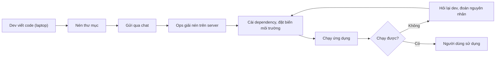

# Buổi 01 – Thử thách thêm

Tuần 1/16 · Giai đoạn 1 – Engineering Foundation · Buổi 01/32

[Buổi 01 – DevOps Introduction](session-01.md) · [Bài tập Tuần 1](../../assignments/weekly/week-01.md) · [Hub Tuần 1](README.md)

> **Tóm tắt:** Phần tùy chọn của Buổi 01 cho ai làm xong lab sớm: đề xuất workflow cho dự án CLB thật, tự phá lỗi Mermaid và quy trình, kèm sơ đồ và các bước tham chiếu.

::: tip Làm gì ở đây
Chỉ làm khi đã xong lab bắt buộc (L1) của [Buổi 01 – DevOps Introduction](session-01.md). Thử thách L2 mất khoảng 45 phút ở nhà và là điểm thưởng, chỉ chấm khi L1 đạt từ 60 điểm. Tự thử 15 phút trước khi mở bất kỳ gợi ý nào.
:::

## Thử thách L2: đề xuất workflow cho dự án CLB thật

**Đề bài:** đề xuất DevOps workflow cho một dự án CLB thật (ví dụ website CLB, bot Discord, ứng dụng điểm danh). Ghi vào `lab-01/source/proposal.md`.

Tiêu chí hoàn thành:

- Có sơ đồ Mermaid thể hiện workflow hiện tại và workflow đề xuất.
- Nêu 3 điểm nghẽn có số liệu ước lượng (ví dụ "deploy tay mất 20 phút, mỗi tuần 3 lần").
- Mỗi điểm nghẽn có cách tự động hóa, công cụ dự kiến và buổi nào trong khóa dạy công cụ đó (tra [Lộ trình](../../curriculum/syllabus.md)).
- Có một rủi ro của chính giải pháp tự động hóa (ví dụ: pipeline hỏng thì ai sửa?).
- Chỉ ra 2 chỉ số để đo cải thiện (ví dụ thời gian từ commit đến chạy được, số lần deploy lỗi).

::: details Gợi ý bậc 1: bắt đầu từ đâu
Bắt đầu từ câu hỏi "lần deploy gần nhất mất bao lâu và vì sao". Liệt kê từng phút, bước tốn nhiều phút nhất thường là ứng viên điểm nghẽn.
:::

::: details Gợi ý bậc 2: chọn giải pháp
Chọn giải pháp nhỏ nhất giải quyết được vấn đề, ví dụ một workflow chạy test mỗi lần push trước khi nghĩ tới Kubernetes.
:::

Sau khi nộp bài, đối chiếu với [Đáp án Tuần 1](../../mentors/walkthroughs/week-01.md).

**Thử thách tính toán:** nhóm bạn push 15 lần mỗi ngày, mỗi lần deploy tay mất 10 phút. Tính chi phí mỗi tuần (5 ngày) và nói bước nào nên tự động hóa trước.

::: details Đáp án thử thách tính toán
15 lần x 10 phút x 5 ngày = 750 phút, tức 12,5 giờ mỗi tuần. Tự động hóa bước deploy trước, vì lặp nhiều nhất và tốn thời gian nhất.
:::

## Phá lỗi nâng cao

### Tình huống 1: sơ đồ Mermaid không hiển thị

Cách phá: sửa một nhãn trong `manual-workflow.mmd` thành nhãn có dấu ngoặc và không đặt trong nháy kép:

```text
    E --> F[Ops: chạy (production) ứng dụng]
```

Triệu chứng: mermaid.live báo "Syntax error in text" hoặc sơ đồ không vẽ.

Hướng điều tra:

1. Đọc thông báo lỗi, ghi lại số dòng được báo.
2. Thu hẹp: xóa từng dòng gần vị trí lỗi rồi dán lại, xem sơ đồ nào vẽ được.
3. Kiểm tra ký tự đặc biệt trong nhãn: ngoặc tròn, ngoặc vuông, dấu hai chấm, dấu nháy.
4. Đặt nhãn trong nháy kép và thử lại.

Nguyên nhân gốc: trong cú pháp Mermaid, dấu ngoặc là ký hiệu hình dạng của nút, nên ngoặc nằm trong nhãn không có nháy làm bộ phân tích hiểu sai cấu trúc.

Phòng tránh: luôn đặt nhãn trong nháy kép, xem trước trước khi commit, và để sơ đồ trong Git để có thể quay lại phiên bản đang hoạt động.

### Tình huống 2: quy trình đúng trên giấy nhưng sai ngoài thực tế

Cách phá: đưa sơ đồ thủ công cho bạn cùng bàn và nhờ họ "triển khai" theo đúng sơ đồ, chỉ trả lời câu hỏi bằng thông tin có trong sơ đồ.

Triệu chứng: bạn cùng bàn dừng lại và hỏi "chạy bằng lệnh nào, Node bản mấy, mật khẩu database ở đâu".

Hướng điều tra: ghi lại mọi câu hỏi họ đặt ra, mỗi câu là một thông tin ngầm chưa được viết ra.

Nguyên nhân gốc: kiến thức nằm trong đầu một người (tribal knowledge). Cách phòng tránh là ghi mọi thứ thành file nằm trong Git (README, `compose.yaml`, `.env.example`), đó chính là bước đầu của IaC.

## Sơ đồ tham chiếu và các bước của quy trình tự động

Quy trình thủ công của Nam và Lan:



Từng bước của quy trình tự động trong [Buổi 01 – DevOps Introduction](session-01.md):

1. **Push code:** thay đổi nằm trong Git, có lịch sử và người chịu trách nhiệm rõ ràng.
2. **CI build và test:** máy chủ CI chạy cùng một quy trình mỗi lần, loại bỏ "khác máy".
3. **Cổng kiểm thử:** test thất bại thì dừng, không có image lỗi nào được phát hành.
4. **Đóng gói và đẩy registry:** artifact bất biến, có phiên bản, nơi nào chạy cũng dùng đúng artifact đó.
5. **Deploy từ IaC:** cấu hình môi trường nằm trong file, không phụ thuộc trí nhớ một người.
6. **Health check:** xác nhận ứng dụng thật sự sống (`/health`, `/ready` của starter project).
7. **Monitor và phản hồi:** số liệu và lỗi thực tế quay lại thành công việc cho vòng lặp sau.

Quay lại [Hub Tuần 1](README.md) hoặc sang [Buổi 02 – Development Environment](session-02.md).
