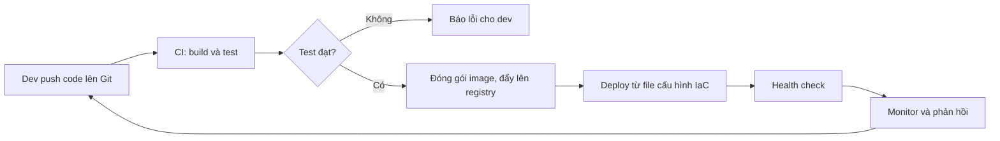

# Buổi 01 – DevOps Introduction

Tuần 1/16 · Giai đoạn 1 – Engineering Foundation · Buổi 01/32

[Slide Buổi 01 – DevOps Introduction](../../slides/01-foundation/session-01.md) · [Bài tập Tuần 1](../../assignments/weekly/week-01.md) · [Hub Tuần 1](README.md)

> **Tóm tắt:** Hiểu DevOps là cách làm việc của cả đội chứ không phải một công cụ, vẽ đường đi của code từ laptop đến server, tìm điểm nghẽn thủ công và nói được cách tự động hóa.

::: tip Buổi này bạn làm gì
**Bạn sẽ tạo ra:** hai sơ đồ Mermaid (quy trình triển khai thủ công và quy trình tự động), một bảng 9 bước "ai làm, nhận gì, tạo ra gì" và danh sách 3 điểm nghẽn.

**Thời gian thật:** đọc khoảng 15 phút, lab bắt buộc 60 phút (viết README và report thêm khoảng 15 phút), thử thách tùy chọn ở nhà khoảng 45 phút.

**Cần chuẩn bị:**

- [ ] Tài khoản GitHub và repo `devops-labs` để PUBLIC, xem [Tài khoản GitHub và repo devops-labs](../../resources/setup-github.md)
- [ ] Đã đọc [Terminal 101](../../resources/terminal-101.md) (mục bắt buộc, khoảng 10 phút): buổi này gõ lệnh `mkdir`, `cat`, `ls` trong terminal
- [ ] Mở Git Bash: bấm Start, gõ `Git Bash`. Trong VS Code: menu Terminal > New Terminal, rồi chọn Git Bash ở mũi tên cạnh dấu `+`
- [ ] Trình xem Mermaid: VS Code có extension Mermaid, hoặc trang [mermaid.live](https://mermaid.live). Chưa cần cài WSL hay Docker: WSL cài ở Buổi 02, Docker để dành cho Buổi 07 (Container Fundamentals), Buổi 08 là Docker CLI. Các bước cài nằm ở [Hướng dẫn cài đặt môi trường](../../resources/setup-guide.md)

**Sản phẩm phải nộp** (thư mục `lab-01/`):

- `README.md` trả lời 7 câu theo mẫu bài lab
- `report.md` ghi 3 điểm nghẽn và workflow tự động bạn đề xuất
- `source/` gồm `steps.md`, `manual-workflow.mmd`, `bottlenecks.md`, `automated-workflow.mmd`
- `evidence/command-output.txt` và 2 ảnh sơ đồ trong `screenshots/`

**Mục lục nhảy:** Đọc ([Vấn đề thực tế](#van-de) và [Khái niệm cốt lõi](#khai-niem)) > [Làm lab](#hands-on-lab) > [Gặp lỗi?](#gap-loi) > [Tự kiểm tra](#tu-kiem-tra) > [Nộp bài](#nop-bai). Kẹt giữa chừng? Nhảy tới [Gặp lỗi?](#gap-loi).

**Từ mới trong buổi** (tra nhanh ở [Bảng thuật ngữ](../../resources/glossary.md)):

- **DevOps**: cách làm việc để dev và ops cùng chịu trách nhiệm đưa phần mềm tới người dùng.
- **SDLC**: các giai đoạn từ ý tưởng đến phần mềm chạy thật.
- **CI/CD**: tự build, test (CI) rồi tự giao bản mới (CD) mỗi lần đổi code.
- **IaC**: mô tả hạ tầng bằng file nằm trong Git.
- **Artifact**: sản phẩm đóng gói sẵn để chạy, ví dụ container image.
:::

Trên lớp, mentor demo trước; tự học thì làm thẳng phần [Làm lab](#hands-on-lab).

## Vấn đề thực tế {#van-de}

CLB làm một ứng dụng quản lý thành viên. Bạn Nam viết xong tính năng danh sách thành viên và chạy tốt trên laptop. Để đưa lên server dùng chung, Nam nén thư mục rồi gửi qua Zalo cho bạn Lan phụ trách máy chủ. Lan giải nén, cài Node.js (bản khác máy Nam), quên đặt biến môi trường mật khẩu database rồi chạy `node server.js`. Ứng dụng lỗi. Hai bạn mất một buổi tối để đoán nguyên nhân, và lần sau lại lặp lại y hệt.

Đây là tình huống "chạy được trên máy tôi". Nguyên nhân không nằm ở code mà ở quy trình: không ai viết ra các bước, môi trường mỗi nơi một kiểu, không có kiểm thử trước khi đưa lên, và hai người ở hai đầu không chung trách nhiệm. DevOps là tập hợp văn hóa, thực hành và công cụ để giải quyết đúng vấn đề này. Cả khóa 16 tuần đi từng bước (Linux, Git, Docker, CI/CD, Kubernetes) cho tới khi ứng dụng CLB tự build, tự kiểm thử và tự triển khai.

## Khái niệm cốt lõi {#khai-niem}

- **DevOps** là văn hóa cộng tác giữa người viết code (Dev) và người vận hành (Ops), công cụ chỉ là phương tiện. Ví von: một đội bếp và phục vụ cùng chịu trách nhiệm bữa ăn, không phải bếp nấu xong rồi ném đĩa qua cửa sổ. Bốn nguyên tắc: cộng tác, tự động hóa, đo lường, phản hồi nhanh và học từ lỗi.
- **SDLC** là vòng đời phần mềm: Plan, Code, Build, Test, Release, Deploy, Operate. Ví von: chuỗi công đoạn làm ra một chiếc xe, nhưng hiện đại là vòng lặp, phản hồi từ khâu vận hành quay lại khâu kế hoạch.
- **CI/CD** là dây chuyền tự động: CI (Continuous Integration) tự build và test mỗi lần push; Continuous Delivery giữ mọi bản đã qua test sẵn sàng phát hành, bước cuối do người bấm duyệt; Continuous Deployment thì tự phát hành, không cần người duyệt. Ví von: băng chuyền kiểm tra chất lượng ở nhà máy.
- **IaC** (Infrastructure as Code) là mô tả hạ tầng và môi trường bằng file văn bản trong Git, như `compose.yaml` của starter project. Ví von: công thức nấu ăn viết ra giấy thay vì nằm trong trí nhớ của một đầu bếp.
- **Vòng đời triển khai** là chuỗi commit, build, test, đóng gói, lưu vào registry, deploy, health check, giám sát, rollback. Quy tắc của buổi: bước nào cũng phải trả lời được "ai làm, nhận gì, tạo ra gì".

Đích đến của khóa học là quy trình tự động dưới đây:



Bảng SDLC chi tiết và so sánh Dev với Ops nằm trong mục "Tìm hiểu thêm" cuối trang.

## Hands-on lab {#hands-on-lab}

**Đề bài:** vẽ quy trình triển khai một ứng dụng từ máy lập trình đến server. Mức L1, bắt buộc, 60 phút. Chạy lệnh trong Git Bash (WSL chưa cài ở buổi này; không dùng PowerShell).

::: tip Không muốn gõ heredoc? Tạo file bằng VS Code
Các Phần 1 đến 4 dùng `cat > tên-file <<'EOF' ... EOF` (heredoc) để ghi nhiều dòng vào file. Cách thay thế cho mọi Phần: mở thư mục `devops-labs` bằng VS Code (`code .` trong Git Bash, hoặc File > Open Folder), tạo file đúng tên trong `lab-01/source/`, dán phần nội dung nằm giữa dòng `cat > ...` và dòng `EOF`, rồi lưu. Kết quả giống hệt.
:::

### Chuẩn bị (5 phút)

```bash
mkdir -p devops-labs && cd devops-labs
mkdir -p lab-01/source lab-01/screenshots lab-01/evidence
git --version
ls lab-01
```

Đã clone repo `devops-labs` từ GitHub? Bỏ dòng đầu, `cd` vào thư mục repo rồi chạy tiếp (repo trống sẽ in cảnh báo "You appear to have cloned an empty repository", đó là bình thường). Nếu lệnh lỗi, xem [Gặp lỗi?](#gap-loi).

Kết quả mong đợi (số phiên bản có thể khác):

```text
git version 2.45.1
evidence  screenshots  source
```

::: tip Kiểm tra: bạn đúng khi
`ls lab-01` in đúng ba thư mục `evidence`, `screenshots`, `source`. Vì sao: tạo sẵn cấu trúc nộp bài từ đầu để khỏi sắp xếp lại ở phút cuối.
:::

### Phần 1 – Chọn ứng dụng và liệt kê các bước (10 phút)

Ứng dụng của bạn là Club Management gồm frontend (Nginx), backend (Node.js, cổng 3000) và database (PostgreSQL). Tạo file ghi các bước triển khai thủ công:

```bash
cat > lab-01/source/steps.md <<'EOF'
# Các bước triển khai thủ công

| Bước | Ai làm | Đầu vào | Đầu ra |
| --- | --- | --- | --- |
| 1. Viết code | Dev | Yêu cầu | Source code |
EOF
```

Không dùng heredoc thì tạo `steps.md` bằng VS Code và dán nội dung. Mở file và bổ sung tối thiểu 8 dòng nữa: commit, build, test, đóng gói, gửi lên server, cấu hình biến môi trường (ví dụ `DB_PASSWORD`), chạy ứng dụng, kiểm tra `/health`. Mỗi dòng phải đủ bốn cột. Vì sao: bảng "ai, đầu vào, đầu ra" làm lộ ra khoảng trống mà sơ đồ đẹp thường che giấu.

::: tip Kiểm tra: bạn đúng khi
`grep -c '^|' lab-01/source/steps.md` in 11 trở lên (9 dòng bước cộng dòng tiêu đề và dòng phân cách) và không ô nào để trống.
:::

### Phần 2 – Vẽ sơ đồ thủ công bằng Mermaid (15 phút)

Chuyển bảng thành sơ đồ. Đặt mọi nhãn trong dấu nháy kép, nếu không sơ đồ dễ lỗi cú pháp (xem [Gặp lỗi?](#gap-loi)):

```bash
cat > lab-01/source/manual-workflow.mmd <<'EOF'
flowchart LR
    A["Dev: viết code"] --> B["Dev: nén và gửi file"]
    B --> C["Ops: giải nén trên server"]
    C --> D["Ops: cài dependency"]
    D --> E["Ops: đặt biến môi trường"]
    E --> F["Ops: chạy ứng dụng"]
    F --> G{"Kiểm tra health"}
    G -- "Lỗi" --> H["Hỏi lại dev"]
    H --> D
    G -- "OK" --> I["Hoàn tất"]
EOF
```

(Thay cho heredoc: tạo `manual-workflow.mmd` bằng VS Code, dán nội dung giữa dòng `cat` và dòng `EOF`.) Dán nội dung vào mermaid.live hoặc xem trước trong VS Code, chụp ảnh lưu vào `lab-01/screenshots/manual-workflow.png`. Vì sao: vòng lặp lỗi chính là chi phí ẩn của quy trình thủ công, hãy nhìn nó bằng mắt.

::: tip Kiểm tra: bạn đúng khi
Sơ đồ vẽ ra được (không báo Syntax error) với đúng 9 nút, có vòng lặp từ "Hỏi lại dev" về "Cài dependency", mỗi nút ghi rõ `Dev:` hoặc `Ops:`.
:::

### Phần 3 – Đánh dấu điểm nghẽn (10 phút)

Với mỗi bước trong `steps.md`, thêm cột "Rủi ro" và "Tự động hóa được không". Gợi ý nhận diện điểm nghẽn: bước phụ thuộc vào trí nhớ của một người, bước chờ người khác, bước dễ sai khi làm tay, bước lặp lại nhiều lần. Chọn 3 bước nghẽn nhất (tạo `bottlenecks.md` bằng lệnh dưới đây, hoặc bằng VS Code và dán nội dung):

```bash
cat > lab-01/source/bottlenecks.md <<'EOF'
# Ba điểm nghẽn

1. Cài dependency trên server: dễ lệch phiên bản. Giải pháp: build image trong CI.
2. (điền tiếp)
3. (điền tiếp)
EOF
```

Vì sao: tự động hóa tùy tiện không có giá trị, bạn phải biết bước nào đau nhất rồi mới chọn công cụ.

::: tip Kiểm tra: bạn đúng khi
`bottlenecks.md` có đúng 3 điểm, mỗi điểm nêu bước nào, vì sao nghẽn và hướng tự động hóa.
:::

### Phần 4 – Vẽ workflow tự động hóa (15 phút)

Vẽ sơ đồ mới, mỗi điểm nghẽn ở Phần 3 được thay bằng một bước tự động:

```bash
cat > lab-01/source/automated-workflow.mmd <<'EOF'
flowchart LR
    A["Dev: push code"] --> B["CI: build và test"]
    B --> C{"Test đạt?"}
    C -- "Không" --> D["Dev: sửa lỗi"]
    D --> A
    C -- "Có" --> E["CI: đóng gói image"]
    E --> F["Registry: lưu image có phiên bản"]
    F --> G["Deploy từ file cấu hình"]
    G --> H["Health check"]
EOF
```

Tạo file bằng heredoc hoặc bằng VS Code như trên. Bổ sung ít nhất một bước bạn thấy còn thiếu (ví dụ rollback, thông báo cho nhóm) rồi chụp ảnh lưu vào `lab-01/screenshots/automated-workflow.png`.

::: tip Kiểm tra: bạn đúng khi
Sơ đồ có CI build và test, cổng kiểm thử có nhánh "không đạt", đóng gói image, registry, deploy, health check và một bước do bạn tự thêm.
:::

### Phần 5 – Ghi bằng chứng (5 phút)

```bash
{
  echo "== git version =="; git --version
  echo "== cau truc lab-01 =="; ls -R lab-01
  echo "== so dong so do =="; wc -l lab-01/source/*.mmd
} > lab-01/evidence/command-output.txt
cat lab-01/evidence/command-output.txt
```

Kết quả mong đợi (rút gọn, số dòng của bạn sẽ khác):

```text
== git version ==
git version 2.45.1
== cau truc lab-01 ==
lab-01:
evidence
screenshots
source
...
== so dong so do ==
   9 lab-01/source/automated-workflow.mmd
  10 lab-01/source/manual-workflow.mmd
  19 total
```

Sau khi viết xong README và report ở phần [Nộp bài](#nop-bai), chạy lại khối lệnh này để bằng chứng phản ánh trạng thái cuối. Vì sao: file text và nguồn chứng minh bạn đã làm, ảnh chụp riêng lẻ thì không đủ.

::: tip Kiểm tra: bạn đúng khi
`cat lab-01/evidence/command-output.txt` không rỗng và liệt kê đủ các file `.mmd`.
:::

### Checklist L1 và lệnh tự kiểm tra

- [ ] `steps.md` có tối thiểu 9 dòng, mỗi dòng đủ cột Ai làm, Đầu vào, Đầu ra.
- [ ] `manual-workflow.mmd` hiển thị được trên mermaid.live, có vòng lặp lỗi.
- [ ] `bottlenecks.md` nêu đúng 3 điểm nghẽn kèm lý do.
- [ ] `automated-workflow.mmd` có CI build, test, đóng gói image, deploy và health check.
- [ ] Có 2 ảnh trong `screenshots/` và file `evidence/command-output.txt`.
- [ ] Giải thích được bằng lời: Continuous Delivery khác Continuous Deployment ở đâu.

```bash
ls lab-01/source lab-01/screenshots lab-01/evidence && grep -c '^|' lab-01/source/steps.md
```

## Gặp lỗi? {#gap-loi}

| Triệu chứng | Nguyên nhân | Cách sửa |
| --- | --- | --- |
| mermaid.live báo "Syntax error in text" | Nhãn có ngoặc, dấu hai chấm hoặc ký tự đặc biệt mà không đặt trong nháy kép. Ví dụ `F[Ops: chạy (production) ứng dụng]` làm parser hiểu ngoặc là hình dạng nút | Đọc số dòng được báo, xóa từng dòng gần đó để thu hẹp, rồi đặt mọi nhãn trong nháy kép: `F["Ops: chạy (production) ứng dụng"]` |
| Sơ đồ chỉ có hộp và mũi tên, không biết ai làm | Thiếu cột người thực hiện, đầu vào, đầu ra | Thêm "Dev:" hoặc "Ops:" vào nhãn và lập bảng `steps.md` |
| Bạn cùng bàn "triển khai" theo sơ đồ nhưng cứ hỏi "lệnh nào, Node bản mấy, mật khẩu ở đâu" | Kiến thức nằm trong đầu một người (tribal knowledge), chưa được viết ra | Ghi mọi câu hỏi đó thành file trong Git (README, `compose.yaml`, `.env.example`) |
| Trả lời "DevOps là Docker và Kubernetes" | Nhầm công cụ với văn hóa và quy trình | Nhắc lại bốn nguyên tắc: cộng tác, tự động hóa, đo lường, phản hồi |
| Tự động hóa mọi thứ nhưng không nêu điểm nghẽn | Chọn công cụ trước khi hiểu vấn đề | Quay lại Phần 3, ưu tiên bước đau nhất |
| `mkdir -p` hoặc `cat > ... <<'EOF'` báo lỗi | Đang chạy trong PowerShell | Mở Git Bash (Start, gõ `Git Bash`), xem [Terminal 101](../../resources/terminal-101.md). Hoặc tạo file bằng VS Code như hộp ở đầu Hands-on lab |
| `Author identity unknown` khi `git commit` | Chưa cấu hình `user.name`, `user.email` | Chạy `git config user.name "Ten Ban"` và `git config user.email "email-github@example.com"` trong repo |
| `git push` báo `no upstream branch` hoặc bị từ chối | Chưa đặt upstream hoặc chưa đăng nhập GitHub | Chạy `git push -u origin HEAD`, kiểm tra `git remote -v`, đăng nhập bằng Git Credential Manager. Không dán token vào file nào |
| `command-output.txt` rỗng | Quên chuyển hướng đầu ra vào file | Chạy lại khối lệnh ở Phần 5, kiểm tra bằng `cat` |
| Ảnh chụp có thông tin cá nhân hoặc token | Chụp cả cửa sổ trình duyệt đang mở nhiều tab | Cắt ảnh, chỉ chụp phần sơ đồ |

## Tự kiểm tra {#tu-kiem-tra}

1. DevOps có phải là một chức danh công việc không? Giải thích.
2. Kể tên 3 giai đoạn của SDLC và nêu một việc có thể tự động hóa ở mỗi giai đoạn.
3. Khác biệt giữa Continuous Delivery và Continuous Deployment là gì?
4. IaC giải quyết vấn đề gì và `compose.yaml` thuộc loại nào?
5. Sau khi deploy, ứng dụng lỗi vì thiếu biến môi trường `DB_PASSWORD`. Quy trình đã thiếu gì?

::: details Đáp án gợi ý
1. Không. DevOps là văn hóa và tập hợp thực hành giúp dev và ops cộng tác. Có vai trò như DevOps Engineer, nhưng bản thân DevOps không phải một người.
2. Ví dụ: Build (cài dependency, đóng gói), Test (chạy unit test), Deploy (cập nhật server từ file cấu hình).
3. Delivery: bản đã qua test luôn sẵn sàng, bước phát hành cuối do người duyệt. Deployment: bản qua test tự triển khai, không cần người duyệt.
4. IaC làm môi trường tái lập được và review được. `compose.yaml` mô tả service, network, volume bằng file nên là IaC cho môi trường local.
5. Thiếu bước cấu hình môi trường được ghi thành tài liệu, hoặc thiếu kiểm tra khi khởi động. Bổ sung file `.env.example`, kiểm tra biến bắt buộc khi chạy (như `compose.yaml` của starter project đòi `DB_PASSWORD`) và health check sau deploy.
:::

## Nộp bài {#nop-bai}

Nộp vào thư mục `lab-01/` trong repo cá nhân `devops-labs`, theo [mẫu bài lab](../../templates/lab-template.md). Chi tiết điểm xem [Bài tập Tuần 1](../../assignments/weekly/week-01.md).

- [ ] `lab-01/README.md` trả lời đủ 7 câu: bài lab giải quyết gì, kiến thức đã dùng, các bước, kết quả mong đợi, lỗi đã gặp, cách khắc phục, có thể cải thiện gì. Cuối file ghi rõ đã làm L1 hay L2.
- [ ] `lab-01/evidence/command-output.txt` chứa đầu ra lệnh thật.
- [ ] `lab-01/report.md` ghi 3 điểm nghẽn, vì sao chọn và workflow đề xuất.
- [ ] `lab-01/source/` có `steps.md`, `manual-workflow.mmd`, `bottlenecks.md`, `automated-workflow.mmd` (và `proposal.md` nếu làm L2), `screenshots/` có ảnh hai sơ đồ.
- [ ] Không có token, mật khẩu hay thông tin cá nhân trong file nộp.

**Cách A, upload trên web (không cần Git):** vào repo `devops-labs` trên GitHub, bấm Add file, Upload files, kéo thả cả thư mục `lab-01/`, rồi Commit changes.

**Cách B, dùng Git:** làm theo mục [Git trong 10 phút](../../curriculum/how-to-learn.md#git-10-phut) (dùng địa chỉ HTTPS hoặc GitHub Desktop). Nếu đã quen:

```bash
git add lab-01
git status -s
git commit -m "Add lab-01 deployment workflow"
git push -u origin HEAD
```

`-u origin HEAD` đẩy nhánh hiện tại và đặt upstream trong một bước. Buổi 01 chưa cần thành thạo Git, push và Pull Request sẽ học kỹ ở [Buổi 06 – Git & GitHub Workflow](../week-03/session-06.md).

## Recap

- DevOps là văn hóa cộng tác cộng với tự động hóa, không phải công cụ hay chức danh.
- Mỗi bước trong quy trình phải có người làm, đầu vào và đầu ra; tự động hóa bắt đầu từ điểm nghẽn, không bắt đầu từ công cụ.
- CI build và test mỗi lần push; IaC đưa hạ tầng vào Git để tái lập và review được.

Buổi tiếp theo: [Buổi 02 – Development Environment](session-02.md).

::: details Tìm hiểu thêm (đọc sau)
**SDLC với ứng dụng CLB**

| Giai đoạn | Câu hỏi chính | Ví dụ với ứng dụng CLB |
| --- | --- | --- |
| Plan | Làm gì, cho ai? | Ban chủ nhiệm cần danh sách thành viên |
| Code | Hiện thực thế nào? | Viết endpoint `GET /api/members` |
| Build | Đóng gói ra sao? | Cài dependency, đóng gói thành image |
| Test | Có đúng không? | Chạy test cho `GET /health` |
| Release | Phiên bản nào được phát hành? | Gắn tag `1.0.0` |
| Deploy | Đưa lên môi trường nào? | Chạy trên server của CLB |
| Operate và Monitor | Có đang chạy ổn không? | Xem log, kiểm tra `/ready` |

Mô hình truyền thống (waterfall) đi một chiều và mỗi giai đoạn do một nhóm khác nhau đảm nhận.

**Dev và Ops: hai mục tiêu mâu thuẫn khi tách rời**

| | Dev (Development) | Ops (Operations) |
| --- | --- | --- |
| Mục tiêu thường thấy | Ra tính năng mới nhanh | Hệ thống ổn định, ít sự cố |
| Sợ điều gì | Bị chặn không được phát hành | Thay đổi làm sập hệ thống |
| Hậu quả khi tách rời | Ném code qua tường | Từ chối thay đổi, quy trình chậm |

DevOps đặt chung một mục tiêu: giao giá trị cho người dùng nhanh và an toàn. Hiểu nhầm phổ biến: "DevOps là Docker/Kubernetes" (sai, đó là công cụ), "DevOps là một người làm hết" (sai, đó là cách làm việc của cả đội).

**CI/CD trong khóa này.** Bạn dùng GitHub Actions cho CI và đẩy image lên GHCR. Vì khóa chạy hoàn toàn local, việc deploy vào máy cá nhân dùng script, không mở máy học viên ra Internet.

Lợi ích của IaC: tái lập được môi trường, review thay đổi như review code, khôi phục nhanh khi hỏng. Sau này `k8s/` sẽ mô tả cùng hệ thống trên Kubernetes.
:::

::: details Thử thách thêm (L2, tùy chọn, làm ở nhà)
Đề xuất DevOps workflow cho một dự án CLB thật (website CLB, bot Discord, ứng dụng điểm danh) và ghi vào `lab-01/source/proposal.md`. Đề bài đầy đủ, gợi ý từng bậc và thử thách tính toán nằm ở [Buổi 01 – Thử thách thêm](session-01-challenge.md). Tự thử 15 phút trước khi mở gợi ý.
:::

::: details Phá lỗi nâng cao
Hai tình huống tự phá rồi tự sửa nằm ở [Buổi 01 – Thử thách thêm](session-01-challenge.md).
:::

::: details Tài liệu tham khảo
- [Atlassian – What is DevOps](https://www.atlassian.com/devops)
- [DORA – nghiên cứu về hiệu suất phân phối phần mềm](https://dora.dev/)
- [Mermaid – Flowchart syntax](https://mermaid.js.org/syntax/flowchart.html)
- [Pro Git – Getting Started](https://git-scm.com/book/en/v2/Getting-Started-About-Version-Control)
- [GitHub Actions – Understanding GitHub Actions](https://docs.github.com/en/actions/get-started/understand-github-actions)
:::
