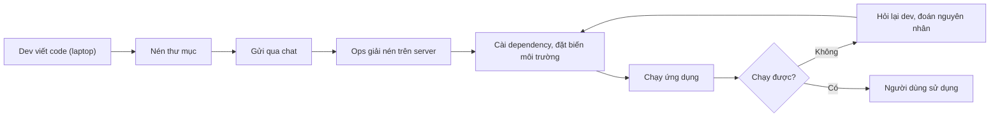
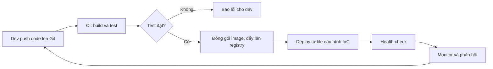

# Buổi 01 – DevOps Introduction

Tuần 1 · Giai đoạn 1 – Engineering Foundation · Slide: [Slide buổi 01](../../slides/01-foundation/session-01.md)

> **Tóm tắt:** Hiểu DevOps là văn hóa và quy trình, vẽ được đường đi của code từ máy lập trình đến server, chỉ ra điểm nghẽn thủ công và cách tự động hóa bằng CI/CD và IaC.

## Mục tiêu học tập

- Giải thích được DevOps là gì và không phải là gì (không phải một công cụ, không phải một chức danh).
- Mô tả được các giai đoạn của SDLC và chỉ ra giai đoạn nào DevOps tác động nhiều nhất.
- Phân biệt được Continuous Integration, Continuous Delivery và Continuous Deployment bằng ví dụ cụ thể.
- Vẽ được sơ đồ deployment workflow bằng Mermaid, trong đó mỗi bước có người thực hiện, đầu vào và đầu ra.
- Chỉ ra được ít nhất 3 điểm nghẽn trong quy trình triển khai thủ công và đề xuất cách tự động hóa.
- Nộp được bài lab đúng cấu trúc `lab-01/` trong repo cá nhân.

## Điều kiện cần

Buổi đầu tiên nên không yêu cầu kiến thức DevOps trước đó. Bạn chỉ cần:

- Một tài khoản GitHub và một repo cá nhân tên `devops-labs` (tạo trống nếu chưa có).
- Git đã cài. Kiểm tra nhanh trong terminal (PowerShell hoặc WSL):

```bash
git --version
```

Kết quả mong đợi (số phiên bản có thể khác):

```text
git version 2.45.1
```

- Một trình soạn thảo có xem trước Mermaid (VS Code kèm extension hỗ trợ Mermaid) hoặc trang [mermaid.live](https://mermaid.live) để dán thử sơ đồ.
- Biết cơ bản lập trình web: frontend gọi backend, backend gọi database (đủ để hiểu ứng dụng Club Management).

WSL2 và Docker sẽ được cài ở buổi 02, buổi này chưa cần.

## Vấn đề thực tế

CLB làm một ứng dụng quản lý thành viên. Ở tuần đầu, bạn Nam viết xong tính năng danh sách thành viên và chạy tốt trên laptop. Để đưa lên server dùng chung, Nam nén thư mục, gửi file qua Zalo cho bạn Lan phụ trách máy chủ. Lan giải nén, cài Node.js (bản khác với máy Nam), quên đặt biến môi trường mật khẩu database, rồi chạy `node server.js`. Ứng dụng lỗi. Hai bạn mất một buổi tối để đoán nguyên nhân, và lần triển khai sau lại lặp lại y hệt.

Đây là tình huống kinh điển "chạy được trên máy tôi". Nguyên nhân không nằm ở code mà ở quy trình: không ai viết ra các bước, môi trường mỗi nơi một kiểu, không có kiểm thử trước khi đưa lên, và hai người ở hai đầu không có chung trách nhiệm. DevOps là tập hợp văn hóa, thực hành và công cụ để giải quyết đúng vấn đề này. Cả khóa học 16 tuần sẽ đi từng bước: Linux, Git, Docker, CI/CD, Kubernetes, cho tới khi ứng dụng CLB tự build, tự kiểm thử và tự triển khai lặp lại được.

## Khái niệm cốt lõi

### SDLC: vòng đời phát triển phần mềm

SDLC (Software Development Life Cycle) mô tả các giai đoạn từ ý tưởng đến phần mềm chạy thật:

| Giai đoạn | Câu hỏi chính | Ví dụ với ứng dụng CLB |
| --- | --- | --- |
| Plan | Làm gì, cho ai? | Ban chủ nhiệm cần danh sách thành viên |
| Code | Hiện thực thế nào? | Viết endpoint `GET /api/members` |
| Build | Đóng gói ra sao? | Cài dependency, đóng gói thành image |
| Test | Có đúng không? | Chạy test cho `GET /health` |
| Release | Phiên bản nào được phát hành? | Gắn tag `1.0.0` |
| Deploy | Đưa lên môi trường nào? | Chạy trên server của CLB |
| Operate và Monitor | Có đang chạy ổn không? | Xem log, kiểm tra `/ready` |

Mô hình truyền thống (waterfall) đi một chiều và mỗi giai đoạn do một nhóm khác nhau đảm nhận. Mô hình hiện đại là vòng lặp ngắn: phản hồi từ giai đoạn Operate quay lại giai đoạn Plan.

### Dev vs Ops và bức tường giữa hai nhóm

| | Dev (Development) | Ops (Operations) |
| --- | --- | --- |
| Mục tiêu thường thấy | Ra tính năng mới nhanh | Hệ thống ổn định, ít sự cố |
| Sợ điều gì | Bị chặn không được phát hành | Thay đổi làm sập hệ thống |
| Hậu quả khi tách rời | Ném code qua tường | Từ chối thay đổi, quy trình chậm |

Hai mục tiêu này mâu thuẫn khi hai nhóm tách biệt. DevOps đặt chung một mục tiêu: giao giá trị cho người dùng nhanh và an toàn. Nghĩa là dev hiểu cách ứng dụng chạy thật, ops tham gia từ sớm, và cả hai chia sẻ trách nhiệm về chất lượng.

### DevOps culture

DevOps trước hết là văn hóa, công cụ chỉ là phương tiện. Bốn nguyên tắc nên nhớ:

- **Cộng tác:** dev và ops cùng sở hữu sản phẩm, không đổ lỗi qua lại.
- **Tự động hóa:** việc lặp lại (build, test, deploy) giao cho máy.
- **Đo lường:** quyết định dựa trên số liệu (thời gian deploy, tỷ lệ lỗi), không dựa cảm giác.
- **Phản hồi nhanh và học từ lỗi:** lỗi là dữ liệu để cải thiện quy trình, không phải để tìm người chịu trách nhiệm.

Hiểu nhầm phổ biến: "DevOps là Docker/Kubernetes" (sai, đó là công cụ), "DevOps là một người làm hết" (sai, đó là cách làm việc của cả đội).

### CI/CD

| Thuật ngữ | Ý nghĩa | Kết quả |
| --- | --- | --- |
| Continuous Integration (CI) | Mỗi lần push, hệ thống tự build và test | Phát hiện lỗi tích hợp sớm |
| Continuous Delivery | Mỗi bản đã qua test luôn sẵn sàng deploy, bước cuối do người bấm duyệt | Phát hành bất cứ lúc nào |
| Continuous Deployment | Bản qua test được deploy tự động, không cần người duyệt | Phát hành liên tục |

Trong khóa này bạn sẽ dùng GitHub Actions cho CI và đẩy image lên GHCR. Vì khóa học chạy hoàn toàn local, việc deploy vào máy cá nhân sẽ dùng script, không mở máy học viên ra Internet.

### Infrastructure as Code (IaC)

IaC là mô tả hạ tầng và môi trường bằng file văn bản, lưu trong Git, thay vì cấu hình bằng tay. Ví dụ trong starter project: `compose.yaml` mô tả 3 service (frontend, backend, postgres), sau này `k8s/` mô tả cùng hệ thống trên Kubernetes. Lợi ích: tái lập được môi trường, review được thay đổi như review code, và khôi phục nhanh khi hỏng.

### Deployment lifecycle

Một thay đổi code đi qua: commit, build, test, đóng gói artifact (ví dụ container image), lưu vào registry, deploy lên môi trường, kiểm tra sức khỏe (health check), giám sát, và rollback nếu cần. Mỗi bước có đầu vào và đầu ra rõ ràng. Quy tắc vẽ sơ đồ trong bài lab: bước nào cũng phải trả lời được "ai làm, nhận gì, tạo ra gì".

## Kiến trúc và cách hoạt động

Sơ đồ dưới đây là deployment workflow thủ công, đúng kiểu câu chuyện của Nam và Lan:



Và đây là workflow tự động hóa mà khóa học hướng tới:



Giải thích từng bước của workflow tự động:

1. **Push code:** thay đổi nằm trong Git, có lịch sử và người chịu trách nhiệm rõ ràng.
2. **CI build và test:** máy chủ CI chạy cùng một quy trình mỗi lần, loại bỏ "khác máy".
3. **Cổng kiểm thử:** test thất bại thì dừng, không có image lỗi nào được phát hành.
4. **Đóng gói và đẩy registry:** artifact bất biến, có phiên bản. Nơi nào chạy cũng dùng đúng artifact đó.
5. **Deploy từ IaC:** cấu hình môi trường nằm trong file, không phụ thuộc trí nhớ của một người.
6. **Health check:** xác nhận ứng dụng thật sự sống (ví dụ `/health`, `/ready` của starter project).
7. **Monitor và phản hồi:** số liệu và lỗi thực tế quay lại thành công việc cho vòng lặp tiếp theo.

## Demo của mentor

Mục tiêu demo (khoảng 10 phút): cho lớp thấy chi phí của quy trình thủ công và cách một sơ đồ làm lộ điểm nghẽn.

1. Mentor mở slide và kể lại tình huống Nam và Lan. Hỏi lớp: "Bước nào dễ sai nhất? Ai biết bước đó?"
2. Mentor tạo thư mục demo và file sơ đồ đầu tiên:

```bash
mkdir -p ~/demo-lab-01 && cd ~/demo-lab-01
cat > workflow.mmd <<'EOF'
flowchart LR
    A["Dev viết code"] --> B["Nén thư mục"]
    B --> C["Ops giải nén trên server"]
    C --> D["Chạy ứng dụng"]
EOF
cat workflow.mmd
```

Kết quả mong đợi:

```text
flowchart LR
    A["Dev viết code"] --> B["Nén thư mục"]
    B --> C["Ops giải nén trên server"]
    C --> D["Chạy ứng dụng"]
```

3. Dán nội dung này vào mermaid.live để cả lớp thấy sơ đồ được vẽ ra từ văn bản. Điểm cần nhấn mạnh: sơ đồ là text, nằm trong Git, review được. Đây là tư duy "as code" đầu tiên của khóa học.
4. Mentor commit sơ đồ, thêm một dòng (ví dụ bước "Chạy test") rồi xem thay đổi bằng Git:

```bash
git init -q
git add workflow.mmd
git -c user.name=demo -c user.email=demo@example.com commit -q -m "Add manual workflow"
echo '    D --> E["Chạy test"]' >> workflow.mmd
git diff --stat
git log --oneline
```

Kết quả mong đợi (mã commit sẽ khác):

```text
 workflow.mmd | 1 +
 1 file changed, 1 insertion(+)
3f2a9c1 Add manual workflow
```

Điểm cần nhấn mạnh: `git diff` cho thấy đúng dòng nào thay đổi, đó là lợi ích của việc để sơ đồ dưới dạng text.

Câu hỏi mentor nên hỏi lớp:

- Sơ đồ này thiếu thông tin gì? (Gợi ý: không có bước kiểm thử, không có người chịu trách nhiệm, không có đầu vào và đầu ra.)
- Nếu server cài Node.js bản cũ hơn, bước nào phát hiện ra lỗi?
- Nếu deploy 10 lần một ngày, bước nào bạn muốn giao cho máy?

## Hands-on lab

**Đề bài:** Vẽ quy trình triển khai một ứng dụng từ máy lập trình đến server. Thời lượng: 60 phút.

### Chuẩn bị

Làm việc trong thư mục repo cá nhân. Nếu dùng WSL2 thì clone vào filesystem của WSL (ví dụ `~/devops-labs`), không dùng `/mnt/c`. Buổi này chưa cài WSL2 thì dùng Git Bash hoặc PowerShell, bỏ qua lưu ý đó.

```bash
git clone https://github.com/TEN_GITHUB_CUA_BAN/devops-labs.git
cd devops-labs
git config user.name "Ho Ten Cua Ban"
git config user.email "email-github-cua-ban@example.com"
mkdir -p lab-01/source lab-01/screenshots lab-01/evidence
ls lab-01
```

Clone repo trống sẽ in cảnh báo "You appear to have cloned an empty repository", đó là bình thường. Hai lệnh `git config` (không có `--global`) chỉ áp dụng cho repo này; Buổi 02 sẽ cấu hình toàn cục và chuyển sang SSH. Nếu `git push` ở bước 10 yêu cầu đăng nhập, dùng Git Credential Manager (Windows) hoặc đợi tới sau Buổi 02 rồi push, không dán token vào file nào trong repo.

Kết quả mong đợi:

```text
evidence  screenshots  source
```

Vì sao: tạo sẵn đúng cấu trúc nộp bài từ đầu để không phải sắp xếp lại ở phút cuối.

### Phần 1 – Chọn ứng dụng và liệt kê các bước (10 phút)

Bước 1. Ứng dụng của bạn là Club Management gồm frontend (Nginx), backend (Node.js, cổng 3000) và database (PostgreSQL). Hãy tạo file ghi các bước triển khai thủ công mà bạn nghĩ sẽ cần:

```bash
cat > lab-01/source/steps.md <<'EOF'
# Các bước triển khai thủ công

| Bước | Ai làm | Đầu vào | Đầu ra |
| --- | --- | --- | --- |
| 1. Viết code | Dev | Yêu cầu | Source code |
EOF
```

Bước 2. Mở file và bổ sung tối thiểu 8 dòng nữa: commit, build, test, đóng gói, gửi lên server, cấu hình biến môi trường (ví dụ `DB_PASSWORD`), chạy ứng dụng, kiểm tra `/health`. Mỗi dòng phải có đủ bốn cột.

Vì sao: bảng "ai, đầu vào, đầu ra" là thứ làm lộ ra khoảng trống mà sơ đồ đẹp thường che giấu.

### Phần 2 – Vẽ sơ đồ thủ công bằng Mermaid (15 phút)

Bước 3. Chuyển bảng thành sơ đồ. Ghi nhãn trong dấu nháy kép để tránh lỗi cú pháp:

```bash
cat > lab-01/source/manual-workflow.mmd <<'EOF'
flowchart LR
    A["Dev: viết code"] --> B["Dev: nén và gửi file"]
    B --> C["Ops: giải nén trên server"]
    C --> D["Ops: cài dependency"]
    D --> E["Ops: đặt biến môi trường"]
    E --> F["Ops: chạy ứng dụng"]
    F --> G{"Kiểm tra health"}
    G -- "Lỗi" --> H["Hỏi lại dev"]
    H --> D
    G -- "OK" --> I["Hoàn tất"]
EOF
```

Bước 4. Dán nội dung vào mermaid.live hoặc xem trước trong VS Code, chụp ảnh lưu vào `lab-01/screenshots/manual-workflow.png`.

Kết quả mong đợi: sơ đồ hiển thị đúng 9 nút, có một vòng lặp từ "Hỏi lại dev" về "Cài dependency".

Vì sao: vòng lặp lỗi chính là chi phí ẩn của quy trình thủ công. Hãy nhìn nó bằng mắt.

### Phần 3 – Đánh dấu điểm nghẽn (10 phút)

Bước 5. Với mỗi bước trong `steps.md`, thêm cột "Rủi ro" và "Tự động hóa được không". Gợi ý nhận diện điểm nghẽn: bước phụ thuộc vào trí nhớ của một người, bước chờ người khác, bước dễ sai khi làm tay, bước lặp lại nhiều lần.

Bước 6. Chọn ra 3 bước nghẽn nhất và ghi vào `lab-01/source/bottlenecks.md`:

```bash
cat > lab-01/source/bottlenecks.md <<'EOF'
# Ba điểm nghẽn

1. Cài dependency trên server: dễ lệch phiên bản. Giải pháp: build image trong CI.
2. (điền tiếp)
3. (điền tiếp)
EOF
```

Vì sao: tự động hóa tùy tiện không có giá trị. Bạn phải biết bước nào đau nhất rồi mới chọn công cụ.

### Phần 4 – Vẽ workflow tự động hóa (15 phút)

Bước 7. Vẽ sơ đồ mới, mỗi điểm nghẽn ở Phần 3 phải được thay bằng một bước tự động:

```bash
cat > lab-01/source/automated-workflow.mmd <<'EOF'
flowchart LR
    A["Dev: push code"] --> B["CI: build và test"]
    B --> C{"Test đạt?"}
    C -- "Không" --> D["Dev: sửa lỗi"]
    D --> A
    C -- "Có" --> E["CI: đóng gói image"]
    E --> F["Registry: lưu image có phiên bản"]
    F --> G["Deploy từ file cấu hình"]
    G --> H["Health check"]
EOF
```

Bước 8. Bổ sung ít nhất một bước mà bạn thấy thiếu (ví dụ rollback, thông báo cho nhóm) rồi chụp ảnh lưu vào `lab-01/screenshots/automated-workflow.png`.

### Phần 5 – Ghi bằng chứng và commit (10 phút)

Bước 9. Ghi lại bằng chứng dạng văn bản:

```bash
{
  echo "== git version =="; git --version
  echo "== cau truc lab-01 =="; ls -R lab-01
  echo "== so dong so do =="; wc -l lab-01/source/*.mmd
} > lab-01/evidence/command-output.txt
cat lab-01/evidence/command-output.txt
```

Kết quả mong đợi (rút gọn; README.md và report.md chưa có ở bước này nên chưa xuất hiện):

```text
== git version ==
git version 2.45.1
== cau truc lab-01 ==
lab-01:
evidence
screenshots
source

lab-01/evidence:
command-output.txt
...
== so dong so do ==
   9 lab-01/source/automated-workflow.mmd
  10 lab-01/source/manual-workflow.mmd
  19 total
```

Số dòng thực tế của bạn sẽ khác tùy bạn bổ sung bao nhiêu bước. Sau khi viết xong README và report, chạy lại khối lệnh trên để bằng chứng phản ánh trạng thái cuối.

Bước 10. Viết `lab-01/README.md` (7 câu theo `templates/lab-template.md`) và `lab-01/report.md`, sau đó commit:

```bash
git add lab-01
git status -s
git commit -m "Add lab-01 deployment workflow"
git push -u origin HEAD
```

Vì sao `-u origin HEAD`: repo mới clone từ remote trống chưa có nhánh theo dõi, lệnh này đẩy nhánh hiện tại và đặt upstream trong một bước.

Vì sao: bằng chứng bằng text, source và commit chứng minh bạn đã làm, còn ảnh chụp màn hình riêng lẻ thì không đủ.

### L1 – Foundation: checklist hoàn thành

- [ ] `steps.md` có tối thiểu 9 dòng, mỗi dòng đủ cột Ai làm, Đầu vào, Đầu ra.
- [ ] `manual-workflow.mmd` hiển thị được trên mermaid.live, có vòng lặp lỗi.
- [ ] `bottlenecks.md` nêu đúng 3 điểm nghẽn kèm lý do.
- [ ] `automated-workflow.mmd` có CI build, test, đóng gói image, deploy và health check.
- [ ] Có 2 ảnh trong `screenshots/` và file `evidence/command-output.txt`.
- [ ] Giải thích được bằng lời: khác biệt giữa Continuous Delivery và Continuous Deployment.

### L2 – Engineering: thử thách tự làm

**Đề bài:** Đề xuất DevOps workflow cho một dự án CLB thật (ví dụ website CLB, bot Discord, ứng dụng điểm danh). Ghi vào `lab-01/source/proposal.md`.

Tiêu chí hoàn thành:

- Có sơ đồ Mermaid thể hiện workflow hiện tại và workflow đề xuất.
- Nêu 3 điểm nghẽn có số liệu ước lượng (ví dụ "deploy tay mất 20 phút, mỗi tuần 3 lần").
- Mỗi điểm nghẽn có cách tự động hóa, công cụ dự kiến và buổi nào trong khóa sẽ dạy công cụ đó (tra `curriculum/syllabus.md`).
- Có một rủi ro của chính giải pháp tự động hóa (ví dụ: pipeline hỏng thì ai sửa?).
- Chỉ ra 2 chỉ số để đo cải thiện (ví dụ thời gian từ commit đến chạy được, số lần deploy lỗi).

<details>
<summary>Gợi ý</summary>

Bắt đầu từ câu hỏi "lần deploy gần nhất mất bao lâu và vì sao". Liệt kê từng phút, bước tốn nhiều phút nhất thường là ứng viên điểm nghẽn. Với tự động hóa, hãy chọn giải pháp nhỏ nhất giải quyết được vấn đề, ví dụ một workflow chạy test mỗi lần push trước khi nghĩ tới Kubernetes.

</details>

<details>
<summary>Lời giải tham khảo</summary>

Ví dụ cho bot Discord của CLB:

| Điểm nghẽn | Số liệu ước lượng | Tự động hóa | Học ở |
| --- | --- | --- | --- |
| Deploy tay qua SSH | 15 phút, 2 lần mỗi tuần | Đóng gói bằng container, deploy bằng một lệnh | Giai đoạn Docker |
| Không có test, lỗi phát hiện khi người dùng báo | 1 lỗi mỗi tuần | CI chạy test mỗi lần push | Giai đoạn CI/CD |
| Cấu hình token nằm trong máy một người | Mất token là ngừng bot | Biến môi trường, không commit secret | Giai đoạn Docker, Compose |

Chỉ số đo: thời gian từ commit đến bot chạy bản mới, số lần deploy phải làm lại. Rủi ro: pipeline hỏng thì cả nhóm không phát hành được, cần ít nhất 2 người biết sửa.

</details>

## Phá lỗi và debug

### Tình huống 1: sơ đồ Mermaid không hiển thị

Cách phá: sửa một nhãn trong `manual-workflow.mmd` thành nhãn có dấu ngoặc và không đặt trong nháy kép:

```text
    E --> F[Ops: chạy (production) ứng dụng]
```

Triệu chứng: mermaid.live báo "Syntax error in text" hoặc sơ đồ không vẽ.

Hướng điều tra:

1. Đọc thông báo lỗi, ghi lại số dòng được báo.
2. Thu hẹp: xóa từng dòng gần vị trí lỗi rồi dán lại, xem sơ đồ nào vẽ được.
3. Kiểm tra ký tự đặc biệt trong nhãn: ngoặc tròn, ngoặc vuông, dấu hai chấm, dấu nháy.
4. Đặt nhãn trong nháy kép và thử lại.

Nguyên nhân gốc: trong cú pháp Mermaid, dấu ngoặc là ký hiệu hình dạng của nút, nên ngoặc nằm trong nhãn không có nháy làm bộ phân tích hiểu sai cấu trúc.

Phòng tránh: luôn đặt nhãn trong nháy kép, xem trước trước khi commit, và để sơ đồ trong Git để có thể quay lại phiên bản đang hoạt động.

### Tình huống 2: quy trình đúng trên giấy nhưng sai ngoài thực tế

Cách phá: đưa sơ đồ thủ công cho bạn cùng bàn và nhờ họ "triển khai" theo đúng sơ đồ, chỉ trả lời câu hỏi bằng thông tin có trong sơ đồ.

Triệu chứng: bạn cùng bàn dừng lại và hỏi "chạy bằng lệnh nào, Node bản mấy, mật khẩu database ở đâu".

Hướng điều tra: ghi lại mọi câu hỏi họ đặt ra, mỗi câu là một thông tin ngầm chưa được viết ra.

Nguyên nhân gốc: kiến thức nằm trong đầu một người (tribal knowledge). Cách phòng tránh là ghi mọi thứ thành file nằm trong Git (README, `compose.yaml`, `.env.example`), đó chính là bước đầu của IaC.

## Lỗi thường gặp

| Triệu chứng | Nguyên nhân | Cách xử lý |
| --- | --- | --- |
| Sơ đồ Mermaid báo Syntax error | Nhãn có ký tự đặc biệt chưa đặt trong nháy kép | Đặt mọi nhãn trong dấu nháy kép |
| Sơ đồ chỉ có hộp và mũi tên, không biết ai làm | Thiếu cột người thực hiện, đầu vào, đầu ra | Thêm "Ai: việc" vào nhãn và lập bảng `steps.md` |
| Trả lời "DevOps là Docker và Kubernetes" | Nhầm công cụ với văn hóa và quy trình | Nhắc lại bốn nguyên tắc: cộng tác, tự động hóa, đo lường, phản hồi |
| `git push` báo `no upstream branch` hoặc bị từ chối | Chưa đặt upstream hoặc chưa đăng nhập GitHub | Chạy `git push -u origin HEAD`; kiểm tra `git remote -v`; đăng nhập bằng trình quản lý credential của Git |
| `Author identity unknown` khi `git commit` | Chưa cấu hình `user.name`, `user.email` | Chạy hai lệnh `git config` ở phần Chuẩn bị |
| Ảnh chụp có thông tin cá nhân hoặc token | Chụp cả cửa sổ trình duyệt đang mở nhiều tab | Cắt ảnh, chỉ chụp phần sơ đồ |
| Tự động hóa mọi thứ nhưng không nêu điểm nghẽn | Chọn công cụ trước khi hiểu vấn đề | Quay lại Phần 3, ưu tiên bước đau nhất |
| `command-output.txt` rỗng | Quên chuyển hướng đầu ra vào file | Chạy lại khối lệnh ở Phần 5, kiểm tra bằng `cat` |

## Tự kiểm tra

1. DevOps có phải là một chức danh công việc không? Giải thích.
2. Kể tên 3 giai đoạn của SDLC và nêu một việc có thể tự động hóa ở mỗi giai đoạn.
3. Khác biệt giữa Continuous Delivery và Continuous Deployment là gì?
4. IaC giải quyết vấn đề gì và `compose.yaml` thuộc loại nào?
5. Vì sao mỗi bước trong sơ đồ deployment cần có đầu vào và đầu ra?
6. Tình huống: sau khi deploy, ứng dụng lỗi vì thiếu biến môi trường `DB_PASSWORD`. Quy trình nào đã thiếu và bạn bổ sung gì?
7. Tình huống: nhóm bạn push 15 lần mỗi ngày, mỗi lần deploy tay mất 10 phút. Tính chi phí mỗi tuần (5 ngày) và nói bước nào nên tự động hóa trước.

<details>
<summary>Đáp án</summary>

1. Không. DevOps là văn hóa và tập hợp thực hành giúp dev và ops cộng tác. Có vai trò như DevOps Engineer, nhưng bản thân DevOps không phải một người.
2. Ví dụ: Build (cài dependency, đóng gói), Test (chạy unit test), Deploy (cập nhật server từ file cấu hình).
3. Delivery: bản đã qua test luôn sẵn sàng, bước phát hành cuối do người duyệt. Deployment: bản qua test tự triển khai, không cần người duyệt.
4. IaC làm môi trường tái lập được và review được. `compose.yaml` mô tả các service, network, volume bằng file nên là IaC cho môi trường local.
5. Để biết bước đó cần gì và tạo ra gì, từ đó phát hiện khoảng trống, kiểm thử được và tự động hóa được.
6. Thiếu bước cấu hình môi trường được ghi thành tài liệu, hoặc thiếu kiểm tra khi khởi động. Bổ sung file `.env.example`, kiểm tra biến bắt buộc khi chạy (như `compose.yaml` của starter project đòi `DB_PASSWORD`) và health check sau deploy.
7. 15 lần x 10 phút x 5 ngày = 750 phút, tức 12,5 giờ mỗi tuần. Tự động hóa bước deploy trước, vì lặp nhiều nhất và tốn thời gian nhất.

</details>

## Nộp bài

Nộp vào thư mục `lab-01/` trong repo cá nhân, theo `templates/lab-template.md`:

- [ ] `lab-01/README.md` trả lời đủ 7 câu: bài lab giải quyết gì, kiến thức đã dùng, các bước, kết quả mong đợi, lỗi đã gặp, cách khắc phục, có thể cải thiện gì.
- [ ] `lab-01/evidence/command-output.txt` chứa đầu ra lệnh thật (phiên bản Git, cấu trúc thư mục, số dòng sơ đồ).
- [ ] `lab-01/report.md` ghi lại 3 điểm nghẽn, vì sao chọn và workflow đề xuất.
- [ ] `lab-01/source/` có `steps.md`, `manual-workflow.mmd`, `bottlenecks.md`, `automated-workflow.mmd` (và `proposal.md` nếu làm L2).
- [ ] `lab-01/screenshots/` có ảnh hai sơ đồ.
- [ ] Ghi rõ đã làm L1 hay L2 ở cuối README.
- [ ] Không có token, mật khẩu hoặc thông tin cá nhân trong file nộp. Giá trị nhạy cảm chỉ dùng placeholder.

## Recap

- DevOps là văn hóa cộng tác cộng với tự động hóa, không phải một công cụ hay một chức danh.
- SDLC là vòng lặp, phản hồi từ vận hành quay lại kế hoạch.
- CI build và test mỗi lần push; Delivery cần người duyệt bước cuối, Deployment thì tự động.
- IaC đưa hạ tầng vào file trong Git để tái lập và review được.
- Mỗi bước trong quy trình phải có người làm, đầu vào và đầu ra.
- Tự động hóa bắt đầu từ việc tìm điểm nghẽn, không bắt đầu từ công cụ.
- Mọi sản phẩm của bạn (sơ đồ, ghi chú, bằng chứng) nên nằm trong Git.

## Tài liệu tham khảo

- [Atlassian – What is DevOps](https://www.atlassian.com/devops)
- [DORA – nghiên cứu về hiệu suất phân phối phần mềm](https://dora.dev/)
- [Mermaid – Flowchart syntax](https://mermaid.js.org/syntax/flowchart.html)
- [Pro Git – Getting Started](https://git-scm.com/book/en/v2/Getting-Started-About-Version-Control)
- [GitHub Actions – Understanding GitHub Actions](https://docs.github.com/en/actions/get-started/understand-github-actions)
