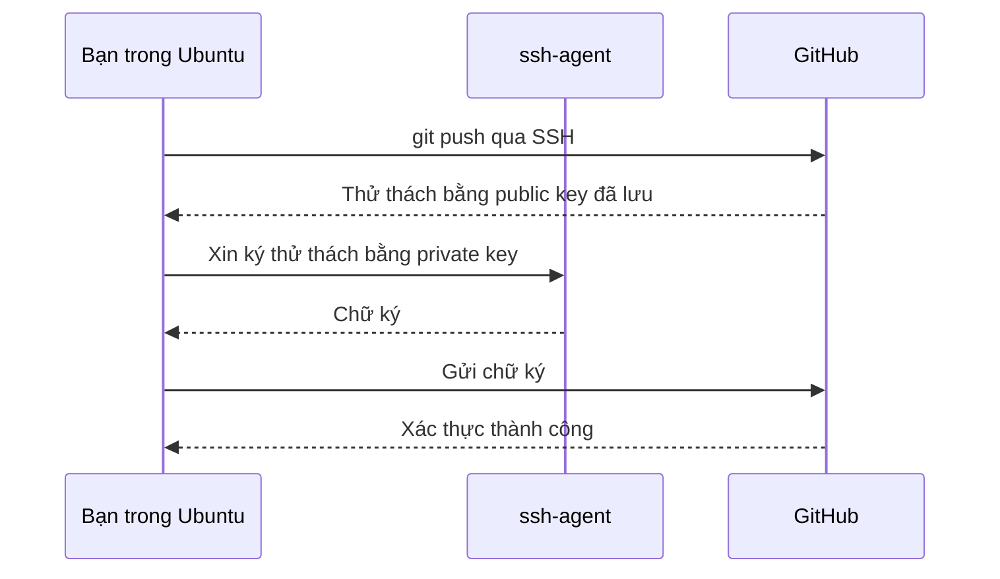

# Buổi 02 – Thử thách thêm

Tuần 1/16 · Giai đoạn 1 – Engineering Foundation · Buổi 02/32

[Buổi 02 – Development Environment](session-02.md) · [Bài tập Tuần 1](../../assignments/weekly/week-01.md) · [Hub Tuần 1](README.md)

> **Tóm tắt:** Phần tùy chọn của Buổi 02: tự viết script kiểm tra môi trường, dotfiles, phá lỗi quyền SSH key bằng khóa thử, cùng các bảng và sơ đồ tham khảo thêm về WSL, shell và SSH.

::: tip Làm gì ở đây
Chỉ làm khi đã xong lab bắt buộc (L1) của [Buổi 02 – Development Environment](session-02.md). L2 là điểm thưởng, mất khoảng 45 phút ở nhà. Tự thử 15 phút trước khi mở bất kỳ gợi ý nào. Trong trang này mọi thao tác phá lỗi chỉ dùng khóa thử `~/.ssh/test_key`, tuyệt đối không đụng tới khóa thật `~/.ssh/id_ed25519`.
:::

## Thử thách L2

### Thử thách 0: tự viết bản check-env rút gọn

L1 chạy script có sẵn `resources/check-env.sh`. Để hiểu nó hoạt động ra sao, bạn tự viết một bản rút gọn trong `~/devops-labs/lab-02/source/check-env.sh`:

```bash
cat > ~/devops-labs/lab-02/source/check-env.sh <<'EOF'
#!/usr/bin/env bash
# Kiem tra cac cong cu can cho khoa DevOps
set -u
fail=0
check() {
  name="$1"; cmd="$2"; flag="${3:---version}"
  if command -v "$cmd" >/dev/null 2>&1; then
    printf 'OK    %-10s %s\n' "$name" "$($cmd "$flag" 2>&1 | head -n 1)"
  else
    printf 'THIEU %-10s chua cai\n' "$name"
    fail=1
  fi
}
check git git
check curl curl
check ssh ssh -V
check docker docker
case "$PWD" in
  /mnt/*) echo "CANH BAO: dang o /mnt, hay lam viec trong home cua WSL"; fail=1 ;;
esac
exit "$fail"
EOF
chmod +x ~/devops-labs/lab-02/source/check-env.sh
```

Vì sao `set -u`: biến chưa khai báo sẽ gây lỗi thay vì lặng lẽ rỗng. Vì sao `chmod +x`: cấp quyền thực thi để chạy trực tiếp. Vì sao `ssh` có tham số thứ ba `-V`: `ssh` không hiểu `--version`, nó in phiên bản bằng `-V` (và in ra stderr, nên script gộp `2>&1`). Hàm `check` nhận cờ phiên bản làm tham số tùy chọn, mặc định là `--version`.

Chạy script và lưu kết quả như ở Phần 4 của bài lab (gán `code=$?` ngay sau lệnh chạy):

```bash
cd ~/devops-labs/lab-02
./source/check-env.sh > evidence/command-output-own.txt 2>&1
code=$?
echo "exit code: $code" >> evidence/command-output-own.txt
cat evidence/command-output-own.txt
```

Kết quả mong đợi (docker có thể báo THIEU vì chưa cài, chấp nhận được ở tuần này):

```text
OK    git        git version 2.43.0
OK    curl       curl 8.5.0 (x86_64-pc-linux-gnu) libcurl/8.5.0 ...
OK    ssh        OpenSSH_9.6p1 Ubuntu-3ubuntu13, OpenSSL 3.0.13 30 Jan 2024
THIEU docker     chua cai
exit code: 1
```

### Thử thách 1: script kiểm tra đầy đủ

Mở rộng `check-env.sh` để (a) kiểm tra thêm `node`, `npm`, `make`; (b) in tổng kết "N công cụ thiếu"; (c) trả mã thoát khác 0 nếu có công cụ thiếu; (d) kiểm tra quyền của khóa SSH là 600. Tiêu chí hoàn thành: khi cố tình đổi quyền khóa thử thành 644 thì script báo lỗi và thoát khác 0; sửa lại thì báo OK. Để an toàn, cho script nhận đường dẫn khóa qua biến `KEY_FILE` (mặc định `~/.ssh/id_ed25519`) rồi thử trên `~/.ssh/test_key`.

::: details Gợi ý
- Dùng `stat -c '%a' "$KEY_FILE"` để lấy quyền dạng số.
- Đếm công cụ thiếu bằng biến `missing=$((missing+1))` trong hàm `check`.
- Đường dẫn khóa: `key="${KEY_FILE:-$HOME/.ssh/id_ed25519}"`.
- Cuối script: `[ "$missing" -eq 0 ] || exit 1`.
:::

### Thử thách 2: dotfiles có tổ chức

Đưa alias của bạn vào thư mục `source/dotfiles/` trong repo, viết `source/dotfiles/install.sh` tạo symlink an toàn (không ghi đè file cũ mà không sao lưu). Tiêu chí hoàn thành: chạy `install.sh` hai lần liên tiếp không lỗi và không nhân đôi nội dung.

Khởi động bằng cách đặt alias thủ công vào `~/.bashrc` (khối lệnh dưới nhân đôi nội dung mỗi lần chạy, đó chính là lý do cần `install.sh` an toàn):

```bash
cat >> ~/.bashrc <<'EOF'

# Alias cho khoa DevOps
alias ll='ls -alF'
alias gs='git status -sb'
alias labs='cd ~/devops-labs'
EOF
source ~/.bashrc
ll ~ | head -5
```

Vì sao dùng `<<'EOF'` có nháy đơn: ngăn shell tự thay thế biến bên trong khối văn bản. Kết quả mong đợi: `ll` liệt kê file ẩn kèm quyền.

::: details Gợi ý
Dùng `ln -sfn` để tạo symlink, và `cp -n` hoặc `mv` sang `.bak` trước khi thay. Kiểm tra `[ -L file ]` để biết file đã là symlink chưa.
:::

### Thử thách 3: giải thích bằng lời

Trong `report.md`, giải thích bằng 5 đến 8 dòng: vì sao dùng `~` thay cho `/mnt/c`, và vì sao dùng ed25519 với ssh-agent thay cho mật khẩu GitHub.

Sau khi nộp bài, đối chiếu lời giải với [trang tuần 1](README.md).

## Phá lỗi nâng cao

### Tình huống: ssh bị từ chối vì quyền file key quá rộng

Cách phá: tạo một khóa thử rồi cố tình mở quyền của nó. Dùng `IdentitiesOnly=yes` để SSH chỉ thử đúng khóa này, bỏ qua các khóa đã nạp trong ssh-agent (nếu không, SSH vẫn dùng khóa trong agent và bạn sẽ không thấy lỗi).

::: danger Chỉ thao tác trên khóa thử
Chỉ chạy các lệnh dưới đây với `~/.ssh/test_key`. Không chạy `ssh-add -D` (xóa mọi khóa khỏi agent) và không `chmod 644` lên `~/.ssh/id_ed25519` thật. Nếu lỡ đổi quyền khóa thật, đưa về ngay bằng `chmod 600 ~/.ssh/id_ed25519`.
:::

```bash
ssh-keygen -t ed25519 -f ~/.ssh/test_key -N "" -C "test-only"
chmod 644 ~/.ssh/test_key
ssh -o IdentitiesOnly=yes -i ~/.ssh/test_key -T git@github.com
```

Triệu chứng: SSH in cảnh báo lớn và bỏ qua key (đường dẫn trong thông báo sẽ là khóa thử của bạn).

```text
@@@@@@@@@@@@@@@@@@@@@@@@@@@@@@@@@@@@@@@@@@@@@@@@@@@@@@@@@@@
@         WARNING: UNPROTECTED PRIVATE KEY FILE!          @
@@@@@@@@@@@@@@@@@@@@@@@@@@@@@@@@@@@@@@@@@@@@@@@@@@@@@@@@@@@
Permissions 0644 for '/home/tien/.ssh/test_key' are too open.
It is required that your private key files are NOT accessible by others.
This private key will be ignored.
Load key "/home/tien/.ssh/test_key": bad permissions
git@github.com: Permission denied (publickey).
```

Hướng điều tra, từng bước:

1. Đọc dòng thông báo cụ thể: "Permissions 0644 ... are too open" chỉ thẳng vào quyền file.
2. Xem quyền hiện tại: `ls -l ~/.ssh`.
3. Chạy `ssh -vT git@github.com` để xem SSH thử những key nào và bị bỏ qua vì lý do gì.
4. Xác nhận bạn không để key trong `/mnt/c` (nơi chmod không có tác dụng như Linux).

Nguyên nhân gốc: SSH từ chối private key mà người khác trong hệ thống có thể đọc, vì đó là rủi ro bảo mật.

Cách sửa: đưa quyền về đúng, cảnh báo sẽ biến mất (khóa thử chưa được thêm lên GitHub nên vẫn có thể thấy `Permission denied (publickey)`, nhưng không còn dòng "bad permissions"):

```bash
chmod 700 ~/.ssh
chmod 600 ~/.ssh/test_key
ssh -o IdentitiesOnly=yes -i ~/.ssh/test_key -T git@github.com
```

Dọn dẹp khóa thử khi xong:

::: danger Xóa đúng hai file khóa thử
Lệnh `rm` dưới đây chỉ nhắm hai file `test_key` và `test_key.pub`. Kiểm tra lại đường dẫn trước khi nhấn Enter và không dùng ký tự thay thế như `*`.
:::

```bash
rm -f ~/.ssh/test_key ~/.ssh/test_key.pub
```

Cách phòng tránh: luôn tạo key trong `~/.ssh` của WSL, không sao chép từ ổ Windows; đưa kiểm tra quyền vào `check-env.sh` (Thử thách 1).

### Tình huống bổ sung: ảo hóa chưa bật

Nếu `wsl --install` báo lỗi mã `0x80370102` hoặc "Virtualization not enabled", mở Task Manager, tab Performance, CPU và đọc dòng "Virtualization". Nếu là Disabled, vào BIOS/UEFI bật Intel VT-x hoặc AMD SVM (tên menu khác nhau theo hãng máy), lưu và khởi động lại. Phòng tránh: kiểm tra mục này trước buổi học.

## Tự kiểm tra thêm

1. Tại sao phải `sudo apt update` trước `sudo apt install`?
2. Bạn clone repo vào `/mnt/c/Users/An/code`, chạy `npm install` mất 10 phút và `./run.sh` báo `\r: command not found`. Bạn xử lý thế nào?

::: details Đáp án gợi ý
1. `update` làm mới danh sách gói và phiên bản từ kho; không có nó, `install` có thể không tìm thấy gói hoặc cài bản cũ.
2. Clone lại vào `~/` (filesystem Linux) để khắc phục tốc độ. Với `\r`, chuyển script sang LF (`sed -i 's/\r$//' run.sh`) và đặt `git config --global core.autocrlf input`.
:::

## Kiến thức tham khảo thêm

**WSL1, WSL2 và máy ảo**

| Tiêu chí | WSL1 | WSL2 | Máy ảo (VirtualBox, VMware) |
| --- | --- | --- | --- |
| Nhân Linux | Lớp dịch syscall, không có nhân thật | Nhân Linux thật | Nhân Linux thật |
| Tốc độ filesystem Linux | Trung bình | Nhanh | Nhanh |
| Tốc độ truy cập `/mnt/c` | Nhanh hơn | Chậm | Không áp dụng |
| Tương thích Docker | Hạn chế | Tốt (Docker Desktop dùng WSL2) | Tốt |
| Cấu hình thủ công | Ít | Rất ít | Nhiều (RAM, đĩa, mạng) |
| Dùng trong khóa này | Không | Có | Không |

**Terminal, shell và bash**

| Thuật ngữ | Là gì | Ví dụ |
| --- | --- | --- |
| Terminal | Cửa sổ ứng dụng để nhập và xem chữ | Windows Terminal, terminal tích hợp của VS Code |
| Shell | Chương trình đọc lệnh bạn gõ và thực thi | `bash` (mặc định của Ubuntu), `zsh`, PowerShell |
| Lệnh | Chương trình hoặc hàm shell được gọi | `ls`, `git`, `cd` |

Bash đọc file `~/.bashrc` mỗi lần mở shell tương tác, nên đó là nơi đặt alias và biến môi trường cá nhân.

**apt.** `sudo` chạy lệnh với quyền root. Cài từ `apt` giúp bạn nâng cấp, gỡ cài đặt và kiểm tra nguồn gốc dễ hơn so với tải file về chạy tay.

**SSH tới GitHub hoạt động thế nào**



**Giải thích sơ đồ kiến trúc trong bài chính**

1. Windows Terminal mở một tab chạy distro Ubuntu. Windows tự khởi động máy ảo WSL2 nếu chưa chạy.
2. Bash trong Ubuntu thao tác trên filesystem ext4 ở `/home/TEN_BAN`, nơi bạn lưu repository.
3. Khi bạn gõ `code .` trong Ubuntu, VS Code (giao diện trên Windows) tự cài và kết nối tới VS Code Server chạy bên trong WSL. Giao diện ở Windows, còn terminal, extension, debugger chạy trong Linux.
4. Git trong Ubuntu dùng SSH key lưu ở `~/.ssh` để nói chuyện với GitHub qua cổng 22.
5. Docker Desktop (cài ở buổi Docker) sẽ tích hợp với WSL2 để bạn gõ `docker` ngay trong Ubuntu. Buổi này chỉ chuẩn bị nền tảng.

Quay lại [Hub Tuần 1](README.md) hoặc sang [Buổi 03 – Linux CLI](../week-02/session-03.md).
