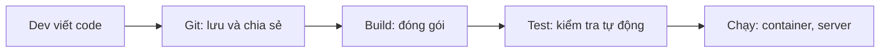

# Ngày 1 – Môi trường Linux và repo devops-labs

Lộ trình Cơ bản · Ngày 1/10 · khoảng 2 giờ

[Slide Ngày 1](../../slides/01-foundation/session-02.md) · [Thử thách thêm](session-02-challenge.md)

> **Tóm tắt:** Dựng môi trường Linux thật trên Windows 11 bằng WSL2 Ubuntu, VS Code, Git và SSH key GitHub, clone repo `devops-labs` vào WSL và đẩy file `notes/day-01.md` đầu tiên lên GitHub.

::: tip Hôm nay bạn làm gì
**Sản phẩm cuối ngày:** terminal Ubuntu chạy trên WSL2, VS Code mở thẳng vào Ubuntu, SSH key đăng nhập được GitHub, repo `devops-labs` nằm ở `~/devops-labs` và đã có `notes/day-01.md` trên GitHub.

**Thời gian:** 15 phút xem slide, 85 phút làm, 20 phút ghi note và commit. Cài WSL lần đầu kèm khởi động lại mất khoảng 30 phút, nên cài trước giờ học nếu có thể.

**Cần có:**

- [ ] Windows 11, quyền Administrator, còn trống ít nhất 20 GB ổ đĩa, đã cài VS Code
- [ ] Tài khoản GitHub và repo `devops-labs` ở chế độ Public, xem [Tài khoản GitHub và repo devops-labs](../../resources/setup-github.md)
- [ ] Các bước cài đặt chi tiết nằm ở [Hướng dẫn cài đặt môi trường](../../resources/setup-guide.md). Bài này dẫn bạn đi qua và kiểm tra.
:::

## Bài toán thật

CLB có 20 thành viên, mỗi người một máy: Windows 10, Windows 11, vài máy macOS. Mentor gửi lệnh `docker compose up`: người này chạy được, người kia báo `command not found`, người khác bị lỗi `\r: command not found` vì script có ký tự xuống dòng kiểu Windows. Server thật gần như luôn chạy Linux, nên cả lớp dùng chung một môi trường Linux ngay trên laptop. Hôm nay bạn dựng nó và chứng minh nó chạy bằng log thật.

## 10 phút đầu: đường đi của code

Bạn sẽ đưa app Club Management đi qua chuỗi dưới đây trong 10 ngày. Nhìn một lần, chưa cần nhớ chi tiết.



- Mọi người dùng chung một môi trường: Ngày 1 và Ngày 4 đến 8.
- Git giữ lịch sử và cho phép làm việc nhóm: Ngày 3.
- Build và test tự động mỗi lần push: Ngày 9 (CI).
- Đóng gói thành image và đưa lên registry để chạy ở đâu cũng giống nhau: Ngày 6 và Ngày 10.
- DevOps là làm cho cả đường này tự động và lặp lại được, để không còn cảnh "chạy được trên máy tôi".

## Làm

Mọi lệnh dưới đây gõ trong Ubuntu (WSL), trừ chỗ có ghi PowerShell.

### Bước 1: Cài WSL2 và Ubuntu (khoảng 30 phút lần đầu)

Làm đúng theo mục 2 (Bật ảo hóa) và mục 3 (WSL2 và Ubuntu 24.04) của [Hướng dẫn cài đặt môi trường](../../resources/setup-guide.md). Cài xong, khởi động lại Windows; cửa sổ Ubuntu tự mở để bạn tạo tài khoản Linux (username viết thường, không dấu; mật khẩu gõ không hiện ký tự là bình thường). Kiểm tra trong PowerShell:

```powershell
wsl --list --verbose
```

Kết quả mong đợi:

```text
  NAME            STATE           VERSION
* Ubuntu-24.04    Running         2
```

Trong Ubuntu:

```bash
lsb_release -a
```

Kết quả mong đợi: `Description: Ubuntu 24.04.x LTS`.

::: tip Kiểm tra: bạn đúng khi
Ubuntu có VERSION 2 và `lsb_release -a` hiện Ubuntu 24.04 LTS.
:::

### Bước 2: Mở VS Code trong Ubuntu

Quy tắc của cả khóa: **mã nguồn luôn nằm trong `~` (ổ Linux), không nằm trong `/mnt/c` (ổ Windows)**. Truy cập chéo qua `/mnt/c` chậm và hay sai quyền file, sai xuống dòng.

Cài extension "WSL" của Microsoft trong VS Code (mục 4 của [Hướng dẫn cài đặt môi trường](../../resources/setup-guide.md)), rồi gõ trong Ubuntu:

```bash
cd ~
pwd
code .
uname -a
```

Kết quả mong đợi: `pwd` in `/home/TEN_BAN`; `uname -a` chứa `microsoft-standard-WSL2`; góc dưới trái VS Code ghi "WSL: Ubuntu-24.04".

::: tip Kiểm tra: bạn đúng khi
`pwd` bắt đầu bằng `/home/` (không phải `/mnt/c`) và VS Code có nhãn "WSL: Ubuntu-24.04".
:::

### Bước 3: Cấu hình Git

Git gắn tên và email vào mỗi commit, nên phải khai báo trước. Dùng đúng email đã đăng ký GitHub.

```bash
sudo apt update
sudo apt install -y git
git config --global user.name "Ho Ten Cua Ban"
git config --global user.email "email-github-cua-ban@example.com"
git config --global init.defaultBranch main
git config --global core.autocrlf input
git config --global --list
```

`apt update` làm mới danh sách gói, `apt install` mới cài; luôn chạy theo thứ tự đó. `core.autocrlf input` đổi xuống dòng kiểu Windows (CRLF) thành LF khi commit, tránh lỗi `\r` trong script shell.

::: tip Kiểm tra: bạn đúng khi
`git config --global --list` có `user.name`, `user.email` thật của bạn và `core.autocrlf=input`.
:::

### Bước 4: Tạo SSH key và nối GitHub

SSH key là cặp khóa: private key ở lại máy bạn, public key (đuôi `.pub`) đưa lên GitHub. Nhờ vậy `git push` không cần nhập mật khẩu. Nên đặt passphrase khi được hỏi.

```bash
ssh-keygen -t ed25519 -C "email-github-cua-ban@example.com"
eval "$(ssh-agent -s)"
ssh-add ~/.ssh/id_ed25519
cat ~/.ssh/id_ed25519.pub
```

Nhấn Enter để nhận đường dẫn mặc định. Kết quả mong đợi: `Identity added: ...` rồi một dòng bắt đầu bằng `ssh-ed25519 AAAA...`. Chỉ sao chép file `.pub`, không bao giờ chia sẻ hay commit file `id_ed25519`.

Trên GitHub: **Settings, SSH and GPG keys, New SSH key**; đặt title "WSL2 laptop", loại Authentication Key, dán public key, lưu. Rồi thử:

```bash
ssh -T git@github.com
```

Lần đầu SSH hỏi fingerprint: gõ `yes`. Kết quả mong đợi: "Hi TEN_GITHUB! You've successfully authenticated, but GitHub does not provide shell access." Mã thoát 1 của lệnh này là bình thường.

::: tip Kiểm tra: bạn đúng khi
`ssh -T git@github.com` in dòng "successfully authenticated".
:::

### Bước 5: Clone devops-labs và repo giáo trình

`devops-labs` là repo cá nhân, nơi bạn nộp bài suốt khóa. Repo giáo trình chứa `starter-project/` (app Club) và script kiểm tra môi trường. Thay `TEN_GITHUB` bằng username của bạn:

```bash
cd ~
git clone git@github.com:TEN_GITHUB/devops-labs.git ~/devops-labs
git clone https://github.com/TienNHM/devops-course.git ~/devops-course
ls ~/devops-labs ~/devops-course
```

Kết quả mong đợi: `README.md` trong `devops-labs`; thấy `starter-project` và `resources` trong `devops-course`. Thư mục đã có thì chạy `git pull` trong đó, đừng clone lại.

::: tip Kiểm tra: bạn đúng khi
`cd ~/devops-labs && git remote -v` hiện hai dòng `origin ... (fetch)` và `(push)` dạng `git@github.com:`.
:::

### Bước 6: Chạy script check-env

Script chỉ đọc thông tin máy, không cài hay sửa gì. Số `2` là tham số của script ("kiểm tra mức cần cho giai đoạn đầu"), cứ gõ đúng như dưới. Gán `$?` ngay sau lệnh để log ghi đúng mã thoát:

```bash
cd ~/devops-course
bash resources/check-env.sh 2 > ~/check-env.txt 2>&1
echo "exit code: $?" >> ~/check-env.txt
cat ~/check-env.txt
```

Kết quả mong đợi (rút gọn): các dòng WSL, git, curl là `[ OK ]`; docker, kubectl chỉ hiện `[ DE SAU ]` (cài ở ngày sau); cuối cùng là `exit code: 0`. Thấy `[ THIEU ]` ở git hoặc curl thì cài theo gợi ý trên dòng đó (ví dụ `sudo apt install -y curl`) rồi chạy lại.

::: tip Kiểm tra: bạn đúng khi
File log có dòng `exit code: 0` ở cuối và các dòng WSL, git, curl là `[ OK ]`.
:::

### Bước 7: Ghi note và push

Mỗi ngày bạn viết một note ngắn trong `notes/`: bằng chứng chạy thật cộng 2 đến 3 câu của bạn. Để máy sinh phần bằng chứng:

```bash
cd ~/devops-labs
mkdir -p notes
{
  echo "# Ngày 1 - Môi trường dev"
  echo
  echo "Bằng chứng (chạy trong Ubuntu):"
  echo
  { lsb_release -ds; uname -r; git --version; git config --global core.autocrlf; } | sed 's/^/    /'
  ssh -T git@github.com 2>&1 | head -n 1 | sed 's/^/    /'
  tail -n 3 ~/check-env.txt | sed 's/^/    /'
} > notes/day-01.md
code notes/day-01.md
```

Trong VS Code, thêm cuối file 2 đến 3 câu: vì sao mã nguồn để trong `~`, và public key khác private key ở đâu. Rồi đẩy lên GitHub:

```bash
git add notes/day-01.md
git status -s
git commit -m "Add day-01 notes"
git push -u origin HEAD
```

Kết quả mong đợi: `git push` báo `main -> main`; mở `https://github.com/TEN_GITHUB/devops-labs` thấy thư mục `notes/`.

::: tip Kiểm tra: bạn đúng khi
Trang GitHub của `devops-labs` hiện `notes/day-01.md` có đủ output và các câu bạn viết.
:::

::: danger Chỉ dùng khi thật sự cần
`wsl --shutdown` tắt mọi distro WSL đang chạy và làm mất công việc chưa lưu trong đó. Lưu file và đóng VS Code trước khi chạy.
:::

## Gặp lỗi?

| Triệu chứng | Nguyên nhân | Cách sửa |
| --- | --- | --- |
| `wsl --install` báo `0x80370102` hoặc "Virtualization not enabled" | Ảo hóa chưa bật trong BIOS | Task Manager, tab Performance, CPU, đọc dòng Virtualization. Nếu Disabled, vào BIOS/UEFI bật Intel VT-x hoặc AMD SVM, khởi động lại |
| Cột VERSION trong `wsl --list --verbose` là 1 | Distro tạo ở chế độ WSL1 | `wsl --set-version Ubuntu-24.04 2` |
| `bash\r: No such file or directory` hoặc `\r: command not found` | Script lưu với xuống dòng CRLF của Windows | `sed -i 's/\r$//' file.sh`; đặt `core.autocrlf input` |
| `Permission denied (publickey)` | Chưa dán public key lên GitHub, hoặc key chưa nạp vào agent | Dán đúng file `.pub`; chạy `ssh-add -l`; `ssh -vT git@github.com` xem key nào được thử. Mở terminal mới thì chạy lại `eval "$(ssh-agent -s)"` và `ssh-add` |
| `WARNING: UNPROTECTED PRIVATE KEY FILE` | Quyền file private key quá rộng | `chmod 700 ~/.ssh` và `chmod 600 ~/.ssh/id_ed25519`, rồi `ssh-add ~/.ssh/id_ed25519` |
| `code: command not found` trong Ubuntu | Chưa cài VS Code trên Windows hoặc chưa Add to PATH | Cài VS Code (chọn Add to PATH), rồi chạy `wsl --shutdown` trong PowerShell và mở lại Ubuntu |

## Nộp bài

- [ ] `~/devops-labs` là bản clone của repo `devops-labs` trên GitHub (nằm trong `~`, không phải `/mnt/c`).
- [ ] `notes/day-01.md` đã push lên GitHub, có output `lsb_release`, `git --version`, `ssh -T` và 3 dòng cuối của check-env (có `exit code: 0`).
- [ ] Cuối `notes/day-01.md` có 2 đến 3 câu của bạn về `~` so với `/mnt/c` và về SSH key.
- [ ] Không có private key, mật khẩu hay token nào trong repo.

## Tự kiểm tra

1. Vì sao mã nguồn nên nằm trong `~` thay vì `/mnt/c/Users/...`?
2. Public key và private key khác nhau thế nào, cái nào được chia sẻ?
3. `ssh -T git@github.com` báo `Permission denied (publickey)` dù bạn đã tạo key. Liệt kê ba điểm kiểm tra đầu tiên.

::: details Đáp án gợi ý
1. Filesystem Linux nhanh hơn nhiều với nhiều file nhỏ, chmod hoạt động đúng, ít lỗi xuống dòng. `/mnt/c` đi qua lớp trung gian nên chậm.
2. Public key (`.pub`) đặt lên GitHub, chia sẻ được. Private key ở lại máy bạn, không bao giờ chia sẻ hay commit.
3. Đã dán đúng public key lên GitHub chưa; key đã nạp vào agent chưa (`ssh-add -l`); `ssh -vT git@github.com` xem key nào được thử và quyền file có đúng 600 không.
:::

## Tiếp theo

[Ngày 2 – Dùng Linux CLI để đọc project Club](../week-02/session-03.md)

::: details Tài liệu tham khảo
- [Cài đặt WSL (Microsoft Learn)](https://learn.microsoft.com/windows/wsl/install)
- [Tạo SSH key mới và thêm vào ssh-agent (GitHub Docs)](https://docs.github.com/en/authentication/connecting-to-github-with-ssh/generating-a-new-ssh-key-and-adding-it-to-the-ssh-agent)
- [Cấu hình Git lần đầu (Pro Git)](https://git-scm.com/book/en/v2/Getting-Started-First-Time-Git-Setup)
:::
