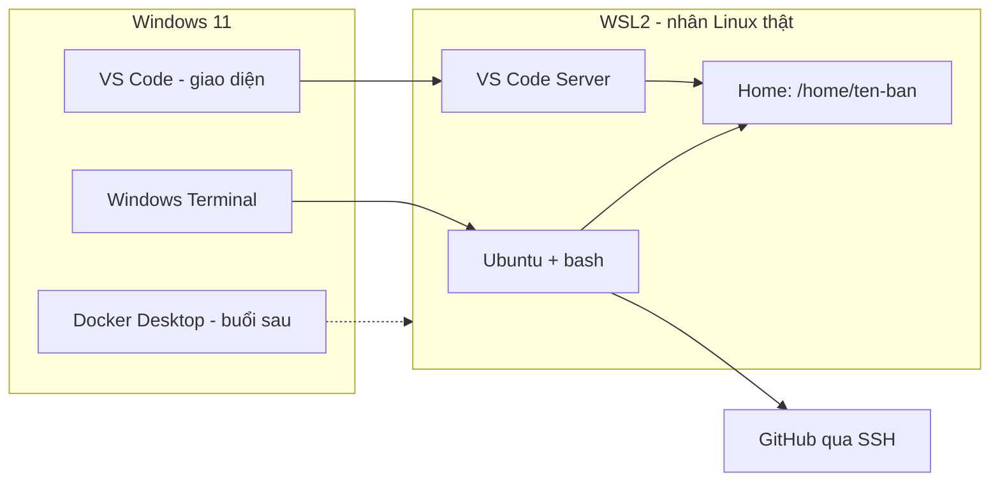
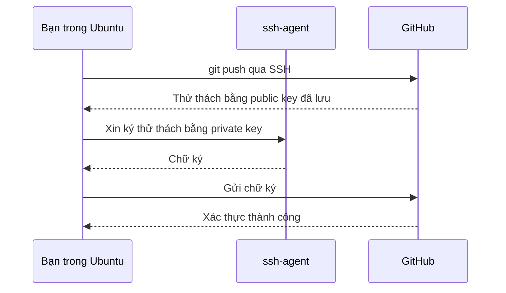

# Buổi 02 – Development Environment

Tuần 1 · Giai đoạn 1 – Engineering Foundation · Slide: [Slide buổi 02](../../slides/01-foundation/session-02.md)

> **Tóm tắt:** Dựng môi trường Linux thật trên Windows 11 bằng WSL2 Ubuntu, VS Code Remote WSL, Git và SSH key GitHub, rồi kiểm tra bằng script check-env.

## Mục tiêu học tập

- Giải thích WSL2 là gì, khác máy ảo truyền thống và khác WSL1 ở điểm nào.
- Cài được WSL2 với Ubuntu và xác minh bằng `wsl --list --verbose` rằng distro chạy VERSION 2.
- Điều hướng filesystem Linux, phân biệt home của WSL (`~`) với ổ Windows (`/mnt/c`) và chọn đúng nơi làm việc.
- Cấu hình Git, tạo SSH key ed25519 và xác thực được với GitHub bằng `ssh -T git@github.com`.
- Mở dự án trong WSL bằng VS Code Remote WSL và chạy được script kiểm tra môi trường.
- Chẩn đoán được ba lỗi môi trường phổ biến: ảo hóa chưa bật, làm việc trong `/mnt/c`, lỗi quyền file SSH key.

## Điều kiện cần

- Đã hoàn thành Buổi 01 (hiểu vòng đời triển khai từ máy lập trình đến server).
- Máy chạy Windows 11 (Home hoặc Pro đều được), đã cài bản cập nhật Windows mới, có quyền Administrator.
- Có tài khoản GitHub và biết email dùng cho tài khoản đó.
- Còn ít nhất 20 GB ổ đĩa trống và kết nối Internet ổn định (tải Ubuntu khoảng vài trăm MB).
- Đã cài VS Code (tải từ trang chính thức của VS Code).

Kiểm tra nhanh trong PowerShell:

```powershell
winver
systeminfo | Select-String "Hyper-V Requirements"
```

Kết quả mong đợi: `winver` hiện Windows 11 (build 22000 trở lên). Dòng Hyper-V Requirements, nếu có, cho biết "A hypervisor has been detected" hoặc "Virtualization Enabled In Firmware: Yes". Nếu thấy "No", bạn cần bật ảo hóa trong BIOS (xem phần Phá lỗi và debug).

## Vấn đề thực tế

CLB có 20 thành viên, mỗi người một máy: người dùng Windows 10, người dùng Windows 11, vài người dùng macOS. Khi mentor gửi một câu lệnh `docker compose up`, người này chạy được, người kia báo "command not found", người khác bị lỗi `\r: command not found` vì script có ký tự xuống dòng kiểu Windows. Mất 40 phút đầu mỗi buổi chỉ để "làm cho máy chạy giống nhau". Đây là kiểu lỗi "works on my machine" mà DevOps sinh ra để loại bỏ.

Server thật gần như luôn chạy Linux. Nếu bạn luyện tập trên một môi trường giống Linux ngay từ máy cá nhân, mọi lệnh, đường dẫn và script học trong 16 tuần sẽ chạy y hệt khi đưa lên CI hoặc server. Buổi này dựng nền tảng đó: một môi trường chuẩn, tái lập được, mà cả CLB dùng chung. Từ Buổi 03 trở đi, mọi lab đều giả định bạn đang ở trong terminal Ubuntu của WSL2.

## Khái niệm cốt lõi

### WSL2 là gì

WSL (Windows Subsystem for Linux) cho phép chạy môi trường Linux ngay trên Windows mà không cần cài dual-boot. WSL2 chạy một nhân Linux thật trong một máy ảo nhẹ (lightweight utility VM) do Windows quản lý. Bạn không phải cấu hình máy ảo: Windows tự khởi động và tắt nó khi cần.

| Tiêu chí | WSL1 | WSL2 | Máy ảo (VirtualBox, VMware) |
| --- | --- | --- | --- |
| Nhân Linux | Lớp dịch syscall, không có nhân thật | Nhân Linux thật | Nhân Linux thật |
| Tốc độ filesystem Linux | Trung bình | Nhanh | Nhanh |
| Tốc độ truy cập `/mnt/c` | Nhanh hơn | Chậm | Không áp dụng |
| Tương thích Docker | Hạn chế | Tốt (Docker Desktop dùng WSL2) | Tốt |
| Cấu hình thủ công | Ít | Rất ít | Nhiều (RAM, đĩa, mạng) |
| Dùng trong khóa này | Không | Có | Không |

### Terminal, shell và bash

Ba khái niệm hay bị nhầm lẫn:

| Thuật ngữ | Là gì | Ví dụ |
| --- | --- | --- |
| Terminal | Cửa sổ ứng dụng để nhập và xem chữ | Windows Terminal, terminal tích hợp của VS Code |
| Shell | Chương trình đọc lệnh bạn gõ và thực thi | `bash` (mặc định của Ubuntu), `zsh`, PowerShell |
| Lệnh | Chương trình hoặc hàm shell được gọi | `ls`, `git`, `cd` |

Khi bạn mở tab Ubuntu trong Windows Terminal, bạn đang dùng terminal Windows Terminal chạy shell bash bên trong WSL2. Bash đọc file `~/.bashrc` mỗi lần mở shell tương tác, nên đó là nơi đặt alias và biến môi trường cá nhân.

### Filesystem: hai thế giới

Trong WSL2 có hai vùng lưu trữ khác nhau:

| Vùng | Đường dẫn trong WSL | Đường dẫn từ Windows | Dùng để |
| --- | --- | --- | --- |
| Filesystem Linux (ext4) | `/home/TEN_BAN/` (viết tắt `~`) | `\\wsl$\Ubuntu\home\TEN_BAN` (hoặc `\\wsl.localhost\Ubuntu\...`) | Mã nguồn, Docker build context, mọi lab |
| Ổ đĩa Windows | `/mnt/c/Users/...` | `C:\Users\...` | Chỉ để trao đổi file (ảnh chụp, tải về) |

Quy tắc của khóa học: mã nguồn luôn nằm trong `~`. Truy cập chéo qua `/mnt/c` đi qua một lớp mạng 9P nên chậm hơn nhiều với các thao tác nhiều file nhỏ như `npm install` hay `git status`, đồng thời quyền file (chmod) và ký tự xuống dòng hay gây lỗi.

### Package manager

Ubuntu cài phần mềm qua `apt`, lấy gói từ kho (repository) đã được ký số. Hai lệnh luôn đi cặp: `sudo apt update` (làm mới danh sách gói) rồi `sudo apt install TEN_GOI` (cài). `sudo` chạy lệnh với quyền root. Cài từ `apt` giúp bạn nâng cấp, gỡ cài đặt và kiểm tra nguồn gốc dễ dàng hơn so với tải file về chạy tay.

### Git và SSH key

Git lưu lịch sử mã nguồn. Để đẩy code lên GitHub mà không gõ mật khẩu, bạn dùng cặp khóa SSH:

- Private key (`~/.ssh/id_ed25519`): ở lại trên máy bạn, tuyệt đối không chia sẻ, không commit.
- Public key (`~/.ssh/id_ed25519.pub`): dán vào GitHub (Settings, SSH and GPG keys).

GitHub dùng public key để thử thách (challenge) máy bạn; chỉ ai giữ private key tương ứng mới trả lời đúng.

## Kiến trúc và cách hoạt động



Giải thích từng bước:

1. Windows Terminal mở một tab chạy distro Ubuntu. Windows tự khởi động máy ảo WSL2 nếu chưa chạy.
2. Bash trong Ubuntu thao tác trên filesystem ext4 ở `/home/TEN_BAN`. Đây là nơi bạn lưu repository.
3. Khi bạn gõ `code .` trong Ubuntu, VS Code (giao diện trên Windows) tự cài và kết nối tới VS Code Server chạy bên trong WSL. Giao diện nằm ở Windows, còn terminal, extension, debugger chạy trong Linux.
4. Git trong Ubuntu dùng SSH key lưu ở `~/.ssh` để nói chuyện với GitHub qua cổng 22.
5. Docker Desktop (cài ở Buổi 07) sẽ tích hợp với WSL2 để bạn gõ `docker` ngay trong Ubuntu. Buổi này chỉ chuẩn bị nền tảng.



## Demo của mentor

Mentor dùng một máy sạch (hoặc máy ảo Windows 11) và trình chiếu terminal. Thời gian: khoảng 12 phút trong phần 30 phút kiến thức.

### Bước 1. Cho thấy hai thế giới filesystem

```bash
pwd
ls /mnt/c | head -5
cd ~ && mkdir -p demo && cd demo && pwd
```

Kết quả mong đợi (tên người dùng sẽ khác, danh sách thư mục trong `/mnt/c` tùy máy):

```text
/home/mentor
'$Recycle.Bin'
'Documents and Settings'
...
/home/mentor/demo
```

Câu hỏi cho lớp: "Hai đường dẫn này đang nằm trên ổ đĩa nào? Tại sao ta không để code trong `/mnt/c`?"

### Bước 2. Đo sự chênh lệch tốc độ

```bash
mkdir -p ~/demo/io-test /mnt/c/Users/Public/io-test
cd ~/demo/io-test
time (for i in $(seq 1 2000); do echo x > f$i.txt; done)
cd /mnt/c/Users/Public/io-test
time (for i in $(seq 1 2000); do echo x > f$i.txt; done)
cd ~ && rm -rf ~/demo/io-test /mnt/c/Users/Public/io-test
```

Kết quả mong đợi: lần chạy trong `~/demo` nhanh hơn rõ rệt (thường vài lần trở lên) so với `/mnt/c`. Con số chính xác phụ thuộc máy; điều quan trọng là xu hướng. Demo dùng thư mục riêng `io-test` và xóa ngay sau khi đo, không dùng `rm f*.txt` trong thư mục có sẵn dữ liệu.

Câu hỏi: "Nếu `npm install` tạo hàng chục nghìn file nhỏ thì chuyện gì xảy ra?"

### Bước 3. Cho thấy apt và shell

```bash
sudo apt update
sudo apt install -y tree
tree -L 1 ~
echo "$SHELL"; echo "$HOME"
```

Kết quả mong đợi: `apt` liệt kê các kho đã truy cập (Hit, Get), `tree` in cấu trúc thư mục, `$SHELL` là `/bin/bash`, `$HOME` là `/home/mentor`.

Câu hỏi: "Tại sao phải chạy `apt update` trước `apt install`?"

### Bước 4. Mở VS Code từ WSL và thử SSH tới GitHub

```bash
code .
ssh -T git@github.com
```

Kết quả mong đợi: cửa sổ VS Code mở với góc dưới trái ghi "WSL: Ubuntu". Lệnh `ssh -T` in dòng "Hi TEN_GITHUB! You've successfully authenticated, but GitHub does not provide shell access." (nếu mentor đã cấu hình key).

Câu hỏi: "Terminal bên trong VS Code đang chạy trên Windows hay Linux? Làm sao biết?"

## Hands-on lab

Thời lượng 60 phút. Phần 1 và 2 cần quyền Administrator trên Windows, phần còn lại làm trong Ubuntu.

### Chuẩn bị

- Đóng các ứng dụng nặng, cắm sạc laptop.
- Mở sẵn trang tài khoản GitHub trong trình duyệt.
- Ghi lại mọi lệnh và output vào `~/devops-labs/lab-02/evidence/command-output.txt` (sẽ tạo ở Phần 4).

### Phần 1. Cài WSL2 và Ubuntu (khoảng 15 phút)

**Bước 1.1.** Mở Windows Terminal (hoặc PowerShell) bằng quyền Administrator, kiểm tra phiên bản WSL:

```powershell
wsl --status
```

Kết quả mong đợi nếu đã cài: dòng "Default Version: 2". Nếu báo chưa cài, tiếp tục bước 1.2.

**Bước 1.2.** Cài WSL cùng Ubuntu:

```powershell
wsl --install -d Ubuntu-24.04
```

Kết quả mong đợi: tiến trình tải và cài đặt, cuối cùng yêu cầu khởi động lại máy ("The requested operation is successful. Changes will not be effective until the system is rebooted"). Khởi động lại Windows. Vì sao: Windows cần bật các tính năng ảo hóa (Virtual Machine Platform) và chỉ áp dụng sau khi reboot.

Nếu báo không tìm thấy distro tên `Ubuntu-24.04`, chạy `wsl --list --online` để xem tên hợp lệ rồi dùng lại lệnh `wsl --install -d` với tên đó (các bước sau thay tên tương ứng). Nếu WSL đã cài từ trước, lệnh chỉ cài thêm distro và có thể không cần khởi động lại. Nếu lệnh `wsl` báo không nhận ra tùy chọn, chạy `wsl --update` hoặc cập nhật Windows rồi thử lại.

**Bước 1.3.** Sau khi khởi động lại, cửa sổ Ubuntu tự mở và yêu cầu tạo tài khoản Linux. Đặt username viết thường, không dấu, không khoảng trắng (ví dụ `tien`) và một mật khẩu bạn nhớ. Mật khẩu này chỉ dùng cho `sudo` trong Ubuntu; khi gõ sẽ không hiện ký tự, đó là bình thường.

**Bước 1.4.** Xác minh distro chạy WSL2:

```powershell
wsl --list --verbose
```

Kết quả mong đợi:

```text
  NAME            STATE           VERSION
* Ubuntu-24.04    Running         2
```

Nếu cột VERSION là 1, chuyển đổi bằng `wsl --set-version Ubuntu-24.04 2`.

**Bước 1.5.** Trong Ubuntu, xác minh hệ điều hành và cập nhật gói:

```bash
lsb_release -a
sudo apt update && sudo apt upgrade -y
```

Kết quả mong đợi: `Distributor ID: Ubuntu`, `Description: Ubuntu 24.04.x LTS`. Phần upgrade có thể mất vài phút.

### Phần 2. Terminal, VS Code Remote WSL và dotfiles (khoảng 10 phút)

**Bước 2.1.** Tạo thư mục làm việc trong filesystem Linux:

```bash
mkdir -p ~/devops-labs/lab-02/{source,screenshots,evidence}
cd ~/devops-labs/lab-02
pwd
```

Kết quả mong đợi: `/home/TEN_BAN/devops-labs/lab-02`. Vì sao: thư mục nằm trong `~` nên nhanh và không dính vấn đề quyền file của Windows.

**Bước 2.2.** Trong VS Code trên Windows, mở Extensions (Ctrl+Shift+X), tìm và cài extension "WSL" của Microsoft. Sau đó, từ terminal Ubuntu:

```bash
code .
```

Kết quả mong đợi: VS Code mở, góc dưới trái hiện "WSL: Ubuntu-24.04". Lần đầu, VS Code tải VS Code Server vào WSL nên cần vài chục giây.

**Bước 2.3.** Mở terminal tích hợp (Ctrl+`) và kiểm tra bạn đang ở Linux:

```bash
uname -a
echo "$HOME"
```

Kết quả mong đợi: chuỗi `uname` chứa `microsoft-standard-WSL2` và `Linux`; `$HOME` là `/home/TEN_BAN`.

**Bước 2.4.** Thêm alias vào `~/.bashrc` để tiết kiệm thao tác, rồi nạp lại:

```bash
cat >> ~/.bashrc <<'EOF'

# Alias cho khoa DevOps
alias ll='ls -alF'
alias gs='git status -sb'
alias labs='cd ~/devops-labs'
EOF
source ~/.bashrc
ll ~ | head -5
```

Kết quả mong đợi: `ll` liệt kê file ẩn kèm quyền. Vì sao dùng `<<'EOF'` có nháy đơn: ngăn shell tự thay thế biến bên trong khối văn bản.

### Phần 3. Git và SSH key GitHub (khoảng 20 phút)

**Bước 3.1.** Cài và cấu hình Git:

```bash
sudo apt install -y git
git --version
git config --global user.name "Ho Ten Cua Ban"
git config --global user.email "email-github-cua-ban@example.com"
git config --global init.defaultBranch main
git config --global core.autocrlf input
git config --global --list
```

Kết quả mong đợi: `git version 2.43.x` (hoặc mới hơn) và danh sách cấu hình có đúng tên, email. Vì sao `core.autocrlf input`: chuyển CRLF thành LF khi commit, tránh script shell bị ký tự `\r` làm hỏng.

**Bước 3.2.** Tạo SSH key ed25519 (thay email bằng email của bạn):

```bash
ssh-keygen -t ed25519 -C "email-github-cua-ban@example.com"
```

Nhấn Enter để chấp nhận đường dẫn mặc định `~/.ssh/id_ed25519`. Nên đặt passphrase; nếu để trống, hiểu rằng ai lấy được file private key là dùng được ngay. Kết quả mong đợi: thông báo "Your public key has been saved in /home/TEN_BAN/.ssh/id_ed25519.pub" cùng hình ASCII "randomart".

**Bước 3.3.** Nạp key vào ssh-agent để không phải gõ passphrase lặp lại:

```bash
eval "$(ssh-agent -s)"
ssh-add ~/.ssh/id_ed25519
```

Kết quả mong đợi: `Agent pid NNNN` rồi `Identity added: /home/TEN_BAN/.ssh/id_ed25519`. Lưu ý: agent này chỉ sống trong phiên terminal hiện tại; mở terminal mới thì chạy lại hai lệnh trên (hoặc nhập passphrase khi SSH hỏi, vẫn hoạt động bình thường).

**Bước 3.4.** In public key và sao chép:

```bash
cat ~/.ssh/id_ed25519.pub
```

Kết quả mong đợi: một dòng bắt đầu bằng `ssh-ed25519 AAAA...` và kết thúc bằng email. Chỉ sao chép file có đuôi `.pub`.

**Bước 3.5.** Trên GitHub: Settings, SSH and GPG keys, New SSH key; đặt title (ví dụ "WSL2 laptop"), loại Authentication Key, dán public key, lưu.

**Bước 3.6.** Kiểm tra kết nối:

```bash
ssh -T git@github.com
```

Lần đầu, SSH hỏi xác nhận fingerprint của máy chủ. Hãy đối chiếu với fingerprint công bố trong tài liệu GitHub (xem Tài liệu tham khảo) rồi gõ `yes`. Kết quả mong đợi: "Hi TEN_GITHUB! You've successfully authenticated, but GitHub does not provide shell access." Mã thoát 1 của lệnh này là bình thường.

**Bước 3.7.** Tạo repository cá nhân `devops-labs` trên GitHub (private hoặc public, không thêm README), rồi nối với thư mục local:

```bash
cd ~/devops-labs
git rev-parse --is-inside-work-tree 2>/dev/null || git init
git remote get-url origin 2>/dev/null || git remote add origin git@github.com:TEN_GITHUB/devops-labs.git
git remote set-url origin git@github.com:TEN_GITHUB/devops-labs.git
git remote -v
```

Kết quả mong đợi: hai dòng `origin ... (fetch)` và `origin ... (push)` dùng địa chỉ dạng `git@github.com:`. Các lệnh trên an toàn cho cả hai trường hợp: thư mục mới (chạy `git init`) hoặc repo đã clone từ Buổi 01 bằng HTTPS (chỉ đổi remote sang SSH). Commit và push sẽ làm ở phần nộp bài, lần đầu dùng `git push -u origin HEAD`.

### Phần 4. Script kiểm tra môi trường (khoảng 15 phút)

Repo giáo trình có sẵn script mẫu `resources/check-env.sh` (cho Ubuntu) và `resources/check-env.ps1` (cho Windows). Trong lab này bạn tự viết một bản rút gọn để hiểu cách nó hoạt động.

**Bước 4.1.** Tạo file `~/devops-labs/lab-02/source/check-env.sh`:

```bash
cat > ~/devops-labs/lab-02/source/check-env.sh <<'EOF'
#!/usr/bin/env bash
# Kiem tra cac cong cu can cho khoa DevOps
set -u
fail=0
check() {
  name="$1"; cmd="$2"; flag="${3:---version}"
  if command -v "$cmd" >/dev/null 2>&1; then
    printf 'OK    %-10s %s\n' "$name" "$($cmd "$flag" 2>&1 | head -n 1)"
  else
    printf 'THIEU %-10s chua cai\n' "$name"
    fail=1
  fi
}
check git git
check curl curl
check ssh ssh -V
check docker docker
case "$PWD" in
  /mnt/*) echo "CANH BAO: dang o /mnt, hay lam viec trong home cua WSL"; fail=1 ;;
esac
exit "$fail"
EOF
chmod +x ~/devops-labs/lab-02/source/check-env.sh
```

Vì sao `set -u`: biến chưa khai báo sẽ gây lỗi thay vì lặng lẽ rỗng. Vì sao `chmod +x`: cấp quyền thực thi để chạy trực tiếp. Vì sao `ssh` có tham số thứ ba `-V`: `ssh` không hiểu `--version`, nó in phiên bản bằng `-V` (và in ra stderr, nên script gộp `2>&1`). Hàm `check` nhận cờ phiên bản làm tham số tùy chọn, mặc định là `--version`.

**Bước 4.2.** Chạy script và lưu kết quả làm bằng chứng:

```bash
cd ~/devops-labs/lab-02
./source/check-env.sh > evidence/command-output.txt 2>&1
code=$?
echo "exit code: $code" >> evidence/command-output.txt
cat evidence/command-output.txt
```

Kết quả mong đợi (docker có thể báo THIEU vì chưa cài, và điều đó chấp nhận được ở buổi này):

```text
OK    git        git version 2.43.0
OK    curl       curl 8.5.0 (x86_64-pc-linux-gnu) libcurl/8.5.0 ...
OK    ssh        OpenSSH_9.6p1 Ubuntu-3ubuntu13, OpenSSL 3.0.13 30 Jan 2024
THIEU docker     chua cai
exit code: 1
```

Lưu ý: ta gán `code=$?` ngay sau khi chạy script để lấy đúng mã thoát của script (nếu dùng `| tee` thì `$?` là mã thoát của `tee`, luôn là 0). Mã thoát 1 khi thiếu docker là đúng thiết kế; sau Buổi 07 nó sẽ là 0.

**Bước 4.3.** Thêm vào cuối `evidence/command-output.txt` kết quả các lệnh xác minh còn lại:

```bash
{ lsb_release -a; uname -r; git --version; ssh -T git@github.com; } >> evidence/command-output.txt 2>&1
```

### L1 – Foundation: checklist hoàn thành

- [ ] `wsl --list --verbose` cho thấy Ubuntu chạy VERSION 2.
- [ ] `lsb_release -a` chạy được trong Ubuntu và hiện Ubuntu LTS.
- [ ] Thư mục `~/devops-labs/lab-02` nằm trong filesystem Linux (không phải `/mnt/c`).
- [ ] `code .` mở VS Code với nhãn "WSL: Ubuntu" ở góc dưới trái.
- [ ] `git --version` chạy được và `git config --global --list` có đúng tên, email.
- [ ] `ssh -T git@github.com` báo xác thực thành công.
- [ ] `evidence/command-output.txt` chứa output các lệnh trên.

### L2 – Engineering: thử thách tự làm

**Thử thách 1: script kiểm tra đầy đủ.** Mở rộng `check-env.sh` để (a) kiểm tra thêm `node`, `npm`, `make` (b) in tổng kết "N công cụ thiếu" (c) trả mã thoát khác 0 nếu có công cụ thiếu (d) kiểm tra quyền của `~/.ssh/id_ed25519` là 600. Tiêu chí hoàn thành: chạy script khi cố tình đổi quyền key thành 644 thì script báo lỗi và thoát khác 0; sửa lại thì báo OK.

<details><summary>Gợi ý</summary>

- Dùng `stat -c '%a' ~/.ssh/id_ed25519` để lấy quyền dạng số.
- Đếm công cụ thiếu bằng biến `missing=$((missing+1))` trong hàm `check`.
- Cuối script: `[ "$missing" -eq 0 ] || exit 1`.

</details>

<details><summary>Lời giải tham khảo</summary>

```bash
#!/usr/bin/env bash
set -u
missing=0
check() {
  if command -v "$2" >/dev/null 2>&1; then
    printf 'OK    %-8s %s\n' "$1" "$($2 "${3:---version}" 2>&1 | head -n 1)"
  else
    printf 'THIEU %-8s\n' "$1"; missing=$((missing+1))
  fi
}
check git git; check curl curl; check ssh ssh -V
check node node; check npm npm; check make make
key="$HOME/.ssh/id_ed25519"
if [ -f "$key" ]; then
  perm=$(stat -c '%a' "$key")
  if [ "$perm" != "600" ]; then
    echo "LOI: quyen key la $perm, can 600"; missing=$((missing+1))
  fi
fi
echo "Tong ket: $missing van de"
[ "$missing" -eq 0 ] || exit 1
```

</details>

**Thử thách 2: dotfiles có tổ chức.** Đưa `.bashrc` alias của bạn vào thư mục `source/dotfiles/` trong repo, viết `source/dotfiles/install.sh` tạo symlink an toàn (không ghi đè file cũ mà không sao lưu). Tiêu chí hoàn thành: chạy `install.sh` hai lần liên tiếp không lỗi và không nhân đôi nội dung.

<details><summary>Gợi ý</summary>

Dùng `ln -sfn` để tạo symlink, và `cp -n` hoặc `mv` sang `.bak` trước khi thay. Kiểm tra `[ -L file ]` để biết file đã là symlink chưa.

</details>

**Thử thách 3: giải thích bằng lời.** Trong `report.md`, giải thích bằng 5-8 dòng: vì sao dùng `~` thay cho `/mnt/c`, và vì sao dùng ed25519 với ssh-agent thay cho mật khẩu GitHub.

## Phá lỗi và debug

### Tình huống: ssh bị từ chối vì quyền file key quá rộng

**Cách phá:** cố tình mở quyền key rồi thử kết nối. Cần gỡ key khỏi ssh-agent trước, nếu không SSH vẫn dùng bản key đã nạp trong agent và bạn sẽ không thấy lỗi.

```bash
ssh-add -D
chmod 644 ~/.ssh/id_ed25519
ssh -T git@github.com
```

**Triệu chứng:** SSH in cảnh báo lớn và bỏ qua key.

```text
@@@@@@@@@@@@@@@@@@@@@@@@@@@@@@@@@@@@@@@@@@@@@@@@@@@@@@@@@@@
@         WARNING: UNPROTECTED PRIVATE KEY FILE!          @
@@@@@@@@@@@@@@@@@@@@@@@@@@@@@@@@@@@@@@@@@@@@@@@@@@@@@@@@@@@
Permissions 0644 for '/home/tien/.ssh/id_ed25519' are too open.
It is required that your private key files are NOT accessible by others.
This private key will be ignored.
Load key "/home/tien/.ssh/id_ed25519": bad permissions
git@github.com: Permission denied (publickey).
```

**Hướng điều tra, từng bước:**

1. Đọc dòng thông báo cụ thể: "Permissions 0644 ... are too open" chỉ thẳng vào quyền file.
2. Xem quyền hiện tại: `ls -l ~/.ssh`.
3. Chạy `ssh -vT git@github.com` để xem SSH thử những key nào và bị bỏ qua vì lý do gì.
4. Xác nhận bạn không để key trong `/mnt/c` (nơi chmod không có tác dụng như Linux).

**Nguyên nhân gốc:** SSH từ chối private key mà người khác trong hệ thống có thể đọc, vì đó là rủi ro bảo mật.

**Cách sửa:**

```bash
chmod 700 ~/.ssh
chmod 600 ~/.ssh/id_ed25519
ssh-add ~/.ssh/id_ed25519
ssh -T git@github.com
```

**Cách phòng tránh:** luôn tạo key trong `~/.ssh` của WSL, không sao chép từ ổ Windows; đưa kiểm tra quyền vào `check-env.sh` (thử thách L2).

### Tình huống bổ sung: ảo hóa chưa bật

Nếu `wsl --install` báo lỗi mã `0x80370102` hoặc "Virtualization not enabled", mở Task Manager, tab Performance, CPU và đọc dòng "Virtualization". Nếu là Disabled, vào BIOS/UEFI bật Intel VT-x hoặc AMD SVM (tên menu khác nhau theo hãng máy), lưu và khởi động lại. Phòng tránh: kiểm tra mục này trước buổi học.

## Lỗi thường gặp

| Triệu chứng | Nguyên nhân | Cách xử lý |
| --- | --- | --- |
| `wsl --install` báo lỗi 0x80370102 | Ảo hóa chưa bật trong BIOS hoặc Virtual Machine Platform chưa bật | Bật VT-x/SVM trong BIOS, bật tính năng Virtual Machine Platform, khởi động lại |
| `git status` và `npm install` rất chậm | Repo nằm trong `/mnt/c` | Chuyển repo sang `~` bằng `cp -r` hoặc `git clone` lại trong home |
| `bash\r: No such file or directory` hoặc `\r: command not found` | Script lưu với xuống dòng CRLF của Windows | Đổi sang LF trong VS Code (góc dưới phải), hoặc `sed -i 's/\r$//' file.sh`; đặt `core.autocrlf input` |
| `Permission denied (publickey)` | Chưa thêm public key lên GitHub, hoặc key chưa nạp vào agent | Kiểm tra `ssh-add -l`; dán đúng file `.pub` lên GitHub |
| `ssh: connect to host github.com port 22: Connection timed out` | Mạng (trường, quán cafe) chặn cổng 22 | Thử SSH qua cổng 443 theo hướng dẫn "Using SSH over the HTTPS port" của GitHub Docs, hoặc đổi mạng |
| `WARNING: UNPROTECTED PRIVATE KEY FILE` | Quyền file key quá rộng | `chmod 600 ~/.ssh/id_ed25519` |
| `code: command not found` trong Ubuntu | Chưa cài VS Code trên Windows hoặc PATH Windows bị tắt | Cài VS Code, khởi động lại WSL bằng `wsl --shutdown` rồi mở lại Ubuntu |
| `E: Unable to locate package` hoặc `Temporary failure resolving` | Chưa chạy `apt update` hoặc WSL mất mạng/DNS | Chạy `sudo apt update`, kiểm tra Internet; nếu vẫn lỗi DNS thử `wsl --shutdown` rồi mở lại Ubuntu |

## Tự kiểm tra

1. WSL2 khác WSL1 ở điểm cốt lõi nào?

<details><summary>Đáp án</summary>

WSL2 chạy nhân Linux thật trong một máy ảo nhẹ, nên tương thích hệ thống và tốc độ filesystem Linux tốt hơn; WSL1 chỉ dịch syscall.

</details>

2. Tại sao mã nguồn nên nằm trong `~` thay vì `/mnt/c/Users/...`?

<details><summary>Đáp án</summary>

Filesystem Linux (ext4) nhanh hơn nhiều với nhiều file nhỏ, chmod hoạt động đúng và ít vấn đề xuống dòng. `/mnt/c` đi qua lớp trung gian nên chậm.

</details>

3. Phân biệt terminal, shell và bash.

<details><summary>Đáp án</summary>

Terminal là cửa sổ hiển thị; shell là chương trình thông dịch lệnh; bash là một loại shell cụ thể (mặc định trên Ubuntu).

</details>

4. Public key và private key khác nhau thế nào, cái nào được phép chia sẻ?

<details><summary>Đáp án</summary>

Public key (`.pub`) đặt lên GitHub và có thể chia sẻ. Private key không bao giờ được chia sẻ hay commit.

</details>

5. Tại sao phải `sudo apt update` trước `sudo apt install`?

<details><summary>Đáp án</summary>

`update` làm mới danh sách gói và phiên bản từ kho; không có nó, `install` có thể không tìm thấy gói hoặc cài bản cũ.

</details>

6. Tình huống: bạn clone repo vào `/mnt/c/Users/An/code`, chạy `npm install` mất 10 phút và `./run.sh` báo `\r: command not found`. Bạn xử lý thế nào?

<details><summary>Đáp án</summary>

Clone lại vào `~/` (filesystem Linux) để khắc phục tốc độ. Với `\r`, chuyển script sang LF (`sed -i 's/\r$//' run.sh`) và đặt `git config --global core.autocrlf input`.

</details>

7. Tình huống: `ssh -T git@github.com` báo `Permission denied (publickey)` dù bạn đã tạo key. Liệt kê ba điểm kiểm tra đầu tiên.

<details><summary>Đáp án</summary>

(1) Đã dán đúng public key lên tài khoản GitHub chưa. (2) Key đã nạp vào agent chưa (`ssh-add -l`). (3) Chạy `ssh -vT git@github.com` xem key nào được thử và quyền file có đúng 600 không.

</details>

## Nộp bài

Nộp vào thư mục `lab-02/` trong repo cá nhân `devops-labs`, theo `templates/lab-template.md`.

- [ ] `lab-02/README.md` trả lời đủ 7 câu: bài lab giải quyết vấn đề gì, kiến thức đã dùng, các bước thực hiện, kết quả mong đợi, lỗi đã gặp, cách khắc phục, có thể cải thiện gì.
- [ ] `lab-02/evidence/command-output.txt` chứa output của `wsl --list --verbose` (dán tay từ PowerShell), `lsb_release -a`, `git --version`, `ssh -T git@github.com` và `check-env.sh`.
- [ ] `lab-02/report.md` giải thích ngắn (5-8 dòng) về `~` so với `/mnt/c` và về SSH key; ghi rõ đã làm L1 hay L2.
- [ ] `lab-02/source/check-env.sh` (và `source/dotfiles/` nếu làm L2) có thể chạy lại được.
- [ ] `lab-02/screenshots/` có ảnh VS Code hiện "WSL: Ubuntu" (ảnh chỉ bổ trợ, không thay evidence).
- [ ] Đã kiểm tra: không có private key (`id_ed25519`), mật khẩu hay token nào trong repo. Chỉ public key mới được phép xuất hiện.
- [ ] Đã `git add`, `git commit` và `git push` thành công qua SSH.

## Recap

- WSL2 cho bạn một môi trường Linux thật trên Windows; mọi lab của khóa chạy trong Ubuntu.
- Mã nguồn đặt trong `~`, không đặt trong `/mnt/c`, để nhanh và tránh lỗi quyền, xuống dòng.
- Terminal là cửa sổ, shell là chương trình đọc lệnh, bash là shell mặc định của Ubuntu.
- `apt update` rồi `apt install` là quy trình cài gói chuẩn trên Ubuntu.
- SSH key gồm private (giữ kín) và public (đưa lên GitHub); sai quyền file là lỗi thường gặp nhất.
- Viết script kiểm tra môi trường giúp cả nhóm tái lập cùng một setup và phát hiện lỗi sớm.

## Tài liệu tham khảo

- [Cài đặt WSL (Microsoft Learn)](https://learn.microsoft.com/windows/wsl/install)
- [Làm việc qua các filesystem trong WSL](https://learn.microsoft.com/windows/wsl/filesystems)
- [Phát triển trong WSL với VS Code](https://code.visualstudio.com/docs/remote/wsl)
- [Tạo SSH key mới và thêm vào ssh-agent (GitHub Docs)](https://docs.github.com/en/authentication/connecting-to-github-with-ssh/generating-a-new-ssh-key-and-adding-it-to-the-ssh-agent)
- [Thêm SSH key vào tài khoản GitHub](https://docs.github.com/en/authentication/connecting-to-github-with-ssh/adding-a-new-ssh-key-to-your-github-account)
- [Tài liệu Git](https://git-scm.com/doc)
