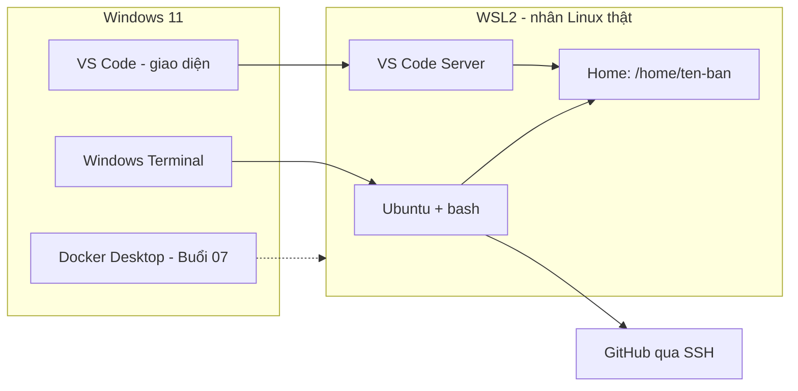

# Buổi 02 – Development Environment

Tuần 1/16 · Giai đoạn 1 – Engineering Foundation · Buổi 02/32

[Slide Buổi 02 – Development Environment](../../slides/01-foundation/session-02.md) · [Bài tập Tuần 1](../../assignments/weekly/week-01.md) · [Hub Tuần 1](README.md)

> **Tóm tắt:** Dựng môi trường Linux thật trên Windows 11 bằng WSL2 Ubuntu, VS Code Remote WSL, Git và SSH key GitHub, rồi kiểm tra bằng script check-env.sh có sẵn của giáo trình.

::: tip Buổi này bạn làm gì
**Bạn sẽ tạo ra:** một terminal Ubuntu chạy trên WSL2, VS Code mở thẳng vào Ubuntu, Git và SSH key đăng nhập được GitHub, cùng một file log thật của `check-env.sh`.

**Thời gian thật:** đọc khoảng 15 phút; bắt buộc ở lớp khoảng 60 phút (WSL, VS Code, `git config`, chạy `check-env.sh`; cài WSL lần đầu kèm khởi động lại mất khoảng 30 phút nên cài trước giờ học nếu có thể); làm ở nhà khoảng 30 phút (SSH key, nối remote, gom evidence); tự viết script kiểm tra (L2) tùy chọn khoảng 45 phút.

**Cần chuẩn bị:**

- [ ] Windows 11, quyền Administrator, còn trống ít nhất 20 GB ổ đĩa, đã cài VS Code
- [ ] Tài khoản GitHub và repo `devops-labs` PUBLIC, xem [Tài khoản GitHub và repo devops-labs](../../resources/setup-github.md)
- [ ] Đã học [Buổi 01 – DevOps Introduction](session-01.md). Các bước cài đặt nằm ở [Hướng dẫn cài đặt môi trường](../../resources/setup-guide.md), đó là nguồn duy nhất, bài này chỉ dẫn bạn đi qua và kiểm tra.

**Sản phẩm phải nộp** (thư mục `lab-02/` trong `devops-labs`):

- `README.md` trả lời 7 câu theo mẫu bài lab
- `evidence/command-output.txt` gồm `wsl --list --verbose`, `lsb_release -a`, `git config --global --list`, `ssh -T git@github.com`, log `check-env.sh` kèm `exit code:`
- `report.md` giải thích ngắn về `~` so với `/mnt/c` và về SSH key

**Mục lục nhảy:** Đọc ([Vấn đề thực tế](#van-de) và [Khái niệm cốt lõi](#khai-niem)) > [Làm lab](#hands-on-lab) > [Gặp lỗi?](#gap-loi) > [Tự kiểm tra](#tu-kiem-tra) > [Nộp bài](#nop-bai). Kẹt giữa chừng? Nhảy tới [Gặp lỗi?](#gap-loi).

**Từ mới trong buổi** (tra nhanh ở [Bảng thuật ngữ](../../resources/glossary.md)):

- **WSL2**: chạy Linux thật ngay trong Windows, không cần dual-boot.
- **Shell**: chương trình đọc lệnh bạn gõ và thực thi, ví dụ bash.
- **apt**: công cụ cài phần mềm trên Ubuntu.
- **SSH key**: cặp khóa (private giữ kín, public đưa lên GitHub) để đăng nhập không cần mật khẩu.
- **ssh-agent**: chương trình giữ sẵn khóa đã mở để bạn không gõ lại passphrase.
:::

Trên lớp, mentor demo trước; tự học thì làm thẳng phần [Làm lab](#hands-on-lab).

## Vấn đề thực tế {#van-de}

CLB có 20 thành viên, mỗi người một máy: Windows 10, Windows 11, vài máy macOS. Khi mentor gửi lệnh `docker compose up`, người này chạy được, người kia báo "command not found", người khác bị lỗi `\r: command not found` vì script có ký tự xuống dòng kiểu Windows. Mất 40 phút đầu mỗi buổi chỉ để "làm cho máy chạy giống nhau".

Server thật gần như luôn chạy Linux. Nếu bạn luyện tập trên một môi trường giống Linux ngay từ máy cá nhân, mọi lệnh, đường dẫn và script trong 16 tuần sẽ chạy y hệt khi lên CI hoặc server. Buổi này dựng nền tảng đó. Từ [Buổi 03 – Linux CLI](../week-02/session-03.md) trở đi, mọi lab đều giả định bạn đang ở terminal Ubuntu của WSL2.

## Khái niệm cốt lõi {#khai-niem}

- **WSL2** cho phép chạy một nhân Linux thật trong máy ảo nhẹ do Windows tự bật và tắt, bạn không phải cấu hình gì. Ví von: một căn phòng Linux nằm sẵn trong nhà Windows, mở cửa là vào.
- **Terminal, shell, bash** là ba thứ khác nhau: terminal là cửa sổ để gõ và đọc chữ (Windows Terminal), shell là chương trình hiểu lệnh (bash), lệnh là việc bạn nhờ shell làm (`ls`, `git`). Ví von: terminal là bàn điều khiển, shell là người phiên dịch.
- **Hai thế giới filesystem**: mã nguồn luôn đặt trong `~` (ổ Linux, đường dẫn dạng `/home/ten-ban`), không đặt trong `/mnt/c` (ổ Windows) vì truy cập chéo chậm và hay sai quyền, sai xuống dòng. Ví von: nấu ăn trong bếp nhà mình, đừng chạy sang bếp hàng xóm lấy từng hạt gia vị.
- **apt** cài phần mềm từ kho đã ký số, luôn đi cặp `sudo apt update` (làm mới danh sách gói) rồi `sudo apt install TEN_GOI`. Ví von: xem thực đơn mới nhất trước khi gọi món.
- **Git và SSH key**: Git lưu lịch sử mã nguồn; SSH key là cặp khóa, private (`~/.ssh/id_ed25519`) ở lại máy bạn, public (`.pub`) dán lên GitHub. Ví von: public key là ổ khóa đưa cho GitHub, private key là chìa khóa bạn giữ.



Bảng hai vùng filesystem nằm trong mục "Tìm hiểu thêm" cuối trang; bảng so sánh WSL1, WSL2 và máy ảo nằm ở [Buổi 02 – Thử thách thêm](session-02-challenge.md).

## Hands-on lab {#hands-on-lab}

**Đề bài:** dựng môi trường chuẩn của khóa học và chứng minh nó chạy được bằng log thật. Mức L1 bắt buộc, 60 phút ở lớp (Phần 1 đến 4) và khoảng 30 phút ở nhà (Phần 5 và 6). Phần 1 cần quyền Administrator trên Windows, các phần sau làm trong Ubuntu.

### Chuẩn bị (5 phút)

Cắm sạc laptop, mở sẵn trang GitHub. Kiểm tra nhanh trong PowerShell:

```powershell
winver
systeminfo | Select-String "Hyper-V Requirements"
```

Kết quả mong đợi: `winver` hiện Windows 11 (build 22000 trở lên). Dòng Hyper-V Requirements, nếu có, cho biết "A hypervisor has been detected" hoặc "Virtualization Enabled In Firmware: Yes". Thấy "No" thì cần bật ảo hóa trong BIOS, xem [Gặp lỗi?](#gap-loi).

### Phần 1 – Cài WSL2 và Ubuntu, ở lớp (khoảng 30 phút lần đầu)

Làm đúng theo mục 2 (Bật ảo hóa) và mục 3 (WSL2 và Ubuntu 24.04) của [Hướng dẫn cài đặt môi trường](../../resources/setup-guide.md). Cài xong cần khởi động lại Windows, rồi cửa sổ Ubuntu tự mở để bạn tạo tài khoản Linux (username viết thường, không dấu; mật khẩu gõ không hiện ký tự, đó là bình thường). Sau đó kiểm tra trong PowerShell:

```powershell
wsl --list --verbose
```

Kết quả mong đợi:

```text
  NAME            STATE           VERSION
* Ubuntu-24.04    Running         2
```

Trong Ubuntu, xác minh hệ điều hành:

```bash
lsb_release -a
```

Kết quả mong đợi: `Distributor ID: Ubuntu` và `Description: Ubuntu 24.04.x LTS`. Gặp lỗi ở bước này (cột VERSION là 1, báo lỗi `0x80370102`, không tìm thấy tên distro)? Xem [Gặp lỗi?](#gap-loi).

::: tip Kiểm tra: bạn đúng khi
`wsl --list --verbose` cho thấy Ubuntu có VERSION 2 và `lsb_release -a` hiện Ubuntu 24.04 LTS.
:::

### Phần 2 – VS Code Remote WSL và thư mục làm việc, ở lớp (10 phút)

Tạo thư mục làm việc trong filesystem Linux:

```bash
mkdir -p ~/devops-labs/lab-02/{source,screenshots,evidence}
cd ~/devops-labs/lab-02
pwd
```

Kết quả mong đợi: `/home/TEN_BAN/devops-labs/lab-02`. Vì sao: thư mục nằm trong `~` nên nhanh và không dính vấn đề quyền file của Windows.

Cài extension "WSL" của Microsoft trong VS Code (xem mục 4 của [Hướng dẫn cài đặt môi trường](../../resources/setup-guide.md)), rồi từ terminal Ubuntu:

```bash
code .
```

Lần đầu VS Code tải VS Code Server vào WSL nên cần vài chục giây. Mở terminal tích hợp (Ctrl+`) và kiểm tra bạn đang ở Linux:

```bash
uname -a
echo "$HOME"
```

Kết quả mong đợi: chuỗi `uname` chứa `microsoft-standard-WSL2` và `Linux`; `$HOME` là `/home/TEN_BAN`. Góc dưới trái VS Code ghi "WSL: Ubuntu-24.04".

Muốn đặt alias như `ll` hay `gs` cho nhanh tay? Làm ở phần thử thách thêm, xem [Buổi 02 – Thử thách thêm](session-02-challenge.md).

::: tip Kiểm tra: bạn đúng khi
`pwd` bắt đầu bằng `/home/` (không phải `/mnt/c`), `code .` mở VS Code với nhãn WSL và `uname -a` có `microsoft-standard-WSL2`.
:::

### Phần 3 – Cấu hình Git, ở lớp (5 phút)

```bash
sudo apt install -y git
git --version
git config --global user.name "Ho Ten Cua Ban"
git config --global user.email "email-github-cua-ban@example.com"
git config --global init.defaultBranch main
git config --global core.autocrlf input
git config --global --list
```

Kết quả mong đợi: `git version 2.43.x` (hoặc mới hơn) và danh sách cấu hình có đúng tên, email. Vì sao `core.autocrlf input`: chuyển CRLF thành LF khi commit, tránh script shell bị ký tự `\r` làm hỏng. Dùng đúng email đã đăng ký GitHub.

::: tip Kiểm tra: bạn đúng khi
`git config --global --list` có `user.name`, `user.email` thật của bạn và `core.autocrlf=input`.
:::

### Phần 4 – Chạy script kiểm tra môi trường, ở lớp (10 phút)

Giáo trình có sẵn `resources/check-env.sh`. Chép repo giáo trình về `~/devops-course` (bỏ qua nếu thư mục đã có, khi đó chỉ cần `git pull`):

```bash
cd ~
git clone https://github.com/TienNHM/devops-course.git ~/devops-course
ls ~/devops-course
```

Số `2` sau tên script nghĩa là "kiểm tra tới Buổi 02". Chạy script và lưu log làm bằng chứng:

```bash
cd ~/devops-course
bash resources/check-env.sh 2 > ~/devops-labs/lab-02/evidence/command-output.txt 2>&1
code=$?
echo "exit code: $code" >> ~/devops-labs/lab-02/evidence/command-output.txt
cat ~/devops-labs/lab-02/evidence/command-output.txt
```

Kết quả mong đợi (rút gọn): các dòng WSL, git, curl là `[ OK ]`; docker, kubectl chỉ hiện `[ DE SAU ]`; dòng `KET QUA: đủ công cụ bắt buộc tới buổi 2`; cuối cùng là `exit code: 0`.

Ghi chú: công cụ của buổi sau sẽ được kiểm tra khi tới buổi đó (Docker để dành cho Buổi 07 – Container Fundamentals, Buổi 08 là Docker CLI; kubectl và kind ở Buổi 21). Khi đó bạn chạy lại script với số buổi tương ứng, ví dụ `bash resources/check-env.sh 7`. Nếu thấy `[ THIEU ]` ở git hoặc curl thì cài theo gợi ý trên dòng đó rồi chạy lại.

Hai lưu ý: gán `code=$?` ngay sau khi chạy script để lấy đúng mã thoát (nếu đi qua `| tee` thì `$?` là mã thoát của `tee`, luôn là 0 và log sẽ ghi sai); và đây là script chỉ đọc thông tin, không đổi máy bạn.

::: tip Kiểm tra: bạn đúng khi
File log không rỗng, có dòng `exit code: 0` ở cuối và các dòng WSL, git, curl là `[ OK ]`.
:::

### Phần 5 – SSH key và GitHub, làm ở nhà (20 phút)

Tạo khóa ed25519 (thay email bằng email của bạn), nên đặt passphrase:

```bash
ssh-keygen -t ed25519 -C "email-github-cua-ban@example.com"
eval "$(ssh-agent -s)"
ssh-add ~/.ssh/id_ed25519
cat ~/.ssh/id_ed25519.pub
```

Nhấn Enter để chấp nhận đường dẫn mặc định. Kết quả mong đợi: thông báo "Your public key has been saved in ...id_ed25519.pub", rồi `Identity added: ...`, rồi một dòng bắt đầu bằng `ssh-ed25519 AAAA...`. Chỉ sao chép file có đuôi `.pub`. Agent chỉ sống trong phiên terminal hiện tại: mở terminal mới thì chạy lại `eval` và `ssh-add`.

Trên GitHub: Settings, SSH and GPG keys, New SSH key; đặt title (ví dụ "WSL2 laptop"), loại Authentication Key, dán public key, lưu. Rồi kiểm tra kết nối:

```bash
ssh -T git@github.com
```

Lần đầu SSH hỏi xác nhận fingerprint của máy chủ: đối chiếu với fingerprint công bố trong tài liệu GitHub (xem Tài liệu tham khảo) rồi gõ `yes`. Kết quả mong đợi: "Hi TEN_GITHUB! You've successfully authenticated, but GitHub does not provide shell access." Mã thoát 1 của lệnh này là bình thường.

Cuối cùng nối thư mục trong WSL với repo `devops-labs` trên GitHub. Lưu ý: Git Bash (Buổi 01) và Ubuntu (WSL) có thư mục home KHÁC nhau, nên `lab-01` bạn làm ở Buổi 01 chưa nằm trong WSL. Cách an toàn nhất là clone repo từ GitHub về (repo đã có `README` và `lab-01` bạn đã tải lên ở Buổi 01), rồi đưa `lab-02` vào:

```bash
if git -C ~/devops-labs rev-parse --is-inside-work-tree >/dev/null 2>&1; then
  git -C ~/devops-labs remote set-url origin git@github.com:TEN_GITHUB/devops-labs.git
else
  mv ~/devops-labs ~/devops-labs-wip
  git clone git@github.com:TEN_GITHUB/devops-labs.git ~/devops-labs
  cp -r ~/devops-labs-wip/lab-02 ~/devops-labs/
fi
cd ~/devops-labs
git remote -v
ls
```

Kết quả mong đợi: `ls` thấy `lab-01` (nếu bạn đã đưa lên GitHub ở Buổi 01), `lab-02` và `README.md`. Chưa đưa `lab-01` lên GitHub? Không sao, nộp `lab-01` sau bằng cách chép từ `/mnt/c/Users/TEN_WINDOWS/devops-labs/lab-01` (đây là ngoại lệ được dùng `/mnt/c`): `cp -r /mnt/c/Users/TEN_WINDOWS/devops-labs/lab-01 ~/devops-labs/`.

::: tip Kiểm tra: bạn đúng khi
`ssh -T git@github.com` in dòng "successfully authenticated" và `git remote -v` hiện hai dòng `origin ... (fetch)` và `(push)` dạng `git@github.com:`. Bị `Permission denied (publickey)` hoặc cảnh báo quyền file? Xem [Gặp lỗi?](#gap-loi).
:::

### Phần 6 – Gom evidence, làm ở nhà (10 phút)

```bash
cd ~/devops-labs/lab-02
{ lsb_release -a; uname -r; git --version; git config --global --list; git remote -v; ssh -T git@github.com; } >> evidence/command-output.txt 2>&1
```

Dán tay output của `wsl --list --verbose` (chạy trong PowerShell) vào đầu file `evidence/command-output.txt`, vì lệnh này chạy ngoài Ubuntu. Đây là ngoại lệ duy nhất cho nguyên tắc "log phải do máy sinh ra".

### Checklist L1 và lệnh tự kiểm tra

- [ ] `wsl --list --verbose` cho thấy Ubuntu chạy VERSION 2.
- [ ] `lsb_release -a` chạy được trong Ubuntu và hiện Ubuntu LTS.
- [ ] Thư mục `~/devops-labs/lab-02` nằm trong filesystem Linux (không phải `/mnt/c`).
- [ ] `code .` mở VS Code với nhãn "WSL: Ubuntu" ở góc dưới trái.
- [ ] `git config --global --list` có đúng tên, email và `core.autocrlf=input`.
- [ ] `ssh -T git@github.com` báo xác thực thành công.
- [ ] `evidence/command-output.txt` chứa output các lệnh trên và dòng `exit code:`.

```bash
lsb_release -ds && git config --global core.autocrlf && ssh -T git@github.com 2>&1 | head -n 1
```

## Gặp lỗi? {#gap-loi}

| Triệu chứng | Nguyên nhân | Cách sửa |
| --- | --- | --- |
| `wsl --install` báo lỗi `0x80370102` hoặc "Virtualization not enabled" | Ảo hóa chưa bật trong BIOS, hoặc Virtual Machine Platform chưa bật | Task Manager, tab Performance, CPU, đọc dòng Virtualization. Nếu Disabled, vào BIOS/UEFI bật Intel VT-x hoặc AMD SVM (tên menu tùy hãng), bật Virtual Machine Platform, khởi động lại. Nên kiểm tra trước buổi học |
| Cột VERSION trong `wsl --list --verbose` là 1 | Distro được tạo ở chế độ WSL1 | `wsl --set-version Ubuntu-24.04 2` |
| Báo không tìm thấy distro `Ubuntu-24.04`, hoặc `wsl` không nhận tùy chọn | Tên distro khác, hoặc WSL cũ | `wsl --list --online` để xem tên hợp lệ; `wsl --update` hoặc cập nhật Windows rồi thử lại |
| `git status` và `npm install` rất chậm | Repo nằm trong `/mnt/c` | Chuyển repo sang `~` bằng `cp -r` hoặc `git clone` lại trong home |
| `bash\r: No such file or directory` hoặc `\r: command not found` | Script lưu với xuống dòng CRLF của Windows | Đổi sang LF trong VS Code (góc dưới phải), hoặc `sed -i 's/\r$//' file.sh`; đặt `core.autocrlf input` |
| `Permission denied (publickey)` | Chưa thêm public key lên GitHub, key chưa nạp vào agent, hoặc quyền file key sai | Dán đúng file `.pub` lên GitHub; `ssh-add -l`; `ssh -vT git@github.com` xem key nào được thử |
| `WARNING: UNPROTECTED PRIVATE KEY FILE` và `bad permissions` | Quyền file private key quá rộng, SSH bỏ qua key | `chmod 700 ~/.ssh` và `chmod 600 ~/.ssh/id_ed25519`, rồi `ssh-add ~/.ssh/id_ed25519`. Key tạo trong `~/.ssh` của WSL, không chép từ ổ Windows |
| `ssh: connect to host github.com port 22: Connection timed out` | Mạng (trường, quán cà phê) chặn cổng 22 | Thử SSH qua cổng 443 theo "Using SSH over the HTTPS port" của GitHub Docs, hoặc đổi mạng |
| `code: command not found` trong Ubuntu | Chưa cài VS Code trên Windows hoặc PATH Windows bị tắt | Cài VS Code (chọn Add to PATH), rồi khởi động lại WSL (xem cảnh báo bên dưới bảng) |
| `E: Unable to locate package` hoặc `Temporary failure resolving` | Chưa chạy `apt update` hoặc WSL mất mạng/DNS | `sudo apt update`, kiểm tra Internet; nếu vẫn lỗi DNS thì khởi động lại WSL |
| Log ghi `exit code: 0` trong khi có dòng `[ THIEU ]` | Đọc `$?` sau `\| tee` nên lấy mã thoát của `tee` | Chạy lại đúng khối lệnh ở Phần 4, gán `code=$?` ngay sau lệnh chạy script |
| `exit code: 1` và có dòng `[ THIEU ]` ở git hoặc curl | Chưa cài git hoặc curl trong Ubuntu | Làm theo gợi ý trên dòng `[ THIEU ]` (ví dụ `sudo apt install -y curl`), rồi chạy lại Phần 4 |
| `git clone` báo `destination path ... already exists` | Đã clone từ trước | `cd ~/devops-course && git pull`, không clone lại |

::: danger Chỉ dùng khi thật sự cần
`wsl --shutdown` tắt mọi distro WSL đang chạy và làm mất công việc chưa lưu trong đó. Lưu file và đóng VS Code trước khi chạy, và đừng chạy khi Docker Desktop đang làm việc quan trọng.
:::

## Tự kiểm tra {#tu-kiem-tra}

1. WSL2 khác WSL1 ở điểm cốt lõi nào?
2. Tại sao mã nguồn nên nằm trong `~` thay vì `/mnt/c/Users/...`?
3. Phân biệt terminal, shell và bash.
4. Public key và private key khác nhau thế nào, cái nào được phép chia sẻ?
5. `ssh -T git@github.com` báo `Permission denied (publickey)` dù bạn đã tạo key. Liệt kê ba điểm kiểm tra đầu tiên.

::: details Đáp án gợi ý
1. WSL2 chạy nhân Linux thật trong một máy ảo nhẹ, nên tương thích hệ thống và tốc độ filesystem Linux tốt hơn; WSL1 chỉ dịch syscall.
2. Filesystem Linux (ext4) nhanh hơn nhiều với nhiều file nhỏ, chmod hoạt động đúng và ít vấn đề xuống dòng. `/mnt/c` đi qua lớp trung gian nên chậm.
3. Terminal là cửa sổ hiển thị; shell là chương trình thông dịch lệnh; bash là một loại shell cụ thể (mặc định trên Ubuntu).
4. Public key (`.pub`) đặt lên GitHub và có thể chia sẻ. Private key không bao giờ được chia sẻ hay commit.
5. (1) Đã dán đúng public key lên tài khoản GitHub chưa. (2) Key đã nạp vào agent chưa (`ssh-add -l`). (3) Chạy `ssh -vT git@github.com` xem key nào được thử và quyền file có đúng 600 không.
:::

## Nộp bài {#nop-bai}

Nộp vào thư mục `lab-02/` trong repo cá nhân `devops-labs`, theo [mẫu bài lab](../../templates/lab-template.md). Chi tiết điểm xem [Bài tập Tuần 1](../../assignments/weekly/week-01.md).

- [ ] `lab-02/README.md` trả lời đủ 7 câu: bài lab giải quyết gì, kiến thức đã dùng, các bước, kết quả mong đợi, lỗi đã gặp, cách khắc phục, có thể cải thiện gì. Cuối file ghi rõ đã làm L1 hay L2.
- [ ] `lab-02/evidence/command-output.txt` chứa output của `wsl --list --verbose` (dán tay từ PowerShell), `lsb_release -a`, `git config --global --list`, `git remote -v`, `ssh -T git@github.com` và log `check-env.sh` có `exit code:`.
- [ ] `lab-02/report.md` giải thích ngắn (5 đến 8 dòng) về `~` so với `/mnt/c` và về SSH key.
- [ ] `lab-02/screenshots/` có ảnh VS Code hiện "WSL: Ubuntu" (chỉ bổ trợ); `lab-02/source/` chỉ cần khi làm L2.
- [ ] Không có private key (`id_ed25519`), mật khẩu hay token nào trong repo. Chỉ public key được phép xuất hiện.

Rồi đẩy lên GitHub qua SSH:

```bash
cd ~/devops-labs
git add lab-02
git status -s
git commit -m "Add lab-02 development environment"
git push -u origin HEAD
```

## Recap

- WSL2 cho môi trường Linux thật trên Windows; mã nguồn đặt trong `~`, không đặt trong `/mnt/c`.
- `apt update` rồi `apt install` là quy trình cài gói chuẩn; terminal là cửa sổ, shell là chương trình, bash là shell mặc định.
- SSH key gồm private (giữ kín) và public (đưa lên GitHub); script kiểm tra môi trường giúp cả nhóm tái lập cùng một setup.

Buổi tiếp theo: [Buổi 03 – Linux CLI](../week-02/session-03.md).

::: details Tìm hiểu thêm (đọc sau)
**Hai vùng filesystem**

| Vùng | Đường dẫn trong WSL | Đường dẫn từ Windows | Dùng để |
| --- | --- | --- | --- |
| Filesystem Linux (ext4) | `/home/TEN_BAN/` (viết tắt `~`) | `\\wsl$\Ubuntu\home\TEN_BAN` (hoặc `\\wsl.localhost\Ubuntu\...`) | Mã nguồn, Docker build context, mọi lab |
| Ổ đĩa Windows | `/mnt/c/Users/...` | `C:\Users\...` | Chỉ để trao đổi file (ảnh chụp, tải về) |

Nếu `git push` báo `rejected`, `fetch first` hoặc `unrelated histories`: thư mục WSL được `git init` riêng trong khi repo GitHub đã có README hoặc `lab-01`. Đừng `git init` ở thư mục mới: clone repo về như ở Phần 5 rồi chép `lab-02` vào, hoặc `git pull --rebase origin main` nếu đã nối remote.

Truy cập chéo qua `/mnt/c` đi qua một lớp mạng 9P nên chậm hơn nhiều với thao tác nhiều file nhỏ như `npm install` hay `git status`, đồng thời quyền file (chmod) và ký tự xuống dòng hay gây lỗi. Bảng WSL1, WSL2 và máy ảo, bảng terminal và shell, sơ đồ SSH tới GitHub và lời giải thích sơ đồ kiến trúc nằm ở [Buổi 02 – Thử thách thêm](session-02-challenge.md).
:::

::: details Thử thách thêm và phá lỗi nâng cao (L2, tùy chọn, làm ở nhà)
Tự viết script kiểm tra môi trường của riêng bạn, mở rộng nó (node, npm, make, kiểm tra quyền key), viết dotfiles có `install.sh` chạy lặp an toàn, và tự phá rồi sửa lỗi quyền file SSH key trên khóa thử `~/.ssh/test_key` (không đụng khóa thật). Đề bài đầy đủ, gợi ý từng bậc và bản script rút gọn nằm ở [Buổi 02 – Thử thách thêm](session-02-challenge.md). Tự thử 15 phút trước khi mở gợi ý.
:::

::: details Tài liệu tham khảo
- [Cài đặt WSL (Microsoft Learn)](https://learn.microsoft.com/windows/wsl/install)
- [Tạo SSH key mới và thêm vào ssh-agent (GitHub Docs)](https://docs.github.com/en/authentication/connecting-to-github-with-ssh/generating-a-new-ssh-key-and-adding-it-to-the-ssh-agent)
:::
