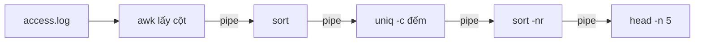

# Buổi 03 – Linux CLI

Tuần 2/16 · Giai đoạn 1 – Engineering Foundation · Buổi 03/32

[Slide](../../slides/01-foundation/session-03.md) · [Bài tập tuần](../../assignments/weekly/week-02.md) · [Hub tuần](README.md)

> **Tóm tắt:** Dùng pwd, ls, cd, find, grep, less và pipe để điều hướng filesystem, tìm file và đếm IP, mã lỗi trong access log chỉ bằng terminal.

::: tip Buổi này bạn làm gì
**Bạn sẽ tạo ra:** một cây thư mục dự án CLB và bảng thống kê IP, mã HTTP từ một file access log, tất cả bằng dòng lệnh.

**Thời gian thật:** đọc 15 phút, lab bắt buộc 60 phút, thử thách tùy chọn làm ở nhà. **Cần chuẩn bị:**
- [ ] Đã xong [Buổi 02 – Development Environment](../week-01/session-02.md): mở được terminal Ubuntu trong WSL. Chưa quen terminal thì đọc [Terminal cơ bản](../../resources/terminal-101.md).
- [ ] Có tài khoản GitHub, xem [Tài khoản GitHub và repo](../../resources/setup-github.md); cài đặt theo [Hướng dẫn cài đặt](../../resources/setup-guide.md).
- [ ] Đã clone repo giáo trình vào `~/devops-course` (cần file `examples/linux/access.log`).

**Sản phẩm phải nộp** (thư mục `lab-03/`, xem [Nộp bài](#nop-bai)): `README.md` và `report.md`; `source/` có cây `club-site` và `mini-access.log`; `evidence/command-output.txt` chứa lệnh và output của lab.

**Đi nhanh:** Đọc (bên dưới) → [Làm lab](#hands-on-lab) → [Gặp lỗi?](#gap-loi) → [Tự kiểm tra](#tu-kiem-tra) → [Nộp bài](#nop-bai). Kẹt thì nhảy thẳng tới [Gặp lỗi?](#gap-loi).

**Từ mới trong buổi:**
- [Terminal và shell](../../resources/glossary.md): cửa sổ gõ lệnh và chương trình hiểu lệnh đó
- [Pipe](../../resources/glossary.md): ký tự `|` nối output của lệnh này vào lệnh kế tiếp
- [stdin, stdout, stderr](../../resources/glossary.md): ba đường vào/ra chuẩn của một lệnh
- [Access log](../../resources/glossary.md): file ghi mỗi request mà web server nhận được
- [Đường dẫn tuyệt đối và tương đối](../../resources/glossary.md): bắt đầu từ `/` hay từ chỗ đang đứng
:::

Trên lớp, mentor demo trước; tự học thì làm thẳng phần Làm lab.

## Vấn đề thực tế

Một buổi tối trước giờ demo, website CLB bị chậm. Máy chủ không có giao diện đồ họa, chỉ có terminal. Log của Nginx dài hàng chục nghìn dòng: không thể mở bằng Notepad, cũng không thể đọc bằng mắt. Bạn cần trả lời nhanh: IP nào gọi nhiều nhất, bao nhiêu request lỗi 5xx, endpoint nào bị gọi nhiều nhất. Người biết CLI trả lời trong vài chục giây bằng một dòng pipeline.

Mọi thứ về sau (`docker logs`, `kubectl logs`, đọc file cấu hình) đều xảy ra trong terminal. Buổi này dạy cách ghép các lệnh nhỏ thành một công cụ phân tích, không phải học thuộc lệnh.

## Khái niệm cốt lõi

### Cây thư mục và đường dẫn

Linux chỉ có một cây thư mục bắt đầu từ gốc `/`, không có ổ `C:` hay `D:`. Ví von: như một cái cây có một gốc duy nhất, mọi thư mục là cành. Ổ Windows nằm dưới `/mnt/c` (tránh dùng trong khóa này vì chậm và sai quyền file).

Chỗ cần nhớ: `~` là home của bạn (nơi làm việc chính), `/etc` là cấu hình, `/var/log` là log, `.` và `..` là thư mục hiện tại và thư mục cha. Đường dẫn tuyệt đối bắt đầu bằng `/` hoặc `~`, đường dẫn tương đối tính từ chỗ đang đứng. Linux phân biệt chữ hoa chữ thường.

### Lệnh điều hướng và đọc file

Các lệnh như `pwd`, `ls -la`, `cd`, `mkdir -p`, `cat`, `less`, `head`, `tail`, `wc -l` là bộ "tay chân" của terminal. Ví von: `pwd` là hỏi "tôi đang ở đâu", `ls` là nhìn quanh. Thói quen quan trọng nhất: trước mọi lệnh xóa, chạy `pwd` và `ls`. Trong `less`, gõ `/chuoi` để tìm, `q` để thoát.

### find và grep

`find` tìm **file** theo thuộc tính (tên, loại, kích thước), `grep` tìm **dòng** theo nội dung. Ví von: `find` là tra mục lục thư viện, `grep` là lật từng trang tìm câu chữ.

Ví dụ: `find . -name "*.log"`, `find . -type d`, `grep -rn "mẫu" thư-mục`.

### Pipe và redirect

Mỗi lệnh làm một việc nhỏ: đọc từ stdin, ghi ra stdout. Ký tự `|` nối stdout của lệnh trước vào stdin của lệnh sau. Ví von: dây chuyền nhà máy, mỗi công nhân làm một công đoạn. Redirect `>` ghi đè file, `>>` ghi nối thêm, `2>` ghi riêng lỗi.

### Đọc access log bằng pipeline

Một dòng access log (định dạng rút gọn): cột 1 là IP, cột 7 là đường dẫn, cột 9 là mã HTTP.

```text
10.0.0.5 - - [21/Oct/2026:09:00:01 +0700] "GET /health HTTP/1.1" 200 15
```



`awk` cắt dòng thành cột, `sort` đưa các giá trị giống nhau nằm cạnh nhau (vì `uniq` chỉ gộp dòng liền kề), `uniq -c` đếm, `sort -nr` xếp giảm dần, `head` giữ top N. Xây từng đoạn và xem output trước khi thêm lệnh tiếp.

::: details Tìm hiểu thêm (đọc sau)
Mỗi lệnh trong pipeline chạy như một process riêng, dữ liệu chảy qua pipe theo từng khối nên xử lý được file rất lớn mà không nạp hết vào bộ nhớ. `grep` đứng đầu pipeline là bước tùy chọn để lọc dòng trước khi đếm.

Cột 4 của access log là thời gian (có dấu `[`), cột 6 là phương thức (có dấu `"`), cột 10 là số byte. Đó là lý do `awk '{print $9}'` lấy được mã trạng thái.

Thêm công cụ hay gặp: `sort -n` sắp xếp theo số; `find . -size +1M` tìm file lớn hơn 1 MiB; `tail -f` theo dõi file đang được ghi; `grep -i`, `-v`, `-c`, `-n` là không phân biệt hoa thường, đảo, đếm, hiện số dòng.
:::

## Hands-on lab

Thời lượng 60 phút: Chuẩn bị 5', Phần 1 10', Phần 2 10', Phần 3 25', ghi evidence và checklist 10'. Gặp lỗi ở đâu, xem [Gặp lỗi?](#gap-loi).

### Chuẩn bị (5 phút)

Mở terminal Ubuntu, kiểm tra môi trường rồi tạo thư mục lab trong repo cá nhân (`devops-labs`, để public):

```bash
echo "$SHELL"
cd ~ && pwd
mkdir -p devops-labs/lab-03/{source,screenshots,evidence}
cd devops-labs/lab-03
ls
```

Kết quả mong đợi: `/bin/bash`, `/home/ten-ban`, rồi `evidence  screenshots  source`. Nếu `pwd` bắt đầu bằng `/mnt/c`, chạy `cd ~` rồi làm lại. Cuối lab dán output vào `evidence/command-output.txt` (hoặc `history | tail -n 50 > evidence/history.txt`).

### Phần 1: Tạo cấu trúc thư mục (10 phút)

**Bước 1.1.** Tạo cây thư mục mô phỏng một dự án CLB:

```bash
cd ~/devops-labs/lab-03/source
mkdir -p club-site/{src,docs,logs,config}
mkdir -p "club-site/docs/meeting notes"
touch club-site/src/app.js club-site/src/index.html
touch club-site/config/app.conf club-site/config/db.conf
touch "club-site/docs/meeting notes/week 1.txt"
```

`mkdir -p` tạo cả thư mục cha; `{a,b}` do bash mở rộng thành nhiều đối số. Thư mục `meeting notes` có khoảng trắng nên bắt buộc đặt trong dấu nháy kép (lỡ quên, xem [Gặp lỗi?](#gap-loi)).

**Bước 1.2.** Kiểm tra cấu trúc:

```bash
find club-site | sort
```

Kết quả mong đợi:

```text
club-site
club-site/config
club-site/config/app.conf
club-site/config/db.conf
club-site/docs
club-site/docs/meeting notes
club-site/docs/meeting notes/week 1.txt
club-site/logs
club-site/src
club-site/src/app.js
club-site/src/index.html
```

::: tip Kiểm tra: bạn đúng khi
`find club-site | sort` in đúng 11 dòng như trên. Muốn luyện thêm đường dẫn tương đối và tuyệt đối, làm bài luyện trong [Thử thách thêm](session-03-challenge.md).
:::

### Phần 2: Tìm file bằng find và grep (10 phút)

**Bước 2.1.** Quay về `source` và tìm theo tên:

```bash
cd ~/devops-labs/lab-03/source
find club-site -name "*.conf"
```

Kết quả mong đợi (thứ tự có thể khác): `club-site/config/app.conf` và `club-site/config/db.conf`.

**Bước 2.2.** Tìm theo loại, kể cả file có khoảng trắng:

```bash
find club-site -type d
find club-site -type f -name "*.txt"
```

Kết quả mong đợi: lệnh đầu in 6 thư mục (kể cả `club-site`), lệnh sau in đúng một dòng `club-site/docs/meeting notes/week 1.txt`. `find` in nguyên vẹn tên có khoảng trắng vì nhận tên file trực tiếp, không qua việc tách từ của shell.

**Bước 2.3.** Ghi nội dung vào file rồi dùng `grep -r`:

```bash
echo "host=localhost" > club-site/config/db.conf
echo "port=5432" >> club-site/config/db.conf
echo "debug=true" > club-site/config/app.conf
grep -rn "port" club-site/config
```

Kết quả mong đợi: `club-site/config/db.conf:2:port=5432`. `>` ghi đè, `>>` ghi nối thêm; nếu dùng nhầm `>` ở dòng hai, bạn mất dòng `host` ([Gặp lỗi?](#gap-loi)).

::: tip Kiểm tra: bạn đúng khi
`grep -rn "port" club-site/config` in đúng một dòng có tên file và số dòng `2`, và `wc -l club-site/config/db.conf` in `2`.
:::

### Phần 3: Phân tích access log (25 phút)

**Bước 3.1.** Tạo log mẫu nhỏ có thể đếm bằng tay để tự kiểm chứng:

```bash
cd ~/devops-labs/lab-03/source
cat > mini-access.log <<'EOF'
10.0.0.5 - - [21/Oct/2026:09:00:01 +0700] "GET /health HTTP/1.1" 200 15
10.0.0.5 - - [21/Oct/2026:09:00:02 +0700] "GET /api/members HTTP/1.1" 200 512
10.0.0.7 - - [21/Oct/2026:09:00:03 +0700] "GET /api/members HTTP/1.1" 200 512
10.0.0.9 - - [21/Oct/2026:09:00:04 +0700] "GET /api/members/99 HTTP/1.1" 404 40
10.0.0.5 - - [21/Oct/2026:09:00:05 +0700] "GET /ready HTTP/1.1" 200 15
10.0.0.7 - - [21/Oct/2026:09:00:06 +0700] "POST /api/members HTTP/1.1" 405 30
10.0.0.9 - - [21/Oct/2026:09:00:07 +0700] "GET /api/members HTTP/1.1" 500 60
10.0.0.5 - - [21/Oct/2026:09:00:08 +0700] "GET /health HTTP/1.1" 200 15
10.0.0.7 - - [21/Oct/2026:09:00:09 +0700] "GET /health HTTP/1.1" 200 15
10.0.0.9 - - [21/Oct/2026:09:00:10 +0700] "GET /favicon.ico HTTP/1.1" 404 40
EOF
wc -l mini-access.log
```

Kết quả mong đợi: `10 mini-access.log`. Dấu nháy đơn quanh `EOF` ngăn bash mở rộng ký tự đặc biệt trong nội dung.

**Bước 3.2.** Xem đầu, cuối, tìm theo mẫu:

```bash
head -n 3 mini-access.log
tail -n 2 mini-access.log
grep -c " 404 " mini-access.log
grep "POST" mini-access.log
```

Kết quả mong đợi: 3 dòng đầu, 2 dòng cuối, số `2`, và đúng một dòng POST từ `10.0.0.7`.

**Bước 3.3.** Đếm request theo IP:

```bash
awk '{print $1}' mini-access.log | sort | uniq -c | sort -nr
```

Kết quả mong đợi (số lần bằng nhau thì thứ tự có thể khác):

```text
      4 10.0.0.5
      3 10.0.0.9
      3 10.0.0.7
```

**Bước 3.4.** Thống kê theo mã HTTP:

```bash
awk '{print $9}' mini-access.log | sort | uniq -c | sort -nr
```

Kết quả mong đợi:

```text
      6 200
      2 404
      1 500
      1 405
```

Cả hai bảng cộng lại đều bằng 10, khớp `wc -l`. Mã 200 hiện nhiều dòng nghĩa là bạn quên `sort`: xem [Gặp lỗi?](#gap-loi).

**Bước 3.5.** Lọc request lỗi server (5xx) và xem IP nào gây ra:

```bash
awk '$9 ~ /^5/ {print $1, $7, $9}' mini-access.log
```

Kết quả mong đợi: `10.0.0.9 /api/members 500`. Dùng `awk` thay vì `grep " 5"` vì `grep` có thể khớp nhầm vào số byte hoặc ngày giờ; `awk` kiểm tra đúng cột 9.

::: tip Kiểm tra: bạn đúng khi
Bảng theo IP khớp Bước 3.3, bảng theo mã HTTP khớp Bước 3.4, và lọc 5xx cho đúng một dòng.
:::

**Bước 3.6.** Chạy trên file thật của giáo trình (260 dòng). Đổi đường dẫn nguồn cho đúng nơi bạn clone repo giáo trình:

```bash
cp ~/devops-course/examples/linux/access.log ~/devops-labs/lab-03/source/access.log
cd ~/devops-labs/lab-03/source
wc -l access.log
head -n 3 access.log
less access.log
```

Kết quả mong đợi: `260 access.log`. File thật có thêm hai trường cuối (referer, user-agent) nhưng các cột 1, 7, 9 vẫn là IP, đường dẫn, mã HTTP. Trong `less`, gõ `/404` để tìm, `n` để sang kết quả kế tiếp, `q` để thoát. Nếu `cp` báo `No such file or directory`, xem [Gặp lỗi?](#gap-loi).

### Checklist L1 (bắt buộc)

- [ ] Cây thư mục `club-site` đúng như Bước 1.2, `find club-site | sort` khớp kết quả mong đợi.
- [ ] Dùng `find` liệt kê được file `*.conf` và file `.txt` có khoảng trắng trong tên.
- [ ] Tạo được `mini-access.log` và `wc -l` trả về 10.
- [ ] Đếm đúng request theo IP và theo mã HTTP, khớp Bước 3.3 và 3.4.
- [ ] Dùng `less` mở `access.log`, tìm một chuỗi bằng `/`, thoát bằng `q`.
- [ ] Lưu output các lệnh chính vào `evidence/command-output.txt`.

Lệnh tự kiểm tra một dòng (kết quả mong đợi: `11 10 260`):

```bash
cd ~/devops-labs/lab-03/source && echo "$(find club-site | wc -l) $(wc -l < mini-access.log) $(wc -l < access.log)"
```

## Gặp lỗi?

| Triệu chứng | Nguyên nhân | Cách sửa |
| --- | --- | --- |
| `cd: too many arguments` | Đường dẫn có khoảng trắng, chưa quote | Dùng `cd "my folder"` hoặc `cd my\ folder` |
| `rm -r club-site/docs/meeting notes` báo hai lỗi `No such file or directory` cho `meeting` và `notes` (thư mục vẫn còn) | Bash tách đối số theo khoảng trắng, `rm` nhận hai đối số | Quote đường dẫn. Trước lệnh xóa, chạy `ls` hoặc `echo` với cùng đối số để xem bash truyền gì |
| `No such file or directory` | Sai đường dẫn hoặc đứng sai thư mục | Chạy `pwd`, `ls`, dùng đường dẫn tuyệt đối hoặc `~`; với `cp access.log`, dùng `find ~ -name access.log -path "*examples*" 2>/dev/null` để tìm nơi clone repo |
| `uniq -c` cho nhiều dòng mã 200 với số đếm nhỏ | Quên `sort`; `uniq` chỉ gộp dòng liền kề | Thêm `sort` trước `uniq -c`; cộng các số đếm và so với `wc -l` |
| File mất nội dung sau khi ghi (`db.conf` chỉ còn một dòng) | Dùng `>` thay cho `>>` | Dùng `>>` để ghi nối; chạy `cat` trước khi ghi đè |
| `grep` không in gì | Sai chữ hoa thường hoặc mẫu không khớp | Thử `grep -i`; kiểm tra mẫu bằng `cat file \| head` |
| `Permission denied` (đọc file, hoặc `find` in nhiều dòng) | File thuộc user khác, hoặc `find` quét qua thư mục hệ thống | `ls -l` (xem [Buổi 04 – Linux Administration](session-04.md) về `chmod`, `chown`); giới hạn thư mục tìm hoặc thêm `2>/dev/null` |
| Script báo `bad interpreter` hoặc `\r` | File lưu bằng CRLF của Windows | Soạn file trong WSL, hoặc `sed -i 's/\r$//' file.sh` |

## Tự kiểm tra

1. Khác biệt giữa đường dẫn tuyệt đối và tương đối? Cho ví dụ.
2. `>` và `>>` khác nhau thế nào?
3. Vì sao phải `sort` trước `uniq -c`?
4. `find` và `grep` khác nhau ở điểm nào? Khi nào dùng cái nào?
5. Viết pipeline in 3 URL được gọi nhiều nhất từ access log.

::: details Đáp án gợi ý
1. Tuyệt đối bắt đầu bằng `/` hoặc `~` (ví dụ `/home/an/lab-03`), không phụ thuộc vị trí hiện tại. Tương đối tính từ thư mục hiện tại (ví dụ `../config`).
2. `>` ghi đè file (tạo mới nếu chưa có); `>>` ghi nối thêm vào cuối file.
3. `uniq` chỉ gộp dòng liền kề; `sort` đưa các giá trị giống nhau nằm cạnh nhau.
4. `find` tìm file theo thuộc tính (tên, loại, kích thước); `grep` tìm dòng theo nội dung. Tìm file thì dùng `find`, tìm chuỗi trong file thì dùng `grep`.
5. `awk '{print $7}' access.log | sort | uniq -c | sort -nr | head -n 3`
:::

## Nộp bài

Nộp vào thư mục `lab-03/` trong repo `devops-labs` theo [mẫu nộp lab](../../templates/lab-template.md). Chưa dùng được Git thì upload trên web GitHub hoặc làm theo mục [Git trong 10 phút](../../curriculum/how-to-learn.md#git-10-phut); push và Pull Request thành thạo từ [Buổi 06 – Git & GitHub Workflow](../week-03/session-06.md). Chi tiết nhiệm vụ và bảng điểm: [Bài tập tuần 2](../../assignments/weekly/week-02.md).

- [ ] `README.md` trả lời đủ 7 câu (vấn đề, kiến thức, các bước, kết quả, lỗi đã gặp, cách khắc phục, cải thiện) và ghi level đã làm (L1/L2).
- [ ] `source/` có cây `club-site`, `mini-access.log` (và `log-report.sh` nếu làm L2); `evidence/command-output.txt` có lệnh và output của Phần 1 đến 3; `screenshots/` có ảnh terminal (ảnh không thay output text).
- [ ] `report.md` ghi một lỗi bạn đã gặp, cách điều tra, bài học. Không commit secret hay thông tin cá nhân trong log.

## Recap

- Linux có một cây thư mục từ `/`; làm việc trong `~` của WSL, kiểm tra bằng `pwd` và `ls` trước khi xóa.
- `find` tìm file theo thuộc tính, `grep` tìm dòng theo nội dung; quote đường dẫn và biến.
- Pipe nối lệnh nhỏ thành công cụ phân tích: `awk | sort | uniq -c | sort -nr | head`, kiểm chứng bằng dữ liệu nhỏ đếm tay.

Buổi tiếp theo: [Buổi 04 – Linux Administration](session-04.md).

::: details Thử thách thêm (L2, tùy chọn, làm ở nhà)
Top 5 IP, phân bố mã HTTP, top 3 endpoint lỗi và script `log-report.sh` trên file `access.log` thật: xem [Buổi 03 – Thử thách thêm (L2)](session-03-challenge.md), có gợi ý từng bậc.
:::

::: details Phá lỗi nâng cao
Pipeline sai mà không báo lỗi, gõ thừa dấu cách trong `rm -rf`, `grep` không ra gì: xem phần cuối của [Buổi 03 – Thử thách thêm (L2)](session-03-challenge.md).
:::

::: details Tài liệu tham khảo
- [GNU Bash Reference Manual – Pipelines](https://www.gnu.org/software/bash/manual/html_node/Pipelines.html)
- [GNU Bash Reference Manual – Quoting](https://www.gnu.org/software/bash/manual/html_node/Quoting.html)
- [GNU findutils – find manual](https://www.gnu.org/software/findutils/manual/html_mono/find.html)
- [GNU grep manual](https://www.gnu.org/software/grep/manual/grep.html)
- [GNU Coreutils – sort invocation](https://www.gnu.org/software/coreutils/manual/html_node/sort-invocation.html)
- [GNU Coreutils – uniq invocation](https://www.gnu.org/software/coreutils/manual/html_node/uniq-invocation.html)
:::
