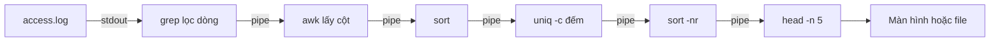

# Buổi 03 – Linux CLI

Tuần 2 · Giai đoạn 1 – Engineering Foundation · Slide: [Slide buổi 03](../../slides/01-foundation/session-03.md)

> **Tóm tắt:** Dùng thành thạo pwd, ls, cd, find, grep, cat, less, head, tail và pipe để điều hướng filesystem, tìm file và phân tích access log như một DevOps engineer.

## Mục tiêu học tập

- Giải thích được cấu trúc cây thư mục Linux, đường dẫn tuyệt đối và tương đối, home directory trong WSL2.
- Chạy được các lệnh `pwd`, `ls`, `cd`, `mkdir`, `cat`, `less`, `head`, `tail` để điều hướng và đọc file.
- Tìm được file theo tên, loại, kích thước bằng `find` và tìm dòng theo mẫu bằng `grep`.
- Xây dựng được pipeline nhiều lệnh (`grep | awk | sort | uniq -c | sort -nr`) để thống kê access log.
- Chẩn đoán được các lỗi phổ biến: quên quote đường dẫn có khoảng trắng, sai đường dẫn, `rm -rf` nhầm chỗ.
- Giải thích được vì sao DevOps engineer đọc log bằng CLI thay vì mở file bằng trình soạn thảo.

## Điều kiện cần

- Đã hoàn thành Buổi 02: có WSL2 Ubuntu chạy được, biết mở terminal Ubuntu.
- Làm việc trong filesystem của WSL (thư mục `~`), không làm việc trong `/mnt/c`.
- Có repository cá nhân (ví dụ `devops-labs`) để nộp bài vào thư mục `lab-03/`.
- Kiểm tra nhanh:

```bash
echo "$SHELL"
cd ~ && pwd
grep --version | head -1
```

Kết quả mong đợi (rút gọn, phiên bản có thể khác):

```text
/bin/bash
/home/ten-ban
grep (GNU grep) 3.11
```

Nếu `pwd` trả về đường dẫn bắt đầu bằng `/mnt/c`, hãy chạy `cd ~` rồi làm lại.

## Vấn đề thực tế

Một buổi tối trước giờ demo, website CLB bị chậm. Máy chủ không có giao diện đồ họa, chỉ có terminal. Log của Nginx dài hàng chục nghìn dòng: không thể mở bằng Notepad, và cũng không thể đọc từng dòng bằng mắt. Bạn cần trả lời nhanh: IP nào gọi nhiều nhất, bao nhiêu request lỗi 5xx, endpoint nào bị gọi nhiều nhất. Người biết CLI trả lời trong vài chục giây bằng một dòng pipeline.

Trong khóa học này, mọi thứ bạn làm sau đó đều xảy ra trong terminal: `docker logs`, `kubectl logs`, đọc file cấu hình, tìm file YAML bị thiếu, lọc output của lệnh. Buổi này xây nền tảng đó. Thay vì học thuộc lệnh, bạn học cách ghép các lệnh nhỏ thành một công cụ phân tích hoàn chỉnh.

## Khái niệm cốt lõi

### Cây thư mục Linux và đường dẫn

Linux chỉ có một cây thư mục duy nhất bắt đầu từ gốc `/` (root). Không có ổ đĩa `C:` hay `D:`. Ổ đĩa Windows nằm dưới `/mnt/c` (nên tránh trong khóa này vì chậm và sai quyền file).

| Đường dẫn | Ý nghĩa |
| --- | --- |
| `/` | Gốc của toàn bộ cây thư mục |
| `/home/ten-ban` hoặc `~` | Home directory của bạn, nơi làm việc chính |
| `/etc` | File cấu hình hệ thống |
| `/var/log` | Log hệ thống và dịch vụ |
| `/tmp` | File tạm, có thể bị xóa khi khởi động lại |
| `.` và `..` | Thư mục hiện tại và thư mục cha |

Đường dẫn tuyệt đối bắt đầu bằng `/` (hoặc `~`) và không phụ thuộc bạn đang đứng ở đâu. Đường dẫn tương đối tính từ thư mục hiện tại. Linux phân biệt chữ hoa chữ thường: `Log` và `log` là hai thư mục khác nhau.

### Nhóm lệnh điều hướng và đọc file

| Lệnh | Công dụng | Ví dụ |
| --- | --- | --- |
| `pwd` | In thư mục hiện tại | `pwd` |
| `ls` | Liệt kê file | `ls -la` (dài, gồm file ẩn) |
| `cd` | Đổi thư mục | `cd ~/devops-labs`, `cd ..`, `cd -` |
| `mkdir -p` | Tạo thư mục, kể cả thư mục cha | `mkdir -p a/b/c` |
| `cat` | In toàn bộ file | `cat file.txt` |
| `less` | Xem file dài, cuộn được | `less access.log` (thoát bằng `q`, tìm bằng `/chuoi`) |
| `head`, `tail` | Xem đầu, cuối file | `head -n 5`, `tail -n 20`, `tail -f` |
| `wc -l` | Đếm số dòng | `wc -l access.log` |

### find và grep

`find` tìm **file** theo thuộc tính (tên, loại, kích thước, thời gian sửa). `grep` tìm **dòng** trong nội dung file theo mẫu.

| Lệnh | Ý nghĩa |
| --- | --- |
| `find . -name "*.log"` | File có tên kết thúc bằng .log, từ thư mục hiện tại |
| `find . -type d` | Chỉ thư mục (`-type f` là file thường) |
| `find . -size +1M` | File lớn hơn 1 MiB |
| `grep "ERROR" file` | Dòng chứa ERROR |
| `grep -i`, `-v`, `-c`, `-n` | Không phân biệt hoa thường, đảo ngược, đếm, hiện số dòng |
| `grep -r "mẫu" thư-mục` | Tìm đệ quy trong nhiều file |

### Pipe và redirect

Mỗi lệnh Unix làm một việc nhỏ, đọc từ **stdin**, ghi ra **stdout**. Ký tự `|` nối stdout của lệnh trước vào stdin của lệnh sau. Redirect `>` ghi đè file, `>>` ghi nối thêm, `2>` ghi riêng lỗi (stderr).

| Công cụ | Vai trò trong pipeline |
| --- | --- |
| `awk '{print $1}'` | Lấy cột thứ 1 (cột cách nhau bởi khoảng trắng) |
| `sort` | Sắp xếp; `sort -n` theo số, `sort -nr` số giảm dần |
| `uniq -c` | Đếm dòng liên tiếp giống nhau (phải `sort` trước) |
| `head -n 5` | Lấy 5 dòng đầu, dùng để lấy "top 5" |

### Định dạng access log

Access log của web server (định dạng combined, rút gọn) có dạng:

```text
10.0.0.5 - - [21/Oct/2026:09:00:01 +0700] "GET /health HTTP/1.1" 200 15
```

Tách theo khoảng trắng: cột 1 là IP client, cột 4 là thời gian (có dấu `[`), cột 6 là phương thức (có dấu `"`), cột 7 là đường dẫn, cột 9 là mã HTTP, cột 10 là số byte. Đây là lý do `awk '{print $9}'` lấy được mã trạng thái.

## Kiến trúc và cách hoạt động



Giải thích từng bước:

1. `grep` đọc file và chỉ cho đi qua các dòng khớp mẫu (có thể bỏ qua nếu muốn thống kê toàn bộ).
2. `awk` cắt mỗi dòng thành các cột và in cột cần phân tích (IP, mã HTTP hoặc đường dẫn).
3. `sort` đưa các giá trị giống nhau nằm cạnh nhau, vì `uniq` chỉ gộp các dòng **liền kề**.
4. `uniq -c` gộp và đếm, thêm số lần xuất hiện ở đầu dòng.
5. `sort -nr` sắp xếp theo số lần giảm dần.
6. `head -n 5` giữ lại 5 dòng đầu, tức top 5.

Mỗi lệnh chạy như một process riêng, dữ liệu chảy qua pipe theo từng khối nên xử lý được file rất lớn mà không cần nạp hết vào bộ nhớ. Kiểm tra pipeline bằng cách chạy từng đoạn: thêm từng lệnh một và quan sát output trước khi thêm lệnh tiếp theo.

## Demo của mentor

Mentor thực hiện trên màn hình chiếu, học viên gõ theo. Thời lượng khoảng 10 phút trong phần 30 phút kiến thức.

**Bước 1. Định vị.**

```bash
cd ~
pwd
ls -la
```

Kết quả mong đợi: đường dẫn `/home/ten-ban` và danh sách file ẩn như `.bashrc`.

Câu hỏi cho lớp: "Nếu tôi gõ `cd /` rồi `ls`, bạn nghĩ sẽ thấy gì? Ổ `C:` nằm ở đâu?"

**Bước 2. Tạo file log nhỏ và quan sát.**

```bash
mkdir -p ~/demo && cd ~/demo
printf '%s\n' 'line one' 'line two ERROR' 'line three' > sample.txt
cat sample.txt
grep ERROR sample.txt
```

Kết quả mong đợi:

```text
line one
line two ERROR
line three
line two ERROR
```

**Bước 3. Pipe là gì.** So sánh hai cách đếm số dòng:

```bash
wc -l sample.txt
cat sample.txt | wc -l
```

Kết quả mong đợi: `3 sample.txt` và `3`. Giải thích: khi đọc từ stdin, `wc` không biết tên file nên không in tên.

Câu hỏi cho lớp: "Vì sao `uniq -c` cho kết quả sai nếu bỏ qua `sort` trước nó?" (Gợi ý mentor: thử với dữ liệu `a b a`.)

**Bước 4. Phá thử cố ý.**

```bash
cd ~/demo
mkdir "my folder"
cd my folder
```

Kết quả mong đợi: lỗi `bash: cd: too many arguments`. Giải thích bằng quote: `cd "my folder"`. Chuyển sang phần Phá lỗi để học viên tự điều tra.

**Dọn dẹp demo:**

```bash
cd ~ && rm -r ~/demo
```

## Hands-on lab

Thời lượng 60 phút: Phần 1 (10'), Phần 2 (10'), Phần 3 (25'), L2 (15').

### Chuẩn bị

1. Mở terminal Ubuntu và tạo thư mục làm việc cho lab (trong repository cá nhân):

```bash
cd ~
mkdir -p devops-labs/lab-03
cd devops-labs/lab-03
pwd
```

Kết quả mong đợi: `/home/ten-ban/devops-labs/lab-03`.

2. Tạo các thư mục nộp bài theo `templates/lab-template.md`:

```bash
mkdir -p source screenshots evidence
ls
```

Kết quả mong đợi: `evidence  screenshots  source`.

3. Bắt đầu ghi lại lệnh để làm bằng chứng. Ở cuối lab bạn sẽ dán output vào `evidence/command-output.txt`. Có thể dùng `history | tail -n 50 > evidence/history.txt` để lưu lệnh đã gõ.

### Phần 1: Tạo cấu trúc thư mục

Mục tiêu: dựng cấu trúc mô phỏng một dự án CLB.

**Bước 1.1.** Tạo cây thư mục bằng một lệnh:

```bash
cd ~/devops-labs/lab-03/source
mkdir -p club-site/{src,docs,logs,config}
mkdir -p "club-site/docs/meeting notes"
touch club-site/src/app.js club-site/src/index.html
touch club-site/config/app.conf club-site/config/db.conf
touch "club-site/docs/meeting notes/week 1.txt"
```

Vì sao: `mkdir -p` tạo cả thư mục cha; `{a,b}` do bash mở rộng thành nhiều đối số. Thư mục `meeting notes` có khoảng trắng, nên bắt buộc đặt trong dấu nháy kép.

**Bước 1.2.** Kiểm tra cấu trúc:

```bash
find club-site | sort
```

Kết quả mong đợi:

```text
club-site
club-site/config
club-site/config/app.conf
club-site/config/db.conf
club-site/docs
club-site/docs/meeting notes
club-site/docs/meeting notes/week 1.txt
club-site/logs
club-site/src
club-site/src/app.js
club-site/src/index.html
```

**Bước 1.3.** Di chuyển bằng đường tương đối và tuyệt đối:

```bash
cd club-site/src
pwd
cd ../config
pwd
cd ~/devops-labs/lab-03/source/club-site
pwd
cd -
```

Kết quả mong đợi: lần lượt `.../club-site/src`, `.../club-site/config`, `.../club-site`, và `cd -` in ra thư mục trước đó (`.../club-site/config`). Vì sao: `..` là thư mục cha, `cd -` quay lại thư mục trước.

### Phần 2: Tìm file bằng find

**Bước 2.1.** Quay về thư mục `source` và tìm theo tên:

```bash
cd ~/devops-labs/lab-03/source
find club-site -name "*.conf"
```

Kết quả mong đợi (thứ tự có thể khác):

```text
club-site/config/app.conf
club-site/config/db.conf
```

**Bước 2.2.** Tìm theo loại, rồi thử file có khoảng trắng:

```bash
find club-site -type d
find club-site -type f -name "*.txt"
```

Kết quả mong đợi: lệnh đầu in 6 thư mục (kể cả `club-site`), lệnh sau in đúng một dòng `club-site/docs/meeting notes/week 1.txt`. Dòng có khoảng trắng vẫn in nguyên vẹn vì `find` nhận tên file trực tiếp, không qua việc tách từ của shell.

**Bước 2.3.** Ghi nội dung vào file rồi dùng `grep -r`:

```bash
echo "host=localhost" > club-site/config/db.conf
echo "port=5432" >> club-site/config/db.conf
echo "debug=true" > club-site/config/app.conf
grep -rn "port" club-site/config
```

Kết quả mong đợi:

```text
club-site/config/db.conf:2:port=5432
```

Vì sao: `>` ghi đè, `>>` ghi nối thêm. Nếu dùng nhầm `>` ở dòng thứ hai, bạn sẽ mất dòng `host`. Hãy thử và quan sát để nhớ.

### Phần 3: Phân tích access log

**Bước 3.1.** Tạo file log mẫu nhỏ, có kết quả đếm được bằng tay để tự kiểm chứng:

```bash
cd ~/devops-labs/lab-03/source
cat > mini-access.log <<'EOF'
10.0.0.5 - - [21/Oct/2026:09:00:01 +0700] "GET /health HTTP/1.1" 200 15
10.0.0.5 - - [21/Oct/2026:09:00:02 +0700] "GET /api/members HTTP/1.1" 200 512
10.0.0.7 - - [21/Oct/2026:09:00:03 +0700] "GET /api/members HTTP/1.1" 200 512
10.0.0.9 - - [21/Oct/2026:09:00:04 +0700] "GET /api/members/99 HTTP/1.1" 404 40
10.0.0.5 - - [21/Oct/2026:09:00:05 +0700] "GET /ready HTTP/1.1" 200 15
10.0.0.7 - - [21/Oct/2026:09:00:06 +0700] "POST /api/members HTTP/1.1" 405 30
10.0.0.9 - - [21/Oct/2026:09:00:07 +0700] "GET /api/members HTTP/1.1" 500 60
10.0.0.5 - - [21/Oct/2026:09:00:08 +0700] "GET /health HTTP/1.1" 200 15
10.0.0.7 - - [21/Oct/2026:09:00:09 +0700] "GET /health HTTP/1.1" 200 15
10.0.0.9 - - [21/Oct/2026:09:00:10 +0700] "GET /favicon.ico HTTP/1.1" 404 40
EOF
wc -l mini-access.log
```

Kết quả mong đợi: `10 mini-access.log`. Dấu nháy đơn quanh `EOF` ngăn bash mở rộng ký tự đặc biệt trong nội dung.

**Bước 3.2.** Xem đầu, cuối và tìm theo mẫu:

```bash
head -n 3 mini-access.log
tail -n 2 mini-access.log
grep -c " 404 " mini-access.log
grep "POST" mini-access.log
```

Kết quả mong đợi: 3 dòng đầu, 2 dòng cuối, số `2`, và đúng một dòng POST từ `10.0.0.7`.

**Bước 3.3.** Đếm request theo IP:

```bash
awk '{print $1}' mini-access.log | sort | uniq -c | sort -nr
```

Kết quả mong đợi (với số lần bằng nhau, thứ tự có thể khác):

```text
      4 10.0.0.5
      3 10.0.0.9
      3 10.0.0.7
```

**Bước 3.4.** Thống kê theo mã HTTP:

```bash
awk '{print $9}' mini-access.log | sort | uniq -c | sort -nr
```

Kết quả mong đợi:

```text
      6 200
      2 404
      1 500
      1 405
```

**Bước 3.5.** Lọc request lỗi server (5xx) và xem là IP nào gây ra:

```bash
awk '$9 ~ /^5/ {print $1, $7, $9}' mini-access.log
```

Kết quả mong đợi: `10.0.0.9 /api/members 500`. Vì sao dùng `awk` thay vì `grep " 5"`: `grep` có thể khớp nhầm vào số byte hoặc ngày giờ; `awk` kiểm tra đúng cột 9.

**Bước 3.6.** Chạy trên file thật của giáo trình. File `examples/linux/access.log` nằm trong repo giáo trình (xem thêm `examples/linux/README.md`). Sao chép vào thư mục lab (đổi đường dẫn nguồn cho đúng nơi bạn clone repo giáo trình):

```bash
cp ~/devops-course/examples/linux/access.log ~/devops-labs/lab-03/source/access.log
cd ~/devops-labs/lab-03/source
wc -l access.log
head -n 3 access.log
```

Kết quả mong đợi: `260 access.log` và 3 dòng đầu cùng cột như file mini, nhưng có thêm hai trường cuối (referer và user-agent) nên số cột nhiều hơn; các cột 1, 7, 9 vẫn là IP, đường dẫn, mã HTTP. Ngày trong file thật là 10/Mar/2025, khác file mini, nhưng không ảnh hưởng các pipeline ở đây. Nếu `cp` báo `No such file or directory`, hãy dùng `find ~ -name access.log -path "*examples*" 2>/dev/null` để xác định vị trí clone.

### L1 – Foundation

- [ ] Cây thư mục `club-site` đúng như Bước 1.2, `find club-site | sort` khớp kết quả mong đợi.
- [ ] Dùng `find` liệt kê được file `*.conf` và file `.txt` có khoảng trắng trong tên.
- [ ] Tạo được `mini-access.log` và `wc -l` trả về 10.
- [ ] Đếm đúng số request theo IP và theo mã HTTP trên `mini-access.log`, khớp bảng ở Bước 3.3 và 3.4.
- [ ] Dùng `less` mở `access.log`, tìm một chuỗi bằng `/`, thoát bằng `q`.
- [ ] Lưu output các lệnh chính vào `evidence/command-output.txt`.

### L2 – Engineering

Thực hiện trên `source/access.log` (file thật). Mỗi thử thách phải có lệnh một dòng (pipeline) và một câu giải thích tại sao pipeline đúng.

1. **Top 5 IP.** In ra 5 IP gửi nhiều request nhất kèm số lần.
2. **Phân bố mã HTTP.** Thống kê số lượng mỗi mã trạng thái, sắp xếp giảm dần.
3. **Top 3 endpoint bị lỗi.** Chỉ xét các dòng có mã 4xx hoặc 5xx, in 3 đường dẫn xuất hiện nhiều nhất.
4. **Tự viết script.** Tạo `source/log-report.sh` nhận đường dẫn file log làm tham số, in ba báo cáo trên, và thoát với thông báo rõ ràng nếu thiếu tham số hoặc file không tồn tại.

Tiêu chí hoàn thành: pipeline của thử thách 1 đến 3 chạy trên `mini-access.log` cho kết quả khớp đếm tay (ví dụ `/api/members` lỗi 2 lần); script chạy được với cả hai file; không hard-code đường dẫn tuyệt đối; có kiểm tra tham số đầu vào.

Thời gian gợi ý: thử thách 1 đến 3 khoảng 8 phút, thử thách 4 (script) khoảng 7 phút; nếu hết giờ, hoàn thành script ở nhà.

<details>
<summary>Gợi ý</summary>

- Top 5: thêm `head -n 5` vào cuối pipeline ở Bước 3.3.
- Endpoint lỗi: dùng `awk '$9 >= 400 {print $7}'`; awk so sánh số khi cột trông giống số.
- Script: `$1` là tham số đầu tiên, `[ -z "$1" ]` kiểm tra rỗng, `[ -f "$1" ]` kiểm tra file tồn tại, luôn bao quanh biến bằng dấu nháy kép.
- Nhớ cấp quyền chạy bằng `chmod +x log-report.sh` hoặc chạy bằng `bash log-report.sh`.

</details>

<details>
<summary>Lời giải tham khảo</summary>

```bash
# 1. Top 5 IP
awk '{print $1}' access.log | sort | uniq -c | sort -nr | head -n 5

# 2. Phân bố mã HTTP
awk '{print $9}' access.log | sort | uniq -c | sort -nr

# 3. Top 3 endpoint lỗi
awk '$9 >= 400 {print $7}' access.log | sort | uniq -c | sort -nr | head -n 3
```

```bash
#!/usr/bin/env bash
# log-report.sh - thống kê access log
set -u

if [ -z "${1:-}" ]; then
  echo "Cách dùng: $0 duong-dan-access.log" >&2
  exit 1
fi
if [ ! -f "$1" ]; then
  echo "Không tìm thấy file: $1" >&2
  exit 1
fi

echo "== Top 5 IP =="
awk '{print $1}' "$1" | sort | uniq -c | sort -nr | head -n 5
echo "== Mã HTTP =="
awk '{print $9}' "$1" | sort | uniq -c | sort -nr
echo "== Top 3 endpoint lỗi =="
awk '$9 >= 400 {print $7}' "$1" | sort | uniq -c | sort -nr | head -n 3
```

Chạy thử: `bash log-report.sh mini-access.log`. Với `mini-access.log`, `/api/members` xuất hiện 2 lần (một POST trả 405, một GET trả 500), còn `/api/members/99` và `/favicon.ico` mỗi cái 1 lần.

</details>

## Phá lỗi và debug

### Tình huống 1: Thư mục có khoảng trắng

**Cách phá:**

```bash
cd ~/devops-labs/lab-03/source
rm -r club-site/docs/meeting notes
```

**Triệu chứng:** lệnh báo hai lỗi `No such file or directory` cho `club-site/docs/meeting` và `notes`; thư mục thực sự vẫn còn.

**Hướng điều tra:**

1. Đọc kỹ thông báo lỗi: nó nêu tên `meeting` và `notes` như hai đối tượng riêng.
2. Chạy `echo rm -r club-site/docs/meeting notes` hoặc dùng `printf '[%s]\n' club-site/docs/meeting notes` để thấy bash chia thành mấy đối số.
3. Nhận ra bash tách đối số theo khoảng trắng.

**Nguyên nhân gốc:** shell tách dòng lệnh thành từ theo khoảng trắng trước khi gọi chương trình; thiếu quote nên `rm` nhận hai đối số.

**Cách phòng tránh:** luôn đặt đường dẫn và biến trong dấu nháy kép (`"$dir"`); với lệnh xóa, chạy `ls` hoặc `echo` với cùng đối số trước để xem bash sẽ truyền gì; không dùng `rm -rf` khi chưa kiểm tra bằng `pwd` và `ls`.

### Tình huống 2: Pipeline cho kết quả sai

**Cách phá:** bỏ `sort` đứng trước `uniq -c`:

```bash
awk '{print $9}' mini-access.log | uniq -c
```

**Triệu chứng:** cùng một mã (ví dụ 200) xuất hiện nhiều dòng với số đếm nhỏ thay vì một dòng tổng.

**Hướng điều tra:** chạy `awk '{print $9}' mini-access.log` để xem dữ liệu thô; thấy các giá trị giống nhau không nằm liền kề.

**Nguyên nhân gốc:** `uniq` chỉ gộp các dòng liền nhau.

**Cách phòng tránh:** luôn thêm `sort` trước `uniq -c`; kiểm tra tổng bằng cách cộng các số đếm và so với `wc -l`.

## Lỗi thường gặp

| Triệu chứng | Nguyên nhân | Cách xử lý |
| --- | --- | --- |
| `cd: too many arguments` | Đường dẫn có khoảng trắng, chưa quote | Dùng `cd "my folder"` hoặc `cd my\ folder` |
| `No such file or directory` | Sai đường dẫn tương đối hoặc đứng sai thư mục | Chạy `pwd`, `ls`, dùng đường dẫn tuyệt đối hoặc `~` |
| `Permission denied` khi đọc file | File thuộc user khác hoặc không có quyền đọc | Kiểm tra bằng `ls -l`; xem Buổi 04 về `chmod`, `chown` |
| `grep` không in gì | Sai chữ hoa thường hoặc mẫu không khớp | Thử `grep -i`; kiểm tra mẫu bằng `cat file | head` |
| `uniq -c` đếm sai | Quên `sort` trước `uniq` | Thêm `sort` trước `uniq -c` |
| File bị mất nội dung sau khi ghi | Dùng `>` thay cho `>>` | Dùng `>>` để ghi nối, kiểm tra bằng `cat` trước khi ghi đè |
| Lệnh `find` trả nhiều lỗi `Permission denied` | Quét qua thư mục hệ thống | Giới hạn thư mục tìm, hoặc thêm `2>/dev/null` |
| Script báo `bad interpreter` hoặc `\r` | File lưu bằng CRLF của Windows | Soạn file trong WSL, hoặc chạy `sed -i 's/\r$//' file.sh` |

## Tự kiểm tra

1. Khác biệt giữa đường dẫn tuyệt đối và tương đối? Cho ví dụ.
2. `>` và `>>` khác nhau thế nào?
3. Vì sao phải `sort` trước `uniq -c`?
4. `find` và `grep` khác nhau ở điểm nào? Khi nào dùng cái nào?
5. Viết pipeline in 3 URL được gọi nhiều nhất từ access log.
6. Tình huống: bạn chạy `rm -rf logs /` do gõ thừa dấu cách thay vì `rm -rf logs/`. Chuyện gì có thể xảy ra, và thói quen nào giúp tránh?
7. Tình huống: một đồng đội nói "grep ERROR app.log không ra gì nhưng tôi chắc có lỗi". Bạn kiểm tra những gì?

<details>
<summary>Đáp án</summary>

1. Tuyệt đối bắt đầu bằng `/` hoặc `~` (ví dụ `/home/an/lab-03`), không phụ thuộc vị trí hiện tại. Tương đối tính từ thư mục hiện tại (ví dụ `../config`).
2. `>` ghi đè file (tạo mới nếu chưa có); `>>` ghi nối thêm vào cuối file.
3. `uniq` chỉ gộp dòng liền kề; `sort` đưa các giá trị giống nhau nằm cạnh nhau.
4. `find` tìm file theo thuộc tính (tên, loại, kích thước); `grep` tìm dòng theo nội dung. Tìm file nào thì dùng `find`, tìm chuỗi trong file thì dùng `grep`.
5. `awk '{print $7}' access.log | sort | uniq -c | sort -nr | head -n 3`
6. Lệnh xóa cả thư mục `logs` lẫn thư mục gốc `/`. Hệ thống hiện đại có cơ chế bảo vệ (`--preserve-root`) nhưng không nên dựa vào nó. Thói quen: chạy `ls` với cùng đối số trước, dùng `rm -r` không `-f` khi cần xác nhận, và `pwd` trước khi xóa.
7. Thử `grep -i` (có thể là `error` hoặc `Error`), kiểm tra đúng file và đúng thư mục bằng `pwd`/`ls`, xem file có rỗng không (`wc -l`), kiểm tra log có nằm ở stderr hoặc file khác không, và thử `grep -r ERROR .` trong thư mục log.

</details>

## Nộp bài

Nộp vào thư mục `lab-03/` trong repository cá nhân theo `templates/lab-template.md`:

- [ ] `README.md` trả lời đủ 7 câu: bài lab giải quyết vấn đề gì, kiến thức đã dùng, các bước thực hiện, kết quả mong đợi, lỗi đã gặp, cách khắc phục, có thể cải thiện gì.
- [ ] `source/` chứa cây `club-site`, `mini-access.log` và (nếu làm L2) `log-report.sh`.
- [ ] `evidence/command-output.txt` chứa lệnh và output của Phần 1 đến Phần 3 (và L2 nếu có).
- [ ] `screenshots/` có ít nhất một ảnh terminal, nhưng ảnh không thay thế được output dạng text.
- [ ] `report.md` mô tả ngắn: một lỗi bạn đã gặp, cách điều tra, bài học rút ra.
- [ ] Đánh dấu level đã làm (L1/L2) ở cuối `README.md`.
- [ ] Không commit secret, token, password hay thông tin cá nhân nằm trong log.

## Recap

- Linux có một cây thư mục duy nhất từ `/`; làm việc trong `~` của WSL, tránh `/mnt/c`.
- Luôn kiểm tra vị trí bằng `pwd` và nội dung bằng `ls` trước khi thao tác nguy hiểm như xóa.
- `find` tìm file theo thuộc tính, `grep` tìm dòng theo nội dung.
- Pipe `|` nối các lệnh nhỏ thành công cụ phân tích; xây từng đoạn và kiểm tra output từng bước.
- Mẫu thống kê kinh điển: `awk | sort | uniq -c | sort -nr | head`.
- Quote đường dẫn và biến để tránh lỗi tách đối số do khoảng trắng.
- Tự kiểm chứng kết quả bằng dữ liệu nhỏ có thể đếm tay trước khi chạy trên dữ liệu thật.

## Tài liệu tham khảo

- [GNU Bash Reference Manual – Pipelines](https://www.gnu.org/software/bash/manual/html_node/Pipelines.html)
- [GNU Bash Reference Manual – Quoting](https://www.gnu.org/software/bash/manual/html_node/Quoting.html)
- [GNU findutils – find manual](https://www.gnu.org/software/findutils/manual/html_mono/find.html)
- [GNU grep manual](https://www.gnu.org/software/grep/manual/grep.html)
- [GNU Coreutils – sort invocation](https://www.gnu.org/software/coreutils/manual/html_node/sort-invocation.html)
- [GNU Coreutils – uniq invocation](https://www.gnu.org/software/coreutils/manual/html_node/uniq-invocation.html)
