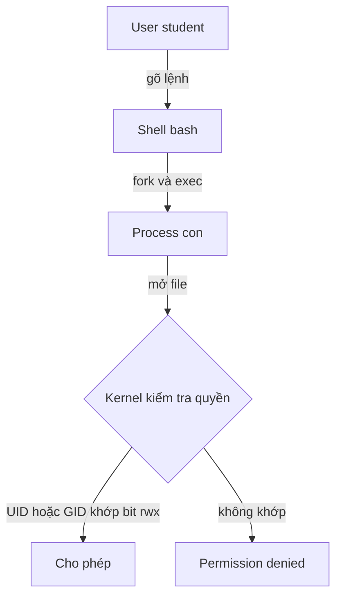
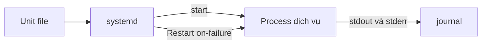

# Buổi 04 – Linux Administration

Tuần 2 · Giai đoạn 1 – Engineering Foundation · Slide: [Slide buổi 04](../../slides/01-foundation/session-04.md)

> **Tóm tắt:** Tạo user và group, phân quyền thư mục dùng chung bằng chmod/chown/setgid, quản lý process, biến môi trường và một systemd service trên WSL2 Ubuntu.

## Mục tiêu học tập

- Giải thích được mô hình quyền của Linux: owner, group, other và ba bit r, w, x trên file và thư mục.
- Tạo được user, group và thư mục dùng chung cho nhóm bằng `useradd`, `groupadd`, `chown`, `chmod` (kể cả bit setgid).
- Liệt kê, theo dõi và dừng được process bằng `ps`, `pgrep`, `kill`, `jobs`, hiểu khác biệt giữa SIGTERM và SIGKILL.
- Phân biệt được biến shell và biến môi trường (`export`), chứng minh bằng một process con.
- Chạy được một service đơn giản bằng `systemctl` và đọc log bằng `journalctl` (nếu WSL bật systemd).
- Chẩn đoán được lỗi `Permission denied` bằng `id`, `ls -l`, `namei -l` thay vì dùng `chmod 777`.

## Điều kiện cần

- Đã hoàn thành buổi 02 (WSL2 + Ubuntu) và buổi 03 (Linux CLI: `ls`, `cd`, `cat`, pipe).
- Làm việc trong WSL Ubuntu, thư mục home của WSL (`~`), không dùng `/mnt/c`.
- Tài khoản của bạn trong WSL có quyền `sudo`.

Kiểm tra nhanh:

```bash
whoami
sudo -v && echo "sudo OK"
cat /etc/os-release | head -n 2
ps -p 1 -o comm=
```

Kết quả mong đợi (rút gọn):

```text
student
sudo OK
PRETTY_NAME="Ubuntu 24.04.1 LTS"
NAME="Ubuntu"
init
```

Dòng cuối là `systemd` nếu WSL của bạn đã bật systemd, là `init` nếu chưa. Cả hai đều chấp nhận được; phần systemd ở L2 sẽ hướng dẫn bật.

## Vấn đề thực tế

CLB có một máy chủ nhỏ (hoặc một VM) dùng chung cho nhóm dự án Club Management. Ba thành viên cùng đẩy file cấu hình và log vào một thư mục. Hôm đầu mọi người dùng chung một tài khoản và `chmod 777` cho nhanh; tuần sau một bạn vô tình xóa `.env` của bạn khác, và không ai biết ai đã làm vì mọi thao tác đều mang cùng một tên người dùng.

Kiến thức Linux Administration giải quyết đúng chuyện này: mỗi người một user, nhóm dự án một group, thư mục chia sẻ có quyền vừa đủ, service chạy bằng tài khoản riêng với quyền tối thiểu, và khi có sự cố bạn biết tìm process nào đang chiếm CPU hay port. Mọi thứ về sau (Docker, Kubernetes) đều chạy trên nền các khái niệm này: container thực chất là process Linux, volume phụ thuộc quyền file, và nhiều lỗi `permission denied` trong container đến từ UID/GID.

## Khái niệm cốt lõi

### User, group và UID/GID

Linux nhận diện người dùng bằng số (UID), tên chỉ là nhãn. Mỗi user có một group chính (primary group) và có thể thuộc nhiều group phụ (supplementary groups).

| Khái niệm | File lưu | Lệnh xem | Ghi chú |
| --- | --- | --- | --- |
| User | `/etc/passwd` | `id`, `getent passwd tên` | UID 0 là root; user thường từ 1000 trở lên |
| Group | `/etc/group` | `groups`, `getent group tên` | Một user có thể thuộc nhiều group |
| Mật khẩu băm | `/etc/shadow` | chỉ root đọc được | Không bao giờ chép file này ra ngoài |
| Quyền quản trị | `/etc/sudoers` | `sudo -l` | Dùng `sudo` thay vì đăng nhập root |

### Quyền file: owner, group, other

`ls -l` hiển thị chuỗi 10 ký tự, ví dụ `drwxrws---`: ký tự đầu là loại (d thư mục, - file), tiếp theo là ba nhóm quyền cho owner, group, other.

| Bit | Với file | Với thư mục | Giá trị số |
| --- | --- | --- | --- |
| r | đọc nội dung | liệt kê tên file bên trong | 4 |
| w | sửa nội dung | tạo, xóa, đổi tên file bên trong | 2 |
| x | thực thi | đi vào thư mục (`cd`) và truy cập file bên trong | 1 |

Ví dụ `chmod 750 thu-muc`: owner = 7 (rwx), group = 5 (r-x), other = 0. Điểm hay nhầm: để xóa một file, bạn cần quyền `w` trên thư mục chứa nó, không phải trên file. Để vào sâu `/a/b/c`, bạn cần `x` trên mọi thư mục dọc đường.

### Bit đặc biệt và umask

| Cơ chế | Ý nghĩa | Ví dụ |
| --- | --- | --- |
| setgid trên thư mục (`g+s`, số 2000) | file mới tạo trong thư mục thừa hưởng group của thư mục, không phải group chính của người tạo | `chmod 2770 /srv/club-shared` |
| sticky bit (`+t`, số 1000) | chỉ owner của file (hoặc root) được xóa file trong thư mục | `/tmp` có `drwxrwxrwt` |
| umask | quyền bị "trừ đi" khi tạo file mới | umask `022` cho file 644, thư mục 755; umask `007` cho file 660, thư mục 770 |

### Process và tín hiệu

Mỗi chương trình đang chạy là một process có PID, chạy dưới một UID và có process cha (PPID). Process 1 là trình khởi tạo hệ thống (systemd hoặc init).

| Lệnh | Tác dụng |
| --- | --- |
| `ps aux` | liệt kê mọi process (user, PID, %CPU, %MEM, lệnh) |
| `pgrep -a tên` | tìm PID theo tên |
| `kill PID` | gửi SIGTERM (15): xin process tự dọn dẹp rồi thoát |
| `kill -9 PID` | gửi SIGKILL (9): hệ điều hành giết ngay, process không kịp dọn dẹp |
| `jobs`, `fg`, `bg` | quản lý job của shell hiện tại |

Quy tắc: luôn thử SIGTERM trước, chỉ dùng SIGKILL khi process không phản hồi.

### Biến môi trường

Biến shell chỉ tồn tại trong shell hiện tại. Biến được `export` mới được sao chép sang mọi process con. Đây chính là cơ chế mà `docker run -e` và `env:` trong GitHub Actions bắt chước. Ví dụ ứng dụng starter-project đọc `DB_PASSWORD` và `WEB_PORT` từ môi trường (file `.env` được Compose nạp vào).

### systemd và systemctl

systemd quản lý service dưới dạng unit file (thường ở `/etc/systemd/system/*.service`). `systemctl start|stop|restart|status|enable` điều khiển service, `journalctl -u tên` đọc log. WSL2 hỗ trợ systemd từ khi bật `systemd=true` trong `/etc/wsl.conf`.

## Kiến trúc và cách hoạt động



Giải thích từng bước:

1. Bạn gõ lệnh vào shell. Shell tạo process con (fork) và nạp chương trình (exec); process con kế thừa biến môi trường đã `export` và UID của bạn.
2. Khi process mở một file, kernel so sánh UID/GID của process với owner/group của file rồi áp dụng đúng một nhóm quyền: owner nếu UID khớp, nếu không thì group nếu GID khớp (kể cả group phụ), nếu không thì other.
3. Nhóm quyền được chọn quyết định kết quả; không có chuyện "cộng dồn" quyền của owner và group.
4. Kernel cũng kiểm tra bit `x` của mọi thư mục dọc đường dẫn.

Luồng của service dưới systemd:



systemd đọc unit, chạy process dưới `User=` đã khai báo, thu stdout/stderr vào journal, và khởi động lại khi process lỗi nếu có `Restart=`.

## Demo của mentor

Mục tiêu (khoảng 10 phút): cho lớp thấy quyền quyết định việc đọc/ghi và tín hiệu quyết định việc dừng process.

1. Xem quyền thực tế và nhận biết owner/group/other.

```bash
id
ls -ld /tmp /etc/shadow ~
```

Kết quả mong đợi (rút gọn):

```text
uid=1000(student) gid=1000(student) groups=1000(student),27(sudo)
-rw-r----- 1 root    shadow   1234 Oct 21 09:00 /etc/shadow
drwxr-x--- 8 student student  4096 Oct 21 09:00 /home/student
drwxrwxrwt 12 root    root    4096 Oct 21 09:00 /tmp
```

`ls` sắp xếp các đối số theo tên nên `/etc/shadow` hiện trước, `~` (đã mở rộng thành `/home/student`) ở giữa, `/tmp` sau cùng.

Hỏi lớp: vì sao `/tmp` có chữ `t` ở cuối? Vì sao bạn không `cat /etc/shadow` được?

2. Thử đọc file không có quyền.

```bash
cat /etc/shadow
sudo cat /etc/shadow | head -n 1 | cut -d: -f1
```

Kết quả mong đợi: dòng đầu `cat: /etc/shadow: Permission denied`; dòng sau chỉ in `root` (chỉ lấy tên user, không in hash).

3. Biến shell và biến môi trường.

```bash
CLUB=dsc
bash -c 'echo "con thay: [$CLUB]"'
export CLUB
bash -c 'echo "con thay: [$CLUB]"'
```

Kết quả mong đợi:

```text
con thay: []
con thay: [dsc]
```

Hỏi lớp: nếu quên `export` thì điều gì xảy ra với ứng dụng đọc `DB_PASSWORD`?

4. Process và tín hiệu.

```bash
sleep 300 &
pgrep -a sleep
kill $(pgrep -n sleep)
sleep 1; pgrep -a sleep || echo "da dung"
```

Kết quả mong đợi: dòng đầu in PID job (ví dụ `[1] 4242`), `pgrep` in `4242 sleep 300`, sau `kill` in `da dung`.

Hỏi lớp: lệnh `kill` mặc định gửi tín hiệu nào? Khi nào cần `kill -9`?

## Hands-on lab

Thời lượng: 60 phút. Phần 1 đến 4 là L1 (khoảng 40 phút); L2 làm tiếp trong 20 phút còn lại: bài 1 và bài 3 làm trên lớp, bài 2 (systemd) có thể hoàn thành ở nhà.

### Chuẩn bị

```bash
mkdir -p ~/devops-labs/lab-04/{source,screenshots,evidence}
cd ~/devops-labs/lab-04
date | tee evidence/command-output.txt
```

Từ giờ, mỗi lệnh quan trọng bạn chạy dạng `lệnh 2>&1 | tee -a evidence/command-output.txt` để có bằng chứng nộp bài.

Tên dùng trong lab: user `clb-dev1`, `clb-dev2` (thành viên nhóm), `clb-guest` (người ngoài nhóm), group `clbdev`, thư mục `/srv/club-shared`.

### Phần 1 – Tạo group và user

1. Tạo group nhóm dự án:

```bash
sudo groupadd clbdev
getent group clbdev
```

Kết quả mong đợi: `clbdev:x:1001:` (số GID có thể khác).

2. Tạo ba user có thư mục home và shell bash:

```bash
sudo useradd -m -s /bin/bash clb-dev1
sudo useradd -m -s /bin/bash clb-dev2
sudo useradd -m -s /bin/bash clb-guest
```

Vì sao dùng `useradd -m`: mặc định `useradd` không tạo thư mục home. Các user này chưa có mật khẩu nên không đăng nhập trực tiếp được; ta sẽ chuyển sang họ bằng `sudo -u`, đủ cho bài lab và không phải lưu mật khẩu nào.

3. Thêm hai thành viên vào group phụ `clbdev`:

```bash
sudo usermod -aG clbdev clb-dev1
sudo usermod -aG clbdev clb-dev2
id clb-dev1
id clb-guest
```

Kết quả mong đợi:

```text
uid=1001(clb-dev1) gid=1002(clb-dev1) groups=1002(clb-dev1),1001(clbdev)
uid=1003(clb-guest) gid=1004(clb-guest) groups=1004(clb-guest)
```

Vì sao có `-a`: thiếu `-a`, `usermod -G` thay toàn bộ group phụ hiện có bằng danh sách mới.

### Phần 2 – Thư mục dùng chung với setgid

1. Tạo thư mục, đặt owner và quyền:

```bash
sudo mkdir -p /srv/club-shared
sudo chown root:clbdev /srv/club-shared
sudo chmod 2770 /srv/club-shared
ls -ld /srv/club-shared
```

Kết quả mong đợi: `drwxrws--- 2 root clbdev 4096 ... /srv/club-shared`. Chữ `s` ở nhóm group là setgid; nhóm other là `---` nên người ngoài không vào được.

2. Kiểm tra từng user. Thư mục home của bạn có quyền `750` nên user khác không vào được; hãy đứng ở thư mục trung tính trước để tránh cảnh báo về thư mục hiện tại, rồi quay lại sau:

```bash
cd /tmp
sudo -u clb-dev1 bash -c 'umask 007; touch /srv/club-shared/config-dev1.env && echo "dev1 ghi OK"'
sudo -u clb-dev2 bash -c 'echo "dev2 doc:"; ls -l /srv/club-shared'
sudo -u clb-guest ls /srv/club-shared
```

Kết quả mong đợi:

```text
dev1 ghi OK
dev2 doc:
total 0
-rw-rw---- 1 clb-dev1 clbdev 0 Oct 21 09:20 config-dev1.env
ls: cannot open directory '/srv/club-shared': Permission denied
```

Sau bước này chạy `cd ~/devops-labs/lab-04` để quay lại thư mục lab.

Vì sao file có group `clbdev` mà không phải `clb-dev1`: nhờ setgid, file mới thừa hưởng group của thư mục. Vì sao quyền `rw-rw----`: ta đặt `umask 007` trong lệnh của dev1 để group được ghi. Với umask mặc định `022`, file sẽ là `rw-r--r--` và dev2 chỉ đọc được.

3. Chứng minh vai trò của setgid: tạo thư mục thứ hai không có setgid để so sánh.

```bash
sudo mkdir /srv/club-nosgid
sudo chown root:clbdev /srv/club-nosgid
sudo chmod 770 /srv/club-nosgid
sudo -u clb-dev1 touch /srv/club-nosgid/a.txt
ls -l /srv/club-nosgid
```

Kết quả mong đợi: `-rw-r--r-- 1 clb-dev1 clb-dev1 0 ... a.txt`. Group là `clb-dev1`, không phải `clbdev`: dev2 sẽ không sửa được file này. Đó là lý do thư mục chia sẻ cần setgid.

### Phần 3 – Process: tìm và dừng

1. Chạy hai process nền và quan sát:

```bash
sleep 600 &
sleep 601 &
jobs
ps -o pid,ppid,user,stat,cmd -C sleep
```

Kết quả mong đợi (rút gọn):

```text
[1]-  Running   sleep 600 &
[2]+  Running   sleep 601 &
  PID  PPID USER     STAT CMD
 5101  4000 student  S    sleep 600
 5102  4000 student  S    sleep 601
```

PPID chính là PID của shell bạn đang dùng (`echo $$`).

2. Dừng nhẹ nhàng rồi kiểm tra:

```bash
kill %1
sleep 1
jobs
```

Kết quả mong đợi: `[1]- Terminated sleep 600`. SIGTERM đã đủ.

3. Một process "cứng đầu" bỏ qua SIGTERM:

```bash
bash -c 'trap "" TERM; sleep 700' &
sleep 1
kill $(pgrep -n -f "sleep 700")
pgrep -a -f "sleep 700"
```

Kết quả mong đợi: `sleep 700` vẫn còn, vì `trap "" TERM` đặt SIGTERM ở chế độ bỏ qua và chế độ này được process con kế thừa. Dọn bằng cách (SIGKILL cho process cứng đầu, SIGTERM thường qua `kill %2` cho `sleep 601` còn lại; không dùng `pkill sleep` vì nó dừng mọi process tên `sleep` của bạn):

```bash
pkill -9 -f "sleep 700"
kill %2
sleep 1
pgrep -af "sleep 60[01]|sleep 700" || echo "sach"
```

Vì sao ở đây dùng `-9`: process không thể bắt hoặc bỏ qua SIGKILL, nhưng đổi lại không có cơ hội dọn dẹp (đóng file, xóa file tạm). Trong thực tế chỉ dùng khi SIGTERM thất bại.

### Phần 4 – Biến môi trường cho process con

1. Mô phỏng cấu hình của backend starter-project:

```bash
DB_PASSWORD=doi-mat-khau-that
bash -c 'echo "khong export: [${DB_PASSWORD:-trong}]"'
export DB_PASSWORD
bash -c 'echo "da export: [${DB_PASSWORD:-trong}]"'
env | grep -c '^DB_PASSWORD='
unset DB_PASSWORD
```

Kết quả mong đợi: `khong export: [trong]`, `da export: [doi-mat-khau-that]`, `1`. Giá trị trên chỉ là placeholder; mật khẩu thật nằm trong `.env` không commit.

2. Biến chỉ cho một lệnh duy nhất:

```bash
WEB_PORT=8081 bash -c 'echo "WEB_PORT=$WEB_PORT"'
echo "sau lenh: [${WEB_PORT:-chua dat}]"
```

Kết quả mong đợi: `WEB_PORT=8081` rồi `sau lenh: [chua dat]`. Cú pháp `BIEN=giatri lenh` chỉ áp dụng cho lệnh đó.

### Dọn dẹp (làm sau khi đã chụp bằng chứng, trước khi sang L2 nếu muốn)

```bash
sudo rm -rf /srv/club-shared /srv/club-nosgid
sudo userdel -r clb-dev1; sudo userdel -r clb-dev2; sudo userdel -r clb-guest
sudo groupdel clbdev
```

Cảnh báo: `rm -rf` với `sudo` rất nguy hiểm; đọc kỹ đường dẫn trước khi nhấn Enter. Nếu `userdel` báo user đang có process chạy, dừng process đó trước. Cảnh báo `mail spool ... not found` là bình thường và có thể bỏ qua.

### L1 – Foundation: checklist hoàn thành

- [ ] Tạo được group `clbdev` và ba user, `id` cho thấy dev1, dev2 thuộc `clbdev`, guest thì không.
- [ ] Thư mục `/srv/club-shared` có quyền `drwxrws---`, owner `root:clbdev`.
- [ ] dev1 tạo file, dev2 đọc được, guest bị `Permission denied`; có output trong `evidence/command-output.txt`.
- [ ] So sánh được thư mục có và không có setgid, giải thích khác biệt về group của file mới.
- [ ] Dừng được process bằng `kill` và `pkill -9`, giải thích khi nào dùng cái nào.
- [ ] Chứng minh được khác biệt biến shell và biến đã `export` bằng `bash -c`.

### L2 – Engineering: thử thách tự làm

Bài 1 – Script kiểm tra tài nguyên (khoảng 10 phút). Viết `source/resource-check.sh` in tải CPU, % RAM, % disk và cảnh báo khi vượt ngưỡng; ngưỡng đọc từ biến môi trường `MEM_LIMIT`, `DISK_LIMIT` (mặc định 85). Tiêu chí hoàn thành:

- [ ] Script có `set -euo pipefail`, chạy được bằng `bash source/resource-check.sh`.
- [ ] Đặt `MEM_LIMIT=1 bash source/resource-check.sh` thì in dòng `WARN`.
- [ ] Bạn giải thích được từng lệnh `awk` trong script (không chép nguyên mẫu mà không hiểu).

Bạn có thể tham khảo bản mẫu `examples/linux/resource-check.sh` sau khi tự thử.

<details>
<summary>Gợi ý</summary>

- RAM: `free | awk '/Mem:/ {printf "%d", $3/$2*100}'` (cột used chia cột total).
- Disk: `df / | awk 'NR==2 {gsub("%","",$5); print $5}'`.
- Giá trị mặc định cho biến: `${MEM_LIMIT:-85}`.
- Với `set -e`, câu `[ "$a" -ge "$b" ] && echo ...` trả mã khác 0 khi điều kiện sai; cuối script nên có `exit 0` hoặc dùng `if ... then ... fi`.

</details>

<details>
<summary>Lời giải</summary>

```bash
#!/usr/bin/env bash
set -euo pipefail
MEM_LIMIT=${MEM_LIMIT:-85}
DISK_LIMIT=${DISK_LIMIT:-85}

mem=$(free | awk '/Mem:/ {printf "%d", $3/$2*100}')
disk=$(df / | awk 'NR==2 {gsub("%","",$5); print $5}')
echo "load: $(cut -d' ' -f1-3 /proc/loadavg)"
echo "mem:  ${mem}%"
echo "disk: ${disk}%"
if [ "$mem" -ge "$MEM_LIMIT" ]; then echo "WARN: memory above ${MEM_LIMIT}%"; fi
if [ "$disk" -ge "$DISK_LIMIT" ]; then echo "WARN: disk above ${DISK_LIMIT}%"; fi
```

</details>

Bài 2 – Chạy script như một systemd service (khoảng 10 phút). Điều kiện: `systemctl is-system-running` trả về `running` hoặc `degraded`. Nếu báo lỗi hoặc `offline`, bật systemd:

```bash
sudo tee /etc/wsl.conf > /dev/null <<'EOF'
[boot]
systemd=true
EOF
```

Sau đó chạy `wsl --shutdown` trong PowerShell của Windows, mở lại Ubuntu. Lưu ý: lệnh trên ghi đè `/etc/wsl.conf`; nếu file đã có nội dung, hãy thêm mục `[boot]` thay vì ghi đè.

Yêu cầu: tạo unit `club-resource-check.service` chạy script mỗi 30 giây, tiêu chí hoàn thành:

- [ ] `systemctl status club-resource-check` hiển thị `active (running)`.
- [ ] `sudo journalctl -u club-resource-check -n 5 --no-pager` thấy output của script.
- [ ] Service chạy bằng user `clb-dev1` (tạo lại user nếu đã dọn), không phải root.
- [ ] Khi `sudo kill -9` process chính, systemd tự khởi động lại.

<details>
<summary>Gợi ý</summary>

- Copy script vào `/opt/club/resource-check.sh` và `chmod 755`; user của service phải đọc và thực thi được cả đường dẫn.
- Unit `Type=simple` cần một tiến trình chạy mãi: bọc script trong `bash -c 'while true; do ...; sleep 30; done'`.
- Sau khi tạo hoặc sửa unit phải chạy `sudo systemctl daemon-reload`.

</details>

<details>
<summary>Lời giải</summary>

```bash
sudo mkdir -p /opt/club
sudo cp source/resource-check.sh /opt/club/resource-check.sh
sudo chmod 755 /opt/club/resource-check.sh
sudo tee /etc/systemd/system/club-resource-check.service > /dev/null <<'EOF'
[Unit]
Description=Club resource check loop

[Service]
User=clb-dev1
ExecStart=/bin/bash -c 'while true; do /opt/club/resource-check.sh; sleep 30; done'
Restart=on-failure
RestartSec=3

[Install]
WantedBy=multi-user.target
EOF
sudo systemctl daemon-reload
sudo systemctl start club-resource-check
systemctl status club-resource-check --no-pager
sudo journalctl -u club-resource-check -n 5 --no-pager
```

Kiểm tra tự khởi động lại: `sudo kill -9 $(systemctl show -p MainPID --value club-resource-check)`, đợi 3 giây rồi `systemctl status` sẽ thấy PID mới. Dọn: `sudo systemctl stop club-resource-check` và xóa file unit rồi `daemon-reload`.

</details>

Bài 3 – Tự viết `source/permissions-notes.md` (5 dòng) giải thích vì sao không dùng `chmod 777` cho `/srv/club-shared` và bạn dùng cơ chế nào thay thế. Bản script tham khảo cho các thao tác quyền: `examples/linux/permissions-lab.sh`.

## Phá lỗi và debug

Tình huống: user mới được thêm vào group nhưng vẫn bị `Permission denied`.

Cách phá (tạo lại môi trường nếu đã dọn ở trên):

```bash
getent group clbdev > /dev/null || sudo groupadd clbdev
sudo useradd -m -s /bin/bash clb-dev3
sudo mkdir -p /srv/club-shared && sudo chown root:clbdev /srv/club-shared && sudo chmod 2770 /srv/club-shared
sudo -u clb-dev3 ls /srv/club-shared
```

Triệu chứng: `ls: cannot open directory '/srv/club-shared': Permission denied`, dù bạn "chắc chắn" đã cấp quyền cho nhóm.

Hướng điều tra theo từng bước:

1. Xem user có thực sự thuộc group không: `id clb-dev3`. Nếu không thấy `clbdev`, user chưa được thêm.
2. Xem quyền thư mục và owner: `ls -ld /srv/club-shared`. Group phải là `clbdev` và có `rwx`.
3. Xem mọi thư mục dọc đường đi: `namei -l /srv/club-shared`. Một thư mục cha thiếu `x` cũng gây lỗi.
4. Sửa đúng gốc: `sudo usermod -aG clbdev clb-dev3`, rồi kiểm tra bằng một phiên mới: `sudo -u clb-dev3 ls /srv/club-shared`.
5. Lưu ý quan trọng: nếu user đã đăng nhập sẵn, phiên hiện tại vẫn mang danh sách group cũ. Phải đăng xuất rồi đăng nhập lại (hoặc `newgrp clbdev`) thì group mới có hiệu lực. Với bản thân bạn trong WSL, mở terminal mới (hoặc `wsl --shutdown` nếu cần).

Nguyên nhân gốc: kernel dùng danh sách group được nạp lúc phiên bắt đầu; sửa `/etc/group` không đổi các phiên đang chạy. Cách phòng tránh: ghi quy trình onboarding thành script, luôn kiểm tra bằng `id` trong phiên mới, và tuyệt đối không "chữa cháy" bằng `chmod 777`, vì làm vậy xóa luôn ranh giới giữa nhóm và người ngoài.

Dọn: `sudo userdel -r clb-dev3`.

## Lỗi thường gặp

| Triệu chứng | Nguyên nhân | Cách xử lý |
| --- | --- | --- |
| `Permission denied` dù đã thêm vào group | Phiên hiện tại chưa nạp group mới | Đăng nhập lại, hoặc `newgrp clbdev`; kiểm tra bằng `id` |
| File trong thư mục chung có group là tên cá nhân | Thư mục thiếu setgid | `sudo chmod g+s /srv/club-shared`; file cũ sửa bằng `chgrp` |
| Dev khác chỉ đọc được file, không sửa được | umask 022 tạo file `rw-r--r--` | Dùng umask 002 hoặc 007, hoặc `chmod g+w` file |
| `usermod -G` làm user mất các group khác (như sudo) | Thiếu cờ `-a` | Dùng `usermod -aG`; khôi phục bằng `usermod -aG sudo tên` |
| `kill` xong process vẫn còn | Process bỏ qua SIGTERM hoặc chỉ giết nhầm process cha | Kiểm tra `ps`, thử `kill -9` làm phương án cuối |
| Biến `export` ở terminal này không thấy ở terminal khác | Biến môi trường chỉ truyền cho process con | Ghi vào `~/.bashrc` hoặc file `.env` rồi nạp lại |
| `systemctl` báo `System has not been booted with systemd` | WSL chưa bật systemd | Thêm `systemd=true` vào `/etc/wsl.conf`, chạy `wsl --shutdown` |
| Service `status=203/EXEC` | Đường dẫn ExecStart sai hoặc thiếu quyền thực thi | Kiểm tra `ls -l`, `chmod 755`, đường dẫn tuyệt đối |

## Tự kiểm tra

1. File có quyền `640`, owner `alice`, group `dev`. Bob thuộc group `dev` có đọc, ghi được không?

<details>
<summary>Đáp án</summary>

Bob đọc được nhưng không ghi được. Quyền `640` gồm owner = 6 (rw-), group = 4 (r--), other = 0. Bob thuộc group `dev` nên áp dụng nhóm group, chỉ có `r`.

</details>

2. Vì sao xóa một file cần quyền `w` trên thư mục chứa nó?

<details>
<summary>Đáp án</summary>

Xóa file là sửa danh sách tên trong thư mục, nên cần `w` (và `x`) trên thư mục. Quyền của chính file không quyết định. Sticky bit là cơ chế thu hẹp điều này.

</details>

3. `chmod 2770` khác `chmod 770` ở đâu và vì sao quan trọng với thư mục chung?

<details>
<summary>Đáp án</summary>

Số 2 đầu tiên bật setgid: file mới thừa hưởng group của thư mục, nên mọi thành viên cùng group có quyền như nhau với file của nhau.

</details>

4. Khác biệt giữa `kill PID` và `kill -9 PID`?

<details>
<summary>Đáp án</summary>

`kill` gửi SIGTERM để process tự dọn dẹp và thoát, có thể bắt hoặc bỏ qua; `kill -9` gửi SIGKILL, kernel giết ngay, không thể bắt, nhưng có thể để lại file tạm hoặc dữ liệu dang dở.

</details>

5. Bạn chạy `API_KEY=abc` rồi `node app.js`, ứng dụng không thấy `API_KEY`. Vì sao và sửa thế nào?

<details>
<summary>Đáp án</summary>

Biến chưa được `export` nên không truyền cho process con. Sửa: `export API_KEY=abc` hoặc `API_KEY=abc node app.js`.

</details>

6. Tình huống: thành viên mới báo `Permission denied` ở thư mục dự án dù bạn đã `usermod -aG` cho bạn ấy từ 10 phút trước. Bạn làm gì đầu tiên?

<details>
<summary>Đáp án</summary>

Chạy `id` trong terminal của bạn ấy: nếu chưa thấy group thì phiên cũ chưa nạp group; yêu cầu đăng nhập lại. Sau đó kiểm tra `ls -ld` và `namei -l`. Không chmod 777.

</details>

7. Vì sao service nên chạy bằng user riêng thay vì root?

<details>
<summary>Đáp án</summary>

Nguyên tắc quyền tối thiểu: nếu service bị khai thác, kẻ tấn công chỉ có quyền của user đó. Đây cũng là lý do Dockerfile của backend starter-project dùng user không phải root.

</details>

## Nộp bài

Nộp vào `lab-04/` trong repository cá nhân (ví dụ `devops-labs`) theo `templates/lab-template.md`:

- [ ] `README.md` trả lời đủ 7 câu: lab giải quyết vấn đề gì, kiến thức đã dùng, các bước, kết quả mong đợi, lỗi đã gặp, cách khắc phục, có thể cải thiện gì.
- [ ] `evidence/command-output.txt` chứa output của `id`, `ls -ld /srv/club-shared`, thử quyền của ba user, `ps`, `kill` và thí nghiệm biến môi trường.
- [ ] `report.md` ghi mức đã làm (L1 hoặc L2), một lỗi bạn đã gặp thật và cách điều tra.
- [ ] `source/` có `resource-check.sh` (nếu làm L2), file unit `club-resource-check.service` và `permissions-notes.md`.
- [ ] `screenshots/` có ảnh kèm (chỉ bổ sung, không thay thế log).
- [ ] Đã kiểm tra không có mật khẩu, token hay nội dung `.env` thật nào trong repo.
- [ ] Đã dọn user, group, thư mục thử nghiệm hoặc ghi rõ lý do giữ lại.

## Recap

- Quyền Linux được xét theo đúng một nhóm: owner, group hoặc other; thư mục cần `x` để đi vào và `w` để thêm hoặc xóa file.
- Thư mục dùng chung của nhóm: group sở hữu + `chmod 2770` (setgid) + umask phù hợp, không bao giờ `777`.
- Sửa group của user chỉ có hiệu lực với phiên đăng nhập mới.
- Process dừng bằng SIGTERM trước, SIGKILL là phương án cuối.
- Chỉ biến đã `export` mới truyền sang process con; đó là cách cấu hình ứng dụng như `DB_PASSWORD` và `WEB_PORT`.
- Service chạy dưới systemd với user riêng, log xem bằng `journalctl -u`.

## Tài liệu tham khảo

- [Ubuntu Server: User management](https://documentation.ubuntu.com/server/how-to/security/user-management/)
- [man7: chmod(1)](https://man7.org/linux/man-pages/man1/chmod.1.html)
- [man7: credentials(7)](https://man7.org/linux/man-pages/man7/credentials.7.html)
- [man7: signal(7)](https://man7.org/linux/man-pages/man7/signal.7.html)
- [systemd.service](https://www.freedesktop.org/software/systemd/man/latest/systemd.service.html)
- [Microsoft Learn: Use systemd to manage Linux services with WSL](https://learn.microsoft.com/en-us/windows/wsl/systemd)
