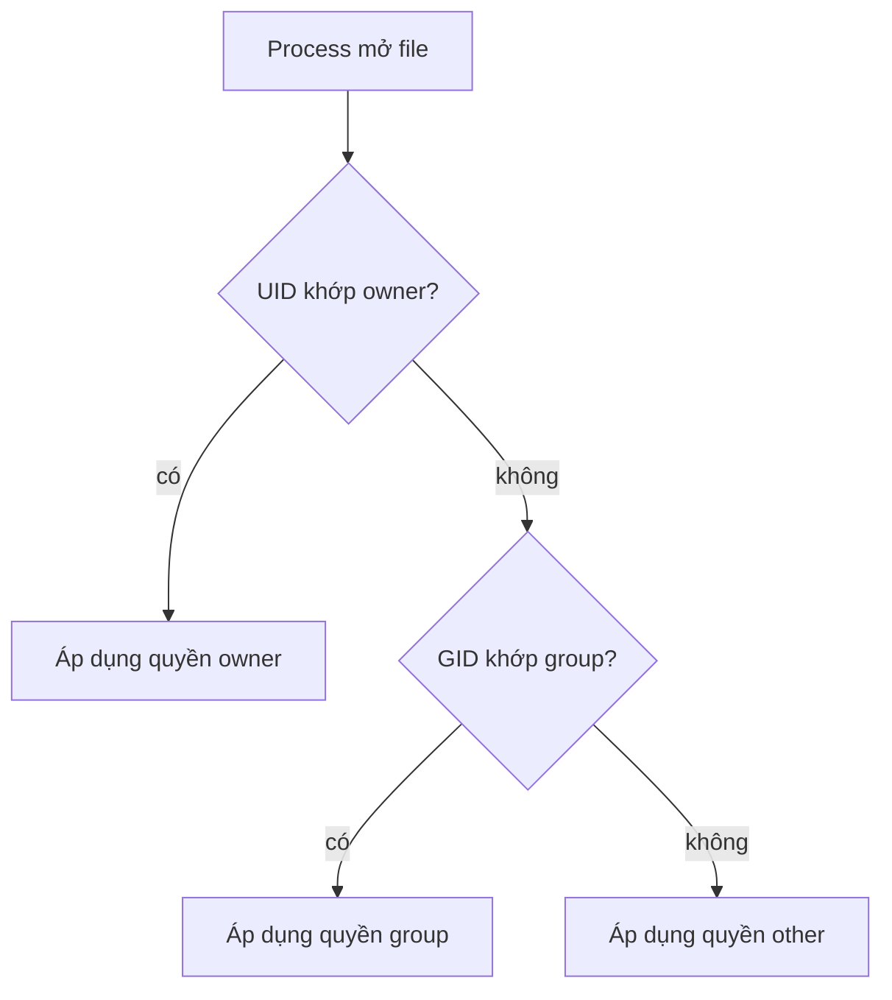

# Buổi 04 – Linux Administration

Tuần 2/16 · Giai đoạn 1 – Engineering Foundation · Buổi 04/32

[Slide](../../slides/01-foundation/session-04.md) · [Bài tập tuần](../../assignments/weekly/week-02.md) · [Hub tuần](README.md)

> **Tóm tắt:** Tạo user và group, phân quyền thư mục dùng chung bằng chmod, chown, setgid, dừng process bằng tín hiệu và hiểu biến môi trường trên WSL2 Ubuntu.

::: tip Buổi này bạn làm gì
**Bạn sẽ tạo ra:** một thư mục dùng chung cho nhóm, nơi hai thành viên cùng ghi được còn người ngoài nhóm bị chặn, không dùng `chmod 777`.

**Thời gian thật:** đọc 15 phút, lab bắt buộc 60 phút, systemd và thử thách tùy chọn làm ở nhà. **Cần chuẩn bị:**
- [ ] Đã xong [Buổi 03 – Linux CLI](session-03.md) (`ls`, `cd`, `cat`, pipe); chưa quen terminal thì đọc [Terminal cơ bản](../../resources/terminal-101.md).
- [ ] Tài khoản WSL của bạn có quyền `sudo`; cài đặt theo [Hướng dẫn cài đặt](../../resources/setup-guide.md); có repo `devops-labs` theo [Tài khoản GitHub và repo](../../resources/setup-github.md).
- [ ] Làm trong WSL Ubuntu, thư mục `~`, không dùng `/mnt/c`.

**Sản phẩm phải nộp** (thư mục `lab-04/`, xem [Nộp bài](#nop-bai)): `README.md` và `report.md`; `evidence/command-output.txt` có `id`, `ls -ld /srv/club-shared`, thử quyền của ba user, `ps`, `kill` và thí nghiệm biến môi trường; xác nhận đã dọn môi trường thử nghiệm.

**Đi nhanh:** Đọc (bên dưới) → [Làm lab](#hands-on-lab) → [Gặp lỗi?](#gap-loi) → [Tự kiểm tra](#tu-kiem-tra) → [Nộp bài](#nop-bai). Kẹt thì nhảy thẳng tới [Gặp lỗi?](#gap-loi).

**Từ mới trong buổi:**
- [UID, GID](../../resources/glossary.md): số định danh của user và group, tên chỉ là nhãn
- [Quyền rwx](../../resources/glossary.md): ba bit đọc, ghi, thực thi cho owner, group, other
- [setgid](../../resources/glossary.md): bit làm file mới thừa hưởng group của thư mục
- [Process và PID](../../resources/glossary.md): chương trình đang chạy và số định danh của nó
- [Tín hiệu SIGTERM, SIGKILL](../../resources/glossary.md): lời xin dừng nhẹ và lệnh giết ngay
- [Biến môi trường](../../resources/glossary.md): biến được truyền sang process con nhờ `export`
:::

Trên lớp, mentor demo trước; tự học thì làm thẳng phần Làm lab.

## Vấn đề thực tế

CLB có một máy chủ nhỏ dùng chung cho nhóm dự án Club Management. Ba thành viên cùng đẩy file cấu hình và log vào một thư mục. Hôm đầu mọi người dùng chung một tài khoản và `chmod 777` cho nhanh; tuần sau một bạn vô tình xóa `.env` của bạn khác, và không ai biết ai làm vì mọi thao tác mang cùng một tên người dùng.

Cách làm đúng: mỗi người một user, nhóm dự án một group, thư mục chung có quyền vừa đủ, và khi có sự cố bạn biết tìm process nào đang chiếm CPU hay port. Docker và Kubernetes về sau chạy trên nền các khái niệm này: container thực chất là process Linux, và nhiều lỗi `permission denied` trong container đến từ UID/GID.

## Khái niệm cốt lõi

### User, group và UID/GID

Linux nhận diện người dùng bằng số (UID), tên chỉ là nhãn. Mỗi user có một group chính và có thể thuộc nhiều group phụ. Ví von: UID là số căn cước, group là tổ công tác bạn thuộc về. Xem bằng `id`; `sudo` cho phép chạy lệnh với quyền quản trị mà không phải đăng nhập root.

### Quyền file: owner, group, other

`ls -l` hiển thị chuỗi như `drwxrws---`: ký tự đầu là loại (d thư mục), tiếp theo là quyền cho owner, group, other. Ba bit: r = 4 (đọc), w = 2 (ghi), x = 1 (thực thi, với thư mục là đi vào). `chmod 750` nghĩa là owner rwx, group r-x, other không có gì. Ví von: ba lớp cửa, khóa riêng cho chủ nhà, người nhà, khách. Hay nhầm: xóa file cần quyền `w` trên **thư mục chứa nó**, không phải trên file.



Kernel chỉ chọn **một** nhóm quyền, không cộng dồn. Group phụ cũng được tính, và kernel còn kiểm tra `x` của mọi thư mục dọc đường dẫn.

### setgid và umask: thư mục dùng chung

setgid trên thư mục (`chmod 2770`) làm file mới thừa hưởng group của thư mục thay vì group chính của người tạo. umask là quyền bị "trừ đi" khi tạo file: `022` cho file 644, `007` cho file 660. Công thức thư mục chung của nhóm: group sở hữu + `2770` + umask `007` hoặc `002`. Ví von: setgid là tờ giấy dán trên cửa phòng "mọi thứ tạo ra ở đây thuộc tổ này".

### Process và tín hiệu

Mỗi chương trình đang chạy là một process có PID, chạy dưới một UID và có process cha (PPID). `kill PID` gửi SIGTERM (15): xin process tự dọn dẹp rồi thoát. `kill -9 PID` gửi SIGKILL (9): kernel giết ngay, process không kịp dọn dẹp. Quy tắc: thử SIGTERM trước, SIGKILL là phương án cuối.

### Biến môi trường

Biến shell chỉ sống trong shell hiện tại; biến được `export` mới được sao chép sang process con. Đây là cơ chế `docker run -e` và `env:` trong GitHub Actions bắt chước, và là cách ứng dụng starter-project đọc `DB_PASSWORD`, `WEB_PORT`.

::: details Tìm hiểu thêm (đọc sau)
**File lưu thông tin:** user ở `/etc/passwd`, group ở `/etc/group`, mật khẩu băm ở `/etc/shadow` (chỉ root đọc, không bao giờ chép ra ngoài), quyền sudo ở `/etc/sudoers`. UID 0 là root, user thường từ 1000. Xem bằng `getent passwd tên`, `getent group tên`, `sudo -l`.

**Sticky bit** (`+t`, số 1000): chỉ owner của file (hoặc root) được xóa file trong thư mục; `/tmp` có `drwxrwxrwt`.

**Lệnh process khác:** `ps aux` liệt kê mọi process, `pgrep -a tên` tìm PID theo tên, `jobs`, `fg`, `bg` quản lý job của shell hiện tại.

**systemd** quản lý service bằng unit file (thường ở `/etc/systemd/system/*.service`): `systemctl start|stop|restart|status|enable` điều khiển, `journalctl -u tên` đọc log, `Restart=` khởi động lại khi lỗi. WSL2 hỗ trợ khi bật `systemd=true` trong `/etc/wsl.conf`. Phần thực hành systemd nằm ở [Buổi 04 – Thử thách thêm (L2)](session-04-challenge.md).
:::

## Hands-on lab

Thời lượng 60 phút: Chuẩn bị 5', Phần 1 8', Phần 2 15', Phần 3 12', Phần 4 8', dọn dẹp 5', ghi evidence 7'. Gặp lỗi ở đâu, xem [Gặp lỗi?](#gap-loi).

### Chuẩn bị (5 phút)

```bash
whoami
sudo -v && echo "sudo OK"
mkdir -p ~/devops-labs/lab-04/{source,screenshots,evidence}
cd ~/devops-labs/lab-04
date | tee evidence/command-output.txt
```

Kết quả mong đợi: tên user của bạn, `sudo OK`, rồi một dòng ngày giờ. Từ giờ, lệnh quan trọng chạy dạng `lệnh 2>&1 | tee -a evidence/command-output.txt` để có bằng chứng nộp bài (nhớ `-a`, thiếu sẽ ghi đè). Tên dùng trong lab: user `clb-dev1`, `clb-dev2` (thành viên), `clb-guest` (người ngoài), group `clbdev`, thư mục `/srv/club-shared`.

### Phần 1: Tạo group và user (8 phút)

```bash
sudo groupadd clbdev
getent group clbdev
sudo useradd -m -s /bin/bash clb-dev1
sudo useradd -m -s /bin/bash clb-dev2
sudo useradd -m -s /bin/bash clb-guest
sudo usermod -aG clbdev clb-dev1
sudo usermod -aG clbdev clb-dev2
id clb-dev1
id clb-guest
```

Kết quả mong đợi (số UID, GID có thể khác):

```text
clbdev:x:1001:
uid=1001(clb-dev1) gid=1002(clb-dev1) groups=1002(clb-dev1),1001(clbdev)
uid=1003(clb-guest) gid=1004(clb-guest) groups=1004(clb-guest)
```

`useradd -m` tạo thư mục home (mặc định không tạo). Các user này chưa có mật khẩu nên ta chuyển sang họ bằng `sudo -u`, không phải lưu mật khẩu nào. `-a` trong `usermod -aG` là bắt buộc: thiếu `-a`, `-G` thay toàn bộ group phụ hiện có ([Gặp lỗi?](#gap-loi)).

::: tip Kiểm tra: bạn đúng khi
`id clb-dev1` có `clbdev` trong danh sách group, còn `id clb-guest` thì không.
:::

### Phần 2: Thư mục dùng chung với setgid (15 phút)

**Bước 2.1.** Tạo thư mục, đặt owner và quyền:

```bash
sudo mkdir -p /srv/club-shared
sudo chown root:clbdev /srv/club-shared
sudo chmod 2770 /srv/club-shared
ls -ld /srv/club-shared
```

Kết quả mong đợi: `drwxrws--- 2 root clbdev 4096 ... /srv/club-shared`. Chữ `s` ở nhóm group là setgid; nhóm other là `---` nên người ngoài không vào được.

**Bước 2.2.** Thử từng user. Home của bạn có quyền `750` nên user khác không vào được; đứng ở thư mục trung tính `/tmp` trước:

```bash
cd /tmp
sudo -u clb-dev1 bash -c 'umask 007; touch /srv/club-shared/config-dev1.env && echo "dev1 ghi OK"'
sudo -u clb-dev2 bash -c 'echo "dev2 doc:"; ls -l /srv/club-shared'
sudo -u clb-guest ls /srv/club-shared
cd ~/devops-labs/lab-04
```

Kết quả mong đợi:

```text
dev1 ghi OK
dev2 doc:
total 0
-rw-rw---- 1 clb-dev1 clbdev 0 Oct 21 09:20 config-dev1.env
ls: cannot open directory '/srv/club-shared': Permission denied
```

File có group `clbdev` (không phải `clb-dev1`) nhờ setgid, và quyền `rw-rw----` nhờ `umask 007`. Với umask mặc định `022`, file sẽ là `rw-r--r--` và dev2 chỉ đọc được.

**Bước 2.3.** Đối chứng: tạo thư mục thứ hai không có setgid.

```bash
sudo mkdir /srv/club-nosgid
sudo chown root:clbdev /srv/club-nosgid
sudo chmod 770 /srv/club-nosgid
sudo -u clb-dev1 touch /srv/club-nosgid/a.txt
ls -l /srv/club-nosgid
```

Kết quả mong đợi: `-rw-r--r-- 1 clb-dev1 clb-dev1 0 ... a.txt`. Group là `clb-dev1`, nên dev2 không sửa được file này. Đó là lý do thư mục chia sẻ cần setgid.

::: tip Kiểm tra: bạn đúng khi
dev1 ghi được, dev2 đọc được, guest bị `Permission denied`; file trong `club-shared` mang group `clbdev`, file trong `club-nosgid` mang group `clb-dev1`.
:::

### Phần 3: Process, tìm và dừng (12 phút)

**Bước 3.1.** Chạy hai process nền và quan sát:

```bash
sleep 600 &
sleep 601 &
jobs
ps -o pid,ppid,user,stat,cmd -C sleep
```

Kết quả mong đợi (rút gọn): hai job `Running` và hai dòng `sleep 600`, `sleep 601`. PPID chính là PID của shell bạn đang dùng (`echo $$`).

**Bước 3.2.** Dừng nhẹ nhàng rồi kiểm tra:

```bash
kill %1
sleep 1
jobs
```

Kết quả mong đợi: `[1]- Terminated sleep 600`. SIGTERM đã đủ.

**Bước 3.3.** Một process "cứng đầu" bỏ qua SIGTERM:

```bash
bash -c 'trap "" TERM; sleep 700' &
sleep 1
kill $(pgrep -n -f "sleep 700")
pgrep -a -f "sleep 700"
```

Kết quả mong đợi: `sleep 700` vẫn còn, vì `trap "" TERM` đặt SIGTERM ở chế độ bỏ qua. Dọn bằng SIGKILL cho process cứng đầu và SIGTERM thường cho `sleep 601`:

```bash
pkill -9 -f "sleep 700"
kill %2
sleep 1
pgrep -af "sleep 60[01]|sleep 700" || echo "sach"
```

Dùng `-9` vì process không thể bắt hoặc bỏ qua SIGKILL, nhưng đổi lại không có cơ hội đóng file hay xóa file tạm. Không dùng `pkill sleep` vì nó dừng mọi process tên `sleep` của bạn.

::: tip Kiểm tra: bạn đúng khi
Lệnh cuối in `sach`, và bạn giải thích được vì sao `kill` thường không dừng được `sleep 700`.
:::

### Phần 4: Biến môi trường cho process con (8 phút)

```bash
DB_PASSWORD=doi-mat-khau-that
bash -c 'echo "khong export: [${DB_PASSWORD:-trong}]"'
export DB_PASSWORD
bash -c 'echo "da export: [${DB_PASSWORD:-trong}]"'
env | grep -c '^DB_PASSWORD='
unset DB_PASSWORD
WEB_PORT=8081 bash -c 'echo "WEB_PORT=$WEB_PORT"'
echo "sau lenh: [${WEB_PORT:-chua dat}]"
```

Kết quả mong đợi: `khong export: [trong]`, `da export: [doi-mat-khau-that]`, `1`, `WEB_PORT=8081`, `sau lenh: [chua dat]`. Giá trị mật khẩu chỉ là placeholder; mật khẩu thật nằm trong `.env` không commit. Cú pháp `BIEN=giatri lenh` chỉ áp dụng cho lệnh đó.

::: tip Kiểm tra: bạn đúng khi
Bạn thấy `[trong]` trước `export` và `[doi-mat-khau-that]` sau `export`.
:::

### Dọn dẹp (5 phút, sau khi đã chụp bằng chứng)

::: danger Cẩn thận với sudo rm -rf
`sudo rm -rf` không hỏi lại và không có thùng rác. Chỉ chạy trên đúng hai thư mục thử nghiệm của lab. Chạy `ls -d /srv/club-*` trước để thấy đúng hai thư mục này và đọc kỹ đường dẫn trước khi nhấn Enter.
:::

```bash
ls -d /srv/club-shared /srv/club-nosgid
sudo rm -rf /srv/club-shared /srv/club-nosgid
sudo userdel -r clb-dev1; sudo userdel -r clb-dev2; sudo userdel -r clb-guest
sudo groupdel clbdev
```

Nếu `userdel` báo user đang có process chạy, dừng process đó trước. Cảnh báo `mail spool ... not found` là bình thường. Nếu bạn định làm thử thách L2, có thể dọn sau.

### Checklist L1 (bắt buộc)

- [ ] Tạo được group `clbdev` và ba user, `id` cho thấy dev1, dev2 thuộc `clbdev`, guest thì không.
- [ ] Thư mục `/srv/club-shared` có quyền `drwxrws---`, owner `root:clbdev`.
- [ ] dev1 tạo file, dev2 đọc được, guest bị `Permission denied`; có output trong `evidence/command-output.txt`.
- [ ] So sánh được thư mục có và không có setgid, giải thích khác biệt về group của file mới.
- [ ] Dừng được process bằng `kill` và `pkill -9`, giải thích khi nào dùng cái nào.
- [ ] Chứng minh được khác biệt biến shell và biến đã `export` bằng `bash -c`.

Lệnh tự kiểm tra một dòng (chạy trước khi dọn; kết quả mong đợi `drwxrws--- root clbdev`):

```bash
stat -c '%A %U %G' /srv/club-shared
```

## Gặp lỗi?

| Triệu chứng | Nguyên nhân | Cách sửa |
| --- | --- | --- |
| `Permission denied` dù đã thêm vào group | Phiên hiện tại chưa nạp group mới (kernel dùng danh sách group lúc phiên bắt đầu) | Đăng nhập lại hoặc `newgrp clbdev`; kiểm tra bằng `id` trong phiên mới. Không chữa cháy bằng `chmod 777` |
| File trong thư mục chung có group là tên cá nhân | Thư mục thiếu setgid | `sudo chmod g+s /srv/club-shared`; file cũ sửa bằng `chgrp` |
| Dev khác chỉ đọc được file, không sửa được | umask 022 tạo file `rw-r--r--` | Dùng umask 002 hoặc 007, hoặc `chmod g+w` file |
| `usermod -G` làm user mất các group khác (như sudo) | Thiếu cờ `-a` | Dùng `usermod -aG`; khôi phục bằng `usermod -aG sudo tên` |
| `kill` xong process vẫn còn | Process bỏ qua SIGTERM, hoặc giết nhầm process cha | `ps` để xem lại; `kill -9` là phương án cuối |
| Biến `export` ở terminal này không thấy ở terminal khác | Biến môi trường chỉ truyền cho process con | Ghi vào `~/.bashrc` hoặc file `.env` rồi nạp lại |
| `sudo -u user ls ...` báo lỗi thư mục hiện tại | Home của bạn quyền `750` | `cd /tmp` rồi chạy lại |
| `userdel` báo user đang chạy process | Còn process của user đó | Dừng process rồi chạy lại `userdel -r` |
| `systemctl` báo `System has not been booted with systemd`, hoặc `status=203/EXEC` | WSL chưa bật systemd, hoặc đường dẫn `ExecStart` sai | Xem [Buổi 04 – Thử thách thêm (L2)](session-04-challenge.md) |

## Tự kiểm tra

1. File có quyền `640`, owner `alice`, group `dev`. Bob thuộc group `dev` có đọc, ghi được không?
2. Vì sao xóa một file cần quyền `w` trên thư mục chứa nó?
3. `chmod 2770` khác `chmod 770` ở đâu và vì sao quan trọng với thư mục chung?
4. Khác biệt giữa `kill PID` và `kill -9 PID`?
5. Bạn chạy `API_KEY=abc` rồi `node app.js`, ứng dụng không thấy `API_KEY`. Vì sao và sửa thế nào?

::: details Đáp án gợi ý
1. Bob đọc được nhưng không ghi được. `640` là owner rw-, group r--, other ---; Bob thuộc group `dev` nên áp dụng nhóm group, chỉ có `r`.
2. Xóa file là sửa danh sách tên trong thư mục, nên cần `w` (và `x`) trên thư mục. Quyền của chính file không quyết định.
3. Số 2 bật setgid: file mới thừa hưởng group của thư mục, nên mọi thành viên cùng group có quyền như nhau với file của nhau.
4. `kill` gửi SIGTERM để process tự dọn dẹp và thoát (có thể bắt hoặc bỏ qua); `kill -9` gửi SIGKILL, kernel giết ngay, không thể bắt, nhưng có thể để lại file tạm hoặc dữ liệu dang dở.
5. Biến chưa được `export` nên không truyền cho process con. Sửa: `export API_KEY=abc` hoặc `API_KEY=abc node app.js`.
:::

## Nộp bài

Nộp vào `lab-04/` trong repo `devops-labs` theo [mẫu nộp lab](../../templates/lab-template.md). Chưa dùng được Git thì upload trên web GitHub hoặc làm theo mục [Git trong 10 phút](../../curriculum/how-to-learn.md#git-10-phut); push và Pull Request thành thạo từ [Buổi 06 – Git & GitHub Workflow](../week-03/session-06.md). Chi tiết nhiệm vụ và bảng điểm: [Bài tập tuần 2](../../assignments/weekly/week-02.md).

- [ ] `README.md` trả lời đủ 7 câu (vấn đề, kiến thức, các bước, kết quả, lỗi đã gặp, cách khắc phục, cải thiện) và ghi level đã làm (L1/L2).
- [ ] `evidence/command-output.txt` có output của `id`, `ls -ld /srv/club-shared`, thử quyền của ba user, `ps`, `kill` và thí nghiệm biến môi trường; `screenshots/` có ảnh kèm (không thay log).
- [ ] `report.md` ghi một lỗi bạn đã gặp thật và cách điều tra; `source/` có file L2 (nếu làm).
- [ ] Không có mật khẩu, token hay nội dung `.env` thật trong repo; đã dọn user, group, thư mục thử nghiệm hoặc ghi rõ lý do giữ lại.

## Recap

- Quyền Linux xét theo đúng một nhóm (owner, group hoặc other); thư mục chung của nhóm dùng group sở hữu + `chmod 2770` + umask phù hợp, không bao giờ `777`.
- Sửa group chỉ có hiệu lực với phiên đăng nhập mới; process dừng bằng SIGTERM trước, SIGKILL là phương án cuối.
- Chỉ biến đã `export` mới truyền sang process con; systemd và script tài nguyên làm ở L2.

Buổi tiếp theo: [Buổi 05 – Networking Fundamentals](../week-03/session-05.md).

::: details Thử thách thêm (L2, tùy chọn, làm ở nhà)
Script `resource-check.sh`, chạy script như service systemd và ghi chú `permissions-notes.md`: xem [Buổi 04 – Thử thách thêm (L2)](session-04-challenge.md), có gợi ý từng bậc.
:::

::: details Phá lỗi nâng cao
Tình huống "user mới thêm vào group vẫn bị `Permission denied`" và cách điều tra bằng `id`, `ls -ld`, `namei -l`: xem phần cuối của [Buổi 04 – Thử thách thêm (L2)](session-04-challenge.md).
:::

::: details Tài liệu tham khảo
- [Ubuntu Server: User management](https://documentation.ubuntu.com/server/how-to/security/user-management/)
- [man7: chmod(1)](https://man7.org/linux/man-pages/man1/chmod.1.html)
- [man7: credentials(7)](https://man7.org/linux/man-pages/man7/credentials.7.html)
- [man7: signal(7)](https://man7.org/linux/man-pages/man7/signal.7.html)
- [systemd.service](https://www.freedesktop.org/software/systemd/man/latest/systemd.service.html)
- [Microsoft Learn: Use systemd to manage Linux services with WSL](https://learn.microsoft.com/en-us/windows/wsl/systemd)
:::
