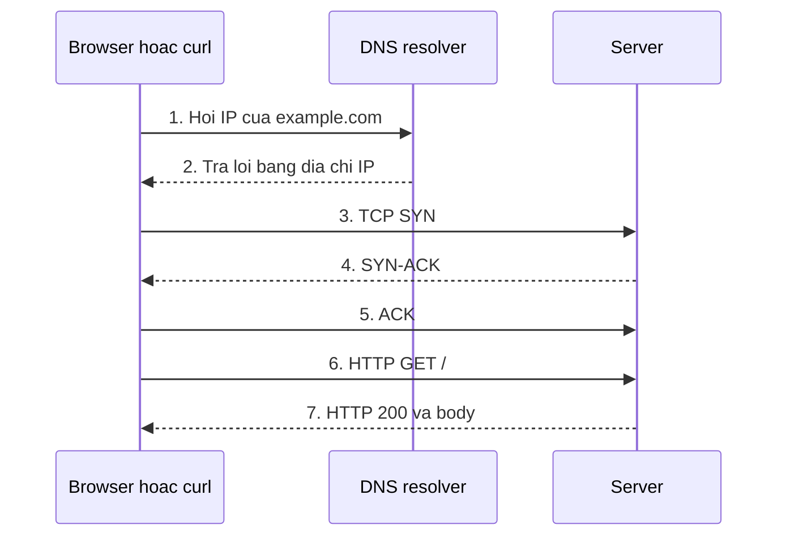

# Buổi 05 – Thử thách nâng cao

[Buổi 05 – Networking Fundamentals](session-05.md) · [Hub Tuần 3](README.md) · [Bài tập tuần 3](../../assignments/weekly/week-03.md)

> **Tóm tắt:** Phần nâng cao của Buổi 05, tùy chọn làm ở nhà: bốn thử thách L2, tình huống port bị chiếm, và kiến thức mạng đọc thêm.

Trang này không bắt buộc. Hoàn thành [Làm lab của Buổi 05](session-05.md#hands-on-lab) trước.

## Thử thách thêm (L2) {#thu-thach}

::: warning Tự thử trước khi mở gợi ý
Chọn tối thiểu hai thử thách. Tự thử 15 phút trước khi mở gợi ý. Lời giải đầy đủ nằm ở [trang tuần 3](README.md), chỉ mở sau khi nộp bài.
:::

**Thử thách A – Mô tả đường đi của request.** Viết trong `report.md` một đoạn 8 đến 12 dòng giải thích điều gì xảy ra từ lúc gõ `https://example.com/` tới lúc thấy trang, mỗi bước ghi lệnh nào trong bài chứng minh được. Hoàn thành khi có đủ DNS, TCP, TLS, HTTP và ít nhất ba lệnh làm chứng.

::: details Gợi ý bậc 1
Dùng `curl -v` và đọc các dòng bắt đầu bằng `*`. Chú ý các dòng `resolved`, `Connected to`, `SSL connection using`. Mỗi dòng ứng với một tầng.
:::

**Thử thách B – Chứng minh ping không đủ.** Chạy server Python ở port 9000 bind `127.0.0.1`; dùng `ss` và `curl` chứng minh: server đang lắng nghe, `curl` tới 9000 thành công, còn `curl` tới 9001 bị từ chối dù `ping 127.0.0.1` vẫn thành công. Hoàn thành khi bằng chứng cho cả ba điều nằm trong `command-output.txt` và `report.md` có một câu kết luận về giới hạn của `ping`.

::: details Gợi ý bậc 1
`ping` chỉ kiểm tra máy có phản hồi ICMP, không liên quan tới việc có process lắng nghe port. So sánh `ping 127.0.0.1` với `curl http://127.0.0.1:9001/`.
:::

::: details Gợi ý bậc 2
Bốn lệnh cần chạy: `ping -c 2 127.0.0.1`, `ss -ltn | grep -E ':9000|:9001'`, `curl -sS -o /dev/null -w "9000 status=%{http_code}\n" http://127.0.0.1:9000/` và `curl -sS http://127.0.0.1:9001/`. Kết luận: máy sống không có nghĩa service sống.
:::

**Thử thách C – Gọi đúng tên mà không sửa file hosts.** Khi server Python port 9000 đang chạy, dùng `curl --resolve` gọi nó bằng tên `demo.club.test` mà không sửa `/etc/hosts`. Giải thích trong `report.md` header `Host` curl gửi đi và vì sao nó quan trọng với reverse proxy. Hoàn thành khi có dòng `> Host: demo.club.test:9000` trong output.

::: details Gợi ý bậc 1
Cú pháp là `--resolve tên:port:địa-chỉ-IP`. Thêm `-v` để thấy header.
:::

::: details Gợi ý bậc 2
```bash
# server python3 -m http.server 9000 --bind 127.0.0.1 phải đang chạy ở terminal khác
curl -v --resolve demo.club.test:9000:127.0.0.1 http://demo.club.test:9000/ -o /dev/null 2>&1 | grep -E 'Host|HTTP/'
```

Reverse proxy như Nginx dùng header `Host` để chọn service phía sau (virtual host); Ingress của Kubernetes trong khóa học dùng host `club.localhost` theo cách tương tự.
:::

**Thử thách D (nâng cao, cần Docker Desktop) – Quan sát cổng của starter-project.** Trong thư mục `starter-project` (đặt trong filesystem WSL), chạy `cp .env.example .env` rồi đặt `DB_PASSWORD` thành giá trị giả như `change-me-local` (compose báo lỗi nếu thiếu biến này), chạy `docker compose up -d --build`, dùng `ss -ltn` và `curl` kiểm tra cổng 8080 và 3000. Giải thích vì sao frontend gọi `/api/` thành công mà không cần biết IP backend. Chạy `docker compose down` sau khi xong, không commit `.env`.

::: details Gợi ý bậc 1
Nginx là reverse proxy; tên `backend` được DNS nội bộ của Docker network `club-network` phân giải. Phần này học kỹ ở [Buổi 11 – Container Networking](../week-06/session-11.md).
:::

::: details Gợi ý bậc 2
```bash
ss -ltn | grep -E ':8080|:3000'
curl -s http://localhost:8080/health ; echo
curl -s http://localhost:3000/health ; echo
curl -s http://localhost:8080/api/members
```

`/health` của API chỉ có trực tiếp ở cổng 3000; Nginx chỉ chuyển tiếp đường dẫn `/api/`, nên `http://localhost:8080/health` trả trang frontend.
:::

## Phá lỗi nâng cao: "Port đã được sử dụng" {#pha-loi}

Đây là tình huống 01 trong bộ lỗi của khóa; xem thêm `examples/troubleshooting/scenario-01`.

**Cách phá.** Chạy server giữ port 9000 ở một terminal (`python3 -m http.server 9000`), rồi ở terminal khác chạy lại đúng lệnh đó.

**Triệu chứng.** Lệnh thứ hai thoát ngay với `OSError: [Errno 98] Address already in use`. Trong Docker: `Bind for 0.0.0.0:8080 failed: port is already allocated`.

**Hướng điều tra.**

1. Xác nhận port có người dùng: `ss -ltn 'sport = :9000'`. Có dòng LISTEN nghĩa là đã bị chiếm.
2. Tìm process: `ss -ltnp 'sport = :9000'` và đọc `users:((...))` lấy tên và PID.
3. Kiểm tra process đó: `ps -p PID -o pid,ppid,etime,cmd` (thay `PID` bằng số thật). Server cũ bạn quên tắt, hay một service cần giữ?
4. Quyết định: `kill PID` (không `kill -9` ngay), hoặc đổi sang port khác.
5. Chạy lại và xác nhận bằng `ss` rằng port thuộc về process mới.

**Nguyên nhân gốc.** Mỗi cặp địa chỉ và port chỉ có một socket lắng nghe. Process cũ chưa thoát, hoặc hai service cấu hình cùng một port. Trên Windows, một chương trình phía Windows cũng có thể giữ port mà `ss` trong WSL không thấy.

**Phòng tránh.** Đặt port bằng biến môi trường (như `WEB_PORT` trong `compose.yaml`); tắt dịch vụ cũ trước khi chạy lại; ghi lại bảng port của dự án.

## Đọc thêm: kiến thức mạng chi tiết {#doc-them}

**Dải địa chỉ IPv4.**

| Dải địa chỉ | Loại | Ghi chú |
| --- | --- | --- |
| `127.0.0.0/8` | Loopback | Chỉ nói chuyện với chính máy này |
| `10.0.0.0/8`, `172.16.0.0/12`, `192.168.0.0/16` | Private | Mạng nội bộ; WSL2, Docker và kind đều dùng |
| `0.0.0.0` | Không phải địa chỉ đích thông thường | Khi server bind vào đây là lắng nghe mọi card mạng |
| Còn lại | Public | Định tuyến được trên Internet |

Ví dụ `192.168.1.25/24`: dải mạng `192.168.1.0` đến `192.168.1.255`, có 254 địa chỉ cho thiết bị, subnet mask `255.255.255.0`. Hai máy `192.168.1.10/24` và `192.168.2.10/24` không cùng subnet: với `/24`, ba số đầu là phần mạng nên gói tin phải đi qua gateway.

**DNS.** Máy hỏi một resolver (trong WSL2 là địa chỉ ở `/etc/resolv.conf`); resolver hỏi tiếp lên trên và cache theo TTL. Bản ghi A là tên ra IPv4, AAAA là tên ra IPv6, CNAME là bí danh (`www.example.com` trỏ về `example.com`). File `/etc/hosts` được tra trước DNS; `localhost` được định nghĩa là `127.0.0.1`.

**TCP và UDP.** Một kết nối được xác định bởi IP nguồn, port nguồn, IP đích, port đích.

| Tiêu chí | TCP | UDP |
| --- | --- | --- |
| Kết nối | Có, bắt tay ba bước | Không |
| Độ tin cậy | Đảm bảo thứ tự, gửi lại nếu mất | Không đảm bảo |
| Dùng cho | HTTP, HTTPS, SSH, PostgreSQL | DNS (truy vấn nhỏ), video call, game |
| Công cụ xem | `ss -ltn` | `ss -lun` |

**Đường đi của `http://example.com/`.**



1. Client kiểm tra `/etc/hosts` và cache, rồi hỏi DNS resolver.
2. Resolver trả IP. Nếu lỗi ở đây bạn thấy `Could not resolve host`.
3. Client gửi SYN tới IP ở port 80 (HTTP) hoặc 443 (HTTPS).
4. Có process lắng nghe thì server trả SYN-ACK. Máy tồn tại nhưng không ai lắng nghe port thì hệ điều hành trả RST: `Connection refused`. Gói tin bị chặn hoặc không có đường đi thì không có phản hồi: `Connection timed out`.
5. Client gửi ACK, TCP hoàn tất. Với HTTPS, TLS handshake diễn ra ngay sau đó.
6. Client gửi `GET /`; server trả status, header, body.

**HTTP và HTTPS.** Nhóm status: 2xx thành công (200), 3xx chuyển hướng (301, 302), 4xx lỗi phía client (404), 5xx lỗi phía server (500, 502, 503). HTTPS là HTTP trong kênh mã hóa TLS (port 443): client và server thực hiện TLS handshake, client kiểm tra chứng chỉ.

**Câu hỏi thêm.**

- Lệnh nào cho biết process nào đang giữ port 3000, và các cờ `-l`, `-t`, `-n`, `-p` nghĩa là gì? `ss -ltnp 'sport = :3000'`; `-l` socket đang lắng nghe, `-t` TCP, `-n` hiện số thay vì tên, `-p` hiện process.
- Reverse proxy giải quyết những vấn đề gì trong kiến trúc của dự án? Một điểm vào duy nhất, che giấu địa chỉ service nội bộ, định tuyến theo đường dẫn hoặc tên miền, gom HTTPS một nơi và tránh CORS.
