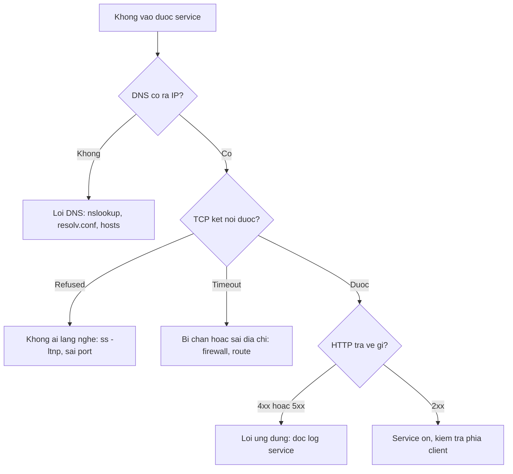

# Buổi 05 – Networking Fundamentals

Tuần 3/16 · Giai đoạn 1 – Engineering Foundation · Buổi 05/32

[Slide buổi 05](../../slides/01-foundation/session-05.md) · [Bài tập tuần 3](../../assignments/weekly/week-03.md) · [Hub Tuần 3](README.md)

> **Tóm tắt:** Dùng ping, curl, nslookup, ss để chẩn đoán một request từ DNS, port đến HTTP, và biết lỗi kết nối nằm ở tầng nào thay vì ngồi đoán.

::: tip Buổi này bạn làm gì
**Bạn sẽ tạo ra:** thư mục `lab-05/` với file bằng chứng `evidence/command-output.txt` và bảng "bốn tầng" (IP, DNS, port, HTTP) chỉ ra bạn tìm lỗi kết nối ở đúng tầng.

**Thời gian thật:** đọc 15 phút · lab bắt buộc 60 phút · thử thách tùy chọn làm ở nhà.

**Cần chuẩn bị:**

- [ ] Terminal Ubuntu trong WSL2, làm trong `~/devops-labs` (không dùng `/mnt/c`). Chưa quen terminal: xem [Terminal 101](../../resources/terminal-101.md).
- [ ] Đã xong [Buổi 04 – Linux Administration](../week-02/session-04.md); môi trường đã cài theo [Hướng dẫn cài đặt](../../resources/setup-guide.md).
- [ ] Có tài khoản GitHub và repo `devops-labs` (public) theo [Tài khoản và repo GitHub](../../resources/setup-github.md).

**Sản phẩm phải nộp:** `lab-05/` trong `devops-labs` gồm `README.md`, `evidence/command-output.txt` (output thật), `report.md` (bảng bốn tầng và phân tích ba lỗi), `source/site/index.html`.

**Đi nhanh:** [Đọc](#doc) → [Làm lab](#hands-on-lab) → [Gặp lỗi?](#gap-loi) → [Tự kiểm tra](#tu-kiem-tra) → [Nộp bài](#nop-bai). Kẹt? Nhảy tới [Gặp lỗi?](#gap-loi).
:::

Từ mới trong buổi (xem [Thuật ngữ](../../resources/glossary.md)):

- **IP**: địa chỉ của một máy trong mạng.
- **DNS**: hệ thống đổi tên miền thành IP.
- **Port**: cổng để đưa gói tin tới đúng chương trình trên máy.
- **Loopback (`localhost`)**: địa chỉ trỏ về chính máy này, `127.0.0.1`.
- **Bind address**: địa chỉ mà một server chịu lắng nghe, ví dụ `127.0.0.1` hoặc `0.0.0.0`.
- **curl**: công cụ dòng lệnh gửi HTTP request.

Trên lớp, mentor demo trước; tự học thì làm thẳng phần [Làm lab](#hands-on-lab).

## Vấn đề thực tế {#doc}

Thành viên CLB nhắn: "Web của em không vào được, API chết rồi anh ơi". Câu "không vào được" có thể là năm lỗi khác nhau: tên miền không ra IP, máy đích không chạy service, service lắng nghe sai địa chỉ, tường lửa chặn, hoặc service chạy tốt nhưng trả lỗi 500. Không có mô hình chia nhỏ vấn đề, bạn sẽ ngồi đoán và restart lung tung.

Từ Phase 2, ứng dụng Club Management gồm ba thành phần nói chuyện qua mạng: Nginx (cổng 8080 trên máy host), API Node.js (cổng 3000) và PostgreSQL (cổng 5432). Mỗi lỗi "không kết nối được" trong Docker, Compose hay Kubernetes thực chất là lỗi mạng ở một tầng cụ thể. Buổi này cho bạn bộ công cụ để chỉ ra đúng tầng đó trong vài phút.

## Khái niệm cốt lõi

Bảng port, UDP, bản ghi DNS, reverse proxy và sơ đồ chi tiết một request nằm ở phần "Tìm hiểu thêm" cuối trang.

- **Địa chỉ IP và subnet.** IP là địa chỉ của một máy, ví dụ `192.168.1.25/24` (24 bit đầu là mạng, phần còn lại là thiết bị). Giống số nhà trong một con phố: cùng phố thì đi bộ sang, khác phố phải qua cổng chung (gateway).
- **DNS.** DNS đổi tên miền thành IP. Giống danh bạ điện thoại: bạn nhớ tên, danh bạ cho số. Lỗi ở đây là `Could not resolve host`, chưa có gói tin nào tới server.
- **Port và TCP.** Port đưa gói tin tới đúng chương trình trên máy; TCP bắt tay ba bước trước khi gửi dữ liệu. Giống số phòng trong một tòa nhà: IP là địa chỉ tòa nhà, port là số phòng. Một port chỉ có một process lắng nghe, process thứ hai sẽ gặp `Address already in use`.
- **HTTP.** HTTP là giao thức hỏi đáp chạy trên TCP: client gửi request, server trả status (2xx thành công, 4xx lỗi client, 5xx lỗi server). Giống gọi món: bạn gọi, bếp trả món hoặc báo hết.
- **localhost và bind address.** `localhost` là `127.0.0.1`, chỉ nói chuyện với chính máy. Server bind `127.0.0.1` chỉ nhận kết nối từ máy đó, bind `0.0.0.0` nhận trên mọi card mạng. Mỗi container có `localhost` riêng, nên API trong container không gọi `localhost:5432` để tới PostgreSQL được; compose dùng `DB_HOST: postgres` (tên service). Giống phòng riêng: "phòng tôi" của mỗi người là một phòng khác nhau.

Quy trình chẩn đoán từ dưới lên, dùng xuyên suốt khóa học:



## Hands-on lab (60 phút, bắt buộc) {#hands-on-lab}

Bạn sẽ chạy từng lệnh, ghi output thật vào `evidence/command-output.txt` và đối chiếu với "Kết quả mong đợi" (IP, PID, thời gian của bạn sẽ khác). Bước nào lỗi, xem [Gặp lỗi?](#gap-loi).

### Chuẩn bị (5 phút)

1. Kiểm tra môi trường:

```bash
curl --version | head -n 1
ss --version
python3 --version
nslookup -version 2>&1 | head -n 1
ping -V | head -n 1
```

Kết quả mong đợi: in ra phiên bản của `curl`, `ss`, `python3`, `nslookup`. Lệnh nào báo `command not found` thì cài thêm: `sudo apt update && sudo apt install -y dnsutils iputils-ping`.

2. Tạo cấu trúc nộp bài:

```bash
mkdir -p ~/devops-labs/lab-05/{source,screenshots,evidence}
cd ~/devops-labs/lab-05
echo "# Lab 05 - Networking evidence" > evidence/command-output.txt
```

Kết quả mong đợi: không lỗi; `ls` thấy ba thư mục.

3. Từ đây, mỗi lệnh quan trọng chạy dạng sau để vừa xem vừa lưu bằng chứng. Bài tập yêu cầu mỗi khối có một dòng `$ lệnh` đứng trước:

```bash
echo '$ ip -br addr' >> evidence/command-output.txt
ip -br addr | tee -a evidence/command-output.txt
```

Luôn dùng `tee -a` (append); quên `-a` là ghi đè mất bằng chứng (xem [Gặp lỗi?](#gap-loi)).

### Phần 1 – Tầng IP: máy mình là ai, router là ai (8 phút)

```bash
ip -br addr | tee -a evidence/command-output.txt
ip route | tee -a evidence/command-output.txt
ping -c 4 127.0.0.1 | tee -a evidence/command-output.txt
ping -c 4 1.1.1.1 | tee -a evidence/command-output.txt
```

Kết quả mong đợi (rút gọn):

```text
lo      UNKNOWN   127.0.0.1/8 ::1/128
eth0    UP        172.24.100.5/20
default via 172.24.96.1 dev eth0
4 packets transmitted, 4 received, 0% packet loss
4 packets transmitted, 4 received, 0% packet loss
```

Vì sao: dòng `default via` là gateway, nơi gói tin đi khi đích nằm ngoài subnet. `ping` dùng ICMP, hỏi "máy đích có phản hồi không". Ping `1.1.1.1` (IP, không phải tên) thành công chứng tỏ ra được Internet mà chưa cần DNS. Nhiều mạng chặn ICMP, nên ping lỗi chưa chắc mất mạng, và ping được chưa chắc service sống.

::: tip Kiểm tra: bạn đúng khi
Bạn ghi được IP, prefix và gateway của `eth0`, và hai lệnh `ping` đều báo `0% packet loss`.
:::

### Phần 2 – Tầng DNS: tên ra IP (8 phút)

```bash
cat /etc/resolv.conf | tee -a evidence/command-output.txt
nslookup github.com | tee -a evidence/command-output.txt
nslookup github.com 1.1.1.1 | tee -a evidence/command-output.txt
getent hosts localhost | tee -a evidence/command-output.txt
```

Kết quả mong đợi (rút gọn):

```text
nameserver 10.255.255.254
Server:         10.255.255.254
Name:   github.com
Address: 20.205.243.166
```

Lệnh `nslookup ... 1.1.1.1` đổi dòng `Server` thành `1.1.1.1`; `getent` in một địa chỉ loopback (`127.0.0.1` hoặc `::1`) kèm tên `localhost`.

Vì sao: dòng `nameserver` trong `resolv.conf` trùng dòng `Server` của `nslookup` là bằng chứng bạn hỏi đúng resolver hệ thống. `getent hosts` đi qua cơ chế phân giải của hệ điều hành (hosts file rồi DNS), còn `nslookup` chỉ hỏi DNS; hai lệnh khác kết quả là dấu hiệu `/etc/hosts` bị sửa.

::: tip Kiểm tra: bạn đúng khi
`nameserver` trong `/etc/resolv.conf` trùng dòng `Server` của `nslookup github.com`, và bạn chỉ ra được dòng đó trong file bằng chứng.
:::

### Phần 3 – Tầng HTTP: gọi và đọc response bằng curl (8 phút)

```bash
curl -v https://example.com/ -o /dev/null 2>&1 | grep -E '^\*|^>|^<' | head -n 25 | tee -a evidence/command-output.txt
curl -s -o /dev/null -w "status=%{http_code} dns=%{time_namelookup}s connect=%{time_connect}s total=%{time_total}s\n" https://example.com/ | tee -a evidence/command-output.txt
curl -sI https://github.com/ | head -n 5 | tee -a evidence/command-output.txt
```

Kết quả mong đợi (rút gọn, số liệu khác nhau theo mạng): các dòng `* Host example.com:443 was resolved.`, `* Connected to example.com`, `* SSL connection using TLSv1.3`, `> GET / HTTP/2`, `< HTTP/2 200`; sau đó `status=200 dns=0.020s connect=0.045s total=0.210s` và `HTTP/2 200`.

Vì sao: bạn thấy DNS, TCP, TLS, HTTP lần lượt xuất hiện. `2>&1` cần thiết vì `curl -v` ghi chẩn đoán ra stderr. `-w` cho biết thời gian từng giai đoạn (chậm ở DNS, kết nối hay xử lý); `-I` chỉ lấy header.

::: tip Kiểm tra: bạn đúng khi
Output có ít nhất một dòng bắt đầu bằng `>` (request), một dòng bắt đầu bằng `<` (response) và status code `200`.
:::

### Phần 4 – Tầng port: chạy server và xem bằng ss (12 phút)

Mở terminal thứ hai và chạy server bind vào loopback:

```bash
cd ~/devops-labs/lab-05/source
mkdir -p site && echo "Club Management lab 05" > site/index.html
cd site && python3 -m http.server 9000 --bind 127.0.0.1
```

Ở terminal thứ nhất:

```bash
cd ~/devops-labs/lab-05
ss -ltnp | grep ':9000' | tee -a evidence/command-output.txt
curl -s -o /dev/null -w "status=%{http_code}\n" http://127.0.0.1:9000/ | tee -a evidence/command-output.txt
```

Kết quả mong đợi:

```text
LISTEN 0      5      127.0.0.1:9000      0.0.0.0:*    users:(("python3",pid=2410,fd=3))
status=200
```

Vì sao: `-l` chỉ liệt kê socket đang lắng nghe, `-t` là TCP, `-n` hiện số thay vì tên, `-p` hiện process (chỉ thấy process của bạn nếu không dùng `sudo`).

Bây giờ ở terminal thứ hai nhấn `Ctrl+C` rồi bind lại vào mọi giao diện:

```bash
python3 -m http.server 9000 --bind 0.0.0.0
```

Ở terminal thứ nhất chạy lại `ss -ltnp | grep ':9000' | tee -a evidence/command-output.txt`. Cột Local Address đổi thành `0.0.0.0:9000`, nghĩa là chấp nhận kết nối trên mọi card mạng. Trong lab này không sao vì bạn không mở port ra Internet, nhưng với service thật, bind `0.0.0.0` là quyết định có chủ đích. Trình duyệt Windows mở được `http://localhost:9000/` là nhờ tính năng chuyển tiếp localhost của WSL2; không mở được thì ghi nhận vào báo cáo và đi tiếp.

::: tip Kiểm tra: bạn đúng khi
File bằng chứng có hai dòng `LISTEN` của port 9000: một dòng `127.0.0.1:9000`, một dòng `0.0.0.0:9000`, cùng `status=200`.
:::

### Phần 5 – Port conflict và ba loại lỗi kết nối (15 phút)

Khi server `0.0.0.0` ở Phần 4 vẫn chạy, mở terminal thứ ba (hoặc dùng terminal thứ nhất) và chạy server thứ hai trên cùng port:

```bash
python3 -m http.server 9000 --bind 0.0.0.0
```

Kết quả mong đợi (rút gọn): `OSError: [Errno 98] Address already in use`. Tìm thủ phạm:

```bash
ss -ltnp 'sport = :9000' | tee -a evidence/command-output.txt
```

Kết quả mong đợi: một dòng `LISTEN` có `users:(("python3",pid=...,fd=3))`. Ghi lại PID. Dừng đúng process đó (hoặc `Ctrl+C` ở terminal đang chạy nó), rồi chạy lại server thứ hai. Quy tắc: tìm đúng PID trước, rồi mới quyết định dừng; không kill process mình không biết là gì (xem [Gặp lỗi?](#gap-loi)).

Dừng mọi server, rồi ghi ba loại lỗi:

```bash
{ curl -sS http://127.0.0.1:9000/ ; curl -sS --max-time 3 http://192.0.2.1/ ; curl -sS http://khong-ton-tai.invalid/ ; } 2>&1 | tee -a evidence/command-output.txt
```

Kết quả mong đợi: ba dòng lỗi `curl: (7)` Connection refused, `curl: (28)` timed out (một số mạng báo `Network is unreachable`, hãy ghi chú), `curl: (6)` Could not resolve host. `192.0.2.1` thuộc dải TEST-NET-1 dành cho tài liệu nên không ai trả lời.

Cuối cùng viết `report.md` với bảng sau (điền kết quả thật của bạn), và thêm phân tích ba lỗi: tầng bị lỗi và lệnh kiểm tra tiếp theo cho mỗi lỗi.

| Tầng | Lệnh | Kết quả của bạn | Kết luận |
| --- | --- | --- | --- |
| IP | `ip -br addr` | (điền) | (điền) |
| DNS | `nslookup github.com` | (điền) | (điền) |
| TCP/port | `ss -ltnp` | (điền) | (điền) |
| HTTP | `curl -v` | (điền) | (điền) |

::: tip Kiểm tra: bạn đúng khi
Bạn thấy `Address already in use`, tìm được PID bằng `ss`, và có đủ ba mã lỗi `curl: (7)`, `(28)`, `(6)` trong file bằng chứng.
:::

### Checklist L1 và lệnh tự kiểm tra

- [ ] Ghi được IP, prefix và gateway của `eth0` vào `evidence/command-output.txt`.
- [ ] `ping` thành công tới `127.0.0.1` và `1.1.1.1`, giải thích được vì sao ping IP không cần DNS.
- [ ] `nslookup github.com` có kết quả và chỉ ra dòng DNS resolver đang dùng.
- [ ] Có `curl -v` với các dòng `>` (request) và `<` (response) kèm status code.
- [ ] Có `ss -ltnp` cho thấy server Python lắng nghe port 9000 kèm process.
- [ ] Gặp và ghi lại `Address already in use` cùng cách tìm PID.
- [ ] Hoàn thành bảng bốn tầng trong `report.md`.

```bash
grep -oE 'curl: \((6|7|28)\)' evidence/command-output.txt | sort -u; grep -c LISTEN evidence/command-output.txt
```

Kết quả mong đợi: ba dòng `curl: (28)`, `curl: (6)`, `curl: (7)` rồi một số từ 2 trở lên (số dòng `LISTEN`).

## Gặp lỗi? {#gap-loi}

| Triệu chứng | Nguyên nhân | Cách sửa |
| --- | --- | --- |
| `curl: (6) Could not resolve host` | Sai tên miền, DNS lỗi hoặc `/etc/resolv.conf` sai | Kiểm tra chính tả; `nslookup tên`; thử `nslookup tên 1.1.1.1`; xem `/etc/resolv.conf` |
| `curl: (7) Failed to connect ... Connection refused` | Máy đích sống nhưng không có process lắng nghe port đó, hoặc sai port | `ss -ltnp` trên máy đích; kiểm tra service đã chạy và đúng port |
| `curl: (28) Connection timed out` | Gói tin bị chặn (firewall) hoặc không có đường tới đích | Kiểm tra IP, `ip route`, firewall; thử từ mạng khác |
| `OSError: [Errno 98] Address already in use` (Docker: `port is already allocated`) | Port đang bị process khác giữ, thường là server cũ quên tắt | `ss -ltnp 'sport = :PORT'` lấy PID, `ps -p PID -o pid,ppid,etime,cmd` xem là gì, rồi `kill PID` (không `kill -9` ngay) hoặc đổi port. Nếu `ss` không thấy ai giữ port, có thể một chương trình phía Windows đang giữ |
| `ping` không phản hồi nhưng web vẫn vào được | ICMP bị chặn, không liên quan tới HTTP | Dùng `curl -v` kiểm tra service thật, đừng kết luận chỉ từ ping |
| `ping` thành công nhưng web lỗi | Máy sống nhưng service không chạy hoặc sai port | Kiểm tra bằng `ss` và `curl` theo từng tầng |
| `ss` không hiện cột process | Thiếu `-p` hoặc process của user khác | Thêm `-p`; dùng `sudo ss -ltnp` khi cần xem process của user khác |
| File bằng chứng mất nội dung cũ | Dùng `tee` thay vì `tee -a` | Chạy lại các lệnh và luôn dùng `tee -a` |
| `localhost` trong container không gọi được service khác | `localhost` trong container là chính container | Dùng tên service (Compose) hoặc Service name (Kubernetes) |

## Tự kiểm tra {#tu-kiem-tra}

1. `Connection refused` và `Connection timed out` khác nhau thế nào, và mỗi lỗi gợi ý nguyên nhân gì?

::: details Đáp án gợi ý
Refused: máy đích phản hồi RST vì không có process lắng nghe port đó (hoặc sai port). Timed out: không có phản hồi, thường do firewall chặn hoặc không có đường đi tới đích.
:::

2. Vì sao `ping 1.1.1.1` thành công không chứng minh được `curl https://github.com` sẽ thành công?

::: details Đáp án gợi ý
Ping chỉ kiểm tra ICMP tới một IP. `curl` cần thêm DNS phân giải tên, TCP tới port 443, TLS và HTTP. Lỗi có thể ở bất kỳ tầng nào trong số đó.
:::

3. Tình huống: API trong container báo không kết nối được PostgreSQL, biến `DB_HOST=localhost`. Bạn kết luận gì và sửa thế nào?

::: details Đáp án gợi ý
`localhost` trong container API là chính container API, không có PostgreSQL ở đó. Đặt `DB_HOST` bằng tên service của database (`postgres` trong `compose.yaml`) để DNS của Docker network phân giải ra đúng container.
:::

4. Tình huống: bạn mở `http://localhost:8080/health` trên máy chạy starter-project nhưng nhận trang frontend thay vì JSON của API. Vì sao?

::: details Đáp án gợi ý
Nginx chỉ chuyển tiếp các đường dẫn bắt đầu bằng `/api/` sang backend. `/health` không khớp nên rơi vào `location /` trả `index.html`. Gọi trực tiếp API ở cổng 3000, hoặc dùng `/api/members`.
:::

## Nộp bài {#nop-bai}

Nộp vào thư mục `lab-05/` trong repo `devops-labs` theo [mẫu lab](../../templates/lab-template.md). Chi tiết nhiệm vụ và tiêu chí: [Bài tập tuần 3](../../assignments/weekly/week-03.md).

- [ ] `README.md` trả lời đủ 7 câu: bài lab giải quyết vấn đề gì, kiến thức đã dùng, các bước thực hiện, kết quả mong đợi, lỗi đã gặp, cách khắc phục, có thể cải thiện gì. Ghi level đã làm (L1, L2) ở cuối.
- [ ] `evidence/command-output.txt` chứa kết quả thật của `ip -br addr`, `ip route`, `ping`, `nslookup`, `curl -v`, `ss -ltnp` và ba loại lỗi curl.
- [ ] `report.md` có bảng bốn tầng (IP, DNS, TCP/port, HTTP) và phần phân tích ba lỗi kết nối.
- [ ] `source/` chứa `site/index.html` và các lệnh đã chạy (có thể là `commands.sh`); `screenshots/` có ít nhất một ảnh, không dùng ảnh thay cho bằng chứng text.
- [ ] Không có password, token hay file `.env` trong repository, và không còn server Python chiếm port 9000.

## Recap

- Một request đi qua DNS, TCP, TLS (nếu HTTPS), HTTP; lỗi ở tầng nào thì dùng công cụ của tầng đó (`nslookup`, `ss`, `curl`).
- `Could not resolve host` là DNS, `Connection refused` là không ai lắng nghe port, `Connection timed out` là bị chặn hoặc không có đường đi; `ping` chỉ chứng minh ICMP.
- `127.0.0.1` chỉ nội bộ, `0.0.0.0` là mọi giao diện, `localhost` trong container là chính container.

Buổi tiếp theo: [Buổi 06 – Git & GitHub Workflow](session-06.md).

::: details Tìm hiểu thêm (đọc sau)
- **Port quen thuộc:** 22 SSH, 53 DNS, 80 và 443 HTTP(S), 5432 PostgreSQL, 3000 API của starter-project, 8080 frontend (biến `WEB_PORT`). Port nằm trong khoảng 0 đến 65535.
- **Reverse proxy** là server đứng trước các service phía sau, nhận request và chuyển tiếp. Trong starter-project, Nginx trả file tĩnh cho `/` và chuyển `/api/` sang `http://backend:3000`: một điểm vào duy nhất, che giấu service nội bộ, gom HTTPS, tránh CORS.
- **Bind address:** `127.0.0.1` chỉ nhận kết nối từ cùng máy hoặc cùng network namespace; `0.0.0.0` nhận trên mọi giao diện, kể cả từ máy khác.
- Bảng dải IP, bản ghi DNS, TCP với UDP, sơ đồ chi tiết một request và câu hỏi thêm: xem [Buổi 05 – Thử thách nâng cao](session-05-challenge.md#doc-them).
:::

::: details Thử thách thêm (L2, tùy chọn, làm ở nhà)
Bốn thử thách: A mô tả đường đi của request, B chứng minh ping không đủ, C gọi đúng tên bằng `curl --resolve`, D quan sát cổng của starter-project (cần Docker Desktop). Chọn tối thiểu hai. Có gợi ý từng bậc và tình huống "Port đã được sử dụng" ở [Buổi 05 – Thử thách nâng cao](session-05-challenge.md). Tự thử 15 phút trước khi mở gợi ý.
:::

::: details Phá lỗi nâng cao
Tình huống 01 "Port đã được sử dụng" (tái hiện, điều tra từng bước, nguyên nhân gốc, phòng tránh): xem [Buổi 05 – Thử thách nâng cao](session-05-challenge.md#pha-loi).
:::

::: details Tài liệu tham khảo
- [curl – tài liệu chính thức](https://curl.se/docs/manual.html)
- [curl – tùy chọn --write-out](https://curl.se/docs/manpage.html)
- [ss(8) – Linux manual page](https://man7.org/linux/man-pages/man8/ss.8.html)
- [MDN – Tổng quan về HTTP](https://developer.mozilla.org/en-US/docs/Web/HTTP/Overview)
- [MDN – DNS là gì](https://developer.mozilla.org/en-US/docs/Glossary/DNS)
- [Microsoft – Truy cập ứng dụng mạng trong WSL](https://learn.microsoft.com/en-us/windows/wsl/networking)
:::
