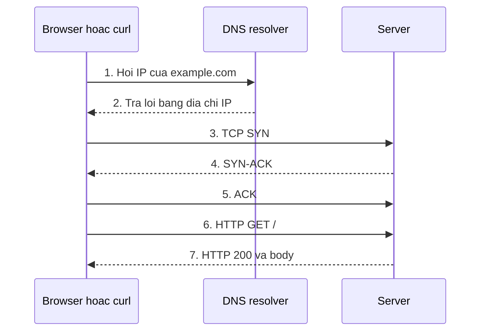
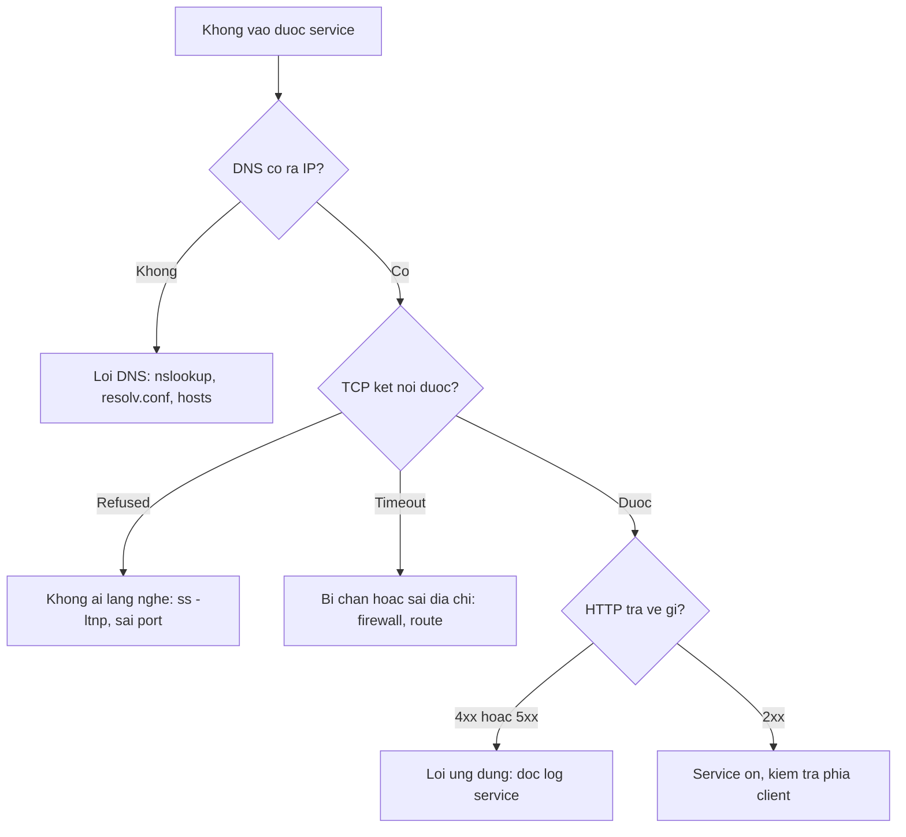

# Buổi 05 – Networking Fundamentals

Tuần 3 · Giai đoạn 1 – Engineering Foundation · Slide: [Slide buổi 05](../../slides/01-foundation/session-05.md)

> **Tóm tắt:** Hiểu IP, DNS, TCP, port, HTTP và localhost, rồi dùng ping, curl, nslookup, ss để chẩn đoán một request từ trình duyệt đến server theo từng tầng.

## Mục tiêu học tập

- Giải thích được đường đi của một request: DNS, TCP handshake, TLS (nếu HTTPS), HTTP request và response.
- Phân biệt được địa chỉ IP, subnet, port, `localhost`, `127.0.0.1` và `0.0.0.0`, và nói được khi nào dùng loại nào.
- Chạy được `ping`, `curl -v`, `nslookup` và `ss -ltnp` rồi đọc đúng kết quả của từng lệnh.
- Chẩn đoán được ba lỗi kết nối khác nhau: `Could not resolve host`, `Connection refused` và `Connection timed out`.
- Xử lý được tình huống "Address already in use" bằng cách tìm process đang chiếm port.
- Giải thích được vì sao `localhost` trong container không phải là `localhost` của máy host, và reverse proxy giải quyết gì.

## Điều kiện cần

- Đã hoàn thành Buổi 03 và Buổi 04 (dùng được terminal Linux, hiểu process, biến môi trường).
- Đang làm việc trong terminal Ubuntu của WSL2, thư mục làm việc nằm trong filesystem của WSL (ví dụ `~/devops-labs`), không dùng `/mnt/c`.
- Có Internet để gọi `example.com` và `github.com`.
- Có `curl`, `ping`, `ss` (gói `iproute2`) và `python3`. `nslookup` nằm trong gói `dnsutils`.

Kiểm tra nhanh:

```bash
curl --version | head -n 1
ss --version
python3 --version
nslookup -version 2>&1 | head -n 1
ping -V | head -n 1
```

Kết quả mong đợi: các lệnh in ra phiên bản của `curl`, `ss`, `python3` và `nslookup`. Nếu lệnh nào báo `command not found`, cài thêm:

```bash
sudo apt update && sudo apt install -y dnsutils iputils-ping
```

## Vấn đề thực tế

Thành viên CLB nhắn: "Web của em không vào được, API chết rồi anh ơi". Câu "không vào được" có thể là năm lỗi khác nhau: tên miền không phân giải ra IP, máy đích không chạy service, service chạy nhưng lắng nghe sai địa chỉ, tường lửa chặn gói tin, hoặc service chạy tốt nhưng trả về lỗi 500. Nếu không có mô hình để chia nhỏ vấn đề, bạn sẽ ngồi đoán và restart lung tung.

Từ Phase 2 trở đi, ứng dụng Club Management gồm ba thành phần nói chuyện với nhau qua mạng: Nginx (frontend, cổng 8080 trên máy host), API Node.js (cổng 3000) và PostgreSQL (cổng 5432). Mỗi lỗi "không kết nối được" trong Docker, Compose hay Kubernetes thực chất là một lỗi mạng ở một tầng cụ thể. Buổi này cho bạn bộ công cụ và quy trình để chỉ ra đúng tầng đó trong vài phút.

## Khái niệm cốt lõi

### Địa chỉ IP và subnet

Địa chỉ IPv4 gồm 4 số từ 0 đến 255 (ví dụ `192.168.1.25`). Một địa chỉ đi kèm một prefix, viết dạng CIDR như `192.168.1.25/24`: 24 bit đầu xác định mạng (subnet), 8 bit cuối xác định thiết bị trong mạng đó. Hai thiết bị cùng subnet nói chuyện trực tiếp; khác subnet thì gói tin phải đi qua gateway (router).

| Dải địa chỉ | Loại | Ghi chú |
| --- | --- | --- |
| `127.0.0.0/8` | Loopback | Chỉ nói chuyện với chính máy này, `127.0.0.1` là địa chỉ quen thuộc nhất |
| `10.0.0.0/8`, `172.16.0.0/12`, `192.168.0.0/16` | Private | Mạng nội bộ, không định tuyến ra Internet; WSL2, Docker và kind đều dùng các dải này |
| `0.0.0.0` | Không phải địa chỉ đích thông thường | Khi một server bind vào `0.0.0.0`, nghĩa là lắng nghe trên mọi card mạng |
| Còn lại | Public | Có thể định tuyến trên Internet |

Ví dụ `192.168.1.25/24`: dải mạng là `192.168.1.0` đến `192.168.1.255`, có 254 địa chỉ dùng cho thiết bị (trừ địa chỉ mạng và broadcast). Subnet mask tương ứng là `255.255.255.0`.

### DNS

Máy tính nói chuyện bằng IP, con người nhớ tên. DNS (Domain Name System) là hệ thống đổi tên miền thành địa chỉ IP. Máy bạn hỏi một DNS resolver (thường là router hoặc DNS của nhà mạng, trong WSL2 là địa chỉ ghi ở `/etc/resolv.conf`); resolver hỏi tiếp lên các máy chủ DNS cho tới khi có câu trả lời, rồi lưu cache theo TTL.

| Bản ghi | Ý nghĩa | Ví dụ |
| --- | --- | --- |
| A | Tên ra địa chỉ IPv4 | `example.com` ra một địa chỉ IPv4 |
| AAAA | Tên ra địa chỉ IPv6 | `example.com` ra một địa chỉ IPv6 |
| CNAME | Tên này là bí danh của tên khác | `www.example.com` trỏ về `example.com` |

Ngoài DNS, máy còn có file `/etc/hosts` để ánh xạ tên sang IP cục bộ; file này được tra trước DNS trong cấu hình Ubuntu mặc định. `localhost` được định nghĩa ở đó (và trong chuẩn hệ điều hành) là `127.0.0.1`.

### TCP, UDP và port

IP đưa gói tin tới đúng máy; port đưa gói tin tới đúng chương trình trên máy đó. Một kết nối được xác định bởi bốn thông tin: IP nguồn, port nguồn, IP đích, port đích.

| Tiêu chí | TCP | UDP |
| --- | --- | --- |
| Kết nối | Có, bắt tay ba bước trước khi gửi dữ liệu | Không |
| Độ tin cậy | Đảm bảo thứ tự, gửi lại nếu mất gói | Không đảm bảo |
| Dùng cho | HTTP, HTTPS, SSH, PostgreSQL | DNS (truy vấn nhỏ), video call, game |
| Công cụ xem | `ss -ltn` (listening TCP) | `ss -lun` (listening UDP) |

Port nằm trong khoảng 0 đến 65535. Các port quen thuộc trong khóa học:

| Port | Dịch vụ |
| --- | --- |
| 22 | SSH |
| 53 | DNS |
| 80 / 443 | HTTP / HTTPS |
| 5432 | PostgreSQL |
| 3000 | API Node.js của starter-project |
| 8080 | Frontend của starter-project (biến `WEB_PORT`) |

Một port chỉ có một process lắng nghe trên cùng một địa chỉ. Process thứ hai cố bind sẽ nhận lỗi "Address already in use".

### HTTP và HTTPS

HTTP là giao thức dạng hỏi đáp chạy trên TCP. Client gửi request gồm method (`GET`, `POST`...), đường dẫn, header, có thể có body; server trả response gồm status code, header và body.

| Nhóm status | Ý nghĩa | Ví dụ |
| --- | --- | --- |
| 2xx | Thành công | 200 OK |
| 3xx | Chuyển hướng | 301, 302 |
| 4xx | Lỗi phía client | 404 Not Found |
| 5xx | Lỗi phía server | 500, 502, 503 |

HTTPS là HTTP chạy bên trong một kênh mã hóa TLS (mặc định port 443). Trước khi gửi HTTP, client và server thực hiện TLS handshake để thống nhất khóa mã hóa và client kiểm tra chứng chỉ của server.

### localhost, loopback và bind address

`localhost` là tên trỏ về `127.0.0.1`, thuộc giao diện loopback. Gói tin gửi tới loopback không ra khỏi máy. Quan trọng nhất là địa chỉ mà server bind:

| Server bind vào | Ai kết nối được |
| --- | --- |
| `127.0.0.1` | Chỉ process trên cùng máy (hoặc cùng network namespace) |
| `0.0.0.0` | Mọi giao diện mạng của máy, kể cả từ máy khác trong mạng |

Mỗi container có network namespace riêng, nên `localhost` trong container là chính container đó. API trong container gọi `localhost:5432` sẽ không thấy PostgreSQL ở container khác hay trên máy host. Đó là lý do trong `compose.yaml` của starter-project, API dùng `DB_HOST: postgres` (tên service) thay vì `localhost`.

### Reverse proxy

Reverse proxy là server đứng trước các service phía sau, nhận request từ client và chuyển tiếp. Trong starter-project, Nginx nhận mọi request ở cổng 80 của container, trả file tĩnh cho `/` và chuyển tiếp `/api/` sang `http://backend:3000`. Lợi ích: một điểm vào duy nhất, che giấu service nội bộ, gom HTTPS, và trình duyệt không gặp vấn đề CORS vì chỉ nói chuyện với một origin.

## Kiến trúc và cách hoạt động

Khi bạn gõ `http://example.com/` rồi nhấn Enter, các bước diễn ra theo thứ tự:



Giải thích từng bước:

1. Client kiểm tra `/etc/hosts` và cache, sau đó hỏi DNS resolver tên `example.com`.
2. Resolver trả về địa chỉ IP. Nếu bước này lỗi, bạn thấy `Could not resolve host`. Lỗi nằm ở DNS, chưa có gói tin nào tới server.
3. Client gửi SYN tới IP đó ở port 80 (HTTP) hoặc 443 (HTTPS).
4. Nếu có process đang lắng nghe, server trả SYN-ACK. Nếu máy đó tồn tại nhưng không ai lắng nghe port, hệ điều hành trả RST và bạn thấy `Connection refused`. Nếu gói tin bị chặn hoặc không có đường đi, không có phản hồi nào và bạn thấy `Connection timed out`.
5. Client gửi ACK, kết nối TCP hoàn tất. Với HTTPS, TLS handshake diễn ra ngay sau đây.
6. Client gửi HTTP request (`GET /`). Server xử lý và trả status code, header, body (bước 7 trong sơ đồ).

Từ đó rút ra quy trình chẩn đoán theo tầng, từ dưới lên:



## Demo của mentor

Mục tiêu: cho lớp thấy một request đi qua từng tầng bằng công cụ thật. Thời lượng khoảng 12 đến 15 phút, chiếu terminal lên màn hình.

**Bước 1 – Xem địa chỉ IP của máy.**

```bash
ip -br addr
```

Kết quả mong đợi (rút gọn, địa chỉ của bạn sẽ khác):

```text
lo               UNKNOWN        127.0.0.1/8 ::1/128
eth0             UP             172.24.100.5/20
```

Giải thích: `lo` là loopback, `eth0` là card mạng ảo của WSL2 với địa chỉ private. Câu hỏi cho lớp: "Hai địa chỉ này khác nhau chỗ nào về phạm vi truy cập?"

**Bước 2 – Phân giải tên miền.**

```bash
nslookup example.com
```

Kết quả mong đợi (rút gọn, IP thực tế có thể khác):

```text
Server:         10.255.255.254
Address:        10.255.255.254#53

Non-authoritative answer:
Name:   example.com
Address: 93.184.215.14
```

Giải thích: dòng `Server` là DNS resolver đang dùng; `#53` là port DNS. Câu hỏi: "Vì sao có chữ Non-authoritative?" (Câu trả lời đến từ cache của resolver, không phải từ máy chủ gốc quản lý tên miền.)

**Bước 3 – Gọi HTTP và xem toàn bộ quá trình.**

```bash
curl -v http://example.com/ -o /dev/null
```

Kết quả mong đợi (rút gọn):

```text
* Host example.com:80 was resolved.
*   Trying 93.184.215.14:80...
* Connected to example.com (93.184.215.14) port 80
> GET / HTTP/1.1
> Host: example.com
> User-Agent: curl/8.5.0
>
< HTTP/1.1 200 OK
< Content-Type: text/html
```

Giải thích: dòng bắt đầu bằng `*` là thông tin kết nối (DNS, TCP), `>` là request gửi đi, `<` là response nhận về. Câu hỏi: "Dòng nào chứng minh DNS đã thành công? Dòng nào chứng minh TCP đã thành công?"

**Bước 4 – Tạo một server cục bộ và xem port.**

Mở terminal thứ hai, chạy:

```bash
mkdir -p ~/devops-labs/lab-05/source/site && cd ~/devops-labs/lab-05/source/site
echo "Club Management network demo" > index.html
python3 -m http.server 9000 --bind 127.0.0.1
```

Ở terminal thứ nhất:

```bash
ss -ltnp | grep 9000
curl -i http://127.0.0.1:9000/
```

Kết quả mong đợi:

```text
LISTEN 0      5      127.0.0.1:9000      0.0.0.0:*    users:(("python3",pid=2310,fd=3))
HTTP/1.0 200 OK
Server: SimpleHTTP/0.6 Python/3.12.3
Content-type: text/html
...
Club Management network demo
```

Giải thích: `ss` cho thấy process `python3` đang giữ port 9000 trên `127.0.0.1`. Câu hỏi: "Nếu mình bind `0.0.0.0` thay vì `127.0.0.1`, cột Local Address sẽ đổi thế nào, và ai khác có thể vào?"

**Bước 5 – Phá có chủ đích để lớp thấy ba loại lỗi.**

```bash
curl http://127.0.0.1:9001/
curl --max-time 3 http://192.0.2.1/
curl http://khong-ton-tai.invalid/
```

Kết quả mong đợi (nội dung chi tiết khác nhẹ tùy phiên bản curl và mạng; `192.0.2.1` thuộc dải TEST-NET-1 dành riêng cho tài liệu nên không ai trả lời, một số mạng có thể báo `Network is unreachable` thay vì timeout):

```text
curl: (7) Failed to connect to 127.0.0.1 port 9001 after 0 ms: Couldn't connect to server
curl: (28) Connection timed out after 3002 milliseconds
curl: (6) Could not resolve host: khong-ton-tai.invalid
```

Câu hỏi chốt: "Ba lỗi này nằm ở tầng nào? Với mỗi lỗi, lệnh nào bạn chạy tiếp theo?"

## Hands-on lab

Thời lượng 60 phút. Bạn sẽ thu thập bằng chứng kiểm tra từng tầng và ghi vào `evidence/command-output.txt`.

### Chuẩn bị

1. Dừng server demo nếu còn chạy (nhấn `Ctrl+C` ở terminal đó) rồi tạo cấu trúc nộp bài:

```bash
mkdir -p ~/devops-labs/lab-05/{source,screenshots,evidence}
cd ~/devops-labs/lab-05
echo "# Lab 05 - Networking evidence" > evidence/command-output.txt
```

Kết quả mong đợi: không có lỗi; `ls` thấy ba thư mục `source`, `screenshots`, `evidence`.

2. Từ đây, mỗi lệnh quan trọng bạn chạy bằng dạng sau để lưu bằng chứng (lệnh in kết quả ra màn hình và đồng thời ghi thêm vào file):

```bash
echo '$ ip -br addr' >> evidence/command-output.txt
ip -br addr | tee -a evidence/command-output.txt
```

Chú ý: dùng `tee -a` (append). Nếu quên `-a`, bạn sẽ ghi đè mất bằng chứng cũ.

### Phần 1 – Tầng IP: máy mình là ai, router là ai

**Bước 1.1 – Lấy địa chỉ IP và gateway.**

```bash
ip -br addr | tee -a evidence/command-output.txt
ip route | tee -a evidence/command-output.txt
```

Kết quả mong đợi (rút gọn):

```text
lo      UNKNOWN   127.0.0.1/8 ::1/128
eth0    UP        172.24.100.5/20
default via 172.24.96.1 dev eth0
172.24.96.0/20 dev eth0 proto kernel scope link src 172.24.100.5
```

Vì sao: dòng `default via` là gateway, nơi gói tin đi tới khi đích nằm ngoài subnet. Dòng thứ hai cho biết subnet của bạn. Ghi vào báo cáo: địa chỉ IP của `eth0`, prefix, và gateway.

**Bước 1.2 – Ping loopback và một địa chỉ Internet.**

```bash
ping -c 4 127.0.0.1 | tee -a evidence/command-output.txt
ping -c 4 1.1.1.1 | tee -a evidence/command-output.txt
```

Kết quả mong đợi (rút gọn):

```text
64 bytes from 127.0.0.1: icmp_seq=1 ttl=64 time=0.030 ms
4 packets transmitted, 4 received, 0% packet loss
64 bytes from 1.1.1.1: icmp_seq=1 ttl=57 time=12.4 ms
4 packets transmitted, 4 received, 0% packet loss
```

Vì sao: `ping` dùng giao thức ICMP, kiểm tra "máy đích có phản hồi gói tin không". Ping loopback thành công chứng tỏ ngăn xếp mạng của máy hoạt động. Ping `1.1.1.1` (dùng IP, không dùng tên) thành công chứng tỏ bạn ra được Internet mà chưa cần DNS. Lưu ý: nhiều mạng và máy chủ chặn ICMP, nên ping thất bại chưa chắc là mất mạng, và ping thành công chưa chắc service hoạt động.

### Phần 2 – Tầng DNS: tên ra IP

**Bước 2.1 – Xem resolver đang dùng và tra tên.**

```bash
cat /etc/resolv.conf | tee -a evidence/command-output.txt
nslookup github.com | tee -a evidence/command-output.txt
```

Kết quả mong đợi (rút gọn):

```text
nameserver 10.255.255.254
Server:         10.255.255.254
Name:   github.com
Address: 20.205.243.166
```

Vì sao: dòng `nameserver` trong `resolv.conf` trùng với dòng `Server` của `nslookup`, đó là bằng chứng bạn hỏi đúng resolver hệ thống. Địa chỉ IP của GitHub có thể khác ở máy bạn, và có thể có nhiều dòng `Address`.

**Bước 2.2 – Hỏi thẳng một DNS khác và so sánh.**

```bash
nslookup github.com 1.1.1.1 | tee -a evidence/command-output.txt
getent hosts localhost | tee -a evidence/command-output.txt
```

Kết quả mong đợi: dòng `Server` đổi thành `1.1.1.1`; `getent` in một địa chỉ loopback (thường là `127.0.0.1` hoặc `::1`) kèm tên `localhost`.

Vì sao: `getent hosts` đi qua đúng cơ chế phân giải của hệ điều hành (hosts file rồi DNS), còn `nslookup` chỉ hỏi DNS. Hai lệnh khác kết quả là dấu hiệu có mục trong `/etc/hosts` hoặc cấu hình tra cứu tên bị đổi.

### Phần 3 – Tầng HTTP: gọi và đọc response bằng curl

**Bước 3.1 – Xem từng giai đoạn của HTTPS.**

```bash
curl -v https://example.com/ -o /dev/null 2>&1 | grep -E '^\*|^>|^<' | head -n 25 | tee -a evidence/command-output.txt
```

Kết quả mong đợi (rút gọn): các dòng `* Host example.com:443 was resolved.`, `* Connected to example.com`, `* SSL connection using TLSv1.3`, `> GET / HTTP/2`, `< HTTP/2 200`.

Vì sao: bạn nhìn thấy DNS, TCP, TLS và HTTP lần lượt xuất hiện, đúng với sơ đồ ở phần Kiến trúc. `2>&1` cần thiết vì `curl -v` ghi thông tin chẩn đoán ra stderr.

**Bước 3.2 – Chỉ lấy status code và thời gian.**

```bash
curl -s -o /dev/null -w "status=%{http_code} dns=%{time_namelookup}s connect=%{time_connect}s total=%{time_total}s\n" https://example.com/ | tee -a evidence/command-output.txt
curl -sI https://github.com/ | head -n 5 | tee -a evidence/command-output.txt
```

Kết quả mong đợi (số liệu khác nhau theo mạng):

```text
status=200 dns=0.020s connect=0.045s total=0.210s
HTTP/2 200
server: github.com
```

Vì sao: `-w` cho biết thời gian từng giai đoạn, giúp xác định chậm ở DNS, kết nối hay xử lý. `-I` chỉ gửi yêu cầu lấy header.

### Phần 4 – Tầng port: chạy server và xem bằng ss

**Bước 4.1 – Chạy server bind vào loopback.**

Terminal thứ hai:

```bash
cd ~/devops-labs/lab-05/source
mkdir -p site && echo "Club Management lab 05" > site/index.html
cd site && python3 -m http.server 9000 --bind 127.0.0.1
```

Terminal thứ nhất:

```bash
cd ~/devops-labs/lab-05
ss -ltnp | grep ':9000' | tee -a evidence/command-output.txt
curl -s -o /dev/null -w "status=%{http_code}\n" http://127.0.0.1:9000/ | tee -a evidence/command-output.txt
```

Kết quả mong đợi:

```text
LISTEN 0      5      127.0.0.1:9000      0.0.0.0:*    users:(("python3",pid=2410,fd=3))
status=200
```

Vì sao: `-l` chỉ liệt kê socket đang lắng nghe, `-t` là TCP, `-n` hiện số thay vì tên, `-p` hiện process (chỉ thấy process của bạn nếu không dùng `sudo`).

**Bước 4.2 – Đổi sang bind 0.0.0.0 và so sánh.**

Ở terminal thứ hai, nhấn `Ctrl+C` rồi chạy lại:

```bash
python3 -m http.server 9000 --bind 0.0.0.0
```

Ở terminal thứ nhất:

```bash
ss -ltnp | grep ':9000' | tee -a evidence/command-output.txt
```

Kết quả mong đợi: cột Local Address đổi thành `0.0.0.0:9000`.

Vì sao: `0.0.0.0` nghĩa là chấp nhận kết nối trên mọi card mạng. Trong lab này vẫn không sao vì bạn không mở port ra Internet, nhưng với service thật, bind `0.0.0.0` là quyết định có chủ đích. Nếu trình duyệt Windows mở `http://localhost:9000/` được, đó là tính năng chuyển tiếp localhost của WSL2; nếu không được, ghi nhận vào báo cáo và tiếp tục.

### Phần 5 – Port conflict và ba loại lỗi kết nối

**Bước 5.1 – Gây xung đột port.** Khi server ở Bước 4.2 vẫn chạy, mở terminal thứ ba (hoặc dùng terminal thứ nhất) và chạy server thứ hai trên cùng port:

```bash
python3 -m http.server 9000 --bind 0.0.0.0
```

Kết quả mong đợi (rút gọn):

```text
OSError: [Errno 98] Address already in use
```

**Bước 5.2 – Tìm thủ phạm và xử lý.**

```bash
ss -ltnp 'sport = :9000' | tee -a evidence/command-output.txt
```

Kết quả mong đợi: một dòng LISTEN có `users:(("python3",pid=...,fd=3))`. Ghi lại PID. Dừng đúng process đó (hoặc `Ctrl+C` ở terminal đang chạy nó), rồi chạy lại server thứ hai.

Vì sao: `sport = :9000` lọc theo source port của socket đang lắng nghe, nhanh hơn dùng `grep`. Quy tắc: tìm đúng PID trước, rồi mới quyết định dừng, đừng kill process không biết là gì.

**Bước 5.3 – Ghi lại ba loại lỗi.** Dừng mọi server rồi chạy:

```bash
{ curl -sS http://127.0.0.1:9000/ ; curl -sS --max-time 3 http://192.0.2.1/ ; curl -sS http://khong-ton-tai.invalid/ ; } 2>&1 | tee -a evidence/command-output.txt
```

Kết quả mong đợi: ba dòng lỗi lần lượt là `curl: (7)` Connection refused, `curl: (28)` timed out (có thể khác tùy mạng, ví dụ `Network is unreachable`), `curl: (6)` Could not resolve host. Với mỗi lỗi, ghi vào `report.md` tầng bị lỗi và lệnh kiểm tra tiếp theo.

**Bước 5.4 – Tổng kết bằng `report.md`.** Viết bảng sau (điền kết quả thật của bạn):

| Tầng | Lệnh | Kết quả của bạn | Kết luận |
| --- | --- | --- | --- |
| IP | `ip -br addr` | (điền) | (điền) |
| DNS | `nslookup github.com` | (điền) | (điền) |
| TCP/port | `ss -ltnp` | (điền) | (điền) |
| HTTP | `curl -v` | (điền) | (điền) |

### L1 – Foundation

- [ ] Ghi được địa chỉ IP, prefix và gateway của `eth0` vào `evidence/command-output.txt`.
- [ ] `ping` thành công tới `127.0.0.1` và `1.1.1.1`, giải thích được vì sao ping IP không cần DNS.
- [ ] `nslookup github.com` có kết quả và chỉ ra được dòng nào là DNS resolver đang dùng.
- [ ] Có kết quả `curl -v` cho thấy các dòng `>` (request) và `<` (response) kèm status code.
- [ ] Có kết quả `ss -ltnp` cho thấy server Python lắng nghe ở port 9000, kèm process.
- [ ] Gặp và ghi lại được lỗi `Address already in use` cùng cách tìm PID.
- [ ] Hoàn thành bảng bốn tầng trong `report.md`.

### L2 – Engineering

Chọn tối thiểu hai thử thách, tự làm không xem gợi ý trước.

**Thử thách A – Mô tả đường đi của request.** Viết trong `report.md` một đoạn 8 đến 12 dòng giải thích điều gì xảy ra từ lúc gõ `https://example.com/` tới lúc thấy trang, và với mỗi bước ghi rõ lệnh nào trong bài chứng minh được bước đó. Tiêu chí hoàn thành: có đủ DNS, TCP, TLS, HTTP và có ít nhất ba lệnh làm chứng.

<details><summary>Gợi ý</summary>

Dùng `curl -v` và đọc các dòng bắt đầu bằng `*`. Chú ý các dòng `resolved`, `Connected to`, `SSL connection using`. Mỗi dòng ứng với một tầng.

</details>

<details><summary>Lời giải</summary>

Các bước: (1) tra `/etc/hosts` và hỏi DNS resolver, bằng chứng là `nslookup` và dòng `was resolved` của curl; (2) TCP handshake tới port 443, bằng chứng là dòng `Connected to`; (3) TLS handshake, bằng chứng là dòng `SSL connection using` và thông tin chứng chỉ; (4) gửi request `GET /` và nhận `HTTP/2 200`, bằng chứng là các dòng `>` và `<`; (5) trình duyệt hiển thị nội dung body.

</details>

**Thử thách B – Chứng minh ping không đủ.** Chạy một server Python ở port 9000 nhưng bind vào `127.0.0.1`; sau đó dùng `ss` và `curl` để chứng minh ba điều: server đang lắng nghe, `curl` tới port 9000 thành công, còn `curl` tới port 9001 bị từ chối dù `ping 127.0.0.1` vẫn thành công. Tiêu chí hoàn thành: bằng chứng cho cả ba điều nằm trong `command-output.txt` và `report.md` có một câu kết luận về giới hạn của `ping`.

<details><summary>Gợi ý</summary>

`ping` chỉ kiểm tra máy có phản hồi ICMP, không liên quan tới việc có process nào lắng nghe port. So sánh `ping 127.0.0.1` với `curl http://127.0.0.1:9001/`.

</details>

<details><summary>Lời giải</summary>

```bash
ping -c 2 127.0.0.1
ss -ltn | grep -E ':9000|:9001'
curl -sS -o /dev/null -w "9000 status=%{http_code}\n" http://127.0.0.1:9000/
curl -sS http://127.0.0.1:9001/
```

Ping thành công, `ss` chỉ có 9000, curl 9000 ra 200, curl 9001 ra `Connection refused`. Kết luận: máy sống không có nghĩa service sống; phải kiểm tra đúng port bằng `ss` và `curl`.

</details>

**Thử thách C – Gọi đúng tên mà không sửa file hosts.** Khi server Python ở port 9000 đang chạy, dùng `curl --resolve` để gọi server ở port 9000 bằng tên `demo.club.test` mà không sửa `/etc/hosts`. Giải thích trong `report.md` header `Host` mà curl gửi đi là gì và vì sao điều này quan trọng với reverse proxy. Tiêu chí hoàn thành: có lệnh chạy được, có dòng `> Host: demo.club.test:9000` trong output.

<details><summary>Gợi ý</summary>

Cú pháp là `--resolve tên:port:địa-chỉ-IP`. Thêm `-v` để thấy header.

</details>

<details><summary>Lời giải</summary>

```bash
# server python3 -m http.server 9000 --bind 127.0.0.1 phải đang chạy ở terminal khác
curl -v --resolve demo.club.test:9000:127.0.0.1 http://demo.club.test:9000/ -o /dev/null 2>&1 | grep -E 'Host|HTTP/'
```

Reverse proxy như Nginx dùng header `Host` để chọn service phía sau (virtual host). Ingress của Kubernetes trong khóa học cũng dùng host `club.localhost` theo cách tương tự.

</details>

**Thử thách D (nâng cao, cần Docker Desktop) – Quan sát cổng của starter-project.** Trong thư mục `starter-project` (đặt trong filesystem WSL), chạy `cp .env.example .env` rồi đặt `DB_PASSWORD` thành giá trị giả như `change-me-local` (compose báo lỗi nếu thiếu biến này), chạy `docker compose up -d --build`, rồi dùng `ss -ltn` và `curl` kiểm tra cổng 8080 và 3000. Giải thích vì sao frontend gọi `/api/` thành công mà không cần biết IP của backend. Chạy `docker compose down` sau khi xong, không commit `.env`.

<details><summary>Lời giải</summary>

```bash
ss -ltn | grep -E ':8080|:3000'
curl -s http://localhost:8080/health ; echo
curl -s http://localhost:3000/health ; echo
curl -s http://localhost:8080/api/members
```

Lưu ý `/health` của API chỉ có trực tiếp ở cổng 3000; Nginx chỉ chuyển tiếp đường dẫn `/api/`, nên `http://localhost:8080/health` không tới API (trả trang frontend). Frontend gọi `/api/members` thành công vì Nginx (reverse proxy) chuyển tiếp sang `http://backend:3000`; tên `backend` được DNS nội bộ của Docker network `club-network` phân giải. Phần này sẽ học kỹ ở [Buổi 11](../week-06/session-11.md).

</details>

## Phá lỗi và debug

**Tình huống: "Port đã được sử dụng".** Đây là tình huống 01 trong bộ lỗi của khóa; bạn có thể xem thêm tại `examples/troubleshooting/scenario-01`.

**Cách phá.** Chạy server giữ port 9000 ở một terminal (`python3 -m http.server 9000`), rồi ở terminal khác chạy lại đúng lệnh đó.

**Triệu chứng.** Lệnh thứ hai thoát ngay với `OSError: [Errno 98] Address already in use`. Trong Docker, triệu chứng tương tự là `Bind for 0.0.0.0:8080 failed: port is already allocated`.

**Hướng điều tra, từng bước.**

1. Xác nhận port có người dùng: `ss -ltn 'sport = :9000'`. Có dòng LISTEN nghĩa là đã bị chiếm.
2. Tìm process: `ss -ltnp 'sport = :9000'` và đọc `users:((...))` để lấy tên và PID.
3. Kiểm tra process đó là gì: `ps -p PID -o pid,ppid,etime,cmd` (thay `PID` bằng số thật). Có phải server cũ bạn quên tắt, hay một service khác cần giữ?
4. Quyết định: dừng process cũ nhẹ nhàng bằng `kill PID` (không dùng `kill -9` ngay), hoặc đổi sang port khác.
5. Chạy lại và xác nhận bằng `ss` rằng port thuộc về process mới.

**Nguyên nhân gốc.** Mỗi cặp địa chỉ và port chỉ có một socket lắng nghe. Process cũ chưa thoát, hoặc hai service được cấu hình cùng một port. Trên Windows, một chương trình phía Windows cũng có thể giữ port mà `ss` trong WSL không thấy.

**Cách phòng tránh.** Đặt port trong biến môi trường (như `WEB_PORT` trong `compose.yaml`) thay vì cố định cứng; tắt dịch vụ cũ trước khi chạy lại; ghi lại bảng port của dự án để nhóm không tranh nhau.

## Lỗi thường gặp

| Triệu chứng | Nguyên nhân | Cách xử lý |
| --- | --- | --- |
| `curl: (6) Could not resolve host` | Sai tên miền, DNS lỗi hoặc `/etc/resolv.conf` sai | Kiểm tra chính tả; `nslookup tên`; thử `nslookup tên 1.1.1.1`; xem `/etc/resolv.conf` |
| `curl: (7) Failed to connect ... Connection refused` | Máy đích sống nhưng không có process lắng nghe port đó, hoặc sai port | `ss -ltnp` trên máy đích; kiểm tra service đã chạy và đúng port |
| `curl: (28) Connection timed out` | Gói tin bị chặn (firewall) hoặc không có đường tới đích | Kiểm tra IP, `ip route`, firewall; thử từ mạng khác |
| `Address already in use` | Port đang bị process khác giữ | `ss -ltnp 'sport = :PORT'`, dừng process hoặc đổi port |
| `ping` không có phản hồi nhưng web vẫn vào được | ICMP bị chặn, không liên quan tới HTTP | Dùng `curl -v` để kiểm tra service thật, đừng kết luận chỉ từ ping |
| `ping` thành công nhưng web lỗi | Máy sống nhưng service không chạy hoặc sai port | Kiểm tra bằng `ss` và `curl` theo từng tầng |
| `localhost` trong container không gọi được service khác | `localhost` trong container là chính container | Dùng tên service (Compose) hoặc Service name (Kubernetes) |
| `ss` không hiện cột process | Thiếu `-p` hoặc process của user khác | Thêm `-p`; dùng `sudo ss -ltnp` khi cần xem process của user khác |

## Tự kiểm tra

1. Hai máy `192.168.1.10/24` và `192.168.2.10/24` có cùng subnet không?

<details><summary>Đáp án</summary>

Không. Với `/24`, ba số đầu là phần mạng: `192.168.1` và `192.168.2` khác nhau, nên gói tin phải đi qua gateway.

</details>

2. `Connection refused` và `Connection timed out` khác nhau thế nào, và mỗi lỗi gợi ý nguyên nhân gì?

<details><summary>Đáp án</summary>

Refused: máy đích phản hồi RST vì không có process lắng nghe port đó (hoặc sai port). Timed out: không có phản hồi, thường do firewall chặn hoặc không có đường đi tới đích.

</details>

3. Vì sao `ping 1.1.1.1` thành công không chứng minh được `curl https://github.com` sẽ thành công?

<details><summary>Đáp án</summary>

Ping chỉ kiểm tra ICMP tới một IP. `curl` cần thêm DNS phân giải tên, TCP tới port 443, TLS và HTTP. Lỗi có thể ở bất kỳ tầng nào trong số đó.

</details>

4. Server bind `127.0.0.1:9000` và server bind `0.0.0.0:9000` khác nhau thế nào?

<details><summary>Đáp án</summary>

`127.0.0.1` chỉ nhận kết nối từ chính máy (hoặc network namespace) đó. `0.0.0.0` nhận trên mọi giao diện mạng, nên máy khác trong cùng mạng cũng truy cập được.

</details>

5. Lệnh nào cho biết process nào đang giữ port 3000, và các cờ `-l`, `-t`, `-n`, `-p` nghĩa là gì?

<details><summary>Đáp án</summary>

`ss -ltnp 'sport = :3000'`. `-l` socket đang lắng nghe, `-t` TCP, `-n` hiện số thay vì tên, `-p` hiện process.

</details>

6. Tình huống: API trong container báo không kết nối được tới PostgreSQL, biến `DB_HOST=localhost`. Bạn kết luận gì và sửa thế nào?

<details><summary>Đáp án</summary>

`localhost` trong container API là chính container API, không có PostgreSQL ở đó. Phải đặt `DB_HOST` bằng tên service của database (`postgres` trong `compose.yaml`) để DNS của Docker network phân giải ra đúng container.

</details>

7. Tình huống: bạn mở `http://localhost:8080/health` trên máy chạy starter-project nhưng nhận trang frontend thay vì JSON của API. Vì sao?

<details><summary>Đáp án</summary>

Nginx chỉ chuyển tiếp các đường dẫn bắt đầu bằng `/api/` sang backend. `/health` không khớp nên rơi vào `location /` trả `index.html`. Gọi trực tiếp API ở cổng 3000, hoặc dùng `/api/members`.

</details>

8. Reverse proxy giải quyết những vấn đề gì trong kiến trúc của dự án?

<details><summary>Đáp án</summary>

Một điểm vào duy nhất cho client, che giấu địa chỉ service nội bộ, định tuyến theo đường dẫn hoặc tên miền, gom HTTPS tại một nơi và tránh CORS vì trình duyệt chỉ làm việc với một origin.

</details>

## Nộp bài

Nộp vào thư mục `lab-05/` trong repository cá nhân (ví dụ `devops-labs`), theo `templates/lab-template.md`:

- [ ] `README.md` trả lời đủ 7 câu: bài lab giải quyết vấn đề gì, kiến thức đã dùng, các bước thực hiện, kết quả mong đợi, lỗi đã gặp, cách khắc phục, có thể cải thiện gì.
- [ ] `evidence/command-output.txt` chứa kết quả thật của `ip -br addr`, `ip route`, `ping`, `nslookup`, `curl -v`, `ss -ltnp` và ba loại lỗi curl.
- [ ] `report.md` có bảng bốn tầng (IP, DNS, TCP/port, HTTP) và phần phân tích ba lỗi kết nối.
- [ ] `source/` chứa thư mục `site/` (với `index.html`) đã dùng cho server Python và các lệnh bạn đã chạy (có thể là file `commands.sh`).
- [ ] `screenshots/` có ít nhất một ảnh minh họa, nhưng không dùng ảnh thay cho bằng chứng dạng text.
- [ ] Đánh dấu level đã làm (L1, L2) ở cuối `README.md`; với L2, ghi rõ các thử thách đã chọn.
- [ ] Kiểm tra lại: không có password, token hay file `.env` trong repository.

## Recap

- Một request đi qua các tầng theo thứ tự DNS, TCP, TLS (nếu HTTPS), HTTP; lỗi ở tầng nào thì dùng công cụ của tầng đó.
- `Could not resolve host` là lỗi DNS, `Connection refused` là không ai lắng nghe port, `Connection timed out` là bị chặn hoặc không có đường đi.
- `ping` chỉ chứng minh máy phản hồi ICMP; muốn biết service sống phải dùng `curl` và `ss`.
- `ss -ltnp` cho biết port nào đang được lắng nghe, ở địa chỉ nào và bởi process nào.
- `127.0.0.1` chỉ nội bộ, `0.0.0.0` là mọi giao diện; `localhost` trong container là chính container.
- Reverse proxy (Nginx trong starter-project) là điểm vào duy nhất, chuyển tiếp `/api/` sang backend theo tên service.

## Tài liệu tham khảo

- [curl – tài liệu chính thức](https://curl.se/docs/manual.html)
- [curl – tùy chọn --write-out](https://curl.se/docs/manpage.html)
- [ss(8) – Linux manual page](https://man7.org/linux/man-pages/man8/ss.8.html)
- [MDN – Tổng quan về HTTP](https://developer.mozilla.org/en-US/docs/Web/HTTP/Overview)
- [MDN – DNS là gì](https://developer.mozilla.org/en-US/docs/Glossary/DNS)
- [Microsoft – Truy cập ứng dụng mạng trong WSL](https://learn.microsoft.com/en-us/windows/wsl/networking)
