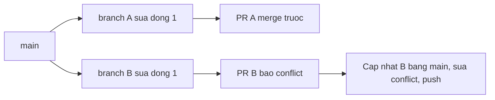

# Buổi 06 – Thử thách nâng cao

[Buổi 06 – Git & GitHub Workflow](session-06.md) · [Hub Tuần 3](README.md) · [Bài tập tuần 3](../../assignments/weekly/week-03.md)

> **Tóm tắt:** Phần nâng cao của Buổi 06, tùy chọn làm ở nhà: tự tạo conflict thứ hai, bật branch protection, xử lý .env lỡ commit và tình huống push bị từ chối.

Trang này không bắt buộc. Hoàn thành [Làm lab của Buổi 06](session-06.md#hands-on-lab) trước.

## Thử thách thêm (L2) {#thu-thach}

::: warning Tự thử trước khi mở gợi ý
Chọn tối thiểu một thử thách. Tự thử 15 phút trước khi mở gợi ý. Lời giải đầy đủ nằm ở [Đối chiếu đáp án](../../mentors/walkthroughs/week-03.md), chỉ mở sau khi nộp bài.
:::

**Thử thách 1: tự tạo conflict ở file thứ hai và giải thích.** Tạo conflict trong `docs/team.md` (hai người sửa cùng dòng) và resolve mà không mất dòng của ai. Viết vào `report.md` giải thích: vì sao Git báo conflict, bạn chọn kết quả nào và vì sao. Hoàn thành khi PR merged, lịch sử có merge commit, không còn conflict marker trong repo.

::: details Gợi ý bậc 1
Cả hai bạn cùng sửa dòng `- Ten thanh vien 1` (trong `docs/team.md`) thành hai nội dung khác nhau trên hai branch khác nhau. Sau khi một PR được merge, người còn lại chạy `git fetch origin` và `git merge origin/main`.
:::

::: details Gợi ý bậc 2
Trong file có conflict, giữ cả hai dòng nếu cả hai đều hợp lệ (ví dụ `- Ten thanh vien 1 (ban P)` và `- Ten thanh vien 1 (ban Q)`), rồi `git add docs/team.md`, `git commit`, `git push`.
:::

**Thử thách 2: bật branch protection cho `main`.**

::: warning Chỉ bật sau khi làm xong các bước push trực tiếp
Rule sẽ chặn mọi lần push thẳng lên `main`. Hãy làm xong Phần 1 của lab và phần "Phá lỗi nâng cao" bên dưới trước khi bật.
:::

Trong repo nhóm, vào Settings, Branches, Add branch protection rule (hoặc Rules, Rulesets nếu giao diện dùng ruleset). Bật tối thiểu: "Require a pull request before merging", "Require approvals" với 1 approval, và "Do not allow bypassing the above settings" nếu có. Chứng minh bằng cách thử push thẳng lên `main` và nhận lỗi. Hoàn thành khi có output `git push` bị từ chối và ảnh chụp trang cấu hình. Repo private trên gói miễn phí có thể không hỗ trợ branch protection; dùng repo public (đúng quy ước của khóa học).

::: details Gợi ý bậc 1
Thử `echo test >> README.md`, `git commit -am "Direct push test"`, `git push origin main`. Lỗi sẽ chứa cụm `protected branch` hoặc mã `GH006` (với ruleset là `GH013`, "Repository rule violations").
:::

::: details Gợi ý bậc 2
Sau khi chứng minh, chạy `git reset --hard origin/main` trên local để bỏ commit thử (chỉ làm trên local, vì đây là commit thử chưa ai dùng). Nếu bạn là chủ repo mà vẫn push được, rule của bạn đang cho phép admin bypass: bật tùy chọn cấm bypass hoặc dùng tài khoản collaborator để thử.
:::

**Thử thách 3: `.gitignore` sau khi đã lỡ commit.** Cố tình commit `.env` giả (chỉ chứa giá trị `dummy`; vì `.env` đã nằm trong `.gitignore` nên phải dùng `git add -f .env`, nên làm trên một branch rồi mở PR), sau đó dừng theo dõi nó mà không xóa file local. Hoàn thành khi `git ls-files` không còn `.env`, file `.env` vẫn có trên đĩa, và bạn giải thích trong `report.md` vì sao phải đổi secret thật nếu điều này xảy ra với secret thật.

::: details Gợi ý bậc 1
Dùng `git rm --cached .env` rồi đảm bảo `.env` có trong `.gitignore`.
:::

::: details Gợi ý bậc 2
Kiểm tra bằng `git ls-files | grep -c '^.env$' || true` (kết quả `0`) và `ls -a | grep '^.env$'` (vẫn thấy file). Lịch sử cũ vẫn chứa `.env`, nên với secret thật bạn phải đổi (rotate) secret đó.
:::

**Câu hỏi thêm.** Branch protection yêu cầu 1 approval. Bạn là chủ repo, một mình. Điều gì xảy ra và vì sao đây là thiết kế có chủ đích?

::: details Đáp án gợi ý
Bạn không thể tự Approve PR của mình, nên không merge được nếu rule áp dụng cho cả admin. Đây là chủ đích: bắt buộc có người thứ hai nhìn qua. Trong dự án thật phải có ít nhất hai người.
:::

## Phá lỗi nâng cao: "Tôi push bị từ chối, và pull thì báo conflict" {#pha-loi}

**Cách phá (làm trước khi bật branch protection).** P và Q cùng làm trên `main` local (không dùng branch), cùng sửa dòng `- Ten thanh vien 1` trong `docs/team.md`, commit, P push trước. Q chạy `git push`.

**Triệu chứng:**

```text
! [rejected]        main -> main (fetch first)
error: failed to push some refs to 'github.com:OWNER/club-team-lab.git'
hint: Updates were rejected because the remote contains work that you do not have locally.
```

**Hướng điều tra, từng bước.**

1. Đọc kỹ thông báo: `fetch first` nghĩa là remote có commit mà local chưa có. Không phải lỗi quyền.
2. `git fetch origin` rồi `git log --oneline --graph --all` để thấy hai nhánh lịch sử đã phân kỳ.
3. `git diff main origin/main` để xem chính xác phần khác nhau.
4. `git pull` (hoặc `git merge origin/main`) sẽ báo conflict vì hai bên sửa cùng dòng (sửa khác dòng thì Git tự gộp); giải quyết như Phần 4 của lab, commit, rồi `git push`.

**Nguyên nhân gốc.** Hai người cùng commit lên `main` mà không dùng branch và PR, nên lịch sử phân kỳ. Lỗi này không phải do Git hỏng.

**Cách phòng tránh.** Không commit trực tiếp lên `main`; bật branch protection; luôn `git pull` trước khi bắt đầu làm; commit nhỏ và PR nhỏ để giảm xác suất đụng nhau.

::: danger Không dùng git push --force để cho qua
`git push --force` ghi đè commit của người kia trên remote. Hãy dùng `git pull`, xử lý conflict rồi push thường; đừng chạy lệnh force trên nhánh chung.
:::

## Đọc thêm: Git chi tiết {#doc-them}

**Quy ước nên có.**

| Chủ đề | Quy ước gợi ý | Ví dụ |
| --- | --- | --- |
| Tên branch | Kiểu thay đổi và mô tả ngắn | `feature/add-member-list`, `fix/readme-typo` |
| Thông điệp commit | Câu mệnh lệnh, ngắn, nói rõ việc đã làm | `Add members section to README` |
| Kích thước PR | Nhỏ, một mục đích, dễ review | Dưới khoảng 300 dòng thay đổi |
| Nhánh main | Luôn chạy được, chỉ nhận thay đổi qua PR | Bật branch protection |

**Bốn vùng của Git.**

| Vùng | Là gì | Lệnh chuyển sang vùng tiếp theo |
| --- | --- | --- |
| Working directory | File bạn đang sửa trên đĩa | `git add` |
| Staging area (index) | Danh sách thay đổi sẽ vào commit kế tiếp | `git commit` |
| Local repository | Lịch sử commit trên máy bạn | `git push` |
| Remote repository | Bản trên GitHub (thường tên `origin`) | `git fetch`, `git pull` |

**HEAD** là con trỏ chỉ ra bạn đang đứng ở branch nào. **Merge và rebase:** buổi này dùng merge vì dễ hiểu và an toàn cho người mới; rebase viết lại lịch sử commit và có thể gây rắc rối khi branch đã chia sẻ.

**Giải thích sơ đồ luồng.**

1. Dev A tạo branch `feature/x` từ `main`; mọi commit sau đó chỉ nằm trên branch này.
2. Các commit chưa ai thấy cho tới khi push; `git push -u origin feature/x` đẩy lên GitHub và ghi nhớ upstream, về sau chỉ cần `git push`.
3. Dev A mở PR từ `feature/x` vào `main`; GitHub hiển thị diff và cho phép thảo luận.
4. Reviewer comment hoặc Approve; có branch protection thì GitHub chặn merge cho tới khi đủ điều kiện.
5. Sau merge, mọi người `git pull` trên `main` và xóa branch đã xong.

**Luồng của một conflict.**



**Câu hỏi thêm.** Vì sao nên làm việc trên feature branch thay vì commit trực tiếp lên `main`? Để `main` luôn chạy được, thay đổi được review qua PR trước khi vào `main`, và dễ hủy hoặc sửa một tính năng mà không ảnh hưởng người khác.

**Xem lịch sử.** Xem lịch sử gọn và chi tiết một commit:

```bash
git log --oneline --graph --all -10
git show --stat HEAD
```

**Câu hỏi thêm (tự kiểm tra).**

- Khác nhau giữa `git add` và `git commit` là gì? `git add` đưa thay đổi vào staging area; `git commit` ghi những gì đang ở staging thành một commit trong repository local. Chưa push thì GitHub chưa thấy gì.
- Hai người cùng sửa cùng một dòng, người nào phải xử lý conflict? Người merge sau (PR báo conflict): họ đưa `main` mới nhất vào branch của mình, resolve ở local, commit và push, và nên trao đổi với tác giả của phần kia.
