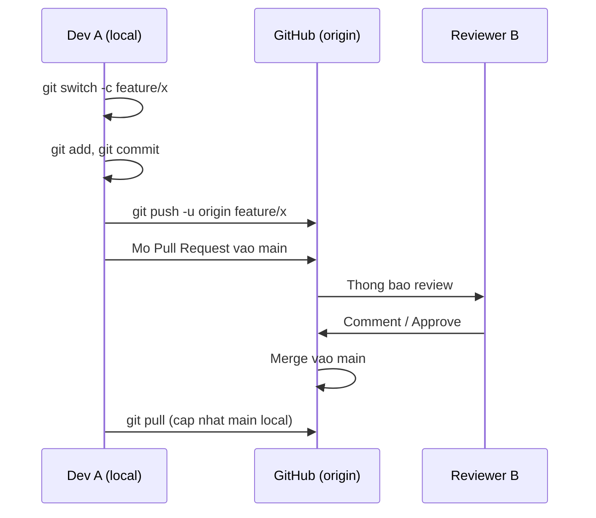
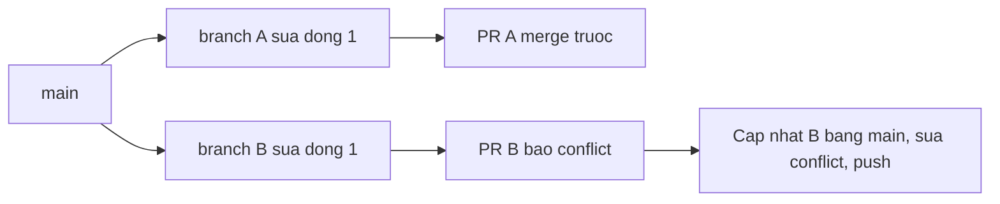

# Buổi 06 – Git & GitHub Workflow

Tuần 3 · Giai đoạn 1 – Engineering Foundation · Slide: [Slide buổi 06](../../slides/01-foundation/session-06.md)

> **Tóm tắt:** Làm việc nhóm với Git và GitHub: feature branch, Pull Request, code review, resolve conflict đúng cách và bảo vệ nhánh main bằng branch protection.

## Mục tiêu học tập

- Giải thích được sự khác nhau giữa working directory, staging area, local repository và remote repository.
- Tạo được feature branch, commit có thông điệp rõ ràng và push lên GitHub bằng dòng lệnh.
- Mở được Pull Request, review chéo cho bạn cùng nhóm và merge sau khi được duyệt.
- Tái hiện và giải quyết được merge conflict mà không làm mất code của người khác.
- Viết được `.gitignore` để không commit `.env`, `node_modules` và các file sinh tự động.
- Thiết lập được branch protection (hoặc ruleset) yêu cầu Pull Request và một review trước khi merge vào `main`.

## Điều kiện cần

- Đã hoàn thành buổi 01–05: thao tác thành thạo terminal Linux trong WSL2 Ubuntu.
- Mỗi học viên có tài khoản GitHub và đã cấu hình cách xác thực với GitHub (SSH key hoặc Git Credential Manager). Không dán token hay password vào lệnh, vào file hay vào chat.
- Nhóm 2–3 người, một người tạo repo nhóm và mời các bạn còn lại làm collaborator (Settings, Collaborators).
- Làm việc trong filesystem của WSL, ví dụ `~/work`, không dùng `/mnt/c`.

Kiểm tra nhanh:

```bash
git --version
git config --global user.name
git config --global user.email
ssh -T git@github.com
```

Kết quả mong đợi (rút gọn):

```text
git version 2.43.0
Nguyen Van A
nguyenvana@example.com
Hi nguyenvana! You've successfully authenticated, but GitHub does not provide shell access.
```

Nếu chưa có `user.name` hoặc `user.email`, cấu hình bằng `git config --global user.name "Tên của bạn"` và `git config --global user.email "email@example.com"`. Đặt thêm một lần chiến lược cho `git pull` (Git bản mới từ chối pull khi lịch sử phân kỳ nếu chưa chọn): `git config --global pull.rebase false` (nghĩa là pull = fetch + merge). Nếu dùng HTTPS thay SSH, bỏ qua lệnh `ssh -T` và dùng URL `https://github.com/...` ở các bước clone.

## Vấn đề thực tế

CLB có 5 bạn cùng sửa một dự án quản lý thành viên. Không có quy ước, mỗi người push thẳng lên `main`. Một bạn commit nhầm file `.env` chứa mật khẩu database, một bạn khác `git push --force` làm mất commit của cả nhóm, và đến buổi demo thì `main` không chạy được vì không ai biết commit nào gây lỗi.

Git và GitHub Workflow giải quyết đúng các vấn đề đó: mỗi thay đổi nằm trên một nhánh riêng, đi qua Pull Request để người khác đọc và kiểm tra, và `main` luôn ở trạng thái chạy được. Đây cũng là nền tảng của CI/CD ở các tuần sau: GitHub Actions sẽ chạy tự động trên mỗi Pull Request. Nếu chưa quen quy trình này, bạn sẽ gặp khó khăn ở capstone khi cả nhóm cùng sửa `starter-project`.

## Khái niệm cốt lõi

### Bốn vùng của Git

| Vùng | Là gì | Lệnh chuyển sang vùng tiếp theo |
| --- | --- | --- |
| Working directory | File bạn đang sửa trên đĩa | `git add` |
| Staging area (index) | Danh sách thay đổi sẽ vào commit kế tiếp | `git commit` |
| Local repository | Lịch sử commit trên máy bạn | `git push` |
| Remote repository | Bản trên GitHub (thường tên `origin`) | `git fetch`, `git pull` |

### Commit, branch, merge

- **Commit** là một ảnh chụp (snapshot) của dự án, có mã băm (hash), tác giả, thời gian và trỏ tới commit cha. Lịch sử là chuỗi commit.
- **Branch** chỉ là một con trỏ có tên tới một commit. Tạo branch rất rẻ, nên mỗi tính năng hay bản sửa lỗi nên có branch riêng.
- **HEAD** là con trỏ chỉ ra bạn đang đứng ở branch nào.
- **Merge** gộp lịch sử của hai branch. Nếu hai branch cùng sửa một vùng của một file, Git không tự quyết được và báo **conflict**.

### Pull Request và code review

Pull Request (PR) là đề nghị gộp branch của bạn vào branch đích (thường là `main`) trên GitHub. PR không phải tính năng của Git mà của GitHub. Giá trị của PR nằm ở chỗ có chỗ để thảo luận, review, chạy kiểm tra tự động và lưu lại lý do thay đổi.

Một review tốt trả lời: thay đổi có làm đúng điều mô tả không, có lộ secret không, có file không nên commit không, có thể gây lỗi ở đâu. Review là góp ý về code, không phải về con người.

### Các quy ước nên có

| Chủ đề | Quy ước gợi ý | Ví dụ |
| --- | --- | --- |
| Tên branch | Kiểu thay đổi và mô tả ngắn | `feature/add-member-list`, `fix/readme-typo` |
| Thông điệp commit | Câu mệnh lệnh, ngắn, nói rõ việc đã làm | `Add members section to README` |
| Kích thước PR | Nhỏ, một mục đích, dễ review | Dưới khoảng 300 dòng thay đổi |
| Nhánh main | Luôn chạy được, chỉ nhận thay đổi qua PR | Bật branch protection |

### .gitignore

`.gitignore` liệt kê các mẫu đường dẫn mà Git bỏ qua. Nó chỉ có tác dụng với file chưa được theo dõi (untracked). Nếu file đã bị commit, thêm vào `.gitignore` là chưa đủ, phải chạy thêm `git rm --cached`. Và nếu secret đã lên GitHub thì phải coi là đã lộ: đổi secret, không chỉ xóa file.

### Merge và rebase

Buổi này dùng **merge** vì dễ hiểu và an toàn cho người mới. Rebase viết lại lịch sử commit và có thể gây rắc rối khi branch đã được chia sẻ, nên chỉ nhắc tên ở đây. Quy tắc an toàn: không bao giờ `git push --force` lên branch chung như `main`.

## Kiến trúc và cách hoạt động



Giải thích từng bước:

1. Dev A tạo branch `feature/x` từ `main`. Mọi commit sau đó chỉ nằm trên branch này, `main` không bị ảnh hưởng.
2. Dev A commit nhiều lần trên local. Các commit chưa ai thấy cho tới khi push.
3. `git push -u origin feature/x` đẩy branch lên GitHub và ghi nhớ branch upstream, về sau chỉ cần `git push`.
4. Dev A mở Pull Request từ `feature/x` vào `main`. GitHub hiển thị diff và cho phép thảo luận.
5. Reviewer B đọc diff, để lại comment hoặc Approve. Nếu có branch protection, GitHub chặn merge cho tới khi đủ điều kiện.
6. Sau khi merge, mọi người `git pull` trên `main` để lấy bản mới và xóa branch đã xong.

Luồng của một conflict:



Quy tắc: người merge sau là người xử lý conflict, bằng cách đưa `main` mới nhất vào branch của mình rồi push lại.

## Demo của mentor

Mentor dùng một repo trống tên `git-demo` (public, tạo sẵn trên GitHub) và máy chiếu terminal WSL. Thời lượng khoảng 15 phút của phần 30 phút kiến thức.

1. Clone và xem trạng thái.

```bash
mkdir -p ~/work && cd ~/work
git clone git@github.com:MENTOR_USER/git-demo.git
cd git-demo
git status
git log --oneline
```

Kết quả mong đợi:

```text
On branch main
Your branch is up to date with 'origin/main'.
nothing to commit, working tree clean
a1b2c3d Initial commit
```

Câu hỏi cho lớp: "Hash `a1b2c3d` đại diện cho cái gì? Nếu tôi đổi một chữ trong commit này thì hash có đổi không?" (Có, vì hash tính từ nội dung.)

2. Tạo branch, sửa, commit.

```bash
git switch -c feature/add-members
echo "- Nguyen Van A" >> members.md
git status --short
git add members.md
git commit -m "Add first member"
git log --oneline --graph --all
```

Kết quả mong đợi:

```text
?? members.md
* 9f8e7d6 (HEAD -> feature/add-members) Add first member
* a1b2c3d (origin/main, origin/HEAD, main) Initial commit
```

Câu hỏi: "Dòng `??` nghĩa là gì? Vì sao `main` chưa thay đổi?"

3. Push và mở PR trên web, rồi để một học viên review và Approve.

```bash
git push -u origin feature/add-members
```

Kết quả mong đợi: Git in ra đường dẫn gợi ý tạo Pull Request (`Create a pull request for 'feature/add-members' on GitHub by visiting: ...`) và dòng `branch 'feature/add-members' set up to track 'origin/feature/add-members'`.

4. Demo `.gitignore` sai thứ tự: tạo file `.env`, `git add .`, thấy nó bị staged, sau đó `git restore --staged .env`, tạo `.gitignore` chứa `.env` và chạy lại `git status`.

```bash
echo "DB_PASSWORD=dummy" > .env
git add .
git status --short
git restore --staged .env
echo ".env" > .gitignore
git status --short
```

Kết quả mong đợi: lần đầu có dòng `A  .env`, lần sau chỉ còn `?? .gitignore`. Câu hỏi: "Nếu tôi đã commit `.env` rồi mới thêm `.gitignore`, chuyện gì xảy ra?" (File vẫn bị theo dõi và vẫn nằm trong lịch sử.)

5. Mentor chỉ nhanh một conflict mẫu (xem Phần 4 của lab) để lớp thấy dấu `<<<<<<<`, `=======`, `>>>>>>>` trước khi tự làm.

## Hands-on lab

Thời gian gợi ý: chuẩn bị 5 phút, Phần 1 10 phút, Phần 2 10 phút, Phần 3 10 phút, Phần 4 15 phút, Phần 5 10 phút.

### Chuẩn bị

Nhóm 2–3 người. Quy ước vai: **Bạn A** tạo repo, **Bạn B** và **Bạn C** (nếu có) là collaborator. Với nhóm 2 người, B đảm nhiệm cả vai C.

1. Bạn A tạo repo tên `club-team-lab` trên GitHub (public, chọn "Add a README file"), rồi mời B, C vào Settings, Collaborators. Các bạn chấp nhận lời mời qua email hoặc trang thông báo của GitHub.
2. Tất cả clone repo về WSL:

```bash
mkdir -p ~/work && cd ~/work
git clone git@github.com:OWNER/club-team-lab.git
cd club-team-lab
git status
```

Kết quả mong đợi: `On branch main` và `nothing to commit, working tree clean`. Thay `OWNER` bằng tên tài khoản của Bạn A (hoặc dùng URL HTTPS nếu bạn xác thực bằng HTTPS).

### Phần 1 – Commit đầu tiên và .gitignore (Bạn A)

1. Tạo cấu trúc ban đầu cho dự án giả lập của nhóm:

```bash
mkdir docs
printf '# Club Team Lab\n\nRepo luyen tap Git workflow.\n' > README.md
printf '# Thanh vien\n\n- Ten thanh vien 1\n' > docs/team.md
printf 'DB_PASSWORD=dummy-only-for-lab\n' > .env
git status --short
```

Kết quả mong đợi: `M README.md`, `?? docs/` và `?? .env`. File `.env` là cố tình tạo ra để luyện thói quen: nó không được phép lên GitHub.

2. Tạo `.gitignore` trước khi add:

```bash
printf '.env\nnode_modules/\n*.log\n.DS_Store\n' > .gitignore
git status --short
```

Kết quả mong đợi: `.env` biến mất khỏi danh sách; còn `.gitignore`, `docs/`, `README.md`.

3. Kiểm tra rằng Git thực sự bỏ qua `.env`, rồi commit thẳng lên `main` (đây là lần cuối và duy nhất, vì repo còn trống):

```bash
git check-ignore -v .env
git add .gitignore README.md docs/team.md
git commit -m "Add project skeleton and gitignore"
git push origin main
```

Kết quả mong đợi: `git check-ignore -v` in ra dòng dạng `.gitignore:1:.env	.env`. Commit báo `3 files changed`.

Vì sao: `git check-ignore -v` cho biết mẫu nào đang chặn file, giúp debug khi file "tự nhiên không được add". Add từng file thay vì `git add .` là thói quen an toàn khi chưa chắc `.gitignore` đầy đủ.

4. Bạn B và C chạy `git pull` để nhận skeleton.

### Phần 2 – Feature branch và Pull Request (cả nhóm)

Mỗi bạn làm việc trên branch riêng và chỉ thêm file của mình, không đụng file của người khác.

1. Tạo branch (thay `ten-ban` bằng tên không dấu của bạn):

```bash
git switch main
git pull
git switch -c feature/add-ten-ban
```

Kết quả mong đợi: `Switched to a new branch 'feature/add-ten-ban'`.

2. Mỗi bạn tạo file hồ sơ riêng (để ba người không sửa chung một vị trí trong file, tránh conflict ngoài ý muốn), commit, rồi bổ sung vai trò và commit lần hai:

```bash
mkdir -p docs/members
echo "# Ten Ban" > docs/members/ten-ban.md
git add docs/members/ten-ban.md
git commit -m "Add Ten Ban profile"
echo "- Vai tro: thanh vien CLB" >> docs/members/ten-ban.md
git diff
git add docs/members/ten-ban.md
git commit -m "Add role to Ten Ban profile"
```

Kết quả mong đợi: commit đầu báo `1 file changed, 1 insertion(+)` và `create mode 100644 docs/members/ten-ban.md`; `git diff` hiển thị một dòng bắt đầu bằng dấu `+`; commit thứ hai báo `1 file changed, 1 insertion(+)`.

Vì sao dùng `git diff` trước khi `git add`: đọc lại thay đổi của chính mình là lớp review đầu tiên, bắt được file in nhầm, debug code quên xóa. Lưu ý `git diff` chỉ hiện file đã được theo dõi; file mới tạo (untracked) chỉ hiện trong `git status`, hoặc trong `git diff --staged` sau khi `git add`.

3. Push branch:

```bash
git push -u origin feature/add-ten-ban
```

4. Mở Pull Request trên GitHub: bấm "Compare & pull request", base là `main`, compare là branch của bạn. Viết tiêu đề ngắn và mô tả gồm: đã thay đổi gì, vì sao, cách kiểm tra. Chỉ định một bạn trong nhóm làm Reviewer.

5. Reviewer mở tab "Files changed", để lại ít nhất một comment cụ thể trên một dòng (có thể là câu hỏi hoặc gợi ý), sau đó chọn "Review changes" và "Approve". Lưu ý: bạn không thể Approve PR của chính mình.

6. Tác giả bấm "Merge pull request" (chọn kiểu mặc định "Create a merge commit"; nếu chọn Squash, `git branch -d` sẽ báo branch chưa merge và bạn phải dùng `-D`) khi đã được duyệt, sau đó xóa branch trên GitHub và dọn local:

```bash
git switch main
git pull
git branch -d feature/add-ten-ban
git log --oneline --graph -5
```

Kết quả mong đợi: `main` local có commit của bạn (có thể thêm merge commit), `git branch -d` báo `Deleted branch feature/add-ten-ban`.

Nếu PR của bạn báo conflict ở bước này, đó chính là chủ đề của Phần 4: hãy làm tiếp theo hướng dẫn ở đó.

### Phần 3 – Đọc lịch sử và hoàn tác an toàn (cá nhân)

1. Xem lịch sử gọn và chi tiết một commit:

```bash
git log --oneline --graph --all -10
git show --stat HEAD
```

2. Hoàn tác an toàn một commit (kể cả commit đã push) bằng `git revert` (tạo commit mới đảo ngược thay đổi, không viết lại lịch sử). Thực hành trên branch riêng:

```bash
git switch -c practice/revert-demo
echo "dong sai" >> README.md
git commit -am "Add wrong line"
git revert --no-edit HEAD
git log --oneline -3
cat README.md
```

Kết quả mong đợi: `git log` có hai commit mới, commit sau tên `Revert "Add wrong line"`; `README.md` không còn dòng `dong sai`.

Vì sao: `git reset --hard` cùng `git push --force` làm mất lịch sử của người khác. `git revert` là cách hoàn tác an toàn cho nhánh chung.

3. Chuyển nhánh về `main` và xóa nhánh thực hành:

```bash
git switch main
git branch -D practice/revert-demo
```

### Phần 4 – Tạo và resolve merge conflict (cả nhóm, theo cặp)

Hai bạn (gọi là P và Q) cố tình sửa **cùng một dòng** để tạo conflict.

1. Cả hai cập nhật `main` rồi tạo branch từ cùng một điểm:

```bash
git switch main
git pull
git switch -c feature/title-p     # Q dung ten feature/title-q
```

2. P đổi dòng tiêu đề của `README.md` thành `# Club Team Lab - Phien ban cua P`, Q đổi thành `# Club Team Lab - Phien ban cua Q`. Mỗi người commit và push branch của mình (lệnh dưới là của P; Q thay `P` bằng `Q` và `title-p` bằng `title-q`):

```bash
sed -i '1s/.*/# Club Team Lab - Phien ban cua P/' README.md
git commit -am "Change title (P)"
git push -u origin feature/title-p
```

Nếu nhóm có người thứ ba (C), C đóng vai reviewer cho cả hai PR.

3. Mở PR cho cả hai branch. P (sau khi được review) merge PR của mình trước. PR của Q chuyển sang trạng thái "This branch has conflicts that must be resolved".

4. Q đưa `main` mới nhất vào branch của mình và xử lý conflict ở local:

```bash
git fetch origin
git merge origin/main
```

Kết quả mong đợi:

```text
Auto-merging README.md
CONFLICT (content): Merge conflict in README.md
Automatic merge failed; fix conflicts and then commit the result.
```

5. Mở `README.md`, bạn sẽ thấy:

```text
<<<<<<< HEAD
# Club Team Lab - Phien ban cua Q
=======
# Club Team Lab - Phien ban cua P
>>>>>>> origin/main
```

Phần giữa `<<<<<<< HEAD` và `=======` là của bạn (branch hiện tại), phần giữa `=======` và `>>>>>>> origin/main` là của `main`. Hai bạn cùng thảo luận để chọn kết quả cuối, ví dụ gộp ý: `# Club Team Lab - P va Q`. Xóa cả ba dòng dấu hiệu, giữ đúng một dòng kết quả.

6. Xác nhận không còn dấu hiệu conflict, hoàn tất merge và push:

```bash
grep -rn '^<<<<<<<\|^=======\|^>>>>>>>' README.md docs/ || echo "Khong con conflict marker"
git add README.md
git commit -m "Merge main into feature/title-q and resolve title conflict"
git push
```

Kết quả mong đợi: `Khong con conflict marker`; PR của Q chuyển sang có thể merge. Reviewer là P xem lại phần đã gộp trước khi Approve.

Vì sao: Git không biết ý định của con người. Nó chỉ đánh dấu chỗ hai bên khác nhau. Việc chọn đúng kết quả là quyết định của người, và phải bàn với tác giả của phần kia. Xóa sạch code của người kia là sai.

### Phần 5 – Dọn dẹp và chuyển sang L2

Sau khi cả hai PR ở Phần 4 đã merge, mỗi người chạy `git switch main`, `git pull`, rồi xóa branch local đã xong bằng `git branch -d`. Từ đây trở đi hoàn thành checklist L1, sau đó chọn thử thách L2 (kể cả bật branch protection) ở bên dưới. Hãy bật branch protection sau khi làm xong các bước push trực tiếp lên `main` ở Phần 1 và phần Phá lỗi, vì rule sẽ chặn các thao tác đó.

### L1 – Foundation: checklist hoàn thành

- [ ] Repo nhóm `club-team-lab` có `.gitignore` chứa `.env` và `node_modules/`; `.env` không có trên GitHub.
- [ ] Bạn có ít nhất 2 commit trên một feature branch, thông điệp rõ ràng.
- [ ] Bạn đã mở một Pull Request có tiêu đề và mô tả đầy đủ.
- [ ] Một bạn trong nhóm đã review (có ít nhất một comment trên dòng cụ thể) và Approve.
- [ ] PR đã được merge, branch đã xóa, `main` local đã `git pull`.
- [ ] `git log --oneline --graph` hiển thị lịch sử có commit của cả nhóm.

### L2 – Engineering: thử thách tự làm

**Thử thách 1: tự tạo conflict ở file thứ hai và giải thích.** Tạo conflict trong `docs/team.md` (hai người sửa cùng dòng) và resolve mà không mất dòng của ai. Viết vào `report.md` giải thích: vì sao Git báo conflict, bạn chọn kết quả nào và vì sao. Tiêu chí hoàn thành: PR merged, lịch sử có merge commit, không còn conflict marker trong repo.

<details>
<summary>Gợi ý</summary>

Cả hai bạn cùng sửa dòng `- Ten thanh vien 1` (trong `docs/team.md`) thành hai nội dung khác nhau trên hai branch khác nhau. Sau khi một PR được merge, người còn lại chạy `git fetch origin` và `git merge origin/main`.

</details>

<details>
<summary>Lời giải</summary>

Trong file có conflict, giữ cả hai dòng nếu cả hai đều hợp lệ:

```text
- Ten thanh vien 1 (ban P)
- Ten thanh vien 1 (ban Q)
```

Sau đó `git add docs/team.md`, `git commit`, `git push`. Điều quan trọng là mỗi người nhận ra phần của người kia và giữ lại khi nó vẫn đúng.

</details>

**Thử thách 2: bật branch protection cho `main`.** Trong repo nhóm, vào Settings, Branches, Add branch protection rule (hoặc Rules, Rulesets nếu giao diện của bạn dùng ruleset). Bật tối thiểu: "Require a pull request before merging", "Require approvals" với 1 approval, và "Do not allow bypassing the above settings" nếu có. Chứng minh bằng cách thử push thẳng lên `main` và nhận lỗi. Tiêu chí hoàn thành: có output lệnh `git push` bị từ chối và ảnh chụp trang cấu hình. Lưu ý: repo private trên gói miễn phí có thể không hỗ trợ branch protection; dùng repo public cho lab.

<details>
<summary>Gợi ý</summary>

Thử `echo test >> README.md`, `git commit -am "Direct push test"`, `git push origin main`. Lỗi sẽ chứa cụm `protected branch` hoặc mã `GH006` (với ruleset là `GH013`, "Repository rule violations"). Sau khi chứng minh, chạy `git reset --hard origin/main` trên local để bỏ commit thử.

</details>

<details>
<summary>Lời giải</summary>

Output dạng (rút gọn, nội dung chính xác có thể khác tuỳ cấu hình):

```text
remote: error: GH006: Protected branch update failed for refs/heads/main.
remote: - Changes must be made through a pull request.
! [remote rejected] main -> main (protected branch hook declined)
```

Nếu bạn dùng ruleset, thông báo khác đi: `remote: error: GH013: Repository rule violations found for refs/heads/main.` và `(push declined due to repository rule violations)`.

Nếu bạn là chủ repo và vẫn push được, rule của bạn đang cho phép admin bypass; bật tuỳ chọn cấm bypass hoặc dùng tài khoản collaborator để thử.

</details>

**Thử thách 3: `.gitignore` sau khi đã lỡ commit.** Cố tình commit `.env` giả (chỉ chứa giá trị `dummy`; vì `.env` đã nằm trong `.gitignore` nên phải dùng `git add -f .env`, và nên làm trên một branch rồi mở PR), sau đó dừng theo dõi nó mà không xóa file local. Tiêu chí hoàn thành: `git ls-files` không còn `.env`, file `.env` vẫn có trên đĩa, và bạn giải thích trong `report.md` vì sao phải đổi secret thật nếu điều này xảy ra với secret thật.

<details>
<summary>Gợi ý</summary>

Dùng `git rm --cached .env` rồi đảm bảo `.env` có trong `.gitignore`.

</details>

<details>
<summary>Lời giải</summary>

```bash
git rm --cached .env
git commit -m "Stop tracking .env"
git ls-files | grep -c '^.env$' || true
ls -a | grep '^.env$'
```

`git ls-files` không còn `.env` (grep báo 0), `ls` vẫn thấy file. Lịch sử cũ vẫn chứa `.env`, nên với secret thật bạn phải đổi (rotate) secret đó; xóa file không xóa được lịch sử đã push.

</details>

## Phá lỗi và debug

**Tình huống: "Tôi push bị từ chối, và pull thì báo conflict."**

Cách phá (làm trước khi bật branch protection): P và Q cùng làm trên `main` local (không dùng branch), cùng sửa dòng `- Ten thanh vien 1` trong `docs/team.md`, commit, P push trước. Q chạy `git push`.

Triệu chứng:

```text
! [rejected]        main -> main (fetch first)
error: failed to push some refs to 'github.com:OWNER/club-team-lab.git'
hint: Updates were rejected because the remote contains work that you do not have locally.
```

Hướng điều tra, từng bước:

1. Đọc kỹ thông báo: `fetch first` nghĩa là remote có commit mà local chưa có. Không phải lỗi quyền.
2. `git fetch origin` rồi `git log --oneline --graph --all` để thấy hai nhánh lịch sử đã phân kỳ.
3. `git diff main origin/main` để xem chính xác phần khác nhau.
4. `git pull` (hoặc `git merge origin/main`) sẽ báo conflict vì hai bên sửa cùng dòng (nếu sửa khác dòng thì Git tự gộp); giải quyết như Phần 4, commit, rồi `git push`.

Nguyên nhân gốc: hai người cùng commit lên `main` mà không dùng branch và PR, nên lịch sử phân kỳ. Lỗi này không phải do Git hỏng.

Cách phòng tránh: không commit trực tiếp lên `main`; bật branch protection; luôn `git pull` trước khi bắt đầu làm; commit nhỏ và PR nhỏ để giảm xác suất đụng nhau. Cảnh báo: không dùng `git push --force` để "cho qua": nó ghi đè commit của người kia.

## Lỗi thường gặp

| Triệu chứng | Nguyên nhân | Cách xử lý |
| --- | --- | --- |
| `Permission denied (publickey)` khi clone hoặc push | Chưa thêm SSH key vào GitHub hoặc ssh-agent chưa nạp key | Chạy `ssh -T git@github.com` để chẩn đoán, thêm public key vào Settings, SSH keys, hoặc dùng HTTPS |
| `.env` hoặc `node_modules` xuất hiện trong `git status` | Chưa có `.gitignore`, hoặc file đã bị theo dõi từ trước | Thêm vào `.gitignore`; nếu đã tracked thì `git rm --cached` |
| `rejected ... (fetch first)` khi push | Remote có commit mới mà local chưa có | `git pull` (hoặc fetch rồi merge), xử lý conflict, push lại |
| Conflict marker còn sót trong file sau khi commit | Quên xóa `<<<<<<<`, `=======`, `>>>>>>>` | Dùng lệnh `grep` ở Phần 4 để kiểm tra trước khi commit |
| `Please tell me who you are` khi commit | Chưa cấu hình `user.name` và `user.email` | `git config --global user.name` và `git config --global user.email` |
| Không thể Approve PR của chính mình | GitHub cấm tác giả tự duyệt | Nhờ bạn khác trong nhóm review |
| Merge xong nhưng `main` local chưa có thay đổi | Quên `git pull` sau khi merge trên web | `git switch main` rồi `git pull` |
| Resolve conflict bằng cách xóa phần của người kia | Chọn nhanh mà không hiểu ý định | Hỏi tác giả, giữ phần hợp lệ của cả hai, chạy lại kiểm thử |

## Tự kiểm tra

1. Khác nhau giữa `git add` và `git commit` là gì?

<details>
<summary>Đáp án</summary>

`git add` đưa thay đổi vào staging area; `git commit` ghi những gì đang ở staging thành một commit trong repository local. Chưa push thì GitHub chưa thấy gì.

</details>

2. Vì sao nên làm việc trên feature branch thay vì commit trực tiếp lên `main`?

<details>
<summary>Đáp án</summary>

Để `main` luôn chạy được, thay đổi được review qua PR trước khi vào `main`, và dễ hủy hoặc sửa một tính năng mà không ảnh hưởng người khác.

</details>

3. Hai người cùng sửa cùng một dòng, người nào phải xử lý conflict?

<details>
<summary>Đáp án</summary>

Người merge sau (PR báo conflict). Họ đưa `main` mới nhất vào branch của mình, resolve ở local, commit và push. Nên trao đổi với tác giả của phần kia.

</details>

4. Bạn thêm `.env` vào `.gitignore` nhưng `git status` vẫn báo `.env` thay đổi. Vì sao và xử lý thế nào?

<details>
<summary>Đáp án</summary>

File đã được theo dõi từ trước; `.gitignore` chỉ áp dụng cho file untracked. Chạy `git rm --cached .env`, commit. Nếu là secret thật đã push thì phải đổi secret.

</details>

5. `git revert` khác `git reset --hard` ở điểm nào, và khi nào dùng cái nào cho nhánh chung?

<details>
<summary>Đáp án</summary>

`revert` tạo commit mới đảo ngược thay đổi, giữ nguyên lịch sử, an toàn cho nhánh đã push. `reset --hard` di chuyển nhánh và bỏ thay đổi, cần `--force` để push, có thể làm mất việc của người khác, chỉ nên dùng trên nhánh cá nhân chưa chia sẻ.

</details>

6. Tình huống: đồng đội báo "mình push lên main mà bị rejected, mình nên `git push --force` đúng không?" Bạn trả lời gì?

<details>
<summary>Đáp án</summary>

Không. Rejected nghĩa là remote có commit mới. Force push sẽ xóa commit đó. Hãy `git pull` (fetch và merge), xử lý conflict nếu có, rồi push thường. Tốt hơn là chuyển sang feature branch và PR.

</details>

7. Branch protection yêu cầu 1 approval. Bạn là chủ repo, một mình. Điều gì xảy ra và vì sao đây là thiết kế có chủ đích?

<details>
<summary>Đáp án</summary>

Bạn không thể tự Approve PR của mình, nên không merge được nếu rule áp dụng cho cả admin. Đây là chủ đích: bắt buộc có người thứ hai nhìn qua. Trong dự án thật phải có ít nhất hai người.

</details>

## Nộp bài

Nộp vào thư mục `lab-06/` trong repo cá nhân (ví dụ `devops-labs`) theo `templates/lab-template.md`:

- [ ] `README.md` trả lời đủ 7 câu hỏi của template (vấn đề, kiến thức, các bước, kết quả, lỗi đã gặp, cách khắc phục, cải thiện).
- [ ] `evidence/command-output.txt` chứa lệnh và kết quả thật: `git log --oneline --graph --all`, `git status`, và output khi gặp conflict hoặc khi push bị từ chối.
- [ ] `report.md` ghi lại link tới PR của bạn, PR bạn đã review, mô tả cách bạn resolve conflict và (nếu làm L2) kết quả branch protection.
- [ ] `source/` chứa bản sao `.gitignore`, `docs/team.md` và `README.md` cuối cùng của repo nhóm.
- [ ] `screenshots/` có ảnh trang PR đã Approve và merged; ảnh cấu hình branch protection nếu làm L2.
- [ ] Đã ghi rõ level đã làm: L1 hoặc L2.
- [ ] Không commit `.env`, password, token, private key; kiểm tra bằng `git ls-files | grep -i env` trước khi push.

## Recap

- Git có bốn vùng: working directory, staging, local repo, remote; mỗi lệnh chuyển thay đổi từ vùng này sang vùng kế tiếp.
- Mỗi thay đổi nên nằm trên một feature branch nhỏ, commit rõ ràng, và đi vào `main` qua Pull Request.
- Review là cơ chế chất lượng: đọc diff, hỏi, góp ý, kiểm tra secret và file thừa.
- Conflict là bình thường; người merge sau xử lý, bàn với tác giả, và không xóa code của người khác.
- `.gitignore` chỉ ngăn file chưa tracked; secret đã lộ lên GitHub phải được đổi, không chỉ xóa.
- Không `push --force` lên nhánh chung; dùng `git revert` để hoàn tác an toàn.
- Branch protection biến quy ước thành quy tắc bắt buộc, và là nền cho CI/CD ở các tuần sau.

## Tài liệu tham khảo

- [Pro Git (sách chính thức, tiếng Việt và tiếng Anh)](https://git-scm.com/book/vi/v2)
- [Git reference documentation](https://git-scm.com/docs)
- [GitHub Docs – About pull requests](https://docs.github.com/en/pull-requests/collaborating-with-pull-requests/proposing-changes-to-your-work-with-pull-requests/about-pull-requests)
- [GitHub Docs – Addressing merge conflicts](https://docs.github.com/en/pull-requests/collaborating-with-pull-requests/addressing-merge-conflicts)
- [GitHub Docs – About protected branches](https://docs.github.com/en/repositories/configuring-branches-and-merges-in-your-repository/managing-protected-branches/about-protected-branches)
- [GitHub Docs – Connecting to GitHub with SSH](https://docs.github.com/en/authentication/connecting-to-github-with-ssh)
