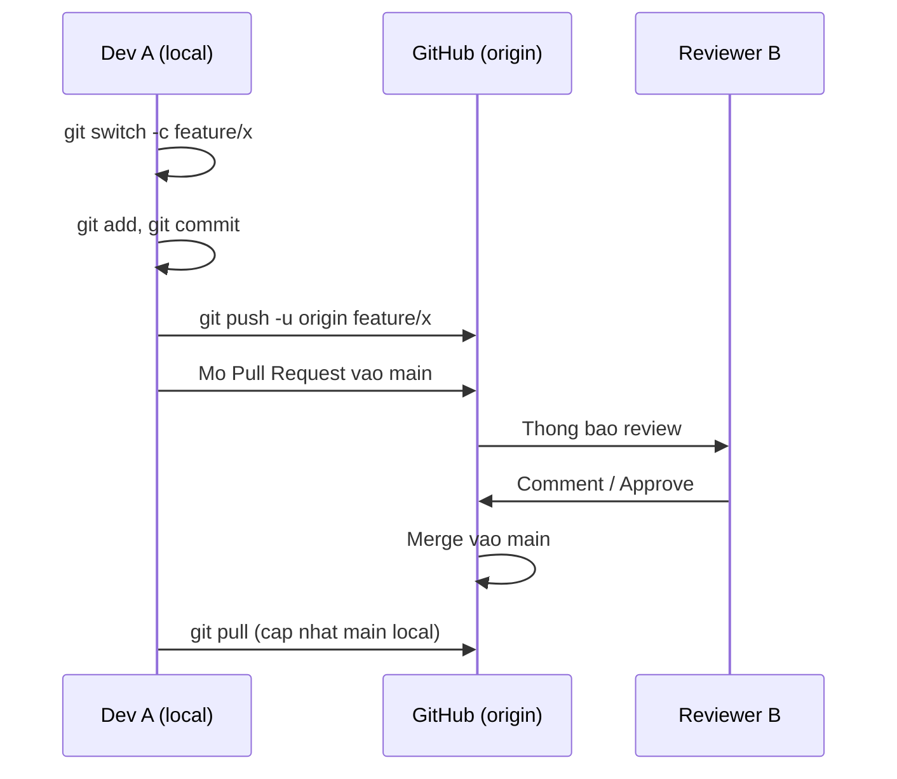

# Buổi 06 – Git & GitHub Workflow

Tuần 3/16 · Giai đoạn 1 – Engineering Foundation · Buổi 06/32

[Slide buổi 06](../../slides/01-foundation/session-06.md) · [Bài tập tuần 3](../../assignments/weekly/week-03.md) · [Hub Tuần 3](README.md)

> **Tóm tắt:** Làm việc nhóm với Git và GitHub: feature branch, Pull Request, code review, xử lý merge conflict đúng cách và không đưa secret lên repo.

::: tip Buổi này bạn làm gì
**Bạn sẽ tạo ra:** một repo nhóm `club-team-lab` có lịch sử sạch: `.gitignore` chặn `.env`, ít nhất một Pull Request đã được bạn khác review và merge, và một merge conflict do chính bạn tạo rồi gỡ.

**Thời gian thật:** đọc 15 phút · lab bắt buộc 60 phút · thử thách tùy chọn (kể cả branch protection) làm ở nhà.

**Cần chuẩn bị:**

- [ ] Xong [Buổi 05 – Networking Fundamentals](session-05.md); môi trường theo [Hướng dẫn cài đặt](../../resources/setup-guide.md).
- [ ] Tài khoản GitHub, đã đăng nhập hoặc cấu hình xác thực (SSH key hoặc Git Credential Manager) theo [Tài khoản và repo GitHub](../../resources/setup-github.md). Không dán token hay password vào lệnh, file hay chat.
- [ ] Một bạn cùng nhóm (2-3 người). Học một mình vẫn làm được, xem ghi chú ở Phần 4.

**Sản phẩm phải nộp:** `lab-06/` trong repo `devops-labs` gồm `README.md`, `evidence/command-output.txt` (log Git thật), `report.md` (link PR, cách resolve conflict), ảnh PR đã Approve và merged.

**Đi nhanh:** [Đọc](#doc) → [Làm lab](#hands-on-lab) → [Gặp lỗi?](#gap-loi) → [Tự kiểm tra](#tu-kiem-tra) → [Nộp bài](#nop-bai). Kẹt? Nhảy tới [Gặp lỗi?](#gap-loi).
:::

Từ mới trong buổi (xem [Thuật ngữ](../../resources/glossary.md)):

- **Commit**: một điểm lưu trong lịch sử Git, gồm thay đổi, tác giả, thông điệp.
- **Branch (nhánh)**: dòng lịch sử độc lập để làm một việc mà không ảnh hưởng nhánh chính.
- **Pull Request (PR)**: đề nghị gộp branch của bạn vào `main` trên GitHub.
- **Merge conflict**: hai nhánh sửa cùng một vùng, Git không tự chọn được.
- **`.gitignore`**: danh sách file Git bỏ qua, như `.env`.
- **Branch protection**: quy tắc GitHub bắt buộc PR và review trước khi vào `main`.

Buổi 01 và trang [Git trong 10 phút](../../curriculum/how-to-learn.md#git-10-phut) chỉ cho bản rút gọn để nộp bài; buổi này là nơi giải thích đầy đủ. Trên lớp, mentor demo trước; tự học thì làm thẳng phần [Làm lab](#hands-on-lab).

## Vấn đề thực tế {#doc}

CLB có 5 bạn cùng sửa một dự án quản lý thành viên. Không có quy ước, mỗi người push thẳng lên `main`. Một bạn commit nhầm file `.env` chứa mật khẩu database, một bạn khác `git push --force` làm mất commit của cả nhóm, và đến buổi demo thì `main` không chạy được vì không ai biết commit nào gây lỗi.

Git và GitHub Workflow giải quyết đúng các vấn đề đó: mỗi thay đổi nằm trên một nhánh riêng, đi qua Pull Request để người khác đọc và kiểm tra, và `main` luôn chạy được. Đây cũng là nền của CI/CD ở các tuần sau: GitHub Actions sẽ chạy tự động trên mỗi Pull Request.

## Khái niệm cốt lõi

- **Bốn vùng của Git.** Thay đổi đi qua working directory (file đang sửa) rồi `git add` vào staging, `git commit` vào local repository, `git push` lên remote (`origin` trên GitHub). Giống gửi bưu kiện: bỏ đồ vào hộp (add), dán nhãn niêm phong (commit), mang ra bưu điện (push).
- **Commit, branch, merge.** Commit là một ảnh chụp dự án có hash, tác giả, thời gian; branch chỉ là con trỏ có tên tới một commit; merge gộp lịch sử hai branch. Giống bản nháp: mỗi branch là một bản photo để bạn sửa thoải mái, merge là ghép bản photo vào bản chính.
- **Pull Request và code review.** PR là đề nghị gộp branch vào `main` trên GitHub, có chỗ thảo luận, review và chạy kiểm tra tự động. Giống nộp bài cho thầy chấm trước khi đưa vào sách giáo khoa. Review góp ý về code, không về con người: đúng mô tả chưa, có lộ secret không, có file thừa không.
- **`.gitignore` và secret.** `.gitignore` chỉ có tác dụng với file chưa theo dõi; file đã commit phải `git rm --cached`; secret đã lên GitHub coi như đã lộ và phải đổi, không chỉ xóa file. Giống thư đã gửi đi: xóa bản nháp không lấy lại được thư.
- **Conflict.** Hai nhánh cùng sửa một vùng thì Git chỉ đánh dấu chỗ khác nhau, con người quyết định kết quả. Người merge sau xử lý: đưa `main` mới nhất vào branch của mình, sửa, push lại. Giống hai người cùng sửa một câu trong bài chung: phải bàn rồi mới chốt.

Luồng làm việc chuẩn của một thay đổi:



## Hands-on lab (60 phút, bắt buộc) {#hands-on-lab}

Nhóm 2-3 người. Quy ước vai: **Bạn A** tạo repo, **Bạn B** và **Bạn C** (nếu có) là collaborator; nhóm 2 người thì B đảm nhiệm cả vai C. Bước nào lỗi, xem [Gặp lỗi?](#gap-loi).

### Chuẩn bị (5 phút)

1. Kiểm tra Git và xác thực:

```bash
git --version
git config --global user.name
git config --global user.email
ssh -T git@github.com
```

Kết quả mong đợi (rút gọn): phiên bản Git (ví dụ `git version 2.43.0`), tên, email của bạn, và `Hi TENCUABAN! You've successfully authenticated, but GitHub does not provide shell access.` Nếu thiếu `user.name` hoặc `user.email`: `git config --global user.name "Tên của bạn"` và `git config --global user.email "email@example.com"`. Đặt thêm một lần `git config --global pull.rebase false` (pull = fetch + merge) vì Git bản mới từ chối pull khi lịch sử phân kỳ nếu chưa chọn. Nếu dùng HTTPS thay SSH, bỏ qua `ssh -T` và dùng URL `https://github.com/...` khi clone.

2. Bạn A tạo repo `club-team-lab` trên GitHub (public, chọn "Add a README file"), mời B, C ở Settings, Collaborators (B, C chấp nhận lời mời). Rồi tất cả clone về WSL (không dùng `/mnt/c`):

```bash
mkdir -p ~/work && cd ~/work
git clone git@github.com:OWNER/club-team-lab.git
cd club-team-lab
git status
```

Kết quả mong đợi: `On branch main` và `nothing to commit, working tree clean`. Thay `OWNER` bằng tên tài khoản của Bạn A (hoặc dùng URL HTTPS).

### Phần 1 – Commit đầu tiên và .gitignore (Bạn A, 10 phút)

1. Tạo cấu trúc ban đầu và một `.env` giả (cố tình, để luyện thói quen: file này không được lên GitHub):

```bash
mkdir docs
printf '# Club Team Lab\n\nRepo luyen tap Git workflow.\n' > README.md
printf '# Thanh vien\n\n- Ten thanh vien 1\n' > docs/team.md
printf 'DB_PASSWORD=dummy-only-for-lab\n' > .env
git status --short
```

Kết quả mong đợi: `M README.md`, `?? docs/` và `?? .env`.

2. Tạo `.gitignore` trước khi add, rồi kiểm tra Git thật sự bỏ qua `.env`:

```bash
printf '.env\nnode_modules/\n*.log\n.DS_Store\n' > .gitignore
git status --short
git check-ignore -v .env
```

Kết quả mong đợi: `.env` biến mất khỏi danh sách; `git check-ignore -v` in dạng `.gitignore:1:.env	.env`.

3. Commit thẳng lên `main` (lần cuối và duy nhất, vì repo còn trống), rồi B và C chạy `git pull`:

```bash
git add .gitignore README.md docs/team.md
git commit -m "Add project skeleton and gitignore"
git push origin main
```

Kết quả mong đợi: commit báo `3 files changed`. Vì sao: `git check-ignore -v` cho biết mẫu nào đang chặn file; add từng file thay vì `git add .` là thói quen an toàn khi chưa chắc `.gitignore` đầy đủ.

::: tip Kiểm tra: bạn đúng khi
`git ls-files` không có `.env`, và trên GitHub (tab Code) không thấy file `.env`.
:::

### Phần 2 – Feature branch và Pull Request (cả nhóm, 12 phút)

Mỗi bạn làm trên branch riêng và chỉ thêm file của mình để tránh conflict ngoài ý muốn.

1. Tạo branch (thay `ten-ban` bằng tên không dấu của bạn), tạo file hồ sơ, commit, thêm vai trò rồi commit lần hai, và push:

```bash
git switch main
git pull
git switch -c feature/add-ten-ban
mkdir -p docs/members
echo "# Ten Ban" > docs/members/ten-ban.md
git add docs/members/ten-ban.md
git commit -m "Add Ten Ban profile"
echo "- Vai tro: thanh vien CLB" >> docs/members/ten-ban.md
git diff
git add docs/members/ten-ban.md
git commit -m "Add role to Ten Ban profile"
git push -u origin feature/add-ten-ban
```

Kết quả mong đợi: `Switched to a new branch 'feature/add-ten-ban'`; commit đầu báo `1 file changed, 1 insertion(+)` và `create mode 100644 docs/members/ten-ban.md`; `git diff` hiển thị một dòng bắt đầu bằng `+`; commit hai báo `1 insertion(+)`. Vì sao `git diff` trước `git add`: đọc lại thay đổi của chính mình là lớp review đầu tiên. `git diff` chỉ hiện file đã theo dõi; file mới chỉ hiện trong `git status`.

2. Mở Pull Request trên GitHub ("Compare & pull request", base là `main`, compare là branch của bạn). Mô tả gồm: đã thay đổi gì, vì sao, cách kiểm tra. Chỉ định một bạn làm Reviewer.

3. Reviewer mở tab "Files changed", để lại ít nhất một comment trên một dòng cụ thể, rồi "Review changes" và "Approve" (không thể Approve PR của chính mình).

4. Tác giả bấm "Merge pull request" (kiểu mặc định "Create a merge commit"; chọn Squash thì `git branch -d` báo chưa merge và phải dùng `-D`), xóa branch trên GitHub, rồi dọn local:

```bash
git switch main
git pull
git branch -d feature/add-ten-ban
git log --oneline --graph -5
```

Kết quả mong đợi: `main` local có commit của bạn (có thể thêm merge commit), `git branch -d` báo `Deleted branch feature/add-ten-ban`. PR báo conflict ở bước này là chủ đề Phần 4.

::: tip Kiểm tra: bạn đúng khi
PR có trạng thái Merged, có một comment trên dòng cụ thể và một Approve, và `git log --oneline --graph` có commit của cả nhóm.
:::

### Phần 3 – Hoàn tác an toàn bằng revert (cá nhân, 6 phút)

Hoàn tác bằng `git revert` (tạo commit mới đảo ngược thay đổi, không viết lại lịch sử), thực hành trên branch riêng:

```bash
git switch -c practice/revert-demo
echo "dong sai" >> README.md
git commit -am "Add wrong line"
git revert --no-edit HEAD
git log --oneline -3
cat README.md
```

Kết quả mong đợi: `git log` có hai commit mới, commit sau tên `Revert "Add wrong line"`; `README.md` không còn dòng `dong sai`. Vì sao: `git reset --hard` cùng `git push --force` làm mất lịch sử của người khác; `git revert` là cách hoàn tác an toàn cho nhánh chung.

Quay về `main` và xóa nhánh thực hành:

```bash
git switch main
git branch -D practice/revert-demo
```

### Phần 4 – Tạo và resolve merge conflict (theo cặp, 15 phút)

Hai bạn (P và Q) cố tình sửa **cùng một dòng**. Học một mình: tự đóng cả P và Q bằng hai branch `feature/title-p`, `feature/title-q` tạo từ cùng một điểm của `main`, và merge lần lượt qua hai PR.

1. Cả hai cập nhật `main`, tạo branch từ cùng một điểm. P đổi dòng tiêu đề của `README.md` thành `# Club Team Lab - Phien ban cua P`, Q thành `# Club Team Lab - Phien ban cua Q`; mỗi người commit và push (lệnh của P; Q thay `P` bằng `Q`, `title-p` bằng `title-q`):

```bash
git switch main
git pull
git switch -c feature/title-p
sed -i '1s/.*/# Club Team Lab - Phien ban cua P/' README.md
git commit -am "Change title (P)"
git push -u origin feature/title-p
```

2. Mở PR cho cả hai branch. P (sau review) merge PR của mình trước; PR của Q chuyển sang "This branch has conflicts that must be resolved". Nhóm có C thì C review cả hai PR.

3. Q đưa `main` mới nhất vào branch của mình:

```bash
git fetch origin
git merge origin/main
```

Kết quả mong đợi:

```text
Auto-merging README.md
CONFLICT (content): Merge conflict in README.md
Automatic merge failed; fix conflicts and then commit the result.
```

4. Mở `README.md`, bạn thấy:

```text
<<<<<<< HEAD
# Club Team Lab - Phien ban cua Q
=======
# Club Team Lab - Phien ban cua P
>>>>>>> origin/main
```

Phần giữa `<<<<<<< HEAD` và `=======` là của bạn, phần giữa `=======` và `>>>>>>> origin/main` là của `main`. Hai bạn bàn để chọn kết quả, ví dụ `# Club Team Lab - P va Q`. Xóa cả ba dòng dấu hiệu, giữ đúng một dòng kết quả.

5. Xác nhận hết dấu hiệu, hoàn tất merge và push:

```bash
grep -rn '^<<<<<<<\|^=======\|^>>>>>>>' README.md docs/ || echo "Khong con conflict marker"
git add README.md
git commit -m "Merge main into feature/title-q and resolve title conflict"
git push
```

Kết quả mong đợi: `Khong con conflict marker`; PR của Q có thể merge sau khi P xem lại phần đã gộp và Approve. Vì sao: Git không biết ý định của con người, chỉ đánh dấu chỗ khác nhau; xóa sạch code của người kia là sai. Dấu hiệu còn sót: xem [Gặp lỗi?](#gap-loi).

::: tip Kiểm tra: bạn đúng khi
Bạn thấy dòng `CONFLICT (content)` thật, lệnh `grep` in `Khong con conflict marker`, và PR của Q đã merge.
:::

Sau khi cả hai PR đã merge, mỗi người chạy `git switch main`, `git pull`, rồi `git branch -d` các branch đã xong.

::: warning Chưa bật branch protection
Branch protection chặn mọi lần push thẳng lên `main`, nên chỉ bật sau khi đã xong các bước push trực tiếp ở Phần 1 và phần "Phá lỗi nâng cao". Hướng dẫn bật nằm ở [Buổi 06 – Thử thách nâng cao](session-06-challenge.md).
:::

### Checklist L1 và lệnh tự kiểm tra

- [ ] Repo nhóm `club-team-lab` có `.gitignore` chứa `.env` và `node_modules/`; `.env` không có trên GitHub.
- [ ] Bạn có ít nhất 2 commit trên một feature branch, thông điệp rõ ràng.
- [ ] Bạn đã mở một Pull Request có tiêu đề và mô tả đầy đủ.
- [ ] Một bạn trong nhóm đã review (ít nhất một comment trên dòng cụ thể) và Approve.
- [ ] PR đã merge, branch đã xóa, `main` local đã `git pull`.
- [ ] `git log --oneline --graph` hiển thị lịch sử có commit của cả nhóm.

```bash
git ls-files | grep -i env || echo "OK: khong co file env"; git log --oneline --graph --all | head -n 15
```

Kết quả mong đợi: `OK: khong co file env` rồi một đồ thị lịch sử có các nhánh nhập vào `main`.

## Gặp lỗi? {#gap-loi}

| Triệu chứng | Nguyên nhân | Cách sửa |
| --- | --- | --- |
| `Permission denied (publickey)` khi clone hoặc push | Chưa thêm SSH key vào GitHub hoặc ssh-agent chưa nạp key | `ssh -T git@github.com` để chẩn đoán, thêm public key vào Settings, SSH keys, hoặc dùng HTTPS |
| `.env` hoặc `node_modules` xuất hiện trong `git status` | Chưa có `.gitignore`, hoặc file đã bị theo dõi từ trước | Thêm vào `.gitignore`; nếu đã tracked thì `git rm --cached` |
| `rejected ... (fetch first)` khi push | Remote có commit mới mà local chưa có (hai người cùng commit lên `main`) | `git fetch origin`, `git log --oneline --graph --all`, rồi `git pull`, xử lý conflict, push lại. Không `git push --force` |
| Conflict marker còn sót trong file sau khi commit | Quên xóa `<<<<<<<`, `=======`, `>>>>>>>` | Chạy lệnh `grep` ở Phần 4 trước khi `git add` |
| `Please tell me who you are` khi commit | Chưa cấu hình `user.name`, `user.email` | `git config --global user.name "Tên"` và `git config --global user.email "email"` |
| Merge xong nhưng `main` local chưa có thay đổi | Quên `git pull` sau khi merge trên web | `git switch main` rồi `git pull` |
| Push bị từ chối với `GH006` hoặc `GH013` | Branch protection hoặc ruleset đang bật | Làm việc qua branch và PR; xem [Buổi 06 – Thử thách nâng cao](session-06-challenge.md) |

## Tự kiểm tra {#tu-kiem-tra}

1. Bạn thêm `.env` vào `.gitignore` nhưng `git status` vẫn báo `.env` thay đổi. Vì sao và xử lý thế nào?

::: details Đáp án gợi ý
File đã được theo dõi từ trước; `.gitignore` chỉ áp dụng cho file untracked. Chạy `git rm --cached .env`, commit. Nếu là secret thật đã push thì phải đổi secret.
:::

2. `git revert` khác `git reset --hard` ở điểm nào, và khi nào dùng cái nào cho nhánh chung?

::: details Đáp án gợi ý
`revert` tạo commit mới đảo ngược thay đổi, giữ nguyên lịch sử, an toàn cho nhánh đã push. `reset --hard` di chuyển nhánh và bỏ thay đổi, cần `--force` để push, có thể làm mất việc của người khác, chỉ nên dùng trên nhánh cá nhân chưa chia sẻ.
:::

3. Tình huống: đồng đội báo "mình push lên main mà bị rejected, mình nên `git push --force` đúng không?" Bạn trả lời gì?

::: details Đáp án gợi ý
Không. Rejected nghĩa là remote có commit mới; force push sẽ xóa commit đó. Hãy `git pull` (fetch và merge), xử lý conflict nếu có, rồi push thường. Tốt hơn là chuyển sang feature branch và PR.
:::

## Nộp bài {#nop-bai}

Nộp vào thư mục `lab-06/` trong repo `devops-labs` theo [mẫu lab](../../templates/lab-template.md). Chi tiết nhiệm vụ và tiêu chí: [Bài tập tuần 3](../../assignments/weekly/week-03.md).

- [ ] `README.md` trả lời đủ 7 câu hỏi của mẫu (vấn đề, kiến thức, các bước, kết quả, lỗi đã gặp, cách khắc phục, cải thiện); ghi level đã làm (L1 hoặc L2).
- [ ] `evidence/command-output.txt` chứa lệnh và kết quả thật: `git log --oneline --graph --all`, `git status`, và output khi gặp conflict hoặc khi push bị từ chối.
- [ ] `report.md` có link tới PR của bạn, PR bạn đã review, cách bạn resolve conflict và (nếu làm L2) kết quả branch protection.
- [ ] `source/` có bản sao `.gitignore`, `docs/team.md`, `README.md` cuối; `screenshots/` có ảnh PR đã Approve và merged (và ảnh branch protection nếu làm L2).
- [ ] Không commit `.env`, password, token, private key; kiểm tra bằng `git ls-files | grep -i env` trước khi push.

## Recap

- Mỗi thay đổi nằm trên một feature branch nhỏ, commit rõ ràng, và vào `main` qua Pull Request có review.
- Conflict là bình thường: người merge sau xử lý, bàn với tác giả, không xóa code của người khác.
- `.gitignore` chỉ ngăn file chưa tracked, secret lộ phải đổi; không `push --force` lên nhánh chung, dùng `git revert`.

Buổi tiếp theo: [Buổi 07 – Container Fundamentals](../week-04/session-07.md).

::: details Tìm hiểu thêm (đọc sau)
- **Quy ước nên có:** tên branch `feature/add-member-list` hoặc `fix/readme-typo`; thông điệp commit là câu mệnh lệnh ngắn (`Add members section to README`); PR nhỏ, một mục đích, dưới khoảng 300 dòng; `main` luôn chạy được và chỉ nhận thay đổi qua PR.
- **HEAD** cho biết bạn đang ở branch nào; buổi này dùng merge, rebase viết lại lịch sử nên chưa dùng. Bảng bốn vùng, giải thích từng bước của sơ đồ, luồng của một conflict: xem [Buổi 06 – Thử thách nâng cao](session-06-challenge.md#doc-them).
:::

::: details Thử thách thêm (L2, tùy chọn, làm ở nhà)
Ba thử thách: tự tạo conflict ở `docs/team.md`, bật branch protection cho `main` (chỉ làm sau khi xong mọi push trực tiếp), và xử lý `.env` lỡ commit bằng `git rm --cached`. Có gợi ý từng bậc ở [Buổi 06 – Thử thách nâng cao](session-06-challenge.md). Tự thử 15 phút trước khi mở gợi ý.
:::

::: details Phá lỗi nâng cao
Tình huống "push bị từ chối, pull thì báo conflict" (tái hiện, điều tra từng bước, nguyên nhân gốc, phòng tránh): xem [Buổi 06 – Thử thách nâng cao](session-06-challenge.md#pha-loi). Làm trước khi bật branch protection.
:::

::: details Tài liệu tham khảo
- [Pro Git (sách chính thức, tiếng Việt và tiếng Anh)](https://git-scm.com/book/vi/v2)
- [Git reference documentation](https://git-scm.com/docs)
- [GitHub Docs – About pull requests](https://docs.github.com/en/pull-requests/collaborating-with-pull-requests/proposing-changes-to-your-work-with-pull-requests/about-pull-requests)
- [GitHub Docs – Addressing merge conflicts](https://docs.github.com/en/pull-requests/collaborating-with-pull-requests/addressing-merge-conflicts)
- [GitHub Docs – About protected branches](https://docs.github.com/en/repositories/configuring-branches-and-merges-in-your-repository/managing-protected-branches/about-protected-branches)
- [GitHub Docs – Connecting to GitHub with SSH](https://docs.github.com/en/authentication/connecting-to-github-with-ssh)
:::
