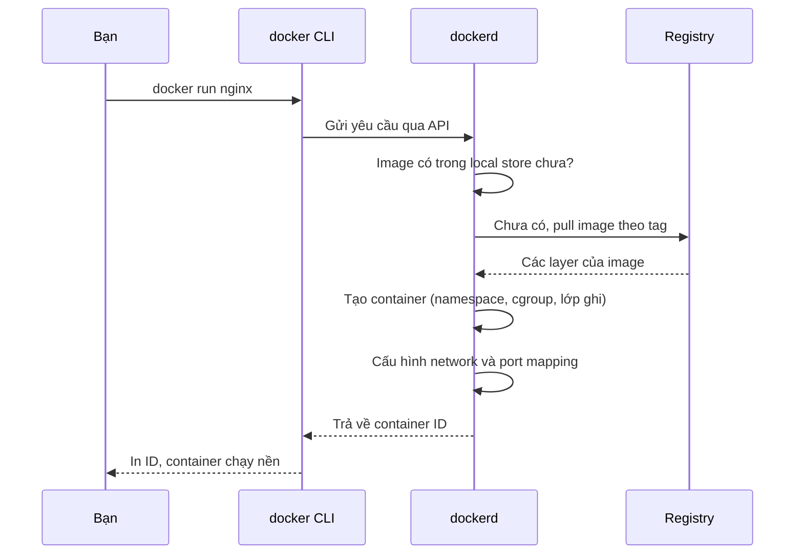

# Buổi 07 – Thử thách thêm và phá lỗi nâng cao

> **Tóm tắt:** Trang tùy chọn của Buổi 07: ba thử thách L2 có gợi ý từng bậc, bài phá lỗi cổng bận và trùng tên, kèm phần đọc thêm về luồng docker run. Làm ở nhà sau khi xong lab bắt buộc.

Quay lại bài chính: [Buổi 07 – Container Fundamentals](session-07.md). Lời giải đầy đủ nằm ở [Walkthrough tuần 4](../../mentors/walkthroughs/week-04.md), chỉ mở sau khi nộp bài.

## Thử thách thêm (L2, tùy chọn)

::: warning Tự thử 15 phút trước khi mở gợi ý
Gợi ý được xếp từng bậc, từ nhẹ tới rõ. Mở bậc 1 trước, thử tiếp, chỉ mở bậc sau khi vẫn kẹt.
:::

### Thử thách 1. Chứng minh container dùng chung kernel

Dùng `uname -r` trên host và trong ít nhất hai image khác nhau (ví dụ `alpine:3.20` và `ubuntu:24.04`). Viết vào `report.md` 3 đến 5 câu giải thích vì sao kết quả giống nhau và điều đó khác VM ở điểm nào.

Tiêu chí hoàn thành: có output của 3 lệnh, và phần giải thích nhắc được kernel dùng chung.

::: details Gợi ý bậc 1
Nhớ rằng image chỉ chứa user space (thư viện, công cụ), không chứa kernel.
:::

::: details Gợi ý bậc 2
Dùng `docker run --rm IMAGE uname -r` với `IMAGE` lần lượt là hai image.
:::

### Thử thách 2. Giải thích client, daemon, registry bằng bằng chứng

Dùng `docker version`, `docker info` và `docker pull busybox:1.36` để chỉ ra: client nói chuyện với daemon ở đâu, image được kéo từ registry nào, lưu ở đâu. Vẽ lại sơ đồ bằng lời của bạn (có thể dùng mermaid) trong `report.md`.

Tiêu chí hoàn thành: report có sơ đồ và chỉ ra ít nhất 3 dòng output làm bằng chứng (ví dụ `Registry` trong `docker info`, tên daemon trong `docker version`).

::: details Gợi ý bậc 1
Trong `docker info`, tìm dòng `Registry`. Trong `docker version`, khối `Server` là daemon.
:::

::: details Gợi ý bậc 2
Trong output của `docker pull`, dòng cuối thường có `docker.io/library/...`, cho biết registry là Docker Hub và image thuộc namespace `library` (image chính thức).
:::

### Thử thách 3. So sánh tài nguyên container và VM

Chạy Nginx với giới hạn bộ nhớ và CPU rồi đo.

```bash
docker run -d --name lab07-limit --memory 64m --cpus 0.5 -p 8082:80 nginx:1.27-alpine
docker stats --no-stream lab07-limit
docker inspect --format '{{.HostConfig.Memory}}' lab07-limit
```

Tiêu chí hoàn thành: ghi được lượng RAM Nginx dùng thực tế, kiểm chứng giới hạn Memory, và so sánh với một VM Ubuntu (nếu có VirtualBox hoặc Hyper-V, nếu không thì dùng nhận định: VM cần cấp trước RAM cho cả OS, thường từ 1 GB trở lên). Kết luận bằng 3 gạch đầu dòng về chi phí tài nguyên và thời gian khởi động (đo bằng `time docker run --rm alpine:3.20 true`), dựa trên số liệu bạn vừa đo.

::: details Gợi ý bậc 1
`docker stats` thường cho thấy Nginx dùng vài MB RAM. Giới hạn trong `inspect` tính bằng byte; 64 MiB bằng 64 nhân 1024 nhân 1024 byte.
:::

::: details Gợi ý bậc 2
Khi image đã có sẵn, `time docker run --rm alpine:3.20 true` thường chạy dưới vài giây, trong khi VM phải boot cả OS. Nhớ dọn: `docker rm -f lab07-limit`.
:::

## Phá lỗi nâng cao

### "port is already allocated"

Cách phá: container `lab07-web` đang chạy cổng 8081, bạn chạy thêm một container khác cùng cổng.

```bash
docker run -d --name lab07-web -p 8081:80 nginx:1.27-alpine
docker run -d --name web-b -p 8081:80 nginx:1.27-alpine
```

Triệu chứng (nội dung có thể hơi khác theo phiên bản), và một container `web-b` ở trạng thái `Created` vẫn bị tạo ra:

```text
docker: Error response from daemon: ... Bind for 0.0.0.0:8081 failed: port is already allocated.
```

Điều tra theo từng bước:

1. Đọc kỹ thông báo: lỗi nói rõ cổng 8081 trên host.
2. Xem ai giữ cổng: `docker ps --format "table {{.Names}}\t{{.Ports}}"`. Nếu thấy container khác map `8081`, đó là thủ phạm.
3. Nếu không phải container, kiểm tra process của host: `ss -ltnp | grep 8081` trong WSL, hoặc trong PowerShell `netstat -ano | findstr :8081`.
4. Kiểm tra `docker ps -a` để thấy container `Created` còn sót.

Nguyên nhân gốc: một cổng host chỉ có một process lắng nghe. Hai container không thể cùng publish cổng 8081 của host, dù cổng 80 bên trong mỗi container là độc lập.

Cách sửa và phòng tránh: dọn container thất bại bằng `docker rm web-b`, rồi chạy lại với cổng host khác (`-p 8083:80`). Đặt quy ước mỗi bài lab một dải cổng, và luôn đặt `--name` để dễ tìm. Tình huống tương tự có sẵn ở [tình huống 01](../../examples/troubleshooting/scenario-01/README.md) (chỉ nhận triệu chứng, tự tìm nguyên nhân).

### Trùng tên container

Chạy lại đúng lệnh `docker run -d --name lab07-web ...` lần thứ hai sẽ báo `Conflict. The container name "/lab07-web" is already in use by container ...`. Sửa bằng `docker rm -f lab07-web` hoặc đặt tên khác. Nguyên nhân: tên container là duy nhất trong một daemon, kể cả khi container đã dừng. Dọn sau khi thử: `docker rm -f lab07-web web-b`.

## Đọc thêm: luồng khi gõ docker run

Luồng khi bạn gõ `docker run -d -p 8081:80 nginx:1.27-alpine`:



1. **Docker CLI** chỉ là client: nó không chạy container, chỉ gửi yêu cầu qua API (socket Unix hoặc named pipe) tới daemon.
2. **dockerd** (Docker Engine) quản lý image, container, network, volume. Daemon nhờ `containerd` và `runc` tạo process thật sự.
3. Daemon kiểm tra image trong local store. Nếu chưa có thì `pull` từ registry mặc định (Docker Hub), mỗi image gồm nhiều **layer** được tải và lưu riêng.
4. Daemon tạo container: cấp namespace, cgroup, ghép layer chỉ đọc cùng một lớp ghi, rồi chạy lệnh mặc định của image (với Nginx là `nginx -g 'daemon off;'`).
5. Cờ `-p 8081:80` nói với Docker chuyển tiếp cổng 8081 trên host vào cổng 80 trong container.

Docker Desktop trên Windows gói sẵn toàn bộ chuỗi này: một VM WSL2 chứa `dockerd`, cùng Docker CLI cài sẵn ở Windows và có thể "tích hợp" vào distro Ubuntu của bạn (WSL integration).

## Tài liệu tham khảo

- [Docker Desktop cho Windows](https://docs.docker.com/desktop/setup/install/windows-install/)
- [Docker overview (kiến trúc Docker)](https://docs.docker.com/get-started/docker-overview/)
- [Docker Desktop WSL 2 backend](https://docs.docker.com/desktop/features/wsl/)
- [docker container run (CLI reference)](https://docs.docker.com/reference/cli/docker/container/run/)
- [Docker Hub: image nginx](https://hub.docker.com/_/nginx)
- [What is a container (docker.com)](https://www.docker.com/resources/what-container/)
