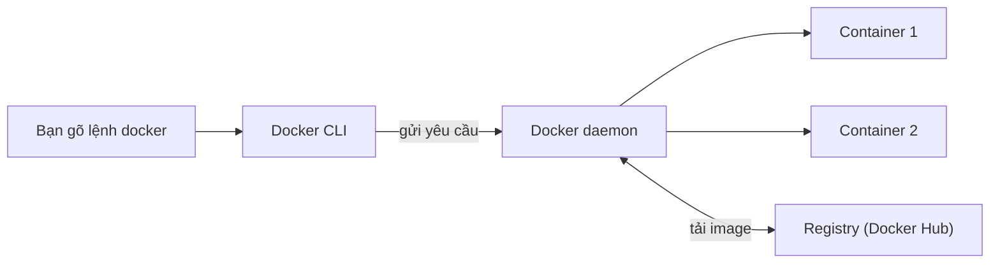

# Buổi 07 – Container Fundamentals

Tuần 4/16 · Giai đoạn 2 – Containerization · Buổi 07/32

[Slide buổi 07](../../slides/02-docker/session-07.md) · [Bài tập tuần 4](../../assignments/weekly/week-04.md) · [Hub tuần 4](README.md)

> **Tóm tắt:** Hiểu container là gì từ con số 0, rồi cài Docker Desktop và chạy, kiểm tra, dọn một container Nginx phục vụ trang web của chính bạn.

::: tip Buổi này bạn làm gì
**Bạn sẽ tạo ra:** một trang web HTML của riêng bạn, chạy trong container Nginx và mở được ở `http://localhost:8081`.

**Thời gian thật:** đọc 15 phút, lab bắt buộc 60 phút, thử thách tùy chọn làm ở nhà.

**Cần chuẩn bị:**

- [ ] Làm xong [Buổi 06 – Git & GitHub Workflow](../week-03/session-06.md) và đã cài môi trường theo [Hướng dẫn cài đặt](../../resources/setup-guide.md) (WSL2 Ubuntu, Docker Desktop).
- [ ] Có tài khoản GitHub và repo `devops-labs` (public) theo [Tài khoản GitHub và repo devops-labs](../../resources/setup-github.md).
- [ ] Mở được terminal WSL Ubuntu; chưa quen thì xem [Terminal 101](../../resources/terminal-101.md).

**Sản phẩm phải nộp** (thư mục `lab-07/` trong `devops-labs`):

- `README.md` trả lời 7 câu theo mẫu, ghi rõ đã làm L1 hay L2.
- `evidence/command-output.txt` chứa output thật của các lệnh chính.
- `source/index.html` và lệnh `docker run` bạn đã dùng.
- `report.md` ngắn: vì sao kernel giống nhau và một lỗi bạn đã gặp.

**Đi nhanh:** [Đọc](#van-de-thuc-te) > [Làm lab](#hands-on-lab) > [Gặp lỗi?](#gap-loi) > [Tự kiểm tra](#tu-kiem-tra) > [Nộp bài](#nop-bai). Kẹt giữa chừng? Nhảy tới [Gặp lỗi?](#gap-loi).
:::

**Từ mới trong buổi** (tra thêm ở [Thuật ngữ](../../resources/glossary.md)):

- **Container**: một "hộp" chạy ứng dụng, tách biệt với phần còn lại của máy.
- **Image**: gói chỉ đọc chứa ứng dụng và mọi thứ nó cần, dùng để tạo container.
- **Docker daemon**: chương trình nền thật sự tạo và quản lý container.
- **Registry**: kho lưu và chia sẻ image, ví dụ Docker Hub.
- **Port mapping**: nối một cổng của máy bạn vào cổng bên trong container.
- **Bind mount**: gắn một file hoặc thư mục của máy bạn vào container.

## Vấn đề thực tế {#van-de-thuc-te}

Một thành viên CLB viết API quản lý thành viên bằng Node.js 22. Chạy tốt trên máy bạn ấy, nhưng bạn khác clone về thì lỗi: sai phiên bản Node, thiếu thư viện, cổng bị chiếm. Đến lúc mentor deploy lên máy chung lại lỗi theo một cách khác. Câu "máy tôi chạy được mà" nghĩa là môi trường chạy không được đóng gói cùng ứng dụng.

Container giải quyết việc này: đóng gói ứng dụng cùng runtime, thư viện và cấu hình tối thiểu vào một **image** chạy giống nhau ở mọi nơi có Docker. Từ Buổi 09 bạn sẽ đóng gói chính ứng dụng Club Management (backend, frontend, database). Hôm nay bạn chỉ cần hiểu nền tảng và chạy thành công container đầu tiên.

## Khái niệm cốt lõi {#khai-niem}

Hãy nghĩ đến một nhà hàng. Mỗi khái niệm dưới đây có một vai trong nhà hàng đó.

- **Container** là một process Linux được cô lập, chứa ứng dụng và những gì nó cần. Ví von: hộp cơm đóng sẵn, mang đi đâu mở ra cũng ăn được như nhau. Container không phải "máy ảo nhỏ"; nó dùng chung kernel (lõi hệ điều hành) của máy chủ.
- **Image** là gói chỉ đọc mô tả ứng dụng và môi trường chạy. Ví von: công thức nấu ăn kèm nguyên liệu đóng gói sẵn. Container là một suất ăn nấu ra từ công thức đó, một image nấu được nhiều suất. Xóa suất ăn không làm mất công thức.
- **Docker CLI và daemon**: CLI là lệnh `docker` bạn gõ, daemon là chương trình nền làm việc thật. Ví von: bạn gọi món ở quầy (CLI), bếp trưởng (daemon) nấu. Tắt bếp thì gọi món vẫn được nhưng không ai nấu, nên `docker` báo "không kết nối được daemon".
- **Registry** là nơi cất và phân phối image. Ví von: kho công thức dùng chung. Docker Hub là kho công thức công cộng; chưa có image trên máy thì daemon tự tải về.
- **Port mapping** `-p 8081:80` nối cổng 8081 của máy bạn vào cổng 80 trong container. Ví von: số máy lẻ của tổng đài; bạn gọi số 8081 bên ngoài, cuộc gọi chuyển vào phòng số 80 bên trong. Số bên trái là của máy bạn.



::: details Tìm hiểu thêm (đọc sau)
**VM và container.** VM ảo hóa ở mức phần cứng và mỗi VM có kernel riêng (nặng hàng GB, khởi động chục giây đến phút, cô lập mạnh). Container ảo hóa ở mức hệ điều hành và dùng chung kernel của host (vài MB đến vài trăm MB, khởi động dưới vài giây, cô lập yếu hơn nhưng đủ cho đa số ứng dụng). VM hợp để chạy hệ điều hành khác; container hợp để đóng gói và chạy ứng dụng, CI/CD, microservice. Trên Windows, Docker Desktop chạy container Linux trong một VM Linux nhẹ do WSL2 quản lý, nên "kernel của host" là kernel Linux của WSL2.

**Container cô lập bằng gì.** Ba cơ chế của kernel:

- **Namespaces**: mỗi container thấy một bộ riêng về process (PID), network, mount, hostname; process chính có PID 1.
- **cgroups**: giới hạn và đo tài nguyên (CPU, RAM) cho nhóm process.
- **Union filesystem (overlay)**: ghép các lớp image chỉ đọc với một lớp ghi mỏng của container.

**Tag và digest.** Tag là nhãn phiên bản (`1.27-alpine`), digest là mã băm bất biến (`sha256:...`, giống commit hash). Không xóa được image nếu còn container (kể cả đã dừng) đang dùng nó. `latest` chỉ là một cái tên, không có nghĩa "mới nhất thật sự" và nội dung đổi theo thời gian, nên khóa này luôn ghim phiên bản cụ thể như `nginx:1.27-alpine` để kết quả tái lập được.

Sơ đồ chi tiết luồng `docker run` nằm ở [trang thử thách của Buổi 07](session-07-challenge.md).
:::

Trên lớp, mentor demo trước; tự học thì làm thẳng phần Làm lab.

## Hands-on lab (60 phút, bắt buộc) {#hands-on-lab}

### Chuẩn bị (5 phút)

1. Cài Docker Desktop theo mục Docker Desktop của [Hướng dẫn cài đặt](../../resources/setup-guide.md) (chọn WSL 2 khi cài). Mở Docker Desktop, vào Settings, Resources, WSL integration, bật cho Ubuntu rồi Apply.
2. Kiểm tra WSL2 trong PowerShell:

```powershell
wsl -l -v
```

Kết quả mong đợi: Ubuntu có cột `VERSION` bằng `2`. Nếu là `1`, chạy `wsl --set-version Ubuntu 2` (đổi `Ubuntu` đúng với tên distro của bạn).

3. Mở terminal WSL Ubuntu, làm việc trong filesystem của WSL (không dùng `/mnt/c`):

```bash
mkdir -p ~/devops-labs/lab-07/{source,screenshots,evidence}
cd ~/devops-labs/lab-07
pwd
echo "# Lab 07 evidence - $(date -Iseconds)" > evidence/command-output.txt
```

Kết quả mong đợi: `pwd` in `/home/tên-bạn/devops-labs/lab-07`, đường dẫn bắt đầu bằng `/home`, không phải `/mnt/c`. Từ đây mỗi lệnh quan trọng thêm `2>&1 | tee -a evidence/command-output.txt` để làm bằng chứng nộp bài.

### Phần 1. Kiểm tra cài đặt (10 phút)

**Bước 1.1.** Client và daemon:

```bash
docker version 2>&1 | tee -a evidence/command-output.txt
```

Kết quả mong đợi: có cả khối `Client:` và `Server:`. Chỉ có Client kèm lỗi kết nối daemon thì xem [Gặp lỗi?](#gap-loi).

**Bước 1.2.** Thông tin hệ thống:

```bash
docker info 2>&1 | tee -a evidence/command-output.txt | head -30
```

Kết quả mong đợi (rút gọn): các dòng `Server Version`, `Storage Driver: overlayfs` hoặc `overlay2`, `Operating System: Docker Desktop`. Đây là lệnh đầu tiên cần chạy khi nghi ngờ môi trường.

**Bước 1.3.** Container đầu tiên, và chứng minh container dùng chung kernel với máy:

```bash
docker run --rm hello-world 2>&1 | tee -a evidence/command-output.txt
uname -r | tee -a evidence/command-output.txt
docker run --rm alpine:3.20 uname -r | tee -a evidence/command-output.txt
```

Kết quả mong đợi: dòng `Hello from Docker!`, rồi hai dòng `uname -r` giống nhau, dạng `6.x.x-microsoft-standard-WSL2`. Cờ `--rm` tự xóa container sau khi thoát. Lần đầu có dòng `Unable to find image ... locally` vì daemon phải tải image.

::: tip Kiểm tra: bạn đúng khi
`docker version` có cả Client lẫn Server, `Hello from Docker!` xuất hiện, và hai dòng `uname -r` trùng nhau. Alpine là distro khác nhưng kernel giống hệt vì container không có kernel riêng.
:::

### Phần 2. Chạy Nginx (10 phút)

**Bước 2.1.** Tải image trước để thấy việc "tải công thức" tách biệt với "nấu":

```bash
docker pull nginx:1.27-alpine
```

Kết quả mong đợi: các dòng `Pull complete`, kết thúc bằng `Status: Downloaded newer image for nginx:1.27-alpine` (image nặng khoảng 50 MB).

**Bước 2.2.** Tạo trang HTML riêng (nhớ thay nội dung bằng họ tên hoặc MSSV của bạn) và chạy container:

```bash
cat > source/index.html <<'EOF'
<!doctype html>
<html lang="vi">
<head><meta charset="utf-8"><title>Lab 07</title></head>
<body><h1>Container đầu tiên của tôi - Họ tên, MSSV</h1></body>
</html>
EOF

docker run -d --name lab07-web -p 8081:80 \
  -v "$PWD/source/index.html:/usr/share/nginx/html/index.html:ro" \
  nginx:1.27-alpine
```

Kết quả mong đợi: một chuỗi 64 ký tự hex (container ID). `-d` chạy nền để terminal còn dùng được; `:ro` để container chỉ đọc file, không sửa file của máy bạn. Lưu chính lệnh `docker run` này vào `source/commands.sh`. Lỗi cổng hoặc tên trùng: xem [Gặp lỗi?](#gap-loi).

**Bước 2.3.** Kiểm tra bằng `curl` và trình duyệt:

```bash
curl -s http://localhost:8081 | tee -a evidence/command-output.txt
```

Mở trình duyệt Windows tại `http://localhost:8081`, chụp màn hình lưu vào `screenshots/`. Docker Desktop tự chuyển tiếp cổng từ WSL ra Windows.

::: tip Kiểm tra: bạn đúng khi
`curl` in ra đúng trang HTML có họ tên của bạn (không phải trang "Welcome to nginx!") và trình duyệt hiển thị cùng nội dung.
:::

### Phần 3. Quan sát container (15 phút)

**Bước 3.1.** Trạng thái, log, và nhìn vào bên trong:

```bash
docker ps 2>&1 | tee -a evidence/command-output.txt
docker logs lab07-web 2>&1 | tee -a evidence/command-output.txt
docker exec lab07-web ls /usr/share/nginx/html | tee -a evidence/command-output.txt
```

Kết quả mong đợi: `STATUS` dạng `Up ... seconds` và cột PORTS có `0.0.0.0:8081->80/tcp`; log có dòng access như `"GET / HTTP/1.1" 200` (đó là request `curl` của bạn); thư mục có `index.html` (file bạn mount) và `50x.html`.

**Bước 3.2.** Vào trong container như vào một căn phòng nhỏ:

```bash
docker exec -it lab07-web sh
```

Trong shell của container chạy:

```sh
whoami
cat /etc/os-release | head -2
exit
```

Kết quả mong đợi: `os-release` cho thấy Alpine Linux. Container có filesystem riêng, nhìn thấy hệ điều hành của image chứ không phải Ubuntu của bạn.

**Bước 3.3.** Chứng minh mount ở chế độ chỉ đọc:

```bash
docker inspect --format '{{json .Mounts}}' lab07-web | tee -a evidence/command-output.txt
```

Kết quả mong đợi: chuỗi JSON có `"Mode":"ro"` và `"RW":false`.

**Bước 3.4.** Dữ liệu trong container là tạm thời:

```bash
docker exec lab07-web sh -c 'echo "toi la file tam" > /tmp/ghi-chu.txt && cat /tmp/ghi-chu.txt'
docker rm -f lab07-web
docker run -d --name lab07-web -p 8081:80 nginx:1.27-alpine
docker exec lab07-web cat /tmp/ghi-chu.txt
```

Kết quả mong đợi: lần `cat` cuối báo `No such file or directory`. File nằm trong lớp ghi của container cũ nên xóa container là xóa file. Đây là lý do database cần volume (học ở [Buổi 12 – Persistent Storage](../week-06/session-12.md)). Lưu ý: container mới này không mount `index.html`, nên trang là trang Nginx mặc định.

::: tip Kiểm tra: bạn đúng khi
Log có request của chính bạn, `Mounts` ghi `"RW":false`, và file `/tmp/ghi-chu.txt` biến mất sau khi tạo lại container.
:::

### Phần 4. Dừng, xóa, dọn (5 phút)

```bash
docker stop lab07-web
docker ps
docker ps -a
docker rm lab07-web
```

Kết quả mong đợi: sau `stop`, `docker ps` không còn container nhưng `docker ps -a` vẫn liệt kê `lab07-web` với trạng thái `Exited`; sau `rm` thì biến mất. Ba lệnh dễ nhầm: `stop` dừng nhưng giữ lại, `rm` xóa container, còn `docker rmi` xóa image (chỉ làm được khi không còn container dùng nó; bài này không cần chạy `rmi`).

::: tip Kiểm tra: bạn đúng khi
`docker ps -a` không còn container nào tên `lab07-`, và bạn nói được `stop`, `rm`, `rmi` khác nhau thế nào.
:::

### Checklist L1 và tự kiểm tra một dòng

- [ ] `docker version` hiển thị cả Client và Server.
- [ ] `docker run --rm hello-world` chạy thành công; hai dòng `uname -r` trùng nhau.
- [ ] Container Nginx chạy với `-p 8081:80`, mở được `http://localhost:8081` với trang của bạn.
- [ ] Đã xem `docker logs` có request của chính mình và `docker exec` liệt kê được `/usr/share/nginx/html`.
- [ ] Đã dừng và xóa container, nói đúng khác biệt `stop`, `rm`, `rmi`.
- [ ] Đã ghi output các lệnh chính vào `evidence/command-output.txt`.

```bash
grep -E -c 'Server:|Hello from Docker|"RW":false' evidence/command-output.txt
```

Kết quả mong đợi: một số từ 3 trở lên (đủ ba loại bằng chứng).

## Gặp lỗi? {#gap-loi}

| Triệu chứng | Nguyên nhân | Cách sửa |
| --- | --- | --- |
| `docker: command not found` trong WSL | Chưa bật WSL integration cho distro | Docker Desktop, Settings, Resources, WSL integration, bật Ubuntu, Apply; mở lại terminal |
| `Cannot connect to the Docker daemon` | Docker Desktop chưa chạy hoặc đang khởi động | Mở Docker Desktop, đợi biểu tượng báo Running, thử lại `docker info` |
| Docker Desktop báo lỗi WSL hoặc ảo hóa | Chưa bật Virtualization hoặc WSL cũ | Bật Virtualization trong BIOS/UEFI, chạy `wsl --update` trong PowerShell |
| `port is already allocated` | Cổng host đã có container hoặc process khác giữ | `docker ps` xem container nào map cổng đó, đổi cổng host trong `-p` (ví dụ `-p 8083:80`) |
| `name is already in use` (Conflict) | Container cũ cùng tên còn tồn tại, kể cả đã dừng | `docker rm -f lab07-web` hoặc đặt tên khác |
| `unable to remove repository reference ... container is using its image` | Nhầm image với container, còn container dùng image | `docker rm` container trước, sau đó `docker rmi` image |
| Trang Nginx hiện 403 hoặc 404 | Bind mount sai đường dẫn (đường dẫn tương đối hoặc file không tồn tại) | Dùng đường dẫn tuyệt đối như `"$PWD/source/index.html"`, `ls` kiểm tra trước |
| Sửa `index.html` mà trang vẫn cũ | Mount một file đơn lẻ, editor hoặc `sed -i` thay file mới nên đổi inode | Ghi đè bằng `cat > source/index.html` hoặc mount cả thư mục |
| Máy chạy chậm, tốn nhiều RAM | Nhiều container và image chưa dọn, VmmemWSL chiếm RAM | `docker system df` rồi `docker container prune`; có thể giới hạn RAM WSL bằng `.wslconfig` |

## Tự kiểm tra {#tu-kiem-tra}

1. Khác biệt lớn nhất giữa VM và container về kernel là gì?

::: details Đáp án gợi ý
VM có kernel riêng chạy trên hypervisor; container dùng chung kernel của host và chỉ được cô lập bằng namespaces và cgroups.
:::

2. Docker CLI, dockerd và registry mỗi thành phần làm gì? Image và container khác nhau thế nào?

::: details Đáp án gợi ý
CLI gửi lệnh, dockerd quản lý image và container (nhờ containerd và runc tạo process), registry lưu và phân phối image. Image là gói chỉ đọc, container là một lần chạy của image kèm lớp ghi; một image chạy được nhiều container.
:::

3. Vì sao `-p 8081:80` có hai số? Số nào là của host?

::: details Đáp án gợi ý
Định dạng `HOST:CONTAINER`. 8081 là cổng của máy bạn (nơi bạn truy cập), 80 là cổng Nginx lắng nghe trong container.
:::

4. Bạn xóa container database và tạo lại, dữ liệu mất hết. Vì sao, và hướng khắc phục là gì?

::: details Đáp án gợi ý
Dữ liệu nằm trong lớp ghi tạm của container, bị xóa cùng container. Dùng volume để dữ liệu sống độc lập với container (Buổi 12).
:::

5. Bạn chạy `docker run -p 8080:80 nginx:1.27-alpine` và nhận lỗi port is already allocated. Nêu các bước điều tra.

::: details Đáp án gợi ý
`docker ps` xem container nào publish 8080; nếu không có, kiểm tra process host bằng `ss -ltnp | grep 8080` hoặc `netstat -ano` trên Windows; sau đó dừng thủ phạm hoặc đổi cổng host. Đừng dừng process mà bạn không hiểu rõ.
:::

## Nộp bài {#nop-bai}

Nộp vào thư mục `lab-07/` trong repo `devops-labs` theo [mẫu lab](../../templates/lab-template.md); đề bài và bảng điểm ở [Bài tập tuần 4](../../assignments/weekly/week-04.md).

- [ ] `README.md` trả lời đủ 7 câu: vấn đề bài lab giải quyết, kiến thức đã dùng, các bước thực hiện, kết quả mong đợi, lỗi đã gặp, cách khắc phục, có thể cải thiện gì; ghi rõ đã làm L1 hay L2.
- [ ] `evidence/command-output.txt` chứa output của `docker version`, `docker info`, `hello-world`, hai dòng `uname -r`, `curl http://localhost:8081`, `docker logs`, `Mounts`.
- [ ] `source/index.html` (trang bạn dùng cho bind mount) và `source/commands.sh` (lệnh `docker run` đã dùng); `screenshots/` có ảnh trình duyệt mở trang (chỉ minh họa).
- [ ] `report.md`: 2 đến 3 câu giải thích vì sao hai dòng `uname -r` giống nhau, và một lỗi bạn đã gặp (triệu chứng, cách điều tra, nguyên nhân gốc).
- [ ] Không commit secret, token hay mật khẩu; kiểm tra lại evidence trước khi push.

## Recap

- Container là process Linux được cô lập, dùng chung kernel với host; image là công thức chỉ đọc, container là một suất nấu ra từ đó.
- CLI chỉ gửi lệnh, daemon mới làm việc, registry cất image; `-p HOST:CONTAINER`, `-v`, `-d`, `--rm` là các cờ bạn dùng nhiều nhất.
- Dữ liệu trong container là tạm thời; khi lỗi hãy đọc thông báo, `docker ps -a`, `docker logs`.

Buổi tiếp theo: [Buổi 08 – Docker CLI](session-08.md).

::: details Thử thách thêm (L2, tùy chọn, làm ở nhà)
Ba thử thách có gợi ý từng bậc: chứng minh kernel dùng chung với hai image, chỉ ra client, daemon, registry bằng bằng chứng, và đo giới hạn tài nguyên so với VM. Tự thử 15 phút trước khi mở gợi ý. Xem [Buổi 07 – Thử thách thêm](session-07-challenge.md).
:::

::: details Phá lỗi nâng cao
Tự tạo hai lỗi "port is already allocated" và trùng tên container, rồi điều tra từng bước. Xem phần Phá lỗi nâng cao ở [Buổi 07 – Thử thách thêm](session-07-challenge.md).
:::

::: details Tài liệu tham khảo
- [Docker Desktop cho Windows](https://docs.docker.com/desktop/setup/install/windows-install/)
- [Docker overview (kiến trúc Docker)](https://docs.docker.com/get-started/docker-overview/)
- [docker container run (CLI reference)](https://docs.docker.com/reference/cli/docker/container/run/)

Danh sách đầy đủ ở cuối [trang thử thách](session-07-challenge.md).
:::
