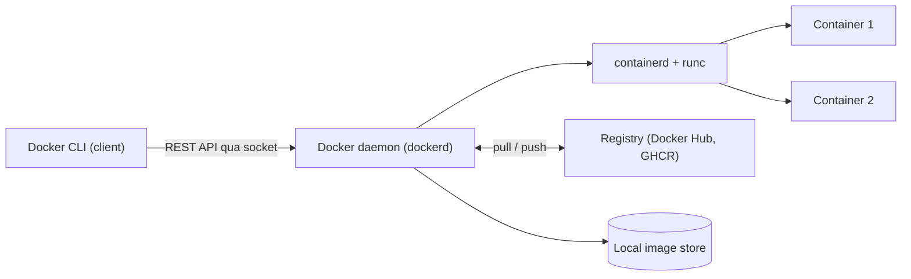
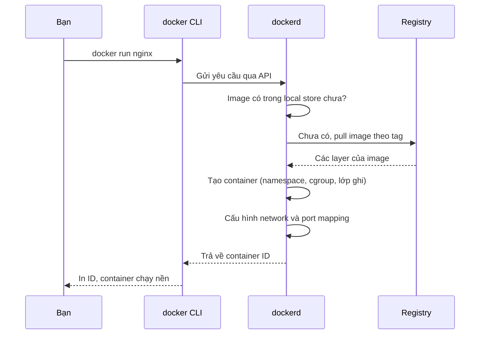

# Buổi 07 – Container Fundamentals

Tuần 4 · Giai đoạn 2 – Containerization · Slide: [Slide buổi 07](../../slides/02-docker/session-07.md)

> **Tóm tắt:** Phân biệt VM và container, đọc được kiến trúc Docker (client, daemon, registry), cài Docker Desktop và chạy, kiểm tra, dọn một container Nginx.

## Mục tiêu học tập

- Giải thích được sự khác nhau giữa máy ảo (VM) và container ở mức kernel, tài nguyên và thời gian khởi động.
- Mô tả được vai trò của Docker client, Docker daemon, image, container và registry, và vẽ lại luồng `docker run`.
- Cài và kiểm tra được Docker Desktop với WSL2 backend, chạy được `docker version`, `docker info`, `docker run hello-world`.
- Chạy được container Nginx với port mapping và bind mount, truy cập được từ trình duyệt và `curl`.
- Chứng minh được container dùng chung kernel với host và dữ liệu ghi trong container sẽ mất khi container bị xóa.
- Chẩn đoán được lỗi "port is already allocated" và lỗi trùng tên container bằng các lệnh kiểm tra.

## Điều kiện cần

- Đã hoàn thành Giai đoạn 1: dùng được terminal Linux trong WSL2 Ubuntu, hiểu process, port và HTTP cơ bản (Buổi 01 đến 06).
- Windows 11 đã bật ảo hóa (Virtualization) trong BIOS/UEFI, có WSL2 và một distro Ubuntu.
- Tài khoản GitHub (dùng cho các buổi sau). Docker Hub account không bắt buộc ở buổi này.
- Cách kiểm tra nhanh, chạy trong PowerShell:

```powershell
wsl --version
wsl -l -v
```

Kết quả mong đợi (rút gọn): Ubuntu có cột `VERSION` bằng `2`.

```text
  NAME      STATE           VERSION
* Ubuntu    Running         2
```

Nếu `VERSION` là `1`, chuyển sang WSL2 bằng `wsl --set-version Ubuntu 2` (đổi `Ubuntu` đúng với tên distro của bạn).

## Vấn đề thực tế

Một thành viên CLB viết API quản lý thành viên bằng Node.js 22. Chạy tốt trên máy bạn ấy, nhưng khi bạn khác clone về thì lỗi: sai phiên bản Node, thiếu thư viện hệ thống, cổng bị chiếm. Đến lúc mentor deploy lên máy chung lại lỗi theo một cách khác. Câu "máy tôi chạy được mà" là triệu chứng của việc môi trường chạy không được đóng gói cùng ứng dụng.

Container giải quyết việc này bằng cách đóng gói ứng dụng cùng runtime, thư viện và cấu hình tối thiểu vào một **image** có thể chạy giống nhau ở mọi nơi có Docker. Máy ảo cũng làm được điều đó nhưng nặng: mỗi VM mang theo cả một hệ điều hành. Với khóa học này, ứng dụng xuyên suốt là Club Management (backend, frontend, database). Từ Buổi 09 bạn sẽ đóng gói chính ứng dụng đó. Hôm nay bạn chỉ cần hiểu nền tảng và chạy thành công container đầu tiên.

## Khái niệm cốt lõi

### VM và container

| Tiêu chí | Máy ảo (VM) | Container |
| --- | --- | --- |
| Ảo hóa ở mức | Phần cứng (hypervisor) | Hệ điều hành (process được cô lập) |
| Kernel | Mỗi VM có kernel riêng | Dùng chung kernel của host |
| Kích thước điển hình | Hàng GB (cả OS) | Từ vài MB đến vài trăm MB |
| Thời gian khởi động | Chục giây đến phút | Dưới một giây đến vài giây |
| Cô lập | Mạnh (ranh giới phần cứng ảo) | Yếu hơn (cùng kernel), đủ tốt cho đa số ứng dụng |
| Đơn vị phân phối | File đĩa ảo | Image theo chuẩn OCI |
| Phù hợp | Chạy OS khác, cô lập mạnh | Đóng gói và chạy ứng dụng, CI/CD, microservice |

Lưu ý: trên Windows, Docker Desktop chạy container Linux bên trong một VM Linux rất nhẹ do WSL2 quản lý. Vì vậy "kernel của host" ở đây là kernel Linux của WSL2, không phải kernel Windows.

### Container thực chất là gì

Container không phải một "máy ảo nhỏ". Nó là một **process Linux bình thường** được kernel cô lập bằng ba cơ chế:

- **Namespaces**: mỗi container thấy một bộ riêng về process (PID), network, mount, hostname. Trong container, process chính có PID 1.
- **cgroups**: giới hạn và đo tài nguyên (CPU, RAM) cho nhóm process.
- **Union filesystem (overlay)**: ghép các lớp image chỉ đọc với một lớp ghi mỏng của container.

### Image, container, registry

| Khái niệm | Là gì | Ví dụ | Tương tự |
| --- | --- | --- | --- |
| Image | Gói chỉ đọc gồm filesystem và metadata (lệnh mặc định, cổng, biến môi trường) | `nginx:1.27-alpine` | Class, hoặc file cài đặt |
| Container | Một lần chạy của image, có thêm lớp ghi | `nginx-demo` | Object, hoặc chương trình đang chạy |
| Registry | Nơi lưu và phân phối image | Docker Hub, GitHub Container Registry (GHCR) | Kho gói như npm |
| Tag | Nhãn phiên bản của image | `1.27-alpine` | Phiên bản |
| Digest | Mã băm bất biến của image | `sha256:...` | Commit hash |

Một image chạy được nhiều container độc lập. Xóa container không xóa image, và ngược lại không xóa được image nếu còn container (kể cả đã dừng) đang dùng nó.

Về tag: `latest` chỉ là một cái tên, không có nghĩa "mới nhất" thật sự và có thể thay đổi nội dung theo thời gian. Trong khóa này luôn ghim phiên bản cụ thể như `nginx:1.27-alpine` để kết quả tái lập được.

## Kiến trúc và cách hoạt động



Luồng khi bạn gõ `docker run -d -p 8081:80 nginx:1.27-alpine`:



Giải thích từng bước:

1. **Docker CLI** chỉ là client: nó không chạy container, chỉ gửi yêu cầu qua API (socket Unix hoặc named pipe) tới daemon.
2. **dockerd** (Docker Engine) quản lý image, container, network, volume. Daemon nhờ `containerd` và `runc` tạo process thật sự.
3. Daemon kiểm tra image trong local store. Nếu chưa có thì `pull` từ registry mặc định (Docker Hub), mỗi image gồm nhiều **layer** được tải và lưu riêng.
4. Daemon tạo container: cấp namespace, cgroup, ghép layer chỉ đọc cùng một lớp ghi, rồi chạy lệnh mặc định của image (với Nginx là `nginx -g 'daemon off;'`).
5. Cờ `-p 8081:80` nói với Docker chuyển tiếp cổng 8081 trên host vào cổng 80 trong container.

Docker Desktop trên Windows gói sẵn toàn bộ chuỗi này: một VM WSL2 chứa `dockerd`, cùng Docker CLI cài sẵn ở Windows và có thể "tích hợp" vào distro Ubuntu của bạn (WSL integration).

## Demo của mentor

Mentor chiếu màn hình terminal WSL Ubuntu và thực hiện lần lượt. Mỗi bước dừng lại hỏi lớp trước khi gõ Enter.

**Bước 1. Client và server là hai thứ khác nhau.**

```bash
docker version
```

Kết quả mong đợi (rút gọn, số phiên bản có thể khác):

```text
Client:
 Version:           27.x.x
 OS/Arch:           linux/amd64
Server: Docker Desktop
 Engine:
  Version:          27.x.x
  OS/Arch:          linux/amd64
```

Câu hỏi cho lớp: "Vì sao có hai khối Client và Server? Nếu tắt Docker Desktop thì khối nào mất?" (Khối Server báo lỗi không kết nối được daemon.)

**Bước 2. Container đầu tiên.**

```bash
docker run --rm hello-world
```

Kết quả mong đợi: đoạn chữ bắt đầu bằng `Hello from Docker!` kèm giải thích 4 bước (client liên hệ daemon, pull image, tạo container, stream output).

Câu hỏi: "Dòng `Unable to find image 'hello-world:latest' locally` nghĩa là gì? Lần chạy thứ hai sẽ khác thế nào?"

**Bước 3. Cùng kernel với host.**

```bash
uname -r
docker run --rm alpine:3.20 uname -r
```

Kết quả mong đợi: hai dòng giống nhau, dạng `5.15.x-microsoft-standard-WSL2` hoặc `6.x.x-microsoft-standard-WSL2`.

Câu hỏi: "Alpine là một distro khác, vì sao kernel giống hệt? Điều này nói gì về container so với VM?"

**Bước 4. Nginx, port mapping và bind mount.**

```bash
cd ~/devops-labs
mkdir -p demo && cd demo
cat > index.html <<'EOF'
<h1>Xin chào từ container Nginx</h1>
EOF
docker run -d --name nginx-demo -p 8081:80 \
  -v "$PWD/index.html:/usr/share/nginx/html/index.html:ro" \
  nginx:1.27-alpine
curl -s http://localhost:8081
```

Kết quả mong đợi: `docker run` in một chuỗi ID dài, `curl` in `<h1>Xin chào từ container Nginx</h1>`.

Câu hỏi: "Sửa file `index.html` trên host rồi `curl` lại, nội dung có đổi không? Vì sao không cần build lại image?" (Lưu ý: khi mount một file đơn lẻ, các editor thay file bằng file mới như `sed -i` hoặc vim có thể làm container vẫn thấy nội dung cũ do đổi inode. Hãy sửa bằng `cat > index.html` hoặc `echo ... >`, hoặc mount cả thư mục.)

**Bước 5. Nhìn vào bên trong.**

```bash
docker ps
docker top nginx-demo
docker exec nginx-demo ps
```

Kết quả mong đợi: `docker ps` thấy `0.0.0.0:8081->80/tcp`; bên trong container `nginx: master process` là PID 1.

Mentor tổng kết: ví dụ đầy đủ có sẵn ở `examples/docker/nginx-demo/` (README và `index.html`, dùng cổng 38080 thay cho 8081 trong lab). Cuối demo dọn bằng `docker rm -f nginx-demo`.

## Hands-on lab

Thời lượng 60 phút: Chuẩn bị 15', Phần 1 đến 4 khoảng 35', L2 làm tiếp hoặc về nhà.

### Chuẩn bị

1. Cài Docker Desktop cho Windows: tải từ trang chính thức (link ở mục Tài liệu tham khảo), chọn tùy chọn dùng WSL 2 khi cài, khởi động lại nếu được yêu cầu.
2. Mở Docker Desktop, vào Settings, mục Resources, WSL integration, bật tích hợp cho distro Ubuntu của bạn rồi chọn Apply.
3. Mở terminal WSL Ubuntu và làm việc trong filesystem của WSL, không dùng `/mnt/c`:

```bash
mkdir -p ~/devops-labs/lab-07/{source,screenshots,evidence}
cd ~/devops-labs/lab-07
pwd
```

Kết quả mong đợi: `/home/<tên-bạn>/devops-labs/lab-07` (đường dẫn bắt đầu bằng `/home`, không phải `/mnt/c`).

Từ đây ghi lại bằng `tee` để làm bằng chứng nộp bài:

```bash
echo "# Lab 07 evidence - $(date -Iseconds)" > evidence/command-output.txt
```

### Phần 1. Kiểm tra cài đặt (10 phút)

**Bước 1.1.** Kiểm tra client và daemon:

```bash
docker version 2>&1 | tee -a evidence/command-output.txt
```

Kết quả mong đợi: có cả khối `Client:` và `Server:`. Nếu chỉ có Client và báo lỗi kết nối daemon, Docker Desktop chưa chạy hoặc chưa bật WSL integration (xem mục Lỗi thường gặp).

**Bước 1.2.** Xem thông tin hệ thống:

```bash
docker info 2>&1 | tee -a evidence/command-output.txt | head -30
```

Kết quả mong đợi (rút gọn): các dòng `Server Version`, `Storage Driver: overlayfs` hoặc `overlay2`, `Operating System: Docker Desktop`, `Containers`, `Images`.

Vì sao: `docker info` cho biết daemon đang chạy với cấu hình nào. Đây là lệnh đầu tiên cần chạy khi nghi ngờ môi trường.

**Bước 1.3.** Chạy container đầu tiên:

```bash
docker run --rm hello-world 2>&1 | tee -a evidence/command-output.txt
```

Kết quả mong đợi: thông báo `Hello from Docker!`. Cờ `--rm` tự xóa container sau khi thoát để không để rác.

### Phần 2. Chạy Nginx (10 phút)

**Bước 2.1.** Pull image trước để thấy tách biệt giữa tải image và chạy container:

```bash
docker pull nginx:1.27-alpine
docker image ls nginx
```

Kết quả mong đợi (rút gọn):

```text
REPOSITORY   TAG           IMAGE ID       CREATED        SIZE
nginx        1.27-alpine   xxxxxxxxxxxx   x months ago   ~50MB
```

**Bước 2.2.** Tạo trang HTML riêng và chạy container:

```bash
cat > source/index.html <<'EOF'
<!doctype html>
<html lang="vi">
<head><meta charset="utf-8"><title>Lab 07</title></head>
<body><h1>Container đầu tiên của tôi</h1></body>
</html>
EOF

docker run -d --name web-lab07 -p 8081:80 \
  -v "$PWD/source/index.html:/usr/share/nginx/html/index.html:ro" \
  nginx:1.27-alpine
```

Kết quả mong đợi: một chuỗi 64 ký tự hex (container ID). Vì sao `-d`: chạy nền để terminal còn dùng được. Vì sao `:ro`: container chỉ cần đọc file, không nên sửa file của host.

**Bước 2.3.** Kiểm tra bằng `curl` và trình duyệt Windows:

```bash
curl -s http://localhost:8081 | tee -a evidence/command-output.txt
```

Mở trình duyệt trên Windows tại `http://localhost:8081`, chụp màn hình lưu vào `screenshots/`. Docker Desktop tự chuyển tiếp cổng từ WSL ra Windows.

### Phần 3. Quan sát container (10 phút)

**Bước 3.1.** Trạng thái và log:

```bash
docker ps
docker logs web-lab07
```

Kết quả mong đợi: `STATUS` dạng `Up ... seconds`, log có dòng access ví dụ `"GET / HTTP/1.1" 200`.

**Bước 3.2.** Vào bên trong container:

```bash
docker exec -it web-lab07 sh
```

Trong shell của container chạy:

```sh
whoami
ls /usr/share/nginx/html
cat /etc/os-release | head -2
exit
```

Kết quả mong đợi: thư mục có `index.html` (file bạn mount) và `50x.html`; `os-release` cho thấy Alpine Linux. Vì sao: container có filesystem riêng, nhìn thấy hệ điều hành của image chứ không phải Ubuntu của bạn.

**Bước 3.3.** Dữ liệu trong container là tạm thời:

```bash
docker exec web-lab07 sh -c 'echo "toi la file tam" > /tmp/ghi-chu.txt && cat /tmp/ghi-chu.txt'
docker rm -f web-lab07
docker run -d --name web-lab07 -p 8081:80 nginx:1.27-alpine
docker exec web-lab07 cat /tmp/ghi-chu.txt
```

Kết quả mong đợi: lần `cat` cuối báo `No such file or directory`. Vì sao: file nằm trong lớp ghi của container cũ; xóa container là xóa lớp đó. Đây là lý do database cần volume (Buổi 12).

### Phần 4. Dừng, xóa, dọn (5 phút)

**Bước 4.1.** Phân biệt `stop`, `rm`, `rmi`:

```bash
docker stop web-lab07
docker ps
docker ps -a
docker rm web-lab07
docker image ls nginx
```

Kết quả mong đợi: sau `stop`, `docker ps` không còn container nhưng `docker ps -a` vẫn liệt kê trạng thái `Exited`; sau `rm` container biến mất; image `nginx` vẫn còn. Chỉ `docker rmi nginx:1.27-alpine` mới xóa image (tùy chọn, bạn sẽ phải pull lại).

### L1 – Foundation: checklist hoàn thành

- [ ] `docker version` hiển thị cả Client và Server.
- [ ] `docker run --rm hello-world` chạy thành công.
- [ ] Container Nginx chạy với `-p 8081:80`, mở được `http://localhost:8081` trên trình duyệt.
- [ ] Đã xem `docker logs` có request của chính mình.
- [ ] Đã `docker exec` vào container và liệt kê được `/usr/share/nginx/html`.
- [ ] Đã dừng và xóa container, nói đúng khác biệt giữa `stop`, `rm` và `rmi`.
- [ ] Đã ghi output các lệnh chính vào `evidence/command-output.txt`.

### L2 – Engineering: tự triển khai, giải thích, xử lý lỗi

**Thử thách 1. Chứng minh container dùng chung kernel.** Dùng `uname -r` trên host và trong ít nhất hai image khác nhau (ví dụ `alpine:3.20` và `ubuntu:24.04`). Viết vào `report.md` 3 đến 5 câu giải thích vì sao kết quả giống nhau và điều đó khác VM ở điểm nào.

Tiêu chí hoàn thành: có output của 3 lệnh, và phần giải thích nhắc được kernel dùng chung.

<details>
<summary>Gợi ý</summary>

Dùng `docker run --rm IMAGE uname -r` với `IMAGE` lần lượt là hai image. Nhớ rằng image chỉ chứa user space (thư viện, công cụ), không chứa kernel.

</details>

<details>
<summary>Lời giải</summary>

```bash
uname -r
docker run --rm alpine:3.20 uname -r
docker run --rm ubuntu:24.04 uname -r
```

Cả ba cùng in kernel của WSL2. Container chỉ khác nhau ở user space; kernel luôn là của host, nên container không thể chạy kernel khác hay hệ điều hành khác họ (ví dụ container Linux không dùng kernel Windows). VM thì có kernel riêng nên có thể chạy hệ điều hành bất kỳ.

</details>

**Thử thách 2. Giải thích client, daemon, registry bằng bằng chứng.** Dùng `docker version`, `docker info` và `docker pull` (ví dụ `docker pull busybox:1.36`) để chỉ ra: client nói chuyện với daemon ở đâu, image được kéo từ registry nào, lưu ở đâu. Vẽ lại sơ đồ bằng lời của bạn (có thể dùng mermaid) trong `report.md`.

Tiêu chí hoàn thành: report có sơ đồ và chỉ ra ít nhất 3 dòng output làm bằng chứng (ví dụ `Registry` trong `docker info`, tên daemon trong `docker version`).

<details>
<summary>Gợi ý</summary>

Trong `docker info`, tìm dòng `Registry`. Trong output của `docker pull`, dòng cuối thường có `docker.io/library/...`, cho biết registry là Docker Hub và image thuộc namespace `library` (image chính thức).

</details>

**Thử thách 3. So sánh tài nguyên container và VM.** Chạy Nginx với giới hạn bộ nhớ và CPU rồi đo.

```bash
docker run -d --name web-limit --memory 64m --cpus 0.5 -p 8082:80 nginx:1.27-alpine
docker stats --no-stream web-limit
docker inspect --format '{{.HostConfig.Memory}}' web-limit
```

Tiêu chí hoàn thành: ghi được lượng RAM Nginx dùng thực tế, kiểm chứng giới hạn Memory, và so sánh với một VM Ubuntu (nếu có VirtualBox hoặc Hyper-V, nếu không thì dùng số liệu: VM cần cấp trước RAM cho cả OS, thường từ 1 GB trở lên). Kết luận bằng 3 gạch đầu dòng về chi phí tài nguyên và thời gian khởi động (đo bằng `time docker run --rm alpine:3.20 true`).

<details>
<summary>Lời giải</summary>

`docker stats` thường cho thấy Nginx dùng vài MB RAM. Lệnh `inspect` in `67108864` (64 MiB tính bằng byte), xác nhận cgroup đã được cấu hình. `time docker run --rm alpine:3.20 true` thường chạy dưới vài giây khi image đã có sẵn, trong khi VM phải boot cả OS. Nhớ dọn: `docker rm -f web-limit`.

</details>

## Phá lỗi và debug

### Tình huống: "port is already allocated"

**Cách phá.** Container `web-lab07` đang chạy cổng 8081, bạn chạy thêm một container khác cùng cổng:

```bash
docker run -d --name web-lab07 -p 8081:80 nginx:1.27-alpine
docker run -d --name web-b -p 8081:80 nginx:1.27-alpine
```

**Triệu chứng.** Lệnh thứ hai báo lỗi (nội dung có thể hơi khác theo phiên bản):

```text
docker: Error response from daemon: ... Bind for 0.0.0.0:8081 failed: port is already allocated.
```

Đồng thời một container `web-b` ở trạng thái `Created` (chưa chạy) vẫn bị tạo ra.

**Điều tra theo từng bước.**

1. Đọc kỹ thông báo: lỗi nói rõ cổng 8081 trên host.
2. Xem ai đang giữ cổng: `docker ps --format "table {{.Names}}\t{{.Ports}}"`. Nếu thấy container khác map `8081`, đó là thủ phạm.
3. Nếu không phải container, kiểm tra process của host: `ss -ltnp | grep 8081` trong WSL, hoặc trong PowerShell `netstat -ano | findstr :8081`.
4. Kiểm tra `docker ps -a` để thấy container `Created` còn sót.

**Nguyên nhân gốc.** Một cổng host chỉ có một process lắng nghe. Hai container không thể cùng publish cổng 8081 của host, dù cổng 80 bên trong mỗi container là độc lập.

**Cách sửa và phòng tránh.** Dọn container thất bại bằng `docker rm web-b`, rồi chạy lại với cổng host khác (`-p 8083:80`). Đặt quy ước mỗi bài lab một dải cổng, và luôn đặt `--name` để dễ tìm. Tình huống tương tự có sẵn trong `examples/troubleshooting/scenario-01` (chỉ nhận triệu chứng, tự tìm nguyên nhân).

### Tình huống: trùng tên container

Chạy lại đúng lệnh `docker run -d --name web-lab07 ...` lần thứ hai sẽ báo `Conflict. The container name "/web-lab07" is already in use by container ...`. Sửa bằng `docker rm -f web-lab07` hoặc đặt tên khác. Nguyên nhân: tên container là duy nhất trong một daemon, kể cả khi container đã dừng.

## Lỗi thường gặp

| Triệu chứng | Nguyên nhân | Cách xử lý |
| --- | --- | --- |
| `docker: command not found` trong WSL | Chưa bật WSL integration cho distro | Docker Desktop, Settings, Resources, WSL integration, bật Ubuntu, Apply; mở lại terminal |
| `Cannot connect to the Docker daemon` | Docker Desktop chưa chạy hoặc đang khởi động | Mở Docker Desktop, đợi biểu tượng báo Running, thử lại `docker info` |
| `port is already allocated` | Cổng host đã có container hoặc process khác giữ | `docker ps`, `ss -ltnp`, đổi cổng host trong `-p` |
| `name is already in use` | Container cũ cùng tên còn tồn tại (kể cả đã dừng) | `docker rm -f TÊN` hoặc đặt tên khác |
| `unable to remove repository reference ... container is using its image` | Nhầm image với container, còn container dùng image | `docker rm` container trước, sau đó `docker rmi` image |
| Trang Nginx hiện 403 hoặc 404 | Bind mount sai đường dẫn (đường dẫn tương đối hoặc file không tồn tại) | Dùng đường dẫn tuyệt đối như `"$PWD/source/index.html"`, kiểm tra `ls` trước |
| Docker Desktop báo lỗi WSL hoặc ảo hóa | Chưa bật Virtualization hoặc WSL cũ | Bật Virtualization trong BIOS/UEFI, chạy `wsl --update` trong PowerShell |
| Chạy chậm, tốn nhiều RAM | Nhiều container và image chưa dọn, VmmemWSL chiếm RAM | Dọn bằng `docker system df` rồi `docker container prune`; có thể giới hạn RAM WSL bằng `.wslconfig` |

## Tự kiểm tra

1. Khác biệt lớn nhất về kernel giữa VM và container là gì?

<details>
<summary>Đáp án</summary>

VM có kernel riêng chạy trên hypervisor; container dùng chung kernel của host và chỉ được cô lập bằng namespaces và cgroups.

</details>

2. Docker CLI, dockerd và registry mỗi thành phần làm gì?

<details>
<summary>Đáp án</summary>

CLI gửi lệnh, dockerd quản lý image và container và nhờ containerd/runc tạo process, registry lưu và phân phối image.

</details>

3. Image và container khác nhau thế nào? Một image chạy được mấy container?

<details>
<summary>Đáp án</summary>

Image là gói chỉ đọc, container là một lần chạy của image kèm lớp ghi. Một image chạy được nhiều container độc lập.

</details>

4. Vì sao `-p 8081:80` có hai số? Số nào là của host?

<details>
<summary>Đáp án</summary>

Định dạng `HOST:CONTAINER`. 8081 là cổng của host (nơi bạn truy cập), 80 là cổng Nginx lắng nghe trong container.

</details>

5. Bạn xóa container database và tạo lại, dữ liệu mất hết. Vì sao, và hướng khắc phục là gì?

<details>
<summary>Đáp án</summary>

Dữ liệu nằm trong lớp ghi tạm của container, bị xóa cùng container. Dùng volume để dữ liệu sống độc lập với container (Buổi 12).

</details>

6. Tình huống: bạn chạy `docker run -p 8080:80 nginx:1.27-alpine` và nhận lỗi port is already allocated. Nêu các bước điều tra.

<details>
<summary>Đáp án</summary>

Chạy `docker ps` xem container nào publish 8080; nếu không có, kiểm tra process host bằng `ss -ltnp | grep 8080` hoặc `netstat -ano` trên Windows; sau đó dừng thủ phạm hoặc đổi cổng host. Đừng dừng process mà bạn không hiểu rõ.

</details>

7. Vì sao không nên dùng tag `latest` trong tài liệu và CI?

<details>
<summary>Đáp án</summary>

`latest` có thể trỏ tới nội dung khác theo thời gian nên kết quả không tái lập được. Ghim tag phiên bản (hoặc digest) để mọi người chạy cùng một image.

</details>

## Nộp bài

Nộp vào thư mục `lab-07/` trong repository cá nhân (ví dụ `devops-labs`) theo `templates/lab-template.md`:

- [ ] `README.md` trả lời đủ 7 câu: vấn đề bài lab giải quyết, kiến thức đã dùng, các bước thực hiện, kết quả mong đợi, lỗi đã gặp, cách khắc phục, có thể cải thiện gì; ghi rõ đã làm L1 hay L2.
- [ ] `evidence/command-output.txt` chứa output của `docker version`, `docker info`, `hello-world`, `curl http://localhost:8081`.
- [ ] `source/index.html` (trang bạn dùng cho bind mount) và lệnh `docker run` đã dùng.
- [ ] `screenshots/` có ảnh trình duyệt mở `http://localhost:8081` (ảnh chỉ để minh họa, không thay cho evidence).
- [ ] `report.md` mô tả tình huống Break to Debug (port conflict hoặc trùng tên) gồm triệu chứng, cách điều tra, nguyên nhân gốc, cách phòng tránh.
- [ ] Nếu làm L2: có output `uname -r`, `docker stats`, và phần giải thích client, daemon, registry.
- [ ] Không commit secret, token hoặc mật khẩu; kiểm tra lại evidence trước khi push.

## Recap

- Container là process Linux được cô lập bằng namespaces và cgroups, dùng chung kernel với host; VM có kernel riêng.
- Kiến trúc Docker gồm CLI (client), dockerd (daemon) và registry; CLI chỉ gửi yêu cầu, daemon mới làm việc.
- Image là gói chỉ đọc, container là một lần chạy của image; xóa container không xóa image.
- `-p HOST:CONTAINER` publish cổng, `-v` mount file hoặc thư mục, `-d` chạy nền, `--rm` tự dọn.
- Dữ liệu ghi trong container là tạm thời; dữ liệu quan trọng cần volume.
- Khi lỗi: đọc thông báo, `docker ps -a`, `docker logs`, `docker info`, rồi mới suy luận nguyên nhân.
- Luôn ghim tag phiên bản image và làm việc trong filesystem của WSL.

## Tài liệu tham khảo

- [Docker Desktop cho Windows](https://docs.docker.com/desktop/setup/install/windows-install/)
- [Docker overview (kiến trúc Docker)](https://docs.docker.com/get-started/docker-overview/)
- [Docker Desktop WSL 2 backend](https://docs.docker.com/desktop/features/wsl/)
- [docker container run (CLI reference)](https://docs.docker.com/reference/cli/docker/container/run/)
- [Docker Hub: image nginx](https://hub.docker.com/_/nginx)
- [What is a container (docker.com)](https://www.docker.com/resources/what-container/)
