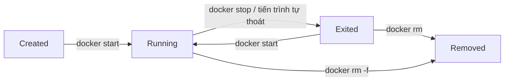

# Buổi 08 – Docker CLI

Tuần 4/16 · Giai đoạn 2 – Containerization · Buổi 08/32

[Slide buổi 08](../../slides/02-docker/session-08.md) · [Bài tập tuần 4](../../assignments/weekly/week-04.md) · [Hub tuần 4](README.md)

> **Tóm tắt:** Dùng 10 lệnh Docker cốt lõi để chạy, kiểm tra, dừng, xóa container, đẩy image lên registry cục bộ, và tự chẩn đoán khi container thoát ngay hoặc cổng bị bận.

::: tip Buổi này bạn làm gì
**Bạn sẽ tạo ra:** một web server Nginx và một database PostgreSQL do bạn tự chạy, soi và sửa lỗi bằng Docker CLI, cộng một image đẩy lên registry chạy ngay trên máy bạn.

**Thời gian thật:** đọc 15 phút, lab bắt buộc 60 phút, thử thách tùy chọn làm ở nhà.

**Cần chuẩn bị:**

- [ ] Làm xong [Buổi 07 – Container Fundamentals](session-07.md): Docker Desktop chạy được, `docker run --rm hello-world` thành công.
- [ ] Môi trường theo [Hướng dẫn cài đặt](../../resources/setup-guide.md); tài khoản GitHub và repo `devops-labs` theo [Tài khoản GitHub và repo devops-labs](../../resources/setup-github.md).
- [ ] Mở terminal WSL Ubuntu, nằm trong filesystem của WSL (không dùng `/mnt/c`).

**Sản phẩm phải nộp** (thư mục `lab-08/` trong `devops-labs`):

- `README.md` trả lời 7 câu theo mẫu, ghi rõ đã làm L1 hay L2.
- `evidence/command-output.txt` chứa lệnh và output thật của Phần 1 đến 4.
- `source/commands.sh` ghi lại các lệnh bạn đã chạy.
- `report.md` trả lời 5 câu hỏi kiểm tra của bài tập tuần.

**Đi nhanh:** [Đọc](#van-de-thuc-te) > [Làm lab](#hands-on-lab) > [Gặp lỗi?](#gap-loi) > [Tự kiểm tra](#tu-kiem-tra) > [Nộp bài](#nop-bai). Kẹt giữa chừng? Nhảy tới [Gặp lỗi?](#gap-loi).
:::

**Từ mới trong buổi** (tra thêm ở [Thuật ngữ](../../resources/glossary.md)):

- **ExitCode**: con số cho biết tiến trình thoát thế nào (0 là êm, khác 0 là lỗi).
- **PID 1**: tiến trình chính của container; nó chết thì container chết.
- **Tag**: nhãn phiên bản của image, ví dụ `1.27-alpine`.
- **Biến môi trường**: cặp `TÊN=giá trị` truyền cấu hình vào container.
- **stdout**: luồng chữ ứng dụng in ra, `docker logs` đọc được nó.
- **Registry**: kho lưu image; hôm nay bạn tự chạy một cái trên máy.

## Vấn đề thực tế {#van-de-thuc-te}

Một thành viên CLB gửi bạn lệnh "chạy thử cho nhanh" rồi báo: "máy mình chạy được, máy bạn thì không". Bạn chạy lệnh, không thấy lỗi nhưng `docker ps` trống. Hoặc bạn mở trang web CLB ở cổng quen thuộc và thấy một trang cũ không biết từ đâu ra. Không có Docker CLI trong tay, bạn chỉ còn cách đoán rồi khởi động lại máy.

Docker CLI giúp bạn trả lời các câu hỏi cốt lõi khi vận hành: container nào đang chạy, từ image nào, đang in ra gì, nghe cổng nào, thoát với mã lỗi bao nhiêu và vì sao. Đây cũng là cách debug đầu tiên bạn dùng ở Kubernetes (`kubectl logs`, `kubectl exec`, `kubectl describe` là anh em họ của các lệnh hôm nay).

## Khái niệm cốt lõi {#khai-niem}

- **Vòng đời container** gồm tạo, chạy, dừng, xóa. Ví von: công tắc đèn; `stop` chỉ tắt đèn (đèn vẫn còn trong phòng), `rm` mới gỡ hẳn bóng đèn.
- **PID 1**: container sống chừng nào tiến trình chính còn sống. Ví von: người trực quầy duy nhất; người đó nghỉ thì quầy đóng cửa, và ExitCode là lời nhắn để lại cho biết nghỉ vì xong việc (0) hay vì sự cố.
- **Bộ ba chẩn đoán** `docker ps -a`, `docker logs`, `docker inspect`. Ví von: bác sĩ hỏi bệnh nhân còn sống không (ps), đọc nhật ký triệu chứng (logs), rồi khám chi tiết (inspect). Gặp container lỗi thì luôn làm theo thứ tự này.
- **Cờ của `docker run`** quyết định cách "gọi món": `-d` mang đi (chạy nền), `--name` đặt tên cho suất ăn, `-p` nối cổng, `-e` thêm gia vị (biến môi trường), `--rm` ăn xong tự dọn bàn.
- **Tên image đầy đủ** như địa chỉ nhà: `localhost:5001/club/nginx:1.27-alpine` gồm registry (`localhost:5001`), repository (`club/nginx`) và tag (`1.27-alpine`). Bỏ phần registry thì Docker hiểu là Docker Hub.



::: details Tìm hiểu thêm (đọc sau)
**Image và container.** Image là gói chỉ đọc (tạo bằng `docker build`, `docker pull`; xem bằng `docker images`; xóa bằng `docker image rm`). Container là tiến trình tạo từ image kèm một lớp ghi (tạo bằng `docker run`, `docker create`; xem bằng `docker ps`, `docker ps -a`; xóa bằng `docker rm`). Một image sinh nhiều container; không xóa được image nếu còn container (kể cả đã dừng) dùng nó.

**`docker run` là ba việc gộp lại:** `docker pull` (nếu image chưa có), `docker create` rồi `docker start`. Cú pháp: `docker run [OPTIONS] IMAGE[:TAG] [COMMAND] [ARGS...]`, phần `COMMAND` nếu có sẽ ghi đè `CMD` mặc định của image. Cờ `-it` cấp stdin và terminal cho shell tương tác như `sh`; quên `-d` thì terminal bị chiếm và nhiều bạn tưởng container "treo".

**Các lệnh quan sát và điều khiển khác.** `docker logs web -f --tail 20` (chỉ thấy stdout và stderr của PID 1), `docker exec -it web sh` (chạy thêm một tiến trình trong container đang chạy, thoát shell không làm container dừng), `docker stats --no-stream`, `docker stop web` (gửi SIGTERM, chờ 10 giây rồi SIGKILL), `docker start web` (giữ nguyên cấu hình ban đầu).

**Kiến trúc.** Lệnh `docker` chỉ là client gọi API của daemon (vì vậy `docker version` có hai khối Client và Server). `docker logs` đọc luồng stdout/stderr của PID 1 mà daemon đã ghi lại nên vẫn xem được log của container đã chết, cho tới khi container bị xóa. `docker push` gửi các layer tới registry theo tên đầy đủ; tên thiếu địa chỉ registry là nguyên nhân push thất bại phổ biến nhất. Tag `latest` thay đổi theo thời gian nên kết quả không tái lập; khóa này luôn pin tag cụ thể.
:::

Trên lớp, mentor demo trước; tự học thì làm thẳng phần Làm lab.

## Hands-on lab (60 phút, bắt buộc) {#hands-on-lab}

### Chuẩn bị (5 phút)

```bash
mkdir -p ~/devops-labs/lab-08/{source,screenshots,evidence}
cd ~/devops-labs/lab-08
docker ps -a --format '{{.Names}}' | head
echo "=== Lab 08 $(date -Iseconds) ===" | tee evidence/command-output.txt
```

Kết quả mong đợi: lệnh `docker ps -a` chạy không lỗi (danh sách tên có thể rỗng). Nếu báo `Cannot connect to the Docker daemon`, xem [Gặp lỗi?](#gap-loi).

Quy ước: mọi container của lab có tên bắt đầu bằng `lab08-`; cổng dùng là 8088 (web) và 5001 (registry). Với mỗi lệnh quan trọng, thêm `2>&1 | tee -a evidence/command-output.txt` ở cuối. Cổng đã bận ở máy bạn thì xem [Gặp lỗi?](#gap-loi).

### Phần 1. Chạy và kiểm tra container (15 phút)

**Bước 1.1.** Chạy Nginx nền với tên và cổng rõ ràng, rồi xác nhận nó sống:

```bash
docker run -d --name lab08-web -p 8088:80 nginx:1.27-alpine 2>&1 | tee -a evidence/command-output.txt
docker ps --filter name=lab08-web --format 'table {{.Names}}\t{{.Image}}\t{{.Status}}\t{{.Ports}}' | tee -a evidence/command-output.txt
curl -s -o /dev/null -w '%{http_code}\n' http://localhost:8088
```

Kết quả mong đợi: một chuỗi ID 64 ký tự (lần đầu có thêm dòng tải layer), một dòng `lab08-web  nginx:1.27-alpine  Up ...  0.0.0.0:8088->80/tcp` và mã `200`. `docker ps` cho biết Docker nghĩ gì; `curl` cho biết dịch vụ có thật sự trả lời.

**Bước 1.2.** Xem log theo thời gian thực:

```bash
docker logs -f --tail 5 lab08-web
```

Mở terminal thứ hai chạy `curl -s http://localhost:8088 > /dev/null` vài lần: mỗi lần có thêm một dòng `GET / HTTP/1.1" 200`. Nhấn Ctrl+C để thoát (container vẫn chạy). Ứng dụng tốt trong container luôn log ra stdout/stderr thay vì ghi file.

**Bước 1.3.** Vào bên trong container:

```bash
docker exec -it lab08-web sh
```

Trong shell của container chạy:

```sh
cat /etc/os-release | head -2
ls /usr/share/nginx/html
ps
exit
```

Kết quả mong đợi: Alpine Linux, file `index.html` và `50x.html`, và `nginx: master process` ở PID 1. Thoát shell không làm container dừng.

**Bước 1.4.** Soi bằng `inspect` (nguồn sự thật về cấu hình thật của container):

```bash
docker inspect --format 'status={{.State.Status}} started={{.State.StartedAt}} ip={{range .NetworkSettings.Networks}}{{.IPAddress}}{{end}}' lab08-web | tee -a evidence/command-output.txt
```

Kết quả mong đợi: `status=running`, thời điểm bắt đầu và một IP nội bộ kiểu `172.17.0.x`.

::: tip Kiểm tra: bạn đúng khi
`curl` trả `200`, `docker logs` có dòng `GET` của chính bạn, `ps` trong container cho thấy Nginx là PID 1 và `inspect` in `status=running`.
:::

### Phần 2. Dừng, chạy lại, xóa (10 phút)

**Bước 2.1.** Dừng và quan sát trạng thái:

```bash
docker stop lab08-web
docker ps
docker ps -a --filter name=lab08-web --format '{{.Names}} {{.Status}}'
docker inspect --format 'exit={{.State.ExitCode}} {{.State.Status}}' lab08-web | tee -a evidence/command-output.txt
```

Kết quả mong đợi: `docker ps` không còn container; `docker ps -a` hiện `Exited (0) ... ago`; `exit=0 exited` (Nginx nhận SIGTERM và thoát êm). Container chỉ biến khỏi `docker ps` chứ chưa bị xóa; log và cấu hình vẫn còn.

**Bước 2.2.** Chạy lại rồi xóa hẳn:

```bash
docker start lab08-web
curl -s -o /dev/null -w '%{http_code}\n' http://localhost:8088
docker rm lab08-web 2>&1 | tee -a evidence/command-output.txt
docker rm -f lab08-web 2>&1 | tee -a evidence/command-output.txt
```

Kết quả mong đợi: `200`; lệnh `docker rm` đầu báo lỗi `cannot remove container ... container is running` (cố ý, nhớ giữ dòng lỗi này trong evidence); `docker rm -f` dừng và xóa. Docker từ chối xóa container đang chạy để tránh mất dịch vụ ngoài ý muốn; `-f` là hành động có chủ đích.

**Bước 2.3.** Container dùng một lần với `--rm`:

```bash
docker run --rm --name lab08-once alpine:3.20 echo "xin chao CLB" | tee -a evidence/command-output.txt
docker ps -a --filter name=lab08-once
```

Kết quả mong đợi: in `xin chao CLB`, rồi danh sách rỗng chỉ còn dòng tiêu đề. `--rm` dọn container ngay khi tiến trình thoát.

::: tip Kiểm tra: bạn đúng khi
Bạn có đủ chuỗi `exit=0 exited`, thông báo lỗi của `docker rm` trên container đang chạy, và không còn container `lab08-web` hay `lab08-once` trong `docker ps -a`.
:::

### Phần 3. Biến môi trường và container thoát ngay (15 phút)

PostgreSQL giống database của dự án CLB, nên đây là dịp quen với biến môi trường. Cố ý chạy sai trước để thấy container "chết".

**Bước 3.1.** Chạy chưa cấu hình gì và điều tra bằng bộ ba chẩn đoán:

```bash
docker run -d --name lab08-pg postgres:17-alpine
docker ps -a --filter name=lab08-pg | tee -a evidence/command-output.txt
docker inspect --format 'exit={{.State.ExitCode}}' lab08-pg | tee -a evidence/command-output.txt
docker logs lab08-pg 2>&1 | head -4 | tee -a evidence/command-output.txt
```

Kết quả mong đợi: `docker ps` (không có `-a`) sẽ không thấy container; `docker ps -a` hiện `Exited (1)`, `exit=1`, và log có dòng `Error: Database is uninitialized and superuser password is not specified.` Nguyên nhân gốc đọc thẳng từ log, không đoán: image từ chối khởi tạo khi thiếu `POSTGRES_PASSWORD`. Gặp `ps` trống sau `run -d`: xem [Gặp lỗi?](#gap-loi).

**Bước 3.2.** Dọn và chạy lại với cấu hình đúng, đợi database sẵn sàng:

```bash
docker rm lab08-pg
docker run -d --name lab08-pg -e POSTGRES_PASSWORD=lab_only_password -e POSTGRES_DB=club postgres:17-alpine
until [ "$(docker logs lab08-pg 2>&1 | grep -c 'ready to accept connections')" -ge 2 ]; do sleep 1; done
docker exec lab08-pg pg_isready -U postgres | tee -a evidence/command-output.txt
docker exec lab08-pg psql -U postgres -d club -c "SELECT version();" | tee -a evidence/command-output.txt
```

Kết quả mong đợi: `pg_isready` in `/var/run/postgresql:5432 - accepting connections`; `psql` in một dòng phiên bản PostgreSQL 17. Vòng `until` đợi dòng `ready to accept connections` xuất hiện hai lần vì image khởi động một server tạm để khởi tạo rồi mới chạy server thật; `psql` quá sớm sẽ lỗi. Mật khẩu ở đây là giá trị tạm của bài lab, không phải mật khẩu thật của bạn.

**Bước 3.3.** Kiểm tra biến đã vào container, nhưng chỉ lọc đúng dòng cần:

```bash
docker inspect --format '{{range .Config.Env}}{{println .}}{{end}}' lab08-pg | grep POSTGRES_DB | tee -a evidence/command-output.txt
```

Kết quả mong đợi: `POSTGRES_DB=club`.

::: danger Không dán nguyên output docker inspect
`docker inspect` hiển thị cả biến chứa mật khẩu. Luôn lọc bằng `--format` và `grep` như trên trước khi đưa vào evidence hoặc báo cáo.
:::

Dọn dẹp: `docker rm -f lab08-pg`.

::: tip Kiểm tra: bạn đúng khi
Evidence có cả lần thất bại (`Exited (1)` kèm dòng lỗi của log) lẫn lần thành công (`accepting connections`), và không có dòng `POSTGRES_PASSWORD=` nào.
:::

### Phần 4. Tag và push lên registry cục bộ (10 phút)

Không cần tài khoản hay token: bạn chạy một registry ngay trên máy.

```bash
docker run -d --name lab08-registry -p 5001:5000 registry:2.8.3
curl -s http://localhost:5001/v2/_catalog
docker tag nginx:1.27-alpine localhost:5001/club/nginx:1.27-alpine
docker push localhost:5001/club/nginx:1.27-alpine 2>&1 | tee -a evidence/command-output.txt
curl -s http://localhost:5001/v2/_catalog | tee -a evidence/command-output.txt
curl -s http://localhost:5001/v2/club/nginx/tags/list | tee -a evidence/command-output.txt
```

Kết quả mong đợi: lệnh `curl` đầu in `{"repositories":[]}`; `push` in các layer `Pushed` hoặc `Layer already exists` rồi `digest: sha256:...`; catalog có `club/nginx`; tags/list in `{"name":"club/nginx","tags":["1.27-alpine"]}`. `docker tag` chỉ thêm một cái tên trỏ cùng image, không sao chép dữ liệu; phần `localhost:5001/` trong tên cho Docker biết đẩy tới đâu. Đây cũng là cơ chế khi bạn push `ghcr.io/ten-ban/club-api:1.0.0` ở các buổi CI/CD sau (thêm xác thực). Push báo `denied`: xem [Gặp lỗi?](#gap-loi).

Dọn dẹp: `docker rm -fv lab08-registry` (cờ `-v` xóa luôn volume ẩn của registry).

::: tip Kiểm tra: bạn đúng khi
`push` kết thúc bằng dòng `digest: sha256:...` và `tags/list` chứa `1.27-alpine`.
:::

### Checklist L1 và tự kiểm tra một dòng

- [ ] `lab08-web` chạy từ `nginx:1.27-alpine`, `curl` trả `200` trên cổng 8088; xem được log và `exec` vào chạy `ps`.
- [ ] Dùng `docker inspect --format` lấy được trạng thái và ExitCode.
- [ ] Dừng, chạy lại, xóa container; giải thích được vì sao `docker rm` không xóa container đang chạy.
- [ ] Có cả lần thất bại và thành công của Postgres, `inspect` đã lọc.
- [ ] Push thành công một image lên registry cục bộ và xem được tag bằng `curl`.
- [ ] Mọi container `lab08-*` đã được dọn sạch.

```bash
docker ps -a --filter name=lab08- --format '{{.Names}}' | wc -l
```

Kết quả mong đợi: `0`.

## Gặp lỗi? {#gap-loi}

| Triệu chứng | Nguyên nhân | Cách sửa |
| --- | --- | --- |
| `Cannot connect to the Docker daemon` | Docker Desktop chưa chạy hoặc chưa bật WSL integration | Mở Docker Desktop, bật WSL integration cho Ubuntu (Settings, Resources, WSL integration) |
| `port is already allocated` | Cổng host đã được container hoặc tiến trình khác giữ | `docker ps --filter publish=PORT`, `ss -ltnp`; đổi cổng host hoặc dừng container vô chủ (tình huống 01 ở trang thử thách) |
| `docker ps` trống nhưng vừa chạy `docker run -d` | Container đã thoát; `docker ps` chỉ liệt kê container đang chạy | `docker ps -a`, `docker logs`, xem `ExitCode` bằng `docker inspect` (tình huống 02) |
| Terminal bị chiếm sau `docker run` | Quên `-d` nên chạy ở foreground | Ctrl+C rồi chạy lại với `-d`; hoặc mở terminal khác |
| `container name is already in use` | Tên trùng với container cũ (kể cả đã dừng) | `docker rm tên` rồi chạy lại, hoặc đặt tên khác |
| `curl` bị từ chối dù container `Up` (`Empty reply from server`, `Connection reset by peer`) | Nhầm cổng container (ví dụ `-p 8088:8088` trong khi Nginx nghe 80), ứng dụng nghe `127.0.0.1`, hoặc chưa sẵn sàng | `docker port`, `docker logs`, `docker exec ... netstat -ltn`, đợi và thử lại |
| `psql` báo không kết nối được ngay sau khi Postgres chạy | Mới có một dòng `ready to accept connections` (server tạm khi khởi tạo) | Đợi dòng đó xuất hiện hai lần (vòng `until` ở Bước 3.2) rồi thử lại |
| `denied` hoặc `requested access to the resource is denied` khi push | Tên image thiếu địa chỉ registry hoặc chưa đăng nhập | `docker tag` lại với tên đầy đủ `localhost:5001/...`; `docker login` khi dùng registry thật |
| Kết quả pull khác nhau giữa các máy | Dùng tag `latest` | Pin tag cụ thể như `nginx:1.27-alpine` |

## Tự kiểm tra {#tu-kiem-tra}

1. Khác biệt giữa `docker stop` và `docker rm -f` là gì?

::: details Đáp án gợi ý
`docker stop` gửi SIGTERM, chờ rồi SIGKILL, container chuyển sang `Exited` và còn lại trên đĩa. `docker rm -f` buộc dừng rồi xóa hẳn container (log và lớp ghi mất theo).
:::

2. `docker run -d -p 9000:80 nginx:1.27-alpine` mở cổng nào trên máy bạn, và Nginx nghe cổng nào trong container?

::: details Đáp án gợi ý
Cổng 9000 trên host; Nginx nghe cổng 80 trong container. Định dạng luôn là host:container.
:::

3. Vì sao `docker logs` vẫn đọc được log của container đã thoát?

::: details Đáp án gợi ý
Daemon lưu stdout/stderr của tiến trình chính theo container; log chỉ mất khi container bị xóa.
:::

4. Bạn chạy `docker run -d --name api club-api:1.0.0`, `docker ps` không thấy gì. Liệt kê ba lệnh bạn chạy tiếp theo theo thứ tự.

::: details Đáp án gợi ý
`docker ps -a` để xem trạng thái và ExitCode; `docker logs api` để xem lỗi; nếu log không rõ, `docker inspect api` (đặc biệt `State`, `Config.Cmd`, `Config.Env`) hoặc chạy `docker run --rm --entrypoint sh -it club-api:1.0.0` để soi bên trong image.
:::

5. `docker push ten-ban/club-api:1.0.0` tới registry cục bộ ở cổng 5001 bị từ chối hoặc đi nhầm nơi. Bạn thiếu gì?

::: details Đáp án gợi ý
Tên image phải chứa địa chỉ registry: `docker tag ten-ban/club-api:1.0.0 localhost:5001/ten-ban/club-api:1.0.0` rồi push tên mới. Không có địa chỉ thì Docker hiểu là Docker Hub.
:::

## Nộp bài {#nop-bai}

Nộp vào thư mục `lab-08/` trong repo `devops-labs` theo [mẫu lab](../../templates/lab-template.md); đề bài và bảng điểm ở [Bài tập tuần 4](../../assignments/weekly/week-04.md).

- [ ] `README.md` trả lời đủ 7 câu: bài lab giải quyết vấn đề gì, kiến thức đã dùng, các bước thực hiện, kết quả mong đợi, lỗi đã gặp, cách khắc phục, có thể cải thiện gì; ghi rõ đã làm L1 hay L2.
- [ ] `evidence/command-output.txt` chứa lệnh và output thật của Phần 1 đến 4 (run, ps, logs, exec, inspect, stop, rm, push).
- [ ] `source/commands.sh` ghi lại các lệnh bạn đã chạy; `screenshots/` (tùy chọn) có ảnh `docker ps`.
- [ ] `report.md` trả lời 5 câu hỏi kiểm tra của bài tập tuần (và báo cáo 5 mục nếu làm thử thách L2).
- [ ] Không commit secret; không dán output `docker inspect` chưa lọc; đã dọn sạch container và registry tạm.

## Recap

- Container sống theo PID 1: tiến trình thoát thì container thoát, ExitCode cho biết thoát thế nào; bộ ba chẩn đoán là `docker ps -a`, `docker logs`, `docker inspect`.
- `-p host:container` (trái là máy bạn); `stop` giữ lại container, `rm` xóa, `--rm` dành cho lệnh một lần.
- Tên image đầy đủ gồm registry, repository, tag; luôn pin tag thay vì `latest`.

Buổi tiếp theo: [Buổi 09 – Dockerfile](../week-05/session-09.md).

::: details Thử thách thêm (L2, tùy chọn, làm ở nhà)
Gồm hai tình huống dựng sẵn (xung đột cổng 28081 và container thoát ngay), một thử thách smoke test, và vài lệnh bổ sung (`docker port`, `docker stats`, pull lại từ registry cục bộ). Tự thử 15 phút trước khi mở gợi ý. Xem [Buổi 08 – Thử thách thêm](session-08-challenge.md).
:::

::: details Phá lỗi nâng cao
Tự tạo lỗi "nhầm cổng container" (container `Up` nhưng không truy cập được) và điều tra từng bước. Xem phần Phá lỗi nâng cao ở [Buổi 08 – Thử thách thêm](session-08-challenge.md).
:::

::: details Tài liệu tham khảo
- [docker run – Docker CLI reference](https://docs.docker.com/reference/cli/docker/container/run/)
- [docker inspect](https://docs.docker.com/reference/cli/docker/inspect/)
- [docker image push](https://docs.docker.com/reference/cli/docker/image/push/)

Danh sách đầy đủ ở cuối [trang thử thách](session-08-challenge.md).
:::
