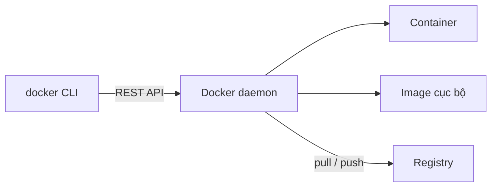
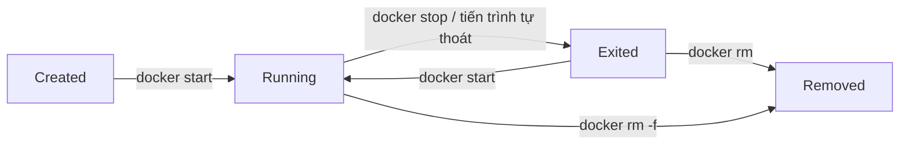

# Buổi 08 – Docker CLI

Tuần 4 · Giai đoạn 2 – Containerization · Slide: [Slide buổi 08](../../slides/02-docker/session-08.md)

> **Tóm tắt:** Dùng thành thạo Docker CLI để chạy, kiểm tra, debug, dừng, xóa container và đẩy image lên registry, rồi chẩn đoán lỗi port bận và container thoát ngay.

## Mục tiêu học tập

- Giải thích vòng đời container (created, running, exited, removed) và lệnh nào chuyển trạng thái nào.
- Chạy được container với `docker run` kèm các cờ `-d`, `--name`, `-p`, `-e`, `--rm` và phân biệt image với container.
- Kiểm tra được container đang chạy bằng `docker ps`, `docker logs`, `docker exec`, `docker inspect`, `docker stats`.
- Dừng và dọn dẹp tài nguyên an toàn bằng `docker stop`, `docker rm`, `docker image rm`, `docker system df`.
- Đặt tag cho image và đẩy lên registry bằng `docker tag`, `docker pull`, `docker push` (registry cục bộ).
- Chẩn đoán được hai lỗi kinh điển: port đã được sử dụng (tình huống 01) và container thoát ngay khi start (tình huống 02).

## Điều kiện cần

- Đã hoàn thành [Buổi 07](session-07.md): hiểu image, container, registry; Docker Desktop chạy với WSL2 backend.
- Làm việc trong terminal WSL2 Ubuntu, thư mục nằm trong filesystem của WSL (ví dụ `~/devops-labs/lab-08`), không dùng `/mnt/c`.
- Kiểm tra nhanh:

```bash
docker version --format '{{.Server.Version}}'
docker run --rm hello-world
```

Kết quả mong đợi: in ra số phiên bản (ví dụ `27.x.x`) và đoạn chữ `Hello from Docker!`. Nếu báo `Cannot connect to the Docker daemon`, mở Docker Desktop và bật WSL integration cho Ubuntu (Settings, Resources, WSL integration).

## Vấn đề thực tế

Một thành viên CLB gửi bạn lệnh "chạy thử cho nhanh" rồi báo: "máy mình chạy được, máy bạn thì không". Bạn chạy lệnh, không thấy lỗi gì nhưng `docker ps` trống. Hoặc bạn mở trang web CLB ở cổng quen thuộc và thấy một trang cũ không biết từ đâu ra. Không có Docker CLI trong tay, bạn chỉ còn cách đoán và khởi động lại máy.

Docker CLI là bộ công cụ quan sát và điều khiển container. Với vài lệnh nhỏ, bạn trả lời được các câu hỏi cốt lõi khi vận hành: container nào đang chạy, nó chạy bằng image nào, nó đang in ra gì, nó nghe cổng nào, nó thoát với mã lỗi bao nhiêu và vì sao. Đây cũng là cách debug đầu tiên mà bạn dùng ở Kubernetes (`kubectl logs`, `kubectl exec`, `kubectl describe` là các anh em họ của các lệnh hôm nay).

## Khái niệm cốt lõi

### Image và container

| | Image | Container |
| --- | --- | --- |
| Bản chất | Gói chỉ đọc gồm filesystem và metadata (CMD, ENV, EXPOSE) | Tiến trình đang chạy (hoặc đã dừng) tạo từ image, có thêm một lớp ghi |
| Tạo bằng | `docker build`, `docker pull` | `docker run`, `docker create` |
| Xem bằng | `docker images` (hoặc `docker image ls`) | `docker ps` (đang chạy), `docker ps -a` (tất cả) |
| Xóa bằng | `docker image rm` | `docker rm` |
| Ví dụ | `nginx:1.27-alpine` | `web` (tên bạn đặt) |

Một image có thể sinh nhiều container. Xóa container không xóa image, và ngược lại không xóa được image nếu còn container (kể cả container đã dừng) dùng nó.

### Cú pháp đầy đủ của docker run

```text
docker run [OPTIONS] IMAGE[:TAG] [COMMAND] [ARGS...]
```

`docker run` thực chất là ba việc gộp lại: `docker pull` (nếu image chưa có), `docker create` (tạo container) và `docker start` (chạy). Phần `COMMAND` nếu có sẽ ghi đè `CMD` mặc định của image.

| Cờ | Ý nghĩa | Lưu ý |
| --- | --- | --- |
| `-d` | Chạy nền (detached) | Quên `-d` thì terminal bị chiếm, nhiều bạn tưởng container "treo" |
| `--name web` | Đặt tên container | Không đặt thì Docker sinh tên ngẫu nhiên; tên phải duy nhất |
| `-p 8088:80` | Map cổng host:container | Cổng bên trái là của máy bạn, bên phải là trong container |
| `-e KEY=value` | Đặt biến môi trường | Không đưa secret thật vào lệnh mẫu hay lịch sử shell |
| `--rm` | Tự xóa container khi nó thoát | Hợp cho lệnh chạy thử một lần |
| `-it` | Có stdin và terminal (TTY) | Dùng cho shell tương tác như `sh` |

### Nhóm lệnh quan sát và điều khiển

| Mục đích | Lệnh | Ghi chú |
| --- | --- | --- |
| Liệt kê | `docker ps`, `docker ps -a` | `-a` bao gồm container đã thoát |
| Xem log | `docker logs web`, `-f`, `--tail 20` | Chỉ thấy stdout và stderr của tiến trình chính (PID 1) |
| Vào trong | `docker exec -it web sh` | Chạy thêm một tiến trình trong container đang chạy |
| Soi chi tiết | `docker inspect web` | Trả về JSON: trạng thái, ExitCode, mạng, mount, env |
| Tài nguyên | `docker stats --no-stream` | CPU, RAM, mạng của container đang chạy |
| Dừng | `docker stop web` | Gửi SIGTERM, chờ 10 giây rồi SIGKILL |
| Chạy lại | `docker start web` | Giữ nguyên cấu hình ban đầu |
| Xóa | `docker rm web`, `docker rm -f web` | `-f` buộc dừng rồi xóa |
| Lấy image | `docker pull nginx:1.27-alpine` | Luôn ghi rõ tag |
| Đổi tên và đẩy | `docker tag`, `docker push` | Tên image chứa địa chỉ registry |

### Tên image đầy đủ

`localhost:5001/club/nginx:1.27-alpine` gồm: registry (`localhost:5001`), repository (`club/nginx`), tag (`1.27-alpine`). Nếu bỏ phần registry, Docker mặc định là Docker Hub. Tag `latest` là tag mặc định khi bạn không ghi tag và nó thay đổi theo thời gian, nên kết quả không tái lập. Trong khóa này luôn pin tag cụ thể.

## Kiến trúc và cách hoạt động





1. Lệnh `docker` chỉ là client; nó gọi API của Docker daemon (chạy trong Docker Desktop). Vì vậy `docker version` hiển thị hai phần Client và Server.
2. `docker run` nhờ daemon tìm image cục bộ, nếu thiếu thì pull từ registry, sau đó tạo container và chạy tiến trình `CMD` của image.
3. Container sống chừng nào tiến trình chính (PID 1) còn sống. Tiến trình thoát (thành công hay lỗi) thì container chuyển sang `Exited` và mã thoát (ExitCode) được lưu lại.
4. `docker logs` đọc luồng stdout/stderr của PID 1 mà daemon đã ghi lại, nên vẫn xem được log của container đã chết.
5. `docker exec` không khởi động lại container; nó chạy thêm một tiến trình khác bên trong các namespace của container đang chạy.
6. `docker push` gửi các layer của image tới registry theo tên đầy đủ; tên sai (thiếu địa chỉ registry) là nguyên nhân push thất bại phổ biến nhất.

## Demo của mentor

Mục tiêu (khoảng 10 phút trong phần 30'): cho lớp thấy một vòng đời hoàn chỉnh và một lỗi thoát ngay. Mentor chạy trên màn hình chiếu, lớp dự đoán trước khi Enter.

1. Chạy nginx nền và kiểm tra.

```bash
docker run -d --name demo-web -p 8088:80 nginx:1.27-alpine
docker ps
curl -I http://localhost:8088
```

Kết quả mong đợi: `docker ps` có một dòng `demo-web` trạng thái `Up`, cột PORTS có `0.0.0.0:8088->80/tcp`; `curl -I` trả `HTTP/1.1 200 OK`.

Hỏi lớp: "Cổng 8088 nằm ở máy hay trong container? Nếu mình đổi thành `-p 8088:8088` thì chuyện gì xảy ra?" (Đáp: nginx nghe cổng 80 trong container nên kết nối tới 8088 bên trong sẽ không có ai trả lời.)

2. Xem log và đi vào trong.

```bash
docker logs --tail 5 demo-web
docker exec demo-web wget -qO- http://localhost
docker exec -it demo-web sh
# trong container:
ps
exit
```

Kết quả mong đợi: log có các dòng khởi động của nginx và một dòng truy cập GET từ `curl`; `wget` in ra HTML "Welcome to nginx!"; `ps` cho thấy `nginx: master process` là PID 1.

Hỏi lớp: "Mình exit shell, container có chết không? Vì sao?" (Đáp: không, shell chỉ là tiến trình phụ do `exec` tạo; PID 1 vẫn là nginx.)

3. Soi chi tiết bằng inspect.

```bash
docker inspect --format '{{.State.Status}} exit={{.State.ExitCode}}' demo-web
docker inspect --format '{{.Config.Image}} {{json .NetworkSettings.Ports}}' demo-web
```

Kết quả mong đợi: `running exit=0` và tên image kèm JSON ánh xạ cổng `80/tcp`.

4. Cho một container thoát ngay (không có biến bắt buộc).

```bash
docker run -d --name demo-pg postgres:17-alpine
docker ps
docker ps -a --filter name=demo-pg
docker logs demo-pg
```

Kết quả mong đợi: `docker ps` không thấy `demo-pg`; `docker ps -a` hiển thị `Exited (1)`; log có dòng `Error: Database is uninitialized and superuser password is not specified.`

Hỏi lớp: "Container đã chết, mình còn xem được log không? Cần sửa gì?" Sau đó sửa:

```bash
docker rm demo-pg
docker run -d --name demo-pg -e POSTGRES_PASSWORD=demo_only_password postgres:17-alpine
docker ps --filter name=demo-pg
```

Kết quả mong đợi: lần này `demo-pg` ở trạng thái `Up`. Mật khẩu ở đây chỉ là giá trị minh họa cho demo, không dùng cho dự án thật.

5. Dừng và dọn dẹp.

```bash
docker stop demo-web demo-pg
docker rm demo-web demo-pg
docker ps -a --filter name=demo-
```

Kết quả mong đợi: hai tên được in lại sau mỗi lệnh; lệnh cuối chỉ còn dòng tiêu đề.

## Hands-on lab

Thời gian dự kiến: 60 phút (Phần 1 đến 3 khoảng 25 phút, Phần 4 khoảng 10 phút, L2 khoảng 25 phút).

### Chuẩn bị

```bash
mkdir -p ~/devops-labs/lab-08/{source,screenshots,evidence}
cd ~/devops-labs/lab-08
docker ps -a --format '{{.Names}}' | head
```

Ghi lại toàn bộ lệnh và output quan trọng vào `evidence/command-output.txt`. Cách dễ nhất là dùng `tee`:

```bash
echo "=== Lab 08 $(date -Iseconds) ===" | tee evidence/command-output.txt
```

Về sau với mỗi lệnh quan trọng, thêm `2>&1 | tee -a evidence/command-output.txt` ở cuối.

Quy ước tên: mọi container của lab bắt đầu bằng `lab08-` để không đụng container khác. Cổng dùng trong lab: 8088 (web) và 5001 (registry cục bộ). Nếu cổng đã bận ở máy bạn, đó chính là tình huống 01; hãy chuyển sang Phần phá lỗi.

### Phần 1 – Chạy và kiểm tra container

1. Chạy nginx nền với tên và cổng rõ ràng.

```bash
docker run -d --name lab08-web -p 8088:80 nginx:1.27-alpine 2>&1 | tee -a evidence/command-output.txt
```

Kết quả mong đợi: một chuỗi ID dài 64 ký tự (lần đầu có thêm dòng tải layer). Vì sao: `-d` trả lại terminal cho bạn, ID là định danh container.

2. Xác nhận container sống và đúng cổng.

```bash
docker ps --filter name=lab08-web --format 'table {{.Names}}\t{{.Image}}\t{{.Status}}\t{{.Ports}}' | tee -a evidence/command-output.txt
curl -s -o /dev/null -w '%{http_code}\n' http://localhost:8088
```

Kết quả mong đợi: một dòng `lab08-web  nginx:1.27-alpine  Up ...  0.0.0.0:8088->80/tcp` và mã `200`. Vì sao: `docker ps` cho biết Docker nghĩ gì, `curl` cho biết dịch vụ có thật sự trả lời.

3. Xem log theo thời gian thực, rồi tạo thêm request.

```bash
docker logs -f --tail 5 lab08-web
```

Mở terminal thứ hai chạy `curl -s http://localhost:8088 > /dev/null` vài lần; mỗi lần sẽ có thêm một dòng log `GET / HTTP/1.1" 200`. Nhấn Ctrl+C để thoát phần theo dõi (container vẫn chạy). Vì sao: nginx ghi access log ra stdout nên `docker logs` thấy được; ứng dụng tốt trong container luôn log ra stdout/stderr thay vì ghi file.

4. Vào bên trong container.

```bash
docker exec -it lab08-web sh
```

Trong shell của container chạy:

```bash
cat /etc/os-release | head -2
ls /usr/share/nginx/html
ps
exit
```

Kết quả mong đợi: tên hệ điều hành Alpine, file `index.html` và `50x.html`, và `nginx: master process` ở PID 1. Vì sao: bạn đang ở trong filesystem của image (cộng lớp ghi của container), không phải máy host.

5. Soi bằng inspect và stats.

```bash
docker inspect --format 'status={{.State.Status}} started={{.State.StartedAt}} ip={{range .NetworkSettings.Networks}}{{.IPAddress}}{{end}}' lab08-web
docker port lab08-web
docker stats --no-stream lab08-web
```

Kết quả mong đợi: trạng thái `running`, một địa chỉ IP nội bộ kiểu `172.17.0.x`, dòng `80/tcp -> 0.0.0.0:8088` (bản Docker mới có thể in thêm một dòng `[::]:8088` cho IPv6), và bảng CPU/MEM rất nhỏ. Vì sao: `inspect` là nguồn sự thật cho cấu hình thật của container; khi nghi ngờ, đọc nó thay vì đoán.

### Phần 2 – Dừng, chạy lại, xóa

1. Dừng và quan sát trạng thái.

```bash
docker stop lab08-web
docker ps
docker ps -a --filter name=lab08-web --format '{{.Names}} {{.Status}}'
docker inspect --format 'exit={{.State.ExitCode}}' lab08-web
```

Kết quả mong đợi: `docker ps` không còn container; `docker ps -a` hiện `Exited (0) ... ago`; ExitCode là `0` (nginx nhận SIGTERM và thoát êm). Vì sao: container chỉ biến mất khỏi `docker ps` chứ chưa bị xóa; log và cấu hình vẫn còn.

2. Chạy lại rồi xóa hẳn.

```bash
docker start lab08-web
curl -s -o /dev/null -w '%{http_code}\n' http://localhost:8088
docker rm lab08-web 2>&1 | tee -a evidence/command-output.txt
docker rm -f lab08-web 2>&1 | tee -a evidence/command-output.txt
```

Kết quả mong đợi: `200`; lệnh `docker rm lab08-web` báo lỗi `cannot remove container ... is running` vì container đang chạy; bạn dùng `docker rm -f` để dừng và xóa. Vì sao: Docker từ chối xóa container đang chạy để tránh mất dịch vụ ngoài ý muốn; `-f` là hành động có chủ đích.

3. Dùng `--rm` cho lệnh một lần.

```bash
docker run --rm --name lab08-once alpine:3.20 echo "xin chao CLB"
docker ps -a --filter name=lab08-once
```

Kết quả mong đợi: in `xin chao CLB`, sau đó danh sách rỗng. Vì sao: `--rm` dọn container ngay khi tiến trình thoát, tránh để lại rác.

### Phần 3 – Biến môi trường và container có trạng thái

Dùng PostgreSQL giống database của starter-project để quen với biến môi trường.

```bash
docker run -d --name lab08-pg -e POSTGRES_PASSWORD=lab_only_password -e POSTGRES_DB=club postgres:17-alpine
docker logs --tail 3 lab08-pg
until [ "$(docker logs lab08-pg 2>&1 | grep -c 'ready to accept connections')" -ge 2 ]; do sleep 1; done
docker exec lab08-pg pg_isready -U postgres
docker exec lab08-pg psql -U postgres -d club -c "SELECT version();"
```

Kết quả mong đợi: log có dòng `database system is ready to accept connections` (có thể cần đợi vài giây rồi chạy lại `logs`); `pg_isready` in `/var/run/postgresql:5432 - accepting connections`; `psql` in một dòng phiên bản PostgreSQL 17. Vì sao có vòng `until`: image postgres khởi động một server tạm để chạy bước khởi tạo rồi tắt và khởi động lại server thật, nên dòng `ready to accept connections` xuất hiện hai lần; chỉ khi đó `psql` mới kết nối ổn định. Vì sao: `-e` truyền cấu hình vào container; `exec` cho phép chạy công cụ có sẵn trong image mà không cần cài trên máy bạn. Mật khẩu trong lab là giá trị tạm, container bị xóa ngay cuối lab; ở dự án thật dùng `.env` không commit.

Kiểm tra biến đã vào container:

```bash
docker inspect --format '{{range .Config.Env}}{{println .}}{{end}}' lab08-pg | grep POSTGRES_DB
```

Kết quả mong đợi: `POSTGRES_DB=club`. Lưu ý rằng `docker inspect` hiển thị cả biến chứa mật khẩu, nên không dán output nguyên văn vào báo cáo; hãy lọc như trên.

Dọn dẹp: `docker rm -f lab08-pg`.

### Phần 4 – pull, tag, push lên registry cục bộ

Bạn không cần tài khoản hay token: dùng một registry chạy ngay trên máy bạn.

1. Chạy registry và kiểm tra.

```bash
docker run -d --name lab08-registry -p 5001:5000 registry:2.8.3
curl -s http://localhost:5001/v2/_catalog
```

Kết quả mong đợi: `{"repositories":[]}`.

2. Pull, tag lại và push.

```bash
docker pull nginx:1.27-alpine
docker tag nginx:1.27-alpine localhost:5001/club/nginx:1.27-alpine
docker push localhost:5001/club/nginx:1.27-alpine
curl -s http://localhost:5001/v2/_catalog
curl -s http://localhost:5001/v2/club/nginx/tags/list
```

Kết quả mong đợi: push in các layer `Pushed` hoặc `Layer already exists` rồi `digest: sha256:...`; catalog có `club/nginx`; tags/list có `1.27-alpine` (dạng `{"name":"club/nginx","tags":["1.27-alpine"]}`). Vì sao: `docker tag` chỉ tạo thêm một cái tên trỏ cùng image, không sao chép dữ liệu; phần `localhost:5001/` trong tên cho Docker biết đẩy tới đâu. Đây là cùng cơ chế khi bạn push `ghcr.io/ten-ban/club-api:1.0.0` ở các buổi CI/CD sau (thay bằng xác thực và token).

3. Xóa bản cục bộ và pull lại từ registry của bạn.

```bash
docker image rm localhost:5001/club/nginx:1.27-alpine
docker pull localhost:5001/club/nginx:1.27-alpine
docker images --filter reference='localhost:5001/*'
```

Kết quả mong đợi: pull thành công từ registry cục bộ, image xuất hiện lại. Dọn dẹp: `docker rm -fv lab08-registry` (cờ `-v` xóa luôn volume ẩn của registry) rồi `docker image rm localhost:5001/club/nginx:1.27-alpine`.

### L1 – Foundation

- [ ] Chạy được `lab08-web` bằng nginx:1.27-alpine, `curl` trả mã 200 trên cổng 8088.
- [ ] Xem được log, `exec` vào container và chạy `ps`, ghi lại output.
- [ ] Dùng `docker inspect --format` lấy được trạng thái và ExitCode.
- [ ] Dừng, chạy lại, rồi xóa container; giải thích được vì sao `docker rm` không xóa container đang chạy.
- [ ] Push thành công một image lên registry cục bộ và xem được tag bằng `curl`.
- [ ] Mọi container `lab08-*` đã được dọn sạch (`docker ps -a --filter name=lab08-` rỗng).

### L2 – Engineering

Thử thách 1: giải quyết xung đột cổng (tình huống 01). Clone repo giáo trình vào filesystem WSL (ví dụ `~/devops-course`) rồi chạy `bash examples/troubleshooting/scenario-01/setup.sh` từ thư mục gốc repo đó (hoặc nhờ mentor). Sau đó chạy lệnh trong `examples/troubleshooting/scenario-01/README.md`.

Tiêu chí hoàn thành:

- [ ] Chỉ ra bằng lệnh ai đang giữ cổng 28081 (container nào, image nào).
- [ ] Chạy được trang của bạn trên một cổng khác mà không xóa trang đang chạy của người khác khi chưa kiểm tra.
- [ ] Viết báo cáo 5 mục (triệu chứng, nguyên nhân gốc, cách xác minh, giải pháp, phòng tránh) trong `report.md`.

<details><summary>Gợi ý</summary>

Lệnh nào liệt kê container kèm cột cổng? `docker ps` với `--filter publish=PORT` trả lời nhanh. Lưu ý: với Docker Desktop, cổng được publish ra Windows nên `ss -ltnp` trong WSL có thể không thấy; nếu `docker ps` không có container nào giữ cổng thì kiểm tra tiến trình Windows bằng `netstat -ano` trong PowerShell. Có hai cách xử lý: đổi cổng host của bạn (an toàn nhất) hoặc dừng container cũ khi bạn chắc chắn nó vô chủ.

</details>

<details><summary>Lời giải</summary>

```bash
docker ps --filter publish=28081 --format 'table {{.Names}}\t{{.Image}}\t{{.Ports}}'
docker rm ts01-web   # dọn container Created sót lại từ lần chạy lỗi, nếu không sẽ trùng tên
docker run -d --name ts01-web -p 28091:80 nginx:1.27-alpine
curl -s -o /dev/null -w '%{http_code}\n' http://localhost:28091
```

Nguyên nhân gốc: container `ts01-legacy-site` đã map cổng host 28081; một cổng host chỉ gán được cho một tiến trình. Nội dung bạn thấy ở `localhost:28081` là của container cũ. Chọn đổi cổng vì không phá dịch vụ của người khác; chỉ `docker stop`/`docker rm` container cũ sau khi xác nhận với chủ của nó. Phòng tránh: đặt tên container, dùng `docker ps` trước khi chạy, ghi cổng vào tài liệu hoặc `.env`. Dọn dẹp bằng `bash examples/troubleshooting/scenario-01/cleanup.sh` (script này cũng xóa `ts01-web`).

</details>

Thử thách 2: container thoát ngay (tình huống 02). Chạy `bash examples/troubleshooting/scenario-02/setup.sh` để build image `ts02-notes:broken`, rồi làm theo `examples/troubleshooting/scenario-02/README.md`.

Tiêu chí hoàn thành:

- [ ] Lấy được ExitCode và log của container đã thoát.
- [ ] Xác định nguyên nhân gốc bằng cách soi bên trong image mà không cần chạy ứng dụng.
- [ ] Sửa và chạy lại để `curl http://localhost:28082` trả JSON.
- [ ] `report.md` ghi rõ file nào, dòng nào đã đổi và cách phát hiện sớm lỗi này.

<details><summary>Gợi ý</summary>

Hai lệnh giúp bạn: `docker logs ts02-notes` và `docker run --rm --entrypoint ls ts02-notes:broken -la /app`. So sánh đường dẫn trong thông báo lỗi với những gì thực sự có trong `/app`.

</details>

<details><summary>Lời giải</summary>

Log báo không tìm thấy module `/app/src/server.js`. Trong image chỉ có `/app/server.js` vì Dockerfile `COPY package.json server.js ./` nhưng `CMD` lại gọi `node src/server.js`. Sửa dòng cuối của Dockerfile thành `CMD ["node", "server.js"]`, build lại và chạy:

```bash
docker rm -f ts02-notes
docker build -t ts02-notes:fixed examples/troubleshooting/scenario-02
docker run -d --name ts02-notes -p 28082:3000 ts02-notes:fixed
curl http://localhost:28082
```

Kết quả mong đợi: `{"status":"healthy","service":"club-notes"}`. Dọn dẹp bằng `bash examples/troubleshooting/scenario-02/cleanup.sh` rồi `docker rmi ts02-notes:fixed`. Phòng tránh: sau khi build luôn chạy thử một lần (smoke test) và xem log trước khi giao image; thêm bước đó vào CI.

</details>

## Phá lỗi và debug

Tình huống tự tạo: nhầm cổng container khi publish (container vẫn `Up` nhưng không truy cập được).

Cách phá:

```bash
docker run -d --name lab08-broken -p 8088:8088 nginx:1.27-alpine
docker ps --filter name=lab08-broken
curl -sS --max-time 3 http://localhost:8088 || echo "FAILED"
```

Triệu chứng: container ở trạng thái `Up`, nhưng `curl` báo `Recv failure: Connection reset by peer` hoặc `Empty reply from server`, in thêm `FAILED`.

Hướng điều tra theo bước:

1. Container có chạy không? `docker ps` cho `Up`: tiến trình sống, vấn đề nằm ở mạng.
2. Log có gì lạ không? `docker logs lab08-broken`: không có lỗi, vì nginx hoạt động bình thường.
3. Ánh xạ cổng thế nào? `docker port lab08-broken` cho `8088/tcp -> 0.0.0.0:8088`: cổng container được khai báo là 8088.
4. Tiến trình thực sự nghe cổng nào? `docker exec lab08-broken netstat -ltn` (busybox) cho thấy `0.0.0.0:80`.

Nguyên nhân gốc: Docker chuyển tiếp cổng host 8088 vào cổng 8088 của container, trong khi nginx nghe cổng 80. Phòng tránh: đọc tài liệu image để biết cổng ứng dụng nghe, kiểm tra bằng `docker exec ... netstat`, và luôn kiểm thử bằng `curl` sau khi chạy. Dọn dẹp: `docker rm -f lab08-broken`. Hai tình huống dựng sẵn 01 và 02 ở thử thách L2 là phần "Break, Debug" bắt buộc; bạn có thể xem thêm tổng quan ở `examples/troubleshooting/README.md`.

## Lỗi thường gặp

| Triệu chứng | Nguyên nhân | Cách xử lý |
| --- | --- | --- |
| `port is already allocated` | Cổng host đã được container hoặc tiến trình khác giữ | `docker ps --filter publish=PORT`, `ss -ltnp`; đổi cổng host hoặc dừng container vô chủ |
| `docker ps` trống nhưng vừa chạy `docker run -d` | Container đã thoát; `docker ps` chỉ liệt kê container đang chạy | `docker ps -a`, `docker logs`, xem `ExitCode` bằng `docker inspect` |
| Terminal bị chiếm sau `docker run` | Quên `-d` nên chạy ở foreground | Ctrl+C rồi chạy lại với `-d`; hoặc mở terminal khác |
| `container name is already in use` | Tên container trùng với container cũ (kể cả đã dừng) | `docker rm tên` rồi chạy lại, hoặc đặt tên khác |
| `curl` bị từ chối dù container `Up` | Nhầm cổng container, ứng dụng nghe `127.0.0.1` thay vì `0.0.0.0`, hoặc ứng dụng chưa sẵn sàng | `docker port`, `docker logs`, `docker exec ... netstat -ltn`, đợi và thử lại |
| `denied` hoặc `requested access to the resource is denied` khi push | Tên image thiếu địa chỉ registry hoặc chưa đăng nhập | `docker tag` lại với tên đầy đủ, `docker login` khi dùng registry thật |
| `Cannot connect to the Docker daemon` | Docker Desktop chưa chạy hoặc chưa bật WSL integration | Mở Docker Desktop, bật WSL integration cho distro Ubuntu |
| Kết quả pull khác nhau giữa các máy | Dùng tag `latest` | Pin tag cụ thể như `nginx:1.27-alpine` |

## Tự kiểm tra

1. Khác biệt giữa `docker stop` và `docker rm -f` là gì?

<details><summary>Đáp án</summary>

`docker stop` gửi SIGTERM, chờ rồi SIGKILL, container chuyển sang `Exited` và còn lại trên đĩa. `docker rm -f` buộc dừng rồi xóa hẳn container (log và lớp ghi mất theo).

</details>

2. `docker run -d -p 9000:80 nginx:1.27-alpine` mở cổng nào trên máy bạn, và nginx nghe cổng nào trong container?

<details><summary>Đáp án</summary>

Cổng 9000 trên host; nginx nghe cổng 80 trong container. Định dạng luôn là host:container.

</details>

3. Vì sao `docker logs` vẫn đọc được log của container đã thoát?

<details><summary>Đáp án</summary>

Daemon lưu stdout/stderr của tiến trình chính theo container; log chỉ mất khi container bị xóa.

</details>

4. `docker exec -it web sh` rồi `exit`. Container có dừng không?

<details><summary>Đáp án</summary>

Không. Shell là tiến trình phụ do `exec` tạo; container sống theo PID 1.

</details>

5. Tình huống: bạn chạy `docker run -d --name api club-api:1.0.0`, `docker ps` không thấy gì. Liệt kê ba lệnh bạn chạy tiếp theo theo thứ tự.

<details><summary>Đáp án</summary>

`docker ps -a` để xem trạng thái và ExitCode; `docker logs api` để xem lỗi; nếu log không rõ, `docker inspect api` (đặc biệt `State`, `Config.Cmd`, `Config.Env`) hoặc chạy `docker run --rm --entrypoint sh -it club-api:1.0.0` để soi bên trong image.

</details>

6. Tình huống: `docker push ten-ban/club-api:1.0.0` tới registry cục bộ ở cổng 5001 bị từ chối hoặc đi nhầm nơi. Bạn thiếu gì?

<details><summary>Đáp án</summary>

Tên image phải chứa địa chỉ registry: `docker tag ten-ban/club-api:1.0.0 localhost:5001/ten-ban/club-api:1.0.0` rồi push tên mới. Không có địa chỉ thì Docker hiểu là Docker Hub.

</details>

7. Vì sao không nên dùng tag `latest` trong bài lab cần tái lập?

<details><summary>Đáp án</summary>

`latest` trỏ tới phiên bản mới nhất tại thời điểm pull, nên hai người ở hai thời điểm có thể nhận hai image khác nhau, kết quả lab không tái lập và lỗi khó truy vết.

</details>

## Nộp bài

Nộp vào thư mục `lab-08/` trong repository cá nhân (ví dụ `devops-labs`), theo `templates/lab-template.md`:

- [ ] `README.md` trả lời đủ 7 câu: bài lab giải quyết vấn đề gì, kiến thức đã dùng, các bước thực hiện, kết quả mong đợi, lỗi đã gặp, cách khắc phục, có thể cải thiện gì. Ghi rõ đã làm L1 hay L2.
- [ ] `evidence/command-output.txt` chứa lệnh và output thật của Phần 1 đến 4 (run, ps, logs, exec, inspect, stop, rm, push).
- [ ] `report.md` gồm báo cáo 5 mục cho tình huống 01 và 02 (triệu chứng, nguyên nhân gốc, cách xác minh, giải pháp, phòng tránh).
- [ ] `source/` chứa Dockerfile đã sửa của tình huống 02 và file ghi lại các lệnh bạn đã chạy (ví dụ `commands.sh`).
- [ ] `screenshots/` có ảnh `docker ps` trước và sau khi sửa (chỉ là minh họa, không thay thế evidence).
- [ ] Không commit secret: không dán mật khẩu thật, token hay output `docker inspect` chứa biến môi trường nhạy cảm.
- [ ] Đã dọn sạch container, image và registry tạm của lab.

## Recap

- Container sống theo tiến trình chính (PID 1): tiến trình thoát thì container thoát, và ExitCode cho biết thoát thế nào.
- `docker ps -a`, `docker logs`, `docker inspect` là bộ ba chẩn đoán đầu tiên cho mọi container lỗi.
- `-p host:container`: nhớ bên trái là máy bạn, bên phải là trong container; một cổng host chỉ gán được cho một dịch vụ.
- `docker exec` thêm một tiến trình vào container đang chạy; thoát shell không làm container dừng.
- `docker stop` giữ lại container để xem lại, `docker rm` mới xóa; dùng `--rm` cho lệnh chạy một lần.
- Tên image đầy đủ gồm registry, repository và tag; luôn pin tag thay vì `latest`.
- Khi gặp lỗi: đọc triệu chứng, lấy bằng chứng (log, inspect), tìm nguyên nhân gốc rồi mới sửa.

## Tài liệu tham khảo

- [docker run – Docker CLI reference](https://docs.docker.com/reference/cli/docker/container/run/)
- [docker container logs](https://docs.docker.com/reference/cli/docker/container/logs/)
- [docker container exec](https://docs.docker.com/reference/cli/docker/container/exec/)
- [docker inspect](https://docs.docker.com/reference/cli/docker/inspect/)
- [docker image push](https://docs.docker.com/reference/cli/docker/image/push/)
- [Publishing and exposing ports](https://docs.docker.com/get-started/docker-concepts/running-containers/publishing-ports/)
