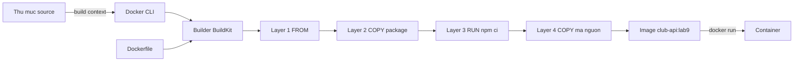

# Buổi 09 – Dockerfile

Tuần 5 · Giai đoạn 2 – Containerization · Slide: [Slide buổi 09](../../slides/02-docker/session-09.md)

> **Tóm tắt:** Viết, build và chạy Dockerfile cho Node.js API của CLB; hiểu build context, layer cache, USER, CMD và ENTRYPOINT, và chẩn đoán lỗi build do sai context.

## Mục tiêu học tập

- Giải thích được vai trò của từng chỉ thị `FROM`, `WORKDIR`, `COPY`, `RUN`, `ENV`, `EXPOSE`, `CMD`, `ENTRYPOINT` và khác biệt giữa build time với run time.
- Viết được Dockerfile cho `starter-project/backend`, build ra image `club-api:lab9` và chạy được endpoint `/health` qua port mapping.
- Giải thích được build context và `.dockerignore`, chứng minh được file không mong muốn (ví dụ `.env`) có thể lọt vào image.
- Sắp xếp được thứ tự các chỉ thị để tận dụng layer cache, quan sát được `CACHED` khi chỉ sửa mã nguồn.
- Phân biệt được `CMD` và `ENTRYPOINT`, exec form và shell form, và ghi đè được chúng khi `docker run`.
- Chẩn đoán được lỗi build do chạy `docker build` sai thư mục (Tình huống 05) và sửa đúng nguyên nhân gốc.

## Điều kiện cần

- Đã học Buổi 07 và 08: chạy được `docker run`, hiểu image, container, port mapping, `docker logs`, `docker exec`.
- Docker Desktop đang chạy với WSL2 backend; làm việc trong terminal WSL2 Ubuntu, trong filesystem của WSL (thư mục dạng `~/...`, không dùng `/mnt/c`).
- Đã clone repo giáo trình vào WSL, ví dụ `~/devops-course` (có `starter-project/backend` và `examples/docker/hello-node`).
- Repo cá nhân `devops-labs` đã có trên máy (clone về `~/devops-labs`), sẽ chứa thư mục `lab-09/`.
- Kiểm tra nhanh:

```bash
docker version --format '{{.Server.Version}}'
docker run --rm hello-world | head -n 3
ls ~/devops-course/starter-project/backend
```

Kết quả mong đợi (rút gọn): in ra phiên bản Docker Engine (27 trở lên), thông điệp "Hello from Docker!", và danh sách có `app.js`, `server.js`, `package.json`.

## Vấn đề thực tế

Backend API của CLB chạy tốt trên máy bạn Hùng với Node.js 22. Bạn Lan clone về, dùng Node 18 và `npm install` ra bộ thư viện khác, API lỗi ngay lúc khởi động. Mentor muốn đưa API lên máy chung của CLB thì phải cài đúng Node, đúng thư viện, đúng biến môi trường, mỗi lần một kiểu. Buổi 07 bạn đã biết container giải quyết bài toán này, nhưng container chỉ chạy được khi có image. Thứ mô tả cách tạo image đó chính là Dockerfile.

Dockerfile là một file văn bản, nằm cùng mã nguồn, ghi lại công thức: bắt đầu từ runtime nào, chép gì vào, cài gì, chạy lệnh nào khi start. Có file này trong Git, ai cũng build ra image giống nhau, CI/CD cũng dùng lại đúng công thức đó (Buổi 13 trở đi). Hôm nay bạn viết Dockerfile đầu tiên cho `club-api` và học các lỗi kinh điển: build chậm vì mất cache, image chứa cả file bí mật, chạy bằng root, container không dừng gọn.

## Khái niệm cốt lõi

### Dockerfile là công thức, image là sản phẩm

Mỗi chỉ thị trong Dockerfile tạo ra một **layer** (lớp chỉ đọc) xếp chồng lên nhau. Image là chồng các layer đó cộng metadata (lệnh mặc định, biến môi trường, port khai báo...). Container là image cộng một lớp ghi mỏng ở trên cùng.

| Chỉ thị | Làm gì | Chạy lúc nào | Ghi chú quan trọng |
| --- | --- | --- | --- |
| `FROM` | Chọn base image làm nền | Build | Luôn ghim phiên bản, ví dụ `node:22-alpine`, không dùng `latest` |
| `WORKDIR` | Đặt thư mục làm việc, tạo nếu chưa có | Build và run | Dùng thay cho `RUN cd ...` |
| `COPY` | Chép file từ build context vào image | Build | Nguồn tính theo build context, không phải theo vị trí Dockerfile |
| `RUN` | Chạy lệnh trong lúc build, kết quả thành layer | Build | Dùng để cài dependency: `npm ci` |
| `ENV` | Đặt biến môi trường, tồn tại cả lúc container chạy | Build và run | Không đặt secret ở đây |
| `EXPOSE` | Khai báo (tài liệu) port ứng dụng lắng nghe | Metadata | Không mở port ra host; muốn truy cập phải dùng `-p` |
| `USER` | Đổi user chạy các lệnh sau đó và container | Build và run | Image `node` có sẵn user `node` (uid 1000) |
| `CMD` | Lệnh mặc định khi start container | Run | Bị thay thế bởi tham số cuối của `docker run` |
| `ENTRYPOINT` | Chương trình cố định của container | Run | Tham số của `docker run` được nối thêm vào sau |

### Build context

Khi chạy `docker build -t tên .`, dấu `.` là **build context**: thư mục mà Docker CLI gói lại và gửi cho builder. `COPY` chỉ thấy các file nằm trong context. Hai hệ quả:

- Chạy `docker build` ở sai thư mục thì `COPY package*.json ./` không tìm thấy file, hoặc không tìm thấy Dockerfile.
- Mọi thứ trong context (kể cả `.env`, `.git`, `node_modules`) đều có thể bị `COPY . .` đưa vào image. File `.dockerignore` đặt trong thư mục context liệt kê những thứ cần loại trừ.

### Layer cache

Docker build từng chỉ thị theo thứ tự. Nếu chỉ thị và dữ liệu đầu vào của nó (ví dụ nội dung file được `COPY`) không đổi so với lần build trước, Docker dùng lại layer cũ và in `CACHED`. Khi một layer bị vô hiệu, mọi layer phía sau nó cũng build lại. Quy tắc thực tế: đặt thứ ít thay đổi lên trên (base image, `package.json`, `npm ci`), thứ hay thay đổi xuống dưới (mã nguồn).

### CMD, ENTRYPOINT, exec form và shell form

| Tiêu chí | `CMD` | `ENTRYPOINT` |
| --- | --- | --- |
| Ý nghĩa | Lệnh (hoặc tham số) mặc định | Chương trình chính của container |
| `docker run image abc` | Thay thế hoàn toàn bằng `abc` | Nối `abc` vào sau ENTRYPOINT |
| Ghi đè khi cần | Truyền lệnh sau tên image | Phải dùng `--entrypoint` |
| Dùng khi | Ứng dụng thông thường, muốn dễ chạy lệnh khác để debug | Image là một "công cụ" luôn chạy một chương trình |

Hai cách viết: **exec form** `CMD ["node", "server.js"]` (mảng JSON, chạy trực tiếp không qua shell) và **shell form** `CMD node server.js` (chạy qua `/bin/sh -c`). Hãy dùng exec form cho ứng dụng: process của bạn là PID 1 và nhận tín hiệu từ `docker stop` trực tiếp. Có thể kết hợp: `ENTRYPOINT ["node"]` và `CMD ["server.js"]`, khi đó `docker run image --version` chạy `node --version`.

## Kiến trúc và cách hoạt động



Giải thích từng bước:

1. Docker CLI nén thư mục context (trừ các mục trong `.dockerignore`) và gửi cho builder. Context càng lớn, bước này càng chậm.
2. Builder đọc Dockerfile, bắt đầu từ `FROM`: kéo base image `node:22-alpine` về nếu chưa có.
3. Mỗi `COPY`, `RUN` tạo một layer mới. Builder so sánh với cache để quyết định build lại hay dùng `CACHED`.
4. Các chỉ thị `ENV`, `EXPOSE`, `USER`, `CMD` chỉ ghi metadata vào image, không tạo ra dữ liệu mới.
5. `docker run` tạo container từ image, đặt lớp ghi lên trên và chạy `CMD` (hoặc `ENTRYPOINT` cộng `CMD`).

## Demo của mentor

Mục đích: cho cả lớp thấy cùng một ứng dụng nhỏ, hai kết quả khác nhau chỉ vì cách viết Dockerfile. Dùng `examples/docker/hello-node/`. Mentor dùng port 3100 để không đụng với lớp.

**Bước 1. Chuẩn bị bản sao để sửa thoải mái.**

```bash
mkdir -p ~/demo && cp -r ~/devops-course/examples/docker/hello-node ~/demo/ && cd ~/demo/hello-node
cat Dockerfile.naive
```

Kết quả mong đợi: Dockerfile ngắn 6 dòng hiệu lực: `FROM node:22`, `WORKDIR /app`, `COPY . .`, `RUN npm install`, `EXPOSE 3000`, `CMD`.

**Bước 2. Build bản "ngây thơ" và chạy.**

```bash
docker build -f Dockerfile.naive -t hello-node:naive .
docker run -d --name demo-naive -p 3100:3000 hello-node:naive
curl -s localhost:3100/health
```

Kết quả mong đợi: build mất vài chục giây (lần đầu kéo image), `curl` in `{"status":"healthy"}`.

**Bước 3. Sửa một dòng mã nguồn rồi build lại.**

```bash
echo "// sua nhe" >> server.js
docker build -f Dockerfile.naive -t hello-node:naive .
```

Kết quả mong đợi: bước `RUN npm install` chạy lại từ đầu dù `package.json` không đổi, vì `COPY . .` đứng trước và nội dung context đã đổi.

**Bước 4. So sánh với bản tối ưu.**

```bash
docker build -f Dockerfile.optimized -t hello-node:opt .
echo "// sua nua" >> server.js
docker build -f Dockerfile.optimized -t hello-node:opt .
docker image ls hello-node
docker exec demo-naive id
```

Kết quả mong đợi: lần build thứ hai của bản `opt` hiện `CACHED` ở bước cài dependency; bảng image cho thấy `naive` lớn hơn nhiều `opt` (base Debian đầy đủ so với Alpine, cỡ vài trăm MB chênh lệch trở lên); `id` của bản naive in `uid=0(root)`.

**Bước 5. Dọn dẹp.**

```bash
docker rm -f demo-naive
```

Câu hỏi mentor nên hỏi lớp:

- Nếu đổi thứ tự hai dòng `COPY package.json` và `COPY . .`, bạn đoán lần build thứ hai nhanh hay chậm? Vì sao?
- Container naive chạy bằng root: nếu API bị khai thác lỗ hổng thì kẻ tấn công có gì trong tay?
- Bản `opt` không chép `tests/` hay `.git`. Bạn nghĩ một Dockerfile tốt nên chép gì vào image?

## Hands-on lab

Thời lượng 60 phút. Bạn viết Dockerfile cho `club-api` từ đầu, tăng dần chất lượng qua từng phần. Image đặt tên `club-api:lab9`, container `club-api-lab9`, host port 3001 (không dùng 3000 để tránh đụng với compose ở các buổi sau).

### Chuẩn bị

1. Tạo thư mục nộp bài và chép mã nguồn backend vào `source/`:

```bash
mkdir -p ~/devops-labs/lab-09/{source,evidence,screenshots}
cd ~/devops-labs/lab-09
cp -r ~/devops-course/starter-project/backend/. source/
rm -rf source/node_modules source/Dockerfile source/.dockerignore
ls -a source
```

Kết quả mong đợi: thấy `app.js`, `db.js`, `server.js`, `package.json`, `package-lock.json`, `tests`. Chưa có `Dockerfile`: bạn sẽ tự viết. Chúng ta xóa luôn `.dockerignore` mẫu để bạn tự thấy vì sao nó cần.

2. Bằng chứng được ghi vào `evidence/command-output.txt`: thêm `2>&1 | tee -a ~/devops-labs/lab-09/evidence/command-output.txt` vào cuối các lệnh quan trọng (có nhắc ở từng phần; trong thư mục `source` có thể viết ngắn là `../evidence/command-output.txt`).

### Phần 1. Dockerfile đầu tiên (khoảng 12 phút)

1. Tạo `source/Dockerfile`:

```dockerfile
FROM node:22-alpine
WORKDIR /app
COPY . .
RUN npm ci --omit=dev
EXPOSE 3000
CMD ["node", "server.js"]
```

Vì sao: `FROM` ghim Node 22 trên Alpine (nhỏ). `npm ci` cài đúng phiên bản trong `package-lock.json`; `--omit=dev` bỏ thư viện dev. `EXPOSE` chỉ là tài liệu cho người đọc.

2. Build từ thư mục `source` (dấu `.` cuối là context):

```bash
cd ~/devops-labs/lab-09/source
docker build -t club-api:lab9 . 2>&1 | tee -a ../evidence/command-output.txt
```

Kết quả mong đợi (rút gọn): các bước `FROM`, `WORKDIR`, `COPY`, `RUN npm ci` chạy lần lượt, cuối cùng có dòng `naming to docker.io/library/club-api:lab9`.

3. Chạy container và gọi API:

```bash
docker run -d --name club-api-lab9 -p 3001:3000 club-api:lab9
curl -s localhost:3001/health
curl -s -i localhost:3001/ready | head -n 1
docker logs club-api-lab9
```

Kết quả mong đợi: `/health` trả `{"status":"healthy","service":"club-api"}`; `/ready` trả `HTTP/1.1 503 Service Unavailable`; log có dòng `API listening on port 3000`.

Vì sao `/ready` là 503: API cần PostgreSQL, mà container này không có database (`DB_HOST` mặc định là `localhost`, bên trong container không có gì ở port 5432). Đây là điều bình thường ở buổi này; Buổi 11 và 12 sẽ nối API với DB bằng network và Compose.

4. Quan sát image:

```bash
docker image ls club-api:lab9
docker history club-api:lab9
```

Kết quả mong đợi: dung lượng cỡ vài trăm MB trở xuống (base Alpine cộng Node và thư viện); `docker history` liệt kê các layer tương ứng với chỉ thị của bạn.

### Phần 2. Tối ưu thứ tự để tận dụng cache (khoảng 10 phút)

1. Đo lại hành vi hiện tại: sửa mã nguồn rồi build.

```bash
cd ~/devops-labs/lab-09/source
echo "// lab9 thay doi 1" >> server.js
docker build --progress=plain -t club-api:lab9 . 2>&1 | grep -E "npm ci|CACHED"
```

Kết quả mong đợi: dòng `RUN npm ci --omit=dev` chạy lại (không có `CACHED` cạnh nó), tốn vài giây đến vài chục giây.

2. Sửa Dockerfile: chép manifest riêng, cài dependency, rồi mới chép mã nguồn.

```dockerfile
FROM node:22-alpine
WORKDIR /app
COPY package.json package-lock.json ./
RUN npm ci --omit=dev
COPY . .
EXPOSE 3000
CMD ["node", "server.js"]
```

3. Build hai lần, giữa hai lần sửa mã nguồn:

```bash
docker build --progress=plain -t club-api:lab9 . 2>&1 | grep -E "npm ci|CACHED"
echo "// lab9 thay doi 2" >> server.js
docker build --progress=plain -t club-api:lab9 . 2>&1 | tee -a ../evidence/command-output.txt | grep -E "npm ci|CACHED"
```

Kết quả mong đợi: ở lần build thứ hai, `RUN npm ci --omit=dev` hiện `CACHED`; chỉ layer `COPY . .` build lại.

Vì sao: layer `npm ci` chỉ phụ thuộc vào hai file manifest. Mã nguồn đổi không làm manifest đổi, nên cache còn hiệu lực. Đây là thói quen quan trọng nhất của Dockerfile cho Node.js.

### Phần 3. Môi trường và user an toàn (khoảng 10 phút)

1. Kiểm tra container hiện tại đang chạy bằng user nào:

```bash
docker rm -f club-api-lab9
docker run -d --name club-api-lab9 -p 3001:3000 club-api:lab9
docker exec club-api-lab9 id
```

Kết quả mong đợi: `uid=0(root) gid=0(root)`. Chạy root không cần thiết là rủi ro: nếu ứng dụng bị khai thác, kẻ tấn công có quyền cao nhất trong container.

2. Cập nhật Dockerfile thành bản có `ENV`, `--chown` và `USER`:

```dockerfile
FROM node:22-alpine
WORKDIR /app
ENV NODE_ENV=production \
    PORT=3000
COPY package.json package-lock.json ./
RUN npm ci --omit=dev
COPY --chown=node:node . .
USER node
EXPOSE 3000
CMD ["node", "server.js"]
```

Giải thích: `NODE_ENV=production` làm Express và một số thư viện bật chế độ production. `PORT=3000` khớp với `server.js` (`process.env.PORT`). `COPY --chown=node:node` để file thuộc user `node`. `USER node` đặt sau `RUN npm ci` để bước cài đặt vẫn có quyền ghi.

3. Build lại, chạy và kiểm tra:

```bash
docker build -t club-api:lab9 .
docker rm -f club-api-lab9
docker run -d --name club-api-lab9 -p 3001:3000 club-api:lab9
docker exec club-api-lab9 id | tee -a ../evidence/command-output.txt
docker exec club-api-lab9 env | grep -E "NODE_ENV|PORT"
curl -s localhost:3001/health
```

Kết quả mong đợi: `uid=1000(node) gid=1000(node)`; `NODE_ENV=production` và `PORT=3000`; `/health` vẫn trả `healthy`.

4. Ghi đè biến môi trường lúc chạy (không cần build lại):

```bash
docker run --rm -e PORT=4000 -d --name club-api-port club-api:lab9
sleep 1
docker logs club-api-port
docker rm -f club-api-port
```

Kết quả mong đợi (thêm `sleep 1` trước `docker logs` nếu log còn trống): log in `API listening on port 4000`. `ENV` trong Dockerfile là giá trị mặc định, `-e` ghi đè được khi chạy. Đây là cơ chế để cấu hình `DB_HOST`, `DB_PASSWORD` ở buổi sau mà không chép secret vào image.

### Phần 4. CMD và ENTRYPOINT (khoảng 10 phút)

1. Ghi đè CMD bằng lệnh khác:

```bash
docker run --rm club-api:lab9 node --version
docker run --rm club-api:lab9 id
```

Kết quả mong đợi: in phiên bản Node 22 (dạng `v22.x.x`) rồi `uid=1000(node)...`. Lệnh sau tên image thay thế hoàn toàn `CMD`, rất tiện để debug.

2. Tạo biến thể dùng `ENTRYPOINT`: chép `Dockerfile` thành `Dockerfile.ep` (cùng thư mục) và thay dòng `CMD` cuối bằng:

```dockerfile
ENTRYPOINT ["node"]
CMD ["server.js"]
```

3. Build và thử:

```bash
docker build -f Dockerfile.ep -t club-api:lab9-ep .
docker run --rm club-api:lab9-ep --version
docker run --rm --entrypoint id club-api:lab9-ep
```

Kết quả mong đợi: lệnh đầu in `v22.x.x` (tham số `--version` được nối vào `node`); lệnh sau in thông tin user nhờ `--entrypoint` thay thế chương trình chính.

4. Kiểm tra việc dừng container có gọn không:

```bash
time docker stop club-api-lab9
```

Kết quả mong đợi: lệnh mất khoảng 10 giây (`real 0m10...`). Lý do: node là PID 1 trong container, `server.js` không xử lý `SIGTERM`, kernel không áp dụng hành vi mặc định cho PID 1, nên Docker chờ hết thời gian chờ rồi gửi `SIGKILL`. Thử lại: `docker rm -f club-api-lab9`, rồi `docker run -d --init --name club-api-lab9 -p 3001:3000 club-api:lab9` và `time docker stop club-api-lab9`: có tiến trình init nhỏ chuyển tín hiệu nên dừng nhanh. (Cách sửa tận gốc trong mã: bắt `SIGTERM` và đóng server, như `examples/docker/hello-node/server.js` đã làm.)

### Phần 5. Build context và .dockerignore (khoảng 8 phút)

1. Giả lập file bí mật và file lớn nằm nhầm trong thư mục dự án:

```bash
cd ~/devops-labs/lab-09/source
echo "DB_PASSWORD=gia-lap-khong-phai-that" > .env
dd if=/dev/zero of=rac.bin bs=1M count=100 status=none
docker build --progress=plain -t club-api:lab9-leak . 2>&1 | grep -i "transferring context"
docker run --rm club-api:lab9-leak ls -a /app
```

Kết quả mong đợi: dòng `transferring context` cho thấy khoảng 100 MB (ví dụ `104.86MB`; con số chính xác tùy phiên bản Docker); `ls -a /app` liệt kê cả `.env` và `rac.bin`: file bí mật đã nằm trong image. Ai pull image đều đọc được.

2. Tạo `source/.dockerignore`:

```text
node_modules
npm-debug.log
.git
.env
*.bin
coverage
tests
Dockerfile*
```

3. Build lại và kiểm tra:

```bash
docker build --progress=plain -t club-api:lab9-clean . 2>&1 | grep -i "transferring context"
docker run --rm club-api:lab9-clean ls -a /app | tee -a ../evidence/command-output.txt
rm -f .env rac.bin
```

Kết quả mong đợi: context chỉ còn rất nhỏ (từ vài trăm byte đến vài chục KB, BuildKit chỉ gửi phần thay đổi so với lần trước; điều quan trọng là không còn khoảng 100 MB); `ls -a /app` không còn `.env` hay `rac.bin`. Lưu ý: bỏ `tests` khỏi image runtime là chủ ý, vì test chạy ở CI (Buổi 13).

### Phần 6. Ghi bằng chứng và dọn dẹp (khoảng 5 phút)

```bash
cd ~/devops-labs/lab-09
docker image ls | grep club-api | tee -a evidence/command-output.txt
docker rm -f club-api-lab9
docker rmi club-api:lab9-leak club-api:lab9-ep
```

Dựng lại container cuối cùng để chụp ảnh `curl /health` vào `screenshots/` nếu mentor yêu cầu.

### L1 – Foundation: checklist hoàn thành

- [ ] `source/Dockerfile` build thành công, image tên `club-api:lab9`.
- [ ] `curl localhost:3001/health` trả `healthy` khi container chạy.
- [ ] Dockerfile chép `package.json` và `package-lock.json` trước khi chạy `npm ci`.
- [ ] `docker exec club-api-lab9 id` cho thấy user `node`, không phải root.
- [ ] Chạy được `docker run --rm club-api:lab9 node --version`.
- [ ] Có `source/.dockerignore` loại `.env` và `node_modules`; đã chứng minh `.env` không còn trong image.

### L2 – Engineering: thử thách tự làm

**Thử thách 1. Viết lại không xem mẫu.** Xóa Dockerfile, viết lại từ đầu cho đạt đồng thời: image dựa trên Node 22 Alpine, chạy bằng user `node`, cache dependency đúng, không chứa `.env`, có `HEALTHCHECK` gọi `/health`. Tiêu chí: `docker inspect --format '{{.State.Health.Status}}' club-api-lab9` về `healthy` sau tối đa 1 phút.

<details>
<summary>Gợi ý</summary>

`HEALTHCHECK` chạy lệnh bên trong container. Image Alpine có `wget` (BusyBox) nhưng không có `curl`. Dùng `--start-period` để cho app thời gian khởi động. Mẫu tham khảo nằm ở `examples/docker/hello-node/Dockerfile.optimized`.

</details>

<details>
<summary>Lời giải</summary>

```dockerfile
FROM node:22-alpine
WORKDIR /app
ENV NODE_ENV=production PORT=3000
COPY package.json package-lock.json ./
RUN npm ci --omit=dev
COPY --chown=node:node . .
USER node
EXPOSE 3000
HEALTHCHECK --interval=15s --timeout=3s --start-period=5s --retries=3 \
  CMD wget -qO- http://127.0.0.1:3000/health || exit 1
CMD ["node", "server.js"]
```

Kiểm tra: `docker run -d --name club-api-lab9 -p 3001:3000 club-api:lab9` rồi `docker ps` (cột STATUS có `healthy`). Dùng `127.0.0.1` thay vì `localhost` để tránh phân giải ra IPv6 trong một số image.

</details>

**Thử thách 2. Giải thích CMD và ENTRYPOINT.** Trong `report.md`, viết một đoạn ngắn (5-8 dòng) giải thích: khi nào bạn chọn `CMD`, khi nào chọn `ENTRYPOINT`, vì sao dùng exec form; kèm bằng chứng lệnh `docker run` bạn đã thử ở Phần 4.

<details>
<summary>Gợi ý</summary>

Nghĩ về hai người dùng image: một người muốn chạy API, một người muốn vào debug bằng `sh`. Với `CMD`, người thứ hai chỉ cần thêm lệnh sau tên image. Với `ENTRYPOINT`, họ phải nhớ `--entrypoint`. Về exec form, hãy so sánh PID 1 và tín hiệu khi `docker stop`.

</details>

<details>
<summary>Lời giải</summary>

Chọn `CMD ["node", "server.js"]` cho ứng dụng vì mặc định phải chạy API nhưng vẫn dễ ghi đè (`docker run image sh`) khi debug. Chọn `ENTRYPOINT` khi image đóng vai một công cụ luôn chạy một chương trình và người dùng chỉ đổi tham số, và có thể kết hợp với `CMD` làm tham số mặc định. Exec form không qua `/bin/sh -c`, nên process của ứng dụng nhận trực tiếp tín hiệu từ `docker stop`; shell form thêm một lớp shell và có thể làm tín hiệu không đến được ứng dụng.

</details>

**Thử thách 3. Sửa lỗi sai build context (Tình huống 05).** Làm phần "Phá lỗi và debug" bên dưới, ghi kết quả điều tra vào `report.md`. Tiêu chí: nêu được nguyên nhân gốc và hai cách sửa khác nhau.

**Thử thách 4. So sánh với Dockerfile của dự án.** Đọc `starter-project/backend/Dockerfile` (multi-stage). Liệt kê ít nhất 3 điểm khác với Dockerfile của bạn và đoán lợi ích của từng điểm (Buổi 10 sẽ đi sâu).

<details>
<summary>Gợi ý</summary>

Đếm số `FROM`. Xem `COPY --from`. Xem bước `npm ci` nằm ở stage nào và image cuối có chứa công cụ build hay không.

</details>

<details>
<summary>Lời giải</summary>

Điểm khác chính: (1) hai stage (`dependencies` và `runtime`), stage cuối chỉ nhận `node_modules` đã cài qua `COPY --from=dependencies`, nên image cuối gọn và không giữ cache npm; (2) dùng `npm ci --omit=dev` ở stage riêng; (3) user `node`, `NODE_ENV=production`, `--chown` giống bản của bạn. Lợi ích: image nhỏ hơn, bề mặt tấn công nhỏ hơn, cache tốt hơn.

</details>

## Phá lỗi và debug

### Tình huống: build thất bại vì sai build context

Liên quan tới Tình huống 05 trong `examples/troubleshooting/scenario-05/` (mentor phát đề cho bạn, chỉ cung cấp triệu chứng).

**Cách phá.** Đứng ở thư mục cha của `source` rồi build:

```bash
cd ~/devops-labs/lab-09
docker build -t club-api:lab9 .
```

**Triệu chứng.** Build dừng ngay với thông báo không đọc được Dockerfile, dạng:

```text
ERROR: failed to solve: failed to read dockerfile: open Dockerfile: no such file or directory
```

Nếu bạn chỉ định `-f source/Dockerfile` nhưng vẫn để context là `.` ở thư mục cha, Dockerfile được tìm thấy nhưng bước `COPY package.json package-lock.json ./` báo lỗi dạng `"/package.json": not found`.

```bash
docker build -f source/Dockerfile -t club-api:lab9 .
```

**Hướng điều tra từng bước.**

1. Đọc kỹ dòng lỗi đầu tiên: đang thiếu Dockerfile hay thiếu file trong `COPY`?
2. Chạy `pwd` và `ls`: bạn đang đứng ở đâu, Dockerfile và `package.json` nằm ở thư mục nào?
3. Nhớ lại: đối số cuối của `docker build` là context; `COPY` tìm file theo context, không theo vị trí Dockerfile.
4. Thử hai cách: đổi thư mục (`cd source`) hoặc giữ vị trí nhưng trỏ rõ `-f source/Dockerfile` và context `source`.

```bash
docker build -f source/Dockerfile -t club-api:lab9 source
```

**Nguyên nhân gốc.** Context không chứa các file mà Dockerfile tham chiếu. Lỗi nằm ở lệnh build, không phải ở nội dung Dockerfile.

**Cách phòng tránh.** Luôn build từ thư mục chứa Dockerfile hoặc ghi rõ cả `-f` lẫn context; đưa lệnh build chuẩn vào README; ghi lệnh vào script hoặc CI để không phụ thuộc trí nhớ.

### Tình huống bổ sung: mất cache vì COPY . . đặt sớm

Đưa `COPY . .` lên trước `RUN npm ci`, sửa một dòng mã nguồn rồi build lại: `npm ci` chạy lại mỗi lần. Triệu chứng là build chậm không rõ lý do. Nguyên nhân gốc: layer `COPY . .` đổi nội dung nên mọi layer sau bị vô hiệu. Phòng tránh: chép manifest trước, mã nguồn sau (Phần 2).

## Lỗi thường gặp

| Triệu chứng | Nguyên nhân | Cách xử lý |
| --- | --- | --- |
| `failed to read dockerfile: open Dockerfile: no such file or directory` | Chạy `docker build` sai thư mục, hoặc file tên khác | `cd` vào thư mục có Dockerfile hoặc dùng `-f đường-dẫn` kèm context đúng |
| `COPY` báo `"/package.json": not found` | `package.json` không nằm trong build context (hoặc bị `.dockerignore` loại) | Kiểm tra context (đối số cuối) và nội dung `.dockerignore` |
| `npm ci` chạy lại mỗi lần build | `COPY . .` đặt trước `npm ci` | Chép `package.json` và `package-lock.json` trước, cài dependency, rồi chép mã nguồn |
| `npm ci` báo thiếu hoặc lệch `package-lock.json` | Lock file không có trong context hoặc không khớp `package.json` | Chạy `npm install` cục bộ để cập nhật lock file, commit cả hai, đảm bảo không bị ignore |
| `port is already allocated` khi `docker run -p 3001:3000` | Port 3001 trên host đang bị container hoặc tiến trình khác dùng | `docker ps` để tìm, dừng container cũ hoặc đổi cổng host (Tình huống 01) |
| Container thoát ngay (`Exited (0)` hoặc `Exited (1)`) | `CMD` sai tên file, hoặc app lỗi khi start | `docker logs tên-container`, kiểm tra đường dẫn trong `CMD` và `WORKDIR` (Tình huống 02) |
| `EACCES: permission denied` khi chạy với `USER node` | File thuộc root, app ghi vào thư mục không có quyền | Dùng `COPY --chown=node:node`; ghi dữ liệu vào volume hoặc thư mục `node` sở hữu |
| `docker stop` luôn mất khoảng 10 giây | App không xử lý `SIGTERM` khi chạy làm PID 1 | Bắt `SIGTERM` trong mã, dùng exec form, hoặc `docker run --init` |
| API trả `503` ở `/ready` | Không kết nối được PostgreSQL | Bình thường ở buổi này; sẽ nối DB ở Buổi 11 và 12 |

## Tự kiểm tra

1. `EXPOSE 3000` có làm cho `curl localhost:3000` từ máy host chạy được không? Nếu không thì cần gì?
2. Vì sao `COPY package.json package-lock.json ./` phải đứng trước `COPY . .`?
3. Khác biệt giữa `ENV PORT=3000` trong Dockerfile và `docker run -e PORT=4000` là gì?
4. `docker run image sh` trong hai trường hợp: Dockerfile dùng `CMD ["node","server.js"]` và Dockerfile dùng `ENTRYPOINT ["node"]`. Kết quả mỗi trường hợp ra sao?
5. Vì sao không nên đặt `.env` hay `DB_PASSWORD` thật vào `ENV` hoặc `COPY` vào image?
6. Tình huống: đồng đội báo "build ở máy mình thì được, ở CI báo COPY không tìm thấy `package.json`". Bạn kiểm tra những gì, theo thứ tự?
7. Tình huống: sau khi thêm `USER node`, container thoát với `EACCES` khi ghi file log vào `/app/logs`. Nguyên nhân và cách sửa?
8. Vì sao nên ghim `node:22-alpine` thay vì `node:latest`?

<details>
<summary>Đáp án</summary>

1. Không. `EXPOSE` chỉ là tài liệu và metadata. Cần `-p 3000:3000` (hoặc `-p cổng-host:3000`) khi `docker run`.
2. Để layer `npm ci` chỉ phụ thuộc manifest. Nếu `COPY . .` đứng trước, mỗi lần sửa mã nguồn sẽ làm hỏng cache và cài lại toàn bộ dependency.
3. `ENV` là giá trị mặc định ghi trong image; `-e` ghi đè giá trị đó cho một container cụ thể lúc chạy, không cần build lại.
4. Với `CMD`: chạy `sh`, vào shell. Với `ENTRYPOINT ["node"]`: thành `node sh`, node cố đọc file tên `sh` và báo lỗi không tìm thấy module; muốn vào shell phải `--entrypoint sh`.
5. Image có thể bị pull và giải nén bởi bất kỳ ai có quyền, lịch sử layer giữ lại nội dung. Secret phải truyền lúc chạy (biến môi trường, Secret trong Kubernetes) và `.env` phải nằm trong `.dockerignore` và `.gitignore`.
6. (a) Đối số context của lệnh build trong workflow, và `working-directory`; (b) có `.dockerignore` loại `package.json` không; (c) file có thực sự được commit không (có thể bị `.gitignore`); (d) phân biệt hoa thường của tên file (Linux phân biệt).
7. User `node` không có quyền tạo thư mục trong `/app` do root sở hữu. Sửa: tạo thư mục và gán quyền khi build (`RUN mkdir logs && chown node:node logs` trước `USER node`), hoặc tốt hơn là ghi log ra stdout/stderr.
8. Để build tái lập: `latest` đổi theo thời gian, cùng Dockerfile hôm nay và tháng sau có thể ra image khác, gây lỗi khó truy vết.

</details>

## Nộp bài

Nộp vào `lab-09/` trong repo cá nhân, theo `templates/lab-template.md`:

- [ ] `README.md` trả lời đủ 7 câu: bài lab giải quyết vấn đề gì, kiến thức đã dùng, các bước, kết quả mong đợi, lỗi đã gặp, cách khắc phục, có thể cải thiện gì.
- [ ] `source/` chứa `Dockerfile` cuối cùng, `.dockerignore` và mã nguồn backend (không có `node_modules`, `.env`, `rac.bin`).
- [ ] `evidence/command-output.txt` có: log build, `curl /health`, `docker exec ... id`, kết quả so sánh `ls -a /app` trước và sau `.dockerignore`.
- [ ] `report.md` có giải thích CMD vs ENTRYPOINT và điều tra lỗi build context (nguyên nhân gốc, hai cách sửa).
- [ ] `screenshots/` có ít nhất một ảnh `curl /health` thành công (ảnh không thay thế được log).
- [ ] Đánh dấu mức đã làm (L1 hoặc L2) ở cuối `README.md`.
- [ ] Đã kiểm tra: không commit secret thật; `.env` nằm trong `.gitignore`.

## Recap

- Dockerfile là công thức tái lập, mỗi chỉ thị `COPY` và `RUN` tạo một layer; image là chồng layer cộng metadata.
- Build context là thư mục gửi cho builder; `COPY` chỉ thấy trong context, và `.dockerignore` giữ file thừa, file bí mật ra khỏi image.
- Thứ tự quyết định cache: manifest và `npm ci` trước, mã nguồn sau.
- `EXPOSE` chỉ là tài liệu; truy cập từ host cần `-p`. Cấu hình lúc chạy dùng `-e`, không nhúng secret vào image.
- Chạy bằng `USER node` và ghim phiên bản image (`node:22-alpine`) là thói quen bảo mật và tái lập cơ bản.
- `CMD` là lệnh mặc định dễ ghi đè, `ENTRYPOINT` là chương trình cố định; dùng exec form để tín hiệu đến đúng process.
- Khi build lỗi, đọc dòng lỗi đầu tiên, kiểm tra thư mục hiện tại và context trước khi nghi ngờ nội dung Dockerfile.

## Tài liệu tham khảo

- [Dockerfile reference](https://docs.docker.com/reference/dockerfile/)
- [Building best practices](https://docs.docker.com/build/building/best-practices/)
- [Build context](https://docs.docker.com/build/concepts/context/)
- [Docker build cache](https://docs.docker.com/build/cache/)
- [docker build CLI reference](https://docs.docker.com/reference/cli/docker/buildx/build/)
- [Docker and Node.js best practices (Node.js docs)](https://github.com/nodejs/docker-node/blob/main/docs/BestPractices.md)
