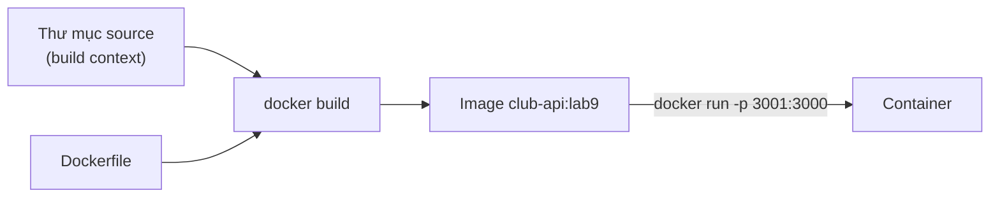

# Buổi 09 – Dockerfile

Tuần 5/16 · Giai đoạn 2 – Containerization · Buổi 09/32

[Slide buổi 09](../../slides/02-docker/session-09.md) · [Bài tập tuần 5](../../assignments/weekly/week-05.md) · [Hub tuần 5](README.md)

> **Tóm tắt:** Viết, build và chạy Dockerfile đầu tiên cho Node.js API của CLB; hiểu build context, ENV, CMD và ENTRYPOINT, và chẩn đoán lỗi build do sai thư mục.

::: tip Buổi này bạn làm gì
**Bạn sẽ tạo ra:** một Dockerfile cho `club-api`, build thành image `club-api:lab9` và gọi được `curl localhost:3001/health` từ máy của bạn.

**Thời gian thật:** đọc 15 phút · lab bắt buộc 60 phút · thử thách thêm (tùy chọn) làm ở nhà.

**Cần chuẩn bị:**
- [ ] Đã xong [Buổi 08 – Docker CLI](../week-04/session-08.md); Docker Desktop đang chạy với WSL2
- [ ] Môi trường đã cài theo [Hướng dẫn cài đặt](../../resources/setup-guide.md), repo cá nhân `devops-labs` theo [Tài khoản GitHub và repo devops-labs](../../resources/setup-github.md)
- [ ] Repo giáo trình nằm ở `~/devops-course` trong WSL (có `starter-project/backend`)
- [ ] Docker Desktop phải đang mở (biểu tượng cá voi ở khay hệ thống ổn định). Chạy `bash ~/devops-course/resources/check-env.sh 9` để biết mình thiếu gì

**Sản phẩm phải nộp** (thư mục `lab-09/` trong `devops-labs`):
- `README.md` và `report.md` theo mẫu, ghi mức đã làm (L1 hoặc L2)
- `source/Dockerfile` cuối cùng cùng mã nguồn backend
- `evidence/command-output.txt`: log build, `curl /health`, `-e PORT=4000`, `node --version`, lỗi sai context

**Đi nhanh:** Đọc phần dưới > [Làm lab](#hands-on-lab) > [Gặp lỗi?](#gap-loi) > [Tự kiểm tra](#tu-kiem-tra) > [Nộp bài](#nop-bai). Kẹt giữa lab? Nhảy tới [Gặp lỗi?](#gap-loi).

**Từ mới trong buổi:**
- [Dockerfile](../../resources/glossary.md): file công thức để build image
- [Build context](../../resources/glossary.md): thư mục được gửi cho Docker khi build
- [CMD](../../resources/glossary.md): lệnh mặc định khi container chạy
- [ENTRYPOINT](../../resources/glossary.md): chương trình cố định của container
- [EXPOSE](../../resources/glossary.md): ghi chú cổng ứng dụng dùng
- [Image](../../resources/glossary.md): gói bất biến dùng để tạo container
:::

Trên lớp, mentor demo trước; tự học thì làm thẳng phần [Làm lab](#hands-on-lab).

## Vấn đề thực tế

Backend API của CLB chạy tốt trên máy bạn Hùng với Node.js 22. Bạn Lan clone về, dùng Node 18 và `npm install` ra bộ thư viện khác, API lỗi ngay lúc khởi động. Mentor muốn đưa API lên máy chung của CLB thì phải cài đúng Node, đúng thư viện, đúng biến môi trường, mỗi lần một kiểu. Buổi 07 bạn đã biết container giải quyết bài toán này, nhưng container chỉ chạy được khi có image.

Thứ mô tả cách tạo image đó là Dockerfile: một file văn bản nằm cùng mã nguồn, ghi lại công thức. Có file này trong Git, ai cũng build ra image giống nhau, CI/CD cũng dùng lại đúng công thức đó (Buổi 15 trở đi). Hôm nay bạn viết Dockerfile đầu tiên cho `club-api`; làm image nhỏ, nhanh, an toàn hơn để dành cho [Buổi 10 – Image Optimization](session-10.md).

## Khái niệm cốt lõi

Bốn khái niệm, mỗi khái niệm một câu định nghĩa và một ví von.

**1. Dockerfile và image.** Dockerfile là danh sách chỉ thị mô tả cách build image; image là kết quả build, chỉ đọc. Ví von: Dockerfile là công thức nấu ăn, image là món đã nấu đóng hộp, container là một suất ăn mở hộp ra dùng.

| Chỉ thị | Làm gì | Chạy lúc nào |
| --- | --- | --- |
| `FROM` | Chọn base image làm nền, ví dụ `node:22-alpine` | Build |
| `WORKDIR` | Đặt thư mục làm việc, tạo nếu chưa có | Build và run |
| `COPY` | Chép file từ build context vào image | Build |
| `RUN` | Chạy lệnh lúc build, ví dụ `npm ci` | Build |
| `ENV` | Đặt biến môi trường mặc định | Build và run |
| `EXPOSE` | Ghi chú cổng ứng dụng nghe (không mở cổng ra host) | Chỉ là metadata |
| `CMD` / `ENTRYPOINT` | Lệnh chạy khi container start | Run |

**2. Build context.** Là thư mục bạn đưa vào lệnh `docker build` (dấu `.` cuối lệnh); `COPY` chỉ thấy file nằm trong đó. Ví von: bạn chỉ nấu được bằng nguyên liệu đã bỏ vào giỏ trước khi vào bếp.

**3. CMD và ENTRYPOINT.** `CMD` là lệnh mặc định, dễ bị thay khi `docker run`; `ENTRYPOINT` là chương trình cố định, tham số của `docker run` được nối vào sau. Ví von: `CMD` như món gợi ý trong thực đơn (gọi món khác được), `ENTRYPOINT` như đầu bếp cố định (chỉ đổi được gia vị). Viết dạng mảng JSON `["node", "server.js"]` (exec form) để node là tiến trình số 1 và nhận tín hiệu từ `docker stop`.

**4. ENV và EXPOSE.** `ENV` đặt giá trị mặc định, `docker run -e` ghi đè được; `EXPOSE` chỉ ghi chú, muốn truy cập từ máy host vẫn cần `-p`. Ví von: `ENV` là số điện thoại ghi sẵn trên phiếu, `-e` là bạn gạch đi viết số khác.



::: details Tìm hiểu thêm (đọc sau)
**CMD và ENTRYPOINT chi tiết.**

| Tiêu chí | `CMD` | `ENTRYPOINT` |
| --- | --- | --- |
| `docker run image abc` | Thay thế hoàn toàn bằng `abc` | Nối `abc` vào sau ENTRYPOINT |
| Ghi đè khi cần | Truyền lệnh sau tên image | Phải dùng `--entrypoint` |
| Dùng khi | Ứng dụng thông thường, dễ vào debug | Image là một công cụ luôn chạy một chương trình |

Shell form `CMD node server.js` chạy qua `/bin/sh -c` nên thêm một lớp shell, tín hiệu có thể không tới ứng dụng. Có thể kết hợp `ENTRYPOINT ["node"]` và `CMD ["server.js"]`: khi đó `docker run image --version` chạy `node --version`.
:::

## Hands-on lab

Thời lượng 60 phút. Image đặt tên `club-api:lab9`, container `club-api-lab9`, host port 3001 (không dùng 3000 để tránh đụng với Compose ở các buổi sau). Nếu port 3001 bận, đổi sang số khác và nhớ dùng nhất quán.

### Chuẩn bị (5 phút)

Kiểm tra môi trường:

```bash
docker version --format '{{.Server.Version}}'
docker run --rm hello-world | head -n 3
ls ~/devops-course/starter-project/backend
```

Kết quả mong đợi: số phiên bản Docker Engine (27 trở lên), dòng "Hello from Docker!", và danh sách có `app.js`, `server.js`, `package.json`. Lỗi ở bước này: xem [Gặp lỗi?](#gap-loi).

Tạo thư mục nộp bài và chép mã nguồn backend vào `source/`:

::: danger Xóa file: kiểm tra thư mục trước
Chỉ chạy `rm -rf` khi `pwd` in ra đường dẫn kết thúc bằng `devops-labs/lab-09`. Lệnh chỉ xóa `node_modules` và `Dockerfile` mẫu trong bản chép `source/`, không đụng tới repo giáo trình.
:::

```bash
mkdir -p ~/devops-labs/lab-09/{source,evidence,screenshots}
cd ~/devops-labs/lab-09
cp -r ~/devops-course/starter-project/backend/. source/
pwd
rm -rf source/node_modules source/Dockerfile
ls -a source
```

Kết quả mong đợi: thấy `app.js`, `db.js`, `server.js`, `package.json`, `package-lock.json`. Chưa có `Dockerfile`: bạn sẽ tự viết. File `.dockerignore` mẫu cứ để nguyên, [Buổi 10](session-10.md) sẽ giải thích nó.

Bằng chứng ghi vào `evidence/command-output.txt`: thêm `2>&1 | tee -a ../evidence/command-output.txt` vào cuối các lệnh quan trọng (có nhắc ở từng phần).

### Phần 1. Dockerfile đầu tiên (15 phút)

1. Tạo `source/Dockerfile`:

```dockerfile
FROM node:22-alpine
WORKDIR /app
COPY package.json package-lock.json ./
RUN npm ci --omit=dev
COPY . .
EXPOSE 3000
CMD ["node", "server.js"]
```

Vì sao: `FROM` chọn Node 22 trên Alpine (nhỏ); luôn ghi rõ phiên bản thay vì `latest`, lý do ở [Buổi 10 – Image Optimization](session-10.md). `npm ci` cài đúng phiên bản trong `package-lock.json`; `--omit=dev` bỏ thư viện dev. Chép `package.json` trước rồi mới `COPY . .` là thói quen chuẩn, lý do học ở Buổi 10 mục Build cache; bây giờ cứ viết đúng thứ tự này.

2. Build từ thư mục `source` (dấu `.` cuối là context). Lỗi `failed to read dockerfile`? Xem [Gặp lỗi?](#gap-loi).

```bash
cd ~/devops-labs/lab-09/source
docker build -t club-api:lab9 . 2>&1 | tee -a ../evidence/command-output.txt
```

Kết quả mong đợi (rút gọn): các bước `FROM`, `WORKDIR`, `COPY`, `RUN npm ci` chạy lần lượt, cuối cùng có dòng `naming to docker.io/library/club-api:lab9`.

3. Chạy container và gọi API:

```bash
docker run -d --name club-api-lab9 -p 3001:3000 club-api:lab9
curl -s localhost:3001/health | tee -a ../evidence/command-output.txt
curl -s -i localhost:3001/ready | head -n 1
docker logs club-api-lab9
```

Kết quả mong đợi: `/health` trả `{"status":"healthy","service":"club-api"}`; `/ready` trả `HTTP/1.1 503 Service Unavailable`; log có dòng `API listening on port 3000`.

Vì sao `/ready` là 503: API cần PostgreSQL mà container này chưa có. Bình thường ở buổi này; Buổi 11 và 12 sẽ nối API với DB.

::: tip Kiểm tra: bạn đúng khi
`curl -s localhost:3001/health` trả `healthy` và `docker ps` thấy `club-api-lab9` đang `Up`. Container này đang chạy bằng root; việc đổi sang user thường học ở Buổi 10.
:::

### Phần 2. ENV và ghi đè lúc chạy (10 phút)

1. Thêm hai dòng sau vào Dockerfile, ngay sau `WORKDIR /app` (các dòng còn lại giữ nguyên):

```dockerfile
ENV NODE_ENV=production \
    PORT=3000
```

Giải thích: `NODE_ENV=production` làm Express và một số thư viện bật chế độ production. `PORT=3000` khớp với `server.js` (`process.env.PORT`).

2. Build lại, chạy lại và kiểm tra biến:

```bash
docker build -t club-api:lab9 .
docker rm -f club-api-lab9
docker run -d --name club-api-lab9 -p 3001:3000 club-api:lab9
docker exec club-api-lab9 env | grep -E "NODE_ENV|PORT"
```

Kết quả mong đợi: `NODE_ENV=production` và `PORT=3000`.

3. Ghi đè biến lúc chạy (không cần build lại):

```bash
docker run --rm -e PORT=4000 -d --name club-api-port club-api:lab9
sleep 1
docker logs club-api-port 2>&1 | tee -a ../evidence/command-output.txt
docker rm -f club-api-port
```

Kết quả mong đợi (thêm `sleep 1` nếu log còn trống): log in `API listening on port 4000`. `ENV` trong Dockerfile là giá trị mặc định, `-e` ghi đè được khi chạy. Đây là cơ chế để cấu hình `DB_HOST`, `DB_PASSWORD` ở buổi sau mà không chép mật khẩu vào image.

::: tip Kiểm tra: bạn đúng khi
Log của `club-api-port` có `port 4000`, còn container `club-api-lab9` vẫn trả `healthy` trên cổng 3001.
:::

### Phần 3. CMD, ENTRYPOINT và dừng container (15 phút)

1. Ghi đè `CMD` bằng lệnh khác:

```bash
docker run --rm club-api:lab9 node --version | tee -a ../evidence/command-output.txt
docker run --rm club-api:lab9 id
```

Kết quả mong đợi: in phiên bản Node 22 (dạng `v22.x.x`), rồi thông tin user. Lệnh sau tên image thay thế hoàn toàn `CMD`, rất tiện để debug.

2. Tạo biến thể dùng `ENTRYPOINT`: chép `Dockerfile` thành `Dockerfile.ep` (cùng thư mục) và thay dòng `CMD` cuối bằng:

```dockerfile
ENTRYPOINT ["node"]
CMD ["server.js"]
```

3. Build và thử:

```bash
docker build -f Dockerfile.ep -t club-api:lab9-ep .
docker run --rm club-api:lab9-ep --version
docker run --rm --entrypoint id club-api:lab9-ep
```

Kết quả mong đợi: lệnh đầu in `v22.x.x` (`--version` được nối vào `node`); lệnh sau in thông tin user nhờ `--entrypoint`.

4. Kiểm tra việc dừng container có gọn không (container `club-api-lab9` phải đang chạy):

```bash
time docker stop club-api-lab9
```

Kết quả mong đợi: khoảng 10 giây (`real 0m10...`). Lý do: node là tiến trình số 1 (PID 1), `server.js` không xử lý `SIGTERM`, nên Docker chờ hết thời gian rồi gửi `SIGKILL`. Thử lại với `--init`:

```bash
docker rm -f club-api-lab9 && docker run -d --init --name club-api-lab9 -p 3001:3000 club-api:lab9
time docker stop club-api-lab9
```

Kết quả mong đợi: dưới 1 giây vì có tiến trình init nhỏ chuyển tín hiệu. Cách sửa tận gốc trong mã là bắt `SIGTERM` và đóng server, như `examples/docker/hello-node/server.js` đã làm.

::: tip Kiểm tra: bạn đúng khi
`docker run --rm club-api:lab9-ep --version` in ra phiên bản Node, và bạn giải thích được vì sao `docker stop` lần đầu chậm hơn lần dùng `--init`.
:::

### Phần 4. Build sai thư mục, ghi bằng chứng, dọn dẹp (10 phút)

Đây là lỗi kinh điển của Tình huống 05. Đứng ở thư mục cha của `source` rồi build:

```bash
cd ~/devops-labs/lab-09
docker build -t club-api:lab9 . 2>&1 | tee -a evidence/command-output.txt
```

Kết quả mong đợi: build dừng ngay với lỗi dạng `failed to read dockerfile: open Dockerfile: no such file or directory`. Nguyên nhân: Dockerfile nằm trong `source/`, còn bạn đang đứng ở thư mục cha, nên context không chứa Dockerfile. Sửa bằng một trong hai cách và ghi lại lệnh đã chạy lại thành công:

```bash
cd ~/devops-labs/lab-09/source && docker build -t club-api:lab9 .
cd ~/devops-labs/lab-09 && docker build -f source/Dockerfile -t club-api:lab9 source
```

Điều tra đầy đủ (kể cả lỗi `"/package.json": not found`) ở mục Phá lỗi nâng cao của [Buổi 09 – thử thách thêm](session-09-challenge.md#pha-loi-nang-cao).

Cuối buổi, ghi bằng chứng và dọn dẹp:

```bash
cd ~/devops-labs/lab-09
docker image ls | grep club-api | tee -a evidence/command-output.txt
docker rm -f club-api-lab9
docker rmi club-api:lab9-ep
```

### Checklist L1

- [ ] `source/Dockerfile` build thành công, image tên `club-api:lab9`.
- [ ] `curl localhost:3001/health` trả `healthy` khi container chạy.
- [ ] `docker exec club-api-lab9 env` có `NODE_ENV=production`; `-e PORT=4000` làm log đổi sang cổng 4000.
- [ ] Chạy được `docker run --rm club-api:lab9 node --version`.
- [ ] Đã build sai thư mục, đọc lỗi và sửa bằng một trong hai cách.

Tự kiểm tra một dòng (kết quả mong đợi: in `healthy` và phiên bản `v22`):

```bash
curl -s localhost:3001/health | grep -o healthy; docker run --rm club-api:lab9 node --version
```

## Gặp lỗi?

| Triệu chứng | Nguyên nhân | Cách sửa |
| --- | --- | --- |
| `Cannot connect to the Docker daemon` ở bước Chuẩn bị | Docker Desktop chưa chạy hoặc chưa bật WSL integration | Mở Docker Desktop, bật WSL integration cho Ubuntu; xem [Xử lý lỗi cài đặt](../../resources/troubleshooting-setup.md) |
| `failed to read dockerfile: open Dockerfile: no such file or directory` | Chạy `docker build` sai thư mục, hoặc file tên khác | `cd` vào thư mục có Dockerfile hoặc dùng `-f đường-dẫn` kèm context đúng (Phần 4) |
| `COPY` báo `"/package.json": not found` | `package.json` không nằm trong build context | Kiểm tra context (đối số cuối) bằng `pwd` và `ls` |
| `npm ci` báo thiếu hoặc lệch `package-lock.json` | Lock file không có trong context hoặc không khớp `package.json` | Chạy `npm install` cục bộ để cập nhật lock file, commit cả hai |
| `port is already allocated` khi `docker run -p 3001:3000` | Port 3001 trên host đang bị container hoặc tiến trình khác dùng | `docker ps` để tìm, dừng container cũ hoặc đổi cổng host (Tình huống 01) |
| Container thoát ngay (`Exited (0)` hoặc `Exited (1)`) | `CMD` sai tên file, hoặc app lỗi khi start | `docker logs tên-container`, kiểm tra đường dẫn trong `CMD` và `WORKDIR` (Tình huống 02) |
| `docker stop` luôn mất khoảng 10 giây | App không xử lý `SIGTERM` khi chạy làm PID 1 | Bắt `SIGTERM` trong mã, dùng exec form, hoặc `docker run --init` |
| API trả `503` ở `/ready` | Không kết nối được PostgreSQL | Bình thường ở buổi này; sẽ nối DB ở Buổi 11 và 12 |
| Build chậm vì `npm ci` chạy lại mỗi lần, hoặc `EACCES` khi chạy bằng `USER node` | Thuộc phần tối ưu | Xem bảng Gặp lỗi? của [Buổi 10 – Image Optimization](session-10.md) |

## Tự kiểm tra

1. `EXPOSE 3000` có làm cho `curl localhost:3000` từ máy host chạy được không? Nếu không thì cần gì?
2. Khác biệt giữa `ENV PORT=3000` trong Dockerfile và `docker run -e PORT=4000` là gì?
3. `docker run image sh` trong hai trường hợp: Dockerfile dùng `CMD ["node","server.js"]` và Dockerfile dùng `ENTRYPOINT ["node"]`. Kết quả mỗi trường hợp ra sao?
4. Tình huống: đồng đội báo "build ở máy mình thì được, ở CI báo COPY không tìm thấy `package.json`". Bạn kiểm tra những gì, theo thứ tự?
5. Vì sao không nên đặt mật khẩu thật vào `ENV` hoặc `COPY` vào image?

::: details Đáp án gợi ý
1. Không. `EXPOSE` chỉ là tài liệu và metadata. Cần `-p 3000:3000` (hoặc `-p cổng-host:3000`) khi `docker run`.
2. `ENV` là giá trị mặc định ghi trong image; `-e` ghi đè giá trị đó cho một container cụ thể lúc chạy, không cần build lại.
3. Với `CMD`: chạy `sh`, vào shell. Với `ENTRYPOINT ["node"]`: thành `node sh`, node cố đọc file tên `sh` và báo lỗi không tìm thấy module; muốn vào shell phải `--entrypoint sh`.
4. (a) Đối số context của lệnh build trong workflow, và `working-directory`; (b) có `.dockerignore` loại `package.json` không; (c) file có thực sự được commit không (có thể bị `.gitignore`); (d) phân biệt hoa thường của tên file (Linux phân biệt).
5. Image có thể bị pull và giải nén bởi bất kỳ ai có quyền, lịch sử layer giữ lại nội dung. Mật khẩu phải truyền lúc chạy (biến môi trường, Secret trong Kubernetes); cách giữ `.env` ngoài image học ở [Buổi 10 – Image Optimization](session-10.md).
:::

## Nộp bài

Nộp vào `lab-09/` trong repo cá nhân, theo [mẫu lab](../../templates/lab-template.md); đề bài và bảng điểm ở [Bài tập tuần 5](../../assignments/weekly/week-05.md).

- [ ] `README.md` trả lời đủ 7 câu theo mẫu.
- [ ] `source/` chứa `Dockerfile` cuối cùng và mã nguồn backend (không có `node_modules`, `.env`).
- [ ] `evidence/command-output.txt` có: log build, `curl /health`, log `-e PORT=4000`, `node --version`, lỗi sai context và lệnh sửa.
- [ ] `report.md` có đoạn giải thích CMD và ENTRYPOINT (nếu làm L2) và điều tra lỗi build context.
- [ ] `screenshots/` có ảnh `curl /health` thành công (ảnh không thay thế log); ghi mức L1 hoặc L2 cuối `README.md`; không commit secret thật.

## Recap

- Dockerfile là công thức tái lập; image là sản phẩm, container là bản chạy.
- Build context là thư mục gửi cho builder; `COPY` chỉ thấy trong context, nên build sai thư mục là lỗi quen thuộc.
- `ENV` là mặc định, `-e` ghi đè; `EXPOSE` chỉ ghi chú, truy cập từ host cần `-p`; `CMD` dễ ghi đè, `ENTRYPOINT` cố định, dùng exec form.

Buổi tiếp theo: [Buổi 10 – Image Optimization](session-10.md).

::: details Thử thách thêm (L2, tùy chọn, làm ở nhà)
Giải thích `CMD` và `ENTRYPOINT` bằng bằng chứng của chính bạn, và điều tra lỗi sai build context để nêu nguyên nhân gốc cùng hai cách sửa. Đề, gợi ý và lời giải nằm ở [Buổi 09 – thử thách thêm](session-09-challenge.md). Tự thử 15 phút trước khi mở gợi ý.
:::

::: details Phá lỗi nâng cao
Điều tra đầy đủ lỗi sai build context (Tình huống 05), gồm cả lỗi `"/package.json": not found`, nằm ở [Buổi 09 – thử thách thêm](session-09-challenge.md#pha-loi-nang-cao).
:::

::: details Tài liệu tham khảo
- [Dockerfile reference](https://docs.docker.com/reference/dockerfile/)
- [Building best practices](https://docs.docker.com/build/building/best-practices/)
- [Build context](https://docs.docker.com/build/concepts/context/)
- [docker build CLI reference](https://docs.docker.com/reference/cli/docker/buildx/build/)
- [Docker and Node.js best practices (Node.js docs)](https://github.com/nodejs/docker-node/blob/main/docs/BestPractices.md)
:::
