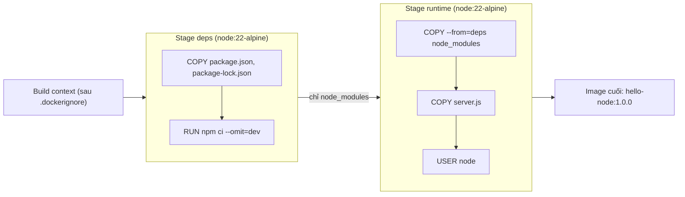

# Buổi 10 – Image Optimization

Tuần 5 · Giai đoạn 2 – Containerization · Slide: [Slide buổi 10](../../slides/02-docker/session-10.md)

> **Tóm tắt:** Hiểu layer và build cache, dùng .dockerignore, multi-stage build, non-root user và tagging để làm image nhỏ hơn, build nhanh hơn, an toàn hơn, rồi chứng minh bằng số liệu.

## Mục tiêu học tập

Sau buổi học, bạn có thể:

- Giải thích image gồm các layer chỉ đọc xếp chồng và vì sao thứ tự lệnh trong Dockerfile quyết định việc cache.
- Chạy được `docker history` và `docker image ls` để đọc kích thước từng layer và so sánh hai image.
- Viết được `.dockerignore` để giảm build context và tránh đưa `.env`, `.git`, `node_modules` vào image.
- Chuyển một Dockerfile đơn giản sang multi-stage build, chạy bằng non-root user và chứng minh bằng lệnh `id`.
- Gắn được tag có ý nghĩa (version cụ thể, không chỉ `latest`) và giải thích khác biệt giữa tag và digest.
- Chẩn đoán được lỗi build do `.dockerignore` hoặc `COPY` sai đường dẫn (tình huống 05).

## Điều kiện cần

- Đã hoàn thành buổi 09: biết `FROM`, `WORKDIR`, `COPY`, `RUN`, `CMD`, build context và chạy `docker build`, `docker run`.
- Windows 11 + WSL2 Ubuntu, Docker Desktop đang chạy và bật WSL integration. Làm việc trong filesystem của WSL (ví dụ `~/devops-labs`), không dùng `/mnt/c`.
- Đã clone repo giáo trình về WSL (ví dụ `~/devops-course`) để lấy thư mục `examples/docker/hello-node/`.
- Repo cá nhân `devops-labs` đã có, sẽ nộp bài vào thư mục `lab-10/`.

Kiểm tra nhanh:

```bash
docker version --format '{{.Server.Version}}'
docker buildx version
ls ~/devops-course/examples/docker/hello-node
```

Kết quả mong đợi (rút gọn):

```text
27.x.x
github.com/docker/buildx v0.xx.x
Dockerfile.naive  Dockerfile.optimized  package-lock.json  package.json  server.js
```

Công cụ tùy chọn: [dive](https://github.com/wagoodman/dive) để duyệt từng layer. Không cài cũng làm được toàn bộ lab vì đã có `docker history`.

## Vấn đề thực tế

Một thành viên CLB viết Dockerfile đầu tiên cho API: `FROM node:22`, `COPY . .`, `RUN npm install`. Image chạy được, nhưng nặng hơn 1 GB. Mỗi lần sửa một dòng code, CI cài lại toàn bộ dependency mất vài phút. Tệ hơn, thư mục dự án có file `.env` chứa mật khẩu database, và `COPY . .` đã chép nó vào image; ai pull image cũng đọc được mật khẩu bằng `docker run ... cat .env`.

Ba vấn đề này (nặng, chậm, không an toàn) có chung một gốc: không hiểu image được tạo ra như thế nào. Buổi này bạn sẽ lấy chính ví dụ đó, đo, sửa từng bước và so sánh số liệu trước/sau. Từ buổi 11 trở đi, image `club-api` sẽ chạy trong Compose và Kubernetes, nên image nhỏ và đúng chuẩn giúp mọi bước sau nhanh và ít lỗi hơn.

## Khái niệm cốt lõi

### Layer và union filesystem

Image là một chồng layer chỉ đọc. Hầu hết lệnh `RUN`, `COPY`, `ADD` tạo ra một layer mới chứa phần chênh lệch filesystem. Khi chạy container, Docker thêm một lớp ghi (writable layer) mỏng lên trên cùng; lớp này mất khi container bị xóa.

Hệ quả quan trọng: layer là bất biến. Nếu `RUN npm install` tạo 200 MB ở layer 4 rồi `RUN rm -rf cache` ở layer 5, image vẫn nặng 200 MB vì layer 4 vẫn nằm đó. Muốn bỏ thứ gì khỏi image, phải không bao giờ đưa nó vào (dùng `.dockerignore`, multi-stage), chứ không phải xóa sau.

### Build cache

Với mỗi lệnh, Docker kiểm tra xem đã có layer cache khớp chưa. Với `COPY`, nó so sánh nội dung (checksum) file được chép. Quy tắc quan trọng nhất: khi một layer bị mất cache, mọi layer phía sau nó cũng phải build lại.

| Cách viết | Sửa 1 dòng trong server.js thì sao | Đánh giá |
| --- | --- | --- |
| `COPY . .` rồi `RUN npm install` | Layer COPY đổi, npm install chạy lại toàn bộ | Chậm |
| `COPY package*.json ./`, `RUN npm ci`, rồi `COPY . .` | Chỉ layer COPY code build lại, dependency lấy từ cache | Nhanh |

Nguyên tắc sắp xếp: thứ ít thay đổi (base image, dependency) đặt trước, thứ hay thay đổi (source code) đặt sau.

### Build context và .dockerignore

Khi chạy `docker build .`, Docker gửi toàn bộ thư mục `.` (build context) tới builder trước khi đọc Dockerfile. Context lớn làm build chậm ngay cả khi không dùng đến các file đó, và `COPY . .` sẽ đưa chúng vào image. File `.dockerignore` đặt cạnh Dockerfile liệt kê những gì loại khỏi context.

| Nên ignore | Lý do |
| --- | --- |
| `node_modules` | Cài lại trong image; bản trên máy bạn có thể sai hệ điều hành |
| `.git` | Lịch sử repo nặng, không cần khi chạy |
| `.env`, `*.pem` | Chứa bí mật, không được vào image |
| `tests`, `coverage`, `*.md` | Không cần ở runtime |
| `Dockerfile*`, `.dockerignore` | Không cần bên trong image |

### Multi-stage build

Một Dockerfile có nhiều `FROM`. Mỗi `FROM` là một stage riêng. Bạn dùng stage đầu để cài đặt/biên dịch (cần nhiều công cụ), rồi `COPY --from=ten-stage` chỉ phần kết quả sang stage cuối. Image cuối chỉ chứa stage cuối, mọi thứ còn lại bị bỏ.

### Chọn base image

| Base | Kích thước tham khảo | Ghi chú |
| --- | --- | --- |
| `node:22` | trên 1 GB | Debian đầy đủ, nhiều công cụ build; thường không cần cho runtime |
| `node:22-slim` | khoảng 200-250 MB | Debian rút gọn, tương thích glibc tốt |
| `node:22-alpine` | khoảng 150-200 MB | Dùng musl và busybox, rất nhỏ; vài thư viện native có thể gặp vấn đề |

Con số thay đổi theo bản phát hành; hãy tin số bạn đo được bằng `docker image ls`. Với app thuần JavaScript như API của CLB, Alpine là lựa chọn tốt.

### Non-root user

Mặc định tiến trình trong container chạy bằng root (uid 0). Nếu ứng dụng bị khai thác, kẻ tấn công có quyền cao hơn mức cần thiết. Image `node` đã tạo sẵn user `node` (uid 1000); chỉ cần `USER node` và đảm bảo file ứng dụng đọc được (`COPY --chown=node:node`).

### Tag và digest

| Khái niệm | Ví dụ | Đặc điểm |
| --- | --- | --- |
| Tag | `club-api:1.0.0` | Nhãn tên do con người đặt, có thể bị gán lại sang image khác |
| `latest` | `club-api:latest` | Chỉ là một tag bình thường, không có nghĩa là "mới nhất"; tránh trong ví dụ cần tái lập |
| Digest | `club-api@sha256:...` | Định danh theo nội dung, không đổi; dùng khi cần chính xác tuyệt đối |

Quy ước của khóa học: `club-api:1.0.0` và `club-web:1.0.0`, có thể gắn thêm `1.0` hoặc `latest` làm bí danh, nhưng deploy luôn dùng tag version cụ thể.

## Kiến trúc và cách hoạt động



Giải thích từng bước:

1. Docker đọc `.dockerignore`, gom context (chỉ các file không bị loại) và gửi cho builder.
2. Stage `deps` chép riêng `package.json` và `package-lock.json`, chạy `npm ci --omit=dev`. Layer này chỉ build lại khi hai file manifest đổi.
3. Stage `runtime` bắt đầu từ base sạch, lấy `node_modules` từ stage `deps` bằng `COPY --from=deps`. Công cụ và cache của bước cài đặt không đi theo.
4. Chép code ứng dụng sau cùng (hay đổi nhất), đặt `USER node` để tiến trình chạy không phải root.
5. Chỉ stage cuối trở thành image; các stage trước chỉ còn trong build cache.

Cache hoạt động theo chuỗi: nếu sửa `server.js`, các layer của stage `deps` và layer `COPY --from=deps` vẫn khớp cache, chỉ `COPY server.js` và các layer sau được tạo lại.

## Demo của mentor

Mentor trình chiếu terminal, dùng thư mục `examples/docker/hello-node/` đã chép vào `~/demo-10`.

**Bước 1. Build bản naive và xem kích thước.** Thư mục mẫu đã có sẵn `.dockerignore` (loại `.env`); ta xóa nó để mô phỏng một dự án chưa biết đến `.dockerignore`.

```bash
mkdir -p ~/demo-10 && cp -r ~/devops-course/examples/docker/hello-node/. ~/demo-10/ && cd ~/demo-10
rm -f .dockerignore
docker build -f Dockerfile.naive -t hello-node:demo-naive .
docker image ls hello-node
```

Kết quả mong đợi (rút gọn, số thật có thể khác):

```text
REPOSITORY   TAG          IMAGE ID       CREATED          SIZE
hello-node   demo-naive   3f1c0a9b7d2e   10 seconds ago   1.6GB
```

Câu hỏi cho lớp: "Ứng dụng chỉ có 1 file server.js và 1 thư viện. Thứ gì làm image nặng như vậy?" (gợi ý: base image Debian đầy đủ.)

**Bước 2. Tạo "rác" trong thư mục và quan sát build context.**

```bash
head -c 30M /dev/zero > big.bin
echo "DB_PASSWORD=do-not-leak" > .env
docker build -f Dockerfile.naive -t hello-node:demo-naive .
```

Trong log tìm dòng `transferring context`:

```text
=> [internal] load build context
=> => transferring context: 31.46MB
```

Chạy thử đọc `.env` từ image:

```bash
docker run --rm hello-node:demo-naive cat /app/.env
```

```text
DB_PASSWORD=do-not-leak
```

Câu hỏi cho lớp: "Nếu image này được push lên registry công khai thì chuyện gì xảy ra?"

**Bước 3. Sửa code, quan sát cache bị mất.** Thêm một dòng comment vào `server.js`, build lại naive:

```bash
echo "// edit" >> server.js
docker build -f Dockerfile.naive -t hello-node:demo-naive . 2>&1 | grep -E "RUN|COPY|CACHED"
```

Kết quả mong đợi: `COPY . .` và `RUN npm install` đều chạy lại, không có chữ `CACHED` ở hai bước này.

**Bước 4. Thêm `.dockerignore`, build bản optimized, so sánh.**

```bash
printf 'node_modules\n.git\n.env\n*.bin\nDockerfile*\n.dockerignore\n' > .dockerignore
docker build -f Dockerfile.optimized -t hello-node:demo-opt .
docker image ls hello-node
docker run --rm hello-node:demo-opt cat /app/.env
```

Kết quả mong đợi: kích thước giảm còn khoảng 200-250 MB, và lệnh `cat` báo `No such file or directory`.

**Bước 5. Chứng minh non-root.**

```bash
docker run --rm -d --name demo10 -p 3100:3000 hello-node:demo-opt
curl -s localhost:3100/
docker rm -f demo10
```

```text
Hello from hello-node (uid=1000)
```

Câu hỏi chốt: "Vì sao sửa một dòng code lần này nhanh hơn? Layer nào được lấy từ cache?" Dọn dẹp: `docker rmi hello-node:demo-naive hello-node:demo-opt`.

## Hands-on lab

Thời gian gợi ý: chuẩn bị 5', phần 1 đến 4 khoảng 45', phần 5 dành cho đóng gói và L2 nếu còn thời gian (L2 có thể hoàn thành sau giờ).

### Chuẩn bị

```bash
mkdir -p ~/devops-labs/lab-10/source ~/devops-labs/lab-10/evidence ~/devops-labs/lab-10/screenshots
cp -r ~/devops-course/examples/docker/hello-node ~/devops-labs/lab-10/source/
cd ~/devops-labs/lab-10/source/hello-node
rm -f .dockerignore README.md
ls -a
```

Thư mục mẫu có sẵn `.dockerignore` và `README.md`; ta xóa chúng để bắt đầu từ trạng thái chưa biết đến `.dockerignore`, bạn sẽ tự viết lại ở Phần 3. Mọi lệnh quan trọng bên dưới hãy ghi lại bằng cách thêm `2>&1 | tee -a ../../evidence/command-output.txt` ở cuối (hoặc copy output vào file). Kết quả mong đợi của `ls -a`: có `Dockerfile.naive`, `Dockerfile.optimized`, `package.json`, `package-lock.json`, `server.js` và không có `.dockerignore`.

### Phần 1. Baseline: build bản naive và đo

Mục đích: có số liệu gốc trước khi tối ưu.

1. Tạo "rác" mô phỏng thư mục dự án thật:

   ```bash
   head -c 30M /dev/zero > big.bin
   echo "DB_PASSWORD=changeme-demo" > .env
   ```

   Vì sao: `.env` và file lớn là thứ rất hay bị `COPY . .` kéo vào image trong dự án thật. Đây là giá trị giả, không dùng mật khẩu thật.

2. Build và đo thời gian:

   ```bash
   time docker build --progress=plain -f Dockerfile.naive -t hello-node:1.0.0-naive . 2>&1 | tee -a ../../evidence/command-output.txt
   docker image ls hello-node
   ```

   Kết quả mong đợi: `transferring context` khoảng 31 MB (do `big.bin`), size trên 1 GB.

3. Xác nhận rò rỉ và quyền root:

   ```bash
   docker run --rm hello-node:1.0.0-naive cat /app/.env
   docker run --rm hello-node:1.0.0-naive id
   ```

   ```text
   DB_PASSWORD=changeme-demo
   uid=0(root) gid=0(root) groups=0(root)
   ```

   Vì sao: bằng chứng ba vấn đề: có bí mật trong image, chạy bằng root, và (ở bước 2) context nặng.

### Phần 2. Đọc layer bằng docker history

```bash
docker history hello-node:1.0.0-naive
```

Kết quả mong đợi (rút gọn):

```text
IMAGE          CREATED          CREATED BY                                      SIZE
3f1c0a9b7d2e   1 minute ago     CMD ["node" "server.js"]                        0B
<missing>      1 minute ago     EXPOSE map[3000/tcp:{}]                         0B
<missing>      1 minute ago     RUN /bin/sh -c npm install                      2.3MB
<missing>      1 minute ago     COPY . . # buildkit                             31.5MB
<missing>      1 minute ago     WORKDIR /app                                    0B
<missing>      2 weeks ago      CMD ["node"]                                    0B
...                                                                             (các layer của node:22)
```

Ghi vào `report.md`: layer nào lớn nhất do bạn tạo ra, layer nào thuộc base image. Layer `COPY . .` nặng 31 MB cho thấy `big.bin` đã vào image. Nếu có dive: `dive hello-node:1.0.0-naive`, dùng phím Tab để chuyển cột, quan sát thư mục `/app`.

### Phần 3. Thêm .dockerignore (mốc L1)

1. Tạo file (dán nguyên khối lệnh, không thụt lề):

```bash
cat > .dockerignore <<'EOF'
node_modules
npm-debug.log
.git
.env
*.bin
Dockerfile*
.dockerignore
EOF
```

2. Build lại bản naive với tag mới để so sánh công bằng:

   ```bash
   docker build --progress=plain -f Dockerfile.naive -t hello-node:1.0.0-naive-ignore . 2>&1 | grep "transferring context"
   docker run --rm hello-node:1.0.0-naive-ignore ls -a /app
   ```

   Kết quả mong đợi: context chỉ còn rất nhỏ (từ vài trăm byte đến vài chục KB, không còn khoảng 31 MB); `ls -a /app` không có `.env`, `big.bin`.

   Vì sao: `.dockerignore` loại file ngay từ context, nên `COPY . .` không còn gì để chép nhầm. Lưu ý Dockerfile và `.dockerignore` vẫn được builder đọc dù bị ignore.

3. So sánh:

   ```bash
   docker image ls hello-node
   ```

   Size gần như không đổi (vẫn trên 1 GB) vì vấn đề chính là base image; `.dockerignore` giải quyết context và rò rỉ, không giải quyết kích thước base. Hãy ghi nhận điều này vào report.

### Phần 4. Build cache: so sánh thứ tự lệnh

1. Xem Dockerfile.optimized, tìm chỗ nó chép manifest trước:

   ```bash
   cat Dockerfile.optimized
   ```

2. Build optimized lần đầu, rồi sửa code và build lại cả hai bản:

   ```bash
   docker build -f Dockerfile.optimized -t hello-node:1.0.0 .
   echo "// edit 1" >> server.js
   docker build -f Dockerfile.naive -t hello-node:1.0.0-naive-ignore . 2>&1 | grep -E "RUN npm|COPY|CACHED"
   echo "// edit 2" >> server.js
   docker build -f Dockerfile.optimized -t hello-node:1.0.0 . 2>&1 | grep -E "RUN npm|COPY|CACHED"
   ```

   Kết quả mong đợi:

   ```text
   # naive: không CACHED ở COPY . . và RUN npm install
   => [3/4] COPY . .
   => [4/4] RUN npm install
   # optimized: các bước stage deps có CACHED
   => CACHED [deps 4/4] RUN npm ci --omit=dev
   => [runtime 5/5] COPY --chown=node:node package.json server.js ./
   # số thứ tự bước có thể khác tùy phiên bản Docker
   ```

   Vì sao: bản naive chép cả thư mục trước khi cài, nên sửa code là mất cache cài đặt. Bản optimized tách manifest ra nên `npm ci` chỉ chạy lại khi lockfile đổi.

3. So sánh kích thước và kiểm tra non-root:

   ```bash
   docker image ls hello-node
   docker run --rm --entrypoint id hello-node:1.0.0
   ```

   ```text
   hello-node   1.0.0                  8c2d...   40 seconds ago   ~200-250MB
   hello-node   1.0.0-naive-ignore     b71e...   2 minutes ago    ~1.6GB
   uid=1000(node) gid=1000(node) groups=1000(node)
   ```

4. Chạy và kiểm tra health:

   ```bash
   docker run -d --name hello-opt -p 3100:3000 hello-node:1.0.0
   curl -s localhost:3100/health
   docker ps --filter name=hello-opt --format '{{.Names}} {{.Status}}'
   sleep 35
   docker ps --filter name=hello-opt --format '{{.Names}} {{.Status}}'
   ```

   ```text
   {"status":"healthy"}
   hello-opt Up 2 seconds (health: starting)
   hello-opt Up 37 seconds (healthy)
   ```

   Vì sao phải đợi: `Dockerfile.optimized` đặt `--interval=30s`, nên lần kiểm tra đầu tiên chỉ chạy sau khoảng 30 giây; trước đó trạng thái là `(health: starting)`. Dọn: `docker rm -f hello-opt`.

### Phần 5. Tag và digest

```bash
docker tag hello-node:1.0.0 hello-node:1.0
docker tag hello-node:1.0.0 hello-node:latest
docker image ls hello-node --digests
docker image inspect hello-node:1.0.0 --format '{{.Id}}'
```

Kết quả mong đợi: ba tag `1.0.0`, `1.0`, `latest` cùng IMAGE ID. Vì sao: tag chỉ là con trỏ; `docker tag` không sao chép dữ liệu. Cột DIGEST có thể là `none` vì image chưa được push (tùy image store của Docker Desktop); digest ổn định chỉ có sau khi push lên registry (buổi CI/GHCR).

### Phần 6. Áp dụng vào starter-project

Backend của dự án đã có Dockerfile multi-stage và `.dockerignore`. Hãy đọc và đối chiếu với những gì vừa học, rồi build:

```bash
cd ~/devops-course/starter-project/backend
cat .dockerignore
docker build -t club-api:1.0.0 .
docker image ls club-api
docker run --rm --entrypoint id club-api:1.0.0
```

```text
REPOSITORY   TAG     IMAGE ID       SIZE
club-api     1.0.0   a1b2c3d4e5f6   ~200-250MB
uid=1000(node) gid=1000(node) groups=1000(node)
```

Điền bảng đối chiếu vào `report.md`: stage nào cài dependency, vì sao `COPY --from=dependencies` đặt trước `COPY . .`, `USER node` đặt ở đâu, và những mục trong `.dockerignore` giải quyết vấn đề gì.

### L1 – Foundation: checklist hoàn thành

- [ ] Build được `hello-node:1.0.0-naive`, ghi lại size và dòng `transferring context`.
- [ ] Chứng minh được bản naive chứa `.env` và chạy bằng root.
- [ ] Có `.dockerignore`; chứng minh `.env` và `big.bin` không còn trong image.
- [ ] Build được `hello-node:1.0.0` từ `Dockerfile.optimized`, có bảng so sánh size naive và optimized.
- [ ] Chạy `docker history` và chỉ ra layer lớn nhất của mỗi image.
- [ ] Build được `club-api:1.0.0` từ starter-project và xác nhận chạy bằng user `node`.

### L2 – Engineering: thử thách tự làm

Thử thách 1. Tự viết `Dockerfile.mine` (không chép từ `Dockerfile.optimized`) cho hello-node, đạt đủ tiêu chí:

- Multi-stage, base `node:22-alpine`, có pin major version.
- Sửa `server.js` không làm `npm ci` chạy lại (chứng minh bằng log `CACHED`).
- Tiến trình chạy bằng non-root, không có `.env` trong image.
- Size không lớn hơn bản `Dockerfile.optimized` quá 10%.

Thử thách 2. Giải thích bằng `docker history` từng layer của image của bạn: layer nào của base, layer nào của bạn, layer nào 0B và vì sao.

Thử thách 3. Đưa ra chiến lược tag cho `club-api` khi có 3 bản phát hành 1.0.0, 1.0.1, 1.1.0: tag nào gắn cho image nào, và deploy dùng tag nào.

Thử thách 4 (nâng cao). Thêm stage `test` chạy `npm test` cho backend của starter-project mà không đưa dependency dev vào image cuối. Dùng `docker build --target test` để chạy riêng stage này.

<details>
<summary>Gợi ý</summary>

- Bắt đầu từ hai stage: `deps` chỉ có `COPY package.json package-lock.json ./` và `RUN npm ci --omit=dev`.
- Stage cuối nhớ `COPY --chown=node:node` và `USER node`, đặt sau khi chép file.
- Nếu `npm ci` báo lỗi thiếu lockfile, kiểm tra `.dockerignore` có đang loại `package-lock.json` không.
- Để chạy test bạn cần devDependencies: stage `test` phải cài `npm ci` đầy đủ, khác stage `deps`.

</details>

<details>
<summary>Lời giải tham khảo</summary>

Thử thách 1 (một đáp án khả dĩ):

```dockerfile
FROM node:22-alpine AS deps
WORKDIR /app
COPY package.json package-lock.json ./
RUN npm ci --omit=dev

FROM node:22-alpine
WORKDIR /app
ENV NODE_ENV=production
COPY --from=deps /app/node_modules ./node_modules
COPY --chown=node:node package.json server.js ./
USER node
EXPOSE 3000
CMD ["node", "server.js"]
```

Thử thách 2: layer của base (`node:22-alpine`) đến từ nhà phát hành image, gồm hệ điều hành và Node.js; layer của bạn là `COPY --from=deps` (node_modules) và `COPY server.js`. Các lệnh `WORKDIR`, `ENV`, `USER`, `EXPOSE`, `CMD` chỉ thay đổi metadata nên 0B.

Thử thách 3: build 1.0.0 gắn `1.0.0` (và `1.0`); build 1.0.1 gắn `1.0.1` và chuyển `1.0` sang nó; build 1.1.0 gắn `1.1.0`, `1.1`. Deploy dùng tag đầy đủ như `club-api:1.0.1` để rollback chính xác; tag `1.0` hoặc `latest` chỉ là bí danh tiện lợi.

Thử thách 4: thêm stage ở giữa:

```dockerfile
FROM node:22-alpine AS test
WORKDIR /app
COPY package*.json ./
RUN npm ci
COPY . .
RUN npm test
```

Lưu ý `.dockerignore` của starter-project đang loại thư mục `tests`, nên stage này không thấy test. Bạn cần bỏ dòng `tests` khỏi `.dockerignore` khi làm thử thách này (hoặc dùng file ignore riêng theo tên Dockerfile, ví dụ `Dockerfile.test.dockerignore` đi kèm `-f Dockerfile.test`, xem tài liệu build context của Docker) và giải thích đánh đổi; nhớ khôi phục dòng đó sau khi thử. Chạy bằng `docker build --target test -t club-api:test .`.

</details>

## Phá lỗi và debug

Tình huống: build thất bại sau khi thêm `.dockerignore` (liên quan tình huống 05). Bạn có thể xem thêm bộ file tại `examples/troubleshooting/scenario-05/`.

**Cách phá.** Trong `source/hello-node` (đã có `.dockerignore` từ Phần 3), thêm dòng sau:

```bash
echo "package-lock.json" >> .dockerignore
docker build -f Dockerfile.optimized -t hello-node:broken .
```

**Triệu chứng.** Build dừng ở stage `deps` với thông báo tương tự:

```text
ERROR: failed to solve: failed to compute cache key: failed to calculate checksum of ref ...: "/package-lock.json": not found
```

**Hướng điều tra.**

1. Đọc dòng lỗi: file `/package-lock.json` "not found" trong context, không phải lỗi npm.
2. Kiểm tra file có tồn tại trên đĩa không: `ls package-lock.json` (có).
3. Vậy file có trên đĩa nhưng builder không thấy. Nghĩ tới thứ lọc context: `cat .dockerignore`.
4. Thấy `package-lock.json` bị liệt kê. Xóa dòng đó, build lại để xác nhận.

**Nguyên nhân gốc.** `.dockerignore` loại file khỏi context nên `COPY` không tìm thấy nó, dù file vẫn nằm trên máy.

**Phòng tránh.** Chỉ ignore thứ chắc chắn không cần; không ignore file mà Dockerfile `COPY`. Khi gặp "not found" với file đang có thật, kiểm tra `.dockerignore` và build context (tham số cuối của `docker build`) trước tiên. Nếu cần chắc chắn, dùng mẫu phủ định `!package-lock.json` để cho phép lại.

Tình huống mở rộng: chạy thử lỗi trong `examples/troubleshooting/scenario-05/` theo hướng dẫn của thư mục đó. Chỉ ghi lại triệu chứng, tự tìm nguyên nhân gốc rồi điền vào `report.md`.

## Lỗi thường gặp

| Triệu chứng | Nguyên nhân | Cách xử lý |
| --- | --- | --- |
| `COPY failed` hoặc `"/xxx": not found` | File bị `.dockerignore` loại, hoặc sai build context | Kiểm tra `.dockerignore`, đường dẫn tương đối so với context |
| Mỗi lần sửa code đều cài lại dependency | `COPY . .` đặt trước `npm install`/`npm ci` | Chép manifest trước, cài, rồi mới chép code |
| Image vẫn rất lớn dù đã xóa file bằng `RUN rm` | Layer trước vẫn chứa file | Dùng multi-stage hoặc `.dockerignore`, không dựa vào `rm` |
| `EACCES: permission denied` khi chạy với `USER node` | File thuộc root, user node không ghi/đọc được | `COPY --chown=node:node`, tránh ghi vào thư mục thuộc root |
| `docker build` rất chậm ở bước "load build context" | Context chứa `node_modules`, `.git`, file lớn | Thêm `.dockerignore`, build từ đúng thư mục |
| `exec format error` hoặc module native lỗi trên Alpine | Dùng `node_modules` copy từ máy khác hệ điều hành hoặc thư viện cần glibc | Cài dependency bên trong image; nếu cần dùng `node:22-slim` |
| Deploy ra bản cũ dù đã build lại | Dùng tag `latest` bị cache hoặc gán nhầm | Dùng tag version cụ thể, kiểm tra IMAGE ID/digest |

## Tự kiểm tra

1. Vì sao `RUN rm -rf` ở layer sau không làm image nhỏ lại?
2. Sắp xếp lại ba lệnh sau cho cache tốt nhất: `COPY . .`, `RUN npm ci`, `COPY package*.json ./`.
3. `.dockerignore` ảnh hưởng điều gì: build context, image cuối hay cả hai?
4. Multi-stage build giảm kích thước bằng cách nào?
5. Làm sao chứng minh container đang chạy bằng non-root?
6. Tình huống: đồng nghiệp báo "build trên CI mất 6 phút dù chỉ sửa README". Bạn kiểm tra những gì và sửa thế nào?
7. Tình huống: build báo `"/package-lock.json": not found` dù file có trong thư mục. Bạn làm gì đầu tiên?
8. Tag `latest` có đảm bảo là bản mới nhất không? Nên tag thế nào để deploy tái lập được?

<details>
<summary>Đáp án</summary>

1. Layer bất biến: layer trước vẫn nằm trong image, `rm` chỉ che file ở layer sau.
2. `COPY package*.json ./`, `RUN npm ci`, `COPY . .`.
3. Cả hai gián tiếp: file bị loại khỏi context nên không có trong `COPY`; context nhỏ cũng giúp build nhanh hơn. Nó không thu nhỏ base image.
4. Chỉ stage cuối thành image; công cụ build và cache ở các stage trước bị bỏ.
5. `docker run --rm --entrypoint id image` hoặc `docker exec container id` cho thấy uid khác 0.
6. Xem layer nào mất cache (log build); kiểm tra `COPY . .` đặt trước cài dependency và `.dockerignore` thiếu `.git`, `node_modules`, `*.md`. Sửa thứ tự lệnh, thêm `.dockerignore`. Sửa README chỉ nên làm đổi layer cuối hoặc không làm đổi layer nào nếu README được ignore.
7. Kiểm tra `.dockerignore` có loại file đó không và build context có đúng thư mục không.
8. Không. `latest` chỉ là một tag bình thường, có thể trỏ tới image cũ. Dùng tag version (`1.0.1`) hoặc digest.

</details>

## Nộp bài

Nộp vào thư mục `lab-10/` trong repository cá nhân, theo `templates/lab-template.md`:

- [ ] `README.md` trả lời đủ 7 câu: lab giải quyết vấn đề gì, kiến thức đã dùng, các bước thực hiện, kết quả mong đợi, lỗi đã gặp, cách khắc phục, có thể cải thiện gì.
- [ ] `source/hello-node/` chứa `.dockerignore`, Dockerfile của bạn (và `Dockerfile.mine` nếu làm L2). Không chứa `big.bin` và `.env`.
- [ ] `evidence/command-output.txt` có: size của naive và optimized (`docker image ls`), `docker history` của cả hai, log build có `CACHED`, kết quả lệnh `id`.
- [ ] `report.md` có bảng so sánh trước/sau (size, thời gian rebuild sau khi sửa code, user chạy, có rò `.env` hay không) và phân tích layer.
- [ ] `screenshots/` có ảnh bổ trợ (không thay cho evidence bằng text).
- [ ] Ghi rõ đã làm L1 hay L2 ở cuối `README.md`.
- [ ] Đã kiểm tra: không commit secret thật, không commit `.env`, `big.bin`.

## Recap

- Image là chồng layer bất biến; xóa ở layer sau không làm nhỏ image.
- Sắp xếp Dockerfile từ ít đổi tới hay đổi để tận dụng cache; khi một layer mất cache, mọi layer sau đều build lại.
- `.dockerignore` giảm context, tăng tốc build và ngăn bí mật lọt vào image.
- Multi-stage build và base image nhỏ (Alpine hoặc slim) cho image gọn; đo bằng `docker image ls` và `docker history`.
- Chạy bằng non-root (`USER node`, `COPY --chown`) để giảm rủi ro.
- Dùng tag version cụ thể; `latest` không phải "mới nhất"; digest mới là định danh bất biến.
- Khi build lỗi "not found" mà file có thật, hãy nghi ngờ `.dockerignore` và build context đầu tiên.

## Tài liệu tham khảo

- [Docker Docs – Building best practices](https://docs.docker.com/build/building/best-practices/)
- [Docker Docs – Multi-stage builds](https://docs.docker.com/build/building/multi-stage/)
- [Docker Docs – Build cache](https://docs.docker.com/build/cache/)
- [Docker Docs – Dockerfile reference (.dockerignore)](https://docs.docker.com/reference/dockerfile/#dockerignore-file)
- [Docker CLI – docker image history](https://docs.docker.com/reference/cli/docker/image/history/)
