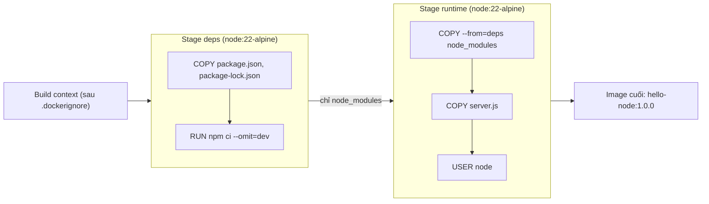

# Buổi 10 – Image Optimization

Tuần 5/16 · Giai đoạn 2 – Containerization · Buổi 10/32

[Slide buổi 10](../../slides/02-docker/session-10.md) · [Bài tập tuần 5](../../assignments/weekly/week-05.md) · [Hub tuần 5](README.md)

> **Tóm tắt:** Làm image nhỏ hơn, build nhanh hơn, an toàn hơn bằng thứ tự lệnh, .dockerignore, multi-stage, non-root user và tag, rồi chứng minh bằng số liệu trước và sau.

::: tip Buổi này bạn làm gì
**Bạn sẽ tạo ra:** một bảng so sánh số liệu thật giữa image `hello-node` làm ẩu (naive) và bản tối ưu, cùng image `club-api:1.0.0` build từ dự án của CLB.

**Thời gian thật:** đọc 15 phút · lab bắt buộc 60 phút · thử thách thêm (tùy chọn) làm ở nhà.

**Cần chuẩn bị:**
- [ ] Đã xong [Buổi 09 – Dockerfile](session-09.md): biết `FROM`, `COPY`, `RUN`, `CMD`, build context
- [ ] Môi trường theo [Hướng dẫn cài đặt](../../resources/setup-guide.md), repo `devops-labs` theo [Tài khoản GitHub và repo devops-labs](../../resources/setup-github.md)
- [ ] Repo giáo trình ở `~/devops-course` (cần thư mục `examples/docker/hello-node`)

**Sản phẩm phải nộp** (thư mục `lab-10/` trong `devops-labs`):
- `report.md` có bảng so sánh trước/sau (size, thời gian rebuild, user chạy, có rò `.env` hay không)
- `.dockerignore` của bạn, không có `big.bin` và `.env` trong repo
- `evidence/command-output.txt`: `docker image ls`, `docker history`, log có `CACHED`, kết quả `id`
- Image `club-api:1.0.0` build được từ starter-project, gắn thêm tag `1.0`

**Đi nhanh:** Đọc phần dưới > [Làm lab](#hands-on-lab) > [Gặp lỗi?](#gap-loi) > [Tự kiểm tra](#tu-kiem-tra) > [Nộp bài](#nop-bai). Kẹt giữa lab? Nhảy tới [Gặp lỗi?](#gap-loi).

**Từ mới trong buổi:**
- [Layer](../../resources/glossary.md): một lớp thay đổi filesystem trong image
- [Layer cache](../../resources/glossary.md): Docker dùng lại layer cũ nếu đầu vào không đổi
- [.dockerignore](../../resources/glossary.md): danh sách thứ không đưa vào build context
- [Multi-stage build](../../resources/glossary.md): nhiều `FROM`, chỉ stage cuối thành image
- [Non-root](../../resources/glossary.md): chạy tiến trình bằng user thường thay vì root
- [Tag](../../resources/glossary.md): nhãn tên của image, ví dụ `club-api:1.0.0`
:::

Trên lớp, mentor demo trước; tự học thì làm thẳng phần [Làm lab](#hands-on-lab).

## Vấn đề thực tế

Một thành viên CLB viết Dockerfile đầu tiên cho API: `FROM node:22`, `COPY . .`, `RUN npm install`. Image chạy được, nhưng nặng hơn 1 GB. Mỗi lần sửa một dòng code, CI cài lại toàn bộ dependency mất vài phút. Tệ hơn, thư mục dự án có file `.env` chứa mật khẩu database, và `COPY . .` đã chép nó vào image; ai pull image cũng đọc được mật khẩu.

Ba vấn đề (nặng, chậm, không an toàn) có chung một gốc: không hiểu image được tạo ra như thế nào. Buổi này bạn lấy chính ví dụ đó, đo, sửa từng bước và so sánh số liệu. Từ Buổi 11, image `club-api` chạy trong Compose và Kubernetes nên image nhỏ và đúng chuẩn giúp mọi bước sau nhanh và ít lỗi hơn.

## Khái niệm cốt lõi

Năm khái niệm; mỗi khái niệm một câu định nghĩa và một ví von.

**1. Layer và build cache.** Image là chồng layer chỉ đọc; Docker dùng lại (`CACHED`) layer nào có lệnh và dữ liệu đầu vào không đổi, nhưng một layer đổi thì mọi layer sau nó build lại. Ví von: xếp bánh nhiều tầng, đổi tầng dưới thì phải làm lại mọi tầng trên. Vì vậy đặt thứ ít đổi (manifest, cài dependency) lên trên, thứ hay đổi (mã nguồn) xuống dưới.

| Cách viết | Sửa 1 dòng trong server.js thì sao | Đánh giá |
| --- | --- | --- |
| `COPY . .` rồi `RUN npm install` | Layer COPY đổi, `npm install` chạy lại toàn bộ | Chậm |
| `COPY package*.json ./`, `RUN npm ci`, rồi `COPY . .` | Chỉ layer COPY code build lại | Nhanh |

**2. `.dockerignore`.** Là file cạnh Dockerfile liệt kê những thứ không đưa vào build context, nên `COPY . .` không chép nhầm chúng. Ví von: danh sách đồ không được mang lên máy bay. Nên ignore `node_modules`, `.git`, `.env`, `*.pem`, `tests`, `Dockerfile*`.

**3. Multi-stage build.** Một Dockerfile có nhiều `FROM`; stage đầu cài đặt, `COPY --from=tên-stage` chỉ chuyển kết quả cần thiết sang stage cuối, và chỉ stage cuối thành image. Ví von: nhà bếp nấu xong chỉ bê món ra bàn, không bê cả bếp.

**4. Non-root user.** Mặc định tiến trình trong container chạy bằng root; image `node` có sẵn user `node` (uid 1000), bật bằng `USER node` kèm `COPY --chown=node:node`. Ví von: nhân viên được cấp thẻ ra vào phòng mình, không cấp chìa khóa toàn tòa nhà.

**5. Tag và digest.** Tag là nhãn tên do người đặt và có thể bị gán lại (`latest` chỉ là một tag bình thường, không có nghĩa "mới nhất"); digest `sha256:...` định danh theo nội dung và không đổi. Ví von: tag như biển tên cửa hàng, digest như số CMND của cửa hàng. Quy ước khóa học: `club-api:1.0.0`, `club-web:1.0.0`; deploy luôn dùng tag version cụ thể.



::: details Tìm hiểu thêm (đọc sau)
**Layer là bất biến.** Hầu hết lệnh `RUN`, `COPY`, `ADD` tạo một layer chứa phần chênh lệch filesystem; khi chạy, Docker thêm một lớp ghi mỏng (mất khi xóa container). Nếu `RUN npm install` tạo 200 MB ở layer 4 rồi `RUN rm -rf cache` ở layer 5, image vẫn nặng 200 MB vì layer 4 còn đó. Muốn bỏ thứ gì khỏi image, đừng đưa nó vào (`.dockerignore`, multi-stage), đừng xóa sau.

**Multi-stage hoạt động thế nào.** (1) Docker đọc `.dockerignore`, gom context rồi gửi cho builder. (2) Stage `deps` chép riêng manifest và chạy `npm ci --omit=dev`; layer này chỉ build lại khi manifest đổi. (3) Stage `runtime` bắt đầu từ base sạch, lấy `node_modules` bằng `COPY --from=deps`. (4) Chép code sau cùng, đặt `USER node`. (5) Chỉ stage cuối thành image. Sửa `server.js` thì chỉ `COPY server.js` và các layer sau tạo lại.

**Chọn base image và danh sách nên ignore.** Hai bảng tham khảo (base `node:22`, `slim`, `alpine`; vì sao ignore từng mục) nằm ở [Buổi 10 – thử thách thêm](session-10-challenge.md#bang-tham-khao). Hãy tin số bạn đo bằng `docker image ls`.

**Tag và digest.** `club-api:1.0.0` là tag có thể bị gán lại; `club-api@sha256:...` là digest bất biến, dùng khi cần chính xác tuyệt đối. Có thể gắn thêm bí danh `1.0` hoặc `latest`, nhưng deploy dùng tag version cụ thể.
:::

## Hands-on lab

Thời lượng 60 phút. Bạn đo một image làm ẩu, sửa từng bước và so sánh. Dùng cổng host 3100 cho `hello-node` (đổi sang số khác nếu bận).

### Chuẩn bị (5 phút)

```bash
docker version --format '{{.Server.Version}}'
docker buildx version
ls ~/devops-course/examples/docker/hello-node
```

Kết quả mong đợi: phiên bản Docker (27.x.x trở lên), một dòng `github.com/docker/buildx ...`, và danh sách có `Dockerfile.naive`, `Dockerfile.optimized`, `package.json`, `package-lock.json`, `server.js`. Lỗi? Xem [Gặp lỗi?](#gap-loi).

```bash
mkdir -p ~/devops-labs/lab-10/{source,evidence,screenshots}
cp -r ~/devops-course/examples/docker/hello-node ~/devops-labs/lab-10/source/
cd ~/devops-labs/lab-10/source/hello-node
rm -f .dockerignore README.md
ls -a
```

Thư mục mẫu có sẵn `.dockerignore` và `README.md`; ta xóa chúng để bắt đầu từ trạng thái chưa biết đến `.dockerignore`. Kết quả mong đợi: có `Dockerfile.naive`, `Dockerfile.optimized`, `package.json`, `package-lock.json`, `server.js`, không có `.dockerignore`. Ghi bằng chứng: thêm `2>&1 | tee -a ../../evidence/command-output.txt` vào cuối các lệnh quan trọng.

### Phần 1. Baseline: build bản naive và đo (10 phút)

Mục đích: có số liệu gốc trước khi tối ưu.

1. Tạo "rác" mô phỏng dự án thật (giá trị giả, không dùng mật khẩu thật):

```bash
head -c 30M /dev/zero > big.bin
echo "DB_PASSWORD=changeme-demo" > .env
```

2. Build và đo thời gian:

```bash
time docker build --progress=plain -f Dockerfile.naive -t hello-node:1.0.0-naive . 2>&1 | tee -a ../../evidence/command-output.txt
docker image ls hello-node
```

Kết quả mong đợi: `transferring context` khoảng 31 MB (do `big.bin`), size trên 1 GB. Từ Docker 29, lấy size ở cột `DISK USAGE`.

3. Xác nhận rò rỉ và quyền root:

```bash
docker run --rm hello-node:1.0.0-naive cat /app/.env
docker run --rm hello-node:1.0.0-naive id
```

```text
DB_PASSWORD=changeme-demo
uid=0(root) gid=0(root) groups=0(root)
```

4. Đọc layer: `docker history hello-node:1.0.0-naive`. Kết quả mong đợi (rút gọn): `COPY . .` nặng khoảng 31 MB (chính là `big.bin`), `RUN npm install` vài MB, các layer còn lại thuộc base `node:22`. Ghi vào `report.md`: layer nào lớn nhất do bạn tạo ra, layer nào thuộc base.

::: tip Kiểm tra: bạn đúng khi
Bạn thấy đủ ba vấn đề: context khoảng 31 MB, `cat /app/.env` in ra mật khẩu, `id` là `uid=0(root)`.
:::

### Phần 2. Thêm .dockerignore (10 phút)

1. Tạo file (dán nguyên khối lệnh, không thụt lề):

```bash
cat > .dockerignore <<'EOF'
node_modules
npm-debug.log
.git
.env
*.bin
Dockerfile*
.dockerignore
EOF
```

2. Build lại bản naive với tag mới để so sánh công bằng:

```bash
docker build --progress=plain -f Dockerfile.naive -t hello-node:1.0.0-naive-ignore . 2>&1 | grep "transferring context"
docker run --rm hello-node:1.0.0-naive-ignore ls -a /app
docker image ls hello-node
```

Kết quả mong đợi: context chỉ còn rất nhỏ (vài trăm byte đến vài chục KB, không còn khoảng 31 MB); `ls -a /app` không có `.env`, `big.bin`; size gần như không đổi (vẫn trên 1 GB).

Vì sao: `.dockerignore` loại file ngay từ context nên `COPY . .` không còn gì để chép nhầm; nó giải quyết rò rỉ và context, không giải quyết kích thước base image. Hãy ghi nhận điều này vào report. Lưu ý Dockerfile và `.dockerignore` vẫn được builder đọc dù bị ignore.

::: tip Kiểm tra: bạn đúng khi
`ls -a /app` không còn `.env` và `big.bin`, và bạn giải thích được vì sao size image gần như không đổi. Image cũ `1.0.0-naive` vẫn chứa `.env`: build lại không sửa image đã build trước đó.
:::

### Phần 3. Cache, multi-stage và non-root (15 phút)

1. Xem `cat Dockerfile.optimized`, tìm chỗ nó chép manifest trước, chỗ có hai `FROM`, và dòng `USER node`.

2. Build optimized, sửa code rồi build lại cả hai bản:

```bash
docker build -f Dockerfile.optimized -t hello-node:1.0.0 .
echo "// edit 1" >> server.js
time docker build -f Dockerfile.naive -t hello-node:1.0.0-naive-ignore . 2>&1 | grep -E "RUN npm|COPY|CACHED" | tee -a ../../evidence/command-output.txt
echo "// edit 2" >> server.js
time docker build -f Dockerfile.optimized -t hello-node:1.0.0 . 2>&1 | grep -E "RUN npm|COPY|CACHED" | tee -a ../../evidence/command-output.txt
```

Kết quả mong đợi (số thứ tự bước có thể khác tùy phiên bản Docker):

```text
# naive: không CACHED ở COPY . . và RUN npm install
=> [3/4] COPY . .
=> [4/4] RUN npm install
# optimized: các bước stage deps có CACHED
=> CACHED [deps 4/4] RUN npm ci --omit=dev
=> [runtime 5/5] COPY --chown=node:node package.json server.js ./
```

Vì sao: bản naive chép cả thư mục trước khi cài nên sửa code là mất cache cài đặt; bản optimized tách manifest ra nên `npm ci` chỉ chạy lại khi lockfile đổi. Trên app nhỏ, thời gian hai bản có thể chênh ít; bằng chứng đáng tin là `CACHED`, không phải số giây.

3. So sánh kích thước và kiểm tra non-root:

```bash
docker image ls hello-node
docker run --rm --entrypoint id hello-node:1.0.0
```

Kết quả mong đợi: `1.0.0` khoảng 200-250 MB, `1.0.0-naive-ignore` khoảng 1.6 GB; `uid=1000(node) gid=1000(node) groups=1000(node)`.

4. Chạy và kiểm tra health:

```bash
docker run -d --name hello-opt -p 3100:3000 hello-node:1.0.0
curl -s localhost:3100/health
sleep 35
docker ps --filter name=hello-opt --format '{{.Names}} {{.Status}}'
docker rm -f hello-opt
```

Kết quả mong đợi: `{"status":"healthy"}`, rồi `hello-opt Up 37 seconds (healthy)`. Vì sao phải đợi: `Dockerfile.optimized` đặt `--interval=30s`, trước đó trạng thái là `(health: starting)`.

::: tip Kiểm tra: bạn đúng khi
Log của bản optimized có dòng `CACHED` cạnh `npm ci`, log naive thì không; `id` in `uid=1000(node)`; size optimized nhỏ hơn naive nhiều lần.
:::

### Phần 4. Tag và digest (5 phút)

```bash
docker tag hello-node:1.0.0 hello-node:1.0
docker tag hello-node:1.0.0 hello-node:latest
docker image ls hello-node --digests
```

Kết quả mong đợi: ba tag `1.0.0`, `1.0`, `latest` cùng IMAGE ID. Vì sao: tag chỉ là con trỏ, `docker tag` không sao chép dữ liệu. Cột DIGEST có thể là `none` vì image chưa push; digest ổn định chỉ có sau khi push lên registry (buổi CI/GHCR).

::: tip Kiểm tra: bạn đúng khi
Ba tag trỏ cùng một IMAGE ID, và bạn nói được vì sao deploy không nên dùng `latest`.
:::

### Phần 5. Áp dụng vào starter-project (10 phút)

Backend của dự án đã có Dockerfile multi-stage và `.dockerignore`. Đọc, đối chiếu với những gì vừa học rồi build:

```bash
cd ~/devops-course/starter-project/backend
cat .dockerignore
docker build -t club-api:1.0.0 . 2>&1 | tee -a ~/devops-labs/lab-10/evidence/command-output.txt
docker tag club-api:1.0.0 club-api:1.0
docker image ls club-api
docker run --rm --entrypoint id club-api:1.0.0
```

Kết quả mong đợi: `1.0.0` và `1.0` cùng IMAGE ID, size khoảng 200-250 MB, `uid=1000(node)`. Điền bảng đối chiếu vào `report.md`: stage nào cài dependency, vì sao `COPY --from=dependencies` đặt trước `COPY . .`, `USER node` đặt ở đâu, các mục trong `.dockerignore` giải quyết vấn đề gì.

::: tip Kiểm tra: bạn đúng khi
`docker run --rm --entrypoint id club-api:1.0.0` in `uid=1000(node)` và `docker image ls club-api` có cả hai tag `1.0.0` và `1.0`.
:::

### Checklist L1

- [ ] Build được `hello-node:1.0.0-naive`, ghi lại size và dòng `transferring context`.
- [ ] Chứng minh được bản naive chứa `.env` và chạy bằng root.
- [ ] Có `.dockerignore`; chứng minh `.env` và `big.bin` không còn trong image.
- [ ] Build được `hello-node:1.0.0` từ `Dockerfile.optimized`, có bảng so sánh size naive và optimized.
- [ ] Chạy `docker history` và chỉ ra layer lớn nhất của mỗi image.
- [ ] Build được `club-api:1.0.0` từ starter-project và xác nhận chạy bằng user `node`.

Lệnh tự kiểm tra một dòng (mong đợi: `uid=1000(node)` và ba tag cùng IMAGE ID):

```bash
docker run --rm --entrypoint id club-api:1.0.0; docker image ls hello-node --format '{{.Tag}} {{.ID}}'
```

## Gặp lỗi?

| Triệu chứng | Nguyên nhân | Cách sửa |
| --- | --- | --- |
| `COPY failed` hoặc `"/package-lock.json": not found` dù file có thật trên đĩa | File bị `.dockerignore` loại, hoặc sai build context | `cat .dockerignore`, bỏ dòng loại file đó (hoặc thêm `!package-lock.json`), kiểm tra tham số cuối của `docker build` |
| Mỗi lần sửa code đều cài lại dependency | `COPY . .` đặt trước `npm install` hoặc `npm ci` | Chép manifest trước, cài, rồi mới chép code |
| Image vẫn rất lớn dù đã xóa file bằng `RUN rm` | Layer trước vẫn chứa file | Dùng multi-stage hoặc `.dockerignore`, không dựa vào `rm` |
| `EACCES: permission denied` khi chạy với `USER node` | File thuộc root, user node không đọc hoặc ghi được | `COPY --chown=node:node`; ghi log ra stdout thay vì ghi file trong `/app` |
| Bước "load build context" rất chậm | Context chứa `node_modules`, `.git`, file lớn | Thêm `.dockerignore`, build từ đúng thư mục |
| `exec format error` hoặc module native lỗi trên Alpine | Dùng `node_modules` chép từ máy khác hệ điều hành, hoặc thư viện cần glibc | Cài dependency bên trong image; nếu cần dùng `node:22-slim` |
| Deploy ra bản cũ dù đã build lại | Dùng tag `latest` bị cache hoặc gán nhầm | Dùng tag version cụ thể, kiểm tra IMAGE ID hoặc digest |
| `ls -a /app` vẫn thấy `.env` sau khi thêm `.dockerignore` | Đang kiểm tra image cũ build trước khi có `.dockerignore` | Build lại với tag mới rồi kiểm tra đúng tag mới |
| `(health: starting)` kéo dài khoảng 30 giây | `--interval=30s` trong `Dockerfile.optimized` | Bình thường; đợi rồi chạy lại `docker ps` |

## Tự kiểm tra

1. Vì sao `RUN rm -rf` ở layer sau không làm image nhỏ lại?
2. Sắp xếp lại ba lệnh sau cho cache tốt nhất: `COPY . .`, `RUN npm ci`, `COPY package*.json ./`.
3. `.dockerignore` ảnh hưởng điều gì: build context, image cuối hay cả hai?
4. Làm sao chứng minh container đang chạy bằng non-root?
5. Tag `latest` có đảm bảo là bản mới nhất không? Nên tag thế nào để deploy tái lập được?

::: details Đáp án gợi ý
1. Layer bất biến: layer trước vẫn nằm trong image, `rm` chỉ che file ở layer sau.
2. `COPY package*.json ./`, `RUN npm ci`, `COPY . .`.
3. Cả hai gián tiếp: file bị loại khỏi context nên không có trong `COPY`; context nhỏ cũng giúp build nhanh hơn. Nó không thu nhỏ base image.
4. `docker run --rm --entrypoint id image` hoặc `docker exec container id` cho thấy uid khác 0.
5. Không. `latest` chỉ là một tag bình thường, có thể trỏ tới image cũ. Dùng tag version (`1.0.1`) hoặc digest.
:::

Câu hỏi luyện thêm (multi-stage, CI chậm, lỗi `not found`, `EACCES`) nằm ở [Buổi 10 – thử thách thêm](session-10-challenge.md#cau-hoi-luyen-them).

## Nộp bài

Nộp vào `lab-10/` trong repo cá nhân, theo [mẫu lab](../../templates/lab-template.md); đề bài và bảng điểm ở [Bài tập tuần 5](../../assignments/weekly/week-05.md).

- [ ] `README.md` trả lời đủ 7 câu theo mẫu, ghi rõ đã làm L1 hay L2.
- [ ] `source/hello-node/` chứa `.dockerignore` và Dockerfile của bạn; không chứa `big.bin` và `.env`.
- [ ] `evidence/command-output.txt` có: size của naive và optimized, `docker history` của cả hai, log build có `CACHED`, kết quả lệnh `id`.
- [ ] `report.md` có bảng so sánh trước/sau (size, thời gian rebuild, user chạy, có rò `.env` hay không), phân tích layer và bảng đối chiếu `club-api`.
- [ ] Không commit secret thật, `.env`, `big.bin`.

## Recap

- Layer bất biến; sắp từ ít đổi tới hay đổi để tận dụng cache; `.dockerignore` giữ file thừa và bí mật ra khỏi image.
- Multi-stage, base nhỏ và `USER node` cho image gọn, an toàn; đo bằng `docker image ls` và `docker history`.
- Dùng tag version cụ thể (`club-api:1.0.0`); `latest` không phải "mới nhất".

Buổi tiếp theo: [Buổi 11 – Container Networking](../week-06/session-11.md).

::: details Thử thách thêm (L2, tùy chọn, làm ở nhà)
Gồm: tự viết `Dockerfile.mine`, giải thích `docker history`, chiến lược tag, stage `test`, và áp dụng cache, `USER node`, `.dockerignore`, `HEALTHCHECK` lên Dockerfile `club-api` của Buổi 09. Đề, gợi ý và lời giải ở [Buổi 10 – thử thách thêm](session-10-challenge.md). Tự thử 15 phút trước khi mở gợi ý.
:::

::: details Phá lỗi nâng cao
Cố tình ignore nhầm `package-lock.json` rồi điều tra lỗi `"/package-lock.json": not found`; đầy đủ ở [Buổi 10 – thử thách thêm](session-10-challenge.md#pha-loi-nang-cao).
:::

::: details Tài liệu tham khảo
- [Docker Docs – Building best practices](https://docs.docker.com/build/building/best-practices/)
- [Docker Docs – Multi-stage builds](https://docs.docker.com/build/building/multi-stage/)
- [Docker Docs – Build cache](https://docs.docker.com/build/cache/)
- [Docker Docs – Dockerfile reference (.dockerignore)](https://docs.docker.com/reference/dockerfile/#dockerignore-file)
- [Docker CLI – docker image history](https://docs.docker.com/reference/cli/docker/image/history/)
- [dive](https://github.com/wagoodman/dive): công cụ tùy chọn để duyệt từng layer, không cài cũng làm được lab
:::
