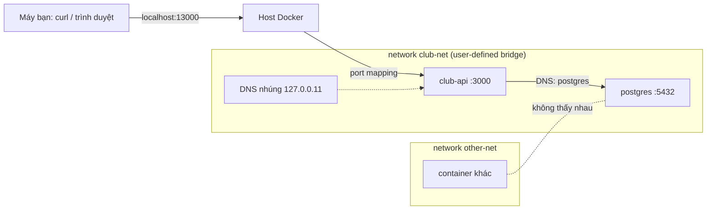

# Buổi 11 – Container Networking

Tuần 6 · Giai đoạn 2 – Docker & Containerization · Slide: [Slide buổi 11](../../slides/02-docker/session-11.md)

> **Tóm tắt:** Dùng user-defined bridge network, container DNS và port mapping để cho API nói chuyện với database, và chẩn đoán lỗi API không kết nối được DB.

## Mục tiêu học tập

- Giải thích được sự khác nhau giữa default bridge và user-defined bridge, đặc biệt về DNS theo tên container.
- Phân biệt được `-p` (publish ra host) với kết nối giữa các container trong cùng network.
- Chạy được hai container giao tiếp bằng tên, và kiểm chứng bằng `nslookup`, `wget`, `docker network inspect`.
- Chứng minh được network isolation: hai network khác nhau không thấy nhau, và `docker network connect` thay đổi điều đó.
- Dựng được API (`club-api`) kết nối Postgres qua network riêng, đặt đúng `DB_HOST`.
- Chẩn đoán được lỗi "API chạy nhưng không nối được DB" theo từng bước, từ triệu chứng tới nguyên nhân gốc.

## Điều kiện cần

- Đã hoàn thành buổi 08–10: biết `docker run`, `docker build`, `docker logs`, `docker exec`, và build được image `club-api:1.0.0`.
- Windows 11 + WSL2 Ubuntu, Docker Desktop đang chạy với WSL integration. Làm việc trong filesystem của WSL (ví dụ `~/devops-labs`), không dùng `/mnt/c`.
- Có starter-project trong WSL (thư mục `starter-project/` của giáo trình hoặc repo nhóm).

Kiểm tra nhanh:

```bash
docker version --format '{{.Server.Version}}'
docker network ls
```

Kết quả mong đợi (rút gọn): phiên bản server từ 27 trở lên, và danh sách có ba network mặc định `bridge`, `host`, `none`.

```text
27.3.1
NETWORK ID     NAME      DRIVER    SCOPE
a1b2c3d4e5f6   bridge    bridge    local
b2c3d4e5f6a1   host      host      local
c3d4e5f6a1b2   none      null      local
```

## Vấn đề thực tế

CLB có một API quản lý thành viên và một database Postgres. Khi chạy trên máy, API gọi `localhost:5432` và mọi thứ hoạt động. Khi đưa cả hai vào container, API báo lỗi không kết nối được DB, dù container Postgres vẫn `Up`. Đây là lỗi mạng container kinh điển: `localhost` bên trong container API là chính container API, không phải máy host và cũng không phải container Postgres.

Hiểu Docker network giúp bạn trả lời ba câu hỏi gặp hằng ngày: container A gọi container B bằng địa chỉ nào, cổng nào cần mở ra ngoài host và cổng nào thì không, và làm sao để database không bị truy cập từ mọi nơi. Trong capstone, cách bạn đặt network sẽ quyết định hệ thống có an toàn và dễ debug hay không.

## Khái niệm cốt lõi

### Network driver

| Driver | Phạm vi | Dùng khi |
| --- | --- | --- |
| `bridge` | Một host Docker | Mặc định. Các container trên cùng máy giao tiếp với nhau. Dùng nhiều nhất. |
| `host` | Một host Docker | Container dùng thẳng network của host, không cô lập. Hạn chế dùng. |
| `none` | Một host Docker | Không có mạng. Dùng khi cần cô lập hoàn toàn. |
| `overlay` | Nhiều host | Docker Swarm. Ngoài phạm vi khóa này (Kubernetes sẽ lo phần này). |

Khóa học chỉ dùng `bridge`.

### Default bridge và user-defined bridge

Docker tạo sẵn network tên `bridge`. Container chạy mà không chỉ định `--network` sẽ vào đó. Network này có hạn chế: container chỉ gọi nhau bằng địa chỉ IP, không có DNS theo tên. IP lại thay đổi mỗi lần container được tạo lại, nên không thể dựa vào nó.

Khi bạn tự tạo network bằng `docker network create`, Docker bật DNS nội bộ cho network đó. Container có thể gọi nhau bằng tên container (hoặc network alias). Compose cũng làm đúng như vậy: mỗi project có một network riêng và service name trở thành tên DNS.

| Tiêu chí | Default bridge | User-defined bridge |
| --- | --- | --- |
| Phân giải tên container | Không | Có |
| Cô lập giữa các ứng dụng | Kém (mọi container chung một network) | Tốt (mỗi nhóm một network) |
| Gắn/gỡ container khi đang chạy | Không linh hoạt | `docker network connect` / `disconnect` |
| Khuyến nghị | Chỉ để thử nhanh | Dùng cho mọi dự án |

### Container DNS

Trong user-defined network, Docker chạy một DNS server nhúng tại địa chỉ `127.0.0.11` bên trong mỗi container. Khi API gọi `postgres`, truy vấn DNS tới `127.0.0.11`, Docker trả IP hiện tại của container có tên `postgres` trong cùng network. Vì vậy, `DB_HOST=postgres` hoạt động dù IP đổi.

### Port mapping

`-p HOST_PORT:CONTAINER_PORT` publish một cổng của container ra host. Nó chỉ cần cho truy cập từ bên ngoài network (trình duyệt, `curl` từ máy bạn). Container trong cùng network gọi nhau thẳng bằng cổng của container, không cần `-p`.

| Cách viết | Ý nghĩa |
| --- | --- |
| `-p 18081:80` | Mở cổng 18081 trên mọi interface của host, trỏ tới cổng 80 của container |
| `-p 127.0.0.1:18081:80` | Chỉ mở trên localhost của host. An toàn hơn, nên dùng khi học |
| `EXPOSE 80` trong Dockerfile | Chỉ là tài liệu, không publish gì cả |

### Isolation

Container ở hai network khác nhau không thấy nhau: không phân giải được tên và không route tới nhau. Nguyên tắc thiết kế: database chỉ nằm trong network nội bộ, không publish cổng ra host nếu không cần.

## Kiến trúc và cách hoạt động



Diễn giải từng bước:

1. Bạn tạo network `club-net`. Docker cấp cho nó một subnet riêng (ví dụ 172.20.0.0/16) và một bridge ảo trên host.
2. Mỗi container gắn vào network nhận một IP trong subnet và một `veth` nối với bridge.
3. Khi `club-api` gọi `postgres:5432`, truy vấn DNS đi tới `127.0.0.11`, Docker trả IP của container `postgres`.
4. Gói tin đi qua bridge tới container Postgres. Không cần publish cổng 5432.
5. Chỉ API có `-p 127.0.0.1:13000:3000`, nên chỉ API truy cập được từ máy bạn.
6. Container ở `other-net` không có đường tới `club-net`, vì không chung network.

## Demo của mentor

Mục tiêu demo: cho cả lớp thấy cùng một thao tác, chỉ khác network, cho kết quả khác nhau.

Chuẩn bị tên riêng để không đụng container khác (tất cả dùng tiền tố `demo-`).

1. Chạy một web server trên default bridge, rồi gọi nó bằng tên từ container khác:

```bash
docker run -d --name demo-web-default nginx:1.27-alpine
docker run --rm alpine:3.20 wget -qO- -T 3 http://demo-web-default
```

Kết quả mong đợi:

```text
wget: bad address 'demo-web-default'
```

Câu hỏi cho lớp: "Container `demo-web-default` đang chạy tốt. Vì sao gọi bằng tên lại thất bại?" (Default bridge không có DNS theo tên.)

2. Cùng thao tác, nhưng trên user-defined network:

```bash
docker network create demo-net
docker run -d --name demo-web --network demo-net nginx:1.27-alpine
docker run --rm --network demo-net alpine:3.20 wget -qO- http://demo-web
```

Kết quả mong đợi: trang chào của Nginx.

```text
<!DOCTYPE html>
<html>
<head>
<title>Welcome to nginx!</title>
...
```

3. Cho lớp xem DNS nhúng:

```bash
docker run --rm --network demo-net alpine:3.20 nslookup demo-web
```

Kết quả mong đợi (địa chỉ IP của bạn sẽ khác):

```text
Server:		127.0.0.11
Address:	127.0.0.11:53

Non-authoritative answer:
Name:	demo-web
Address: 172.19.0.2
```

Câu hỏi: "`127.0.0.11` là gì? Nó nằm ở đâu?" (DNS server nhúng của Docker, nằm trong mỗi container.)

4. Port mapping: gọi từ host, rồi hỏi vì sao container thứ hai không cần `-p`:

```bash
docker run -d --name demo-web-pub --network demo-net -p 127.0.0.1:18081:80 nginx:1.27-alpine
curl -sI http://localhost:18081 | head -n 1
docker port demo-web-pub
```

Kết quả mong đợi:

```text
HTTP/1.1 200 OK
80/tcp -> 127.0.0.1:18081
```

5. Cho xem IP và subnet thật:

```bash
docker network inspect demo-net --format '{{ (index .IPAM.Config 0).Subnet }}'
docker inspect -f '{{range .NetworkSettings.Networks}}{{.IPAddress}}{{end}}' demo-web
```

6. Dọn dẹp demo:

```bash
docker rm -f demo-web-default demo-web demo-web-pub
docker network rm demo-net
```

## Hands-on lab

Thời gian gợi ý: 60 phút. Tất cả chạy trong WSL. Mỗi phần có tiền tố tên riêng để dễ dọn.

### Chuẩn bị

1. Vào thư mục làm việc và kiểm tra Docker:

```bash
mkdir -p ~/devops-labs/lab-11/evidence && cd ~/devops-labs/lab-11
docker info --format '{{.ServerVersion}}'
```

Kết quả mong đợi: số phiên bản Docker (27 trở lên).

2. Bắt đầu ghi bằng chứng. Mỗi lần chạy lệnh quan trọng, nối output vào file:

```bash
echo "== Lab 11 $(date -Iseconds) ==" >> evidence/command-output.txt
```

3. Có sẵn mã nguồn API. Đặt biến `SP` trỏ tới starter-project trong WSL (sửa đường dẫn cho đúng máy bạn):

```bash
export SP=~/devops-course/starter-project
ls "$SP"
```

Kết quả mong đợi: thấy `backend`, `frontend`, `database`, `compose.yaml`, `k8s`.

Gợi ý: ví dụ bổ sung nằm ở `examples/docker/network-lab/` trong repo giáo trình.

### Phần 1 – Hai container giao tiếp bằng tên

1. Tạo network:

```bash
docker network create lab-net
docker network ls --filter name=lab-net
```

Kết quả mong đợi: một dòng `lab-net` với driver `bridge`.

2. Chạy server Nginx và client Alpine trong cùng network:

```bash
docker run -d --name lab-web --network lab-net nginx:1.27-alpine
docker run -d --name lab-client --network lab-net alpine:3.20 sleep 3600
```

Vì sao có `sleep 3600`: Alpine không có tiến trình nền, nếu không giữ nó sống thì container thoát ngay và bạn không thể `docker exec` vào.

3. Gọi bằng tên, từ bên trong client:

```bash
docker exec lab-client wget -qO- http://lab-web | head -n 4
docker exec lab-client nslookup lab-web
```

Kết quả mong đợi: HTML của Nginx và địa chỉ IP phân giải được qua `127.0.0.11`.

Vì sao: client và server cùng ở `lab-net`, DNS nhúng trả IP của `lab-web`.

4. Kiểm tra trên default bridge để so sánh (container này không vào `lab-net`):

```bash
docker run --rm alpine:3.20 wget -qO- -T 3 http://lab-web
```

Kết quả mong đợi: `wget: bad address 'lab-web'`. Container nằm ở network khác nên không phân giải được tên.

5. Xem network chứa những container nào:

```bash
docker network inspect lab-net --format '{{range .Containers}}{{.Name}} {{.IPv4Address}}{{"\n"}}{{end}}'
```

Kết quả mong đợi: hai dòng `lab-web ...` và `lab-client ...` kèm IP/mask.

### Phần 2 – Port mapping

1. Chạy Nginx thứ hai có publish cổng:

```bash
docker run -d --name lab-web-pub --network lab-net -p 127.0.0.1:18082:80 nginx:1.27-alpine
curl -sI http://localhost:18082 | head -n 1
```

Kết quả mong đợi: `HTTP/1.1 200 OK`.

2. Kiểm tra `lab-web` (không publish) không truy cập được từ host:

```bash
docker port lab-web
```

Kết quả mong đợi: không in gì. Container vẫn truy cập được từ bên trong `lab-net`, nhưng host không có cổng nào trỏ tới nó.

3. Thử lấy IP container và gọi trực tiếp từ WSL (tùy môi trường, có thể không route được trên Docker Desktop, đó là bình thường):

```bash
docker inspect -f '{{range .NetworkSettings.Networks}}{{.IPAddress}}{{end}}' lab-web
```

Ghi vào báo cáo: vì sao nên dựa vào tên và `-p`, không dựa vào IP container.

### Phần 3 – API và Postgres trên cùng network

1. Build image API nếu chưa có:

```bash
docker build -t club-api:1.0.0 "$SP/backend"
```

Kết quả mong đợi: dòng cuối `naming to docker.io/library/club-api:1.0.0`.

2. Tạo network riêng cho ứng dụng và đặt mật khẩu tạm bằng biến môi trường (không ghi vào file được commit):

```bash
docker network create club-net
export DB_PASSWORD="$(openssl rand -hex 12)"
```

3. Chạy Postgres, không publish cổng, nạp `init.sql`:

```bash
docker run -d --name lab-postgres --network club-net \
  -e POSTGRES_DB=clubdb -e POSTGRES_USER=club -e POSTGRES_PASSWORD="$DB_PASSWORD" \
  -v "$SP/database/init.sql:/docker-entrypoint-initdb.d/init.sql:ro" \
  postgres:17-alpine
until docker exec lab-postgres pg_isready -h 127.0.0.1 -U club -d clubdb; do sleep 1; done
```

Kết quả mong đợi (vòng lặp chờ vài giây rồi dừng):

```text
127.0.0.1:5432 - accepting connections
```

Vì sao có `-h 127.0.0.1`: trong lần khởi tạo đầu, image Postgres chạy một server tạm chỉ nghe qua unix socket để nạp `init.sql`. Kiểm tra qua TCP chỉ thành công khi server thật đã khởi động, tránh việc API gọi quá sớm.

4. Chạy API với `DB_HOST` là tên container Postgres:

```bash
docker run -d --name lab-api --network club-net -p 127.0.0.1:13000:3000 \
  -e DB_HOST=lab-postgres -e DB_PORT=5432 -e DB_NAME=clubdb \
  -e DB_USER=club -e DB_PASSWORD="$DB_PASSWORD" \
  club-api:1.0.0
curl -s http://localhost:13000/health
curl -s http://localhost:13000/ready
curl -s http://localhost:13000/api/members
```

Kết quả mong đợi:

```text
{"status":"healthy","service":"club-api"}
{"status":"ready"}
[...]
```

Mảng cuối là danh sách thành viên theo `init.sql` (hai dòng Alice và Bob, mỗi dòng có `id`, `name`, `email`). Nếu `curl` báo lỗi kết nối ngay sau `docker run`, chờ 2-3 giây rồi chạy lại.

Vì sao: `DB_HOST=lab-postgres` được DNS nhúng phân giải trong `club-net`; cổng 5432 không cần publish vì API gọi từ bên trong network.

5. Xác nhận Postgres không bị lộ ra host:

```bash
docker port lab-postgres
```

Kết quả mong đợi: không in gì.

6. Ghi bằng chứng:

```bash
{ docker network inspect club-net --format '{{range .Containers}}{{.Name}} {{.IPv4Address}}{{"\n"}}{{end}}'; \
  curl -s http://localhost:13000/ready; echo; } >> evidence/command-output.txt
```

### Phần 4 – Isolation

1. Tạo hai network và hai container:

```bash
docker network create net-a
docker network create net-b
docker run -d --name iso-a --network net-a nginx:1.27-alpine
docker run -d --name iso-b --network net-b alpine:3.20 sleep 3600
```

2. Từ `iso-b` thử gọi `iso-a` bằng tên:

```bash
docker exec iso-b wget -qO- -T 3 http://iso-a
```

Kết quả mong đợi: `wget: bad address 'iso-a'`.

3. Lấy IP của `iso-a` và thử gọi thẳng bằng IP:

```bash
IP_A=$(docker inspect -f '{{(index .NetworkSettings.Networks "net-a").IPAddress}}' iso-a)
docker exec iso-b wget -qO- -T 3 "http://$IP_A"
```

Kết quả mong đợi: hết thời gian chờ (`wget: download timed out`). Hai network bị cô lập nên cũng không route được bằng IP.

4. Nối `iso-b` vào `net-a` rồi thử lại:

```bash
docker network connect net-a iso-b
docker exec iso-b wget -qO- http://iso-a | head -n 4
```

Kết quả mong đợi: lần này nhận được HTML của Nginx. Một container có thể thuộc nhiều network, đó là cách làm "cầu nối" có kiểm soát.

### L1 – Foundation: checklist hoàn thành

- [ ] Tạo được network `lab-net`, hai container giao tiếp bằng tên (`wget` hoặc `nslookup` thành công).
- [ ] Chứng minh được default bridge không phân giải tên (lỗi `bad address`).
- [ ] Publish được một cổng với `-p 127.0.0.1:18082:80` và `curl` từ host thành công.
- [ ] Chạy được `lab-postgres` và `lab-api` trên `club-net`, `/ready` trả `{"status":"ready"}`.
- [ ] Postgres không publish cổng (`docker port lab-postgres` rỗng) và bạn giải thích được vì sao.
- [ ] Đã ghi bằng chứng vào `evidence/command-output.txt`.

### L2 – Engineering: thử thách tự làm

Thử thách A – Chứng minh isolation bằng một script. Viết `source/isolation-test.sh` thực hiện: tạo hai network, chạy hai container, chứng minh gọi bằng tên và bằng IP đều thất bại, nối network, chứng minh thành công, rồi dọn sạch. Tiêu chí hoàn thành:

- Script chạy từ đầu tới cuối không cần can thiệp và in `PASS` hoặc `FAIL` cho từng kiểm tra.
- Script dọn sạch container và network của nó, kể cả khi một bước thất bại (gợi ý: `trap`).
- Báo cáo giải thích vì sao gọi bằng IP cũng thất bại.

<details><summary>Gợi ý</summary>

Dùng `trap cleanup EXIT` ở đầu script để luôn dọn. Một kiểm tra "mong đợi thất bại" viết như `if ! docker exec ... ; then echo PASS; fi`. Dùng `wget -T 3` để không chờ quá lâu.

</details>

<details><summary>Lời giải tham khảo</summary>

```bash
#!/usr/bin/env bash
set -u
cleanup() {
  docker rm -f t-a t-b >/dev/null 2>&1
  docker network rm t-net-a t-net-b >/dev/null 2>&1
}
trap cleanup EXIT

docker network create t-net-a >/dev/null
docker network create t-net-b >/dev/null
docker run -d --name t-a --network t-net-a nginx:1.27-alpine >/dev/null
docker run -d --name t-b --network t-net-b alpine:3.20 sleep 600 >/dev/null
sleep 2

IP_A=$(docker inspect -f '{{(index .NetworkSettings.Networks "t-net-a").IPAddress}}' t-a)

if ! docker exec t-b wget -qO- -T 3 http://t-a >/dev/null 2>&1; then echo "PASS goi bang ten that bai"; else echo "FAIL"; fi
if ! docker exec t-b wget -qO- -T 3 "http://$IP_A" >/dev/null 2>&1; then echo "PASS goi bang IP that bai"; else echo "FAIL"; fi

docker network connect t-net-a t-b
if docker exec t-b wget -qO- -T 3 http://t-a >/dev/null 2>&1; then echo "PASS sau khi connect thanh cong"; else echo "FAIL"; fi
```

</details>

Thử thách B – Chuyển cấu hình sang Compose có hai network. Viết `source/compose.yaml` gồm `postgres` (chỉ trong network `backend-net`), `api` (trong `backend-net` và `frontend-net`, publish `127.0.0.1:13001:3000`) và một `web` Nginx chỉ trong `frontend-net`. Tiêu chí hoàn thành:

- `web` không phân giải được `postgres` (chứng minh bằng `docker compose exec`), còn `api` thì được.
- Không service nào ngoài `api` publish cổng.
- Mật khẩu lấy từ `.env` (không commit), file mẫu `.env.example` có giá trị giả.

<details><summary>Gợi ý</summary>

Khai báo `networks:` ở mức cao nhất với hai network, rồi liệt kê network cho từng service. Với `web`, dùng image `nginx:1.27-alpine`; để kiểm tra DNS, dùng `docker compose exec web nslookup postgres` (Alpine có sẵn `nslookup` của busybox).

</details>

<details><summary>Lời giải tham khảo</summary>

```yaml
services:
  postgres:
    image: postgres:17-alpine
    environment:
      POSTGRES_DB: clubdb
      POSTGRES_USER: club
      POSTGRES_PASSWORD: ${DB_PASSWORD:?Set DB_PASSWORD in .env}
    networks:
      - backend-net

  api:
    image: club-api:1.0.0
    environment:
      DB_HOST: postgres
      DB_PORT: 5432
      DB_NAME: clubdb
      DB_USER: club
      DB_PASSWORD: ${DB_PASSWORD:?Set DB_PASSWORD in .env}
    ports:
      - "127.0.0.1:13001:3000"
    networks:
      - backend-net
      - frontend-net

  web:
    image: nginx:1.27-alpine
    networks:
      - frontend-net

networks:
  backend-net:
  frontend-net:
```

Kiểm tra:

```bash
docker compose exec web nslookup postgres
docker compose exec api wget -qO- http://127.0.0.1:3000/health
```

Dùng `127.0.0.1` thay vì `localhost`: `wget` của BusyBox trong Alpine thử IPv6 (`::1`) trước, mà API chỉ nghe IPv4 (`0.0.0.0`) nên `localhost` báo `Connection refused`.

Lệnh đầu phải báo không tìm thấy tên (`can't resolve` hoặc `NXDOMAIN`); lệnh sau trả JSON health.

</details>

## Phá lỗi và debug

### Tình huống Break: API không kết nối được DB

Phá lỗi 1 – dùng `localhost`. Chạy một API thứ hai với `DB_HOST=localhost`:

```bash
docker run -d --name lab-api-bad --network club-net -p 127.0.0.1:13002:3000 \
  -e DB_HOST=localhost -e DB_PORT=5432 -e DB_NAME=clubdb \
  -e DB_USER=club -e DB_PASSWORD="$DB_PASSWORD" \
  club-api:1.0.0
```

Triệu chứng:

```bash
docker ps --filter name=lab-
curl -s http://localhost:13002/health
curl -s -o /dev/null -w "%{http_code}\n" http://localhost:13002/ready
curl -s -o /dev/null -w "%{http_code}\n" http://localhost:13002/api/members
```

Kết quả mong đợi: container `Up`, `/health` trả `healthy`, `/ready` trả `503`, `/api/members` trả `500`.

Hướng điều tra theo từng bước:

1. Đọc log: `docker logs lab-api-bad --tail 20`. Endpoint `/ready` không ghi log lỗi, nên hãy gọi `/api/members` trước (như ở trên). Log sẽ có `ECONNREFUSED` kèm địa chỉ `127.0.0.1:5432` hoặc `::1:5432` (Node 22 có thể in dạng `AggregateError` liệt kê cả hai địa chỉ).
2. Đọc kỹ địa chỉ: `127.0.0.1` là loopback. Hỏi: loopback của ai? Của chính container API.
3. Kiểm tra biến môi trường thực tế: `docker exec lab-api-bad env | grep DB_` (kiểm tra `DB_HOST`).
4. Kiểm tra từ bên trong container: `docker exec lab-api-bad nslookup lab-postgres` phải phân giải được. Điều này chứng minh network ổn, lỗi nằm ở cấu hình.
5. Sửa bằng cách tạo lại container với `DB_HOST=lab-postgres` (biến môi trường không đổi được trên container đang chạy):

   ```bash
   docker rm -f lab-api-bad
   docker run -d --name lab-api-bad --network club-net -p 127.0.0.1:13002:3000      -e DB_HOST=lab-postgres -e DB_PORT=5432 -e DB_NAME=clubdb      -e DB_USER=club -e DB_PASSWORD="$DB_PASSWORD"      club-api:1.0.0
   sleep 2; curl -s -o /dev/null -w "%{http_code}
" http://localhost:13002/ready
   ```

   Kết quả mong đợi: `200`.

Nguyên nhân gốc: `localhost` trong container trỏ về chính container đó. Phòng tránh: đặt `DB_HOST` bằng tên service/container trong cùng network, không viết cứng trong code, và thêm `/ready` kiểm tra DB (đã có sẵn trong starter-project).

Phá lỗi 2 – sai network. Chạy API trên network khác với Postgres:

```bash
docker network create lab-net-x
docker run -d --name lab-api-iso --network lab-net-x \
  -e DB_HOST=lab-postgres -e DB_PORT=5432 -e DB_NAME=clubdb \
  -e DB_USER=club -e DB_PASSWORD="$DB_PASSWORD" \
  club-api:1.0.0
sleep 3
docker exec lab-api-iso wget -qO- -T 20 http://127.0.0.1:3000/ready
docker exec lab-api-iso wget -qO- -T 20 http://127.0.0.1:3000/api/members
docker logs lab-api-iso --tail 5
```

Dùng `127.0.0.1` (không dùng `localhost`, vì `wget` của Alpine thử IPv6 trước và báo `Connection refused`) và `-T 20` vì việc phân giải tên thất bại mất vài giây (khoảng 5-8 giây), `-T 3` sẽ hết giờ trước khi API kịp trả lỗi.

Kết quả mong đợi: `/ready` trả lỗi 503 (wget in `server returned error: HTTP/1.1 503 Service Unavailable`). `/api/members` trả 500 và log có dòng lỗi dạng `getaddrinfo ENOTFOUND lab-postgres` (hoặc `EAI_AGAIN`). Tên phân giải thất bại vì hai container không chung network. Cách sửa: `docker network connect club-net lab-api-iso` (container vẫn đang chạy, DNS cập nhật ngay), rồi gọi lại `/ready`.

Phá lỗi 3 – tình huống chuẩn bị sẵn. Mentor chạy `bash setup.sh` trong `examples/troubleshooting/scenario-03/`, học viên chỉ nhận triệu chứng (API publish ở `http://localhost:23003`, `/ready` trả `503`) và tự tìm nguyên nhân gốc. Dọn dẹp bằng `bash cleanup.sh`. Câu hỏi L2: vì sao `/health` vẫn `200` và `docker compose ps` không cảnh báo?

## Lỗi thường gặp

| Triệu chứng | Nguyên nhân | Cách xử lý |
| --- | --- | --- |
| `ECONNREFUSED 127.0.0.1:5432` trong log API | `DB_HOST=localhost` bên trong container | Đặt `DB_HOST` là tên container/service Postgres |
| `bad address 'ten-container'` hoặc `ENOTFOUND` | Dùng default bridge, hoặc hai container khác network | Dùng user-defined network chung; kiểm tra bằng `docker network inspect` |
| `Bind for 127.0.0.1:18081 failed: port is already allocated` | Cổng host đã bị container/tiến trình khác dùng | Đổi cổng host, hoặc dừng thứ đang giữ cổng (`docker ps`) |
| `curl localhost:PORT` bị từ chối dù container `Up` | Quên `-p`, hoặc app lắng nghe `127.0.0.1` trong container thay vì `0.0.0.0` | Thêm `-p`; cho app lắng nghe `0.0.0.0` (API starter đã làm vậy) |
| `docker network rm` báo `has active endpoints` | Còn container đang gắn vào network | `docker rm -f` các container đó trước, rồi xóa network |
| `password authentication failed for user "club"` | `DB_PASSWORD` của API khác `POSTGRES_PASSWORD` lúc khởi tạo (hay gặp khi mở terminal mới nên `DB_PASSWORD` bị sinh lại) | Dùng cùng giá trị; nếu cần, tạo lại `lab-postgres` (container này không dùng volume nên dữ liệu mất theo) |
| Container Alpine thoát ngay sau `docker run` | Không có tiến trình nền | Thêm `sleep 3600` hoặc dùng `docker run --rm` cho lệnh một lần |

## Tự kiểm tra

1. Vì sao hai container trên default bridge không gọi nhau bằng tên được, còn trên user-defined bridge thì được?
2. `-p 127.0.0.1:13000:3000` khác `-p 13000:3000` ở điểm nào?
3. Container API có cần `-p 5432:5432` ở Postgres để kết nối DB không? Vì sao?
4. `127.0.0.11` là địa chỉ gì?
5. Làm sao để một container nói chuyện được với container ở network khác mà không tạo lại nó?
6. Tình huống: API chạy, `/health` trả 200, `/ready` trả 503, log có `ECONNREFUSED 127.0.0.1:5432`. Bạn kiểm tra gì đầu tiên và sửa thế nào?
7. Tình huống: bạn thấy `ENOTFOUND postgres` trong log dù `DB_HOST=postgres` đúng và Postgres đang chạy. Có hai nguyên nhân khả dĩ là gì?

<details><summary>Đáp án</summary>

1. Chỉ user-defined bridge có DNS nhúng phân giải tên container; default bridge thì không.
2. Có `127.0.0.1` thì cổng chỉ mở trên localhost của host; không có thì mở trên mọi interface, máy khác trong LAN có thể truy cập.
3. Không. API và Postgres cùng network nên gọi trực tiếp `postgres:5432`. Publish cổng chỉ cần cho truy cập từ host.
4. DNS server nhúng của Docker, có trong mỗi container thuộc user-defined network.
5. `docker network connect TEN_NETWORK TEN_CONTAINER`.
6. Xem `DB_HOST` thực tế bằng `docker exec ... env`. Nếu là `localhost`, đổi thành tên service Postgres rồi chạy lại.
7. API và Postgres khác network (kiểm tra bằng `docker network inspect`), hoặc tên sai chính tả/khác tên container và alias.

</details>

## Nộp bài

Nộp vào thư mục `lab-11/` trong repo cá nhân theo `templates/lab-template.md`:

- [ ] `README.md` trả lời đủ 7 câu: bài lab giải quyết vấn đề gì, kiến thức đã dùng, các bước thực hiện, kết quả mong đợi, lỗi đã gặp, cách khắc phục, có thể cải thiện gì.
- [ ] `evidence/command-output.txt` có output của `docker network inspect`, `nslookup`, `curl /ready` thành công, và lỗi `bad address` hoặc `ECONNREFUSED` đã gặp.
- [ ] `report.md` mô tả một lỗi đã phá và debug (triệu chứng, bước điều tra, nguyên nhân gốc, phòng tránh) và giải thích vì sao `localhost` sai trong container.
- [ ] `source/` chứa các script và `compose.yaml` bạn tự viết (L2), kèm `.env.example` với giá trị giả.
- [ ] `screenshots/` (nếu có) chỉ là bổ trợ; không thay cho log và output.
- [ ] Đã đánh dấu level đã làm (L1/L2) ở cuối `README.md`.
- [ ] Không commit `.env`, mật khẩu thật hay token. `.env` nằm trong `.gitignore`.

Dọn dẹp sau khi nộp:

```bash
docker rm -f lab-web lab-client lab-web-pub lab-postgres lab-api lab-api-bad lab-api-iso iso-a iso-b
docker network rm lab-net club-net lab-net-x net-a net-b
```

## Recap

- Default bridge không có DNS theo tên; user-defined bridge có, nên mọi dự án nên tự tạo network.
- Container gọi nhau bằng tên và cổng của container, không cần `-p`.
- `-p` chỉ để truy cập từ host; bind `127.0.0.1` khi không muốn mở ra LAN.
- `localhost` trong container là chính container đó; luôn đặt `DB_HOST` bằng tên service.
- Database nên nằm trong network nội bộ và không publish cổng.
- Network khác nhau thì cô lập; `docker network connect` nối thêm có kiểm soát.
- Khi lỗi kết nối: đọc log, kiểm tra biến môi trường, `nslookup` từ trong container, `docker network inspect`.

## Tài liệu tham khảo

- [Networking overview – Docker Docs](https://docs.docker.com/engine/network/)
- [Bridge network driver – Docker Docs](https://docs.docker.com/engine/network/drivers/bridge/)
- [Publishing and exposing ports – Docker Docs](https://docs.docker.com/get-started/docker-concepts/running-containers/publishing-ports/)
- [Networking in Compose – Docker Docs](https://docs.docker.com/compose/how-tos/networking/)
- [docker network create – CLI reference](https://docs.docker.com/reference/cli/docker/network/create/)
