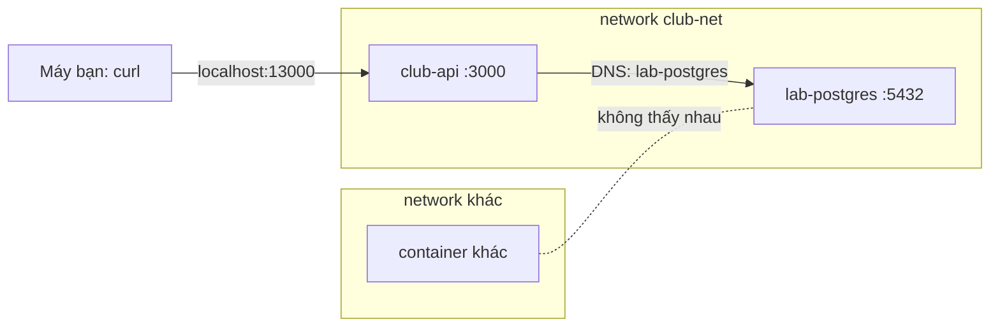

# Buổi 11 – Container Networking

Tuần 6/16 · Giai đoạn 2 – Containerization · Buổi 11/32

[Slide buổi 11](../../slides/02-docker/session-11.md) · [Bài tập tuần 6](../../assignments/weekly/week-06.md) · [Hub tuần 6](README.md)

> **Tóm tắt:** Cho API và database ở hai container nói chuyện bằng tên qua network riêng, chỉ mở đúng cổng ra máy bạn, và tự tìm ra lỗi "API chạy nhưng không nối được DB".

::: tip Buổi này bạn làm gì
**Bạn sẽ tạo ra:** một API `club-api` chạy trong container, nối được Postgres ở container khác qua network `club-net`, kèm bằng chứng database không bị lộ ra ngoài.

**Thời gian thật:** đọc 15 phút, lab bắt buộc 60 phút, thử thách tùy chọn làm ở nhà ([Thử thách thêm buổi 11](session-11-challenge.md)).

**Cần chuẩn bị:**

- [ ] Docker Desktop đang chạy, bạn làm việc trong WSL (không dùng `/mnt/c`). Cài đặt: [Setup Guide: Windows 11 + WSL2](../../resources/setup-guide.md)
- [ ] Đã xong [Buổi 10 – Image Optimization](../week-05/session-10.md): biết `docker run`, `docker build`, `docker logs`, `docker exec`
- [ ] Repo giáo trình đã clone vào `~/devops-course`, repo cá nhân `devops-labs` đã có: [Tài khoản GitHub và repo devops-labs](../../resources/setup-github.md)

**Phải nộp** (thư mục `lab-11/` trong repo `devops-labs`):

- `README.md` trả lời 7 câu theo mẫu
- `evidence/command-output.txt` có lệnh kèm output thật
- `report.md` mô tả một lỗi bạn đã phá và debug
- `source/` (chỉ khi làm thử thách L2)

**Đi nhanh:** [Đọc](#van-de-thuc-te) → [Làm lab](#hands-on-lab) → [Gặp lỗi?](#gap-loi) → [Tự kiểm tra](#tu-kiem-tra) → [Nộp bài](#nop-bai). Kẹt thì nhảy tới [Gặp lỗi?](#gap-loi).

**Từ mới trong buổi:**

- [bridge network](../../resources/glossary.md): mạng ảo nối các container trên cùng một máy
- [DNS](../../resources/glossary.md): "danh bạ" đổi tên thành địa chỉ IP
- [port mapping](../../resources/glossary.md): mở một cổng của container ra máy bạn (`-p`)
- [localhost](../../resources/glossary.md): "chính máy này"; trong container là chính container đó
- [isolation](../../resources/glossary.md): hai network khác nhau không thấy nhau
:::

## Vấn đề thực tế {#van-de-thuc-te}

CLB có một API quản lý thành viên và một database Postgres. Trên máy bạn, API gọi `localhost:5432` và chạy tốt. Đưa cả hai vào container thì API báo không kết nối được DB, dù container Postgres vẫn `Up`. Lý do: `localhost` bên trong container API là chính container API, không phải máy bạn và cũng không phải container Postgres. Bài này trả lời ba câu hỏi gặp hằng ngày: container A gọi container B bằng địa chỉ nào, cổng nào cần mở ra ngoài, và làm sao để database không bị truy cập từ mọi nơi.

## Khái niệm cốt lõi

**1. Default bridge và user-defined bridge.** Docker có sẵn network `bridge` nhưng ở đó container chỉ gọi nhau bằng IP, mà IP đổi mỗi lần container tạo lại. Network bạn tự tạo (`docker network create`) có thêm DNS, nên gọi nhau bằng tên được. Ví von: default bridge là tòa nhà chỉ có số máy lẻ ghi tay; user-defined bridge có danh bạ.

**2. Container DNS.** Trong network tự tạo, mỗi container có sẵn một "danh bạ" tại `127.0.0.11`, trả IP hiện tại của container theo tên. Vì vậy `DB_HOST=postgres` luôn đúng dù IP đổi. Ví von: gọi "phòng Kế toán" thay vì nhớ số máy.

**3. Port mapping.** `-p MÁY:CONTAINER` mở một cổng của container ra máy bạn, chỉ cần cho truy cập từ bên ngoài network (trình duyệt, `curl`). Container cùng network gọi nhau thẳng bằng cổng của container. Nên viết `-p 127.0.0.1:18081:80` để chỉ máy bạn truy cập được. Ví von: cửa trước của tòa nhà; nhân viên trong tòa nhà không cần đi qua cửa trước.

**4. Isolation.** Hai container ở hai network khác nhau không thấy nhau, kể cả gọi bằng IP. Quy tắc thiết kế: database chỉ nằm trong network nội bộ, không publish cổng. Ví von: hai tòa nhà khác nhau, không có hành lang nối.

**5. `localhost` trong container.** Luôn là chính container đó. Muốn gọi container khác, dùng tên của nó.



Chỉ API có `-p`, nên chỉ API truy cập được từ máy bạn. Chi tiết hơn (driver, cách viết `-p`, từng bước đi của gói tin): mục "Tìm hiểu thêm" gập sẵn ở cuối trang.

Trên lớp, mentor demo trước; tự học thì làm thẳng phần Làm lab.

## Hands-on lab (60 phút, bắt buộc) {#hands-on-lab}

Tên tài nguyên có tiền tố riêng (`lab-`, `iso-`) để dễ dọn. Mọi lệnh chạy trong WSL.

### Chuẩn bị (5 phút)

```bash
mkdir -p ~/devops-labs/lab-11/evidence && cd ~/devops-labs/lab-11
docker info --format '{{.ServerVersion}}'
echo "== Lab 11 $(date -Iseconds) ==" >> evidence/command-output.txt
export SP=~/devops-course/starter-project
ls "$SP"
```

Kết quả mong đợi: số phiên bản Docker (27 trở lên), và `ls` thấy `backend`, `frontend`, `database`, `compose.yaml`, `k8s`. Ví dụ bổ sung nằm ở `examples/docker/network-lab/` trong repo giáo trình.

### Phần 1 – Hai container gọi nhau bằng tên (10 phút)

```bash
docker network create lab-net
docker run -d --name lab-web --network lab-net nginx:1.27-alpine
docker run -d --name lab-client --network lab-net alpine:3.20 sleep 3600
docker exec lab-client wget -qO- http://lab-web | head -n 4
docker exec lab-client nslookup lab-web
```

`sleep 3600` giữ Alpine sống để bạn còn `docker exec` vào (Alpine không có tiến trình nền, không có nó thì container thoát ngay).

Kết quả mong đợi: HTML của Nginx, và `nslookup` in `Server: 127.0.0.11` cùng IP của `lab-web`.

Đối chứng: một container trên default bridge, không vào `lab-net`:

```bash
docker run --rm alpine:3.20 wget -qO- -T 3 http://lab-web
docker network inspect lab-net --format '{{range .Containers}}{{.Name}} {{.IPv4Address}}{{"\n"}}{{end}}'
```

Kết quả mong đợi: `wget: bad address 'lab-web'`, rồi hai dòng `lab-web ...` và `lab-client ...` kèm IP.

::: tip Kiểm tra: bạn đúng khi
Gọi bằng tên từ `lab-client` ra HTML, còn từ default bridge ra `bad address`. Lỗi lạ? Xem [Gặp lỗi?](#gap-loi).
:::

### Phần 2 – Port mapping (5 phút)

```bash
docker run -d --name lab-web-pub --network lab-net -p 127.0.0.1:18082:80 nginx:1.27-alpine
curl -sI http://localhost:18082 | head -n 1
docker port lab-web
```

Kết quả mong đợi: `HTTP/1.1 200 OK`, và `docker port lab-web` không in gì (container này không publish, host không có cổng nào trỏ tới nó).

Tùy chọn: `docker inspect -f '{{range .NetworkSettings.Networks}}{{.IPAddress}}{{end}}' lab-web` lấy IP container. Gọi thẳng IP từ WSL có thể không route được trên Docker Desktop, đó là bình thường. Ghi vào `report.md`: vì sao nên dựa vào tên và `-p`, không dựa vào IP.

::: tip Kiểm tra: bạn đúng khi
`curl` tới cổng 18082 trả `200 OK` và `docker port lab-web` rỗng. Cổng bận? Xem [Gặp lỗi?](#gap-loi).
:::

### Phần 3 – API và Postgres trên `club-net` (20 phút)

1. Build image API, tạo network và mật khẩu tạm (chỉ nằm trong shell, không ghi vào file nào trong repo):

```bash
docker build -t club-api:1.0.0 "$SP/backend"
docker network create club-net
export DB_PASSWORD="$(openssl rand -hex 12)"
```

2. Chạy Postgres, không publish cổng, nạp `init.sql`, rồi chờ nó sẵn sàng:

```bash
docker run -d --name lab-postgres --network club-net \
  -e POSTGRES_DB=clubdb -e POSTGRES_USER=club -e POSTGRES_PASSWORD="$DB_PASSWORD" \
  -v "$SP/database/init.sql:/docker-entrypoint-initdb.d/init.sql:ro" \
  postgres:17-alpine
until docker exec lab-postgres pg_isready -h 127.0.0.1 -U club -d clubdb; do sleep 1; done
```

Kết quả mong đợi: vài dòng `no response` rồi `127.0.0.1:5432 - accepting connections`. Có `-h 127.0.0.1` vì lần khởi tạo đầu có một server tạm chỉ nghe qua unix socket; kiểm tra qua TCP chỉ thành công khi server thật đã chạy.

3. Chạy API với `DB_HOST` là tên container Postgres:

```bash
docker run -d --name lab-api --network club-net -p 127.0.0.1:13000:3000 \
  -e DB_HOST=lab-postgres -e DB_PORT=5432 -e DB_NAME=clubdb \
  -e DB_USER=club -e DB_PASSWORD="$DB_PASSWORD" \
  club-api:1.0.0
curl -s http://localhost:13000/health
curl -s http://localhost:13000/ready
curl -s http://localhost:13000/api/members
docker port lab-postgres
```

Kết quả mong đợi:

```text
{"status":"healthy","service":"club-api"}
{"status":"ready"}
[...]
```

Mảng cuối là hai thành viên Alice và Bob từ `init.sql`; `docker port lab-postgres` không in gì. Nếu `curl` lỗi ngay sau `docker run`, chờ 2-3 giây rồi chạy lại. API gọi được DB vì `DB_HOST=lab-postgres` được DNS nhúng phân giải trong `club-net`, và cổng 5432 không cần publish.

4. Ghi bằng chứng (làm ngay bây giờ, trước khi phá lỗi ở Phần 5, để network chỉ có đúng hai container):

```bash
{ docker network inspect club-net --format '{{range .Containers}}{{.Name}} {{.IPv4Address}}{{"\n"}}{{end}}'; \
  curl -s http://localhost:13000/ready; echo; } >> evidence/command-output.txt
```

::: tip Kiểm tra: bạn đúng khi
`/ready` trả `{"status":"ready"}`, `docker port lab-postgres` rỗng, `club-net` có đúng hai container. Lỗi `password authentication failed`? Xem [Gặp lỗi?](#gap-loi).
:::

### Phần 4 – Isolation (10 phút)

```bash
docker network create net-a
docker network create net-b
docker run -d --name iso-a --network net-a nginx:1.27-alpine
docker run -d --name iso-b --network net-b alpine:3.20 sleep 3600
docker exec iso-b wget -qO- -T 3 http://iso-a
IP_A=$(docker inspect -f '{{(index .NetworkSettings.Networks "net-a").IPAddress}}' iso-a)
docker exec iso-b wget -qO- -T 3 "http://$IP_A"
```

Kết quả mong đợi: lệnh đầu báo `bad address 'iso-a'`, lệnh sau hết thời gian chờ (`download timed out`): hai network bị cô lập nên cũng không route được bằng IP. Bây giờ nối `iso-b` vào `net-a`:

```bash
docker network connect net-a iso-b
docker exec iso-b wget -qO- http://iso-a | head -n 4
```

Kết quả mong đợi: lần này nhận được HTML của Nginx. Một container có thể thuộc nhiều network, đó là cách làm "cầu nối" có kiểm soát.

::: tip Kiểm tra: bạn đúng khi
Tên và IP đều thất bại trước `connect`, thành công sau `connect`.
:::

### Phần 5 – Tự phá một lỗi và debug (10 phút)

Chạy API thứ hai với `DB_HOST=localhost`, rồi quan sát:

```bash
docker run -d --name lab-api-bad --network club-net -p 127.0.0.1:13002:3000 \
  -e DB_HOST=localhost -e DB_PORT=5432 -e DB_NAME=clubdb \
  -e DB_USER=club -e DB_PASSWORD="$DB_PASSWORD" \
  club-api:1.0.0
docker ps --filter name=lab-
curl -s http://localhost:13002/health
curl -s -o /dev/null -w "%{http_code}\n" http://localhost:13002/ready
curl -s -o /dev/null -w "%{http_code}\n" http://localhost:13002/api/members
```

Kết quả mong đợi: container `Up`, `/health` trả `healthy`, `/ready` trả `503`, `/api/members` trả `500`. Điều tra theo thứ tự:

```bash
docker logs lab-api-bad --tail 20
docker exec lab-api-bad env | grep DB_
docker exec lab-api-bad nslookup lab-postgres
```

Log có `ECONNREFUSED` kèm `127.0.0.1:5432` (hoặc `::1:5432`): đó là loopback của chính container API. `env` cho thấy `DB_HOST=localhost`. `nslookup lab-postgres` phân giải được, nghĩa là network ổn và lỗi nằm ở cấu hình. Sửa bằng cách tạo lại container với `DB_HOST=lab-postgres` (lệnh đầy đủ ở dòng đầu bảng [Gặp lỗi?](#gap-loi)). Ghi triệu chứng, bước điều tra, nguyên nhân gốc và cách phòng tránh vào `report.md`. Lưu ý `/ready` không ghi log lỗi, hãy gọi `/api/members` trước khi xem log.

### Checklist L1 và tự kiểm tra một dòng

- [ ] Hai container trên `lab-net` gọi nhau bằng tên (`wget` hoặc `nslookup` thành công), default bridge báo `bad address`.
- [ ] Publish cổng bằng `-p 127.0.0.1:18082:80` và `curl` từ máy bạn thành công.
- [ ] `lab-postgres` và `lab-api` trên `club-net`, `/ready` trả `{"status":"ready"}`, `docker port lab-postgres` rỗng.
- [ ] Isolation: tên và IP thất bại, `docker network connect` xong thì thành công.
- [ ] Đã ghi bằng chứng vào `evidence/command-output.txt` và có một lỗi đã phá, đã debug.

```bash
curl -s http://localhost:13000/ready && docker port lab-postgres | wc -l
```

Mong đợi: `{"status":"ready"}` rồi `0`.

## Gặp lỗi? {#gap-loi}

| Triệu chứng | Nguyên nhân | Cách sửa |
| --- | --- | --- |
| `ECONNREFUSED 127.0.0.1:5432` trong log API, `/ready` 503 | `DB_HOST=localhost` bên trong container | `docker rm -f lab-api-bad`, chạy lại với `DB_HOST=lab-postgres` (cùng các tham số khác), đợi 2 giây, `curl` `/ready` ra `200` |
| `bad address 'ten-container'` hoặc `ENOTFOUND` | Default bridge, hai container khác network, hoặc sai tên | Dùng network tự tạo chung; kiểm tra bằng `docker network inspect`; nối thêm: `docker network connect TEN_NETWORK TEN_CONTAINER` |
| `Bind for 127.0.0.1:18082 failed: port is already allocated` | Cổng host đã bị container hoặc chương trình khác dùng | Đổi cổng host, hoặc dừng thứ đang giữ cổng (`docker ps`) |
| `curl localhost:PORT` bị từ chối dù container `Up` | Quên `-p`, hoặc app nghe `127.0.0.1` trong container thay vì `0.0.0.0` | Thêm `-p`; cho app nghe `0.0.0.0` (API starter đã làm vậy) |
| `docker network rm` báo `has active endpoints` | Còn container gắn vào network | `docker rm -f` các container đó trước, rồi xóa network |
| `password authentication failed for user "club"` | `DB_PASSWORD` của API khác lúc khởi tạo Postgres (hay gặp khi mở terminal mới nên mật khẩu bị sinh lại) | Dùng đúng giá trị cũ; hoặc `docker rm -f lab-postgres lab-api`, đặt lại `DB_PASSWORD` rồi chạy lại Phần 3 (container này không dùng volume nên dữ liệu mất theo) |
| Container Alpine thoát ngay sau `docker run` | Không có tiến trình nền | Thêm `sleep 3600`, hoặc `docker run --rm` cho lệnh một lần |
| `docker exec ... wget http://localhost:3000` báo `Connection refused` dù API khỏe | `wget` của Alpine thử IPv6 trước, API chỉ nghe IPv4 | Dùng `127.0.0.1` thay cho `localhost` |
| `curl` ngay sau `docker run` báo lỗi kết nối | API chưa kịp khởi động | Chờ 2-3 giây rồi chạy lại |

## Tự kiểm tra {#tu-kiem-tra}

1. Vì sao hai container trên default bridge không gọi nhau bằng tên được, còn trên user-defined bridge thì được?
2. `-p 127.0.0.1:13000:3000` khác `-p 13000:3000` ở điểm nào?
3. API có cần `-p 5432:5432` ở Postgres để kết nối DB không? Vì sao?
4. Làm sao cho một container nói chuyện được với container ở network khác mà không tạo lại nó?
5. API chạy, `/health` 200, `/ready` 503, log có `ECONNREFUSED 127.0.0.1:5432`. Bạn kiểm tra gì đầu tiên và sửa thế nào?

::: details Đáp án gợi ý
1. Chỉ user-defined bridge có DNS nhúng (`127.0.0.11`) phân giải tên container; default bridge thì không.
2. Có `127.0.0.1` thì cổng chỉ mở trên máy bạn; không có thì mở trên mọi interface, máy khác trong LAN truy cập được.
3. Không. API và Postgres cùng network nên gọi thẳng `lab-postgres:5432`; publish cổng chỉ cần cho truy cập từ máy bạn.
4. `docker network connect TEN_NETWORK TEN_CONTAINER`.
5. Xem `DB_HOST` thực tế bằng `docker exec ... env | grep DB_`. Nếu là `localhost`, tạo lại container với `DB_HOST` là tên container Postgres.
:::

## Nộp bài {#nop-bai}

Nộp vào thư mục `lab-11/` trong repo `devops-labs`, theo [Lab XX – Tên lab](../../templates/lab-template.md) và [Bài tập tuần 6](../../assignments/weekly/week-06.md):

- [ ] `README.md` trả lời đủ 7 câu: bài lab giải quyết vấn đề gì, kiến thức đã dùng, các bước thực hiện, kết quả mong đợi, lỗi đã gặp, cách khắc phục, có thể cải thiện gì. Ghi đã làm L1 hay L2 ở cuối.
- [ ] `evidence/command-output.txt` có output của `docker network inspect`, `nslookup`, `curl /ready` thành công, và lỗi `bad address` hoặc `ECONNREFUSED` đã gặp.
- [ ] `report.md` mô tả một lỗi đã phá và debug (triệu chứng, bước điều tra, nguyên nhân gốc, phòng tránh) và giải thích vì sao `localhost` sai trong container.
- [ ] `source/` chứa script và `compose.yaml` bạn tự viết (nếu làm L2), kèm `.env.example` giá trị giả. Không commit `.env`, mật khẩu thật hay token.

Dọn dẹp sau khi nộp:

```bash
docker rm -f lab-web lab-client lab-web-pub lab-postgres lab-api lab-api-bad lab-api-iso iso-a iso-b
docker network rm lab-net club-net lab-net-x net-a net-b
```

## Recap

- Default bridge không có DNS theo tên; network tự tạo thì có, nên mọi dự án nên tự tạo network.
- Container gọi nhau bằng tên và cổng của container; `-p` chỉ để truy cập từ máy bạn, nên bind `127.0.0.1`.
- `localhost` trong container là chính nó; `DB_HOST` luôn là tên container. Database ở network nội bộ, không publish cổng.

Buổi tiếp theo: [Buổi 12 – Persistent Storage](session-12.md).

::: details Thử thách thêm (L2, tùy chọn, làm ở nhà)
Thử thách A (script chứng minh isolation tự chạy và tự dọn) và Thử thách B (Compose hai network) nằm ở [Thử thách thêm buổi 11](session-11-challenge.md). Mỗi thử thách có gợi ý từng bậc; tự thử 15 phút trước khi mở gợi ý. Đáp án đối chiếu (mở sau khi nộp bài): [trang tuần 6](README.md).
:::

::: details Phá lỗi nâng cao
Hai tình huống khó hơn Phần 5 (API đặt sai network, và Tình huống 03 do mentor chuẩn bị sẵn) nằm ở [Thử thách thêm buổi 11](session-11-challenge.md#pha-loi-nang-cao). Làm sau khi đã xong Phần 5.
:::

::: details Tìm hiểu thêm (đọc sau)
Bảng so sánh driver, default bridge với user-defined bridge, các cách viết `-p` và đường đi từng bước của một yêu cầu nằm ở [Thử thách thêm buổi 11](session-11-challenge.md#tim-hieu-them).
:::

::: details Tài liệu tham khảo
- [Networking overview – Docker Docs](https://docs.docker.com/engine/network/)
- [Bridge network driver – Docker Docs](https://docs.docker.com/engine/network/drivers/bridge/)
- [Publishing and exposing ports – Docker Docs](https://docs.docker.com/get-started/docker-concepts/running-containers/publishing-ports/)
- [Networking in Compose – Docker Docs](https://docs.docker.com/compose/how-tos/networking/)
- [docker network create – CLI reference](https://docs.docker.com/reference/cli/docker/network/create/)
:::
