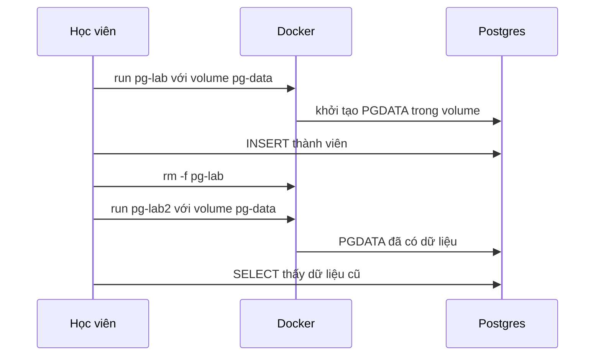

# Buổi 12 – Thử thách thêm

[Buổi 12 – Persistent Storage](session-12.md) · [Bài tập tuần 6](../../assignments/weekly/week-06.md) · [Hub tuần 6](README.md)

> **Tóm tắt:** Thử thách L2 tùy chọn của buổi 12 (Compose với down và down -v, backup mức volume, tái hiện Tình huống 04), cây điều tra Tình huống 04 và phần đọc thêm về volume. Làm ở nhà sau khi xong lab bắt buộc.

::: tip Trang này dành cho ai
Chỉ làm khi bạn đã xong phần L1 của [Buổi 12 – Persistent Storage](session-12.md). Thời gian: khoảng 25 đến 40 phút cho mỗi thử thách. Thử thách L2 là điểm thưởng, không bắt buộc.
:::

## Thử thách L2

::: warning Tự thử 15 phút trước khi mở gợi ý
Gợi ý chia thành hai bậc: bậc 1 chỉ hướng, bậc 2 gần như cho cách làm. Đáp án đối chiếu (mở sau khi nộp bài): [Walkthrough tuần 6](../../mentors/walkthroughs/week-06.md).
:::

### Thử thách A – Dựng lại bằng Compose và phân biệt `down` với `down -v`

Viết `source/compose.yaml` (chạy mọi lệnh `docker compose` trong thư mục `source/`) chạy PostgreSQL với named volume `pgdata` (không publish cổng), rồi chứng minh bằng lệnh:

1. `docker compose down` rồi `up -d --wait` thì dữ liệu còn.
2. `docker compose down -v` rồi `up -d --wait` thì dữ liệu mất.

Tiêu chí hoàn thành: file compose có pin phiên bản image, có `healthcheck`, mật khẩu đọc từ biến môi trường (không hard-code trong file nộp); output của cả hai lần kiểm tra nằm trong `evidence/command-output.txt`; giải thích bằng 2-3 câu vì sao hai lệnh khác nhau.

::: danger Chỉ chạy `down -v` trong thư mục `source/` của bài này
`down -v` xóa mọi named volume khai báo trong file compose ở thư mục hiện tại. Kiểm tra `pwd` và nội dung `compose.yaml` trước khi chạy, và chỉ chạy trên volume thử của lab.
:::

::: details Gợi ý bậc 1
Compose cần: một service `postgres` với image ghim phiên bản, biến môi trường `POSTGRES_*`, một `volumes:` gắn vào `/var/lib/postgresql/data`, một `healthcheck` dùng `pg_isready`, và khai báo volume ở cuối file.
:::

::: details Gợi ý bậc 2
Dùng `name: lab12` ở đầu file để tên project và tên volume dễ đoán (`lab12_pgdata`). Dùng `${DB_PASSWORD:?Set DB_PASSWORD}` giống `starter-project/compose.yaml` và đặt `DB_PASSWORD` trong file `.env` (không commit). `docker compose up -d --wait` chờ tới khi healthcheck báo healthy.
:::

### Thử thách B – Backup ở mức volume

Backup toàn bộ nội dung volume ra file nén bằng một container tạm, khi database đã dừng. Tiêu chí hoàn thành: có `source/pgdata.tgz`, liệt kê được nội dung bằng `tar tzf`, và bạn giải thích được vì sao nên dừng database trước khi sao chép file thô.

::: details Gợi ý bậc 1
Bạn cần một container tạm chạy `tar`, nhìn thấy volume (chỉ đọc) và một thư mục trên máy để ghi file nén ra.
:::

::: details Gợi ý bậc 2
Dùng container `alpine:3.20` gắn volume ở chế độ chỉ đọc và gắn thư mục hiện tại (`source/`) để ghi file. Tên volume do Compose đặt là `lab12_pgdata` (kiểm tra bằng `docker volume ls`). Lệnh nén là `tar czf`.
:::

### Thử thách C – Tái hiện Tình huống 04 và sửa

Làm theo mục "Phá lỗi nâng cao" bên dưới. Tiêu chí hoàn thành: báo cáo đủ 5 mục (triệu chứng, nguyên nhân gốc, cách xác minh, giải pháp, phòng tránh) trong `report.md`.

Dọn dẹp cuối buổi:

```bash
(cd ~/devops-labs/lab-12/source && docker compose down -v 2>/dev/null); docker rm -f pg-lab pg-lab2 2>/dev/null; docker volume rm pg-data 2>/dev/null; true
```

Checklist L2:

- [ ] Có `source/compose.yaml` và chứng minh được khác biệt `down` với `down -v`.
- [ ] Có `source/pgdata.tgz` (nếu làm Thử thách B).
- [ ] Hoàn thành báo cáo Tình huống 04 đủ 5 mục.

## Phá lỗi nâng cao {#pha-loi-nang-cao}

### Tình huống 04: có volume nhưng vẫn mất dữ liệu

Mã nguồn đã dựng sẵn ở `examples/troubleshooting/scenario-04/` (mentor chạy `bash setup.sh` ở thư mục đó). Học viên chỉ nhận triệu chứng bên dưới.

**Cách phá (mô phỏng cấu hình lệch).** File compose của tình huống đặt biến `PGDATA` sang một thư mục khác, trong khi named volume vẫn gắn vào đường dẫn mặc định:

```yaml
    environment:
      PGDATA: /var/lib/postgresql/pgdata
    volumes:
      - ts04-pgdata:/var/lib/postgresql/data
```

Nhìn qua thì mọi thứ đều "đúng": đích mount là đường dẫn chuẩn của Postgres, và volume có thật.

**Triệu chứng.** Sau `docker compose down` rồi `docker compose up -d --wait`, câu `SELECT` báo `ERROR: relation "members" does not exist`. `docker volume ls` vẫn liệt kê volume `ts04_ts04-pgdata`, nên dễ nghĩ rằng volume "bị lỗi".

**Hướng điều tra theo từng bước.**

1. Xác nhận dữ liệu thật sự biến mất, không phải do gõ nhầm tên database: `docker compose exec postgres psql -U club -d clubdb -c "\dt"`.
2. Hỏi Postgres đang ghi dữ liệu ở đâu, rồi hỏi Docker volume gắn ở đâu:

   ```bash
   docker compose exec postgres psql -U club -d clubdb -tA -c "SHOW data_directory;"
   docker inspect ts04-postgres-1 --format '{{range .Mounts}}{{.Type}} {{.Name}} -> {{.Destination}}{{"\n"}}{{end}}'
   ```

   Bạn sẽ thấy `data_directory` là `/var/lib/postgresql/pgdata`, trong khi mount named volume trỏ tới `/var/lib/postgresql/data`. Hai đường dẫn khác nhau, nên Postgres không hề ghi vào volume có tên.
3. Xem volume có tên đang chứa gì: `docker run --rm --mount type=volume,source=ts04_ts04-pgdata,target=/v alpine:3.20 ls -la /v` (kết quả rỗng).
4. Xem dữ liệu đang nằm ở đâu: `docker diff ts04-postgres-1 | grep pgdata | head` (không có `grep`, mấy dòng đầu chỉ là socket trong `/run`). Các dòng có đường dẫn `/var/lib/postgresql/pgdata` cho thấy dữ liệu nằm trong writable layer của container.
5. Kết luận: dữ liệu nằm trong writable layer, nên xóa container bằng `docker compose down` là xóa luôn dữ liệu. Container mới thấy `PGDATA` trống và khởi tạo database mới.

**Nguyên nhân gốc.** `PGDATA` và điểm mount của volume không trùng nhau. Volume "có tồn tại" và "được gắn" không đồng nghĩa là Postgres đang ghi vào nó. Cùng họ lỗi này là gõ sai đích mount, ví dụ `/var/lib/postgres/data`.

**Cách sửa.** Cho `PGDATA` và điểm mount khớp nhau: bỏ biến `PGDATA` (dùng mặc định `/var/lib/postgresql/data`), hoặc đặt cả hai trỏ cùng một đường dẫn. Sau đó chạy `down` rồi `up` để kiểm tra dữ liệu mới nhập có sống sót. Nếu chưa chạy `down`, hãy `pg_dump` ngay từ container đang chạy để cứu dữ liệu. Sau khi đã `down`, dữ liệu trong writable layer đã mất cùng container; nhập lại bằng `INSERT` hoặc từ backup.

**Cách phòng tránh.**

- Luôn kiểm chứng bằng `SHOW data_directory;` và `docker inspect` sau khi cấu hình volume, và đối chiếu hai đường dẫn.
- Làm bài kiểm tra "recreate" ngay ngày đầu: ghi dữ liệu, `down`, `up`, đọc lại.
- Có backup định kỳ bằng `pg_dump` và thử restore thật.
- Cẩn thận với `docker compose down -v` và `docker volume prune`.

Dọn dẹp khi xong: `bash cleanup.sh` trong thư mục tình huống.

## Tìm hiểu thêm (đọc sau) {#tim-hieu-them}

**Bảng so sánh ba loại mount.**

| Tiêu chí | Named volume | Bind mount | tmpfs |
| --- | --- | --- | --- |
| Dữ liệu nằm ở đâu | Vùng do Docker quản lý | Đường dẫn bất kỳ trên máy host | RAM của host |
| Ai quản lý | Docker (`docker volume ...`) | Bạn (thư mục thường) | Docker, tự biến mất |
| Sống sau khi xóa container | Có | Có | Không |
| Sống sau khi dừng container | Có | Có | Không |
| Dùng điển hình | Dữ liệu database, dữ liệu ứng dụng | Mã nguồn khi phát triển, file cấu hình | Dữ liệu tạm, cache, thông tin nhạy cảm không muốn ghi đĩa |
| Điểm cần cẩn thận | `down -v` xóa mất | Phụ thuộc cấu trúc và quyền file của host | Mất khi container dừng; chiếm RAM |

**Cú pháp `--mount` và `-v`.** Hai cú pháp tương đương về chức năng. Giáo trình dùng `--mount` vì tường minh, và Compose dùng dạng ngắn trong `volumes:`.

```bash
# Named volume
docker run -d --mount type=volume,source=pg-data,target=/var/lib/postgresql/data postgres:17-alpine
# Bind mount
docker run -d --mount type=bind,source="$PWD/html",target=/usr/share/nginx/html,readonly nginx:1.27-alpine
# tmpfs
docker run -d --mount type=tmpfs,target=/scratch alpine:3.20 sleep 300
```

Khác biệt đáng nhớ: với `--mount type=bind`, nếu thư mục nguồn không tồn tại thì Docker báo lỗi; với `-v host:container`, Docker sẽ âm thầm tạo thư mục rỗng (thuộc root) và bạn khó nhận ra lỗi gõ nhầm đường dẫn.

**PostgreSQL lưu dữ liệu ở đâu.** Image `postgres` lưu dữ liệu trong `/var/lib/postgresql/data` (biến `PGDATA`) và khai báo thư mục này là `VOLUME`. Nếu bạn không gắn gì vào đó, Docker tự tạo một anonymous volume (tên là chuỗi hex dài); container mới sẽ tạo anonymous volume mới, trông như mất dữ liệu. Nếu gắn volume vào sai đường dẫn, hoặc đổi `PGDATA` sang thư mục khác với điểm mount, Postgres ghi vào chỗ không có volume có tên, còn volume của bạn nằm trống: đó là họ lỗi của Tình huống 04.

Lưu ý phiên bản: bài này ghim `postgres:17-alpine`. Từ Postgres 18, image chính thức đổi cách bố trí (`PGDATA` có thư mục theo phiên bản và điểm mount khuyến nghị là `/var/lib/postgresql`). Khi nâng phiên bản image, hãy đọc lại hướng dẫn trên Docker Hub trước khi dùng lại volume cũ.

**Script khởi tạo chỉ chạy một lần.** Các file trong `/docker-entrypoint-initdb.d/` (như `database/init.sql` của starter-project) chỉ được chạy khi thư mục dữ liệu còn trống, tức lần khởi tạo đầu tiên. Tương tự, `POSTGRES_PASSWORD`, `POSTGRES_USER`, `POSTGRES_DB` chỉ có tác dụng ở lần đầu.

**Vòng đời dữ liệu, từng bước.**

1. Bạn tạo volume `pg-data`. Docker cấp một vùng lưu trữ riêng, độc lập với mọi container.
2. Container `pg-lab` gắn volume vào `/var/lib/postgresql/data`. Postgres ghi file dữ liệu vào đó thay vì vào writable layer.
3. Khi `docker rm -f pg-lab`, writable layer biến mất nhưng volume vẫn còn nguyên.
4. Container mới gắn lại đúng volume vào đúng đường dẫn. Postgres thấy thư mục dữ liệu đã có dữ liệu, bỏ qua bước khởi tạo và dùng lại.
5. Chỉ `docker volume rm pg-data` (hoặc `docker compose down -v`) mới thực sự xóa dữ liệu.



**Vị trí volume trên Docker Desktop.** Volume nằm bên trong máy ảo của Docker Desktop, không phải trong thư mục WSL của bạn. Đừng tìm file volume trong `/var/lib/docker` của Ubuntu; hãy dùng `docker volume inspect` và `docker run` để xem nội dung. Ví dụ `docker volume inspect pg-data --format '{{.Name}} {{.Driver}} {{.Mountpoint}}'` in Mountpoint dạng `/var/lib/docker/volumes/pg-data/_data`, đường dẫn trong máy ảo.

Quay lại [Buổi 12 – Persistent Storage](session-12.md) · Buổi tiếp theo: [Buổi 13 – Docker Compose](../week-07/session-13.md).
