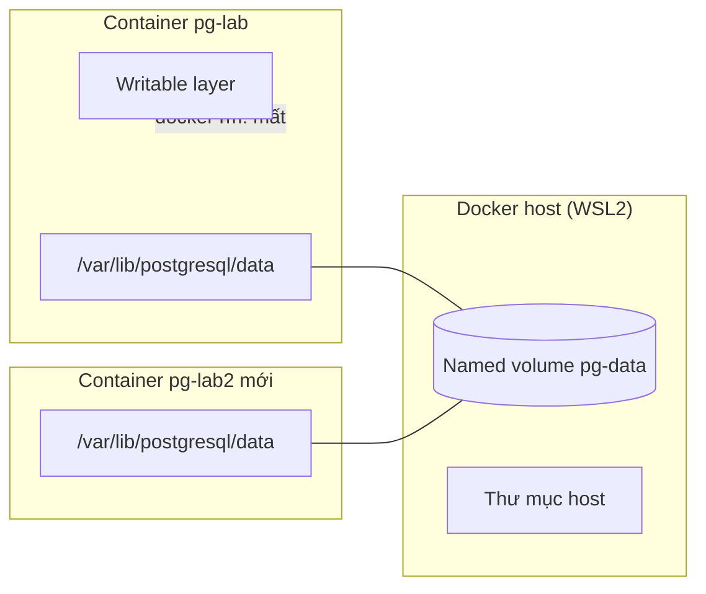
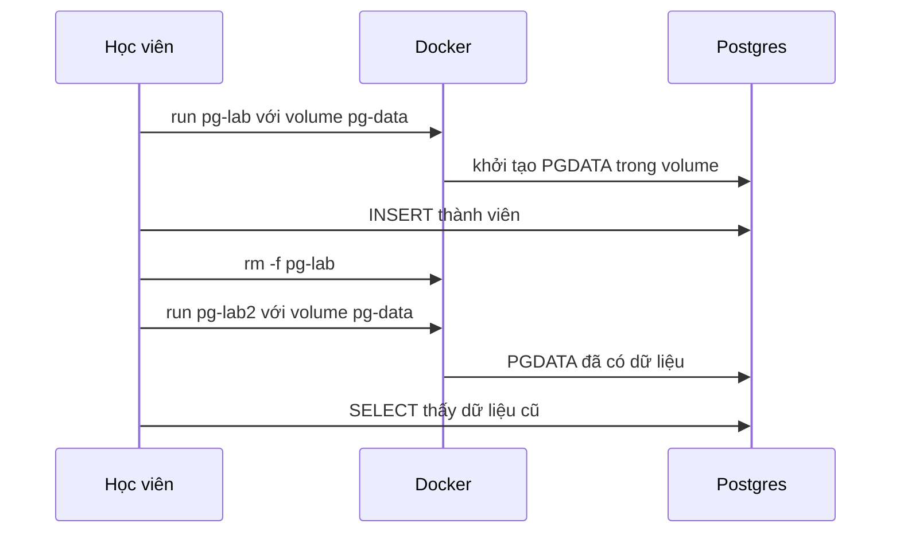

# Buổi 12 – Persistent Storage

Tuần 6 · Giai đoạn 2 – Docker & Containerization · Slide: [Slide buổi 12](../../slides/02-docker/session-12.md)

> **Tóm tắt:** Phân biệt volume, bind mount và tmpfs, chạy PostgreSQL với named volume để dữ liệu sống sót qua recreate container, backup và restore bằng pg_dump.

## Mục tiêu học tập

- Giải thích vì sao dữ liệu ghi vào writable layer của container bị mất khi container bị xóa.
- Phân biệt được named volume, bind mount và tmpfs, và chọn đúng loại cho từng tình huống.
- Chạy được PostgreSQL với named volume gắn đúng `/var/lib/postgresql/data` và chứng minh dữ liệu còn nguyên sau khi xóa và tạo lại container.
- Backup và restore database bằng `pg_dump` và `psql`, kiểm tra được bản backup dùng được.
- Chẩn đoán được tình huống "có volume nhưng vẫn mất dữ liệu" bằng `docker inspect` và `docker volume inspect`.
- Phân biệt `docker compose down` với `docker compose down -v` và nêu được hậu quả của từng lệnh.

## Điều kiện cần

- Đã hoàn thành Buổi 08 (Docker CLI: `run`, `exec`, `inspect`, `logs`, `rm`) và Buổi 11 (Container Networking).
- Windows 11 + WSL2 Ubuntu, Docker Desktop đang chạy và bật WSL integration cho distro Ubuntu.
- Làm việc trong filesystem của WSL (ví dụ `~/devops-labs/lab-12`), không làm trong `/mnt/c`.
- Có repo cá nhân `devops-labs` với thư mục `lab-12/` để nộp bài.

Kiểm tra nhanh:

```bash
docker version --format '{{.Server.Version}}'
docker compose version
docker run --rm alpine:3.20 echo ok
pwd
```

Kết quả mong đợi: có số phiên bản Docker Engine (27 trở lên), có dòng `Docker Compose version v2...`, in ra `ok`, và `pwd` bắt đầu bằng `/home/` (không phải `/mnt/c`).

## Vấn đề thực tế

Một thành viên CLB dựng PostgreSQL để lưu danh sách thành viên, nhập 30 người đăng ký đầu học kỳ. Hôm sau cậu ấy cập nhật phiên bản image: xóa container cũ, chạy container mới. Bảng `members` trống trơn. Không có lỗi nào được báo, mọi lệnh đều chạy thành công, chỉ là dữ liệu không còn.

Container được thiết kế để dùng một lần và thay thế dễ dàng. Đó là điểm mạnh khi triển khai, nhưng dữ liệu của database thì không được phép dùng một lần. Bài này dạy cách tách dữ liệu ra khỏi vòng đời container, cách kiểm chứng việc đó thực sự xảy ra, và cách backup để vẫn an toàn khi volume bị xóa nhầm.

## Khái niệm cốt lõi

### Writable layer và vòng đời dữ liệu

Image gồm các layer chỉ đọc. Khi chạy container, Docker thêm một **writable layer** mỏng lên trên cùng. Mọi file mà tiến trình trong container ghi ra đều nằm ở layer này. Layer này gắn với container: `docker rm` là mất. Nó cũng chậm hơn và không tiện chia sẻ giữa các container.

Vì vậy, quy tắc là: **bất cứ thứ gì cần sống lâu hơn container phải nằm ngoài writable layer.** Docker có ba cách làm việc đó.

### Ba loại mount

| Tiêu chí | Named volume | Bind mount | tmpfs |
| --- | --- | --- | --- |
| Dữ liệu nằm ở đâu | Vùng do Docker quản lý | Đường dẫn bất kỳ trên máy host | RAM của host |
| Ai quản lý | Docker (`docker volume ...`) | Bạn (thư mục thường) | Docker, tự biến mất |
| Sống sau khi xóa container | Có | Có | Không |
| Sống sau khi dừng container | Có | Có | Không |
| Dùng điển hình | Dữ liệu database, dữ liệu ứng dụng | Mã nguồn khi phát triển, file cấu hình | Dữ liệu tạm, cache, thông tin nhạy cảm không muốn ghi đĩa |
| Điểm cần cẩn thận | `down -v` xóa mất | Phụ thuộc cấu trúc và quyền file của host | Mất khi container dừng; chiếm RAM |

Nguyên tắc chọn: database dùng **named volume**; mã nguồn khi dev dùng **bind mount**; dữ liệu tạm dùng **tmpfs**.

### Cú pháp `--mount` và `-v`

Hai cú pháp tương đương về chức năng. Giáo trình dùng `--mount` vì tường minh, và Compose dùng dạng ngắn trong `volumes:`.

```bash
# Named volume
docker run -d --mount type=volume,source=pg-data,target=/var/lib/postgresql/data postgres:17-alpine
# Bind mount
docker run -d --mount type=bind,source="$PWD/html",target=/usr/share/nginx/html,readonly nginx:1.27-alpine
# tmpfs
docker run -d --mount type=tmpfs,target=/scratch alpine:3.20 sleep 300
```

Khác biệt đáng nhớ: với `--mount type=bind`, nếu thư mục nguồn không tồn tại thì Docker báo lỗi; với `-v host:container`, Docker sẽ âm thầm tạo thư mục rỗng (thuộc root) và bạn khó nhận ra lỗi gõ nhầm đường dẫn.

### PostgreSQL lưu dữ liệu ở đâu

Image `postgres` lưu dữ liệu trong thư mục `/var/lib/postgresql/data` (biến `PGDATA`) và khai báo thư mục này là `VOLUME`. Hai hệ quả quan trọng:

1. Nếu bạn **không** gắn gì vào đó, Docker tự tạo một **anonymous volume** (tên là chuỗi hex dài). Dữ liệu vẫn nằm ngoài writable layer nhưng bạn không có tên để tái sử dụng, và container mới sẽ tạo anonymous volume mới, trông như mất dữ liệu.
2. Nếu bạn gắn volume vào **sai đường dẫn** (ví dụ `/var/lib/postgres/data`, thiếu chữ `ql`), hoặc đổi `PGDATA` sang một thư mục khác với điểm mount, Postgres ghi vào chỗ không có volume có tên, còn volume của bạn nằm trống. Đây là họ lỗi của Tình huống 04.

Lưu ý phiên bản: bài này ghim `postgres:17-alpine`. Từ Postgres 18, image chính thức đổi cách bố trí (`PGDATA` có thư mục theo phiên bản và điểm mount khuyến nghị là `/var/lib/postgresql`). Khi nâng phiên bản image, hãy đọc lại hướng dẫn trên Docker Hub trước khi dùng lại volume cũ.

### Script khởi tạo chỉ chạy một lần

Các file trong `/docker-entrypoint-initdb.d/` (như `database/init.sql` của starter-project) chỉ được chạy khi **data directory còn trống**, tức lần khởi tạo đầu tiên. Tương tự, `POSTGRES_PASSWORD`, `POSTGRES_USER`, `POSTGRES_DB` chỉ có tác dụng ở lần đầu. Nếu volume đã có dữ liệu, đổi các biến này không làm thay đổi database hiện có.

## Kiến trúc và cách hoạt động



Giải thích từng bước:

1. Bạn tạo volume `pg-data`. Docker cấp một vùng lưu trữ riêng, độc lập với mọi container.
2. Container `pg-lab` gắn volume vào `/var/lib/postgresql/data`. Postgres ghi file dữ liệu vào đó thay vì vào writable layer.
3. Khi `docker rm -f pg-lab`, writable layer biến mất nhưng volume vẫn còn nguyên.
4. Container mới gắn lại đúng volume `pg-data` vào đúng đường dẫn. Postgres thấy data directory đã có dữ liệu, bỏ qua bước khởi tạo và dùng lại.
5. Chỉ `docker volume rm pg-data` (hoặc `docker compose down -v`) mới thực sự xóa dữ liệu.



Trên Docker Desktop, volume nằm bên trong máy ảo của Docker Desktop, không phải trong thư mục WSL của bạn. Đừng tìm file volume trong `/var/lib/docker` của Ubuntu; hãy dùng `docker volume inspect` và `docker run` để xem nội dung.

## Demo của mentor

Thời lượng gợi ý: 12 phút. Mentor chiếu màn hình, lớp gõ theo ở phần lab.

**Bước 1. Mất dữ liệu khi không có volume (container đơn giản).**

```bash
docker run -d --name demo-tmp alpine:3.20 sleep 600
docker exec demo-tmp sh -c 'echo "du lieu quan trong" > /note.txt && cat /note.txt'
docker rm -f demo-tmp
docker run -d --name demo-tmp alpine:3.20 sleep 600
docker exec demo-tmp cat /note.txt
```

Kết quả mong đợi: lần đọc cuối báo `cat: can't open '/note.txt': No such file or directory`.

Câu hỏi cho lớp: file đó đã nằm ở đâu và tại sao biến mất? (Trả lời: writable layer của container cũ.)

**Bước 2. Cùng thao tác nhưng có volume.**

```bash
docker rm -f demo-tmp
docker volume create demo-vol
docker run -d --name demo-tmp --mount type=volume,source=demo-vol,target=/data alpine:3.20 sleep 600
docker exec demo-tmp sh -c 'echo "du lieu quan trong" > /data/note.txt'
docker rm -f demo-tmp
docker run --rm --mount type=volume,source=demo-vol,target=/data alpine:3.20 cat /data/note.txt
```

Kết quả mong đợi: in ra `du lieu quan trong`.

Câu hỏi cho lớp: container đã bị xóa, vậy ai đang giữ file? (Trả lời: volume `demo-vol`.)

**Bước 3. Xem volume và dọn dẹp.**

```bash
docker volume ls
docker volume inspect demo-vol --format '{{.Name}} {{.Driver}} {{.Mountpoint}}'
docker volume rm demo-vol
```

Kết quả mong đợi: `demo-vol local /var/lib/docker/volumes/demo-vol/_data`. Đường dẫn này nằm trong máy ảo của Docker Desktop.

**Bước 4. tmpfs.**

```bash
docker run --rm --mount type=tmpfs,target=/scratch alpine:3.20 sh -c 'df -h /scratch | tail -1; echo hi > /scratch/a; cat /scratch/a'
```

Kết quả mong đợi: dòng `df` có filesystem `tmpfs` gắn tại `/scratch`, sau đó in `hi`. Dừng container thì dữ liệu mất.

Câu hỏi cuối demo: nếu `docker compose down -v` chạy nhầm trên môi trường thật, cách nào cứu được dữ liệu? (Dẫn vào backup.)

## Hands-on lab

Thời lượng: 60 phút. Phần 1 đến 4 là L1 (khoảng 35 phút), Phần 5 và 6 là L2 (khoảng 25 phút).

### Chuẩn bị

```bash
mkdir -p ~/devops-labs/lab-12/{source,screenshots,evidence}
cd ~/devops-labs/lab-12
docker rm -f pg-lab pg-lab2 2>/dev/null; docker volume rm pg-data 2>/dev/null; true
```

Bạn sẽ dán các lệnh quan trọng và output vào `evidence/command-output.txt` khi làm. Cách đơn giản: chạy lệnh rồi copy kết quả. Có thể dùng `tee`, ví dụ `docker volume ls | tee -a evidence/command-output.txt`.

Biến dùng chung (đổi nếu muốn, không dùng mật khẩu thật của bạn ở bất cứ đâu):

```bash
export PGPASS=lab-only-password
```

Không bind cổng ra host trong bài này; ta truy cập Postgres bằng `docker exec`, tránh xung đột cổng 5432 trên máy bạn.

### Phần 1. Chạy PostgreSQL với named volume (L1)

**Bước 1.1.** Tạo volume và kiểm tra.

```bash
docker volume create pg-data
docker volume ls --filter name=pg-data
```

Kết quả mong đợi:

```text
pg-data
DRIVER    VOLUME NAME
local     pg-data
```

**Bước 1.2.** Chạy PostgreSQL với volume gắn đúng `/var/lib/postgresql/data`.

```bash
docker run -d --name pg-lab \
  -e POSTGRES_DB=clubdb -e POSTGRES_USER=club -e POSTGRES_PASSWORD="$PGPASS" \
  --mount type=volume,source=pg-data,target=/var/lib/postgresql/data \
  postgres:17-alpine
```

Vì sao: `--mount` khai báo rõ loại, nguồn và đích. Đích phải khớp đường dẫn mà Postgres dùng, nếu không volume sẽ vô dụng.

**Bước 1.3.** Chờ database sẵn sàng.

```bash
until docker exec pg-lab pg_isready -h 127.0.0.1 -U club -d clubdb; do sleep 1; done
```

Kết quả mong đợi: dòng `127.0.0.1:5432 - accepting connections`. Trong vài giây đầu có thể thấy `no response` hoặc `rejecting connections`, đó là bình thường vì Postgres đang khởi tạo.

Vì sao có `-h 127.0.0.1`: ở lần khởi tạo đầu, image chạy một server tạm chỉ nghe qua unix socket để nạp script. Kiểm tra qua TCP chỉ thành công khi server thật đã khởi động; nếu bỏ `-h`, bạn có thể gửi lệnh quá sớm và gặp lỗi ngẫu nhiên.

### Phần 2. Tạo dữ liệu (L1)

**Bước 2.1.** Tạo bảng giống `starter-project/database/init.sql` và thêm dữ liệu.

```bash
docker exec -i pg-lab psql -U club -d clubdb -v ON_ERROR_STOP=1 <<'SQL'
CREATE TABLE IF NOT EXISTS members (
  id SERIAL PRIMARY KEY,
  name VARCHAR(100) NOT NULL,
  email VARCHAR(150) UNIQUE NOT NULL,
  created_at TIMESTAMP DEFAULT CURRENT_TIMESTAMP
);
INSERT INTO members (name, email) VALUES
  ('Alice', 'alice@example.com'),
  ('Bob', 'bob@example.com'),
  ('Carol', 'carol@example.com');
SQL
```

Kết quả mong đợi: `CREATE TABLE` rồi `INSERT 0 3`.

**Bước 2.2.** Đọc lại dữ liệu.

```bash
docker exec pg-lab psql -U club -d clubdb -c "SELECT id, name FROM members ORDER BY id;"
```

Kết quả mong đợi:

```text
 id | name  
----+-------
  1 | Alice
  2 | Bob
  3 | Carol
(3 rows)
```

### Phần 3. Xóa và tạo lại container (L1)

**Bước 3.1.** Xóa hẳn container (không phải chỉ dừng).

```bash
docker rm -f pg-lab
docker ps -a --filter name=pg-lab
docker volume ls --filter name=pg-data
```

Kết quả mong đợi: danh sách container rỗng, còn volume `pg-data` vẫn có.

**Bước 3.2.** Tạo container mới với cùng volume, **không** cần tạo lại bảng.

```bash
docker run -d --name pg-lab2 \
  -e POSTGRES_DB=clubdb -e POSTGRES_USER=club -e POSTGRES_PASSWORD="$PGPASS" \
  --mount type=volume,source=pg-data,target=/var/lib/postgresql/data \
  postgres:17-alpine
until docker exec pg-lab2 pg_isready -h 127.0.0.1 -U club -d clubdb; do sleep 1; done
docker exec pg-lab2 psql -U club -d clubdb -c "SELECT id, name FROM members ORDER BY id;"
```

Kết quả mong đợi: vẫn thấy 3 dòng Alice, Bob, Carol. Trong log (`docker logs pg-lab2 | head`) có dòng `Skipping initialization`, cho thấy Postgres nhận ra data directory đã có dữ liệu.

Vì sao: dữ liệu nằm trong volume, container chỉ là lớp vỏ có thể thay thế.

### Phần 4. Kiểm chứng bằng inspect (L1)

**Bước 4.1.** Xem container đang gắn gì.

```bash
docker inspect pg-lab2 --format '{{range .Mounts}}{{.Type}} {{.Name}} -> {{.Destination}}{{"\n"}}{{end}}'
```

Kết quả mong đợi: `volume pg-data -> /var/lib/postgresql/data`.

**Bước 4.2.** Xem Postgres thực sự ghi vào đâu.

```bash
docker exec pg-lab2 psql -U club -d clubdb -tA -c "SHOW data_directory;"
```

Kết quả mong đợi: `/var/lib/postgresql/data`. Điểm đích của mount (bước 4.1) và `data_directory` (bước 4.2) phải trùng nhau. Đây là phép kiểm tra cốt lõi, bạn sẽ dùng lại ở Phần 5.

**Bước 4.3.** Đóng L1: dọn container tạm nhưng giữ volume cho Phần 5.

```bash
docker rm -f pg-lab2
```

### L1 – Foundation: checklist hoàn thành

- [ ] Tạo được volume `pg-data` và chạy PostgreSQL gắn volume vào `/var/lib/postgresql/data`.
- [ ] Tạo bảng `members` với 3 dòng dữ liệu.
- [ ] Xóa container, tạo container mới cùng volume, dữ liệu vẫn còn.
- [ ] Chạy `docker inspect` và `SHOW data_directory;`, đối chiếu được hai đường dẫn.
- [ ] Dán các lệnh và output chính vào `evidence/command-output.txt`.

### Phần 5. Backup và restore bằng pg_dump (L2)

**Bước 5.1.** Tạo container và backup logic (SQL dump).

```bash
docker run -d --name pg-lab \
  -e POSTGRES_DB=clubdb -e POSTGRES_USER=club -e POSTGRES_PASSWORD="$PGPASS" \
  --mount type=volume,source=pg-data,target=/var/lib/postgresql/data \
  postgres:17-alpine
until docker exec pg-lab pg_isready -h 127.0.0.1 -U club -d clubdb; do sleep 1; done
docker exec pg-lab pg_dump -U club -d clubdb > source/backup.sql
head -n 5 source/backup.sql; grep -c "Alice" source/backup.sql
```

Kết quả mong đợi: file `source/backup.sql` có phần đầu bắt đầu bằng comment `-- PostgreSQL database dump`, và `grep -c` in `1`.

Vì sao dùng `pg_dump` thay vì copy thư mục dữ liệu: dump là snapshot nhất quán về mặt logic, chạy khi database đang hoạt động, đọc được bằng mắt, và restore được sang phiên bản Postgres khác.

**Bước 5.2.** Giả lập thảm họa: xóa cả container lẫn volume.

```bash
docker rm -f pg-lab
docker volume rm pg-data
```

**Bước 5.3.** Dựng lại database rỗng và restore.

```bash
docker run -d --name pg-lab \
  -e POSTGRES_DB=clubdb -e POSTGRES_USER=club -e POSTGRES_PASSWORD="$PGPASS" \
  --mount type=volume,source=pg-data,target=/var/lib/postgresql/data \
  postgres:17-alpine
until docker exec pg-lab pg_isready -h 127.0.0.1 -U club -d clubdb; do sleep 1; done
docker exec -i pg-lab psql -U club -d clubdb -v ON_ERROR_STOP=1 < source/backup.sql
docker exec pg-lab psql -U club -d clubdb -c "SELECT count(*) FROM members;"
```

Kết quả mong đợi: các dòng `CREATE TABLE`, `COPY 3` (hoặc `INSERT`), và `count` bằng 3.

Lưu ý: `docker exec -i` (có `-i`, không có `-t`) là bắt buộc khi nhận dữ liệu qua redirect. Thiếu `-i`, `psql` không nhận được file và restore trống.

### Phần 6. Thử thách tự làm (L2)

### L2 – Engineering: thử thách

**Thử thách A. Dựng lại bằng Compose và phân biệt `down` với `down -v`.**

Viết `source/compose.yaml` (chạy mọi lệnh `docker compose` trong thư mục `source/`) chạy PostgreSQL với named volume `pgdata` (không publish cổng), rồi chứng minh bằng lệnh:

1. `docker compose down` rồi `up -d --wait` thì dữ liệu còn.
2. `docker compose down -v` rồi `up -d --wait` thì dữ liệu mất.

Tiêu chí hoàn thành: file compose có pin phiên bản image, có `healthcheck`, mật khẩu đọc từ biến môi trường (không hard-code trong file nộp); output của cả hai lần kiểm tra nằm trong `evidence/command-output.txt`; giải thích bằng 2-3 câu vì sao hai lệnh khác nhau.

<details><summary>Gợi ý</summary>

Dùng `name: lab12` ở đầu file để tên project và tên volume dễ đoán (`lab12_pgdata`). Dùng `${DB_PASSWORD:?Set DB_PASSWORD}` giống `starter-project/compose.yaml` và đặt `DB_PASSWORD` trong file `.env` (không commit). `docker compose up -d --wait` chờ tới khi healthcheck báo healthy.

</details>

<details><summary>Lời giải</summary>

```yaml
name: lab12

services:
  postgres:
    image: postgres:17-alpine
    environment:
      POSTGRES_DB: clubdb
      POSTGRES_USER: club
      POSTGRES_PASSWORD: ${DB_PASSWORD:?Set DB_PASSWORD in .env}
    volumes:
      - pgdata:/var/lib/postgresql/data
    healthcheck:
      test: ["CMD-SHELL", "pg_isready -h 127.0.0.1 -U club -d clubdb"]
      interval: 5s
      timeout: 3s
      retries: 5

volumes:
  pgdata:
```

```bash
cd ~/devops-labs/lab-12/source
echo "DB_PASSWORD=lab-only-password" > .env
docker compose up -d --wait
docker compose exec postgres psql -U club -d clubdb -c "CREATE TABLE t(x int); INSERT INTO t VALUES (1);"
docker compose down && docker compose up -d --wait
docker compose exec postgres psql -U club -d clubdb -tA -c "SELECT count(*) FROM t;"   # 1
docker compose down -v && docker compose up -d --wait
docker compose exec postgres psql -U club -d clubdb -tA -c "SELECT count(*) FROM t;"   # báo lỗi: relation "t" does not exist
```

Giải thích: `down` xóa container và network nhưng giữ named volume; `down -v` xóa thêm các named volume khai báo trong file. Database mới sinh ra từ volume rỗng nên không có bảng `t`.

</details>

**Thử thách B. Backup ở mức volume.**

Backup toàn bộ nội dung volume ra file nén bằng một container tạm, khi database đã dừng. Tiêu chí hoàn thành: có `source/pgdata.tgz`, liệt kê được nội dung bằng `tar tzf`, và bạn giải thích được vì sao nên dừng database trước khi sao chép file thô.

<details><summary>Gợi ý</summary>

Dùng container `alpine:3.20` gắn volume ở chế độ chỉ đọc và gắn thư mục hiện tại (`source/`) để ghi file. Tên volume do Compose đặt là `lab12_pgdata` (kiểm tra bằng `docker volume ls`). Lệnh nén là `tar czf`.

</details>

<details><summary>Lời giải</summary>

```bash
# chạy trong thư mục source/ (nơi có compose.yaml)
docker compose stop postgres
docker run --rm \
  --mount type=volume,source=lab12_pgdata,target=/data,readonly \
  --mount type=bind,source="$PWD",target=/backup \
  alpine:3.20 tar czf /backup/pgdata.tgz -C /data .
tar tzf pgdata.tgz | head -n 5
docker compose start postgres
```

Nếu sao chép file thô khi Postgres đang chạy, các file có thể đang được ghi dở nên bản sao không nhất quán và có thể không khởi động được. Bản sao thô còn phụ thuộc cùng phiên bản Postgres, trong khi `pg_dump` thì không.

</details>

**Thử thách C. Tái hiện Tình huống 04 và sửa.**

Làm theo mục "Phá lỗi và debug" bên dưới. Tiêu chí hoàn thành: báo cáo đủ 5 mục (triệu chứng, nguyên nhân gốc, cách xác minh, giải pháp, phòng tránh) trong `report.md`.

Dọn dẹp cuối buổi:

```bash
(cd ~/devops-labs/lab-12/source && docker compose down -v 2>/dev/null); docker rm -f pg-lab pg-lab2 2>/dev/null; docker volume rm pg-data 2>/dev/null; true
```

### L2 – Engineering: checklist hoàn thành

- [ ] Có `source/backup.sql` và restore thành công vào database mới (count đúng).
- [ ] Có `source/compose.yaml` và chứng minh được khác biệt `down` với `down -v`.
- [ ] Có `source/pgdata.tgz` (nếu làm Thử thách B).
- [ ] Hoàn thành báo cáo Tình huống 04 đủ 5 mục.

## Phá lỗi và debug

### Tình huống: có volume nhưng vẫn mất dữ liệu (Tình huống 04)

Mã nguồn đã dựng sẵn ở `examples/troubleshooting/scenario-04/` (mentor chạy `bash setup.sh` ở thư mục đó). Học viên chỉ nhận triệu chứng bên dưới.

**Cách phá (mô phỏng cấu hình lệch).** File compose của tình huống đặt biến `PGDATA` sang một thư mục khác, trong khi named volume vẫn gắn vào đường dẫn mặc định:

```yaml
    environment:
      PGDATA: /var/lib/postgresql/pgdata
    volumes:
      - ts04-pgdata:/var/lib/postgresql/data
```

Nhìn qua thì mọi thứ đều "đúng": đích mount là đường dẫn chuẩn của Postgres, và volume có thật.

**Triệu chứng.** Sau `docker compose down` rồi `docker compose up -d --wait`, câu `SELECT` báo `ERROR: relation "members" does not exist`. `docker volume ls` vẫn liệt kê volume `ts04_ts04-pgdata`, nên dễ nghĩ rằng volume "bị lỗi".

**Hướng điều tra theo từng bước.**

1. Xác nhận dữ liệu thật sự biến mất, không phải do gõ nhầm tên database: `docker compose exec postgres psql -U club -d clubdb -c "\dt"`.
2. Hỏi Postgres đang ghi dữ liệu ở đâu, rồi hỏi Docker volume gắn ở đâu:

   ```bash
   docker compose exec postgres psql -U club -d clubdb -tA -c "SHOW data_directory;"
   docker inspect ts04-postgres-1 --format '{{range .Mounts}}{{.Type}} {{.Name}} -> {{.Destination}}{{"\n"}}{{end}}'
   ```

   Bạn sẽ thấy `data_directory` là `/var/lib/postgresql/pgdata`, trong khi mount named volume trỏ tới `/var/lib/postgresql/data`. Hai đường dẫn khác nhau, nên Postgres không hề ghi vào volume có tên.
3. Xem volume có tên đang chứa gì: `docker run --rm --mount type=volume,source=ts04_ts04-pgdata,target=/v alpine:3.20 ls -la /v` (kết quả rỗng).
4. Xem dữ liệu đang nằm ở đâu: `docker diff ts04-postgres-1 | grep pgdata | head` (không có `grep`, mấy dòng đầu chỉ là socket trong `/run`). Các dòng có đường dẫn `/var/lib/postgresql/pgdata` cho thấy dữ liệu nằm trong writable layer của container.
5. Kết luận: dữ liệu nằm trong writable layer, nên xóa container bằng `docker compose down` là xóa luôn dữ liệu. Container mới thấy `PGDATA` trống và khởi tạo database mới.

**Nguyên nhân gốc.** `PGDATA` và điểm mount của volume không trùng nhau. Volume "có tồn tại" và "được gắn" không đồng nghĩa là Postgres đang ghi vào nó. Cùng họ lỗi này là gõ sai đích mount, ví dụ `/var/lib/postgres/data`.

**Cách sửa.** Cho `PGDATA` và điểm mount khớp nhau: bỏ biến `PGDATA` (dùng mặc định `/var/lib/postgresql/data`), hoặc đặt cả hai trỏ cùng một đường dẫn. Sau đó chạy `down` rồi `up` để kiểm tra dữ liệu mới nhập có sống sót. Nếu chưa chạy `down`, hãy `pg_dump` ngay từ container đang chạy để cứu dữ liệu. Sau khi đã `down`, dữ liệu trong writable layer đã mất cùng container; nhập lại bằng `INSERT` hoặc từ backup.

**Cách phòng tránh.**

- Luôn kiểm chứng bằng `SHOW data_directory;` và `docker inspect` sau khi cấu hình volume, và đối chiếu hai đường dẫn.
- Làm bài kiểm tra "recreate" ngay ngày đầu: ghi dữ liệu, `down`, `up`, đọc lại.
- Có backup định kỳ bằng `pg_dump` và thử restore thật.
- Cẩn thận với `docker compose down -v` và `docker volume prune`.

Dọn dẹp khi xong: `bash cleanup.sh` trong thư mục tình huống.

## Lỗi thường gặp

| Triệu chứng | Nguyên nhân | Cách xử lý |
| --- | --- | --- |
| Dữ liệu mất sau `down` dù có khai báo volume | Điểm mount không khớp nơi Postgres ghi (gõ sai đường dẫn hoặc `PGDATA` bị đổi) | Đối chiếu `docker inspect` với `SHOW data_directory;`, cho hai đường dẫn khớp nhau |
| Sau `docker compose down -v` mất toàn bộ dữ liệu | `-v` xóa named volume khai báo trong compose | Dùng `down` thường; backup trước khi dùng `-v` |
| Đổi `POSTGRES_PASSWORD` nhưng mật khẩu cũ vẫn dùng | Biến chỉ áp dụng khi khởi tạo lần đầu, volume đã có dữ liệu | Dùng `ALTER USER` hoặc xóa volume (sau khi backup) |
| `init.sql` không chạy lại sau khi sửa | Script trong `docker-entrypoint-initdb.d` chỉ chạy khi data directory trống | Dùng `psql` để áp dụng thay đổi, hoặc tạo volume mới |
| Restore bằng `docker exec ... psql < backup.sql` không có tác dụng, bảng vẫn trống | Thiếu `-i` trong `docker exec -i` nên stdin không vào container | Thêm `-i`, kiểm tra bằng `SELECT count(*)` |
| `invalid mount config ... bind source path does not exist` | Dùng `--mount type=bind` với thư mục chưa tồn tại | Tạo thư mục trước, kiểm tra đường dẫn |
| Postgres không khởi động với bind mount, báo lỗi quyền | Thư mục host (nhất là dưới `/mnt/c`) không cho đổi chủ sở hữu | Dùng named volume cho dữ liệu database; làm trong filesystem của WSL |
| Có hàng chục volume tên hex trong `docker volume ls` | Anonymous volume sinh ra do chưa gắn volume có tên | Gắn named volume; dọn bằng `docker volume ls -f dangling=true` và xóa có chọn lọc |

## Tự kiểm tra

1. Dữ liệu ghi vào writable layer của container có còn sau `docker rm` không? Vì sao?

   <details><summary>Đáp án</summary>

   Không. Writable layer gắn với vòng đời container và bị xóa cùng container.

   </details>

2. Khi nào chọn named volume, bind mount, tmpfs?

   <details><summary>Đáp án</summary>

   Named volume cho dữ liệu cần bền như database; bind mount khi cần chia sẻ file giữa host và container (mã nguồn khi dev, file cấu hình); tmpfs cho dữ liệu tạm hoặc nhạy cảm không muốn ghi đĩa.

   </details>

3. Vì sao `init.sql` trong `docker-entrypoint-initdb.d` không chạy lần thứ hai?

   <details><summary>Đáp án</summary>

   Entrypoint chỉ chạy các script đó khi data directory còn trống (lần khởi tạo đầu). Khi volume đã có dữ liệu, bước khởi tạo bị bỏ qua.

   </details>

4. `docker compose down` và `docker compose down -v` khác nhau thế nào?

   <details><summary>Đáp án</summary>

   `down` xóa container và network, giữ volume. `down -v` xóa thêm named volume khai báo trong file compose, nên mất dữ liệu.

   </details>

5. Tình huống: `docker volume ls` có volume của dự án nhưng dữ liệu vẫn mất sau `down` và `up`. Bạn kiểm tra gì đầu tiên?

   <details><summary>Đáp án</summary>

   So sánh đích mount trong `docker inspect` với `data_directory` của Postgres (`SHOW data_directory;`). Nếu khác nhau, volume chưa được dùng. Kiểm tra thêm `PGDATA` có bị đổi không và có anonymous volume nào được gắn vào container hay không.

   </details>

6. Vì sao `pg_dump` thường được ưu tiên hơn sao chép thô thư mục dữ liệu?

   <details><summary>Đáp án</summary>

   Dump nhất quán về logic khi database đang chạy, không phụ thuộc cấu trúc file nội bộ nên restore được sang phiên bản khác, và đọc/kiểm tra được. Sao chép thô cần dừng database và phụ thuộc cùng phiên bản.

   </details>

7. Tình huống: đồng đội đề xuất lưu dữ liệu Postgres bằng bind mount tới thư mục dưới `/mnt/c`. Bạn nhận xét gì?

   <details><summary>Đáp án</summary>

   Không nên. Filesystem Windows qua `/mnt/c` chậm hơn và có thể gây lỗi quyền, nên dùng named volume. Bind mount hợp lý hơn cho mã nguồn và cấu hình, và nên đặt trong filesystem của WSL.

   </details>

## Nộp bài

Nộp vào `lab-12/` trong repository cá nhân theo `templates/lab-template.md`:

- [ ] `README.md` trả lời đủ 7 câu: bài lab giải quyết gì, kiến thức đã dùng, các bước, kết quả mong đợi, lỗi đã gặp, cách khắc phục, có thể cải thiện gì.
- [ ] `evidence/command-output.txt` có lệnh và output của: tạo dữ liệu, recreate container, `docker inspect`, `SHOW data_directory;`, backup và restore.
- [ ] `report.md` có phần phân tích Tình huống 04 đủ 5 mục (L2).
- [ ] `source/` có `backup.sql`, `compose.yaml` (và `pgdata.tgz` nếu làm), không có file `.env`.
- [ ] Ghi rõ đã làm L1 hay L2 ở cuối `README.md`.
- [ ] Đã rà soát: không commit mật khẩu, token hoặc file `.env` (thêm `.env` vào `.gitignore`). Dùng mật khẩu giả chỉ dành cho lab.

## Recap

- Dữ liệu trong writable layer mất cùng container; dữ liệu cần bền phải nằm trong volume.
- Database dùng named volume; bind mount cho mã nguồn và cấu hình; tmpfs cho dữ liệu tạm.
- Đích mount phải khớp `PGDATA` (`/var/lib/postgresql/data`); volume tồn tại không có nghĩa là đang được dùng.
- Script khởi tạo và biến `POSTGRES_*` chỉ có tác dụng ở lần đầu, khi data directory trống.
- `down` giữ volume, `down -v` xóa volume; hãy backup trước các thao tác phá hủy.
- Backup chưa thử restore thì chưa phải backup: luôn kiểm tra bằng restore thật.

## Tài liệu tham khảo

- [Docker: Volumes](https://docs.docker.com/engine/storage/volumes/)
- [Docker: Bind mounts](https://docs.docker.com/engine/storage/bind-mounts/)
- [Docker: tmpfs mounts](https://docs.docker.com/engine/storage/tmpfs/)
- [Docker Hub: postgres (Official Image)](https://hub.docker.com/_/postgres)
- [PostgreSQL: Backup and Restore (pg_dump)](https://www.postgresql.org/docs/17/backup-dump.html)
- [Docker Compose: docker compose down](https://docs.docker.com/reference/cli/docker/compose/down/)
