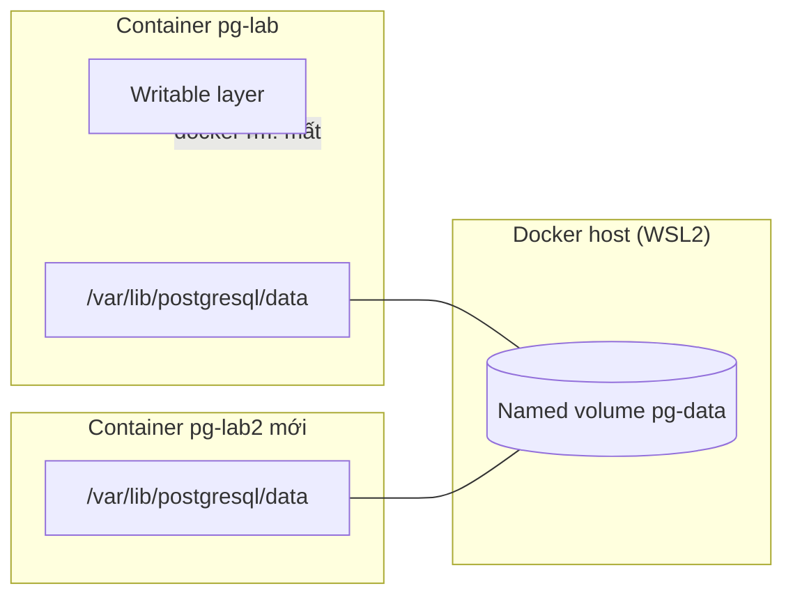

# Buổi 12 – Persistent Storage

Tuần 6/16 · Giai đoạn 2 – Containerization · Buổi 12/32

[Slide buổi 12](../../slides/02-docker/session-12.md) · [Bài tập tuần 6](../../assignments/weekly/week-06.md) · [Hub tuần 6](README.md)

> **Tóm tắt:** Chạy PostgreSQL với named volume để dữ liệu sống sót khi xóa container, rồi backup và restore bằng pg_dump. Biết phân biệt volume, bind mount và tmpfs.

::: tip Buổi này bạn làm gì
**Bạn sẽ tạo ra:** một database Postgres có dữ liệu của bạn, sống sót qua việc xóa hẳn container, và một file `backup.sql` đã được thử restore thật.

**Thời gian thật:** đọc 15 phút, lab bắt buộc 60 phút, thử thách tùy chọn làm ở nhà ([Thử thách thêm buổi 12](session-12-challenge.md)).

**Cần chuẩn bị:**

- [ ] Docker Desktop đang chạy, bạn làm việc trong WSL (`pwd` bắt đầu bằng `/home/`, không phải `/mnt/c`). Cài đặt: [Setup Guide: Windows 11 + WSL2](../../resources/setup-guide.md)
- [ ] Đã xong [Buổi 11 – Container Networking](session-11.md) (biết `docker run`, `docker exec`, `docker inspect`, `docker rm`)
- [ ] Repo cá nhân `devops-labs` đã có: [Tài khoản GitHub và repo devops-labs](../../resources/setup-github.md)

**Phải nộp** (thư mục `lab-12/` trong repo `devops-labs`):

- `README.md` trả lời 7 câu theo mẫu
- `evidence/command-output.txt` có lệnh kèm output thật: tạo dữ liệu, recreate, `docker inspect`, `SHOW data_directory;`, backup và restore
- `report.md` (nếu làm L2: phân tích Tình huống 04)
- `source/backup.sql`, không có file `.env`

**Đi nhanh:** [Đọc](#van-de-thuc-te) → [Làm lab](#hands-on-lab) → [Gặp lỗi?](#gap-loi) → [Tự kiểm tra](#tu-kiem-tra) → [Nộp bài](#nop-bai). Kẹt thì nhảy tới [Gặp lỗi?](#gap-loi).

**Từ mới trong buổi:**

- [volume](../../resources/glossary.md): ngăn lưu trữ do Docker quản lý, tồn tại độc lập với container
- [writable layer](../../resources/glossary.md): lớp ghi tạm của container, mất khi container bị xóa
- [bind mount](../../resources/glossary.md): gắn một thư mục có sẵn trên máy vào container
- [pg_dump](../../resources/glossary.md): lệnh xuất database ra file SQL để backup
- [healthcheck](../../resources/glossary.md): lệnh Docker chạy định kỳ để biết dịch vụ đã khỏe chưa
:::

## Vấn đề thực tế {#van-de-thuc-te}

Một thành viên CLB dựng PostgreSQL để lưu danh sách thành viên, nhập 30 người đăng ký đầu học kỳ. Hôm sau cậu ấy cập nhật phiên bản image: xóa container cũ, chạy container mới. Bảng `members` trống trơn. Không có lỗi nào được báo, mọi lệnh đều chạy thành công, chỉ là dữ liệu không còn. Container được thiết kế để dùng một lần và thay thế dễ dàng, nhưng dữ liệu database thì không được dùng một lần. Bài này dạy cách tách dữ liệu ra khỏi vòng đời container, cách kiểm chứng việc đó thật sự xảy ra, và cách backup để vẫn an toàn khi volume bị xóa nhầm.

## Khái niệm cốt lõi

**1. Writable layer.** Image là các lớp chỉ đọc; khi chạy, Docker thêm một lớp ghi mỏng lên trên. Mọi file container ghi ra nằm ở đó và mất khi `docker rm`. Ví von: bảng trắng trong phòng họp, dọn phòng là sạch. Quy tắc: thứ gì cần sống lâu hơn container phải nằm ngoài lớp này.

**2. Ba loại mount.** Dùng `--mount type=...,source=...,target=...` để gắn dữ liệu ra ngoài.

- **Named volume**: vùng do Docker quản lý, sống sau khi xóa container. Dùng cho database. Ví von: tủ gửi đồ ở kho chung.
- **Bind mount**: một thư mục có sẵn trên máy bạn. Dùng cho mã nguồn và file cấu hình khi phát triển. Ví von: mở cửa thông thẳng sang phòng bên cạnh.
- **tmpfs**: nằm trong RAM, mất khi container dừng. Dùng cho dữ liệu tạm. Ví von: giấy nhớ dán tạm.

**3. Postgres ghi dữ liệu ở `/var/lib/postgresql/data`.** Điểm mount của volume phải trùng đúng đường dẫn này. Nếu không gắn gì, Docker tự tạo một "anonymous volume" tên hex, container mới sẽ tạo cái mới nên trông như mất dữ liệu. Nếu gõ sai đích (ví dụ `/var/lib/postgres/data`, thiếu `ql`), volume của bạn nằm trống còn Postgres ghi vào lớp ghi tạm. Ví von: gửi đồ vào tủ nhưng lại để đồ ở bàn bên cạnh.

**4. Script khởi tạo chỉ chạy một lần.** `init.sql` trong `/docker-entrypoint-initdb.d/` và các biến `POSTGRES_*` chỉ có tác dụng khi thư mục dữ liệu còn trống (lần đầu). Volume đã có dữ liệu thì bị bỏ qua.

**5. Backup bằng `pg_dump`.** Xuất database thành file SQL đọc được, nhất quán khi database đang chạy. Ví von: chụp ảnh cuốn sổ trước khi cho mượn. Backup chưa thử restore thì chưa phải backup.



Xóa `pg-lab` thì lớp ghi tạm biến mất, volume vẫn còn và được gắn lại vào `pg-lab2`. Cú pháp `-v` so với `--mount`, vòng đời dữ liệu từng bước và lưu ý Postgres 18: mục "Tìm hiểu thêm" gập sẵn ở cuối trang.

Trên lớp, mentor demo trước; tự học thì làm thẳng phần Làm lab.

## Hands-on lab (60 phút, bắt buộc) {#hands-on-lab}

Tất cả chạy trong WSL. Không bind cổng ra host trong bài này (ta truy cập Postgres bằng `docker exec`), tránh xung đột cổng 5432.

### Chuẩn bị (5 phút)

```bash
mkdir -p ~/devops-labs/lab-12/{source,screenshots,evidence}
cd ~/devops-labs/lab-12
docker rm -f pg-lab pg-lab2 2>/dev/null; docker volume rm pg-data 2>/dev/null; true
export PGPASS=lab-only-password
docker version --format '{{.Server.Version}}'
docker run --rm alpine:3.20 echo ok
```

Kết quả mong đợi: số phiên bản Docker Engine (27 trở lên) và `ok`. `PGPASS` là mật khẩu giả chỉ dùng cho lab, đừng dùng mật khẩu thật của bạn ở bất cứ đâu. Mỗi lần mở terminal mới, chạy lại dòng `export`.

### Phần 1 – Chạy PostgreSQL với named volume (10 phút)

```bash
docker volume create pg-data
docker volume ls --filter name=pg-data
docker run -d --name pg-lab \
  -e POSTGRES_DB=clubdb -e POSTGRES_USER=club -e POSTGRES_PASSWORD="$PGPASS" \
  --mount type=volume,source=pg-data,target=/var/lib/postgresql/data \
  postgres:17-alpine
until docker exec pg-lab pg_isready -h 127.0.0.1 -U club -d clubdb; do sleep 1; done
```

Kết quả mong đợi: tên volume `pg-data`, bảng `local  pg-data`, rồi (sau vài dòng `no response`, bình thường vì Postgres đang khởi tạo) `127.0.0.1:5432 - accepting connections`. Đích mount phải khớp đường dẫn Postgres dùng, nếu không volume vô dụng. Có `-h 127.0.0.1` vì lần khởi tạo đầu có một server tạm chỉ nghe qua unix socket; kiểm tra qua TCP chỉ thành công khi server thật đã chạy.

::: tip Kiểm tra: bạn đúng khi
`pg_isready` in `accepting connections`. Treo hoặc báo lỗi? Xem [Gặp lỗi?](#gap-loi).
:::

### Phần 2 – Tạo dữ liệu (5 phút)

```bash
docker exec -i pg-lab psql -U club -d clubdb -v ON_ERROR_STOP=1 <<'SQL'
CREATE TABLE IF NOT EXISTS members (
  id SERIAL PRIMARY KEY,
  name VARCHAR(100) NOT NULL,
  email VARCHAR(150) UNIQUE NOT NULL,
  created_at TIMESTAMP DEFAULT CURRENT_TIMESTAMP
);
INSERT INTO members (name, email) VALUES
  ('Alice', 'alice@example.com'),
  ('Bob', 'bob@example.com'),
  ('Carol', 'carol@example.com');
SQL
docker exec pg-lab psql -U club -d clubdb -c "SELECT id, name FROM members ORDER BY id;"
```

Kết quả mong đợi: `CREATE TABLE`, `INSERT 0 3`, rồi bảng 3 dòng Alice, Bob, Carol. Khi làm bài nộp, hãy thay ba dòng này bằng tên và email giả của riêng bạn (các lệnh kiểm tra bên dưới đổi theo).

### Phần 3 – Xóa hẳn container và tạo lại (10 phút)

```bash
docker rm -f pg-lab
docker ps -a --filter name=pg-lab
docker volume ls --filter name=pg-data
docker run -d --name pg-lab2 \
  -e POSTGRES_DB=clubdb -e POSTGRES_USER=club -e POSTGRES_PASSWORD="$PGPASS" \
  --mount type=volume,source=pg-data,target=/var/lib/postgresql/data \
  postgres:17-alpine
until docker exec pg-lab2 pg_isready -h 127.0.0.1 -U club -d clubdb; do sleep 1; done
docker exec pg-lab2 psql -U club -d clubdb -c "SELECT id, name FROM members ORDER BY id;"
docker logs pg-lab2 | head
```

Kết quả mong đợi: danh sách container rỗng nhưng volume `pg-data` vẫn có; sau khi tạo `pg-lab2`, bạn vẫn thấy 3 dòng Alice, Bob, Carol mà không cần tạo lại bảng, và log có dòng `Skipping initialization` (Postgres nhận ra thư mục dữ liệu đã có sẵn). Dữ liệu nằm trong volume, container chỉ là lớp vỏ thay thế được.

::: tip Kiểm tra: bạn đúng khi
`SELECT` sau khi tạo lại vẫn ra đủ 3 dòng và log có `Skipping initialization`. Mất dữ liệu? Xem [Gặp lỗi?](#gap-loi).
:::

### Phần 4 – Kiểm chứng bằng inspect (5 phút)

```bash
docker inspect pg-lab2 --format '{{range .Mounts}}{{.Type}} {{.Name}} -> {{.Destination}}{{"\n"}}{{end}}'
docker exec pg-lab2 psql -U club -d clubdb -tA -c "SHOW data_directory;"
docker rm -f pg-lab2
```

Kết quả mong đợi: `volume pg-data -> /var/lib/postgresql/data` và `/var/lib/postgresql/data`. Đích mount (lệnh 1) và `data_directory` (lệnh 2) phải trùng nhau: đây là phép kiểm tra cốt lõi, và là cách phát hiện lỗi "có volume nhưng vẫn mất dữ liệu". Lệnh cuối dọn container tạm nhưng giữ volume cho Phần 5.

::: tip Kiểm tra: bạn đúng khi
Hai đường dẫn trùng nhau. Nếu khác nhau, volume của bạn chưa được dùng: xem hàng đầu bảng [Gặp lỗi?](#gap-loi).
:::

### Phần 5 – Backup và restore bằng pg_dump (15 phút)

1. Tạo lại container trên volume cũ và backup:

```bash
docker run -d --name pg-lab \
  -e POSTGRES_DB=clubdb -e POSTGRES_USER=club -e POSTGRES_PASSWORD="$PGPASS" \
  --mount type=volume,source=pg-data,target=/var/lib/postgresql/data \
  postgres:17-alpine
until docker exec pg-lab pg_isready -h 127.0.0.1 -U club -d clubdb; do sleep 1; done
docker exec pg-lab pg_dump -U club -d clubdb > source/backup.sql
head -n 5 source/backup.sql; grep -c "Alice" source/backup.sql
```

Kết quả mong đợi: file bắt đầu bằng comment `-- PostgreSQL database dump`, và `grep -c` in `1`. Dùng `pg_dump` thay vì chép thư mục dữ liệu vì dump nhất quán khi database đang chạy, đọc được bằng mắt, và restore được sang phiên bản Postgres khác.

2. Giả lập thảm họa: xóa cả container lẫn volume.

::: danger Chỉ xóa đúng volume của bài này
`docker volume rm` xóa dữ liệu vĩnh viễn. Chỉ xóa `pg-data` (volume của bạn trong bài này), không bao giờ dùng `docker volume prune` trên máy có dự án khác. Chạy `docker volume ls` để chắc tên đúng trước khi xóa.
:::

```bash
docker rm -f pg-lab
docker volume rm pg-data
```

3. Dựng lại database rỗng và restore:

```bash
docker run -d --name pg-lab \
  -e POSTGRES_DB=clubdb -e POSTGRES_USER=club -e POSTGRES_PASSWORD="$PGPASS" \
  --mount type=volume,source=pg-data,target=/var/lib/postgresql/data \
  postgres:17-alpine
until docker exec pg-lab pg_isready -h 127.0.0.1 -U club -d clubdb; do sleep 1; done
docker exec pg-lab psql -U club -d clubdb -c "\dt"
docker exec -i pg-lab psql -U club -d clubdb -v ON_ERROR_STOP=1 < source/backup.sql
docker exec pg-lab psql -U club -d clubdb -c "SELECT id, name, email FROM members ORDER BY id;"
```

Kết quả mong đợi: `\dt` báo `Did not find any relations.` (database mới rỗng), restore in `CREATE TABLE` và `COPY 3`, và `SELECT` cho thấy lại đúng dữ liệu của bạn. Nhớ `docker exec -i` (có `-i`, không có `-t`) khi nhận dữ liệu qua redirect; thiếu `-i`, restore trống mà không báo lỗi.

::: tip Kiểm tra: bạn đúng khi
`SELECT` sau restore ra đúng tên và email của bạn (không chỉ đúng số dòng). Bảng vẫn trống? Xem [Gặp lỗi?](#gap-loi).
:::

### Phần 6 – Gom bằng chứng và dọn dẹp (10 phút)

Dán lệnh và output của các phần trên vào `evidence/command-output.txt`; cách nhanh là chạy lại lệnh với `tee`, ví dụ `docker volume ls | tee -a evidence/command-output.txt`. Thêm `date -Iseconds` trước mỗi nhóm lệnh. Cần có: `SELECT` trước và sau recreate, `docker ps -a --filter name=pg-lab`, `docker volume ls`, `docker inspect` (Mounts), `SHOW data_directory;`, dòng `Skipping initialization`, output `\dt` lúc database rỗng và `SELECT` sau restore. Sau đó dọn:

```bash
docker rm -f pg-lab pg-lab2 2>/dev/null; docker volume rm pg-data 2>/dev/null; true
```

### Checklist L1 và tự kiểm tra một dòng

- [ ] Volume `pg-data` gắn vào `/var/lib/postgresql/data`; bảng `members` có 3 dòng.
- [ ] Xóa container, tạo lại cùng volume, dữ liệu còn (log có `Skipping initialization`).
- [ ] `docker inspect` và `SHOW data_directory;` cho hai đường dẫn trùng nhau.
- [ ] `source/backup.sql` có dữ liệu; sau khi xóa volume, restore thành công và `SELECT` thấy lại dữ liệu.
- [ ] Đã dán lệnh và output chính vào `evidence/command-output.txt`.

```bash
test -s source/backup.sql && grep -c "COPY public.members" source/backup.sql
```

Mong đợi: `1`.

## Gặp lỗi? {#gap-loi}

| Triệu chứng | Nguyên nhân | Cách sửa |
| --- | --- | --- |
| Dữ liệu mất sau `down` hoặc `rm -f` dù có volume trong `docker volume ls`; `SELECT` báo `relation "members" does not exist` | Điểm mount không khớp nơi Postgres ghi (gõ sai đường dẫn, hoặc `PGDATA` bị đổi) | Đối chiếu `docker inspect` với `SHOW data_directory;`, cho hai đường dẫn khớp nhau (Tình huống 04 ở [Thử thách thêm buổi 12](session-12-challenge.md#pha-loi-nang-cao)) |
| Sau `docker compose down -v` mất toàn bộ dữ liệu | `-v` xóa named volume khai báo trong compose | Dùng `down` thường; backup trước khi dùng `-v` |
| Đổi `POSTGRES_PASSWORD` nhưng mật khẩu cũ vẫn dùng | Biến chỉ áp dụng khi khởi tạo lần đầu, volume đã có dữ liệu | Dùng `ALTER USER`, hoặc xóa volume (sau khi backup) |
| `init.sql` không chạy lại sau khi sửa | Script trong `docker-entrypoint-initdb.d` chỉ chạy khi thư mục dữ liệu trống | Dùng `psql` để áp dụng thay đổi, hoặc tạo volume mới |
| Restore bằng `docker exec ... psql < backup.sql` xong bảng vẫn trống | Thiếu `-i` nên stdin không vào container, lệnh vẫn thoát mã 0 | Thêm `-i`, kiểm tra bằng `SELECT` dữ liệu thật |
| `docker volume rm pg-data` báo `volume is in use` | Còn container (kể cả đã dừng) đang dùng volume | `docker rm -f` container đó trước rồi xóa volume |
| `invalid mount config ... bind source path does not exist` | Dùng `--mount type=bind` với thư mục chưa tồn tại | Tạo thư mục trước, kiểm tra đường dẫn |
| Postgres không khởi động với bind mount, báo lỗi quyền | Thư mục host (nhất là dưới `/mnt/c`) không cho đổi chủ sở hữu | Dùng named volume cho dữ liệu database; làm trong filesystem của WSL |
| Có hàng chục volume tên hex trong `docker volume ls` | Anonymous volume sinh ra do chưa gắn volume có tên | Gắn named volume; dọn bằng `docker volume ls -f dangling=true` và xóa có chọn lọc |
| `pg_isready` in `no response` hoặc `rejecting connections` vài giây đầu | Postgres đang khởi tạo (bình thường) | Chờ, vòng `until ... sleep 1` tự dừng khi sẵn sàng |

## Tự kiểm tra {#tu-kiem-tra}

1. Dữ liệu ghi vào writable layer của container có còn sau `docker rm` không? Vì sao?
2. Khi nào chọn named volume, bind mount, tmpfs?
3. `docker compose down` và `docker compose down -v` khác nhau thế nào?
4. `docker volume ls` có volume của dự án nhưng dữ liệu vẫn mất sau `down` và `up`. Bạn kiểm tra gì đầu tiên?
5. Vì sao `pg_dump` thường được ưu tiên hơn sao chép thô thư mục dữ liệu?

::: details Đáp án gợi ý
1. Không. Writable layer gắn với vòng đời container và bị xóa cùng container.
2. Named volume cho dữ liệu cần bền như database; bind mount khi cần chia sẻ file giữa máy và container (mã nguồn khi dev, file cấu hình); tmpfs cho dữ liệu tạm hoặc nhạy cảm không muốn ghi đĩa.
3. `down` xóa container và network, giữ volume. `down -v` xóa thêm named volume khai báo trong file compose, nên mất dữ liệu.
4. So sánh đích mount trong `docker inspect` với `data_directory` của Postgres (`SHOW data_directory;`). Nếu khác nhau, volume chưa được dùng. Kiểm tra thêm `PGDATA` có bị đổi không và có anonymous volume nào được gắn vào container hay không.
5. Dump nhất quán về logic khi database đang chạy, không phụ thuộc cấu trúc file nội bộ nên restore được sang phiên bản khác, và đọc được. Sao chép thô cần dừng database và phụ thuộc cùng phiên bản.
:::

## Nộp bài {#nop-bai}

Nộp vào thư mục `lab-12/` trong repo `devops-labs`, theo [Lab XX – Tên lab](../../templates/lab-template.md) và [Bài tập tuần 6](../../assignments/weekly/week-06.md):

- [ ] `README.md` trả lời đủ 7 câu: bài lab giải quyết gì, kiến thức đã dùng, các bước, kết quả mong đợi, lỗi đã gặp, cách khắc phục, có thể cải thiện gì. Ghi đã làm L1 hay L2 ở cuối.
- [ ] `evidence/command-output.txt` có lệnh và output của: tạo dữ liệu, recreate container, `docker inspect`, `SHOW data_directory;`, backup và restore.
- [ ] `report.md` (nếu làm L2) có phân tích Tình huống 04 đủ 5 mục.
- [ ] `source/` có `backup.sql`, `compose.yaml` (và `pgdata.tgz` nếu làm), không có file `.env`.
- [ ] Đã rà soát: không commit mật khẩu, token hoặc `.env` (thêm `.env` vào `.gitignore`). Mật khẩu chỉ là giá trị giả dành cho lab.

## Recap

- Dữ liệu trong writable layer mất cùng container; dữ liệu cần bền phải nằm trong volume gắn đúng `/var/lib/postgresql/data`.
- Volume tồn tại không có nghĩa là Postgres đang ghi vào nó: luôn đối chiếu `docker inspect` với `SHOW data_directory;`.
- `down` giữ volume, `down -v` xóa volume; backup bằng `pg_dump` chưa thử restore thì chưa phải backup.

Buổi tiếp theo: [Buổi 13 – Docker Compose](../week-07/session-13.md).

::: details Thử thách thêm (L2, tùy chọn, làm ở nhà)
Thử thách A (Compose, `down` với `down -v`), B (backup mức volume) và C (tái hiện Tình huống 04) nằm ở [Thử thách thêm buổi 12](session-12-challenge.md). Mỗi thử thách có gợi ý từng bậc; tự thử 15 phút trước khi mở gợi ý. Đáp án đối chiếu (mở sau khi nộp bài): [trang tuần 6](README.md).
:::

::: details Phá lỗi nâng cao
Tình huống 04 "có volume nhưng vẫn mất dữ liệu" (`PGDATA` lệch điểm mount), cùng cây điều tra từng bước, nằm ở [Thử thách thêm buổi 12](session-12-challenge.md#pha-loi-nang-cao). Mentor chạy `bash setup.sh` trong `examples/troubleshooting/scenario-04/`; bạn chỉ nhận triệu chứng và tự tìm nguyên nhân.
:::

::: details Tìm hiểu thêm (đọc sau)
Cú pháp `--mount` so với `-v`, bảng so sánh ba loại mount, vòng đời dữ liệu từng bước, anonymous volume, lưu ý Postgres 18 và vị trí volume trên Docker Desktop nằm ở [Thử thách thêm buổi 12](session-12-challenge.md#tim-hieu-them).
:::

::: details Tài liệu tham khảo
- [Docker: Volumes](https://docs.docker.com/engine/storage/volumes/)
- [Docker: Bind mounts](https://docs.docker.com/engine/storage/bind-mounts/)
- [Docker: tmpfs mounts](https://docs.docker.com/engine/storage/tmpfs/)
- [Docker Hub: postgres (Official Image)](https://hub.docker.com/_/postgres)
- [PostgreSQL: Backup and Restore (pg_dump)](https://www.postgresql.org/docs/17/backup-dump.html)
- [Docker Compose: docker compose down](https://docs.docker.com/reference/cli/docker/compose/down/)
:::
