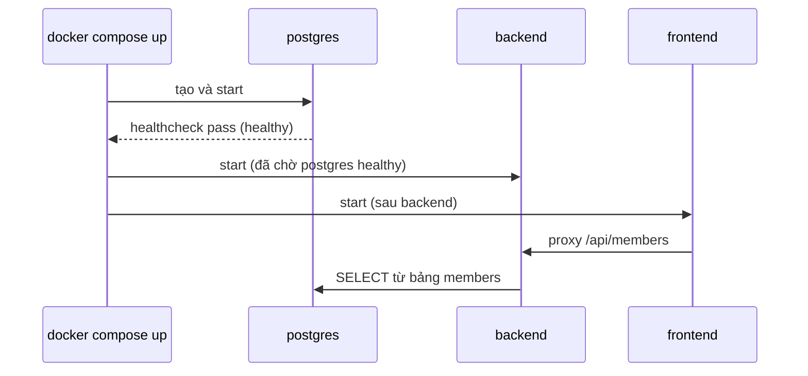

# Buổi 13 – Thử thách L2 và phá lỗi nâng cao

> **Tóm tắt:** Trang phụ của Buổi 13: ba thử thách L2 về Compose, tình huống phá lỗi đổi mật khẩu, bảng tra cứu các khóa compose.yaml và tài liệu tham khảo.

Quay lại bài chính: [Buổi 13 – Docker Compose](session-13.md). Trang này không bắt buộc; chỉ làm khi đã hoàn thành checklist L1. Lời giải mẫu nằm ở [trang tuần 7](README.md) (mở sau khi nộp bài).

## Thử thách L2

Mỗi thử thách có gợi ý từng bậc. Hãy tự thử 15 phút trước khi mở gợi ý.

**Thử thách A (viết lại từ đầu):** tạo `lab-13/source/compose.mine.yaml` cho cùng ba service mà không nhìn file gốc. Tiêu chí hoàn thành:

- [ ] Chạy được bằng `docker compose -f compose.mine.yaml -p lab13mine up -d --build` (dừng bản gốc trước để tránh trùng cổng) và `/api/members` trả về dữ liệu.
- [ ] Backend chỉ khởi động sau khi postgres `healthy`.
- [ ] Mật khẩu chỉ nằm trong `.env`; thiếu thì Compose báo lỗi rõ ràng.
- [ ] Postgres không publish cổng ra máy.
- [ ] Trong `report.md`, giải thích bằng lời của bạn từng khóa trong file.

::: details Gợi ý A
Bắt đầu từ postgres vì các service khác phụ thuộc vào nó: `image`, `environment` (`POSTGRES_DB`, `POSTGRES_USER`, `POSTGRES_PASSWORD`), `volumes`, `healthcheck`. Sau đó backend (`build`, `environment` với `DB_HOST: postgres`, `depends_on` có `condition`), cuối cùng frontend. Chạy `docker compose -f compose.mine.yaml config` sau mỗi lần thêm một service để bắt lỗi thụt lề sớm. Khi dùng `-p` khác, tài nguyên có tiền tố khác nên volume của bạn là volume mới.

Điểm hay sai: viết `DB_HOST: localhost` (phải là `postgres`), quên mount `init.sql` nên bảng `members` không tồn tại, hoặc để `ports` cho postgres khiến xung đột với PostgreSQL cài sẵn trên máy.
:::

**Thử thách B (đổi cổng):** chạy hệ thống với `WEB_PORT=8081` mà không sửa `compose.yaml`. Tiêu chí: truy cập được `http://localhost:8081`, và bạn giải thích được vì sao chỉ cần sửa `.env`.

::: details Gợi ý B
Xem biểu thức `${WEB_PORT:-8080}` trong khóa `ports` của frontend. Sau khi sửa `.env`, chạy `docker compose up -d` để Compose tạo lại container frontend với cổng mới, rồi kiểm tra bằng `docker compose ps`. Cách khác: đặt biến tạm cho một lệnh, `WEB_PORT=8081 docker compose up -d` (biến của shell được ưu tiên hơn `.env`).
:::

**Thử thách C (restart policy):** làm backend thoát bất thường và quan sát. Tiêu chí: giải thích được vì sao container tự chạy lại.

::: details Gợi ý C
Docker Engine bản mới (đã kiểm chứng với 29.x) coi lệnh `docker compose kill` do bạn gõ là dừng thủ công, nên container nằm yên ở `Exited (137)` và không tự chạy lại. Hãy tạo một lần thoát bất thường thật: gọi `curl -s http://localhost:3000/api/members > /dev/null` để pool có một kết nối nhàn rỗi, rồi `docker compose stop postgres`. Backend không bắt sự kiện `error` của pool nên tiến trình Node thoát, và restart policy dựng nó lại. Xem `docker compose ps -a backend` và `docker inspect --format '{{.RestartCount}} {{.HostConfig.RestartPolicy.Name}}'` (lấy ID bằng `docker compose ps -q backend`). Chạy lại `docker compose start postgres` khi xong. So sánh với `docker compose stop backend`.

Ý chính để giải thích: với `restart: unless-stopped`, Docker khởi động lại container khi nó thoát bất thường, trừ khi bạn chủ động dừng. Restart policy không sửa lỗi cấu hình; một container lỗi liên tục sẽ lặp vòng khởi động lại.
:::

**Câu hỏi thêm:**

6. Tình huống: bạn sửa `init.sql` thêm một thành viên, chạy `docker compose up -d` nhưng dữ liệu không đổi. Vì sao và xử lý thế nào?
7. Tình huống: sau khi đổi `DB_PASSWORD`, `docker compose ps` báo mọi thứ `Up` nhưng API trả 500. Bạn kiểm tra gì đầu tiên?

::: details Đáp án câu 6 và 7
6. Init script chỉ chạy khi data directory trống; volume cũ đã có dữ liệu nên bị bỏ qua. Với môi trường học, dùng `down -v` rồi `up -d`; trong thực tế dùng migration hoặc câu lệnh SQL trực tiếp.
7. Xem `docker compose logs backend` để tìm lỗi xác thực; so sánh mật khẩu backend nhận với mật khẩu database đang dùng (volume giữ mật khẩu cũ).
:::

## Phá lỗi nâng cao

### Tình huống: đổi mật khẩu trong .env nhưng API vẫn lỗi kết nối DB

Cách phá (làm sau khi hệ thống đã chạy ổn với dữ liệu):

```bash
sed -i 's/^DB_PASSWORD=.*/DB_PASSWORD=another-password-123/' .env
docker compose up -d
curl -s -o /dev/null -w "%{http_code}\n" http://localhost:8080/api/members
```

Triệu chứng: postgres vẫn `healthy`, các container vẫn `Up`, nhưng API trả mã `500` (hoặc `502` nếu backend đang khởi động lại).

Hướng điều tra theo từng bước:

1. `docker compose ps`: mọi service đều chạy, không có service nào thoát. Lỗi không nằm ở việc container sống hay chết.
2. `docker compose logs --tail=30 backend`: tìm dòng lỗi kiểu `password authentication failed for user "club"`.
3. `docker compose logs --tail=30 postgres`: có thể thấy dòng `FATAL: password authentication failed for user "club"` từ phía server, xác nhận backend đã tới được postgres nhưng bị từ chối.
4. So sánh hai phía: `docker compose exec backend printenv DB_PASSWORD` (mật khẩu mới) với mật khẩu mà database đang dùng. Biến `POSTGRES_PASSWORD` chỉ được dùng khi khởi tạo data directory lần đầu; volume `postgres-data` vẫn giữ mật khẩu cũ.

Nguyên nhân gốc: backend nhận mật khẩu mới từ `.env`, còn database trong volume cũ vẫn đặt theo mật khẩu ban đầu. Đổi biến môi trường không đổi mật khẩu bên trong dữ liệu đã tồn tại.

Cách sửa (chọn một):

- Cho môi trường học: trả lại mật khẩu cũ trong `.env`, hoặc chấp nhận mất dữ liệu bằng `docker compose down -v` rồi `up -d` để khởi tạo lại bằng mật khẩu mới.
- Giữ dữ liệu: đổi mật khẩu trong chính database. Lệnh này kết nối bằng socket nội bộ nên không cần mật khẩu cũ:

```bash
docker compose exec postgres psql -U club -d clubdb -c "ALTER USER club PASSWORD 'another-password-123';"
```

Cách phòng tránh: ghi chú trong README rằng đổi `DB_PASSWORD` sau khi có volume cần đổi cả trong database; quản lý thay đổi secret như một thao tác riêng, không sửa `.env` tùy tiện. Sau bài này hãy khôi phục `.env` về giá trị ban đầu.

Gợi ý mở rộng: các tình huống tương tự có trong `examples/troubleshooting/` (scenario-03, API không kết nối được DB, và scenario-01, port đã được sử dụng). Hãy thử giải trước khi xem gợi ý.

## Tra cứu thêm

**Các khóa chính trong `compose.yaml`**

| Khóa | Ý nghĩa | Ví dụ trong starter-project |
| --- | --- | --- |
| `services` | Danh sách thành phần; mỗi service sinh ra một hoặc nhiều container | `frontend`, `backend`, `postgres` |
| `build` | Build image từ Dockerfile | `context: ./backend` |
| `image` | Dùng image có sẵn | `postgres:17-alpine` |
| `ports` | Publish cổng ra máy, dạng `HOST:CONTAINER` | `"${WEB_PORT:-8080}:80"` |
| `environment` | Biến môi trường cho container | `DB_HOST: postgres` |
| `depends_on` | Thứ tự khởi động giữa các service | backend chờ postgres |
| `networks` | Network mà service tham gia | `club-network` |
| `volumes` | Lưu dữ liệu hoặc mount file | `postgres-data`, `init.sql` |
| `healthcheck` | Lệnh để Docker biết service đã khỏe chưa | `pg_isready` |
| `restart` | Chính sách tự khởi động lại | `unless-stopped` |


**Các dạng `depends_on`**

| Dạng | Hành vi | Khi nào dùng |
| --- | --- | --- |
| `depends_on: [backend]` | Chỉ đảm bảo container backend được start trước | Frontend: nginx phân giải tên `backend` ngay lúc khởi động (do `proxy_pass http://backend:3000`), nên container backend phải được tạo trước; không cần chờ backend sẵn sàng |
| `condition: service_started` | Giống dạng trên (là mặc định) | Phụ thuộc đơn giản |
| `condition: service_healthy` | Chờ tới khi healthcheck của service kia báo healthy | Backend phụ thuộc postgres |

**Thay biến trong `.env`.** Đây là bước thay thế lúc Compose đọc file, khác với việc truyền biến vào container.

| Cú pháp | Ý nghĩa |
| --- | --- |
| `${WEB_PORT:-8080}` | Dùng `WEB_PORT`, nếu trống hoặc chưa đặt thì dùng 8080 |
| `${DB_PASSWORD:?Set DB_PASSWORD in .env}` | Bắt buộc có giá trị, thiếu thì Compose dừng và in thông báo |

**Chuỗi khởi động khi chạy `docker compose up`**



1. `docker compose up` đọc `compose.yaml` và `.env`, thay các biến `${...}`; thiếu `DB_PASSWORD` thì dừng ngay.
2. Compose tạo network `club-network` và volume `postgres-data` nếu chưa có.
3. Build image cho `backend` và `frontend` từ Dockerfile trong từng thư mục (`build.context`).
4. Start `postgres` trước. Lần đầu, entrypoint khởi tạo database `clubdb`, user `club` và chạy `init.sql` (tạo bảng `members`, thêm Alice và Bob).
5. Healthcheck chạy `pg_isready` mỗi 5 giây; sau khi pass, postgres thành `healthy`.
6. Backend start, kết nối `postgres:5432` bằng DNS nội bộ. Sau đó frontend start.
7. Chỉ hai cổng được publish ra máy: `WEB_PORT` (mặc định 8080) cho frontend và 3000 cho backend. Postgres không publish, nên chỉ các container trong network truy cập được.
## Tài liệu tham khảo

- [Docker Compose overview](https://docs.docker.com/compose/)
- [Compose file reference](https://docs.docker.com/reference/compose-file/)
- [Services top-level element: depends_on](https://docs.docker.com/reference/compose-file/services/#depends_on)
- [Environment variables in Compose](https://docs.docker.com/compose/how-tos/environment-variables/)
- [Interpolation in Compose files](https://docs.docker.com/reference/compose-file/interpolation/)
- [Docker Hub: postgres image](https://hub.docker.com/_/postgres)
