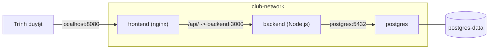
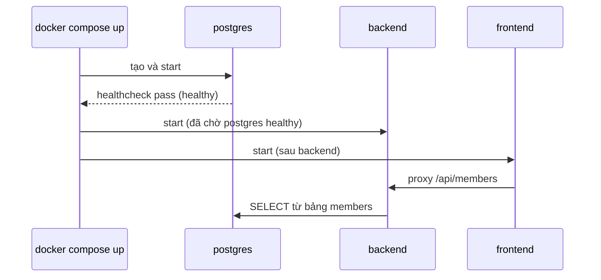

# Buổi 13 – Docker Compose

Tuần 7 · Giai đoạn 2 – Containerization · Slide: [Slide buổi 13](../../slides/03-compose/session-13.md)

> **Tóm tắt:** Dùng Docker Compose để mô tả và chạy cả Frontend, API và PostgreSQL của starter-project bằng một file compose.yaml và một lệnh duy nhất.

## Mục tiêu học tập

- Giải thích được vai trò của từng khóa chính trong `compose.yaml`: `services`, `build`, `image`, `ports`, `environment`, `depends_on`, `networks`, `volumes`, `healthcheck`, `restart`.
- Chạy được toàn bộ starter-project (frontend, backend, postgres) bằng `docker compose up -d --build` và kiểm tra bằng `docker compose ps`, `logs`, `exec`.
- Phân biệt được `depends_on` mặc định (chỉ thứ tự khởi động) với `depends_on` kèm `condition: service_healthy`.
- Cấu hình được biến môi trường qua file `.env` mà không commit secret.
- Giải thích được vì sao dữ liệu PostgreSQL còn lại sau `docker compose down` nhưng mất sau `docker compose down -v`.
- Chẩn đoán được lỗi API không kết nối được database do sai mật khẩu hoặc volume cũ.

## Điều kiện cần

- Đã học buổi 9-12: Dockerfile, build image, networking, volume.
- Windows 11 + WSL2 Ubuntu, Docker Desktop bật tích hợp WSL. Mọi lệnh chạy trong terminal WSL, trong filesystem của WSL (ví dụ `~/devops-labs`), không dùng `/mnt/c`.
- Cổng 8080 và 3000 trên máy chưa bị chiếm (nếu bận, đổi `WEB_PORT`, xem phần Chuẩn bị).

Kiểm tra nhanh:

```bash
docker --version
docker compose version
```

Kết quả mong đợi (số phiên bản có thể khác, Compose cần là v2):

```text
Docker version 27.x.x, build xxxxxxx
Docker Compose version v2.x.x
```

Lưu ý cú pháp: dùng `docker compose` (có dấu cách), không dùng `docker-compose` (bản v1 cũ).

## Vấn đề thực tế

Ở buổi 9-12 bạn đã chạy ứng dụng CLB bằng nhiều lệnh `docker run`: tạo network, tạo volume, chạy postgres với một chuỗi biến môi trường, chạy backend, rồi chạy frontend. Mỗi lần có thành viên mới vào dự án, họ phải chép lại cả chục dòng lệnh, và chỉ cần quên một cờ `-e` hoặc sai thứ tự là hệ thống không lên. Lệnh nằm trong lịch sử terminal của một người, không ai review được.

Docker Compose giải quyết việc này bằng cách mô tả toàn bộ hệ thống trong một file `compose.yaml` được commit cùng mã nguồn. Thành viên mới chỉ cần clone repo, tạo `.env`, chạy `docker compose up -d --build`. File này cũng là tài liệu sống: ai muốn biết backend nối vào database nào, cổng nào mở ra máy chủ, dữ liệu lưu ở đâu chỉ cần đọc một file.

## Khái niệm cốt lõi

Compose là công cụ khai báo (declarative): bạn mô tả trạng thái mong muốn, Compose tạo hoặc cập nhật container, network, volume cho khớp. Một "project" Compose mặc định lấy tên theo tên thư mục chứa `compose.yaml`; mọi tài nguyên được gắn nhãn và tiền tố theo project này.

### Các khóa chính

| Khóa | Ý nghĩa | Ví dụ trong starter-project |
| --- | --- | --- |
| `services` | Danh sách thành phần của ứng dụng; mỗi service sinh ra một hoặc nhiều container | `frontend`, `backend`, `postgres` |
| `build` | Build image từ Dockerfile | `context: ./backend` |
| `image` | Dùng image có sẵn | `postgres:17-alpine` |
| `ports` | Publish cổng ra máy chủ, dạng `HOST:CONTAINER` | `"${WEB_PORT:-8080}:80"` |
| `environment` | Biến môi trường cho container | `DB_HOST: postgres` |
| `depends_on` | Thứ tự khởi động giữa các service | backend chờ postgres |
| `networks` | Network mà service tham gia | `club-network` |
| `volumes` | Lưu dữ liệu hoặc mount file | `postgres-data`, `init.sql` |
| `healthcheck` | Lệnh để Docker biết service đã khỏe chưa | `pg_isready` |
| `restart` | Chính sách tự khởi động lại | `unless-stopped` |

### depends_on: thứ tự khởi động không bằng sẵn sàng

| Dạng | Hành vi | Khi nào dùng |
| --- | --- | --- |
| `depends_on: [backend]` | Chỉ đảm bảo container backend đã được start trước | Frontend: nginx phân giải tên `backend` ngay lúc khởi động (do `proxy_pass http://backend:3000`), nên container backend phải được tạo trước; không cần chờ backend sẵn sàng |
| `condition: service_started` | Giống dạng trên (là mặc định) | Phụ thuộc đơn giản |
| `condition: service_healthy` | Chờ tới khi healthcheck của service kia báo healthy | Backend phụ thuộc postgres |

Container postgres "đang chạy" không có nghĩa là database đã nhận kết nối: nó còn phải khởi tạo cluster và chạy `init.sql`. Vì thế postgres có `healthcheck` và backend dùng `condition: service_healthy`.

### Biến môi trường và file .env

Compose tự đọc file `.env` nằm cạnh `compose.yaml` để thay thế biến `${...}` bên trong YAML (đây là bước thay thế lúc Compose đọc file, khác với việc truyền biến vào container).

| Cú pháp | Ý nghĩa |
| --- | --- |
| `${WEB_PORT:-8080}` | Dùng `WEB_PORT`, nếu trống hoặc chưa đặt thì dùng 8080 |
| `${DB_PASSWORD:?Set DB_PASSWORD in .env}` | Bắt buộc có giá trị, thiếu thì Compose dừng và in thông báo |

File `.env` chứa mật khẩu nên không được commit. Repo chỉ commit `.env.example` với giá trị giả.

### Network và DNS

Mỗi project có một network bridge riêng (ở đây khai báo tên `club-network`). Trong network đó, mỗi service được truy cập bằng tên service: backend gọi `postgres:5432`, nginx gọi `backend:3000`. Đây là lý do `DB_HOST: postgres` mà không phải `localhost`: `localhost` trong container backend là chính container backend.

### Volume

`postgres-data` là named volume do Docker quản lý, gắn vào `/var/lib/postgresql/data`. Container có thể bị xóa và tạo lại, dữ liệu vẫn nằm trong volume. File `./database/init.sql` được mount (chỉ đọc) vào `/docker-entrypoint-initdb.d/`: image postgres chỉ chạy các script trong thư mục này khi data directory còn trống, tức lần khởi tạo đầu tiên.

### Vòng đời

| Lệnh | Tác dụng |
| --- | --- |
| `docker compose up -d --build` | Build (nếu cần), tạo và chạy mọi service ở nền |
| `docker compose ps` | Xem trạng thái các service |
| `docker compose logs -f backend` | Theo dõi log một service |
| `docker compose exec backend sh` | Mở shell trong container đang chạy |
| `docker compose config` | In cấu hình cuối cùng sau khi thay biến, dùng để kiểm tra |
| `docker compose down` | Xóa container và network, giữ volume |
| `docker compose down -v` | Xóa luôn volume (mất dữ liệu) |

## Kiến trúc và cách hoạt động





Giải thích từng bước:

1. `docker compose up` đọc `compose.yaml` và `.env`, thay các biến `${...}`; thiếu `DB_PASSWORD` thì dừng ngay.
2. Compose tạo network `club-network` và volume `postgres-data` nếu chưa có.
3. Build image cho `backend` và `frontend` từ Dockerfile trong từng thư mục (`build.context`).
4. Start `postgres` trước. Lần đầu, entrypoint khởi tạo database `clubdb`, user `club` và chạy `init.sql` (tạo bảng `members`, thêm Alice và Bob).
5. Healthcheck chạy `pg_isready` mỗi 5 giây; sau khi pass, postgres thành `healthy`.
6. Backend start, kết nối `postgres:5432` bằng DNS nội bộ. Sau đó frontend start.
7. Chỉ hai cổng được publish ra máy: `WEB_PORT` (mặc định 8080) cho frontend và 3000 cho backend. Postgres không publish, nên chỉ các container trong network truy cập được.

## Demo của mentor

Mentor trình diễn trên máy chiếu, học viên theo dõi (khoảng 10 phút trong 30 phút kiến thức).

1. Đọc cùng lớp `starter-project/compose.yaml`, chỉ ra ba service, một network, một volume.
2. Chạy khi chưa có `.env`:

```bash
cd ~/devops-labs/starter-project
docker compose up -d --build
```

Kết quả mong đợi: Compose dừng, báo thiếu biến, tương tự:

```text
error while interpolating services.backend.environment.DB_PASSWORD: required variable DB_PASSWORD is missing a value: Set DB_PASSWORD in .env
```

3. Tạo `.env` rồi chạy lại:

```bash
cp .env.example .env
docker compose up -d --build
docker compose ps
```

Kết quả mong đợi (rút gọn):

```text
NAME                       SERVICE    STATUS                    PORTS
starter-project-backend-1  backend    Up 10 seconds             0.0.0.0:3000->3000/tcp
starter-project-frontend-1 frontend   Up 9 seconds              0.0.0.0:8080->80/tcp
starter-project-postgres-1 postgres   Up 20 seconds (healthy)   5432/tcp
```

4. Gọi thử API qua frontend và trực tiếp:

```bash
curl -s http://localhost:8080/api/members
curl -s http://localhost:3000/ready
```

```text
[{"id":1,"name":"Alice","email":"alice@example.com"},{"id":2,"name":"Bob","email":"bob@example.com"}]
{"status":"ready"}
```

5. Chạy `docker compose config` để cho lớp thấy cấu hình sau khi thay biến.

Câu hỏi mentor nên hỏi lớp:

- Nếu bỏ `condition: service_healthy`, backend có luôn lỗi không? (Không chắc: phụ thuộc vào việc postgres lên nhanh hay chậm, đây là lỗi "lúc được lúc không".)
- Vì sao cổng 5432 của postgres không mở ra máy chủ mà backend vẫn kết nối được?
- Chạy `docker compose down` rồi `up` lại, Alice và Bob còn không? Còn nếu dùng `down -v`?

## Hands-on lab

Thời lượng gợi ý: 60 phút (Chuẩn bị 10', Phần 1-4 khoảng 35', L2 khoảng 15'; học viên L1 có thể dừng sau Phần 4).

### Chuẩn bị

1. Trong repo cá nhân `devops-labs`, tạo thư mục nộp bài và sao chép starter-project:

```bash
mkdir -p ~/devops-labs/lab-13/source ~/devops-labs/lab-13/evidence ~/devops-labs/lab-13/screenshots
cp -r ~/devops-course/starter-project/. ~/devops-labs/lab-13/source/
cd ~/devops-labs/lab-13/source
ls
```

Kết quả mong đợi: thấy `backend`, `frontend`, `database`, `k8s`, `compose.yaml` (file ẩn như `.env.example` chỉ hiện khi dùng `ls -a`). (Nếu bạn clone giáo trình ở đường dẫn khác, sửa lại phần `~/devops-course`. Nếu có thư mục `node_modules` trong `backend`, bạn có thể xóa nó trong bản sao để gọn; Dockerfile tự cài dependency khi build.)

2. Bắt đầu ghi bằng chứng:

```bash
echo "## Lab 13 evidence" > ../evidence/command-output.txt
date >> ../evidence/command-output.txt
```

3. Nếu cổng 8080 đang bị chiếm, bạn sẽ đặt `WEB_PORT=8081` trong `.env` ở Phần 1. Kiểm tra nhanh trong PowerShell trên Windows (cổng do Docker Desktop mở nằm ở phía Windows, `ss` trong WSL có thể không thấy): `netstat -ano | findstr :8080` (không có dòng LISTENING nào là cổng đang rảnh). Lưu ý: backend cũng publish cổng 3000 ra máy; chỉ dùng trên máy cá nhân trong mạng tin cậy, đừng mở cổng này ra Internet.

### Phần 1 – Tạo .env và kiểm tra cấu hình

Bước 1.1: tạo `.env` từ mẫu.

```bash
cp .env.example .env
cat .env
```

```text
DB_PASSWORD=change-me-locally
# Host port for the web UI (change if 8080 is busy)
WEB_PORT=8080
```

Vì sao: `.env.example` được commit làm mẫu, `.env` là bản thật của riêng bạn và phải nằm trong `.gitignore`. Hãy đổi `DB_PASSWORD` thành một chuỗi riêng của bạn (không dùng mật khẩu thật của dịch vụ nào khác).

Bước 1.2: xác nhận `.env` được bỏ qua bởi git.

```bash
cd ~/devops-labs && git check-ignore -v lab-13/source/.env; cd lab-13/source
```

Kết quả mong đợi: in ra dòng chỉ tới quy tắc trong `.gitignore`. Nếu không in gì, thêm dòng `.env` vào `.gitignore` của repo trước khi làm tiếp.

Bước 1.3: xem cấu hình sau khi thay biến.

```bash
docker compose config | head -40
```

Vì sao: `config` kiểm tra cú pháp YAML và cho thấy giá trị cuối cùng của mọi biến. Đây là bước đầu tiên khi nghi ngờ Compose "không nhận biến".

### Phần 2 – Khởi chạy hệ thống

Bước 2.1:

```bash
docker compose up -d --build 2>&1 | tee -a ../evidence/command-output.txt
```

Kết quả mong đợi (cuối output, rút gọn):

```text
 Network starter-project_club-network   Created
 Volume "starter-project_postgres-data" Created
 Container starter-project-postgres-1   Healthy
 Container starter-project-backend-1    Started
 Container starter-project-frontend-1   Started
```

Tên project và container phụ thuộc tên thư mục chứa `compose.yaml`; thư mục của bạn là `source` nên tiền tố có thể là `source-`, không phải `starter-project-`. Dùng tên service (`backend`) trong lệnh thay vì tên container.

Bước 2.2: xem trạng thái.

```bash
docker compose ps | tee -a ../evidence/command-output.txt
```

Kết quả mong đợi: postgres `Up ... (healthy)`, backend và frontend `Up`. Nếu postgres chưa healthy, đợi 10-15 giây rồi chạy lại.

Bước 2.3: đọc log để biết hệ thống đang làm gì.

```bash
docker compose logs --tail=20 backend
docker compose logs --tail=20 postgres
```

Vì sao: log postgres cho thấy nó đã chạy `init.sql` ở lần khởi tạo đầu (dòng `running /docker-entrypoint-initdb.d/init.sql`), log backend cho thấy API đang lắng nghe (`API listening on port 3000`).

### Phần 3 – Kiểm thử qua mạng

Bước 3.1: gọi API và giao diện.

```bash
curl -s http://localhost:8080/api/members | tee -a ../evidence/command-output.txt
curl -s http://localhost:3000/health
curl -s http://localhost:3000/ready
```

```text
[{"id":1,"name":"Alice","email":"alice@example.com"},{"id":2,"name":"Bob","email":"bob@example.com"}]
{"status":"healthy","service":"club-api"}
{"status":"ready"}
```

Mở trình duyệt trên Windows tại `http://localhost:8080` và chụp màn hình vào `screenshots/`. (Nếu bạn đổi `WEB_PORT`, dùng cổng đó.)

Bước 3.2: kiểm tra DNS nội bộ giữa các container.

```bash
docker compose exec backend wget -qO- http://127.0.0.1:3000/health
docker compose exec frontend wget -qO- http://backend:3000/health
```

Kết quả mong đợi: cả hai trả về `{"status":"healthy","service":"club-api"}`. Image alpine dùng `wget` của busybox nên có sẵn, không cần `curl`.

Vì sao: lệnh thứ hai chạy trong container frontend và gọi `backend` bằng tên service, chứng minh DNS của `club-network` hoạt động.

Bước 3.3: truy vấn database trực tiếp.

```bash
docker compose exec postgres psql -U club -d clubdb -c "SELECT id, name FROM members;"
```

```text
 id | name
----+-------
  1 | Alice
  2 | Bob
(2 rows)
```

### Phần 4 – Dữ liệu và vòng đời

Bước 4.1: thêm một dòng dữ liệu (API chưa có POST nên thêm bằng SQL).

```bash
docker compose exec postgres psql -U club -d clubdb \
  -c "INSERT INTO members (name, email) VALUES ('Carol', 'carol@example.com');"
```

Bước 4.2: xóa container nhưng giữ volume, rồi chạy lại.

```bash
docker compose down
docker compose up -d
sleep 5
curl -s http://localhost:8080/api/members
```

Kết quả mong đợi: vẫn có Carol (3 phần tử). Vì sao: `down` xóa container và network nhưng không xóa named volume. Init script không chạy lại vì data directory đã có dữ liệu.

Bước 4.3: xóa cả volume.

```bash
docker compose down -v
docker compose up -d
sleep 15
curl -s http://localhost:8080/api/members
```

Kết quả mong đợi: chỉ còn Alice và Bob; Carol đã mất, vì volume bị xóa và `init.sql` chạy lại từ đầu. Ghi kết quả ba lần gọi vào `evidence/command-output.txt`.

### L1 – Foundation: checklist hoàn thành

- [ ] `.env` được tạo từ `.env.example` và không bị git theo dõi.
- [ ] `docker compose ps` cho thấy cả ba service chạy, postgres `healthy`.
- [ ] `curl http://localhost:8080/api/members` trả về danh sách thành viên.
- [ ] Đã thực hiện được lệnh `exec` vào container và gọi `backend` bằng tên service.
- [ ] Đã chứng minh được sự khác nhau giữa `down` và `down -v` bằng dữ liệu Carol.
- [ ] Có file `evidence/command-output.txt` chứa output các lệnh trên.

### L2 – Engineering: thử thách tự làm

Thử thách A (viết lại từ đầu): tạo `lab-13/source/compose.mine.yaml` cho cùng ba service mà không nhìn file gốc. Tiêu chí hoàn thành:

- [ ] Chạy được bằng `docker compose -f compose.mine.yaml -p lab13mine up -d --build` (dừng bản gốc trước để tránh trùng cổng) và `/api/members` trả về dữ liệu.
- [ ] Backend chỉ khởi động sau khi postgres `healthy`.
- [ ] Mật khẩu chỉ nằm trong `.env`; thiếu thì Compose báo lỗi rõ ràng.
- [ ] Postgres không publish cổng ra máy chủ.
- [ ] Trong `report.md`, giải thích bằng lời của bạn từng khóa trong file.

<details>
<summary>Gợi ý</summary>

Bắt đầu từ postgres vì các service khác phụ thuộc vào nó: `image`, `environment` (`POSTGRES_DB`, `POSTGRES_USER`, `POSTGRES_PASSWORD`), `volumes`, `healthcheck`. Sau đó backend (`build`, `environment` với `DB_HOST: postgres`, `depends_on` có `condition`), cuối cùng frontend. Chạy `docker compose -f compose.mine.yaml config` sau mỗi lần thêm một service để bắt lỗi thụt lề sớm. Khi dùng `-p` khác, tài nguyên có tiền tố khác nên volume của bạn là volume mới.

</details>

<details>
<summary>Lời giải</summary>

Về cấu trúc, lời giải tương đương `starter-project/compose.yaml`: ba service, `networks` với `club-network`, `volumes` với `postgres-data`, `healthcheck` dùng `pg_isready -U club -d clubdb`, và backend dùng:

```yaml
depends_on:
  postgres:
    condition: service_healthy
```

Điểm hay sai: viết `DB_HOST: localhost` (phải là `postgres`), quên mount `init.sql` nên bảng `members` không tồn tại, hoặc để `ports` cho postgres khiến xung đột với PostgreSQL cài sẵn trên máy.

</details>

Thử thách B (đổi cổng): chạy hệ thống với `WEB_PORT=8081` mà không sửa `compose.yaml`. Tiêu chí: truy cập được `http://localhost:8081`, và bạn giải thích được vì sao chỉ cần sửa `.env`.

<details>
<summary>Gợi ý</summary>

Xem biểu thức `${WEB_PORT:-8080}` trong khóa `ports` của frontend. Sau khi sửa `.env`, chạy `docker compose up -d` để Compose tạo lại container frontend với cổng mới, rồi kiểm tra bằng `docker compose ps`.

</details>

<details>
<summary>Lời giải</summary>

Đặt `WEB_PORT=8081` trong `.env`, chạy `docker compose up -d`. Compose phát hiện cấu hình của frontend đã đổi nên tạo lại container đó; backend và postgres không bị tạo lại. Một cách khác là đặt biến tạm thời cho một lệnh: `WEB_PORT=8081 docker compose up -d` (biến môi trường của shell được ưu tiên hơn `.env`).

</details>

Thử thách C (restart policy): làm backend thoát bất thường và quan sát. Tiêu chí: giải thích được vì sao container tự chạy lại.

<details>
<summary>Gợi ý</summary>

Docker Engine bản mới (đã kiểm chứng với 29.x) coi lệnh `docker compose kill` do bạn gõ là dừng thủ công, nên container nằm yên ở `Exited (137)` và không tự chạy lại. Hãy tạo một lần thoát bất thường thật: gọi `curl -s http://localhost:3000/api/members > /dev/null` để pool có một kết nối nhàn rỗi, rồi `docker compose stop postgres`. Backend không bắt sự kiện `error` của pool nên tiến trình Node thoát, và restart policy dựng nó lại. Xem `docker compose ps -a backend` và `docker inspect --format '{{.RestartCount}} {{.HostConfig.RestartPolicy.Name}}'` (lấy ID bằng `docker compose ps -q backend`). Chạy lại `docker compose start postgres` khi xong. So sánh với `docker compose stop backend`.

</details>

<details>
<summary>Lời giải</summary>

Với `restart: unless-stopped`, Docker khởi động lại container khi nó thoát bất thường, trừ khi bạn chủ động dừng nó. Container có tiến trình tự thoát bất thường (như backend sập vì lỗi kết nối bị ngắt của pool) được chạy lại sau vài giây và `RestartCount` tăng; container bị `stop` hoặc `kill` thủ công thì giữ trạng thái dừng cho tới khi bạn chạy `docker compose up -d` hay `start`. Cần chú ý: restart policy không sửa lỗi cấu hình, một container lỗi liên tục sẽ lặp vòng khởi động lại.

</details>

## Phá lỗi và debug

### Tình huống: đổi mật khẩu trong .env nhưng API vẫn lỗi kết nối DB

Cách phá (làm sau khi hệ thống đã chạy ổn với dữ liệu):

```bash
sed -i 's/^DB_PASSWORD=.*/DB_PASSWORD=another-password-123/' .env
docker compose up -d
curl -s -o /dev/null -w "%{http_code}\n" http://localhost:8080/api/members
```

Triệu chứng: postgres vẫn `healthy`, các container vẫn `Up`, nhưng API trả mã `500` (hoặc `502` nếu backend đang khởi động lại).

Hướng điều tra theo từng bước:

1. `docker compose ps`: mọi service đều chạy, không có service nào thoát. Lỗi không nằm ở việc container sống hay chết.
2. `docker compose logs --tail=30 backend`: tìm dòng lỗi kiểu `password authentication failed for user "club"`.
3. `docker compose logs --tail=30 postgres`: có thể thấy dòng `FATAL: password authentication failed for user "club"` từ phía server, xác nhận backend đã tới được postgres nhưng bị từ chối.
4. So sánh hai phía: `docker compose exec backend printenv DB_PASSWORD` (mật khẩu mới) với mật khẩu mà database đang dùng. Biến `POSTGRES_PASSWORD` chỉ được dùng khi khởi tạo data directory lần đầu; volume `postgres-data` vẫn giữ mật khẩu cũ.

Nguyên nhân gốc: backend nhận mật khẩu mới từ `.env`, còn database trong volume cũ vẫn đặt theo mật khẩu ban đầu. Đổi biến môi trường không đổi mật khẩu bên trong dữ liệu đã tồn tại.

Cách sửa (chọn một):

- Cho môi trường học: trả lại mật khẩu cũ trong `.env`, hoặc chấp nhận mất dữ liệu bằng `docker compose down -v` rồi `up -d` để khởi tạo lại bằng mật khẩu mới.
- Giữ dữ liệu: đổi mật khẩu trong chính database: `docker compose exec postgres psql -U club -d clubdb -c "ALTER USER club PASSWORD 'another-password-123';"` (lệnh này kết nối bằng socket nội bộ nên không cần mật khẩu cũ).

Cách phòng tránh: ghi chú trong README rằng đổi `DB_PASSWORD` sau khi có volume cần đổi cả trong database; quản lý thay đổi secret như một thao tác riêng, không sửa `.env` tùy tiện. Sau bài này hãy khôi phục `.env` về giá trị ban đầu.

Gợi ý mở rộng: các tình huống tương tự có trong `examples/troubleshooting/` (ví dụ scenario-03, API không kết nối được DB, và scenario-01, port đã được sử dụng). Hãy thử giải trước khi xem gợi ý.

## Lỗi thường gặp

| Triệu chứng | Nguyên nhân | Cách xử lý |
| --- | --- | --- |
| `required variable DB_PASSWORD is missing a value` | Chưa có file `.env` hoặc biến trống | `cp .env.example .env`, điền `DB_PASSWORD`, chạy `docker compose config` để kiểm tra |
| `Bind for 0.0.0.0:8080 failed: port is already allocated` (hoặc `ports are not available ... bind` trên Docker Desktop Windows) | Cổng 8080 đã bị chương trình khác chiếm | Đổi `WEB_PORT` trong `.env` hoặc tắt chương trình đang chiếm cổng |
| `yaml: line N: mapping values are not allowed in this context` hoặc lỗi tương tự | Thụt lề sai, dùng Tab thay vì dấu cách | Dùng 2 dấu cách, không dùng Tab; chạy `docker compose config` để xem dòng lỗi |
| Backend lỗi `ECONNREFUSED` hoặc `getaddrinfo ENOTFOUND` tới DB | Sai `DB_HOST` (ví dụ `localhost`) hoặc service không cùng network | Đặt `DB_HOST: postgres`, kiểm tra `networks` của cả hai service |
| Bảng `members` không tồn tại, `/api/members` trả 500 | `init.sql` không chạy vì volume cũ đã có dữ liệu hoặc quên mount | Mount đúng file; với môi trường học, `docker compose down -v` rồi `up -d` |
| Backend lỗi ngẫu nhiên lúc mới khởi động | `depends_on` không có `condition: service_healthy` nên backend chạy khi DB chưa sẵn sàng | Thêm `healthcheck` cho postgres và `condition: service_healthy` |
| Sửa code nhưng container vẫn chạy bản cũ | Image cũ chưa được build lại | `docker compose up -d --build` |
| Vô tình commit `.env` | `.env` không có trong `.gitignore` | Thêm vào `.gitignore`, gỡ khỏi git, và đổi mật khẩu đã lộ |

## Tự kiểm tra

1. `depends_on` mặc định đảm bảo điều gì và không đảm bảo điều gì?
2. Vì sao backend dùng `DB_HOST: postgres` mà không phải `localhost`?
3. Khác biệt giữa `docker compose down` và `docker compose down -v`?
4. Ý nghĩa của `${DB_PASSWORD:?Set DB_PASSWORD in .env}`?
5. Vì sao postgres không cần `ports` mà backend vẫn kết nối được?
6. Tình huống: bạn sửa `init.sql` thêm một thành viên, chạy `docker compose up -d` nhưng dữ liệu không đổi. Vì sao và xử lý thế nào?
7. Tình huống: sau khi đổi `DB_PASSWORD`, `docker compose ps` báo mọi thứ `Up` nhưng API trả 500. Bạn kiểm tra gì đầu tiên?

<details>
<summary>Đáp án</summary>

1. Chỉ đảm bảo thứ tự start container (service phụ thuộc được start trước). Không đảm bảo ứng dụng bên trong đã sẵn sàng nhận kết nối; cần `condition: service_healthy` cùng `healthcheck`.
2. Mỗi container có network namespace riêng; `localhost` trỏ về chính container backend. Tên service `postgres` được DNS của network Compose phân giải sang IP container postgres.
3. `down` xóa container và network, giữ named volume nên dữ liệu còn. `down -v` xóa cả volume nên mất dữ liệu.
4. Bắt buộc biến `DB_PASSWORD` phải có giá trị; nếu thiếu hoặc rỗng, Compose dừng và in thông báo sau dấu `?`. Cách này ngăn chạy hệ thống với mật khẩu rỗng.
5. Các container trong cùng network nói chuyện với nhau qua cổng container (5432) trực tiếp. `ports` chỉ dùng để publish ra máy chủ; không publish cũng giúp giảm bề mặt tấn công.
6. Init script chỉ chạy khi data directory trống; volume cũ đã có dữ liệu nên bị bỏ qua. Với môi trường học, dùng `down -v` rồi `up -d`; trong thực tế dùng migration hoặc câu lệnh SQL trực tiếp.
7. Xem `docker compose logs backend` để tìm lỗi xác thực; so sánh mật khẩu backend nhận với mật khẩu database đang dùng (volume giữ mật khẩu cũ).

</details>

## Nộp bài

Nộp vào `lab-13/` trong repo cá nhân theo `templates/lab-template.md`:

- [ ] `README.md` trả lời đủ 7 câu của template (bài lab giải quyết vấn đề gì, kiến thức đã dùng, các bước, kết quả mong đợi, lỗi đã gặp, cách khắc phục, cải thiện).
- [ ] `source/` chứa `compose.yaml`, `.env.example`, code ứng dụng; có `compose.mine.yaml` nếu làm L2.
- [ ] `evidence/command-output.txt` có output của `docker compose ps`, `curl`, `psql` và thí nghiệm `down` so với `down -v`.
- [ ] `screenshots/` có ảnh giao diện tại `localhost:8080` (hoặc `WEB_PORT` của bạn).
- [ ] `report.md` giải thích tình huống đổi mật khẩu: triệu chứng, bước điều tra, nguyên nhân gốc, cách phòng tránh.
- [ ] Đánh dấu level đã làm (L1/L2) ở cuối `README.md`.
- [ ] Đã kiểm tra: không có file `.env` hay mật khẩu thật trong commit (`git status`, `git log -p` nếu cần).

## Recap

- Compose mô tả cả hệ thống trong một file `compose.yaml` và quản lý bằng `up`, `ps`, `logs`, `exec`, `down`.
- Service gọi nhau bằng tên service qua network của project; `localhost` trong container là chính nó.
- `depends_on` chỉ lo thứ tự start; muốn chờ sẵn sàng phải dùng `healthcheck` với `condition: service_healthy`.
- Secret nằm trong `.env` (không commit), `.env.example` là mẫu; dùng `${VAR:?msg}` để bắt buộc biến.
- Named volume giữ dữ liệu qua `down`; `down -v` xóa dữ liệu, và `init.sql` chỉ chạy khi volume trống.
- Khi lỗi: `docker compose ps` rồi `logs`, sau đó `config` và `exec` để so sánh cấu hình thật với kỳ vọng.

## Tài liệu tham khảo

- [Docker Compose overview](https://docs.docker.com/compose/)
- [Compose file reference](https://docs.docker.com/reference/compose-file/)
- [Services top-level element: depends_on](https://docs.docker.com/reference/compose-file/services/#depends_on)
- [Environment variables in Compose](https://docs.docker.com/compose/how-tos/environment-variables/)
- [Interpolation in Compose files](https://docs.docker.com/reference/compose-file/interpolation/)
- [Docker Hub: postgres image](https://hub.docker.com/_/postgres)
